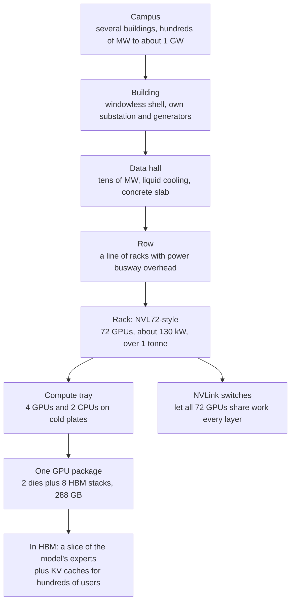
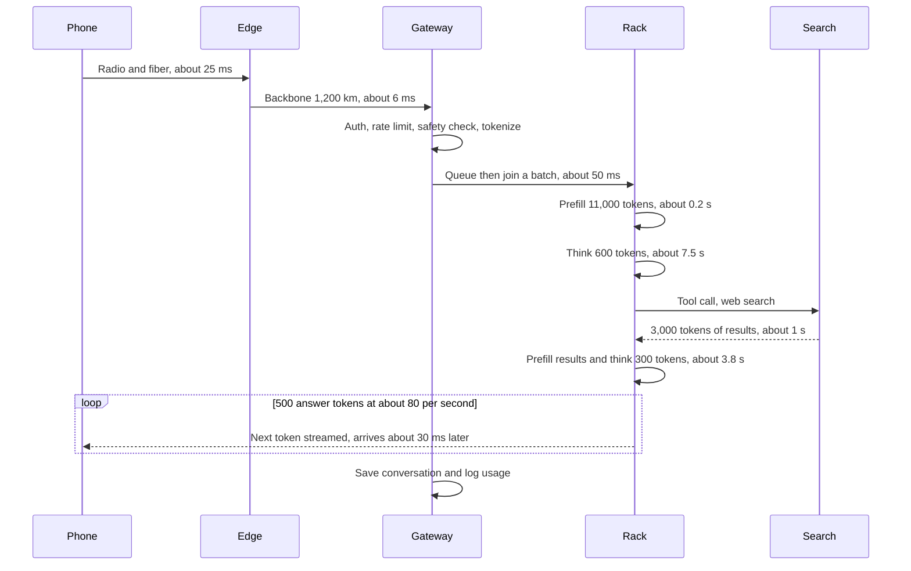
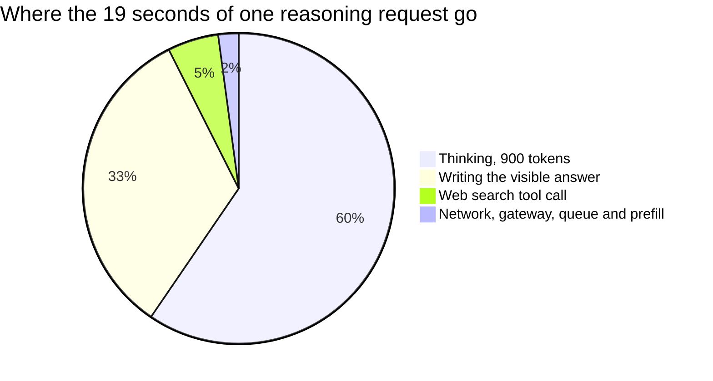
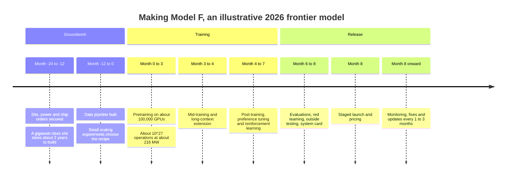
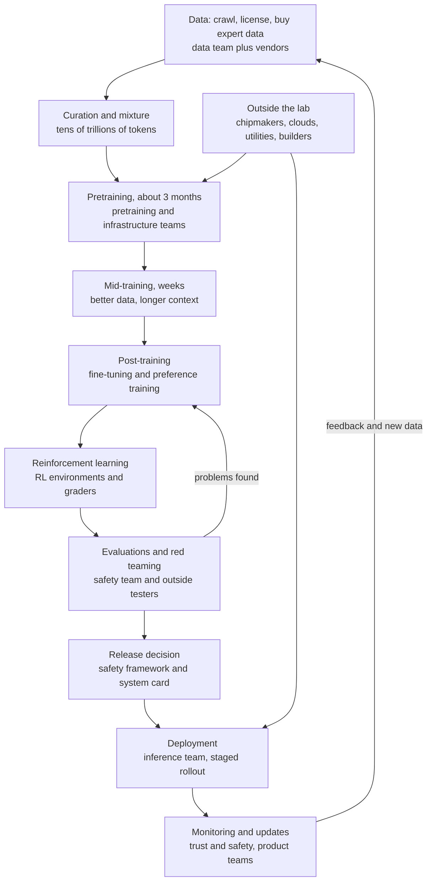

# Chapter 44: How It All Comes Together: The Life of a Prompt and the Making of a Frontier Model

*This chapter follows one question from your thumb to a GPU and back, and one model from raw web pages to your screen, with real milliseconds, watt-hours, cents, megawatts, months and dollars at every step, so you can finally see the whole machine at once.*

## What you'll learn

- How one chatbot request passes through about fifteen separate systems, and how long, how much energy and how much money each step costs
- Why a reasoning request with a pasted document costs many times more than a quick question, and exactly where those seconds, joules and fractions of a cent go
- How to estimate the energy and cost of any request from three numbers: tokens, rack power and rack throughput
- How a frontier model is made from start to finish, from collecting data to monitoring after launch, with a realistic timeline, cluster size, power draw, failure rate and budget
- Who does each step, inside the AI lab and outside it: chipmakers, cloud builders, utilities, electricians and data vendors
- The whole stack from sand to answer in one set of linked diagrams, with one number to remember for each layer
- The eight bottlenecks that decide how fast AI can grow (chips, memory, packaging, power, electrical equipment, data, talent and capital) and how they feed each other

## Before you start

This is the capstone of the first seven Parts of the book, so almost every earlier chapter helps, but none is strictly required: each idea gets a one-sentence recap and a pointer back. Chapter 4 (The Internet and the Cloud) gave a twelve-step tour of one chatbot message; here we go deeper at every step and attach numbers. Chapters 18 to 23 (how LLMs work, pretraining, post-training, reasoning models, multimodal models and inference) explain what happens inside the model. Chapters 32 to 37 (chips, memory, racks and networks, the chip industry, how chips are made, and training at scale) explain the hardware. Chapters 38 to 43 (data centers, power, cooling, energy, the buildout and the economics of compute) explain the buildings, the electricity and the money.

## Two clocks, one machine

Two things happen on two very different clocks every time you use a chatbot.

The fast clock is your request. You type a question, tap Send, and about a second later (or, for a hard question, ten or twenty seconds later) words start appearing. In that time your message crosses a city, maybe a continent, enters a building the size of several football fields, gets turned into numbers, is multiplied through about a trillion learned parameters stored on chips that each draw more power than a hair dryer, and comes back to you as text.

The slow clock is the model itself. The thing that answered you took one to two years to make. Before a single training step could run, someone had to buy land, win a grid connection, pour concrete, order hundreds of thousands of chips more than a year in advance, and assemble a team of hundreds. Then a cluster of around 100,000 accelerators ran for about three months, drawing the power of a mid-sized city, followed by months more of fine-tuning, reinforcement learning and safety testing.

The two clocks run on the same machine. The racks that serve your prompt today look like the racks that trained the model last year. The same electricity grid, the same chip factories in Taiwan, the same memory makers in Korea and the same bottlenecks shape both. That is why this chapter tells both stories in turn and then draws the single stack underneath them.

> **Definition — Full stack:** Every layer of technology needed to deliver a product, from raw materials and hardware at the bottom to the app you touch at the top. For AI it runs from sand and silicon through chips, buildings, power, data and models to your screen.

> **Key idea:** A chatbot answer is the visible tip of a very large physical system. Every quantity in this chapter (milliseconds, watt-hours, cents, megawatts, months, dollars) comes from somewhere in that system, and you can estimate most of them yourself with a few multiplications.

A word on honesty before the numbers start. Labs do not publish the size of their closed models, the exact hardware that served your request, or what each request cost them. So this chapter uses public anchors (published chip specs, company energy figures, open-weight model sizes, independent estimates from groups like Epoch AI) and fills the gaps with clearly labeled assumptions. Treat every figure here as "the right order of magnitude," good to within a factor of two or three, not as a measurement of any particular company.

## Journey 1: the life of one prompt

### The question and the model

Chapter 4 followed a simple 2,000-token chat. This time we pick a harder, more realistic request, because that is where the interesting costs hide.

You are in Denver on your phone, on a 5G connection. You open your chatbot, attach the PDF of a 12-page apartment lease, and type: "Summarize what I'm agreeing to, and tell me whether the late fee looks normal for my state." The chatbot has reasoning (thinking) on, and it has a web search tool.

Here is the token budget for this request. Token counts are rounded; a token is about three-quarters of an English word (Chapter 18).

| Piece of the context | Tokens | Notes |
|---|---|---|
| Hidden system prompt and tool descriptions | about 3,000 | Written by the app maker; the same for every user, so usually cached |
| Your lease (about 6,000 words) | about 8,000 | At about 1.3 tokens per word |
| Your question | about 30 | |
| Model's first round of thinking | about 600 | Generated, not shown in full |
| Search query the model writes | about 20 | A tool call |
| Search results added to the context | about 3,000 | Read by the model, not written by it |
| Model's second round of thinking | about 300 | |
| The visible answer | about 500 | About 375 words |
| **Total read (input)** | **about 14,000** | |
| **Total written (output)** | **about 1,400** | 900 thinking plus 500 visible |

*Table 44.1: The token budget of one realistic request. Notice that the model writes almost twice as many tokens in thinking as in the answer you see.*

> **Definition — System prompt:** Instructions the app maker places at the start of every conversation, usually hidden from you, that set the model's role, rules and available tools. In consumer chatbots it often runs to thousands of tokens.

> **Definition — Thinking tokens:** Tokens a reasoning model generates while working through a problem before its final answer. You usually see only a summary, but they take real time, energy and (on an API bill) money, because they are billed as output.

Now the model. We will pretend your chatbot is built like the largest open-weight models of 2026, because their shapes are public. DeepSeek-V4-Pro, for example, has about 1.6 trillion parameters in total but uses only about 49 billion of them for each token. We round to **1.6 trillion total and 50 billion active**. Stored mostly at 4 to 8 bits per parameter, as DeepSeek does, the weights take roughly 1 TB.

> **Definition — Mixture of experts (MoE):** A model design in which a small router sends each token to a few of many "expert" sub-networks, so the model can hold a huge number of parameters while doing the math of only a small fraction of them per token (Chapter 17).

Using the rule of thumb from Chapter 5, each token costs about 2 operations per active parameter: 2 × 50 billion = `10^11` floating-point operations per token. Our request handles about 15,400 tokens in all, so the whole request is roughly 15,400 × `10^11` ≈ `1.5 × 10^15` operations: one and a half quadrillion multiplications and additions to answer one question about a lease.

### Phase 1: from your thumb to the provider's front door (0 to about 35 ms)

**Packaging (a few milliseconds).** The app extracts the text from your PDF and wraps the whole conversation (lease, question, settings, your login token) into a JSON request of about 40 KB. It reuses an encrypted connection it already has open to the provider.

**Radio (roughly 10 to 30 ms).** Your phone sends the request as radio waves to the nearest cell tower, which hands it to your carrier's network. This first hop is often the slowest part of the whole network trip, because radio links schedule transmissions in small time slots and must handle interference. A typical good 5G or 4G connection adds something like 10 to 30 milliseconds; a weak signal adds much more.

> **Definition — Cell tower (base station):** The radio equipment that connects your phone to the mobile network. It converts your phone's radio signal into data on fiber or microwave links into the carrier's network.

**Fiber to the edge (about 5 ms).** From the carrier's network, packets travel over fiber to the AI provider's nearest point of presence, often in the same metro area. Light in glass covers about 200 km per millisecond, so a few dozen kilometers cost well under a millisecond; most of this time is spent passing through routers.

> **Definition — Point of presence (PoP):** A provider's network entrance in a city, where it accepts users' traffic, terminates encryption and passes requests onto its own private backbone. Big providers have hundreds around the world.

**The encryption handshake (0 or about 50 ms).** If your app had to open a fresh secure connection, it would spend one extra round trip agreeing on encryption keys. Because it reuses the connection, this step costs nothing today.

> **Definition — TLS handshake:** The opening exchange in which your device and a server agree on encryption keys and check the server's certificate, before any real data flows. Modern versions need about one round trip; reusing a connection skips it.

> **Definition — Round-trip time (RTT):** How long it takes a message to go from you to a server and back. It is the basic unit of network delay; a "ping" measures it.

**Backbone to the data center (about 6 ms).** The provider routes your request over its own fiber to a data center region that has capacity for your model. Say it is about 1,200 km of fiber away. At about 5 milliseconds per 1,000 km (Chapter 4), the trip takes about 6 ms one way. This is physics; no software can make it faster.

Running total: about 35 milliseconds, and nothing interesting has happened to your question yet.

### Phase 2: at the front door (about 35 to 120 ms)

**Load balancer (under 1 ms).** A load balancer picks a healthy cluster for your chosen model, steering around anything overloaded or under maintenance.

> **Definition — Load balancer:** A traffic director that spreads incoming requests across many servers and routes around failed ones, so no single machine is overwhelmed.

**API gateway (a few ms).** The gateway checks your account, your plan and your rate limit, and logs the request for billing and abuse monitoring.

> **Definition — API gateway:** The front-door service of an AI provider that checks logins or API keys, enforces rate limits and routes each request to the right back-end system before any expensive GPU work starts.

**Safety screening (milliseconds to tens of ms).** Many providers run small, fast classifier models over the input before the main model sees it, looking for clearly prohibited requests. Some also screen the output as it streams. Anthropic, for instance, runs classifiers around its Fable model that route flagged cyber, biology and chemistry requests to a more conservative model; the company says over 95% of Fable sessions see no such fallback (Chapter 56).

> **Definition — Safety classifier:** A smaller, separate model that scores inputs or outputs for risky content, so a request can be blocked, flagged or routed to a safer model. It runs alongside the main model, not inside it.

**Tokenizing (about 1 ms).** A tokenizer, a fixed and fast program running on an ordinary CPU, turns your 6,000-word lease into about 8,000 token IDs. This is cheap: tokenizers process megabytes of text per second.

> **Definition — Tokenizer:** The program that splits text into tokens and maps each to an ID number from the model's vocabulary, and reverses the process on the way out (Chapter 18).

**Queueing (0 to hundreds of ms).** A scheduler places your request into a batch on a group of GPUs already serving many other people. At a quiet moment you wait almost nothing; at peak load, you might wait a few hundred milliseconds. Say 50 ms today.

> **Definition — Scheduler (inference):** The software that decides which group of accelerators handles each incoming request and when, packing requests into batches to keep the hardware busy while meeting speed targets.

### Phase 3: where your prompt physically lands

Your request now reaches real hardware, and it is worth pausing to see where.

The provider's fleet of serving machines for your model is spread over several campuses. Your request lands on one rack in one of them: a liquid-cooled, rack-scale system in the style of NVIDIA's GB300 NVL72, holding 72 GPUs linked into one fast domain. The rack stands on a concrete slab (it weighs well over a tonne, too heavy for old raised floors), in a row of similar racks, in a data hall of tens of megawatts, in a windowless building on a campus with its own substation.

> **Definition — Inference fleet:** All the accelerators a provider dedicates to serving a model to users, often thousands of racks spread over several data centers, each running its own copy (replica) of the model.



*Figure 44.1: Where your prompt physically lands, from campus down to the memory chips that hold a slice of the model. Numbers are typical of 2025–26 NVL72-class deployments.*

Why a whole rack? Because the model's 1 TB of weights is too big for one GPU's 288 GB of fast memory, and because spreading the experts across 72 GPUs lets each GPU hold a slice. Every layer of the model, each token's data hops across the rack's NVLink switches to whichever GPUs hold the experts it was routed to, then comes back. This is called expert parallelism (Chapter 37), and it only works because the links inside the rack are fast: about 1.8 TB/s per GPU on Blackwell-generation hardware.

> **Definition — Expert parallelism:** Placing different experts of a mixture-of-experts model on different chips and sending each token to the chips holding its chosen experts. It needs very fast links, so it usually stays inside one rack-scale domain.

> **Definition — HBM (High Bandwidth Memory):** Stacks of memory chips placed right beside an AI accelerator on the same package, holding the model's weights and working data and delivering terabytes per second (Chapter 33).

The rack draws about 130 kilowatts, roughly the average draw of 100 American homes, from overhead busway. Coolant flows through metal cold plates on every chip and carries the heat to a coolant distribution unit at the end of the row, then to the building's water loop and finally to dry coolers or cooling towers outside (Chapter 40). On a modern AI campus, the cooling and power-conversion overhead adds roughly 10 to 20% on top of the IT power.

> **Definition — PUE (power usage effectiveness):** Total facility energy divided by the energy used by the computing equipment. A PUE of 1.2 means 20% overhead for cooling and power losses; leading AI sites run about 1.1 to 1.2, and the industry average is around 1.5.

### Phase 4: prefill (about 0.2 s)

The model first reads everything: system prompt, lease and question, about 11,000 tokens. This phase is called prefill, and it is the opposite of what happens next. All 11,000 tokens are processed in parallel, so the chips' arithmetic units stay busy: prefill is limited by math, not by memory.

> **Definition — Prefill:** The first phase of answering, in which the model reads the whole prompt at once, in parallel, building its internal notes for every token. Its length mostly sets the wait before anything appears.

The math: 11,000 tokens × `10^11` operations ≈ `1.1 × 10^15` operations. Suppose the slice of the rack working on your prefill delivers an effective `10^16` operations per second (10 petaFLOPS, a modest fraction of the rack's peak, because it is shared with other people's requests). Then prefill takes `1.1 × 10^15 ÷ 10^16` ≈ 0.11 seconds. Add attention's extra work and overheads and call it 0.2 seconds.

There is a discount hiding here. The 3,000-token system prompt is identical for every user, so the provider keeps its computed notes in memory and skips recomputing them. That is prompt caching (Chapter 23), and it is why API prices for cached input are a small fraction of the normal input price.

> **Definition — Prompt caching:** Reusing the stored intermediate results for a prompt prefix that was processed recently (such as a long system prompt or a document you already sent), so it does not have to be recomputed. It cuts both time and cost.

As prefill runs, the model writes its notes on every token into the KV cache in HBM. How big is it? Models with compact attention designs like DeepSeek's multi-head latent attention need about 0.07 MB per token (Chapter 23). For our final 15,400 tokens: 15,400 × 0.07 MB ≈ 1.1 GB. A model with an older attention design, like Llama 3 70B, would need about 0.33 MB per token, or about 5 GB for the same conversation. Either way, your conversation occupies a gigabyte or more of the world's scarcest memory for as long as it is active.

> **Definition — KV cache:** Stored intermediate results (keys and values) for every token the model has read or written in a conversation, so it never recomputes them. It grows with conversation length and competes with the model's weights for GPU memory.

### Phase 5: thinking, a tool call, and more thinking (about 0.4 to 12.7 s)

Now the model writes, one token at a time. This phase is called decode, and it is limited by memory and communication rather than by math. For every new token, each layer must fetch the right experts' weights from HBM, exchange data across the rack, and append a new entry to the KV cache. A frontier model has dozens of layers, so each token is a long chain of small, dependent steps.

> **Definition — Decode:** The phase in which the model generates its output one token at a time, each token depending on all earlier ones. Its speed is limited mostly by memory bandwidth and chip-to-chip communication, not arithmetic.

How fast does it go for you? Frontier chatbots typically stream somewhere between tens and a hundred-odd tokens per second per user. Providers choose this speed deliberately: running bigger batches makes each user slower but spreads the rack's cost over more people (Chapter 23). Assume 80 tokens per second, or 12.5 milliseconds per token.

- **First round of thinking: about 600 tokens ≈ 7.5 seconds.** Your app shows "Thinking..." The model works out what kind of document this is, which clauses matter, and that it needs current information about late-fee rules.
- **Tool call: about 1 second.** The model writes a 20-token search query in a special format. The serving software pauses generation, sends the query to a search service, and waits. Results come back as about 3,000 tokens of text.

> **Definition — Tool call:** A structured request the model writes (for example, "search for X") that the surrounding software executes on its behalf, feeding the result back into the model's context. The model only asks; the software acts (Chapter 28).

- **Prefill of the search results: about 0.05 seconds.** The 3,000 new tokens are read in parallel. The earlier 11,600 tokens are already in the KV cache, so they are not reprocessed.
- **Second round of thinking: about 300 tokens ≈ 3.75 seconds.** The model reconciles the lease clause with what it found.

### Phase 6: the answer streams back (about 12.7 to 19 s)

The first visible word leaves the GPU at about 12.7 seconds and reaches your phone about 30 milliseconds later. Each subsequent token is converted back into text and pushed down the open connection as a tiny message, a few bytes at a time.

> **Definition — Streaming (server-sent events):** Sending a response piece by piece over a connection that stays open, so text appears as it is generated instead of all at the end.

> **Definition — Time to first token (TTFT):** The delay between sending a request and seeing the first word of the answer. For a quick question it is usually under a second; with reasoning and tools it can be many seconds.

The 500-token answer at 80 tokens per second takes about 6.25 seconds to finish. You are reading it as it arrives, so it does not feel like waiting. At about 19 seconds the answer is complete.



*Figure 44.2: The life of one prompt, with typical times at each step. Everything before the "Think" step takes about a third of a second; the rest is the model reasoning and writing.*

### Phase 7: after the answer

When the stream ends, several quiet things happen. The conversation is written to databases (replicated across machines so it survives failures) and appears on your other devices. Usage is logged against your plan or API bill. Abuse-monitoring systems may sample it. Your KV cache is kept for a few minutes in case you reply, then freed for other users. Whether your conversation can be used to train future models depends on the provider and your settings (Chapter 58).

> **Try it:** Ask your chatbot a question that needs both a document and a search, with thinking on. Use your phone's stopwatch to record three times: when "Thinking" starts, when the first word of the answer appears, and when the answer ends. Then ask a one-line factual question with thinking off and time it the same way. Your two timelines will look like the two rows of Figure 44.3.

### The time budget

```
Reasoning request with a web search, about 19 s in all
(each character is 0.4 seconds)

seconds      0    2    4    6    8    10   12   14   16   18   20
             |----|----|----|----|----|----|----|----|----|----|
setup 0.35s  #
think 7.5s    ###################
search 1s                        ###
think 3.75s                         #########
answer 6.25s                                 ################

Quick question with thinking off, about 4 s in all
setup 0.5s   #
answer 3.5s   #########
```

*Figure 44.3: A reasoning request with a tool call spends almost all its time generating tokens. A quick question with thinking off is dominated by the network and prefill, and finishes in a few seconds.*



*Figure 44.4: The same request as a pie. The network, which people often blame for slowness, is about 2% of the time.*

> **Key idea:** For quick questions, the wait is mostly network and prefill, well under a second. For hard questions, the wait is almost entirely the model writing tokens, including thinking tokens you never see in full. When a chatbot feels slow, it is usually thinking, not traveling.

### The energy budget

Now the energy. We can estimate it from three numbers.

1. **Rack power at the wall.** The rack draws about 130 kW for its IT equipment. At a PUE of 1.2, the building draws 130 × 1.2 = **156 kW** for it.
2. **Rack decode throughput.** How many output tokens does the whole rack produce per second, across all the users batched on it? Microsoft has said one of its 72-GPU racks in its Fairwater data center can produce about 865,000 tokens per second, but it did not say for which model. For a big reasoning model with 50 billion active parameters we will assume a more cautious **100,000 output tokens per second** per rack. At 80 tokens per second each, that means about 1,250 people decoding on the rack at once.
3. **Rack prefill throughput.** Reading is about ten times cheaper per token than writing on this kind of hardware. Assume **1,000,000 input tokens per second** per rack. (Check: 1,000,000 × `10^11` = `10^17` operations per second, a reasonable fraction of the rack's peak 8-bit math.)

> **Definition — Joule:** The basic unit of energy, about the energy needed to lift an apple one meter. One watt is one joule per second, and 3,600 joules make one watt-hour.

> **Definition — Watt-hour (Wh):** An amount of energy: one watt for one hour, or 3,600 joules. A 10-watt LED bulb uses 10 Wh in an hour. Electric bills use kilowatt-hours (1,000 Wh).

Energy per token is power divided by throughput:

- Per output token: 156,000 joules per second ÷ 100,000 tokens per second = **1.56 joules**.
- Per input token: 156,000 ÷ 1,000,000 = **0.156 joules**.

Our request:

- Input: 14,000 tokens × 0.156 J ≈ 2,180 J.
- Output: 1,400 tokens × 1.56 J ≈ 2,180 J.
- Total: about 4,370 J ÷ 3,600 ≈ **1.2 watt-hours**.

Another way to see it: your request occupied the whole rack for 14,000 ÷ 1,000,000 + 1,400 ÷ 100,000 = 0.014 + 0.014 = **0.028 rack-seconds**, spread across 19 seconds and shared with over a thousand other people. A rack at 156 kW for 0.028 seconds uses 156,000 × 0.028 ≈ 4,370 joules. Same answer.

How does 1.2 Wh compare with published figures? Google reported that its median Gemini Apps text prompt in May 2025 used 0.24 Wh (including idle machines and building overhead, and not independently verified). OpenAI's chief executive said an average ChatGPT query used about 0.34 Wh. Epoch AI estimated about 0.3 Wh for a typical query, but about 2.5 Wh with 10,000 input tokens on 2025 hardware. Our request has a long document, a search and reasoning, so landing at about four times a typical short prompt is about right.

What does 1.2 Wh feel like? A 10-watt LED bulb uses it in about 7 minutes. A smartphone battery holds roughly 15 Wh, so the request used about one-twelfth of a phone charge. The network's share (tens of kilobytes over fiber and radio) is tiny by comparison. If on-site water use scales with energy, Google's 0.26 mL per median prompt suggests roughly 1.3 mL for ours, about a quarter of a teaspoon.

> **Watch out:** "A chatbot answer uses X watt-hours" is not one number. Energy scales with tokens, so a long document, a long thinking trace or an agent that runs for an hour can cost ten to a thousand times a short chat. Published per-prompt figures are medians or averages for short text prompts, mostly self-reported, and they measure slightly different things.

### The money budget

The same 0.028 rack-seconds turn into money just as easily.

> **Definition — GPU-hour:** One GPU used for one hour, the basic unit of AI cloud pricing. In October 2026, on-demand list prices at GPU clouds ran from about $3–4 per hour for an H100 to about $6–9 for Blackwell-generation GPUs; large reserved contracts are cheaper and not public.

Assume the provider's all-in cost (hardware depreciation, power, building, network, staff) works out to **$5 per GPU-hour**. A 72-GPU rack then costs 72 × $5 = $360 per hour, or **$0.10 per second**.

- Cost per million output tokens: $0.10 ÷ 100,000 tokens × 1,000,000 = **$1.00**.
- Cost per million input tokens: $0.10 ÷ 1,000,000 × 1,000,000 = **$0.10**.
- Our request: 0.028 rack-seconds × $0.10 = **$0.0028, about 0.28 cents**, if the rack is busy 100% of the time.

> **Definition — Utilization:** The share of time hardware is doing paid or useful work. Fleets are sized for peak demand, so average utilization is well below 100%, and the cost of idle time is spread over the work that does get done.

At a more realistic 50% average utilization, the cost doubles to about 0.56 cents. Of that, the electricity alone is 1.2 Wh = 0.0012 kWh × $0.08 per kWh (an assumed industrial rate) ≈ $0.0001, a hundredth of a cent. Electricity is only a few percent of the cost of serving AI; the chips are most of it.

Now compare with what the provider charges. At Claude Opus 5.5's list price in October 2026 ($4 per million input tokens and $20 per million output tokens), our request would cost an API customer 14,000 × $4 ÷ 1,000,000 + 1,400 × $20 ÷ 1,000,000 = $0.056 + $0.028 = **$0.084, about 8 cents**, a bit less with prompt caching on the system prompt, plus a small fee for the search. At Sonnet 5.5's $2 and $10 it would be about 4 cents; at Haiku 5.5's $0.10 and $0.50, about 0.2 cents.

> **Definition — Cost per million tokens:** The standard unit of AI inference pricing and cost: what it costs to read (input) or write (output) a million tokens. Output usually costs four to five times more than input, mirroring the hardware gap between decode and prefill.

The gap between roughly half a cent of compute and 8 cents of list price is not pure profit. It pays for idle hardware at night, free users, the training runs that made the model (Journey 2), research that did not pan out, safety work, staff and a margin. The section "The same numbers from both directions," later in this chapter, puts a rough figure on the training share.

| Request type | Input tokens | Output tokens | Energy (our model) | Compute cost at 100% use | List price at Opus 5.5 rates |
|---|---|---|---|---|---|
| Quick question, no thinking | 3,200 (3,000 cached system prompt) | 300 | about 0.27 Wh | about 0.06 cents | about 2 cents (less with caching) |
| Our lease request | 14,000 | 1,400 | about 1.2 Wh | about 0.28 cents | about 8 cents |
| Summarize a 100,000-token report | 100,000 | 1,000 | about 5 Wh or more | about 1.1 cents | about 42 cents |
| One hour of a coding agent | about 2,000,000, mostly cached | about 60,000 | tens of Wh | tens of cents | about $9 without caching, much less with it |

*Table 44.2: How energy and cost scale with the kind of request, using this chapter's assumed rack (156 kW, 100,000 output and 1,000,000 input tokens per second, $5 per GPU-hour). Treat these as orders of magnitude.*

Two cautions about the table. First, our simple model charges every input token the same, but attention's work grows faster than the input at very long lengths; Epoch AI's 2025 estimate for a 100,000-token input was about 40 Wh on that era's hardware and attention designs. Newer designs shrink this a lot (DeepSeek says its V4 attention needs 27% of the per-token compute and 10% of the KV cache of its previous version at a million tokens), but long inputs remain the most uncertain row. Second, the quick-question row lands at about 0.27 Wh, right in the 0.24–0.34 Wh range that Google, OpenAI and Epoch published, which is a useful sanity check on the assumptions.

> **At the frontier (2026):** Serving hardware is splitting by phase. NVIDIA pairs Vera Rubin racks, which hold the big KV caches, with Groq-based LPX racks (256 chips each with about 500 MB of very fast on-chip memory) aimed at fast token generation; Google split its eighth TPU generation into TPU 8t for training and TPU 8i for inference, with 384 MB of on-chip memory. The goal is the same as this section's arithmetic: more tokens per second per user and per megawatt, so the cents and watt-hours per request keep falling.

## Journey 2: the making of a frontier model

### Model F: a composite with public anchors

The model that answered your lease question did not exist two years earlier. To follow how such a model is made, we invent "Model F," a composite 2026 frontier model. Its numbers come from public anchors wherever possible: Epoch AI's estimate of OpenAI's GPT-6 Astra run (about 100,000 GB200 GPUs for about 90 days, roughly `9.4 × 10^26` operations), Meta's detailed Llama 3 paper, DeepSeek's technical reports, and the data center and energy figures from Part VII. Where no public number exists, the chapter says so and uses a labeled assumption.

> **Definition — Frontier model:** One of the most capable AI models in existence at a given time, typically trained by a handful of labs on the largest clusters. In late 2026 that includes Claude Opus 5.5, GPT-6 Astra and Gemini 4 Argon, with open-weight models a few months behind.



*Figure 44.5: An illustrative timeline for one frontier model. Real labs overlap these stages and run several models through the pipeline at once, so the boundaries blur.*

### Step 0: the ground under the model (one to two years before training)

The first step is not about AI at all. It is about land, electricity, steel and chips.

A training cluster of 100,000 Blackwell-class GPUs needs about 1,390 NVL72-style racks (100,000 ÷ 72). At about 1.8 kW per GPU slot, counting each GPU's share of CPUs, switches and pumps (Chapter 34), that is about 180 MW of IT load, and about 216 MW from the grid at a PUE of 1.2. Epoch AI estimates that a gigawatt-scale AI site takes about two years to build and costs about $38 billion of up-front capital per gigawatt of IT power. Scaled to 180 MW, that is roughly $7 billion.

You can rebuild that figure from parts. The building and its electrical and mechanical systems cost roughly $11–18 million per MW in 2025–26 (JLL and Cushman & Wakefield), so 180 MW × $11–18 million ≈ $2–3.2 billion. The racks themselves have reportedly sold for about $3–4 million each, so 1,390 × $3–4 million ≈ $4–5.6 billion. Total: about $6–9 billion, consistent with Epoch's estimate. The chips are the biggest slice.

Almost none of this work is done by the AI lab. A hyperscaler or a neocloud usually develops or leases the site; construction firms, electricians and pipefitters build it; a utility (or on-site gas turbines, at some 2025–26 megaprojects) supplies the power. NVIDIA designs the GPUs, TSMC manufactures them in Taiwan, SK hynix, Samsung and Micron make the HBM, and contract manufacturers such as Foxconn and Quanta assemble the racks (Chapters 35, 36 and 42). Chip orders are placed more than a year ahead, because packaging and memory capacity are booked out.

Meanwhile, inside the lab, researchers train dozens to hundreds of small "proxy" models to choose the architecture, the data mixture and the hyperparameters. They fit scaling laws to those small runs to predict how the big one will turn out (Chapter 19). This research, and the runs that fail or get abandoned, consume a large share of a lab's total compute.

### Step 1: data (months, and never really finished)

Pretraining data comes from web crawls such as Common Crawl, code repositories, books, scientific papers, licensed news and reference sources, transcribed audio and video, and increasingly synthetic data written by earlier models. Raw crawl is measured in petabytes, and most of it is thrown away by the curation pipeline: text extraction, language identification, exact and fuzzy deduplication, rule-based and model-based quality filters, removal of personal data and toxic content, removal of benchmark questions, and respect for opt-outs (Chapter 19).

> **Definition — Data curation:** Cleaning, filtering, deduplicating and balancing raw data before training. For pretraining it typically discards most of the raw web crawl and keeps the highest-quality fraction.

Published pretraining runs used about 15.6 trillion tokens (Llama 3, 2024), more than 30 trillion (Llama 4, 2025), about 36 trillion (Qwen3, 2025) and about 33 trillion (DeepSeek-V4-Pro, 2026). Stored as plain text at about 4 bytes per token, 30 trillion tokens is about 120 TB, which fits on a few dozen large hard drives. The data is small; reading it is what costs.

Here is a puzzle worth working through. The 6ND rule says training compute ≈ 6 × N × D, where N is the number of active parameters and D the number of training tokens (Chapter 19). If Model F's run is about `10^27` operations, then N × D ≈ `10^27 ÷ 6` ≈ `1.7 × 10^26`. Labs do not publish N and D for runs like this, but try two guesses: with 500 billion active parameters, D ≈ 330 trillion tokens; with 1 trillion active, D ≈ 170 trillion. Either way it is several times the 15–36 trillion tokens of the published runs, and in the neighborhood of Epoch AI's 2024 estimate that only about 300 trillion tokens of high-quality public human text exist (Chapter 11). That is why frontier labs now train on images, audio and video tokens, repeat their best data, generate synthetic data and lean ever harder on reinforcement learning, which creates its own training data.

> **Definition — 6ND rule:** A rule of thumb that training a Transformer takes about 6 × N × D floating-point operations, where N is the number of active parameters and D the number of training tokens.

The data team also buys human expertise. Data vendors such as Scale AI, Surge and Mercor recruit doctors, lawyers, programmers and scientists to write and grade examples for the later training stages (Chapter 11 and Chapter 20).

### Step 2: the pretraining run (about three months)

Now the big run. Model F's 100,000 GPUs train as one machine for about 90 days, splitting the work by data, by pieces of each matrix, by layers and by experts (Chapter 37).

> **Definition — Pretraining:** The first and largest training phase, in which a model learns to predict the next token across trillions of tokens of text and other data. It produces a "base model" that knows a great deal but does not yet behave like an assistant.

| Quantity | Model F (illustrative) | How we got it |
|---|---|---|
| Accelerators | 100,000 GB200-class GPUs | Epoch AI's assumption for GPT-6 Astra |
| Racks | about 1,390 | 100,000 ÷ 72 |
| Duration | about 90 days (2,160 hours) | Epoch AI's assumption |
| GPU-hours | 216 million | 100,000 × 2,160 |
| Training compute | about `10^27` operations | 100,000 GPUs × 7.8 million seconds × about `1.2 × 10^15` operations per second each |
| Share of peak used | about 25% of 8-bit peak | Epoch AI's assumption |
| IT power | about 180 MW | about 1.8 kW per GPU slot |
| Power from the grid | about 216 MW | PUE of 1.2 |
| Energy | about 470 GWh (0.47 TWh) | 216 MW × 2,160 hours |
| Household equivalent | about 44,000 US homes for a year | at about 10,500 kWh per home per year |
| Electricity bill | about $37 million | at an assumed 8 cents per kWh |
| Compute value at rental prices | about $0.4–1.1 billion | 216 million GPU-hours × $2–5 |
| Hardware and buildings | about $6–9 billion | rebuilt from parts in Step 0 |
| Unexpected interruptions | about 4,000 or more | Llama 3's failure rate scaled up, below |

*Table 44.3: The budget of one illustrative frontier pretraining run. Compare the electricity bill (tens of millions) with the hardware (billions): power is a small share of cost but a hard limit on where and when you can build.*

> **Definition — MFU (Model FLOPs Utilization):** The fraction of the hardware's peak arithmetic speed actually used for the model's necessary math. Large training runs typically reach about 25 to 50%, depending on the number format and how hard the scaling is.

**Things break, constantly.** Meta's Llama 3 paper is the best public record: on 16,384 H100 GPUs, its team saw 419 unexpected interruptions in 54 days, about 78% of them hardware faults. That is 419 ÷ (16,384 × 54) ≈ 0.00047 interruptions per GPU per day. Scale it to 100,000 GPUs: about 47 per day, or one every half hour. Over 90 days, more than 4,000.

```
One day of a 100,000-GPU training run (illustrative)
Each digit is one hour: the number of unexpected interruptions

hour   0   4   8   12  16  20  24
       |---|---|---|---|---|---|
       212322202321314203122232

About 47 a day. If each costs the whole cluster 10 minutes,
47 x 10 = 470 minutes, about a third of every day, is lost.
If each costs 2 minutes, the loss falls to about 6.5%.
```

*Figure 44.6: Failure arithmetic at frontier scale. Fast recovery, not perfect hardware, is what keeps a run alive.*

That arithmetic is why reliability engineering is a frontier skill. Teams save checkpoints frequently and in the background, keep hot spare GPUs ready to swap in, detect a failing chip before it crashes the job, and restart in minutes. A checkpoint is big: training state takes about 16 bytes per parameter (Chapter 33), so every trillion parameters means about 16 TB to save. Meta kept effective training time above 90% on Llama 3, and its paper also notes that thousands of GPUs speeding up and slowing down together made the cluster's power draw swing by tens of megawatts, enough to worry the local grid (Chapter 39).

> **Definition — Checkpoint:** A saved snapshot of a model's weights and training state, so a run can resume from that point after a failure instead of starting over.

> **Definition — Goodput:** The share of a cluster's time that produces useful training progress, after subtracting time lost to failures, restarts, recomputation and waiting.

While the run goes, engineers watch the loss curve around the clock. A sudden loss spike may mean a bad batch of data or a numerical overflow; the fix is usually to roll back to a checkpoint, skip the offending data and continue. Data center technicians walk the halls swapping failed GPUs, cables and optical transceivers. The lab's infrastructure team, the cloud operator's site staff and the pretraining researchers are one team for those three months.

> **At the frontier (2026):** OpenAI described GPT-6 Astra, released in September 2026, as its largest training run "by far" and its first pretraining run on more than 100,000 GPUs, at the Stargate site in Abilene, Texas. Microsoft links its Fairwater AI data centers in Wisconsin and Atlanta over an "AI WAN" so they can work as one system, and Google says its TPU 8t training fabric and software can scale past a million chips in one cluster. The frontier is moving from "one building" to "several campuses acting as one computer."

### Step 3: mid-training (weeks)

Late in pretraining, or just after, the lab switches to a smaller, higher-quality mixture: more math, code, reasoning examples and long documents, while lowering the learning rate toward zero (annealing). This is also when the context window is stretched, for example to the 1-million-token windows that the top models offer in late 2026. Mid-training uses a small share of the total compute but has an outsized effect on how good the base model is at the skills the lab cares about.

> **Definition — Mid-training:** An intermediate stage between bulk pretraining and post-training that uses curated, high-quality, long-context or reasoning-heavy data, usually while the learning rate is lowered.

### Step 4: post-training and reinforcement learning (about two to four months)

The base model can continue any document but does not reliably follow instructions. Post-training turns it into an assistant (Chapters 20 and 21).

> **Definition — Post-training:** Everything done after pretraining to turn a base model into a useful, safe product: supervised fine-tuning, preference training, reinforcement learning and safety training.

- **Supervised fine-tuning.** The model trains on curated examples of ideal responses, many written or checked by paid experts.
- **Preference training.** People or AI judges compare pairs of answers; the model learns to prefer the better ones, through RLHF, DPO or AI feedback guided by a written constitution.
- **Reinforcement learning with verifiable rewards.** The model attempts tens of thousands of tasks in sandboxes (math problems with checkable answers, code repositories with unit tests, browsers, terminals, spreadsheets) and is rewarded when it succeeds. This is what teaches it to think at length, and it is the stage that has grown fastest since 2024.
- **Safety training.** Calibrating refusals, training on the lab's model specification, and adversarial examples.

> **Definition — RLVR (reinforcement learning with verifiable rewards):** Training a model by trial and error on tasks whose answers a program can check automatically, such as math problems or code with tests, rewarding attempts that pass.

> **Definition — RL environment:** A sandbox with tasks, tools and an automatic grader (for example a code repository with tests, or a simulated website) used to train models by trial and error. Building them became an industry in 2025–26.

How much does this stage cost? Labs rarely say. One public data point is small: DeepSeek reported that the reasoning-RL stage of its R1 model cost about $294,000 (published September 2025). Frontier labs' RL budgets in 2026 are not published but are widely understood to be far larger, because RL now runs on very large clusters for weeks: every attempt requires the model to generate thousands of tokens, which is inference, so RL inherits all the decode economics of Journey 1.

Post-training also produces the smaller siblings. A big model can teach smaller ones by distillation, which is how one training effort yields a whole price ladder: OpenAI described its GPT-6 Sol and Luna models as cheaper tiers built on Astra's advances, priced 50% below their predecessors, and Alibaba says its Qwen3.8-27B is distilled from Qwen3.8-Max. The model that answered your lease question may well be one of those siblings rather than the giant itself.

> **Definition — Distillation:** Training a smaller "student" model to imitate a larger "teacher" model's outputs or probabilities, producing a cheaper, faster model that keeps much of the teacher's ability.

### Step 5: evaluations and safety testing (one to three months, overlapping)

Before release, the model is tested from every angle (Chapters 24 and 57). Capability benchmarks measure knowledge, coding, agentic tasks and reasoning; private internal evaluations measure what the lab really cares about. Dangerous-capability evaluations check whether the model could meaningfully help someone build biological or chemical weapons, carry out cyberattacks, or act autonomously in risky ways, including speeding up AI research itself. Internal and external red teams attack it. Government institutes such as the UK AI Security Institute and the US Center for AI Standards and Innovation (CAISI), and independent evaluators such as METR and Apollo Research, may get pre-release access.

> **Definition — Red teaming:** Deliberately attacking a model, with clever prompts, tools and scenarios, to find harmful or unsafe behaviors before release.

> **Definition — Dangerous-capability evaluation:** A test of whether a model could give meaningful help with severe harms (such as biological weapons or cyberattacks) or act autonomously in risky ways, used to decide which safeguards a release needs.

The results feed a release decision under the lab's safety framework (Chapter 56), and a system card that documents them. Two 2026 examples: METR's evaluation of Claude Opus 5.5 called it an incremental improvement over Fable 5.1 and "unlikely to be able to fully automate AI R&D," while citing a preliminary Anthropic-internal estimate of about 1.5× overall research acceleration; OpenAI's deployment note treats GPT-6 Sol and Luna as "High" capability in cybersecurity and in biology and chemistry under its Preparedness Framework, with matching safeguards. Testing takes real time. When OpenAI released GPT-4 in March 2023, it said it had spent six months making the model safer before launch.

> **Definition — System card:** A document a lab publishes with a model describing its training, evaluations, safety testing, known limitations and the safeguards chosen for its release.

Increasingly the answer is not simply "ship" or "don't ship" but "ship in tiers." Anthropic's Fable 5 and Mythos 5 are the same underlying model with different safeguards: Fable is public, with classifiers that route flagged requests to an earlier model, while Mythos is reserved for vetted partners such as cyber defenders.

### Step 6: deployment (days to weeks)

Deployment copies the final weights (a file of roughly a terabyte or more) onto thousands of racks across several campuses, loads them into memory and runs load tests. Traffic shifts gradually: a small percentage of users first, then more as dashboards stay green. Prices, rate limits, documentation and app features launch together. In late 2026, Anthropic's Opus 5.5 lists at $4 and $20 per million input and output tokens with a 1-million-token context window; OpenAI's GPT-6 Astra lists at $10 and $50 with a context of 1,050,000 tokens.

> **Definition — Staged rollout:** Releasing a new model or feature to a small fraction of users first and widening access as monitoring confirms it behaves well, so problems hit few people and can be rolled back.

### Step 7: monitoring and updates (the rest of the model's life)

Launch is the start of a new job. Trust-and-safety teams watch for abuse; classifiers are retuned; usage data and user feedback (subject to privacy settings) shape the next model. Sometimes a launch must be partly undone: in April 2025 OpenAI rolled back an update to GPT-4o that had made it excessively flattering. Labs also defend the model against copying: in February 2026 Anthropic reported detecting about 24,000 fraudulent accounts that had generated over 16 million exchanges in an attempt to distill its models. And updates come quickly. Anthropic shipped Claude Opus 4.6, 4.7, 4.8, 5 and 5.5 between February and September 2026, roughly one every one to two months, each a new trip through some or all of the pipeline.



*Figure 44.7: The frontier-model pipeline as a loop, with who does each step. The outside world supplies the machines for both training and serving.*

| Stage | Inside the lab | Outside the lab | Typical duration | One number to remember |
|---|---|---|---|---|
| Groundwork | compute strategy, finance | cloud builders, utilities, chipmakers, construction trades | 1–2+ years | about $38 billion per GW of IT (Epoch AI) |
| Data | data team | crawlers, publishers, data vendors | months, ongoing | 15–36 trillion tokens in published runs |
| Pretraining | pretraining and infrastructure teams | data center operators | about 3 months | about `10^27` operations at about 216 MW |
| Mid-training | pretraining team | | weeks | context stretched to about 1M tokens |
| Post-training and RL | post-training, RL and reasoning teams | expert contractors, RL-environment startups | 2–4 months | DeepSeek R1's RL stage: about $294,000 (an early, small example) |
| Evaluations and safety | safety, evals, interpretability teams | government institutes, METR, Apollo Research | 1–3 months, overlapping | GPT-4: six months of safety work (2023) |
| Deployment | inference and product teams | cloud partners | days to weeks | $4 / $20 per million tokens (Opus 5.5) |
| Monitoring and updates | trust and safety, product | users, outside researchers | the model's life | a new flagship every 1–2 months (Anthropic, 2026) |

*Table 44.4: Who does what in the making of a frontier model. Most of the people involved never work for an AI lab.*

## The same numbers from both directions

The two journeys meet in three calculations.

**Training cost per token served.** Suppose Model F's final run cost about $0.75 billion at rental-equivalent prices (the middle of our range), and the whole program (experiments, failed runs, post-training, data, people) cost about four times that, $3 billion. Outside analysts describe total program cost as several times the final run; four times is our assumption. Now suppose the model family serves about 5.5 trillion tokens a day for six months, about `10^15` tokens. Then training adds $3 billion ÷ `10^15` = $3 per million tokens served. Serve ten times fewer tokens and it is $30 per million; ten times more and it is $0.30. Training is a fixed cost that becomes cheap per token only at enormous volume, which is why labs fight for usage, distill cheap tiers, and cut prices as usage grows.

**Energy: training versus serving.** Model F's pretraining used about 470 GWh. If its family then served a billion lease-sized requests a day at about 1.2 Wh each, serving would use 1.2 GWh per day and would match the whole pretraining run in about 390 days. At a billion short 0.3 Wh prompts per day, it would take about four years. Either way, over a model's life, inference energy catches up with training, which is why the industry expects inference to become the larger share of AI computing (JLL projects it overtaking training around 2027).

**Fleet size.** Our request used 0.028 rack-seconds, so one rack can serve about 86,400 ÷ 0.028 ≈ 3.1 million such requests per day at full use. A billion a day needs about 320 racks at 100% utilization, or about 640 at a more realistic 50%. At 156 kW each, 640 racks draw about 100 MW. Serving one popular model is a data-hall-sized job, roughly half the power of the cluster that trained it, running every day for the life of the model.

> **Key idea:** Training is a huge fixed cost paid once; serving is a smaller cost paid on every token forever. The business only works when a model is used enough to spread the first over the second, which is why both clocks matter to everything from pricing to power plants.

