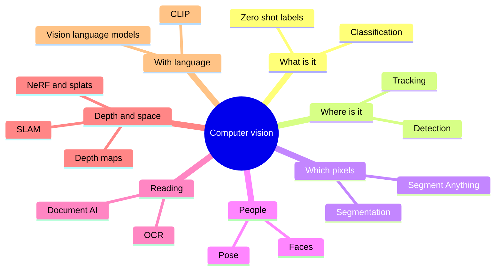
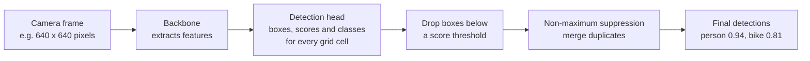
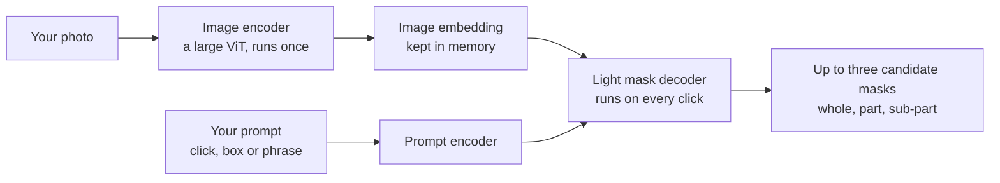

# Chapter 45: Computer Vision

*How machines turn grids of numbers into "a dog on a sofa", "a crack in this weld" or "this is your face", what each vision task really does, where it earns money, how it fails and who it can hurt.*

## What you'll learn

- Why seeing is hard for a computer even though it feels effortless to you, and what a photo looks like from the machine's side.
- The ladder of vision tasks (classification, detection, segmentation, tracking, pose, reading text, faces and 3D), with the output and the accuracy measure for each.
- How a real-time detector such as YOLO finds objects thirty times a second, and how to work out IoU, precision and recall with a pencil.
- How Meta's Segment Anything models went from "click to cut out" in 2023 to "find every red baseball cap in this video" in 2025.
- How document AI reads invoices and forms, and why 99% character accuracy can still mean one wrong field in five.
- How face recognition works, why checking one face and searching a million faces are very different jobs, and what the accuracy gaps, wrongful arrests and laws teach us.
- How phones, robot vacuums and headsets see in 3D, from depth maps to NeRFs and Gaussian splats.
- Where vision is used across industries in 2026, the ways it breaks, and where the opportunities are.

## Before you start

Chapter 3 (Software, Code and Data) showed how a photo is stored as pixels. Chapter 9 (Is the Model Any Good?) introduced precision, recall and the confusion matrix, which this chapter uses often. Chapter 14 (Seeing and Remembering: CNNs, RNNs, Embeddings) explained convolutional networks, ImageNet, AlexNet, ResNet, U-Net and transfer learning in depth, and Chapter 15 (The Transformer, Piece by Piece) explained the Vision Transformer. Chapter 16 (Generative Models) covered CLIP, and Chapter 22 (Multimodal Models) showed how your chatbot turns a photo into tokens. You do not need to remember all of that. This chapter recaps the essentials in a few paragraphs and spends its pages on the applied branch: the tasks, how each one works, who uses it, and what goes wrong.

## The branch of AI you carry in your pocket

Think back over the last day. Your phone probably unlocked when it saw your face. When you typed "dog" into your photo app, it found every dog picture you have taken in years, though you never labeled one. If you deposited a check with your banking app, software read the handwritten amount. If you drove into a parking garage, a camera read your license plate and raised the barrier. If you pointed your phone at a plant, a sign in another language or a pair of shoes, an app told you what it was. And when you uploaded a screenshot to ChatGPT, Claude or Gemini and asked "what does this error mean?", the chatbot read it.

All of these are one branch of AI.

> **Definition — Computer vision:** The branch of AI that extracts useful information from images and video: what is in them, where it is, what is happening and how far away things are.

Computer vision is one of the oldest dreams in AI. In 1963 Larry Roberts, a graduate student at MIT, wrote a thesis on recovering 3D block shapes from photographs, often called the start of the field. In 1966 MIT ran a "Summer Vision Project" that hoped a few students could make serious progress on getting a computer to describe what a camera saw in a single summer. They could not. It took roughly fifty more years, and the turn to learning from data, before machines could reliably say "this is a cat."

For decades, engineers tried to hand-write the rules of seeing: find edges, find corners, describe the texture, then match against templates. These "hand-crafted features" worked in tightly controlled settings such as a factory line with fixed lighting, and failed almost everywhere else. The breakthrough came in 2012, when a neural network called AlexNet learned its own features from a million labeled photos and crushed the hand-engineered competition (Chapter 14 tells that story). Since then, the field's motto has been "learn it, don't hand-code it."

In Chapter 1 we sorted all of AI into five verbs: perceive, predict, create, decide and act. Computer vision is the biggest part of *perceive*. It feeds the other verbs: a self-driving car must see before it can decide, and a robot must see before it can act.



*Figure 45.1: The computer vision branch at a glance. Each leaf is a task this chapter covers.*

## An image is a grid of numbers

From the computer's side, a photo is a spreadsheet.

> **Definition — Pixel:** The smallest dot in a digital image. Each pixel is stored as numbers, usually one brightness number for a grayscale image or three for a color image.

> **Definition — RGB:** The standard way to store color: three numbers per pixel for the brightness of red, green and blue light, usually each from 0 (none) to 255 (full). Pure yellow is (255, 255, 0).

> **Definition — Resolution:** The number of pixels in an image, written as width × height. A 4,000 × 3,000 image has 12 million pixels, or 12 megapixels.

**Worked example: how many numbers is one phone photo?**

1. A typical 12-megapixel phone photo is 4,000 pixels wide and 3,000 tall: 4,000 × 3,000 = 12,000,000 pixels.
2. Each pixel has three numbers (red, green, blue): 12,000,000 × 3 = 36,000,000 numbers.
3. Each number fits in one byte (0 to 255), so the raw image is about 36 megabytes. The JPEG file on your phone is a few megabytes because compression throws away detail your eye will not miss (Chapter 3).
4. Video multiplies this. One frame of 1080p video is 1,920 × 1,080 × 3 ≈ 6.2 million numbers; at 30 frames per second, that is about 187 million numbers every second.

Here is a tiny grayscale corner of a photo, zoomed in until you can see the individual pixels. Dark is near 0 and bright is near 255.

```
  A 5 x 5 corner of a grayscale photo (0 = black, 255 = white)

        col1  col2  col3  col4  col5
  row1    12    15    20   180   200
  row2    10    14    22   185   205
  row3    11    13   160   190   210
  row4     9   150   170   195   215
  row5   140   160   175   200   220

  A diagonal edge runs from bottom-left to top-right: dark
  numbers on one side, bright on the other. That jump is
  what an "edge detector" filter responds to.
```

*Figure 45.2: What a camera hands to a model. The machine never sees "a shadow on a wall", only these numbers.*

> **Analogy:** A photo is a giant paint-by-numbers board with millions of tiny numbered squares. You see a face; the computer sees only the numbers, and it must learn which patterns of numbers tend to mean "face."

### Why seeing is hard for a computer

You recognize your friend in sunlight or shade, from the side, half hidden behind a door, in a blurry photo, wearing a hat. To a computer, each of those situations produces a completely different grid of numbers. Engineers list the main troublemakers:

- **Viewpoint.** A mug from above and a mug from the side share almost no pixel values.
- **Lighting.** The same red car at noon and at dusk has different numbers in every pixel.
- **Scale.** A dog filling the frame and a dog in the far background are thousands of pixels versus a dozen.
- **Occlusion.** Things are partly hidden behind other things.
- **Deformation.** Cats curl, stretch and sit; cloth folds; people bend.
- **Clutter.** The object may sit in a busy scene full of similar shapes.
- **Variety within a class.** A chihuahua and a Great Dane are both "dog."

Even a tiny change breaks naive approaches. Shift a photo one pixel to the right and nearly every number moves to a new position in the list. A model that compared raw numbers directly would think it was a different picture. Learning features that ignore these changes, while staying sensitive to the ones that matter, is the core problem of computer vision.

> **Key idea:** Vision is hard because the same object produces wildly different numbers, and different objects can produce similar numbers. Every vision model is a machine for finding the patterns in pixels that stay stable when everything else changes.

## A quick recap: the networks that see

Chapters 14 and 15 explained the two families of neural networks that dominate vision. Here is the short version.

A **convolutional neural network (CNN)** slides small learned filters across the image. The first layers respond to edges and color blobs, middle layers combine those into textures and parts (an eye, a wheel), and late layers respond to whole objects. The same filter is reused at every position, which is why a CNN recognizes a cat in any corner of the picture.

> **Analogy:** A CNN is a team of detectives with magnifying glasses. The first team only spots edges, the next team combines edges into shapes, the next into ears and eyes, and the last one announces "cat."

A **Vision Transformer (ViT)** cuts the image into small square patches (often 14 or 16 pixels on a side), turns each patch into a vector, and lets attention compare every patch with every other patch. ViTs need more data than CNNs but scale better, and by 2026 most large vision systems, including the vision parts of your chatbot, use them.

Whichever design is used, most applied systems are built in two parts.

> **Definition — Backbone:** The large, general-purpose part of a vision model that turns an image into rich feature vectors. Task-specific "heads" are attached on top to produce labels, boxes or masks.

> **Definition — Transfer learning:** Taking a model already trained on a big general dataset and adapting it to a new, smaller task. In vision, you keep the pretrained backbone and train a small head on a few hundred or thousand of your own images.

> **Definition — Fine-tuning:** Continuing to train a pretrained model on new, task-specific examples so it adapts to them, either updating all of its numbers or only a small part.

The biggest change of the last five years is where backbones come from. Labeling millions of images by hand is slow and expensive (Chapter 11 describes the labeling industry). So labs now pretrain vision backbones with self-supervised learning (predicting hidden patches or matching different crops of the same photo) or with image–caption pairs from the web, as CLIP did in 2021. Meta's DINO family (DINOv2 arrived in 2023) learned strong general features from images alone, with no labels at all.

> **Definition — Vision foundation model:** A large vision model pretrained on hundreds of millions to billions of images, often without human labels, whose features work well for many downstream tasks with little or no extra training.

> **Key idea:** In 2026, almost nobody trains a vision model from scratch. You start from a foundation model and adapt it, or you simply prompt a model that already understands images. The hard, expensive part (learning to see in general) has been done once and is shared.

## The ladder of vision tasks

Vision tasks form a ladder. Each rung asks a more detailed question about the same image. Picture one street photo with a road, a sky, two cars and a person.

```
  CLASSIFICATION                 DETECTION
  +----------------------+       +----------------------+
  |                      |       |  +--car1--+ +car2+   |
  |   label for whole    |       |  |        | |    |   |
  |   image:             |       |  +--------+ +----+   |
  |   "street scene"     |       |              +p+     |
  |                      |       |              +-+     |
  +----------------------+       +----------------------+
  "What is this?"                "What is where?" (boxes)

  SEMANTIC SEGMENTATION          INSTANCE SEGMENTATION
  +----------------------+       +----------------------+
  | SSSSSSSSSSSSSSSSSSSS |       | .................... |
  | SSCCCCCCCCSSCCCCCSSS |       | ..1111111111..22222. |
  | RRCCCCCCCCRRCCCCCRRR |       | ..1111111111..22222. |
  | RRRRRRRRRRRRRRPPRRRR |       | ..............33.... |
  | RRRRRRRRRRRRRRPPRRRR |       | ..............33.... |
  +----------------------+       +----------------------+
  Every pixel gets a class:      Every object gets its own
  S sky, C car, R road,          mask: car 1, car 2,
  P person                       person 3
```

*Figure 45.3: Four questions about one photo. Classification gives one label; detection draws boxes; semantic segmentation colors every pixel by class; instance segmentation separates individual objects.*

| Task | Question it answers | Output | Common accuracy measure | Everyday example |
|---|---|---|---|---|
| Classification | What is in this image? | One or more labels | Top-1 or top-5 accuracy | Photo app search for "beach" |
| Detection | What is where? | Boxes with labels and scores | mAP (mean average precision) | Car camera spotting pedestrians |
| Segmentation | Which pixels belong to what? | A mask per class or object | IoU (overlap) | "Lift subject" in a photo app |
| Tracking | Which object is which over time? | IDs across video frames | Identity switches, tracking accuracy | Sports player statistics |
| Pose | Where are the joints? | Keypoints (a stick figure) | Keypoint distance error | Fitness app counting squats |
| OCR and documents | What does the text say? | Text, fields, tables | Character, word and field accuracy | Banking app reading a check |
| Faces | Whose face is this? | Match or no match, or a ranked list | False match and false non-match rates | Face unlock |
| 3D | How far away is everything? | Depth map, point cloud, 3D scene | Depth error, render quality | Robot vacuum mapping a room |

*Table 45.1: The main vision tasks, what each produces and how it is scored.*

The rest of this chapter climbs the ladder one rung at a time.

## Image classification: "what is in this picture?"

> **Definition — Image classification:** Assigning one label (or several) to a whole image, such as "golden retriever," "defective" or "pneumonia present."

Classification is the task that launched the deep learning boom. The ImageNet competition (Chapter 14) asked models to sort photos into 1,000 categories. In 2012 AlexNet's top-5 error was about 15.3%, against 26.2% for the runner-up. By 2015 Microsoft's ResNet reached about 3.6%, below the roughly 5% that one researcher, Andrej Karpathy, measured when he carefully labeled images himself.

> **Definition — Top-1 and top-5 accuracy:** Two ways to score a classifier. Top-1 counts an answer correct only if the model's single best guess is right; top-5 counts it correct if the right label is anywhere in the model's five best guesses.

> **Watch out:** "Superhuman on ImageNet" never meant "sees better than people." ImageNet has fine-grained categories (120 dog breeds) where careful humans make mistakes, and its photos are mostly clear, centered snapshots. The same models could be fooled by unusual angles, odd lighting or a few changed pixels, as later sections show.

Many real uses need several labels at once (a photo can contain a beach, a dog and a sunset), which is called multi-label classification. And since CLIP (2021), classification no longer needs a fixed list of categories decided in advance.

> **Definition — Zero-shot classification:** Classifying images into categories the model was never specifically trained on, by comparing the image with text descriptions such as "a photo of a forklift" and picking the closest match.

CLIP places images and text in the same space of meaning (Chapter 16). To classify, you embed the image, embed one sentence per candidate label, and pick the label whose sentence is most similar.

**Worked example: zero-shot labeling a warehouse photo.** Suppose CLIP gives these cosine similarities (from −1 to 1; higher means more alike) between one image and three sentences:

| Candidate sentence | Similarity |
|---|---|
| "a photo of a forklift" | 0.31 |
| "a photo of a pallet of boxes" | 0.27 |
| "a photo of a delivery van" | 0.19 |

The model picks "forklift." The numbers look small and close together, but what matters is the ranking. In 2021 CLIP reached about 76% top-1 accuracy on ImageNet this way without training on a single ImageNet example, matching a classic network trained on all 1.2 million of them. That is why classification went from "collect and label thousands of photos" to "write a list of labels."

Industry uses classification wherever a whole image needs one decision: tagging products in online catalogs, flagging photos that break a platform's rules, sorting crop photos by disease, routing medical scans so the most urgent are read first, and pass/fail checks on a production line.

> **Try it:** Go to Google's Teachable Machine (teachablemachine.withgoogle.com) and start an Image Project. Make two classes, "mug" and "no mug," record about 40 webcam images of each, press Train, and test it live. Then hold the mug upside down or in the dark and watch the confidence drop. In ten minutes you have done transfer learning: the site starts from a pretrained backbone and trains only a small head on your photos.

## Object detection: "what is where?"

Classification says "there is a person somewhere." A car needs to know exactly where the person is.

> **Definition — Object detection:** Finding every object of interest in an image, drawing a box around each one, and labeling it with a class and a confidence score.

> **Definition — Bounding box:** The rectangle a detector draws around an object, stored as four numbers: either the left, top, right and bottom edges, or the center point plus width and height.

> **Definition — Confidence score:** A number from 0 to 1 that a model attaches to each prediction, expressing how sure it is. A score of 0.92 should mean "usually right," but scores are not automatically honest probabilities and often need checking (calibration, Chapter 8).

### How a one-stage detector works

Early deep detectors worked in two stages: first propose a few thousand regions that might contain something, then classify each region. This "R-CNN" family (2014 and 2015) was accurate but slow. In 2015 Joseph Redmon and colleagues proposed a design that looked at the image once.

> **Definition — YOLO (You Only Look Once):** A family of real-time object detectors, first published in 2015–2016, that predict all boxes and labels in a single pass of one neural network, fast enough for live video. Many groups have released successor versions since.

The idea is simple to state. Divide the image into a grid. For each grid cell, the network predicts a few candidate boxes, how likely each box is to contain an object, and what class the object probably is. Most cells predict nothing useful. A cleanup step then removes duplicates.

> **Definition — Non-maximum suppression (NMS):** The cleanup step in object detection that removes duplicate boxes. When several boxes overlap heavily on the same object, it keeps the most confident one and deletes the rest.



*Figure 45.4: A one-stage detector. The whole pipeline runs once per frame, many times a second.*

The original YOLO ran at about 45 frames per second on a 2015 graphics card, which made real-time detection practical. Later designs replaced the grid of hand-chosen box shapes, and in 2020 Facebook's DETR showed that a Transformer could output a set of boxes directly, with no duplicate cleanup at all. Modern detectors mix these ideas.

The newest step removes the fixed list of classes. Classic detectors were trained on a fixed set of categories, such as the 80 everyday objects in Microsoft's COCO dataset, and could find nothing else.

> **Definition — Open-vocabulary detection:** Detection where you type what to look for ("hard hat," "spilled liquid," "blue recycling bin") and the model finds it, even if that category was not in its training labels. It combines a detector with CLIP-style image-text understanding.

### Scoring a detector, with a pencil

How do you decide whether a predicted box "found" the object? You measure overlap.

> **Definition — IoU (Intersection over Union):** A score from 0 to 1 for how well two regions overlap: the area they share divided by the total area they cover together. A detection usually counts as correct if its IoU with the true box is at least 0.5.

**Worked example: computing IoU.** The true box for a cat covers x from 20 to 60 and y from 20 to 60 (in pixels). The model's predicted box covers x from 10 to 50 and y from 10 to 50.

```
   y
  60 |          +--------------+
     |          |   true box   |
  50 |  +-------+------+       |
     |  |       |//////|       |
     |  |       |//////|       |
  20 |  |       +------+-------+
     |  | predicted    |
  10 |  +--------------+
     +-------------------------------> x
        10      20     50      60

  The shaded square (///) is the overlap.
  Predicted area: 40 x 40 = 1,600
  True area:      40 x 40 = 1,600
  Overlap:        x 20-50, y 20-50 = 30 x 30 = 900
  Union:          1,600 + 1,600 - 900 = 2,300
  IoU = 900 / 2,300 = 0.39   (below 0.5: counts as a miss)
```

*Figure 45.5: Intersection over Union worked by hand. Two boxes that look "close enough" to a person can still fail the usual 0.5 threshold.*

Once each detection is marked correct or not, you use the precision and recall from Chapter 9.

**Worked example: a defect detector.** A factory camera checks circuit boards. In a test batch there are 100 boards with real defects. The detector flags 90 boards, and 81 of those really are defective.

- Precision = correct flags ÷ all flags = 81 ÷ 90 = 0.90. When it raises an alarm, it is right 90% of the time.
- Recall = correct flags ÷ all real defects = 81 ÷ 100 = 0.81. It catches 81% of defects and misses 19.

Raising the score threshold usually raises precision and lowers recall; lowering it does the opposite. The factory chooses based on cost: a missed defect that reaches a customer may cost far more than a false alarm that a human inspector clears in ten seconds.

> **Definition — mAP (mean average precision):** The standard single-number score for detectors. For each class, it summarizes precision across all recall levels (the "average precision"), then averages over classes, often also over several IoU thresholds. Higher is better; 1.0 is perfect.

### Speed: the frame budget

> **Definition — Frames per second (FPS):** How many video images a system processes each second. Live video is usually 25–60 FPS, so the model gets only 17–40 milliseconds per frame.

At 30 FPS, each frame has a budget of 1,000 ÷ 30 ≈ 33 milliseconds for everything: reading the camera, resizing, running the network, cleaning up the boxes and acting on the result. That is why real-time systems use small, fast detectors rather than giant models, and why many run directly on the device.

> **Definition — Edge deployment:** Running a model on a local device (a camera, phone, car, drone or factory computer) instead of sending data to a distant data center. It cuts delay, keeps video private and works without a connection, at the cost of a smaller model (Chapter 53).

Detection is everywhere: counting cars at intersections, checking that store shelves are stocked, spotting animals in wildlife camera-trap photos, warning when a construction worker is not wearing a hard hat, following the ball in sports broadcasts, guiding drones, and helping cars see pedestrians (Chapter 50 covers the driving stack).

> **Watch out:** Detection systems pass along whatever their training data contained. A pedestrian detector trained mostly on daytime photos of adults walking upright can do worse at night, on children, on wheelchair users or on people carrying large objects. "It works on the test set" only means it works on situations like the test set.

## Segmentation: "which pixels?"

A box is a rough answer. A photo editor removing a background, a surgeon measuring a tumor or a farmer measuring leaf damage needs the exact outline.

> **Definition — Segmentation:** Labeling every pixel in an image according to what it belongs to, producing precise outlines instead of boxes.

> **Definition — Mask:** The pixel-exact outline of a region, stored as a grid the same size as the image with a 1 for every pixel inside the region and a 0 for every pixel outside.

There are three flavors, shown in Figure 45.3.

> **Definition — Semantic segmentation:** Giving every pixel a class label (road, sky, car, person) without separating individual objects. Two touching cars become one "car" region.

> **Definition — Instance segmentation:** Finding each individual object and giving it its own mask, so car 1 and car 2 are separate even when they touch.

> **Definition — Panoptic segmentation:** Combining both: every pixel gets a class, and every countable object also gets its own identity.

> **Analogy:** Detection is a highlighter: it marks roughly where something is. Segmentation is a pair of scissors: it cuts the thing out exactly along its edge.

Chapter 14 described U-Net (2015), the encoder–decoder network that shrinks an image to understand it and then expands it back to full size to draw a mask. U-Net and its descendants still dominate medical segmentation, outlining organs, tumors and cells. For instance segmentation, Mask R-CNN (2017) added a mask head to a two-stage detector and became a workhorse for years.

All of these had one big limitation: they could only segment the categories they were trained on, and building a new segmentation dataset meant paying people to trace outlines by hand, often a minute or more per object.

### Segment Anything: one model that cuts out anything

In April 2023 Meta released the Segment Anything Model (SAM) and changed the economics of segmentation.

> **Definition — Promptable segmentation:** Segmentation driven by a prompt: you click a point, draw a rough box or type a phrase, and the model returns the mask of the thing you meant, for any kind of object.

> **Definition — Segment Anything Model (SAM):** Meta's family of open promptable segmentation models. SAM (2023) outlines any object in an image from a click or box; SAM 2 (2024) does the same in video; SAM 3 (2025) also accepts short text "concept" prompts.

SAM was trained on SA-1B, a dataset of about 1.1 billion masks on 11 million images, far larger than any earlier segmentation dataset. No one traced 1.1 billion outlines by hand. Meta built it with a loop.

> **Definition — Data engine:** A process in which a model helps label data, people correct its labels, the model is retrained on the corrected data, and the improved model labels the next batch faster. Each turn of the loop makes labeling cheaper and the model better.

At first annotators clicked and SAM proposed masks they fixed by hand. As the model improved, annotators only checked its proposals. In the final stage the model labeled images fully automatically, producing most of the billion masks.

SAM's design is built for speed when you click around an image.



*Figure 45.6: How SAM works. The heavy image encoder runs once per image; each new click only reruns the small decoder, so masks appear almost instantly.*

Notice the three candidate masks. If you click on a person's shirt, did you mean the shirt, the whole person, or just the pocket? SAM does not guess one answer; it offers several and lets you pick. That honest handling of ambiguity is part of why it is pleasant to use.

The family moved quickly:

- **SAM (April 2023):** click or box prompts on images.
- **SAM 2 (July 2024):** video. You click an object in one frame and the model follows its mask through the whole clip, using a memory of earlier frames to recover after the object is briefly hidden.
- **SAM 3 (November 19, 2025):** concept prompts. You type a short phrase such as "red baseball cap" or "yellow school bus," and the model finds, segments and tracks *every* instance in an image or video.
- **SAM 3D (November 19, 2025):** reconstructs 3D objects and human bodies from a single photo (more in the 3D section).

Meta released all of them openly, so they spread into photo editors, video tools and research labs within months.

**Where segmentation earns its keep.** "Lift subject" and background-removal features in phone photo apps; rotoscoping in video editing, which once meant artists tracing an actor frame by frame; medical imaging, where outlining a tumor in each slice of a scan is slow expert work; agriculture, where drones measure leaf area and weed coverage; satellite imagery, where buildings, roads and flooded areas are traced across whole countries; and, quietly, labeling data for other models, where SAM-style tools cut annotation time from minutes per object to seconds.

> **Try it:** Open Meta's Segment Anything playground (aidemos.meta.com) or search for a SAM demo on Hugging Face Spaces. Upload a cluttered photo from your phone. Click once on an object and look at the mask. Click on a part of an object (a wheel, a sleeve) and see which candidate it offers. Then type a concept such as "shoes" or "plants" and watch every instance light up.

## Following things through time: tracking, action and video

A video is a stack of images, so you could run a detector on every frame. But the detector does not know that the person in frame 100 is the same person as in frame 99.

> **Definition — Object tracking:** Following the same object across video frames and keeping a consistent identity for it, such as "player 7" or "car 12," even when it moves, turns or is briefly hidden.

The common recipe is "tracking by detection": detect objects in every frame, then link each new detection to an existing track using where the object was heading and what it looked like. Errors show up as *identity switches*, when two players cross and the tracker swaps their labels, which ruins any statistic built on top.

> **Definition — Re-identification (re-ID):** Recognizing that a person or object seen by one camera is the same one seen earlier or by a different camera, usually from appearance such as clothing, gait or vehicle color.

Re-identification makes multi-camera tracking possible in stores, airports and cities. It is also one of the most privacy-sensitive capabilities in vision, because it can follow a person across a city without ever using their face.

Beyond "who is where," video models also ask "what is happening?"

> **Definition — Action recognition:** Identifying what is happening in a video clip, such as "person falling," "goal scored" or "worker skipping a safety step."

Action recognition needs time. A single frame of someone with an arm raised could be a wave, a throw or a stretch; only the motion tells you which. Video models handle this with networks that look across several frames at once, or Transformers that attend across space and time.

Since 2024, multimodal chatbots have added long-video question answering: you upload a recording and ask "when does the speaker first show the sales chart?" Chapter 22 explained how they do it by sampling frames, which is also their weak spot: a moment that falls between sampled frames can be missed entirely.

**Where tracking and video understanding are used.** Sports is the showcase. Hawk-Eye, a multi-camera ball-tracking system, has reviewed line calls in professional tennis since 2006, and in 2025 Wimbledon replaced its human line judges with electronic line calling. Football, basketball and cricket clubs track every player's position many times a second to measure running distance, spacing and tactics. Retailers count footfall and queue lengths. Cities count traffic. Care homes test fall detection. Factories check that assembly steps happen in the right order.

## Pose estimation: the body as a stick figure

> **Definition — Pose estimation:** Detecting the positions of a person's body joints in an image or video to form a stick-figure skeleton, so software can reason about posture and movement.

> **Definition — Keypoint:** One specific landmark a model locates, such as the left elbow, right knee or tip of the nose, given as x and y coordinates (and sometimes depth).

The widely used COCO convention marks 17 body keypoints per person: nose, eyes, ears, shoulders, elbows, wrists, hips, knees and ankles.

**Worked example: compressing a body.** A 1080p frame is about 2 million pixels. A pose model reduces each person in it to 17 keypoints × 2 coordinates = 34 numbers. That is a compression of roughly 60,000 times, keeping only what matters for movement. A fitness app counting squats needs nothing else: it watches the hip keypoint drop below the knee keypoint and rise again, and counts one rep.

Pose estimation reached living rooms with Microsoft's Kinect (2010), which used a depth camera to track players' skeletons for games. In 2017 Carnegie Mellon's OpenPose showed real-time multi-person pose from ordinary cameras, and Google's MediaPipe later made body, hand and face landmarks run on phones in a web browser. Hands get about 21 keypoints each; faces can get hundreds, forming a "face mesh" used for filters and animation.

Uses include fitness and physical therapy apps that check form, coaching tools that compare an athlete's movement with an expert's, animation and motion capture without special suits, workplace ergonomics, sign-language research, and robot learning, where robots learn tasks by watching human videos converted into pose data (Chapter 49).

> **Watch out:** Pose models are less reliable when joints are hidden, with loose or flowing clothing, at unusual camera angles, and for bodies poorly represented in training data, such as wheelchair users or people with limb differences. An app that "scores your form" can be confidently wrong.

> **Try it:** In Teachable Machine, start a Pose Project. Make two classes, "standing" and "squatting," record about 30 samples of each, train it, and watch the skeleton overlay as you move. Then try it from a side angle or with a coat on.
