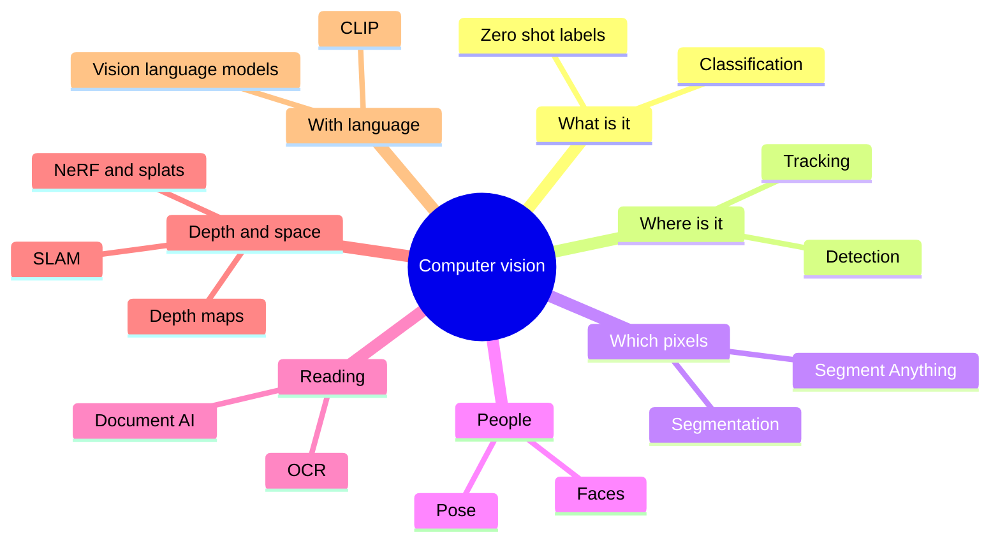
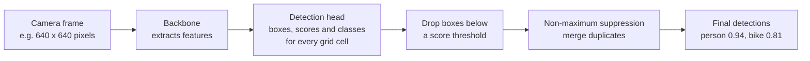
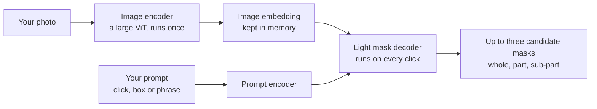
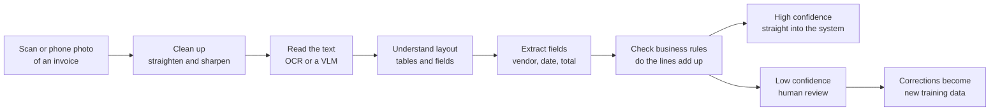
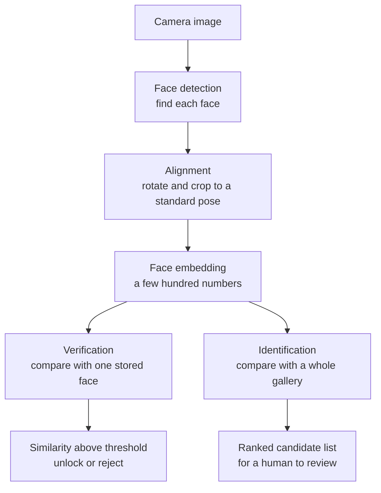
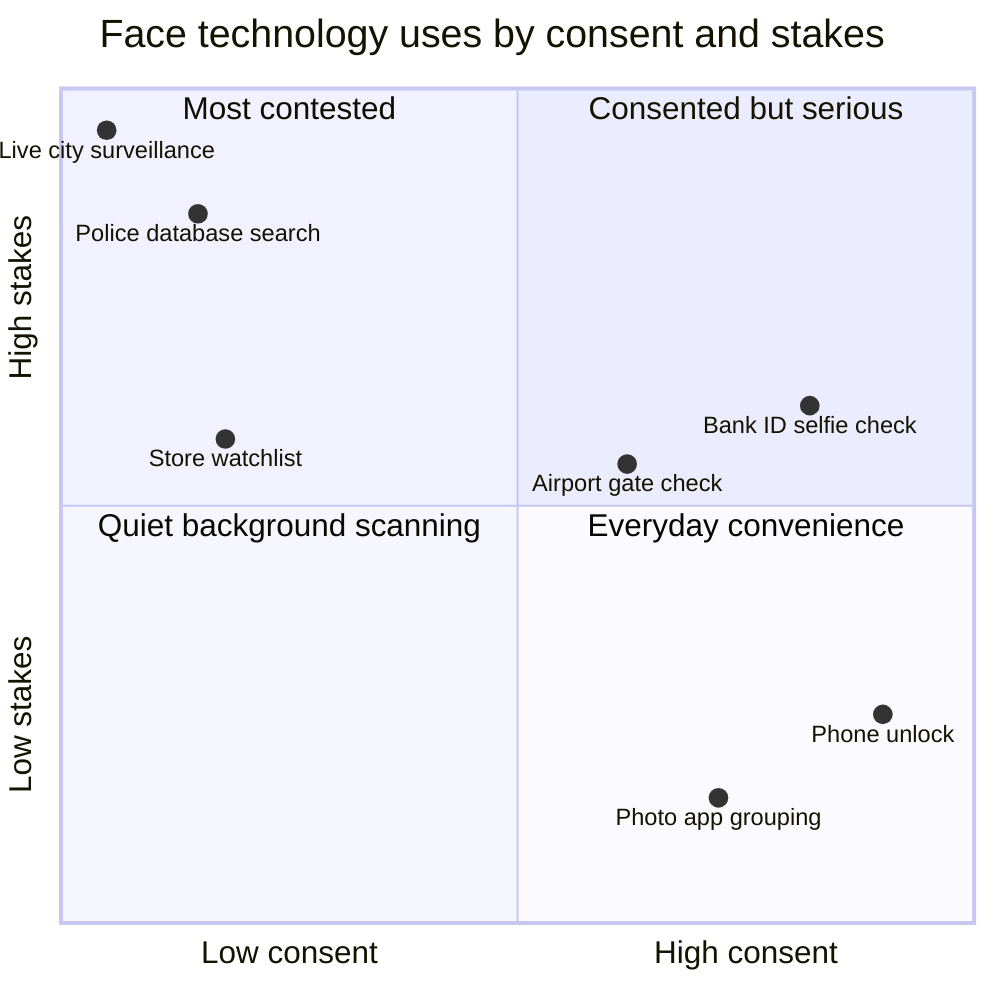
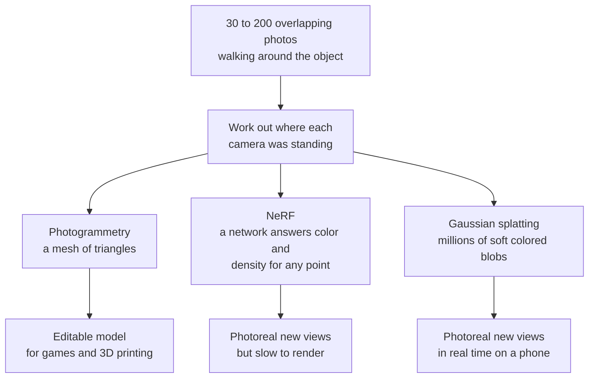
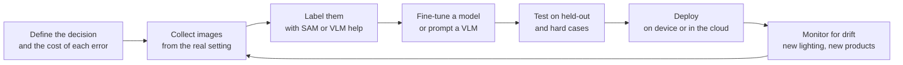

# Chapter 45: Computer Vision

*How machines turn grids of numbers into "a dog on a sofa", "a crack in this weld" or "this is your face", what each vision task really does, where it earns money, how it fails and who it can hurt.*

## What you'll learn

- Why seeing is hard for a computer even though it feels effortless to you, and what a photo looks like from the machine's side.
- The ladder of vision tasks (classification, detection, segmentation, tracking, pose, reading text, faces and 3D), with the output and the accuracy measure for each.
- How a real-time detector such as YOLO finds objects thirty times a second, and how to work out IoU, precision and recall with a pencil.
- How Meta's Segment Anything models went from "click to cut out" in 2023 to "find every red baseball cap in this video" in 2025.
- How document AI reads invoices and forms, and why 99% character accuracy can still mean one wrong field in five.
- How face recognition works, why checking one face and searching a million faces are very different jobs, and what the accuracy gaps, wrongful arrests and laws teach us.
- How phones, robot vacuums and headsets see in 3D, from depth maps to NeRFs and Gaussian splats.
- Where vision is used across industries in 2026, the ways it breaks, and where the opportunities are.

## Before you start

Chapter 3 (Software, Code and Data) showed how a photo is stored as pixels. Chapter 9 (Is the Model Any Good?) introduced precision, recall and the confusion matrix, which this chapter uses often. Chapter 14 (Seeing and Remembering: CNNs, RNNs, Embeddings) explained convolutional networks, ImageNet, AlexNet, ResNet, U-Net and transfer learning in depth, and Chapter 15 (The Transformer, Piece by Piece) explained the Vision Transformer. Chapter 16 (Generative Models) covered CLIP, and Chapter 22 (Multimodal Models) showed how your chatbot turns a photo into tokens. You do not need to remember all of that. This chapter recaps the essentials in a few paragraphs and spends its pages on the applied branch: the tasks, how each one works, who uses it, and what goes wrong.

## The branch of AI you carry in your pocket

Think back over the last day. Your phone probably unlocked when it saw your face. When you typed "dog" into your photo app, it found every dog picture you have taken in years, though you never labeled one. If you deposited a check with your banking app, software read the handwritten amount. If you drove into a parking garage, a camera read your license plate and raised the barrier. If you pointed your phone at a plant, a sign in another language or a pair of shoes, an app told you what it was. And when you uploaded a screenshot to ChatGPT, Claude or Gemini and asked "what does this error mean?", the chatbot read it.

All of these are one branch of AI.

> **Definition — Computer vision:** The branch of AI that extracts useful information from images and video: what is in them, where it is, what is happening and how far away things are.

Computer vision is one of the oldest dreams in AI. In 1963 Larry Roberts, a graduate student at MIT, wrote a thesis on recovering 3D block shapes from photographs, often called the start of the field. In 1966 MIT ran a "Summer Vision Project" that hoped a few students could make serious progress on getting a computer to describe what a camera saw in a single summer. They could not. It took roughly fifty more years, and the turn to learning from data, before machines could reliably say "this is a cat."

For decades engineers hand-wrote the rules of seeing (find edges and corners, match templates), which worked on a factory line with fixed lighting and failed almost everywhere else. In 2012 a neural network called AlexNet learned its own features from a million labeled photos and beat the hand-engineered systems by a wide margin (Chapter 14 tells the story). The field has followed "learn it, don't hand-code it" ever since.

In Chapter 1 we sorted all of AI into five verbs: perceive, predict, create, decide and act. Computer vision is the biggest part of *perceive*. It feeds the other verbs: a self-driving car must see before it can decide, and a robot must see before it can act.



*Figure 45.1: The computer vision branch at a glance. Each leaf is a task this chapter covers.*

## An image is a grid of numbers

From the computer's side, a photo is a spreadsheet.

> **Definition — Pixel:** The smallest dot in a digital image. Each pixel is stored as numbers, usually one brightness number for a grayscale image or three for a color image.

> **Definition — RGB:** The standard way to store color: three numbers per pixel for the brightness of red, green and blue light, usually each from 0 (none) to 255 (full). Pure yellow is (255, 255, 0).

> **Definition — Resolution:** The number of pixels in an image, written as width × height. A 4,000 × 3,000 image has 12 million pixels, or 12 megapixels.

**Worked example: how many numbers is one phone photo?**

1. A typical 12-megapixel phone photo is 4,000 pixels wide and 3,000 tall: 4,000 × 3,000 = 12,000,000 pixels.
2. Each pixel has three numbers (red, green, blue): 12,000,000 × 3 = 36,000,000 numbers.
3. Each number fits in one byte (0 to 255), so the raw image is about 36 megabytes. The JPEG file on your phone is a few megabytes because compression throws away detail your eye will not miss (Chapter 3).
4. Video multiplies this. One frame of 1080p video is 1,920 × 1,080 × 3 ≈ 6.2 million numbers; at 30 frames per second, that is about 187 million numbers every second.

Here is a tiny grayscale corner of a photo, zoomed in until you can see the individual pixels. Dark is near 0 and bright is near 255.

```
  A 5 x 5 corner of a grayscale photo (0 = black, 255 = white)

        col1  col2  col3  col4  col5
  row1    12    15    20   180   200
  row2    10    14    22   185   205
  row3    11    13   160   190   210
  row4     9   150   170   195   215
  row5   140   160   175   200   220

  A diagonal edge runs from bottom-left to top-right: dark
  numbers on one side, bright on the other. That jump is
  what an "edge detector" filter responds to.
```

*Figure 45.2: What a camera hands to a model. The machine never sees "a shadow on a wall", only these numbers.*

> **Analogy:** A photo is a giant paint-by-numbers board with millions of tiny numbered squares. You see a face; the computer sees only the numbers, and it must learn which patterns of numbers tend to mean "face."

### Why seeing is hard for a computer

You recognize your friend in sunlight or shade, from the side, half hidden behind a door, wearing a hat. To a computer, each of those produces a completely different grid of numbers. Viewpoint (a mug from above and from the side share almost no pixel values), lighting, scale, occlusion (things partly hidden), deformation (a cat curling up), background clutter and sheer variety within a class (a chihuahua and a Great Dane are both "dog") all change the numbers while the right answer stays the same.

Even a tiny change breaks naive approaches. Shift a photo one pixel to the right and nearly every number moves to a new position in the list. A model that compared raw numbers directly would think it was a different picture. Learning features that ignore these changes, while staying sensitive to the ones that matter, is the core problem of computer vision.

> **Key idea:** Vision is hard because the same object produces wildly different numbers, and different objects can produce similar numbers. Every vision model is a machine for finding the patterns in pixels that stay stable when everything else changes.

## A quick recap: the networks that see

Chapters 14 and 15 explained the two families of neural networks that dominate vision. Here is the short version.

A **convolutional neural network (CNN)** slides small learned filters across the image. The first layers respond to edges and color blobs, middle layers combine those into textures and parts (an eye, a wheel), and late layers respond to whole objects. The same filter is reused at every position, which is why a CNN recognizes a cat in any corner of the picture.

> **Analogy:** A CNN is a team of detectives with magnifying glasses. The first team only spots edges, the next team combines edges into shapes, the next into ears and eyes, and the last one announces "cat."

A **Vision Transformer (ViT)** cuts the image into small square patches (often 14 or 16 pixels on a side), turns each patch into a vector, and lets attention compare every patch with every other patch. ViTs need more data than CNNs but scale better, and by 2026 most large vision systems, including the vision parts of your chatbot, use them.

Whichever design is used, most applied systems are built in two parts.

> **Definition — Backbone:** The large, general-purpose part of a vision model that turns an image into rich feature vectors. Task-specific "heads" are attached on top to produce labels, boxes or masks.

> **Definition — Transfer learning:** Taking a model already trained on a big general dataset and adapting it to a new, smaller task. In vision, you keep the pretrained backbone and train a small head on a few hundred or thousand of your own images.

> **Definition — Fine-tuning:** Continuing to train a pretrained model on new, task-specific examples so it adapts to them, either updating all of its numbers or only a small part.

The biggest change of the last five years is where backbones come from. Labeling millions of images by hand is slow and expensive (Chapter 11 describes the labeling industry). So labs now pretrain vision backbones with self-supervised learning (predicting hidden patches or matching different crops of the same photo) or with image–caption pairs from the web, as CLIP did in 2021. Meta's DINO family (DINOv2 arrived in 2023) learned strong general features from images alone, with no labels at all.

> **Definition — Vision foundation model:** A large vision model pretrained on hundreds of millions to billions of images, often without human labels, whose features work well for many downstream tasks with little or no extra training.

> **Key idea:** In 2026, almost nobody trains a vision model from scratch. You start from a foundation model and adapt it, or you simply prompt a model that already understands images. The hard, expensive part (learning to see in general) has been done once and is shared.

## The ladder of vision tasks

Vision tasks form a ladder. Each rung asks a more detailed question about the same image. Picture one street photo with a road, a sky, two cars and a person.

```
  CLASSIFICATION                 DETECTION
  +----------------------+       +----------------------+
  |                      |       |  +--car1--+ +car2+   |
  |   label for whole    |       |  |        | |    |   |
  |   image:             |       |  +--------+ +----+   |
  |   "street scene"     |       |              +p+     |
  |                      |       |              +-+     |
  +----------------------+       +----------------------+
  "What is this?"                "What is where?" (boxes)

  SEMANTIC SEGMENTATION          INSTANCE SEGMENTATION
  +----------------------+       +----------------------+
  | SSSSSSSSSSSSSSSSSSSS |       | .................... |
  | SSCCCCCCCCSSCCCCCSSS |       | ..1111111111..22222. |
  | RRCCCCCCCCRRCCCCCRRR |       | ..1111111111..22222. |
  | RRRRRRRRRRRRRRPPRRRR |       | ..............33.... |
  | RRRRRRRRRRRRRRPPRRRR |       | ..............33.... |
  +----------------------+       +----------------------+
  Every pixel gets a class:      Every object gets its own
  S sky, C car, R road,          mask: car 1, car 2,
  P person                       person 3
```

*Figure 45.3: Four questions about one photo. Classification gives one label; detection draws boxes; semantic segmentation colors every pixel by class; instance segmentation separates individual objects.*

| Task | Question it answers | Output | Common accuracy measure | Everyday example |
|---|---|---|---|---|
| Classification | What is in this image? | One or more labels | Top-1 or top-5 accuracy | Photo app search for "beach" |
| Detection | What is where? | Boxes with labels and scores | mAP (mean average precision) | Car camera spotting pedestrians |
| Segmentation | Which pixels belong to what? | A mask per class or object | IoU (overlap) | "Lift subject" in a photo app |
| Tracking | Which object is which over time? | IDs across video frames | Identity switches, tracking accuracy | Sports player statistics |
| Pose | Where are the joints? | Keypoints (a stick figure) | Keypoint distance error | Fitness app counting squats |
| OCR and documents | What does the text say? | Text, fields, tables | Character, word and field accuracy | Banking app reading a check |
| Faces | Whose face is this? | Match or no match, or a ranked list | False match and false non-match rates | Face unlock |
| 3D | How far away is everything? | Depth map, point cloud, 3D scene | Depth error, render quality | Robot vacuum mapping a room |

*Table 45.1: The main vision tasks, what each produces and how it is scored.*

The rest of this chapter climbs the ladder one rung at a time.

## Image classification: "what is in this picture?"

> **Definition — Image classification:** Assigning one label (or several) to a whole image, such as "golden retriever," "defective" or "pneumonia present."

Classification is the task that launched the deep learning boom. The ImageNet competition (Chapter 14) asked models to sort photos into 1,000 categories. In 2012 AlexNet's top-5 error was about 15.3%, against 26.2% for the runner-up. By 2015 Microsoft's ResNet reached about 3.6%, below the roughly 5% that one researcher, Andrej Karpathy, measured when he carefully labeled images himself.

> **Definition — Top-1 and top-5 accuracy:** Two ways to score a classifier. Top-1 counts an answer correct only if the model's single best guess is right; top-5 counts it correct if the right label is anywhere in the model's five best guesses.

> **Watch out:** "Superhuman on ImageNet" never meant "sees better than people." ImageNet has fine-grained categories (120 dog breeds) where careful humans make mistakes, and its photos are mostly clear, centered snapshots. The same models could be fooled by unusual angles, odd lighting or a few changed pixels, as later sections show.

Many real uses need several labels at once (a photo can contain a beach, a dog and a sunset), which is called multi-label classification. And since CLIP (2021), classification no longer needs a fixed list of categories decided in advance.

> **Definition — Zero-shot classification:** Classifying images into categories the model was never specifically trained on, by comparing the image with text descriptions such as "a photo of a forklift" and picking the closest match.

CLIP places images and text in the same space of meaning (Chapter 16). To classify, you embed the image, embed one sentence per candidate label, and pick the label whose sentence is most similar.

**Worked example: zero-shot labeling a warehouse photo.** Suppose CLIP gives these cosine similarities (from −1 to 1; higher means more alike) between one image and three sentences:

| Candidate sentence | Similarity |
|---|---|
| "a photo of a forklift" | 0.31 |
| "a photo of a pallet of boxes" | 0.27 |
| "a photo of a delivery van" | 0.19 |

The model picks "forklift." The numbers look small and close together, but what matters is the ranking. In 2021 CLIP reached about 76% top-1 accuracy on ImageNet this way without training on a single ImageNet example, matching a classic network trained on all 1.2 million of them. That is why classification went from "collect and label thousands of photos" to "write a list of labels."

Industry uses classification wherever a whole image needs one decision: tagging products in online catalogs, flagging photos that break a platform's rules, sorting crop photos by disease, routing medical scans so the most urgent are read first, and pass/fail checks on a production line.

> **Try it:** Go to Google's Teachable Machine (teachablemachine.withgoogle.com) and start an Image Project. Make two classes, "mug" and "no mug," record about 40 webcam images of each, press Train, and test it live. Then hold the mug upside down or in the dark and watch the confidence drop. In ten minutes you have done transfer learning: the site starts from a pretrained backbone and trains only a small head on your photos.

## Object detection: "what is where?"

Classification says "there is a person somewhere." A car needs to know exactly where the person is.

> **Definition — Object detection:** Finding every object of interest in an image, drawing a box around each one, and labeling it with a class and a confidence score.

> **Definition — Bounding box:** The rectangle a detector draws around an object, stored as four numbers: either the left, top, right and bottom edges, or the center point plus width and height.

> **Definition — Confidence score:** A number from 0 to 1 that a model attaches to each prediction, expressing how sure it is. A score of 0.92 should mean "usually right," but scores are not automatically honest probabilities and often need checking (calibration, Chapter 8).

### How a one-stage detector works

Early deep detectors worked in two stages: first propose a few thousand regions that might contain something, then classify each region. This "R-CNN" family (2014 and 2015) was accurate but slow. In 2015 Joseph Redmon and colleagues proposed a design that looked at the image once.

> **Definition — YOLO (You Only Look Once):** A family of real-time object detectors, first published in 2015–2016, that predict all boxes and labels in a single pass of one neural network, fast enough for live video. Many groups have released successor versions since.

The idea is simple to state. Divide the image into a grid. For each grid cell, the network predicts a few candidate boxes, how likely each box is to contain an object, and what class the object probably is. Most cells predict nothing useful. A cleanup step then removes duplicates.

> **Definition — Non-maximum suppression (NMS):** The cleanup step in object detection that removes duplicate boxes. When several boxes overlap heavily on the same object, it keeps the most confident one and deletes the rest.



*Figure 45.4: A one-stage detector. The whole pipeline runs once per frame, many times a second.*

The original YOLO ran at about 45 frames per second on a 2015 graphics card, which made real-time detection practical. Later designs replaced the grid of hand-chosen box shapes, and in 2020 Facebook's DETR showed that a Transformer could output a set of boxes directly, with no duplicate cleanup at all. Modern detectors mix these ideas.

The newest step removes the fixed list of classes. Classic detectors were trained on a fixed set of categories, such as the 80 everyday objects in Microsoft's COCO dataset, and could find nothing else.

> **Definition — Open-vocabulary detection:** Detection where you type what to look for ("hard hat," "spilled liquid," "blue recycling bin") and the model finds it, even if that category was not in its training labels. It combines a detector with CLIP-style image-text understanding.

### Scoring a detector, with a pencil

How do you decide whether a predicted box "found" the object? You measure overlap.

> **Definition — IoU (Intersection over Union):** A score from 0 to 1 for how well two regions overlap: the area they share divided by the total area they cover together. A detection usually counts as correct if its IoU with the true box is at least 0.5.

**Worked example: computing IoU.** The true box for a cat covers x from 20 to 60 and y from 20 to 60 (in pixels). The model's predicted box covers x from 10 to 50 and y from 10 to 50.

```
   y
  60 |          +--------------+
     |          |   true box   |
  50 |  +-------+------+       |
     |  |       |//////|       |
     |  |       |//////|       |
  20 |  |       +------+-------+
     |  | predicted    |
  10 |  +--------------+
     +-------------------------------> x
        10      20     50      60

  The shaded square (///) is the overlap.
  Predicted area: 40 x 40 = 1,600
  True area:      40 x 40 = 1,600
  Overlap:        x 20-50, y 20-50 = 30 x 30 = 900
  Union:          1,600 + 1,600 - 900 = 2,300
  IoU = 900 / 2,300 = 0.39   (below 0.5: counts as a miss)
```

*Figure 45.5: Intersection over Union worked by hand. Two boxes that look "close enough" to a person can still fail the usual 0.5 threshold.*

Once each detection is marked correct or not, you use the precision and recall from Chapter 9.

**Worked example: a defect detector.** A factory camera checks circuit boards. In a test batch there are 100 boards with real defects. The detector flags 90 boards, and 81 of those really are defective.

- Precision = correct flags ÷ all flags = 81 ÷ 90 = 0.90. When it raises an alarm, it is right 90% of the time.
- Recall = correct flags ÷ all real defects = 81 ÷ 100 = 0.81. It catches 81% of defects and misses 19.

Raising the score threshold usually raises precision and lowers recall; lowering it does the opposite. The factory chooses based on cost: a missed defect that reaches a customer may cost far more than a false alarm that a human inspector clears in ten seconds.

> **Definition — mAP (mean average precision):** The standard single-number score for detectors. For each class, it summarizes precision across all recall levels (the "average precision"), then averages over classes, often also over several IoU thresholds. Higher is better; 1.0 is perfect.

### Speed: the frame budget

> **Definition — Frames per second (FPS):** How many video images a system processes each second. Live video is usually 25–60 FPS, so the model gets only 17–40 milliseconds per frame.

At 30 FPS, each frame has a budget of 1,000 ÷ 30 ≈ 33 milliseconds for everything: reading the camera, resizing, running the network, cleaning up the boxes and acting on the result. That is why real-time systems use small, fast detectors rather than giant models, and why many run directly on the device.

> **Definition — Edge deployment:** Running a model on a local device (a camera, phone, car, drone or factory computer) instead of sending data to a distant data center. It cuts delay, keeps video private and works without a connection, at the cost of a smaller model (Chapter 53).

Detection is everywhere: counting cars at intersections, checking that store shelves are stocked, spotting animals in wildlife camera-trap photos, warning when a construction worker is not wearing a hard hat, following the ball in sports broadcasts, guiding drones, and helping cars see pedestrians (Chapter 50 covers the driving stack).

> **Watch out:** Detection systems pass along whatever their training data contained. A pedestrian detector trained mostly on daytime photos of adults walking upright can do worse at night, on children, on wheelchair users or on people carrying large objects. "It works on the test set" only means it works on situations like the test set.

## Segmentation: "which pixels?"

A box is a rough answer. A photo editor removing a background, a surgeon measuring a tumor or a farmer measuring leaf damage needs the exact outline.

> **Definition — Segmentation:** Labeling every pixel in an image according to what it belongs to, producing precise outlines instead of boxes.

> **Definition — Mask:** The pixel-exact outline of a region, stored as a grid the same size as the image with a 1 for every pixel inside the region and a 0 for every pixel outside.

There are three flavors, shown in Figure 45.3.

> **Definition — Semantic segmentation:** Giving every pixel a class label (road, sky, car, person) without separating individual objects. Two touching cars become one "car" region.

> **Definition — Instance segmentation:** Finding each individual object and giving it its own mask, so car 1 and car 2 are separate even when they touch.

> **Definition — Panoptic segmentation:** Combining both: every pixel gets a class, and every countable object also gets its own identity.

> **Analogy:** Detection is a highlighter: it marks roughly where something is. Segmentation is a pair of scissors: it cuts the thing out exactly along its edge.

Chapter 14 described U-Net (2015), the encoder–decoder network that shrinks an image to understand it and then expands it back to full size to draw a mask. U-Net and its descendants still dominate medical segmentation, outlining organs, tumors and cells. For instance segmentation, Mask R-CNN (2017) added a mask head to a two-stage detector and became a workhorse for years.

All of these had one big limitation: they could only segment the categories they were trained on, and building a new segmentation dataset meant paying people to trace outlines by hand, often a minute or more per object.

### Segment Anything: one model that cuts out anything

In April 2023 Meta released the Segment Anything Model (SAM) and changed the economics of segmentation.

> **Definition — Promptable segmentation:** Segmentation driven by a prompt: you click a point, draw a rough box or type a phrase, and the model returns the mask of the thing you meant, for any kind of object.

> **Definition — Segment Anything Model (SAM):** Meta's family of open promptable segmentation models. SAM (2023) outlines any object in an image from a click or box; SAM 2 (2024) does the same in video; SAM 3 (2025) also accepts short text "concept" prompts.

SAM was trained on SA-1B, a dataset of about 1.1 billion masks on 11 million images, far larger than any earlier segmentation dataset. No one traced 1.1 billion outlines by hand. Meta built it with a loop.

> **Definition — Data engine:** A process in which a model helps label data, people correct its labels, the model is retrained on the corrected data, and the improved model labels the next batch faster. Each turn of the loop makes labeling cheaper and the model better.

At first annotators clicked and SAM proposed masks they fixed by hand. As the model improved, annotators only checked its proposals. In the final stage the model labeled images fully automatically, producing most of the billion masks.

SAM's design is built for speed when you click around an image.



*Figure 45.6: How SAM works. The heavy image encoder runs once per image; each new click only reruns the small decoder, so masks appear almost instantly.*

Notice the three candidate masks. If you click on a person's shirt, did you mean the shirt, the whole person, or just the pocket? SAM does not guess one answer; it offers several and lets you pick. That honest handling of ambiguity is part of why it is pleasant to use.

The family moved quickly:

- **SAM (April 2023):** click or box prompts on images.
- **SAM 2 (July 2024):** video. You click an object in one frame and the model follows its mask through the whole clip, using a memory of earlier frames to recover after the object is briefly hidden.
- **SAM 3 (November 19, 2025):** concept prompts. You type a short phrase such as "red baseball cap" or "yellow school bus," and the model finds, segments and tracks *every* instance in an image or video.
- **SAM 3D (November 19, 2025):** reconstructs 3D objects and human bodies from a single photo (more in the 3D section).
- **SAM 3.1 (March 27, 2026):** a drop-in update that follows up to 16 objects in one pass of the network instead of one at a time; Meta says that roughly doubles speed on videos with a moderate number of objects, from 16 to 32 frames per second on a single data-center GPU.

Meta released all of them openly, so they spread into photo editors, video tools and research labs within months.

**Where segmentation earns its keep.** "Lift subject" and background-removal features in phone photo apps; rotoscoping in video editing, which once meant artists tracing an actor frame by frame; medical imaging, where outlining a tumor in each slice of a scan is slow expert work; agriculture, where drones measure leaf area and weed coverage; satellite imagery, where buildings, roads and flooded areas are traced across whole countries; and, quietly, labeling data for other models, where SAM-style tools cut annotation time from minutes per object to seconds.

> **Try it:** Open Meta's Segment Anything playground (aidemos.meta.com) or search for a SAM demo on Hugging Face Spaces. Upload a cluttered photo from your phone. Click once on an object and look at the mask. Click on a part of an object (a wheel, a sleeve) and see which candidate it offers. Then type a concept such as "shoes" or "plants" and watch every instance light up.

## Following things through time: tracking, action and video

A video is a stack of images, so you could run a detector on every frame. But the detector does not know that the person in frame 100 is the same person as in frame 99.

> **Definition — Object tracking:** Following the same object across video frames and keeping a consistent identity for it, such as "player 7" or "car 12," even when it moves, turns or is briefly hidden.

The common recipe is "tracking by detection": detect objects in every frame, then link each new detection to an existing track using where the object was heading and what it looked like. Errors show up as *identity switches*, when two players cross and the tracker swaps their labels, which ruins any statistic built on top.

Underneath much video work sits a lower-level measurement: optical flow, an estimate of how far and in which direction every pixel moved between two frames, drawn as a field of tiny arrows. It helps trackers follow objects between detections, and it powers video stabilization, smooth slow-motion effects that invent in-between frames, and small drones that hold their position by watching the ground drift beneath their downward-facing camera.

> **Definition — Optical flow:** The apparent motion of each pixel between two video frames, estimated as a small arrow per pixel showing direction and distance. It is used for tracking, video stabilization, frame interpolation and drone navigation.

> **Definition — Re-identification (re-ID):** Recognizing that a person or object seen by one camera is the same one seen earlier or by a different camera, usually from appearance such as clothing, gait or vehicle color.

Re-identification makes multi-camera tracking possible in stores, airports and cities. It is also one of the most privacy-sensitive capabilities in vision, because it can follow a person across a city without ever using their face.

Beyond "who is where," video models also ask "what is happening?"

> **Definition — Action recognition:** Identifying what is happening in a video clip, such as "person falling," "goal scored" or "worker skipping a safety step."

Action recognition needs time. A single frame of someone with an arm raised could be a wave, a throw or a stretch; only the motion tells you which. Deep video models have taken three main routes to it. 3-D CNNs use filters that span a few frames as well as a patch of pixels (Chapter 14), so a single filter can respond to movement; the C3D network of late 2014 used small 3 × 3 × 3 cubes throughout. Two-stream networks, introduced by Karen Simonyan and Andrew Zisserman in 2014, run two CNNs side by side, one on ordinary frames for what things look like and one on optical flow for how they move, and combine their answers. Since 2021, video Transformers such as ViViT and TimeSformer cut a clip into small patches across both space and time and let attention relate any patch to any other, the same spacetime-patch idea that video generators use (Chapter 16).

> **Definition — 3-D CNN:** A convolutional network whose filters are small cubes spanning height, width and a few video frames, so it learns motion and appearance together.

> **Definition — Two-stream network:** A video model that runs two networks in parallel, one on the raw frames (appearance) and one on optical flow (motion), and merges their predictions.

Since 2024, multimodal chatbots have added long-video question answering: you upload a recording and ask "when does the speaker first show the sales chart?" Chapter 22 explained how they do it by sampling frames, which is also their weak spot: a moment that falls between sampled frames can be missed entirely.

**Where tracking and video understanding are used.** Sports is the showcase: Hawk-Eye's multi-camera ball tracking has reviewed line calls in professional tennis since 2006, Wimbledon replaced its human line judges with electronic line calling in 2025, and professional clubs track every player many times a second to measure running and tactics. Retailers count footfall and queues, cities count traffic, care homes test fall detection, and factories check that assembly steps happen in order.

## Pose estimation: the body as a stick figure

> **Definition — Pose estimation:** Detecting the positions of a person's body joints in an image or video to form a stick-figure skeleton, so software can reason about posture and movement.

> **Definition — Keypoint:** One specific landmark a model locates, such as the left elbow, right knee or tip of the nose, given as x and y coordinates (and sometimes depth).

The widely used COCO convention marks 17 body keypoints per person: nose, eyes, ears, shoulders, elbows, wrists, hips, knees and ankles.

**Worked example: compressing a body.** A 1080p frame is about 2 million pixels. A pose model reduces each person in it to 17 keypoints × 2 coordinates = 34 numbers. That is a compression of roughly 60,000 times, keeping only what matters for movement. A fitness app counting squats needs nothing else: it watches the hip keypoint drop below the knee keypoint and rise again, and counts one rep.

Pose estimation reached living rooms with Microsoft's Kinect (2010), which used a depth camera to track players' skeletons for games. In 2017 Carnegie Mellon's OpenPose showed real-time multi-person pose from ordinary cameras, and Google's MediaPipe later made body, hand and face landmarks run on phones in a web browser. Hands get about 21 keypoints each; faces can get hundreds, forming a "face mesh" used for filters and animation.

Uses include fitness and physical therapy apps that check form, coaching tools that compare an athlete's movement with an expert's, animation and motion capture without special suits, workplace ergonomics, sign-language research, and robot learning, where robots learn tasks by watching human videos converted into pose data (Chapter 49).

> **Watch out:** Pose models are less reliable when joints are hidden, with loose or flowing clothing, at unusual camera angles, and for bodies poorly represented in training data, such as wheelchair users or people with limb differences. An app that "scores your form" can be confidently wrong.

> **Try it:** In Teachable Machine, start a Pose Project. Make two classes, "standing" and "squatting," record about 30 samples of each, train it, and watch the skeleton overlay as you move. Then try it from a side angle or with a coat on.

## Reading the world: OCR and document AI

Reading text was one of vision's first commercial successes. In the 1990s, systems built on Yann LeCun's LeNet read handwritten digits on bank checks (by one commonly cited estimate, more than a tenth of US checks by the late 1990s), and postal services sorted mail by machine-reading addresses. Tesseract, an OCR engine begun at Hewlett-Packard in the 1980s, was open-sourced in 2005 and developed further by Google; it is still widely used.

> **Definition — OCR (optical character recognition):** Software that finds text in an image and converts it into machine-readable characters, from printed pages to street signs to handwriting.

> **Definition — License plate recognition (ANPR):** Automatic number-plate recognition: cameras that detect a vehicle's plate and read its characters, used for parking, tolls, traffic enforcement and police watchlists.

Classic OCR outputs a stream of characters with little sense of what they mean. A business does not want "characters"; it wants "the invoice total is 1,284.50, due March 3."

> **Definition — Document AI:** Systems that understand whole documents, including layout, tables, forms, checkboxes, stamps and signatures, and turn them into structured data a computer system can use.

> **Definition — Key-value extraction:** Pulling specific labeled fields out of a document, such as "Invoice number: 4471" or "Date of birth: 1985-02-14," and storing each as a field name and value.



*Figure 45.7: A document AI pipeline. The rules check and the human review queue matter as much as the model.*

Before 2023, each box in Figure 45.7 was often a separate model or hand-written rule. Since then, vision-language models increasingly read text, layout and meaning in one step (Chapter 22 explains how and what that costs in tokens). The rest of the pipeline, the rule checks and the human review, did not go away, because of a piece of arithmetic every document project runs into.

**Worked example: why 99% accuracy is not good enough.** A system reads characters with 99% accuracy. That sounds excellent. An invoice has 15 fields of about 20 characters each.

1. Chance a 20-character field has no error: 0.99 × 0.99 × ... (20 times) = 0.99^20 ≈ 0.82.
2. So about 18% of fields, nearly one in five, contain at least one wrong character.
3. With 15 fields, the chance the whole invoice is perfect is 0.82^15 ≈ 0.05. About 95% of invoices need a fix somewhere.
4. At 99.9% character accuracy: 0.999^20 ≈ 0.98 per field, and 0.98^15 ≈ 0.74 for a perfect invoice. Much better, but still one invoice in four has an error.

> **Key idea:** Measure document AI at the level where mistakes cost money: the field and the whole document, not the character. Then design the workflow so that low-confidence fields, and fields that fail a rule (line items that do not add up to the total), go to a person.

Document AI runs accounts-payable departments, insurance claims, loan applications, "know your customer" identity checks at banks (which pair reading the ID card with matching its photo to a live selfie), hospital intake forms, shipping paperwork and the digitization of historical archives, including old handwriting that few living people can read.

> **Watch out:** OCR errors are dangerous because they look plausible. A smudged 7 read as a 1 produces a neat, well-formatted, wrong number. For anything you will act on, ask for the exact text read, a flag such as [unclear] for unreadable parts, and a check of the critical fields against the original.

## Faces: the most personal kind of vision

Faces are where computer vision's power and its risks are most concentrated, so it is worth being precise about the words.

> **Definition — Face detection:** Finding *that* there is a face in an image and where it is, without knowing whose it is. Your camera's little box around faces is detection.

> **Definition — Face verification:** A one-to-one check: is this face the same person as one stored reference? Phone unlock and passport gates do verification.

> **Definition — Face identification:** A one-to-many search: who, out of a gallery of thousands or millions of stored faces, is this? Police searches of mugshot databases do identification.

> **Definition — Biometrics:** Identifying or verifying people from body characteristics such as face, fingerprint, iris, voice or the way they walk.

Fast face detection arrived in consumer cameras after the Viola–Jones method (2001), a clever hand-designed detector. Recognition jumped with deep learning: Facebook's DeepFace (2014) and Google's FaceNet (2015) approached or exceeded human accuracy on a standard benchmark of celebrity photos. FaceNet introduced the approach still used today.

> **Definition — Face embedding:** A short list of numbers (FaceNet used 128) that a network computes from a face photo, trained so that photos of the same person land close together and photos of different people land far apart.

> **Analogy:** A face embedding works like GPS coordinates for faces. Every photo of you lands in roughly the same spot on a map with hundreds of dimensions, a stranger lands somewhere else, and recognition is just measuring the distance between two points.



*Figure 45.8: The face recognition pipeline. The same embedding serves two very different jobs.*

Every system compares a similarity score with a threshold, and every threshold trades two errors.

> **Definition — False match rate and false non-match rate:** The two errors of any biometric system. A false match accepts the wrong person (a stranger unlocks your phone). A false non-match rejects the right person (your phone refuses you). Raising the threshold lowers false matches and raises false non-matches.

**Worked example: same accuracy, different job.** Apple has said the chance that a random stranger could unlock your iPhone with Face ID is about 1 in 1,000,000. For verification, that is superb: a thief gets one comparison against one stored face.

Now imagine a search system with that same per-comparison false match rate, used for identification against a gallery of 1,000,000 faces.

1. Each search makes 1,000,000 comparisons.
2. Expected false matches per search: 1,000,000 × (1 ÷ 1,000,000) = 1.
3. Against a gallery of 10,000,000: about 10 false matches per search.
4. If the person in the photo is not in the gallery at all, every match it returns is wrong.

Real search systems usually return a ranked list for a human to review, and their error rates depend heavily on the image: a grainy, angled security-camera frame is far harder than a passport photo. The arithmetic still holds: the bigger the gallery, the more innocent look-alikes appear. This is the base-rate problem from Chapter 9 in its starkest form.

### Accuracy gaps across groups

In 2018 the Gender Shades study by Joy Buolamwini and Timnit Gebru tested commercial face-analysis systems on classifying gender. Error rates reached 34.7% for darker-skinned women, against 0.8% for lighter-skinned men. The companies involved improved their systems after publication. In 2019 the US National Institute of Standards and Technology (NIST) tested 189 face recognition algorithms and found that, for many of them, false match rates for some demographic groups were 10 to 100 times higher than for others; the most accurate algorithms showed much smaller gaps.

These gaps have had real consequences. In January 2020 Robert Williams, a Black man in the Detroit area, was arrested in front of his family for a theft he did not commit, after a face recognition search matched a blurry store-camera image to his old driver's license photo. A 2024 legal settlement changed the Detroit police department's rules so that a face match alone cannot justify an arrest.

> **Key idea:** A face recognition "system" is not just an algorithm. It is the algorithm plus the probe photo's quality, the gallery's size and makeup, the threshold, and what humans do with the result. Most real-world harms come from the whole system, especially from treating a candidate match as an identification.

### Surveillance, consent and the law

The strongest case for face recognition is real: finding missing children and trafficking victims, identifying suspects in serious crimes faster, speeding passengers through airports, securing phones and bank accounts without passwords, and helping people who cannot recognize faces. The strongest case against is also real: once cameras can name everyone they see, anonymity in public disappears, which can chill protest and free association; errors fall unevenly; images are often collected without consent; and systems built for one purpose tend to expand to others.

Laws reflect that split, and differ sharply by place (Chapter 59 covers AI law in depth):

- **European Union.** Since February 2, 2025, the EU AI Act bans building face databases by untargeted scraping of images from the internet or CCTV, and bans emotion recognition in workplaces and schools. Real-time remote face identification in public spaces by police is banned except in narrowly defined cases, such as searching for a kidnapping victim, with prior authorization.
- **Illinois.** The Biometric Information Privacy Act (2008) requires informed written consent before collecting biometrics and lets individuals sue. Facebook paid $650 million to settle a class action under it in 2021.
- **Cities.** San Francisco banned city agencies, including police, from using face recognition in 2019, and other US cities followed. Other places, including much of China and some US police departments, use it widely.
- **Scraping.** Clearview AI built a search tool from billions of photos scraped from the web and was fined by data-protection regulators in several European countries.

> **Definition — Emotion recognition:** Software that claims to infer a person's emotional state from facial expressions, voice or body language. Scientific reviews have found that facial movements do not map reliably onto inner emotions across people and cultures, which is one reason the EU banned it at work and school.



*Figure 45.9: An illustrative map of face technology uses by how much the person consented and how much is at stake. Positions are the author's judgment, not measurements; the most contested uses sit top left.*

> **At the frontier (2026):** The arms race in identity checks has moved to "liveness." Banks and apps that verify you with a selfie must now tell a real face from a printed photo, a screen, a mask or a deepfake video fed straight into the camera stream. Liveness detection and provenance signals are an active area of product work, and fraud with synthetic faces is a growing concern for finance (Chapter 58).

## Seeing in 3D

A single photo flattens the world. Robots, cars, headsets and phones need to know how far away things are.

> **Definition — Depth estimation:** Predicting the distance from the camera to every point in an image, producing a "depth map" in which each pixel holds a distance instead of a color.

There are several ways to get depth. **Stereo vision** uses two cameras a known distance apart, like your two eyes: the closer an object, the more its position differs between the two images. **Structured light** projects an invisible dot pattern and measures how it distorts; Apple's Face ID projects tens of thousands of infrared dots onto your face, which is why a flat photo cannot fool it. **Lidar** measures distance directly with laser pulses (Chapter 50 covers its role in self-driving cars). And since about 2024, models such as Depth Anything estimate surprisingly good depth from a single ordinary photo, having learned from millions of images what near and far tend to look like.

> **Definition — Point cloud:** A 3D scene represented as a large set of dots, each with x, y and z coordinates and sometimes a color. It is the typical output of a lidar sensor or 3D scanner.

> **Definition — SLAM (simultaneous localization and mapping):** Building a map of an unknown space while tracking your own position within it at the same time. Robot vacuums, drones and AR headsets rely on it.

A robot vacuum running SLAM starts with no map. As it moves, it spots landmarks with its lidar or camera, estimates how far it has traveled, and stitches the observations into a floor plan, constantly correcting both the map and its own position.

> **Analogy:** SLAM is like exploring a dark house with a flashlight while drawing a floor plan. You sketch each room as you see it and mark where you are standing, and when you recognize a doorway you passed earlier, you fix both the drawing and your idea of where you are.

To capture a whole object or scene in 3D, you take many photos from different angles.

> **Definition — Photogrammetry:** Reconstructing 3D shapes from many overlapping photographs by matching features between them and working out where each camera was.

> **Definition — NeRF (neural radiance field):** A 2020 technique that trains a small neural network to represent one 3D scene: given any point in space and a viewing direction, it returns a color and a density. Rendering new viewpoints means asking the network about many points along every pixel's line of sight, which is slow.

> **Definition — Gaussian splatting:** A 2023 technique that represents a 3D scene as millions of tiny, soft, colored, semi-transparent blobs ("Gaussians"). It renders photorealistic new views in real time and trains faster than NeRFs.



*Figure 45.10: Three routes from a ring of photos to a 3D scene.*

| Method | Year it took off | Output | Rendering speed | Strengths | Weaknesses |
|---|---|---|---|---|---|
| Photogrammetry | Decades old, improved with deep features | Triangle mesh plus texture | Fast | Easy to edit, measure and 3D print | Struggles with thin, shiny or see-through things |
| NeRF | 2020 | A trained network | Slow | Beautiful light and reflections | Slow, hard to edit |
| Gaussian splatting | 2023 | Millions of blobs | Real time | Photoreal and fast | Large files, harder to edit as solid shapes |
| Single-image 3D (e.g. SAM 3D) | 2025 | Object or body shape | Fast | Needs only one photo | Back sides are educated guesses |

*Table 45.2: Ways to capture 3D from ordinary cameras.*

**Worked example: why splat files are big.** Each Gaussian stores its position (3 numbers), size along three axes (3), rotation (4), opacity (1) and a color description that changes with viewing angle (48 in the original method), about 60 numbers in all. A detailed room might use 3 million Gaussians: 3,000,000 × 60 = 180 million numbers. At 4 bytes per number that is about 720 megabytes, which is why compressing splats is an active research and product area.

The newest step is reconstruction from a single image. SAM 3D (November 2025) estimates the 3D shape of an object or a human body from one photo, filling in hidden sides from what it has learned about how things are usually shaped.

3D vision is used for real-estate walkthroughs, insurance claims (scan the damaged room), construction progress tracking, preserving historic buildings and artifacts, film visual effects, 3D product views in online shops, AR furniture placement, and robots and cars that must move through real space (Chapters 49 and 50).

## Vision meets language

Chapter 16 described CLIP (2021), which learned from hundreds of millions of image–caption pairs to put pictures and words in one space of meaning, and Chapter 22 described how your chatbot bolts a vision encoder onto a language model.

> **Definition — Vision-language model (VLM):** A model that takes images and text together and can describe images, answer questions about them, read the text in them and reason about what they show.

For the applied field, VLMs changed one big thing: many vision tasks went from *training* to *prompting*. Instead of collecting 2,000 labeled photos of "pallet blocking the fire exit," a safety team can describe it in a sentence and test immediately. In 2026 many VLMs can also answer with locations, not just words.

> **Definition — Visual grounding:** Linking words to specific places in an image, such as returning the box or point for "the second mug from the left." It turns a description into coordinates a robot arm or a software agent can act on.

Specialist models have not disappeared. They are often the right choice in production.

| | Specialist model (e.g. a small detector) | General VLM |
|---|---|---|
| Speed | Milliseconds per frame, runs on a camera | Often a second or more per image |
| Cost per image | Tiny once deployed | Paid per token, adds up on video |
| Setup | Needs labeled examples | A written prompt |
| New categories | Retrain | Change the prompt |
| Explaining its answer | Boxes and scores only | Can describe its reasoning in words |
| Typical failures | Unseen situations | Counting, exact positions, small text, invented details |

*Table 45.3: Specialist vision models versus general vision-language models.*

> **Key idea:** A common 2026 pattern combines both. A large VLM (or SAM 3) labels a pile of images from a text description, people check a sample, and that data trains a small, fast model that runs on the device thirty times a second. The big model is the teacher; the small model does the shift work.

> **Watch out:** Chatbots are still weak at some visual tasks that feel trivial: counting many similar objects, reading analog clocks, judging exact left/right relationships, and reading tiny text in a shrunk image. They may also describe objects that are not there because they usually appear in similar scenes. Chapter 22 gives prompting habits that help.

## How vision systems fail

Vision models can look superhuman in a demo and fail in the field. The failure modes are well understood, and knowing them is half the job of deploying vision responsibly.

> **Definition — Distribution shift:** When the images a model meets in use differ from the ones it was trained and tested on (new camera, new lighting, new country, new product), so its accuracy drops, often silently.

> **Definition — Shortcut learning:** When a model learns an easy cue that happened to correlate with the label in its training data instead of the real thing. It passes tests drawn from the same data and fails when the cue disappears.

Two classic shortcut stories. Researchers explaining model decisions in 2016 deliberately trained a classifier where wolf photos had snowy backgrounds and husky photos did not; it learned "snow means wolf," and explanation tools exposed it. In 2018 a study of pneumonia-detecting X-ray models found they partly recognized *which hospital* an image came from, through markers and scanner differences, and performance dropped at other hospitals.

> **Definition — Adversarial example:** An input deliberately altered, often invisibly to people, so that a model makes a wrong prediction with high confidence.

In 2014 researchers added a faint, carefully computed noise pattern to a photo of a panda; a top classifier then labeled it a gibbon with 99.3% confidence. In 2018 another team showed that a few black and white stickers on a real stop sign could make a classifier read it as a speed-limit sign. Defenses exist but none is complete.

> **Definition — Long tail:** The huge number of rare situations (an overturned truck, a person in a costume, a kangaroo on the road) that each almost never happen but together happen all the time. Models trained on common cases are weakest there.

> **Definition — Automation bias:** The human tendency to over-trust a machine's output and stop checking it, especially when the machine is usually right.

| Failure | Example | Common mitigation |
|---|---|---|
| Distribution shift | A defect model trained in summer fails when winter sunlight hits the line | Collect data from every setting; monitor accuracy after launch |
| Shortcut learning | "Snow means wolf" | Test on deliberately varied data; inspect what the model looks at |
| Adversarial inputs | Stickers on a stop sign | Multiple sensors, robust training, human checks for high stakes |
| Long tail | A rare object on a road | Fleet data collection, simulation, conservative fallback behavior |
| Biased data | Higher error rates for some skin tones | Representative data, per-group testing, published audits |
| Automation bias | Officers treat a face "hit" as proof | Rules requiring independent evidence, training, audit logs |

*Table 45.4: How vision systems fail and how practitioners respond.*

> **Watch out:** "Beats radiologists" or "99% accurate" on a benchmark is the start of the question, not the answer. Ask: tested on whose images, from which hospitals or cameras, at what threshold, with what error rate for each group, and does it improve real outcomes when people use it?

## Computer vision at work: an industry tour

| Industry | Main vision tasks | A real example | Main risk |
|---|---|---|---|
| Manufacturing | Defect detection, segmentation | Inspecting welds, circuit boards, bottles and fabric | Missed defects, false rejects, lighting drift |
| Agriculture | Weed and crop detection | John Deere's See & Spray targets individual weeds; the company reports large herbicide savings | Unusual fields and crops |
| Healthcare | Classification and segmentation of scans | IDx-DR (2018), the first FDA-authorized autonomous AI diagnostic, screens for diabetic eye disease | Uneven performance across hospitals and groups |
| Retail | Detection, tracking | Shelf monitoring, produce recognition at self-checkout | Billing errors, customer privacy |
| Finance and insurance | OCR, faces, damage assessment | ID-plus-selfie checks; photo-based car damage estimates | Deepfake fraud, unfair denials |
| Logistics | OCR, detection, counting | Reading labels, counting pallets, checking loads | Throughput errors |
| Accessibility | VLM scene description | Be My Eyes added a GPT-4-based "Be My AI" describer in 2023 | Confident wrong descriptions |
| Environment | Classification of camera-trap and satellite images | Counting wildlife, tracking deforestation | Rare species mislabeled |
| Sports and media | Tracking, pose | Electronic line calling, player tracking, auto-highlights | Disputed calls, broadcaster dependence |
| Public safety | Faces, plates, re-ID | Plate readers, face searches | Wrongful arrests, mass tracking |

*Table 45.5: Computer vision across industries in 2026.*

**Healthcare** is the most regulated user. The FDA's list of AI-enabled medical devices held about 1,451 authorizations through the end of 2025, roughly three-quarters of them in radiology; one secondary analysis counted 1,614 by late June 2026. Most were cleared as tools that help a clinician rather than replace one (Chapter 52 goes deeper).

**Retail** offers a cautionary tale. Amazon opened its first cashierless "Just Walk Out" store in 2018, using ceiling cameras and shelf sensors to track what each shopper took. In 2024 it removed the system from its US Amazon Fresh grocery stores in favor of smart carts, amid reports that it needed substantial human review (Amazon said reviewers mainly labeled data to improve the model). A demo for a few shoppers is a long way from crowded aisles all day.

**Manufacturing** shows why base rates matter.

**Worked example: false rejects on a fast line.** A bottling line inspects 10 bottles per second, around the clock: 10 × 86,400 seconds = 864,000 bottles a day. True defects are rare, 0.05% or 432 a day. The vision system catches 95% of them (410) but also wrongly rejects 0.1% of good bottles (about 864). So of the roughly 1,274 bottles rejected each day, only about a third are actually defective. Whether that is acceptable depends on what a rejected good bottle costs versus a defective one reaching a customer, and that is a business decision, not a model setting.

Most vision projects follow the same loop.



*Figure 45.11: The life cycle of a vision product. The loop back from monitoring to data collection never stops.*

> **Definition — Data annotation:** The work of labeling images or video (drawing boxes, tracing masks, tagging classes) so they can be used to train or test models. Much of it is done by large outsourced workforces, often for low pay (Chapter 11).

## The ethics of machines that see

Vision models turn every cheap camera into a sensor that can count, recognize and remember, which is the source of both their value and their danger. Five issues recur. **Privacy and consent:** people in view rarely agreed to be analyzed, so on-device processing, blurring faces and plates, and deleting footage quickly all reduce harm. **Surveillance and power:** face search, re-identification and plate readers can track movements at scale, and who may use them under what oversight is a political question. **Bias:** uneven error rates fall on those least represented in the data and least able to contest a mistake. **Dual use:** a detector that counts endangered animals can help a drone pick targets (Chapter 53); in 2020 YOLO's creator, Joseph Redmon, said he had stopped vision research over military uses and privacy concerns. **Labor:** vision runs on human labeling work and changes jobs from line inspectors to line judges.

Before deploying any camera-based AI, ask: what decision will it drive, what happens to a person when it is wrong, who checks it, how long is footage kept, and would the people on camera agree if asked?

## At the frontier, and what is still unsolved

> **At the frontier (2026):** Vision is converging on promptable, general models. SAM 3 finds and tracks any concept you can name; vision-language models return boxes and points as well as words; single-image 3D reconstruction (SAM 3D) and video world models (Chapter 47) are pushing models from flat pictures toward an understanding of space and physics; and robot foundation models reuse vision-language backbones as their eyes (Chapter 49). At the same time, neural processing units in phones and cameras let more of this run on the device, without sending video anywhere.

The big open problems are robustness to unusual conditions and attacks; real 3D and physical understanding (predicting what happens if you push, pour or stack things); small objects and fine detail, such as a hairline crack or a distant pedestrian a few pixels tall; equal accuracy across skin tones, ages, bodies and regions; getting the benefits of cameras without building a surveillance archive; and systems that say "I can't tell" instead of guessing.

## In plain English

A computer sees a photo as millions of numbers, three per pixel. Seeing is hard because the same object gives completely different numbers depending on angle, light and distance. Since 2012, neural networks have learned which number patterns matter, and today they start from huge pretrained "foundation" models instead of learning from scratch.

Vision tasks form a ladder. Classification names what is in a picture. Detection, like YOLO, draws boxes around each object in a few milliseconds. Segmentation cuts out exact outlines; Meta's Segment Anything models do this for anything you click or name, even in video. Tracking follows objects through time, and pose estimation turns a body into a stick figure. OCR and document AI read text and turn invoices into data, but even 99% character accuracy leaves errors in about one field in five, so humans review the uncertain cases. 3D vision builds depth maps and models from photos, using techniques like photogrammetry, NeRFs and Gaussian splats.

Face recognition shows the stakes. Checking your face against your phone's single stored copy is very reliable. Searching a face against millions of people produces innocent look-alikes, error rates have differed across groups, and people have been wrongly arrested. Laws such as the EU AI Act and Illinois's biometrics law limit some uses.

Vision models fail when the world differs from their training data, when they learn shortcuts, and when people trust them too much. Used well, they inspect products, read paperwork, screen eyes for disease, help blind people navigate and track wildlife. Used carelessly, they become surveillance.

## Key terms

Computer vision, Pixel, RGB, Resolution, Backbone, Transfer learning, Fine-tuning, Vision foundation model, Image classification, Top-1 and top-5 accuracy, Zero-shot classification, Object detection, Bounding box, Confidence score, YOLO (You Only Look Once), Non-maximum suppression (NMS), Open-vocabulary detection, IoU (Intersection over Union), mAP (mean average precision), Frames per second (FPS), Edge deployment, Segmentation, Mask, Semantic segmentation, Instance segmentation, Panoptic segmentation, Promptable segmentation, Segment Anything Model (SAM), Data engine, Object tracking, Optical flow, Re-identification (re-ID), Action recognition, 3-D CNN, Two-stream network, Pose estimation, Keypoint, OCR (optical character recognition), License plate recognition (ANPR), Document AI, Key-value extraction, Face detection, Face verification, Face identification, Biometrics, Face embedding, False match rate and false non-match rate, Emotion recognition, Depth estimation, Point cloud, SLAM (simultaneous localization and mapping), Photogrammetry, NeRF (neural radiance field), Gaussian splatting, Vision-language model (VLM), Visual grounding, Distribution shift, Shortcut learning, Adversarial example, Long tail, Automation bias, Data annotation

## Exercises

1. **[Easy] Pixel peeping.** (1) Open any photo in a free browser image editor that has a color picker, such as Photopea (photopea.com). (2) Zoom in until you see individual squares at the edge of a dark object against a bright background. (3) Use the eyedropper on five pixels across the edge and write down their red, green and blue values. (4) Look up your photo's width and height and compute width × height × 3 to get the number of raw values in it. **What you'll learn:** an image really is a grid of numbers, and edges are just places where the numbers jump.

2. **[Easy] Your phone as a vision lab.** (1) Use Google Lens or Apple's Visual Look Up on a plant, a pet and a product. (2) Photograph a printed page and copy its text (OCR). (3) Point the camera at a sign or menu in another language and translate it live. (4) Search your photo library for "receipt," "beach" and "car." (5) Write down every failure you notice (blurry text, a rare object, a wrong photo in the search results) and guess why. **What you'll learn:** classification, OCR and search by image run in seconds, partly on the device, and fail in predictable ways.

3. **[Medium] Train, then sabotage, an image classifier.** (1) At teachablemachine.withgoogle.com, start an Image Project with three classes: "thumbs up," "thumbs down" and "nothing." (2) Record about 50 webcam images for each, varying your hand position. (3) Train and test live. (4) Now start over, but record every "thumbs up" image while wearing a red shirt and every "thumbs down" image in a different-colored shirt. (5) Test thumbs up while wearing the other shirt. **What you'll learn:** training data, generalization and shortcut learning, demonstrated in your own living room.

4. **[Medium] Segment Anything playground.** (1) Open Meta's Segment Anything playground (aidemos.meta.com) or a SAM demo on Hugging Face Spaces (huggingface.co/spaces, search "SAM"). (2) Upload a cluttered photo. (3) Click one object, then click a part of an object, and compare the candidate masks. (4) Type concept prompts such as "shoes," "yellow things" or "windows." (5) If video is supported, track an object through a short clip. (6) Note which objects it struggles with (glass, hair, shadows, reflections). **What you'll learn:** the difference between detection and segmentation, promptable vision, and its limits.

5. **[Easy] IoU, precision and recall with a pencil.** (1) A predicted box covers x 0–40 and y 0–40; the true box covers x 20–60 and y 0–40. Draw both on squared paper and compute the overlap area, the union and the IoU. Does it pass a 0.5 threshold? (2) A pedestrian detector is shown 200 images containing 120 pedestrians. It reports 100 detections, of which 90 are real pedestrians. Compute precision and recall. (3) Write one sentence on which error matters more for a car, and why. **What you'll learn:** how detectors are scored, and why the threshold is a safety decision.

6. **[Medium] The 99% trap.** (1) In a spreadsheet, put character accuracies 0.95, 0.99, 0.995 and 0.999 in column A. (2) In column B compute the chance a 20-character field is perfect with =A1^20. (3) In column C compute the chance a 15-field form is perfect with =B1^15. (4) Then photograph a long store receipt, ask a chatbot to extract every line as a table, and count how many fields are fully correct. **What you'll learn:** why document AI is judged at the field and document level, and why human review of uncertain fields stays essential.

7. **[Medium] The face-search base-rate spreadsheet.** (1) In a spreadsheet, list gallery sizes of 1,000, 100,000, 1,000,000 and 10,000,000 faces. (2) Assume a false match rate of 1 in 100,000 per comparison. (3) For each gallery, compute expected false matches per search (gallery size ÷ 100,000). (4) Repeat with 1 in 1,000,000. (5) Write a short paragraph explaining to a city council member why "the algorithm is 99.999% accurate" does not mean a match is 99.999% likely to be the right person. **What you'll learn:** the base-rate problem in identification, and how to explain it to non-experts.

8. **[Medium] Pose estimation in Teachable Machine.** (1) Start a Pose Project at teachablemachine.withgoogle.com. (2) Make two classes, "standing" and "squatting," and record about 30 samples of each, facing the camera. (3) Train and test. (4) Test again from the side, with a coat on, and with part of your body out of frame. (5) Note when the skeleton overlay breaks. **What you'll learn:** keypoints, how much a body compresses to a stick figure, and how occlusion and viewpoint hurt pose models.

9. **[Challenge] Run a real-time object detector in Google Colab.** (1) Open colab.research.google.com, sign in with a Google account and create a new notebook. (2) Paste the code below into a cell and press the play button. Step 1 installs the free Ultralytics library; step 2 downloads a small YOLO detector trained on 80 everyday object types; step 3 runs it on a sample street photo; step 4 prints each detected object with its confidence score; step 5 draws the boxes and shows the picture.

   ```python
   # 1. Install the Ultralytics library, which packages YOLO detectors
   !pip -q install ultralytics
   from ultralytics import YOLO
   from PIL import Image

   # 2. Load a small pretrained detector (if this name stops working,
   #    check docs.ultralytics.com for the current small model name)
   model = YOLO("yolo11n.pt")

   # 3. Run it on a sample photo (swap in any public image URL)
   results = model("https://ultralytics.com/images/bus.jpg")

   # 4. Print each detection: class name and confidence score
   for box in results[0].boxes:
       print(model.names[int(box.cls)], round(float(box.conf), 2))

   # 5. Draw boxes and show the image (flip BGR colors to RGB)
   Image.fromarray(results[0].plot()[..., ::-1])
   ```

   (3) Replace the URL with a photo of a busy street, a kitchen or a desk, and see what it finds and misses. (4) Change step 3 to `model(url, conf=0.7)` and then `conf=0.2`, and watch boxes appear and disappear. **What you'll learn:** what a detector outputs, how the score threshold trades precision for recall, and what a fixed list of 80 classes cannot see.

10. **[Challenge] Scan an object into 3D with your phone.** (1) Install a free 3D-capture app that supports Gaussian splats or photogrammetry, such as Scaniverse, Polycam or Luma. (2) Walk slowly around a plant or a shoe, keeping it in view. (3) View the result from new angles. (4) Repeat with a shiny or transparent object (a glass, a metal pan). (5) Compare the file sizes and quality. **What you'll learn:** how robots, headsets and estate agents capture 3D, and why reflective and see-through surfaces break the methods.

11. **[Challenge] Design a vision system for a real business.** (1) Pick a local business (a bakery, a garage, a farm, a clinic). (2) Find one decision it makes by looking at things (is this loaf burnt, is this tire worn, is this fruit ripe). (3) Write one page covering: the decision, what a false alarm and a miss each cost, where the images come from, how many you would label, whether a VLM prompt or a small trained model fits better, whether it must run on the device, what privacy issues arise, and who reviews uncertain cases. (4) Ask a chatbot to critique your plan as a skeptical investor. **What you'll learn:** how to turn vision techniques into a product with honest error costs.

## Areas of opportunity

- **Visual inspection for small manufacturers.** Off-the-shelf detectors plus SAM-assisted labeling make defect inspection affordable for factories that could never pay for a custom system. Integrators who can set up cameras, lighting, labeling and monitoring can sell this as a service.
- **Document automation for small and mid-size businesses.** Invoices, delivery notes, claim forms and IDs are still retyped by hand in many offices. Accountants, logistics firms and clinics pay per document for extraction with rule checks and human review.
- **Labeling and data-quality services.** Every vision project needs clean, consistent labels. Annotation leads who know how to use SAM- and VLM-assisted tools, write labeling guidelines and audit quality are in demand.
- **3D capture with Gaussian splats.** Real estate agents, insurers, museums, construction firms and online shops want cheap, photoreal 3D captures. A one-person business with a phone, a capture app and good technique can serve a whole city.
- **Sports video analytics for amateur teams.** Tracking and pose tools that were once only for professional clubs can now serve schools and amateur leagues, which will pay modest subscriptions for highlights and player statistics.
- **Accessibility tools.** Scene description, sign and menu reading, and navigation help for blind and low-vision users are high-impact and funded by nonprofits, governments and accessibility-focused companies; honest uncertainty is the key product feature.
- **Privacy-preserving vision.** Services that blur faces and plates in dashcam, bodycam and street footage, or vision products that process everything on the device and never upload video, answer a growing legal and customer demand.
- **Fairness auditing and compliance.** Companies using face, ID or camera analytics under the EU AI Act, Illinois's biometrics law and similar rules need per-group testing, documentation and audits, a niche for people who combine vision knowledge with policy skills.
- **Drone and satellite analytics.** Farmers, insurers, utilities and conservation groups pay for crop health maps, damage assessment, power-line inspection and deforestation monitoring.
- **Open problems for researchers.** Robustness to unusual conditions, long-tail and small-object recognition, physical and 3D understanding from video, fair performance across groups, privacy-preserving training, and calibrated "I can't tell" answers.

## Check your understanding

1. Why does shifting a photo by a single pixel defeat a naive "compare the raw numbers" approach, and what do neural networks learn instead?
2. What is the difference between semantic and instance segmentation? Give a situation where the difference matters.
3. A predicted box covers x 0–40, y 0–40 and the true box covers x 20–60, y 0–40. What is the IoU, and does it count as a correct detection at the usual threshold?
4. A detector flags 50 items, 40 of which are real, and there are 80 real items in total. What are its precision and recall?
5. Why can the same per-comparison error rate be excellent for phone unlock and troubling for a police database search?
6. Why does 99% character accuracy still leave many invoice fields wrong?
7. What was SAM's "data engine," and why did it matter?
8. Name two ways vision systems fail in the field and one mitigation for each.

<details><summary>Answers</summary>

1. Shifting the image moves almost every value to a new position in the grid, so a pixel-by-pixel comparison sees a completely different list of numbers. Networks learn features (edges, textures, parts, objects) that respond to the same pattern wherever it appears and under varied lighting and viewpoints.
2. Semantic segmentation labels every pixel with a class but merges touching objects of the same class; instance segmentation gives each object its own mask. It matters when you must count or act on individual objects, such as counting cells, tracking each car or picking one item from a pile.
3. The overlap is x 20–40 by y 0–40 = 20 × 40 = 800. Each box is 1,600, so the union is 1,600 + 1,600 − 800 = 2,400. IoU = 800 ÷ 2,400 ≈ 0.33, below 0.5, so it counts as a miss.
4. Precision = 40 ÷ 50 = 0.80. Recall = 40 ÷ 80 = 0.50.
5. Verification makes one comparison, so a tiny false match rate means almost no false accepts. Identification makes a comparison against every face in the gallery, so the tiny rate is multiplied by the gallery size, producing look-alike matches on most searches, and none of them may be right if the person is not in the gallery.
6. Errors compound: a 20-character field is fully correct only with probability 0.99^20 ≈ 0.82, so about 18% of fields contain an error, and a 15-field invoice is perfect only about 5% of the time.
7. A loop in which SAM proposed masks, people corrected them, the model was retrained and then labeled more images, until it could label images automatically. It produced about 1.1 billion masks on 11 million images, far more than hand-tracing could, and that data made a general "segment anything" model possible.
8. Examples: distribution shift (collect data from every setting and monitor accuracy after launch); shortcut learning (test on deliberately varied data and inspect what the model attends to); adversarial inputs (use multiple sensors and human checks for high stakes); biased data (test per group and rebalance data); automation bias (require independent evidence before acting on a match).

</details>

## Going deeper

- **Stanford CS231n: Deep Learning for Computer Vision (cs231n.stanford.edu)** — the classic free course notes and lectures; clear explanations of CNNs, detection and segmentation.
- **Richard Szeliski, *Computer Vision: Algorithms and Applications*, 2nd edition (2022)** — the standard textbook, free as a PDF from the author's website; covers classic geometry, 3D and modern learning.
- **Fei-Fei Li, *The Worlds I See* (2023)** — a memoir by ImageNet's creator, a readable history of how vision became deep learning's first triumph.
- **Kirillov et al., "Segment Anything" (2023), and Meta's SAM 2 and SAM 3 pages** — the paper explains promptable segmentation and the data engine in accessible language.
- **Redmon et al., "You Only Look Once: Unified, Real-Time Object Detection" (2016)** — a short, readable paper that introduced one-stage real-time detection.
- **Gender Shades (gendershades.org) and the documentary *Coded Bias* (2020)** — the study and film that put face-analysis bias on the public agenda.
- **NIST's Face Recognition Technology Evaluation reports (formerly FRVT)** — the most authoritative independent measurements of face recognition accuracy, including demographic effects.
- **Hugging Face Computer Vision Course (huggingface.co/learn)** — a free, hands-on course using open models, with notebooks you can run in Colab.
- **Ultralytics documentation (docs.ultralytics.com)** — practical guides to training and deploying YOLO detectors on your own images.
