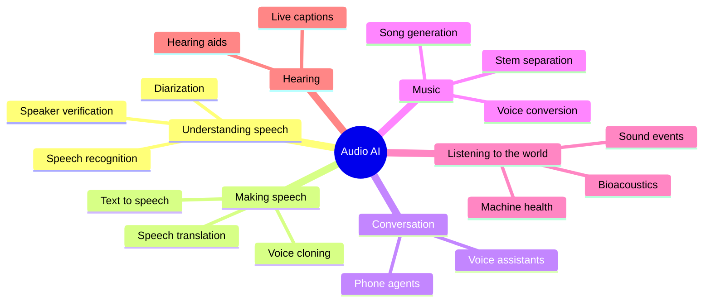
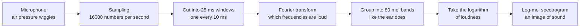
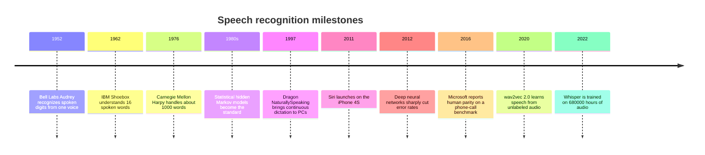
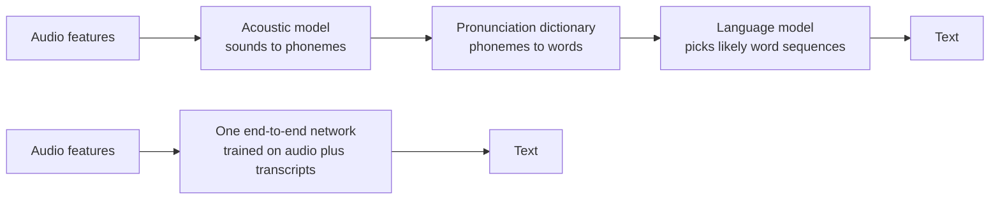
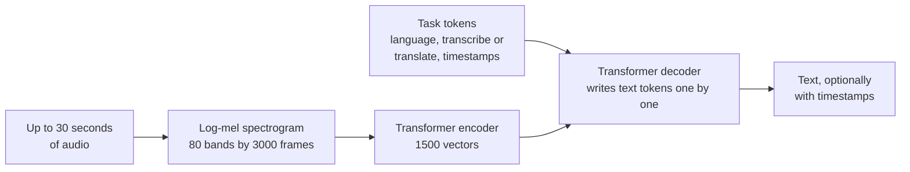
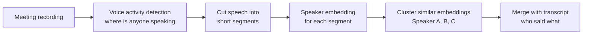

# Chapter 46: Speech, Audio and Music

*How machines learned to hear words, tell voices apart, speak in anyone's voice, compose songs and listen to whales, and what that means for your phone calls, your job and your ears.*

## What you'll learn

- How sound becomes numbers, and why turning it into a picture (a spectrogram) lets audio borrow the tricks of computer vision.
- The seventy-year story of speech recognition, from a 1952 machine that knew ten digits to Whisper, trained on 680,000 hours of audio.
- How to measure a transcript's accuracy with word error rate, and why the same system can be much worse for some speakers than others.
- How "who spoke when" (diarization) works, and why voiceprints are no longer a safe password.
- How synthetic voices went from robotic to indistinguishable, how voice cloning works, and the scams, laws and defenses around it.
- How real-time voice agents are engineered: latency budgets, turn-taking, barge-in and hand-off to humans.
- How AI makes music, what the 2024 label lawsuits and the 2025–26 settlements changed, and what is still unsettled.
- How AI listens to the world (alarms, machines, birds, whales) and helps people hear, plus the failure modes and opportunities across the whole branch.

## Before you start

Chapter 3 (Software, Code and Data) showed how sound is recorded as a list of numbers. Chapter 9 (Is the Model Any Good?) introduced error rates and per-group evaluation. Chapters 14 and 15 explained embeddings, recurrent networks and the Transformer, and Chapter 16 explained diffusion. Chapter 22 (Multimodal Models: Seeing, Hearing and Speaking) is the closest neighbor: it explained how audio becomes tokens, neural audio codecs, and the two designs of voice assistant (the ASR → LLM → TTS cascade and native speech-to-speech "omni" models). This chapter recaps those in a few paragraphs and spends its time on the applied branch. Chapter 45 (Computer Vision) helps too, because much of audio AI works by turning sound into pictures.

## The branch of AI that listens and speaks

You talk to audio AI more than you may realize. Voice typing on your phone, auto-generated captions on videos, "Hey Siri" or "OK Google," the meeting summary that says who promised what, the voice mode in ChatGPT or Gemini, the spam-call warning on your screen, the song recommendation built from what music *sounds* like, and, for hundreds of millions of people, hearing aids and earbuds that clean up speech in a noisy room.

> **Definition — Audio AI:** The branch of AI that works with sound: recognizing speech, identifying speakers, generating voices and music, and detecting and classifying other sounds such as alarms, engines and animal calls.

In the five verbs of AI from Chapter 1, audio covers *perceive* (hearing words, voices and events) and *create* (speaking, singing, composing). Voice agents add *act*, because they book appointments and move money.



*Figure 46.1: The audio branch at a glance. Each leaf is covered in this chapter.*

## Sound as numbers

Sound is air pressure wiggling back and forth. A microphone turns those wiggles into a changing electrical signal, and a converter measures that signal thousands of times a second (Chapter 3).

> **Definition — Waveform:** The raw record of a sound: air pressure (or the microphone's signal) plotted over time. It is a long list of numbers, one per measurement.

> **Definition — Sampling rate:** How many times per second the signal is measured. Phone calls traditionally use 8,000 samples per second, speech AI usually 16,000, and music CDs 44,100.

> **Definition — Bit depth:** How precisely each measurement is stored. CDs use 16 bits per sample, enough for 65,536 different loudness levels.

```
  A sound wave and its samples (each * is one stored number)

  pressure
    +  |      * *                     * *
       |    *     *                 *     *
    0  |--*---------*-------------*---------*------> time
       |              *         *
    -  |                * * * *
          <---- one cycle of the wave ---->

  Stored as a list: 0, 40, 75, 90, 90, 75, 40, 0, -40, ...
```

*Figure 46.2: Sampling. The microphone's smooth wave becomes a list of numbers taken at evenly spaced moments.*

**Worked example: how much data is sound?**

1. A CD stores 44,100 samples per second × 16 bits × 2 channels (left and right) = 1,411,200 bits per second.
2. Divide by 8 to get bytes: about 176,400 bytes per second, or roughly 10.6 megabytes per minute. This is why MP3 and other compressed formats were invented.
3. Speech for AI is usually one channel at 16,000 samples per second. One hour is 16,000 × 3,600 = 57.6 million numbers.

Sounds are made of vibrations at different speeds.

> **Definition — Frequency:** How many times per second a vibration repeats, measured in hertz (Hz). Low notes are low frequencies (a bass guitar's lowest string is about 41 Hz); high notes are high frequencies. People hear roughly 20 Hz to 20,000 Hz when young.

> **Definition — Nyquist limit:** The highest frequency a recording can capture, which is half its sampling rate. A 16,000-samples-per-second recording captures sounds up to 8,000 Hz.

This explains an everyday annoyance. Traditional phone lines carry only frequencies up to about 3,400 Hz. The hissy parts of "s" and "f" live higher than that, so on a phone call "Sam" and "fan" are easy to confuse, and you spell your name with "S as in sugar." Speech AI built for phone calls has to cope with this missing information.

## Spectrograms: a picture of sound

A waveform shows *when* the air moved but hides *which* pitches were present. Your ear does something smarter: the inner ear's cochlea separates sound into frequencies, so you hear a chord as three notes, not one jumble. Audio AI copies this.

> **Definition — Fourier transform:** A mathematical method that splits a chunk of signal into the frequencies it contains and how strong each one is, like a prism splitting white light into colors.

Audio systems cut the waveform into short overlapping windows, typically 25 milliseconds long, starting a new window every 10 milliseconds. Each window is short enough that the sound is roughly steady inside it. A Fourier transform of each window gives one column of frequency strengths. Stack the columns side by side and you have a picture.

> **Definition — Spectrogram:** A picture of sound with time running left to right, frequency (pitch) running bottom to top, and brightness showing how loud each frequency is at each moment.

Human hearing is not linear. We easily hear the difference between 100 Hz and 200 Hz, but 10,000 Hz and 10,100 Hz sound almost the same. So systems squeeze the frequency axis to match.

> **Definition — Mel scale:** A pitch scale that matches human hearing: finely spaced at low frequencies, coarsely spaced at high ones. A mel spectrogram groups frequencies into bands on this scale.

> **Definition — Log-mel spectrogram:** A spectrogram whose frequencies are grouped into mel bands (often 80) and whose loudness values are converted to a logarithmic scale, as the ear perceives loudness. It is the standard input for speech AI.



*Figure 46.3: From air to a picture. Almost every speech model since 2012 starts with some version of this pipeline.*

**Worked example: a spectrogram is smaller and smarter.** With a new window every 10 milliseconds, one second of audio gives 100 columns. With 80 mel bands per column, that is 100 × 80 = 8,000 numbers per second, half of the 16,000 raw samples. And each number now means something ("how loud was the 300 Hz region at 0.42 seconds"), which makes patterns much easier to learn.

```
  A sketch of the spectrogram of someone saying "see you"
  (brighter = louder; # very loud, + medium, . quiet)

  high  |  ######                      
  pitch |  ######   .  .               
        |  ++++++   .  .   ......      
        |           +  +   ++++++      
        |           #  #   ######      
  low   |           #  #   ######      
        +---------------------------------> time
            "s"     "ee"    "you"
          hiss at   bands   bands slide
          high      steady  as the lips
          pitch             round
```

*Figure 46.4: Speech sounds have shapes. The "s" is a bright smear of high frequencies; vowels show as horizontal bands whose positions identify the vowel.*

> **Analogy:** A spectrogram is sheet music for any sound, or the paper roll of a player piano. It records which pitches play when and how loudly, whether the sound is a voice, a bird or a failing ball bearing.

> **Key idea:** Once sound is a picture, the whole toolbox of computer vision applies. CNNs, Vision Transformers and patches (Chapter 45) all work on spectrograms, which is why progress in vision and in audio has moved together.

> **Try it:** Open Chrome Music Lab's Spectrogram (musiclab.chromeexperiments.com/Spectrogram) and allow microphone access. Say "sssss," then "ooooo," then whistle, then clap. Watch the hiss appear as a high smear, the vowel as stacked horizontal bands, the whistle as a single bright line and the clap as a vertical stripe.

## Speech recognition: seventy years of learning to listen

> **Definition — ASR (automatic speech recognition):** Converting spoken audio into written text. Also called speech-to-text.

### From Audrey to Siri



*Figure 46.5: Speech recognition milestones, from single-speaker digits to multilingual open models.*

Early systems matched sound patterns against stored templates for each word, so they worked for one speaker and a tiny vocabulary. The big step came in the 1970s and 1980s, when IBM, Carnegie Mellon and others recast speech recognition as a problem of probabilities. Instead of rules about how speech works, they built statistical models trained on recorded speech. A remark widely attributed to Frederick Jelinek, who led IBM's speech group, captured the mood: every time he fired a linguist, the recognizer's accuracy went up. Data beat hand-written rules decades before the same lesson reached vision and language.

The classic recognizer was a pipeline of three models.

> **Definition — Phoneme:** The smallest unit of sound that distinguishes words in a language, such as the /k/ and /b/ that separate "cat" from "bat." English has roughly 40 phonemes.

> **Definition — Acoustic model:** The part of a speech recognizer that maps short slices of audio to likely speech sounds (phonemes or parts of them).

> **Definition — Hidden Markov model (HMM):** A statistical model of a sequence in which you cannot see the underlying states (which phoneme is being spoken) but can see clues they produce (the sounds). From the 1980s to the early 2010s it was the backbone of speech recognition.

> **Definition — Language model (in speech recognition):** A model of which word sequences are likely, used to choose between sound-alike options. It knows "recognize speech" is more likely than "wreck a nice beach." Chatbots are giant descendants of this idea (Chapter 18).



*Figure 46.6: Top, the classic pipeline of separately built parts. Bottom, the end-to-end approach that replaced it from the mid-2010s.*

Dragon NaturallySpeaking (1997) brought continuous dictation to home computers, though you had to train it on your voice. Google's voice search (2008) and Apple's Siri (2011) moved recognition into the cloud, where data from millions of users could improve it.

### The deep learning turn

In 2012, researchers from the University of Toronto, Microsoft, Google and IBM jointly reported that deep neural networks made far better acoustic models than the older statistical ones, cutting errors substantially. Within a few years every major voice product had switched. In 2016 Microsoft reported a word error rate of 5.9% on Switchboard, a benchmark of recorded telephone conversations, matching the rate of professional human transcribers on the same test.

Next, researchers replaced the whole pipeline with one network.

> **Definition — End-to-end speech recognition:** A single neural network trained to go directly from audio to text, learning the jobs of the acoustic model, pronunciation dictionary and language model together instead of building them separately.

End-to-end models needed lots of transcribed audio, which is expensive: a professional takes several hours to transcribe one hour of speech carefully. Two ideas solved that. Self-supervised learning let models learn from untranscribed audio first: Meta's wav2vec 2.0 (2020) learned by hiding parts of the audio and predicting them, then needed only a small amount of transcribed speech to fine-tune. The second idea was to use huge amounts of imperfect transcripts.

### Whisper: big, messy data wins

> **Definition — Weak supervision:** Training on large amounts of labels that are noisy or imperfect, such as subtitles and transcripts found on the internet, instead of small amounts of carefully checked labels.

OpenAI's Whisper (September 2022) was trained on 680,000 hours of audio paired with transcripts collected from the internet, about 77 years of listening. Roughly 117,000 hours covered 96 languages other than English, and another 125,000 hours paired speech in other languages with English translations. The transcripts were messy, but there were so many that the model learned to cope with accents, background noise, music and technical vocabulary far better than systems trained on clean, narrow datasets.



*Figure 46.7: Whisper's design. An encoder listens to a spectrogram picture; a decoder, steered by special task tokens, writes the transcript like a small language model.*

Whisper is an encoder–decoder Transformer (Chapter 15). The encoder reads the spectrogram. The decoder writes text one token at a time while attending to the encoder's output, and special tokens at the start tell it which language to expect and whether to transcribe or translate into English. Because OpenAI released the model weights openly, Whisper became the default engine inside thousands of apps, from meeting tools to subtitle editors, and later versions improved it further.

> **Key idea:** Whisper repeated the lesson of large language models in audio: a general model trained on a vast, varied, imperfect dataset beats specialized models trained on small clean ones, especially on audio that does not look like any benchmark.

### Measuring speech recognition: word error rate

> **Definition — Word error rate (WER):** The standard accuracy measure for speech recognition: the number of word substitutions, deletions and insertions needed to turn the system's transcript into the correct one, divided by the number of words in the correct transcript. Lower is better.

The formula is WER = (S + D + I) ÷ N, where S is substitutions (wrong word), D is deletions (missed word), I is insertions (extra word) and N is the number of words actually spoken.

**Worked example: scoring a transcript.** A caller says: "please book a table for four at seven tonight" (9 words). The system writes: "please look a table for at seven thirty tonight."

| Spoken | please | book | a | table | for | four | at | seven | (none) | tonight |
|---|---|---|---|---|---|---|---|---|---|---|
| Written | please | look | a | table | for | (none) | at | seven | thirty | tonight |
| Error | | S | | | | D | | | I | |

*Table 46.1: Aligning a transcript with what was said. One substitution, one deletion, one insertion.*

WER = (1 + 1 + 1) ÷ 9 = 3 ÷ 9 ≈ 33%. Because insertions count, WER can even exceed 100% if a system invents lots of words.

To get a feel for the numbers, a one-hour meeting at a typical 150 words per minute contains about 9,000 words. At 5% WER that is about 450 wrong words; at 15%, about 1,350.

> **Definition — Character error rate (CER):** The same idea as WER, counted in characters instead of words. It is used for languages such as Chinese and Japanese that do not put spaces between words.

> **Watch out:** WER treats every error the same. "I can come" heard as "I can't come" is a single substitution, a small WER, and the opposite meaning. A drug name, a dollar amount or a "not" matters far more than an "um." For high-stakes uses, measure the errors that matter (names, numbers, negations), not just the average.

### Who gets heard: accents, noise and fairness

A single WER number hides huge differences between situations and speakers. Clean read speech is easy; a far-away microphone in an echoing room, overlapping talkers, a noisy café, a child, an elderly speaker or a strong accent are all harder.

In 2020 a Stanford-led study published in *PNAS* tested the speech recognition systems of five large technology companies on interviews with Black and white Americans. The average WER was 0.35 for Black speakers and 0.19 for white speakers: roughly 35 errors per 100 words versus 19. The likely cause was training data that underrepresented African American Vernacular English and the voices of Black speakers.

> **Definition — Low-resource language:** A language with little digital text and transcribed speech available for training AI, so models work much worse in it. Most of the world's roughly 7,000 languages are low-resource.

People with atypical speech, for example after a stroke or with ALS, cerebral palsy or Parkinson's, are also poorly served by systems trained on typical voices. Google's Project Euphonia (announced 2019) collected consented recordings from people with speech impairments to build models that understand them, a reminder that representation in data is a design choice.

> **Watch out:** "Our transcription is 95% accurate" usually describes a benchmark, not you. Ask: tested on what kind of audio, which languages and accents, at what WER for each group? For a product that serves the public, measure WER separately for the groups you serve.

### When transcripts invent words

Speech recognizers built like language models can do what chatbots do: produce fluent text that was never said.

> **Definition — Hallucination (in speech recognition):** When a speech model writes words or whole sentences that were not in the audio, often during silence, music or unclear speech, because its decoder is predicting likely text rather than strictly transcribing.

A 2024 study nicknamed "Careless Whisper" found that about 1 percent of Whisper transcriptions in its test set contained entire hallucinated phrases, some of them harmful, such as invented violence or made-up medical terms, and that this happened more often for speakers with long pauses, including people with aphasia. The same year, the Associated Press reported engineers and researchers finding invented text in Whisper-based transcripts, including in tools used to transcribe medical visits.

Mitigations include cutting out silences before transcription, keeping the original audio so a person can check, flagging low-confidence passages, and, for medicine and law, requiring human review of anything that becomes a record.

## Who spoke when: diarization and voice biometrics

A transcript of a meeting is far more useful when it says *who* said each line.

> **Definition — Speaker diarization:** Working out "who spoke when" in a recording with several voices, splitting the audio into segments and labeling each with a speaker (Speaker A, Speaker B) without necessarily knowing their names.

> **Definition — Speaker embedding:** A short list of numbers computed from a stretch of someone's voice, trained so that recordings of the same person land close together and different people land far apart. It is the audio version of the face embedding in Chapter 45.



*Figure 46.8: A diarization pipeline. Clustering groups segments that sound like the same person.*

> **Definition — Diarization error rate (DER):** The share of time in a recording that is attributed to the wrong speaker, to no speaker when someone was talking, or to a speaker when no one was talking.

The hardest part is overlapping speech: when two people talk at once, older systems assigned the stretch to only one of them. Short interjections ("yes," "right") and similar-sounding voices also cause errors. Newer systems are trained end to end on overlapping speech and handle it better.

Diarization powers meeting summaries in video-call software, call-center analytics (agent versus customer), court and journalism transcripts, podcast editing, and ambient medical scribes that must separate the doctor's words from the patient's.

A close relative is checking *who* someone is from their voice.

> **Definition — Speaker verification (voice biometrics):** Checking whether a voice belongs to a claimed person by comparing its speaker embedding with a stored "voiceprint." Some banks and call centers use it instead of passwords.

Voice cloning has badly weakened this. In 2023 a journalist used a free AI voice tool to clone his own voice and got into his own bank account by phone, passing the bank's voice-ID check. Banks and call centers now treat voice as one weak signal among several, not as a password.

> **Watch out:** If your bank offers "my voice is my password," treat it as a convenience, not as security. Ask for additional verification, and never assume a familiar voice on the phone proves who is calling.
