# Chapter 46: Speech, Audio and Music

*How machines learned to hear words, tell voices apart, speak in anyone's voice, compose songs and listen to whales, and what that means for your phone calls, your job and your ears.*

## What you'll learn

- How sound becomes numbers, and why turning it into a picture (a spectrogram) lets audio borrow the tricks of computer vision.
- The seventy-year story of speech recognition, from a 1952 machine that knew ten digits to Whisper, trained on 680,000 hours of audio.
- How to measure a transcript's accuracy with word error rate, and why the same system can be much worse for some speakers than others.
- How "who spoke when" (diarization) works, and why voiceprints are no longer a safe password.
- How synthetic voices went from robotic to indistinguishable, how voice cloning works, and the scams, laws and defenses around it.
- How real-time voice agents are engineered: latency budgets, turn-taking, barge-in and hand-off to humans.
- How AI makes music, what the 2024 label lawsuits and the 2025–26 settlements changed, and what is still unsettled.
- How AI listens to the world (alarms, machines, birds, whales) and helps people hear, plus the failure modes and opportunities across the whole branch.

## Before you start

Chapter 3 (Software, Code and Data) showed how sound is recorded as a list of numbers. Chapter 9 (Is the Model Any Good?) introduced error rates and per-group evaluation. Chapters 14 and 15 explained embeddings, recurrent networks and the Transformer, and Chapter 16 explained diffusion. Chapter 22 (Multimodal Models: Seeing, Hearing and Speaking) is the closest neighbor: it explained how audio becomes tokens, neural audio codecs, and the two designs of voice assistant (the ASR → LLM → TTS cascade and native speech-to-speech "omni" models). This chapter recaps those in a few paragraphs and spends its time on the applied branch. Chapter 45 (Computer Vision) helps too, because much of audio AI works by turning sound into pictures.

## The branch of AI that listens and speaks

You talk to audio AI more than you may realize. Voice typing on your phone, auto-generated captions on videos, "Hey Siri" or "OK Google," the meeting summary that says who promised what, the voice mode in ChatGPT or Gemini, the spam-call warning on your screen, the song recommendation built from what music *sounds* like, and, for hundreds of millions of people, hearing aids and earbuds that clean up speech in a noisy room.

> **Definition — Audio AI:** The branch of AI that works with sound: recognizing speech, identifying speakers, generating voices and music, and detecting and classifying other sounds such as alarms, engines and animal calls.

In the five verbs of AI from Chapter 1, audio covers *perceive* (hearing words, voices and events) and *create* (speaking, singing, composing). Voice agents add *act*, because they book appointments and move money.

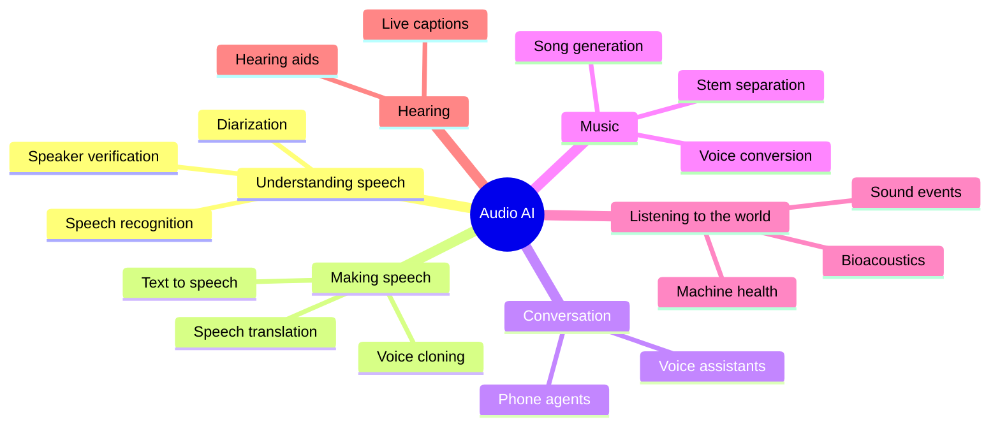

*Figure 46.1: The audio branch at a glance. Each leaf is covered in this chapter.*

## Sound as numbers

Sound is air pressure wiggling back and forth. A microphone turns those wiggles into a changing electrical signal, and a converter measures that signal thousands of times a second (Chapter 3).

> **Definition — Waveform:** The raw record of a sound: air pressure (or the microphone's signal) plotted over time. It is a long list of numbers, one per measurement.

> **Definition — Sampling rate:** How many times per second the signal is measured. Phone calls traditionally use 8,000 samples per second, speech AI usually 16,000, and music CDs 44,100.

> **Definition — Bit depth:** How precisely each measurement is stored. CDs use 16 bits per sample, enough for 65,536 different loudness levels.

```
  A sound wave and its samples (each * is one stored number)

  pressure
    +  |      * *                     * *
       |    *     *                 *     *
    0  |--*---------*-------------*---------*------> time
       |              *         *
    -  |                * * * *
          <---- one cycle of the wave ---->

  Stored as a list: 0, 40, 75, 90, 90, 75, 40, 0, -40, ...
```

*Figure 46.2: Sampling. The microphone's smooth wave becomes a list of numbers taken at evenly spaced moments.*

**Worked example: how much data is sound?**

1. A CD stores 44,100 samples per second × 16 bits × 2 channels (left and right) = 1,411,200 bits per second.
2. Divide by 8 to get bytes: about 176,400 bytes per second, or roughly 10.6 megabytes per minute. This is why MP3 and other compressed formats were invented.
3. Speech for AI is usually one channel at 16,000 samples per second. One hour is 16,000 × 3,600 = 57.6 million numbers.

Sounds are made of vibrations at different speeds.

> **Definition — Frequency:** How many times per second a vibration repeats, measured in hertz (Hz). Low notes are low frequencies (a bass guitar's lowest string is about 41 Hz); high notes are high frequencies. People hear roughly 20 Hz to 20,000 Hz when young.

> **Definition — Nyquist limit:** The highest frequency a recording can capture, which is half its sampling rate. A 16,000-samples-per-second recording captures sounds up to 8,000 Hz.

This explains an everyday annoyance. Traditional phone lines carry only frequencies up to about 3,400 Hz. The hissy parts of "s" and "f" live higher than that, so on a phone call "Sam" and "fan" are easy to confuse, and you spell your name with "S as in sugar." Speech AI built for phone calls has to cope with this missing information.

## Spectrograms: a picture of sound

A waveform shows *when* the air moved but hides *which* pitches were present. Your ear does something smarter: the inner ear's cochlea separates sound into frequencies, so you hear a chord as three notes, not one jumble. Audio AI copies this.

> **Definition — Fourier transform:** A mathematical method that splits a chunk of signal into the frequencies it contains and how strong each one is, like a prism splitting white light into colors.

Audio systems cut the waveform into short overlapping windows, typically 25 milliseconds long, starting a new window every 10 milliseconds. Each window is short enough that the sound is roughly steady inside it. A Fourier transform of each window gives one column of frequency strengths. Stack the columns side by side and you have a picture.

> **Definition — Spectrogram:** A picture of sound with time running left to right, frequency (pitch) running bottom to top, and brightness showing how loud each frequency is at each moment.

Human hearing is not linear. We easily hear the difference between 100 Hz and 200 Hz, but 10,000 Hz and 10,100 Hz sound almost the same. So systems squeeze the frequency axis to match.

> **Definition — Mel scale:** A pitch scale that matches human hearing: finely spaced at low frequencies, coarsely spaced at high ones. A mel spectrogram groups frequencies into bands on this scale.

> **Definition — Log-mel spectrogram:** A spectrogram whose frequencies are grouped into mel bands (often 80) and whose loudness values are converted to a logarithmic scale, as the ear perceives loudness. It is the standard input for speech AI.

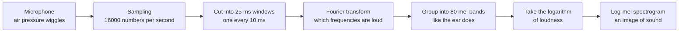

*Figure 46.3: From air to a picture. Almost every speech model since 2012 starts with some version of this pipeline.*

**Worked example: a spectrogram is smaller and smarter.** With a new window every 10 milliseconds, one second of audio gives 100 columns. With 80 mel bands per column, that is 100 × 80 = 8,000 numbers per second, half of the 16,000 raw samples. And each number now means something ("how loud was the 300 Hz region at 0.42 seconds"), which makes patterns much easier to learn.

```
  A sketch of the spectrogram of someone saying "see you"
  (brighter = louder; # very loud, + medium, . quiet)

  high  |  ######                      
  pitch |  ######   .  .               
        |  ++++++   .  .   ......      
        |           +  +   ++++++      
        |           #  #   ######      
  low   |           #  #   ######      
        +---------------------------------> time
            "s"     "ee"    "you"
          hiss at   bands   bands slide
          high      steady  as the lips
          pitch             round
```

*Figure 46.4: Speech sounds have shapes. The "s" is a bright smear of high frequencies; vowels show as horizontal bands whose positions identify the vowel.*

> **Analogy:** A spectrogram is sheet music for any sound, or the paper roll of a player piano. It records which pitches play when and how loudly, whether the sound is a voice, a bird or a failing ball bearing.

> **Key idea:** Once sound is a picture, the whole toolbox of computer vision applies. CNNs, Vision Transformers and patches (Chapter 45) all work on spectrograms, which is why progress in vision and in audio has moved together.

> **Try it:** Open Chrome Music Lab's Spectrogram (musiclab.chromeexperiments.com/Spectrogram) and allow microphone access. Say "sssss," then "ooooo," then whistle, then clap. Watch the hiss appear as a high smear, the vowel as stacked horizontal bands, the whistle as a single bright line and the clap as a vertical stripe.

## Speech recognition: seventy years of learning to listen

> **Definition — ASR (automatic speech recognition):** Converting spoken audio into written text. Also called speech-to-text.

### From Audrey to Siri

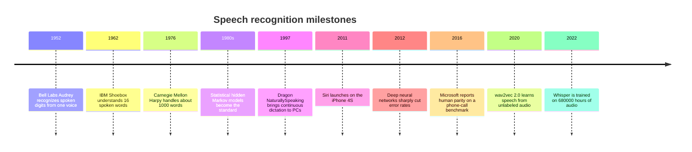

*Figure 46.5: Speech recognition milestones, from single-speaker digits to multilingual open models.*

Early systems matched sound patterns against stored templates for each word, so they worked for one speaker and a tiny vocabulary. The big step came in the 1970s and 1980s, when IBM, Carnegie Mellon and others recast speech recognition as a problem of probabilities. Instead of rules about how speech works, they built statistical models trained on recorded speech. A remark widely attributed to Frederick Jelinek, who led IBM's speech group, captured the mood: every time he fired a linguist, the recognizer's accuracy went up. Data beat hand-written rules decades before the same lesson reached vision and language.

The classic recognizer was a pipeline of three models.

> **Definition — Phoneme:** The smallest unit of sound that distinguishes words in a language, such as the /k/ and /b/ that separate "cat" from "bat." English has roughly 40 phonemes.

> **Definition — Acoustic model:** The part of a speech recognizer that maps short slices of audio to likely speech sounds (phonemes or parts of them).

> **Definition — Hidden Markov model (HMM):** A statistical model of a sequence in which you cannot see the underlying states (which phoneme is being spoken) but can see clues they produce (the sounds). From the 1980s to the early 2010s it was the backbone of speech recognition.

> **Definition — Language model (in speech recognition):** A model of which word sequences are likely, used to choose between sound-alike options. It knows "recognize speech" is more likely than "wreck a nice beach." Chatbots are giant descendants of this idea (Chapter 18).

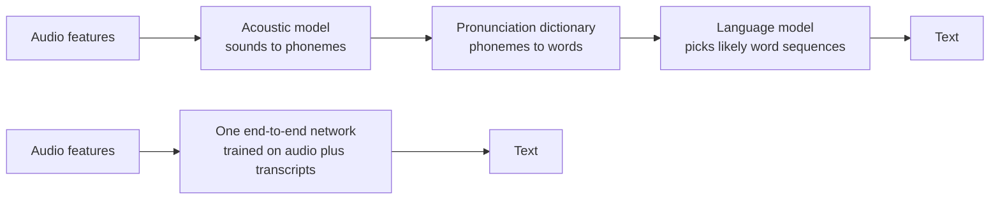

*Figure 46.6: Top, the classic pipeline of separately built parts. Bottom, the end-to-end approach that replaced it from the mid-2010s.*

Dragon NaturallySpeaking (1997) brought continuous dictation to home computers, though you had to train it on your voice. Google's voice search (2008) and Apple's Siri (2011) moved recognition into the cloud, where data from millions of users could improve it.

### The deep learning turn

In 2012, researchers from the University of Toronto, Microsoft, Google and IBM jointly reported that deep neural networks made far better acoustic models than the older statistical ones, cutting errors substantially. Within a few years every major voice product had switched. In 2016 Microsoft reported a word error rate of 5.9% on Switchboard, a benchmark of recorded telephone conversations, matching the rate of professional human transcribers on the same test.

Next, researchers replaced the whole pipeline with one network.

> **Definition — End-to-end speech recognition:** A single neural network trained to go directly from audio to text, learning the jobs of the acoustic model, pronunciation dictionary and language model together instead of building them separately.

End-to-end models needed lots of transcribed audio, which is expensive: a professional takes several hours to transcribe one hour of speech carefully. Two ideas solved that. Self-supervised learning let models learn from untranscribed audio first: Meta's wav2vec 2.0 (2020) learned by hiding parts of the audio and predicting them, then needed only a small amount of transcribed speech to fine-tune. The second idea was to use huge amounts of imperfect transcripts.

### Whisper: big, messy data wins

> **Definition — Weak supervision:** Training on large amounts of labels that are noisy or imperfect, such as subtitles and transcripts found on the internet, instead of small amounts of carefully checked labels.

OpenAI's Whisper (September 2022) was trained on 680,000 hours of audio paired with transcripts collected from the internet, about 77 years of listening. Roughly 117,000 hours covered 96 languages other than English, and another 125,000 hours paired speech in other languages with English translations. The transcripts were messy, but there were so many that the model learned to cope with accents, background noise, music and technical vocabulary far better than systems trained on clean, narrow datasets.

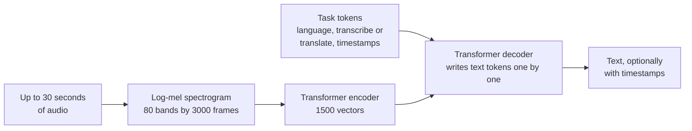

*Figure 46.7: Whisper's design. An encoder listens to a spectrogram picture; a decoder, steered by special task tokens, writes the transcript like a small language model.*

Whisper is an encoder–decoder Transformer (Chapter 15). The encoder reads the spectrogram. The decoder writes text one token at a time while attending to the encoder's output, and special tokens at the start tell it which language to expect and whether to transcribe or translate into English. Because OpenAI released the model weights openly, Whisper became the default engine inside thousands of apps, from meeting tools to subtitle editors, and later versions improved it further.

> **Key idea:** Whisper repeated the lesson of large language models in audio: a general model trained on a vast, varied, imperfect dataset beats specialized models trained on small clean ones, especially on audio that does not look like any benchmark.

### Measuring speech recognition: word error rate

> **Definition — Word error rate (WER):** The standard accuracy measure for speech recognition: the number of word substitutions, deletions and insertions needed to turn the system's transcript into the correct one, divided by the number of words in the correct transcript. Lower is better.

The formula is WER = (S + D + I) ÷ N, where S is substitutions (wrong word), D is deletions (missed word), I is insertions (extra word) and N is the number of words actually spoken.

**Worked example: scoring a transcript.** A caller says: "please book a table for four at seven tonight" (9 words). The system writes: "please look a table for at seven thirty tonight."

| Spoken | please | book | a | table | for | four | at | seven | (none) | tonight |
|---|---|---|---|---|---|---|---|---|---|---|
| Written | please | look | a | table | for | (none) | at | seven | thirty | tonight |
| Error | | S | | | | D | | | I | |

*Table 46.1: Aligning a transcript with what was said. One substitution, one deletion, one insertion.*

WER = (1 + 1 + 1) ÷ 9 = 3 ÷ 9 ≈ 33%. Because insertions count, WER can even exceed 100% if a system invents lots of words.

To get a feel for the numbers, a one-hour meeting at a typical 150 words per minute contains about 9,000 words. At 5% WER that is about 450 wrong words; at 15%, about 1,350.

> **Definition — Character error rate (CER):** The same idea as WER, counted in characters instead of words. It is used for languages such as Chinese and Japanese that do not put spaces between words.

> **Watch out:** WER treats every error the same. "I can come" heard as "I can't come" is a single substitution, a small WER, and the opposite meaning. A drug name, a dollar amount or a "not" matters far more than an "um." For high-stakes uses, measure the errors that matter (names, numbers, negations), not just the average.

### Who gets heard: accents, noise and fairness

A single WER number hides huge differences between situations and speakers. Clean read speech is easy; a far-away microphone in an echoing room, overlapping talkers, a noisy café, a child, an elderly speaker or a strong accent are all harder.

In 2020 a Stanford-led study published in *PNAS* tested the speech recognition systems of five large technology companies on interviews with Black and white Americans. The average WER was 0.35 for Black speakers and 0.19 for white speakers: roughly 35 errors per 100 words versus 19. The likely cause was training data that underrepresented African American Vernacular English and the voices of Black speakers.

> **Definition — Low-resource language:** A language with little digital text and transcribed speech available for training AI, so models work much worse in it. Most of the world's roughly 7,000 languages are low-resource.

People with atypical speech, for example after a stroke or with ALS, cerebral palsy or Parkinson's, are also poorly served by systems trained on typical voices. Google's Project Euphonia (announced 2019) collected consented recordings from people with speech impairments to build models that understand them, a reminder that representation in data is a design choice.

> **Watch out:** "Our transcription is 95% accurate" usually describes a benchmark, not you. Ask: tested on what kind of audio, which languages and accents, at what WER for each group? For a product that serves the public, measure WER separately for the groups you serve.

### When transcripts invent words

Speech recognizers built like language models can do what chatbots do: produce fluent text that was never said.

> **Definition — Hallucination (in speech recognition):** When a speech model writes words or whole sentences that were not in the audio, often during silence, music or unclear speech, because its decoder is predicting likely text rather than strictly transcribing.

A 2024 study nicknamed "Careless Whisper" found that about 1 percent of Whisper transcriptions in its test set contained entire hallucinated phrases, some of them harmful, such as invented violence or made-up medical terms, and that this happened more often for speakers with long pauses, including people with aphasia. The same year, the Associated Press reported engineers and researchers finding invented text in Whisper-based transcripts, including in tools used to transcribe medical visits.

Mitigations include cutting out silences before transcription, keeping the original audio so a person can check, flagging low-confidence passages, and, for medicine and law, requiring human review of anything that becomes a record.

## Who spoke when: diarization and voice biometrics

A transcript of a meeting is far more useful when it says *who* said each line.

> **Definition — Speaker diarization:** Working out "who spoke when" in a recording with several voices, splitting the audio into segments and labeling each with a speaker (Speaker A, Speaker B) without necessarily knowing their names.

> **Definition — Speaker embedding:** A short list of numbers computed from a stretch of someone's voice, trained so that recordings of the same person land close together and different people land far apart. It is the audio version of the face embedding in Chapter 45.

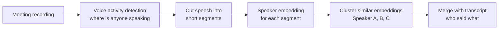

*Figure 46.8: A diarization pipeline. Clustering groups segments that sound like the same person.*

> **Analogy:** Diarization is like a note-taker at a meeting full of strangers. They do not know anyone's name, but they can write "the deep voice by the window" or "the fast talker" each time that person speaks, and a name can be attached later.

> **Definition — Diarization error rate (DER):** The share of time in a recording that is attributed to the wrong speaker, to no speaker when someone was talking, or to a speaker when no one was talking.

The hardest part is overlapping speech: when two people talk at once, older systems assigned the stretch to only one of them. Short interjections ("yes," "right") and similar-sounding voices also cause errors. Newer systems are trained end to end on overlapping speech and handle it better.

Diarization powers meeting summaries in video-call software, call-center analytics (agent versus customer), court and journalism transcripts, podcast editing, and ambient medical scribes that must separate the doctor's words from the patient's.

A close relative is checking *who* someone is from their voice.

> **Definition — Speaker verification (voice biometrics):** Checking whether a voice belongs to a claimed person by comparing its speaker embedding with a stored "voiceprint." Some banks and call centers use it instead of passwords.

Voice cloning has badly weakened this. In 2023 a journalist used a free AI voice tool to clone his own voice and got into his own bank account by phone, passing the bank's voice-ID check. Banks and call centers now treat voice as one weak signal among several, not as a password.

> **Watch out:** If your bank offers "my voice is my password," treat it as a convenience, not as security. Ask for additional verification, and never assume a familiar voice on the phone proves who is calling.

## Teaching machines to speak: text-to-speech

> **Definition — TTS (text-to-speech):** Generating spoken audio from written text. Also called speech synthesis.

The history of synthetic speech is a march from "obviously a machine" to "indistinguishable from a person."

- **1939: the Voder.** At the New York World's Fair, Bell Labs showed an electronic speaking machine played by a trained operator with keys and a foot pedal, like an instrument.
- **1980s: formant synthesis.** Rules described how the throat and mouth shape sound, and electronics imitated them.
- **1990s–2010s: stitching recordings together.** A voice actor read many hours of text; the system cut it into tiny pieces and glued the best-matching pieces together for each new sentence.
- **2000s: statistical models.** Smoother and more flexible than stitching, but with a muffled, buzzy quality.
- **2016 onward: neural networks.** Voices became natural.

> **Definition — Formant synthesis:** Making speech by generating the resonant frequencies (formants) that the human vocal tract produces, using rules rather than recordings. It sounds robotic but is very intelligible; Stephen Hawking's famous voice came from a 1980s synthesizer of this kind.

> **Definition — Concatenative synthesis:** Making speech by cutting a large recording of one voice actor into small units and joining the best-matching units for each new sentence. It sounds natural in the middle of phrases and glitchy at the joins.

In September 2016 DeepMind's WaveNet generated the raw waveform directly, predicting each audio sample from all the samples before it, the same "predict the next piece" idea your chatbot uses for words (Chapter 18). Listeners rated it far more natural than any earlier system.

**Worked example: why WaveNet was slow at first.** At 24,000 samples per second, one second of speech requires 24,000 predictions made one after another, each waiting for the previous one. If each prediction took one millisecond (an illustrative figure), a single second of speech would take 24 seconds to generate. In 2017 a "parallel" version made generation about a thousand times faster, and WaveNet voices went into Google Assistant. Modern systems avoid the problem by generating compact codec tokens instead of raw samples. Kyutai's Mimi codec (Chapter 22), for example, runs at 12.5 frames per second, so a model predicts 12.5 small bundles of tokens per second of speech instead of 24,000 samples.

Most neural TTS systems since 2017 work in two stages, popularized by Google's Tacotron 2: one model turns text into a spectrogram-like representation, and a second turns that back into sound.

> **Definition — Vocoder:** The component that turns a spectrogram or audio tokens back into a playable waveform. Neural vocoders made synthetic speech sound natural instead of buzzy.

Before any of that, the text has to be made speakable.

> **Definition — Text normalization:** Converting written text into the words a person would actually say: "Dr. Lee paid $3.50 on 3/4" becomes "Doctor Lee paid three dollars fifty on March fourth" (or "the third of April," depending on the country).

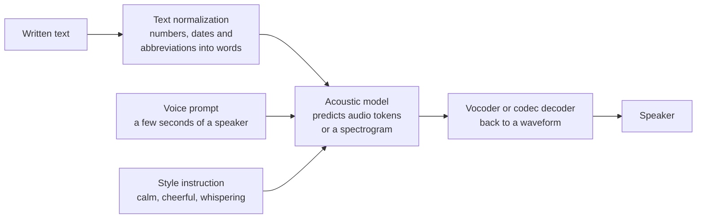

*Figure 46.9: A modern TTS pipeline. The voice prompt and style instruction are what make cloning and expressive delivery possible.*

From 2023, TTS began to look like language modeling. Microsoft's VALL-E (January 2023) treated speech as a sequence of codec tokens, predicted them with a Transformer, and imitated a new voice from a three-second sample. Diffusion and flow-matching methods (Chapter 16) gave another route to fast, high-quality voices. By 2025 several providers let developers describe the delivery in plain words ("speak like a calm nurse, slowly"), and native omni models (Chapter 22) could laugh, whisper and change tone mid-sentence.

> **Definition — Mean opinion score (MOS):** A rating of speech quality or naturalness, usually on a 1–5 scale, averaged across many human listeners. It is the standard way to compare TTS systems, since no formula captures "sounds human."

> **Try it:** In Microsoft Edge, open any article and use the "Read aloud" feature, which offers free neural voices. Then open your phone's accessibility settings and listen to an older system voice reading the same paragraph. Listen for pauses, emphasis on the right words, and how each voice handles a number like "1,284.50."

## Voice cloning: a gift and a weapon

> **Definition — Voice cloning:** Making a TTS system speak in a specific person's voice, from a recording of that person. Higher-quality clones use minutes or hours of audio; modern systems produce a convincing likeness from seconds.

> **Definition — Zero-shot voice cloning:** Imitating a voice from a short sample the model has never been trained on, with no additional training, by feeding the sample in as a prompt alongside the text.

Technically, cloning is TTS conditioned on a voice. The model has heard tens of thousands of speakers in training, so it has learned a "space of voices." A few seconds of a new voice locate a point in that space (much like a speaker embedding), and the model speaks from there.

> **Analogy:** A cloning model is like a gifted impressionist who has listened to tens of thousands of voices. Because they already know how voices vary, a single sentence from someone new is enough for a convincing impression.

### The good uses

Cloning gives voices back. Apple's Personal Voice (2023) lets people at risk of losing their speech, for example from ALS, record about 15 minutes of phrases on their iPhone and then type to speak in a synthetic version of their own voice, generated on the device. Voice banking services do the same for patients before throat surgery. Creators dub their videos into other languages in their own voice. Publishers produce audiobooks for titles that would never get a human narrator. Game studios and advertisers license voices from actors who agree and are paid.

### The harms

The same technology lets anyone with a short clip impersonate someone.

> **Definition — Audio deepfake:** Synthetic speech that imitates a real person saying something they never said, used to deceive.

- **Family-emergency scams.** A caller sounding exactly like your child or grandchild says they are in trouble and need money now. A few seconds of their voice from a social-media video is enough.
- **Executive fraud.** In 2019 the head of a UK energy company reportedly transferred about $243,000 after a phone call from what sounded like his boss at the parent company. In 2024 an employee of the engineering firm Arup in Hong Kong paid out about $25 million after a video call in which the "colleagues," including the finance chief, were deepfakes.
- **Election interference.** In January 2024 voters in New Hampshire received robocalls with an AI-generated imitation of President Biden's voice telling them not to vote in the primary. In February 2024 the US Federal Communications Commission ruled that AI-generated voices in robocalls count as "artificial" voices under the existing robocall law (the Telephone Consumer Protection Act), so such calls need the recipient's prior consent.
- **Performers' livelihoods.** Voice actors found clones of their voices used without consent or pay. Tennessee's ELVIS Act (March 2024) added protection for a person's voice against unauthorized AI imitation, and performers' unions made consent and payment for digital replicas central demands in the 2023 Hollywood strike and in a video-game performers' strike that began in 2024.

Some companies held back. Meta did not publicly release its Voicebox speech model in 2023, citing misuse risks, and in March 2024 OpenAI previewed Voice Engine, which could clone a voice from a 15-second sample, while saying it would not release it widely yet for the same reason. But open-source cloning models are freely available, so restraint by a few companies does not remove the capability.

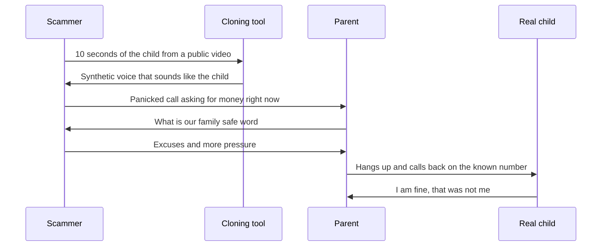

*Figure 46.10: How a voice-clone scam works, and the two habits that defeat it: a pre-agreed safe word and calling back on a number you already know.*

### Defenses

No single defense is enough, so people and organizations layer several:

- **Habits.** Agree on a family safe word. Hang up and call back on a known number. Treat urgency, secrecy and unusual payment methods (gift cards, crypto, wire transfers) as red flags whatever the voice sounds like.
- **Process.** Companies require a second channel and a second person to approve large payments, so no single call can move money.
- **Provenance and watermarks.** Some providers embed hidden signals in generated audio.

> **Definition — Audio watermark:** A hidden signal embedded in generated audio, inaudible to people but detectable by software, so the audio can later be identified as AI-made. Google's SynthID and Meta's AudioSeal (2024) are examples.

Watermarks only help when the generator adds them, and they can sometimes be weakened by editing. Deepfake detectors that analyze audio for telltale artifacts help but are in an arms race with generators. That is why habits and processes, which do not depend on spotting the fake, are the most reliable protection (Chapter 58 covers misuse more broadly).

> **Key idea:** Defend against cloned voices with procedures, not with your ears. A safe word, a call-back to a known number and a second approver for payments work no matter how perfect the fake sounds.

> **Watch out:** "I would recognize my own child's voice" is exactly the instinct scammers exploit. Modern clones fool family members. Verify through a separate channel, not by listening harder.

The policy debate has strong arguments on both sides. Open voice models let researchers build detectors, let small companies and accessibility projects compete, and support languages big companies ignore. Restricting them, the other side argues, raises the cost of mass fraud and harassment, and the people harmed (often elderly, often not tech-savvy) did not choose the risk. Most proposals land in the middle: consent checks for cloning a voice, watermarking by default, clear liability for misuse, and legal rights over one's own voice.

## Real-time voice agents

Chapter 22 explained the two designs of a talking assistant. The **cascade** chains speech recognition, a text language model and TTS; it is flexible, produces a transcript and lets you use any text model, but every hand-off adds delay and the language model never hears your tone. A **native speech-to-speech** ("omni") model listens and speaks directly, which is faster and hears emotion, but offers less control. This section is about the engineering that makes either one work on a real phone line with real customers.

> **Definition — Voice agent:** An AI system that holds a spoken conversation and takes actions, such as booking an appointment, taking an order or answering account questions, usually over the phone or in an app.

### What makes conversation hard

A text chatbot waits for you to press Enter. A voice agent must decide for itself when you have finished, which is harder than it sounds: people pause mid-sentence to think, say "um," and trail off.

> **Definition — Turn-taking:** Managing who speaks when in a conversation: detecting that the other person has finished (endpointing, Chapter 22), starting to reply promptly, and yielding when they start talking again.

> **Definition — Barge-in:** The caller's ability to interrupt the agent mid-sentence and have it stop, listen and respond to what they just said.

Barge-in creates a technical problem: the agent's microphone hears the agent's own voice coming out of the caller's phone speaker.

> **Definition — Echo cancellation:** Removing the agent's own outgoing audio from the incoming signal, so it does not mistake its own voice for the caller interrupting.

> **Definition — Backchannel:** The small sounds listeners make while someone else talks, such as "mm-hm," "right" and "yeah," which signal "keep going," not "my turn." A good voice agent must not treat these as interruptions, and the best ones produce them.

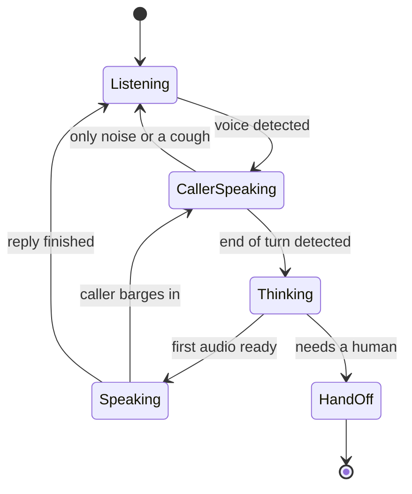

*Figure 46.11: A voice agent's turn-taking as a set of states. Most bad experiences come from wrong transitions: replying while the caller is still thinking, or not stopping when interrupted.*

Phone lines add their own handicaps. Calls traditionally carry narrowband audio at 8,000 samples per second, so frequencies above about 3,400 Hz are gone and "s" and "f" blur together; mobile networks and internet calling add compression and delay; and the caller may be in a car or a kitchen.

### The latency budget

People expect a reply within roughly a second; beyond that, they start repeating themselves or talking over the agent (Chapter 22 cites the roughly 200-millisecond gap typical of human turn-taking).

| Stage | Illustrative delay | How engineers shrink it |
|---|---|---|
| Deciding the caller has finished | 200–500 ms | Smarter turn detectors that use words and intonation, not just silence |
| Final speech recognition | 100–200 ms | Streaming recognition that transcribes while the caller talks |
| Language model's first words | 200–600 ms | Smaller, faster models; short first sentence; cached instructions |
| TTS first audio | 100–200 ms | Streaming TTS that starts speaking from the first phrase |
| Network and phone system | 100–200 ms | Servers near the phone carrier; fewer hops |
| **Total** | **700–1,700 ms** | Target: under about one second |

*Table 46.2: An illustrative latency budget for a cascade phone agent. These are teaching ranges, not measurements of a particular product.*

When an action takes longer (looking up an order), good agents say a short filler ("let me check that for you") so the silence does not feel like a dropped call.

> **Key idea:** In voice, speed is part of correctness. A right answer that arrives after two seconds of silence feels broken, so voice systems are designed around the latency budget first and the model choice second.

> **Analogy:** A slow voice agent feels like an old long-distance call with a satellite delay: both people start talking at once, stop, apologize and start again. Every few hundred milliseconds of extra delay makes the conversation more awkward.

### Guardrails for agents that talk and act

Voice agents are language models with a phone line, so they inherit every reliability issue of Chapter 18, plus a few of their own:

- **Read back what matters.** Repeat names, dates, phone numbers and amounts, and ask for confirmation, because ASR errors on digits are common and costly.
- **Act through tools, not words.** Bookings and refunds should go through structured tool calls with checks (Chapter 28), so the agent cannot "promise" something the system cannot do.
- **Know when to hand off.** Detect frustration, confusion, emergencies and out-of-scope requests, and transfer to a person with a summary so the caller does not start over.
- **Disclose and get consent.** Several jurisdictions require bots to disclose that they are not human in some situations (California has required this for bots used to sell or to influence votes since 2019), and some US states, such as California, require everyone on a call to consent to recording.

> **Definition — Containment rate:** The share of calls a voice agent resolves completely without transferring to a human. Companies track it alongside customer satisfaction, because a high containment rate achieved by frustrating callers into hanging up is a false success.

### Where voice agents work, and where they stumble

Call centers use voice AI in three layers: transcribing and summarizing every call, suggesting answers to human agents in real time ("agent assist"), and fully automated agents for routine requests. Small businesses, from dental clinics to plumbers, use AI receptionists to answer calls they would otherwise miss. Language apps offer spoken conversation practice. Healthcare's fastest-spreading AI tools are ambient scribes, which listen to the doctor–patient conversation and draft the clinical note; leading products include Abridge and Microsoft's Dragon Copilot, and Intermountain Health reported a 27% reduction in time spent on notes per appointment.

There are cautionary tales too. In June 2024 McDonald's ended a test of AI voice ordering at more than 100 US drive-thrus, after viral videos showed orders going comically wrong; drive-thrus combine noise, accents, children shouting from the back seat and orders that change mid-sentence. The lesson for anyone building in this space: a demo in a quiet room says little about a noisy, real setting.

> **At the frontier (2026):** Native speech-to-speech models are closing the gap on control and reliability. Google released Gemini 3.8 Live for real-time voice on September 15, 2026, and full-duplex research systems (Kyutai's Moshi, 2024, was an early example) listen and speak at the same time, producing natural "mm-hm"s and handling interruptions gracefully. Many businesses still run cascades or hybrids because they want transcripts, tighter control over what is said, and the freedom to choose the text model.

## Music and sound generation

> **Definition — Music generation:** Using AI to create music, from melodies and accompaniments to complete songs with lyrics, vocals and production, usually from a text description.

There are two ways to represent music for a model.

> **Definition — Symbolic music (MIDI):** Music stored as notes and instructions (which note, when, how long, how loud, which instrument) rather than as sound. MIDI is the standard format. It is compact and easy to edit but carries no actual timbre or voice.

Early AI music worked symbolically: models wrote notes, and software instruments played them. Generating actual audio, with singing and real-sounding instruments, is much harder because a three-minute song at CD quality is 180 × 44,100 ≈ 7.9 million samples per channel, about 16 million for stereo. OpenAI's Jukebox (2020) generated raw-audio songs with vocals, but OpenAI said it took roughly nine hours to render one minute. Google's MusicLM (January 2023) and Meta's open MusicGen (June 2023) generated short instrumental pieces from text descriptions using audio codec tokens (Chapter 22). Then, in 2024, Suno and Udio made full songs, with lyrics, vocals, verses and choruses, from a one-line prompt, in under a minute.

Under the hood these systems use the same machinery as the rest of the book. Audio is compressed into codec tokens or a compact latent representation; a Transformer predicts the tokens, or a diffusion model (Chapter 16) denoises a latent, conditioned on the text prompt and lyrics; and a decoder turns the result back into sound. What makes them good is training on very large collections of recorded music, which is exactly where the legal fight began.

### Tools musicians actually use

> **Definition — Stem separation:** Splitting a finished song into its separate parts ("stems"), such as vocals, drums, bass and other instruments, so each can be edited, remixed or removed.

> **Analogy:** Separating a mixed recording used to be compared to unbaking a cake: once the eggs, flour and sugar are combined, you cannot get them back. Neural networks trained on thousands of songs with known stems learned to do a surprisingly good job of unbaking.

Open separation tools such as Deezer's Spleeter (2019) and Meta's Demucs made this widely available. Its most famous use came in November 2023, when the Beatles released "Now and Then." Machine-learning audio separation, developed by Peter Jackson's film team, pulled John Lennon's voice cleanly away from the piano on an old cassette demo, letting the surviving Beatles finish the song. It won a Grammy in 2025.

> **Definition — Voice conversion:** Changing the voice in a recording to sound like a different person while keeping the words, melody and timing. In music it lets a singer's performance be "re-sung" in another voice.

Voice conversion went viral in April 2023 with "Heart on My Sleeve," a track using AI imitations of Drake and The Weeknd. It was pulled from streaming services after complaints from their label. Other artists took the opposite approach and invited fans to use licensed AI versions of their voices in exchange for a share of royalties.

Beyond music, text-to-audio models generate sound effects and ambience for videos and games, and video generators such as Google's Veo 3 (May 2025) produce synchronized sound and dialogue along with the picture (Chapter 47). Mastering, mixing and noise-removal tools quietly use AI in most home studios.

### The law, the labels and the settlements

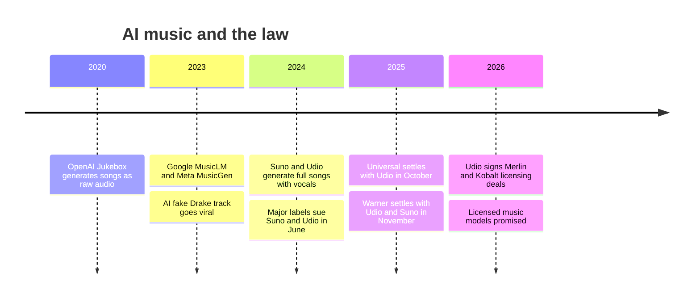

*Figure 46.12: From research demos to lawsuits to licensing, 2020–2026.*

In June 2024 the three major record companies, Universal, Sony and Warner, sued Suno and Udio, alleging that they had trained on copyrighted recordings without permission. The companies argued that training was fair use. Rather than ending in court rulings, much of the fight turned into deals. Universal settled with Udio in October 2025 and struck a deal for a licensed AI music platform; Warner settled with Udio in November 2025 and also settled with Suno, which is to launch licensed models in 2026. Udio went on to sign licensing deals with Merlin, which represents independent labels (January 2026), and the publisher Kobalt (April 2026). In the reports available as of mid-2026, Sony was still litigating. The likely shape of the industry is licensed training with payments to rights holders, but terms, prices and the treatment of artists who never opted in remain contested.

Two further questions are unsettled. **Who owns AI music?** The US Copyright Office's position, restated in a January 2025 report, is that copyright requires human authorship: purely AI-generated material is not protected, though human contributions such as lyrics, arrangement and the selection and editing of outputs can be. **What happens to streaming?** Services reported fast-growing uploads of fully AI-generated tracks in 2025, raising fears of royalty pools diluted by spam. Deezer began labeling fully AI-generated albums, and Spotify announced policies against AI impersonation and spam the same year.

The debate is real on both sides. Supporters say AI music tools democratize creation, letting people with no training make songs for a birthday, a video or a small business, and that musicians themselves use them as instruments. Critics say the tools were built from musicians' work without consent or payment and now compete with those musicians, especially in production music for ads, games and videos, where "good enough and free" wins. Licensing deals address the first complaint more than the second.

> **Key idea:** The AI music fight is about inputs as much as outputs. The 2024 lawsuits targeted what the models were trained on, and the 2025–26 settlements answered with licensed training and payments; whether that fairly compensates individual musicians, and how to compete with free generated music, are still open questions.

## Listening to the world: audio understanding

Not all audio is speech. Many valuable systems simply recognize sounds.

> **Definition — Sound event detection:** Recognizing and timestamping specific sounds in audio, such as glass breaking, a smoke alarm, a baby crying, a cough, a dog barking or a car horn.

The field's ImageNet moment was AudioSet (Google, 2017): roughly two million ten-second clips from YouTube videos, labeled with 527 sound categories. Models trained on it, often by treating spectrograms as images, now run in phones and smart speakers. Since 2020 iPhones have offered Sound Recognition, which alerts deaf and hard-of-hearing users to alarms, doorbells and crying babies, processed on the device.

Factories use acoustic monitoring for predictive maintenance: a bearing about to fail, a pump losing pressure or a leaking valve often sounds different weeks before it breaks, and tiny models on sensors can listen around the clock (Chapter 53 covers this kind of edge AI). Researchers study cough sounds, breathing and snoring as health signals, though few such tools have proven clinical value yet.

Acoustic gunshot detection shows the stakes of errors. Networks of microphones in some US cities alert police to probable gunfire. Supporters say they speed response to shootings that are never reported; critics, citing studies of false alerts and police stops in the alerted areas, say they are inaccurate and concentrated in minority neighborhoods. Chicago ended its contract with the largest provider, ShotSpotter, in 2024, while other cities kept using it.

### Bioacoustics: listening to nature

> **Definition — Bioacoustics:** The study of sounds made by animals. AI bioacoustics uses models to detect and identify species in large volumes of recordings from forests, oceans and cities.

**Worked example: why nature needs AI ears.** One weatherproof recorder in a forest, sampling at 48,000 times per second, collects 48,000 × 86,400 seconds = about 4.1 billion samples per day, and about 124 billion in a month: 720 hours of audio. A research project might deploy hundreds of recorders. No team of humans can listen to that, but a classifier can scan it in hours and hand experts a short list of detections to check.

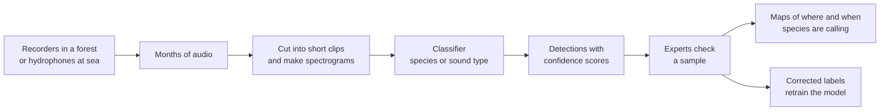

*Figure 46.13: An AI bioacoustics pipeline, from field recorders to maps of wildlife activity.*

The best-known example sits in many birdwatchers' pockets. Cornell Lab of Ornithology's free Merlin Bird ID app added "Sound ID" in 2021, identifying birds from their songs in real time, and the related BirdNET project lets researchers and volunteers analyze recordings at scale. Google worked with the US National Oceanic and Atmospheric Administration (NOAA) to detect humpback whale songs in years of underwater recordings. Project CETI studies the click patterns sperm whales use to communicate, and in 2024 its researchers reported that those patterns have more structure than previously known. Rainforest Connection hangs old phones in trees to listen for chainsaws and alert rangers to illegal logging.

> **Definition — Wake word:** A trigger phrase, such as "Hey Siri" or "Alexa," detected by a tiny model that runs constantly on the device. Only after it fires does the device start recording and, usually, sending audio to the cloud.

> **Watch out:** A popular belief holds that phones secretly listen to your conversations to target ads. There is no credible evidence of mass covert eavesdropping for advertising; it would be expensive and easy to detect in battery use and network traffic. Behavioral data, location, purchases, contacts and "people like you" modeling explain the eerie accuracy (Chapter 51). Wake-word devices do occasionally mis-trigger and record snippets, which is a real, smaller privacy issue worth checking in your device settings.

> **Try it:** Open the privacy or activity settings of any voice assistant you use (Alexa, Google Assistant or Siri) and look for its history of recordings or requests. Check whether any were triggered by mistake, and set an automatic deletion period if the option exists.

## Hearing aids, captions and accessibility

The World Health Organization estimates that more than 1.5 billion people live with some degree of hearing loss, about 430 million of them to a disabling degree. The hardest situation for them is a noisy room.

> **Definition — Cocktail party problem:** The challenge of picking out one voice from a mix of many voices and background noise, which healthy human hearing does well and hearing aids have long done poorly.

Traditional hearing aids amplify sound, including the noise. AI-based noise reduction is trained on thousands of hours of speech mixed with noise, so it learns to keep the voice and suppress the clatter. Running it inside a hearing aid is hard: the device has a tiny battery, and the processing delay must stay very short, on the order of ten milliseconds, or the wearer hears an echo between the sound reaching the ear directly and the processed version. In 2024 Phonak introduced a hearing aid with a dedicated chip running a neural network to separate speech from noise, and other makers are following.

Access has widened too. In 2022 a US Food and Drug Administration rule created a category of over-the-counter hearing aids for adults with mild to moderate loss, sold without a prescription. In September 2024 the FDA authorized hearing-aid software for Apple's AirPods Pro 2, turning popular earbuds into an over-the-counter hearing aid after a built-in hearing test.

> **Definition — Live captions:** Real-time, on-device speech recognition that captions any audio playing on a phone or computer (videos, calls, podcasts), built into Android since 2019 and iPhones since 2022.

> **Try it:** Turn on Live Caption (Android) or Live Captions (iPhone, in Accessibility settings) and play a podcast or video with several speakers. Watch for errors on names, numbers and technical words, and notice that the captions keep working in airplane mode, because recognition runs on the phone.

> **Definition — Speech-to-speech translation:** Translating spoken words in one language directly into spoken words in another, ideally in the speaker's own voice and with little delay. Meta's SeamlessM4T (2023) handled speech and text translation across nearly 100 languages.

Together, captions, translation, voice banking, atypical-speech recognition and sound alerts are among the most clearly beneficial uses of audio AI, and they are a large share of why this branch matters.

## How audio AI fails, and the ethics around it

| Failure mode | Example | Mitigation |
|---|---|---|
| Uneven accuracy | Higher WER for some accents, dialects, ages and speech conditions | Representative data, per-group WER testing, letting users correct transcripts |
| Hallucination | Invented sentences during silence in a medical transcript | Strip silences, keep audio for review, human sign-off for records |
| Noise and channel shift | A model trained on clean audio fails on phone calls or in cars | Train on noisy and narrowband audio; test in the real setting |
| Number and name errors | "Fifteen" heard as "fifty" in an order or dosage | Read back and confirm critical fields |
| Turn-taking mistakes | Agent interrupts a caller who paused to think | Better endpointing, tuning on real calls |
| Impersonation | Cloned voices pass voiceprint checks | Do not rely on voice alone; second channels; watermarks |
| False alarms in detection | Fireworks flagged as gunshots | Human review before action; publish error rates |

*Table 46.3: How audio AI systems fail and how practitioners respond.*

The ethical questions cluster around consent. **Consent to be recorded and analyzed:** meetings, calls and clinic visits are now routinely transcribed, summarized and stored, often with participants only vaguely aware. **Consent over one's voice:** a voice is part of a person's identity and, for performers, their livelihood. **Consent to train:** speech and music datasets were often assembled from material whose creators never agreed. Alongside consent sit fairness (whose voices are understood), honesty (disclosing that a caller is an AI) and security (voice is no longer proof of identity).

## At the frontier, and what is still unsolved

> **At the frontier (2026):** The direction of travel is one model that hears and speaks natively, in many languages, with emotion and natural timing, cheap enough to run for every phone call. Native omni models such as Gemini 3.8 Live (September 2026), full-duplex research systems, instructable expressive TTS, live speech translation in earbuds and phones, licensed music models following the label settlements, and on-device recognition that never sends audio to the cloud are all live areas in late 2026.

Open problems include truly natural turn-taking and emotional understanding; equal accuracy across accents, dialects and the thousands of low-resource languages; transcription that never invents words; reliable detection of cloned voices; consent and payment systems for voices and music used in training; and hearing aids that solve the cocktail party problem in real time on a tiny battery.

## In plain English

Sound is air wiggling, and a microphone turns it into thousands of numbers a second. AI usually converts those numbers into a spectrogram, a picture of which pitches are loud when, so the same tools that recognize images can recognize sounds.

Speech recognition took seventy years to go from ten digits to almost any speech. The big lessons were the same as for chatbots: learn from data rather than rules, and use huge, messy datasets. Whisper, trained on 680,000 hours of internet audio, made good transcription free and open. Accuracy is measured with word error rate, but a single number hides real gaps: some accents and speech conditions get far worse results, and transcripts can even invent sentences. Diarization labels who spoke when.

Synthetic voices went from robotic to human-sounding after 2016, and now a few seconds of audio can clone a voice. That helps people who are losing their speech and creators dubbing videos, and it also powers scams, fake robocalls and unauthorized copies of performers. A family safe word and calling back on a known number beat trying to hear the difference.

Voice agents chain or merge listening, thinking and speaking, and must manage turn-taking, interruptions and a latency budget of about a second. Music AI can write full songs; labels sued in 2024 and many disputes turned into licensing deals in 2025–26. Beyond speech, audio AI detects alarms, failing machines, birds and whales, and it powers live captions and smarter hearing aids.

## Key terms

Audio AI, Waveform, Sampling rate, Bit depth, Frequency, Nyquist limit, Fourier transform, Spectrogram, Mel scale, Log-mel spectrogram, ASR (automatic speech recognition), Phoneme, Acoustic model, Hidden Markov model (HMM), Language model (in speech recognition), End-to-end speech recognition, Weak supervision, Word error rate (WER), Character error rate (CER), Low-resource language, Hallucination (in speech recognition), Speaker diarization, Speaker embedding, Diarization error rate (DER), Speaker verification (voice biometrics), TTS (text-to-speech), Formant synthesis, Concatenative synthesis, Vocoder, Text normalization, Mean opinion score (MOS), Voice cloning, Zero-shot voice cloning, Audio deepfake, Audio watermark, Voice agent, Turn-taking, Barge-in, Echo cancellation, Backchannel, Containment rate, Music generation, Symbolic music (MIDI), Stem separation, Voice conversion, Sound event detection, Bioacoustics, Wake word, Cocktail party problem, Live captions, Speech-to-speech translation

## Exercises

1. **[Easy] See your own voice.** (1) Open Chrome Music Lab's Spectrogram (musiclab.chromeexperiments.com/Spectrogram) and allow microphone access. (2) Say a long "sssss," then "shhhh," then the vowels "ee," "ah" and "oo." (3) Whistle a rising note, clap once, and play a few seconds of music from another device. (4) Sketch what each looks like. (5) Say "Sam" and "fan" and see whether you can tell them apart in the picture. **What you'll learn:** what a spectrogram is, why hissy sounds live at high frequencies, and why sound can be treated as an image.

2. **[Easy] Word error rate by hand.** (1) The reference is "take two tablets twice a day after meals" (8 words). The transcript is "take ten tablets twice day after the meals." (2) Line the two up word by word and mark each substitution, deletion and insertion. (3) Compute WER = (S + D + I) ÷ 8. (4) Circle the single error that could hurt someone, and write one sentence on why WER alone would not reveal how serious it is. **What you'll learn:** how WER is calculated and why the errors that matter must be checked separately.

3. **[Medium] Whisper stress test.** (1) Go to huggingface.co/spaces and search "whisper" to find a free Whisper demo (or use your chatbot's voice input). (2) Write a 60-word paragraph with a name, a number and a technical word. (3) Record yourself reading it four ways: quiet room, with music or a TV in the background, speaking fast, and (if you can) in a second language or with a friend who has a different accent. (4) Compute the WER for each. (5) Note any words the system invented. **What you'll learn:** speech recognition is good but not equally good in every situation, and how to measure it yourself.

4. **[Medium] Train a sound classifier.** (1) At teachablemachine.withgoogle.com, start an Audio Project. (2) Record the required background-noise samples, then classes for "clap," "snap" and "knock" (about 8 samples each; the site shows each as a small spectrogram). (3) Train and test. (4) Move to a different room, or turn on a fan, and test again. (5) Add more varied samples and retrain. **What you'll learn:** sound becomes a picture, the same "learn from examples" recipe works for audio, and models fail when the acoustic setting changes.

5. **[Medium] TTS listening test, and a safe word.** (1) Choose one paragraph containing a date, a price, an abbreviation and an unusual name. (2) Listen to it read by an older built-in voice (your phone's accessibility "speak" feature), a neural voice (Microsoft Edge's free "Read aloud"), and a free TTS demo on Hugging Face Spaces (search "TTS"). (3) With a friend or family member, rate each from 1 to 5 for naturalness, giving a tiny mean opinion score. (4) Note how each handled the date, price and abbreviation. (5) Do not clone anyone's voice. Instead, agree on a family safe word for emergency calls and write down the call-back numbers you would use. **What you'll learn:** how natural TTS has become, what text normalization does, and the single best habit against voice-clone scams.

6. **[Medium] Design and test a voice receptionist on paper.** (1) Invent a small bakery with opening hours, five products and a pickup-order process. (2) Write a one-page script for a voice agent: the greeting (including that it is an AI), the three most common requests, what it must read back for confirmation, and three situations in which it must hand off to a person. (3) Paste the script into your chatbot, turn on voice mode, and ask it to play the receptionist. (4) Test it by interrupting, mumbling, going silent, changing your order midway and asking something off-script. (5) Time the replies with a stopwatch. **What you'll learn:** turn-taking, barge-in, read-backs and hand-offs are design decisions, and you can prototype a voice product without code.

7. **[Medium] Identify birds by ear.** (1) Install Cornell Lab's free Merlin Bird ID app. (2) Go outside (a park or garden works best in the morning) and run Sound ID for 10 minutes. (3) Note each species it suggests and when it highlights them. (4) Try to see or photograph at least one bird to confirm. (5) Think about which suggestions might be false positives and why (similar calls, distant sounds, human imitations). **What you'll learn:** sound event detection and bioacoustics in practice, including confidence and the need for expert checking.

8. **[Challenge] Transcribe your own audio with Whisper in Google Colab.** (1) Open colab.research.google.com and create a new notebook. For speed, choose Runtime, then Change runtime type, then a GPU. (2) Paste the code below into a cell and press play. Step 1 installs OpenAI's open-source Whisper package; step 2 opens a file picker so you can upload a short recording (a voice memo works); step 3 loads a model; step 4 prints the transcript; step 5 prints each segment with its start and end time in seconds.

   ```python
   # 1. Install OpenAI's open-source Whisper package
   !pip -q install openai-whisper
   import whisper
   from google.colab import files

   # 2. Upload an audio file from your computer (mp3, m4a or wav)
   uploaded = files.upload()
   filename = list(uploaded.keys())[0]

   # 3. Load a model: "tiny" and "base" are fast, "small" is
   #    slower but more accurate
   model = whisper.load_model("base")

   # 4. Transcribe the file and print the full text
   result = model.transcribe(filename)
   print(result["text"])

   # 5. Print each segment with its start and end time in seconds
   for seg in result["segments"]:
       print(round(seg["start"], 1), round(seg["end"], 1), seg["text"])
   ```

   (3) Write out by hand what was actually said in the first 100 words and compute the WER. (4) Change "base" to "tiny" and then "small," rerun, and compare WER and running time. **What you'll learn:** how an open speech model is used in practice, and the trade-off between model size, speed and accuracy.

9. **[Challenge] Test diarization on a real conversation.** (1) With the other person's permission, record a three-minute conversation between two people, including a few moments where you talk over each other. (2) Upload it to a meeting-transcription tool with speaker labels, or to a chatbot that accepts audio, and ask for a transcript labeled by speaker. (3) Count how many lines are attributed to the wrong person, and note what happened during overlaps and one-word replies. (4) Write down how a 2% versus a 10% speaker error would matter in a medical visit or a legal deposition. **What you'll learn:** how "who spoke when" works, where it breaks, and why it matters for meeting notes and medical scribes.

10. **[Challenge] An AI music rights audit.** (1) Using the free tier of an AI music generator, create a 30-second instrumental track for an imaginary local coffee shop advert. (2) Find and read the service's terms on who owns the output and whether commercial use is allowed on the free tier. (3) Note whether the service says its models are licensed. (4) Write 200 words advising the coffee shop whether it can use the track, mentioning the US Copyright Office's position that purely AI-generated material is not protected by copyright, and the 2024 label lawsuits and 2025–26 settlements. **What you'll learn:** the practical legal questions behind AI music, and how to read terms of service before using generated media commercially.

## Areas of opportunity

- **Voice receptionists for local businesses.** Clinics, restaurants, salons and trades miss calls every day. People who can set up reliable AI receptionists, with good turn-taking, read-backs, booking-system integration and clean hand-off to staff, can sell monthly subscriptions.
- **Conversation design and voice QA.** Companies deploying voice agents need "conversation designers" to write flows and testers who call them with noise, accents and interruptions. These roles reward communication skills more than coding.
- **Clinical documentation.** Ambient scribes are spreading quickly in healthcare. Hospitals need specialists who configure them, check note quality, train clinicians and monitor for hallucinations and diarization errors.
- **Dubbing and localization for creators.** YouTubers, course creators and small publishers want their content in other languages, in their own voices, with consent and quality control. Producers who combine AI dubbing with human review for each language can serve many clients.
- **Low-resource languages.** Speech recognition and TTS lag badly for most of the world's languages. Collecting consented recordings, building evaluation sets and fine-tuning open models for a language community is both a business (governments, telecoms, NGOs) and a research opportunity.
- **Fraud defense and audio forensics.** Banks, insurers and families need protection from voice-clone scams. Opportunities include call-verification workflows for finance teams, deepfake-detection services, staff training and forensic analysis of disputed recordings.
- **Call analytics for compliance.** Regulated industries must check that calls followed rules (disclosures, complaints handling). Transcription plus language-model review lets one analyst cover thousands of calls.
- **Accessibility products.** Better captions for live events, hearing-aid fitting and coaching, voice banking for people with ALS, and recognition for atypical speech are high-impact niches funded by health systems, charities and governments.
- **Licensed music and sound for creators.** After the label settlements, there is room for services that provide licensed, royalty-clear generated music and sound effects for ads, games and videos, and for musicians who use AI tools to produce faster.
- **Bioacoustics and environmental monitoring.** Wind and solar developers, forestry companies and conservation groups pay for acoustic surveys of birds, bats and other wildlife; AI turns months of recordings into reports.
- **Industrial acoustic monitoring.** Retrofitting factories, pumps and HVAC systems with microphones and small on-device models that hear faults early is a practical predictive-maintenance business.
- **Open problems for researchers.** Natural full-duplex turn-taking and emotion, equal accuracy across accents and languages, hallucination-free transcription, reliable clone detection, consent and payment frameworks for voices, and real-time speech separation in hearing aids.

## Check your understanding

1. Why do most audio models convert a waveform into a spectrogram before learning from it?
2. A call is recorded at 8,000 samples per second. What is the highest frequency it can capture, and why does that make "s" and "f" hard to tell apart?
3. A 10-word reference sentence is transcribed with one substitution, two deletions and one insertion. What is the WER?
4. Why can a Whisper-style speech recognizer invent sentences that were never spoken, and what are two ways to reduce the harm?
5. Why is a voiceprint no longer a safe password, and what two habits defeat a voice-clone "family emergency" call?
6. Name three stages in a cascade voice agent's latency budget and one way to shrink each.
7. What changed between the June 2024 label lawsuits against Suno and Udio and mid-2026?
8. What is the cocktail party problem, and why is solving it inside a hearing aid especially hard?

<details><summary>Answers</summary>

1. A spectrogram shows which frequencies are loud at each moment, much as the ear separates sound into pitches. It is more compact (about 8,000 numbers per second instead of 16,000 for speech) and more meaningful than raw samples, and it lets audio models reuse image techniques such as CNNs and Vision Transformers.
2. Half the sampling rate: 4,000 Hz (in practice phone lines carry up to about 3,400 Hz). Much of the distinguishing energy of "s" and "f" lies above that, so it is simply missing from the recording.
3. WER = (1 + 2 + 1) ÷ 10 = 4 ÷ 10 = 40%.
4. Its decoder works like a language model, predicting likely text, so during silence, music or unclear speech it can generate fluent words that were never said. Mitigations include removing silences before transcription, flagging low-confidence passages, keeping the audio for checking, and requiring human review for medical or legal records.
5. Cloning tools can imitate a voice from a few seconds of audio well enough to pass voice-ID checks. Agree on a family safe word in advance, and hang up and call back on a number you already know.
6. Any three of: endpointing (smarter turn detectors), speech recognition (streaming transcription while the caller talks), the language model's first words (smaller or faster models, short first sentences), TTS (streaming synthesis from the first phrase), and network delay (servers close to the phone carrier).
7. Much of the dispute turned into licensing. Universal settled with Udio (October 2025), Warner settled with Udio and with Suno (November 2025, with Suno to launch licensed models in 2026), and Udio signed deals with Merlin and Kobalt in 2026. Sony was reported to be still litigating as of mid-2026.
8. It is the difficulty of picking out one voice from many voices and background noise. A hearing aid must separate speech from noise with a tiny battery and a processing delay of only around ten milliseconds, or the wearer hears an echo between the direct and processed sound.

</details>

## Going deeper

- **Radford et al., "Robust Speech Recognition via Large-Scale Weak Supervision" (2022)** — the Whisper paper; clear on why large, messy training data generalizes better.
- **Daniel Jurafsky and James H. Martin, *Speech and Language Processing* (3rd edition draft, free online)** — the standard textbook, with readable chapters on speech recognition, TTS and their history.
- **van den Oord et al., "WaveNet: A Generative Model for Raw Audio" (2016), and DeepMind's WaveNet blog post** — the turning point for natural synthetic voices, with audio samples.
- **Koenecke et al., "Racial disparities in automated speech recognition," *PNAS* (2020)** — the key study on uneven ASR accuracy, and a model for how to audit a system by group.
- **3Blue1Brown, "But what is the Fourier Transform? A visual introduction" (YouTube)** — the clearest visual explanation of how sound is split into frequencies.
- **Hugging Face Audio Course (huggingface.co/learn)** — a free, hands-on course on audio data, ASR, TTS and audio classification with open models and Colab notebooks.
- **US Federal Trade Commission consumer advice on voice-cloning and family-emergency scams (consumer.ftc.gov)** — practical, regularly updated guidance to share with relatives.
- **Cornell Lab of Ornithology's Merlin Bird ID and BirdNET (birdnet.cornell.edu)** — the most accessible window into AI bioacoustics, with background on how the models were built.
- **Music Business Worldwide (musicbusinessworldwide.com)** — the trade publication that covered the Suno and Udio lawsuits and licensing deals in detail; useful for following the music-rights story as it develops.
