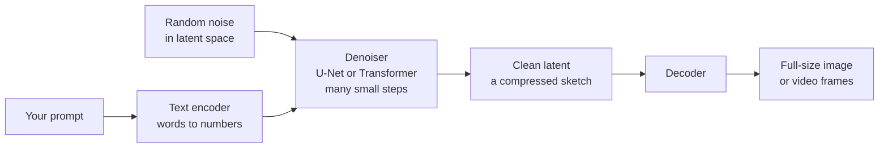
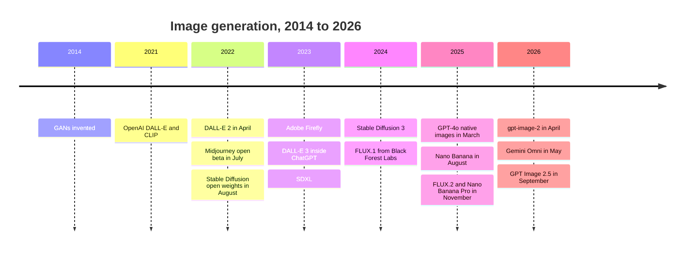
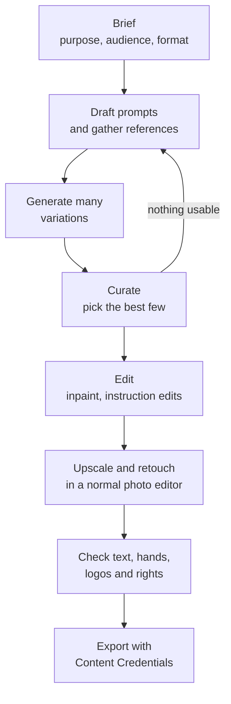
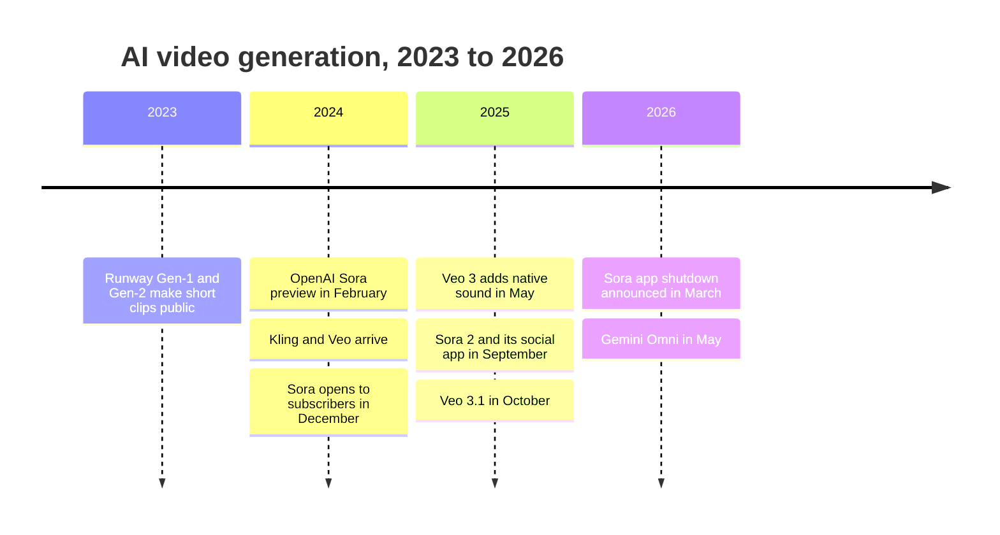
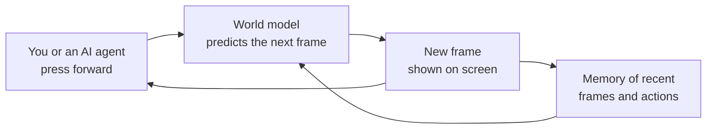
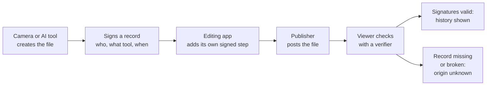

# Chapter 47: Generative Media: Images, Video, 3D and World Models

*This chapter shows you the tools that turn words into pictures, films, 3D objects and explorable worlds, how to use them well, where they still fail, and how the world is learning to tell real media from made media.*

## What you'll learn
- A quick recap of how image and video generators work inside, so the products make sense.
- The history and the 2026 landscape of image tools: Midjourney, DALL·E and GPT image models, Stable Diffusion, FLUX, Nano Banana and others.
- The craft of making images: prompting, seeds, editing, keeping a character consistent, and getting readable text.
- The video-generation story from Sora's preview to the Sora app's shutdown, and the models that lead in 2026 (Veo 3.1, Kling, Runway, Seedance).
- How 3D objects, scenes and talking avatars are generated.
- What world models are (Genie 3, Project Genie, NVIDIA Cosmos, World Labs) and why labs think they matter for robots and agents.
- How provenance works (SynthID watermarks and C2PA Content Credentials), why deepfake detection is an arms race, and what generative media is doing to the creative industries.

## Before you start
Chapter 16 (Generative Models: Autoencoders, GANs, Diffusion and Flow) explains the machinery behind everything in this chapter, step by step; this chapter recaps it in one section and then moves to products and practice. Chapter 22 (Multimodal Models) explains how chatbots like ChatGPT and Gemini came to draw images themselves. Chapter 45 (Computer Vision) covers 3D vision such as NeRFs and Gaussian splatting, and Chapter 46 (Speech, Audio and Music) covers voice cloning and music generation. Misuse in depth is Chapter 58, and the law is Chapter 59.

## Why generative media matters

You have probably asked your chatbot for a picture at least once. Maybe a birthday card, a logo idea, or "my dog as a Renaissance painting." A few seconds later something appeared that had never existed. Five years ago that was a research demo. In 2026 it is a feature inside the apps you already use, and a daily tool for designers, marketers, filmmakers and game studios.

> **Definition — Generative media:** Images, video, audio, 3D models and interactive scenes created by AI models from a description, an example or another piece of media, rather than captured by a camera or drawn by hand.

Generative media is the branch of AI that most people can see. A spam filter works silently; a generated image is right there on the screen for you to judge. That makes it the branch with the most public excitement, the most public anger (from artists who feel their work was taken), and the most public risk (from fakes of real people).

> **Key idea:** Generative media is not one product. It is a family of models that share one core trick (learning what real media looks like well enough to make new examples) applied to pictures, clips, objects and whole interactive worlds.

## From a sentence to a picture: a one-section recap

Chapter 16 took the machinery apart in detail. Here is the short version you need for the rest of this chapter.

**Step 1: the words become numbers.** Your prompt goes through a text encoder, a model that turns a sentence into a list of numbers capturing its meaning. Early systems used CLIP, the 2021 model that put images and captions into one shared "meaning space."

> **Definition — Text encoder:** The part of an image or video generator that turns your prompt into a list of numbers (an embedding) that the image-making part can follow.

**Step 2: start from static.** Most image generators are diffusion models. They begin with pure random noise, like the snow on an old television, and remove a little noise at a time over many steps. At each step a neural network predicts "which part of this is noise?" and subtracts it, steered by your prompt's numbers.

> **Definition — Diffusion model:** A generator that creates an image by starting from random noise and removing it step by step, guided by a prompt. It learned to do this by practicing on real images that had noise added to them.

**Step 3: work on a thumbnail.** Denoising millions of pixels is slow, so the work happens in a compressed "latent" version of the image. A small decoder blows the finished latent back up into full-size pixels. This trick, called latent diffusion, made Stable Diffusion able to run on a home graphics card in 2022.

> **Definition — Latent space:** A compressed internal representation that a model works in. Nearby points in latent space correspond to similar-looking content, so the model can do its creative work on a small sketch instead of every pixel.

**Step 4: the follow-the-prompt knob.** A setting called guidance strength (or "CFG scale") controls how hard the model pushes toward your prompt. Too low gives bland or off-topic images; too high gives harsh, oversaturated ones.

> **Definition — Guidance scale:** A setting in many image generators that controls how strongly each denoising step is pushed toward the prompt. Higher values follow the words more literally but can look overcooked.

**Newer variations.** Three refinements from Chapter 16 show up in product names. Flow matching (used in Stable Diffusion 3 and FLUX) learns straighter paths from noise to image, so fewer steps are needed. The Diffusion Transformer (DiT) replaced the older U-Net denoiser with a Transformer, the same architecture inside your chatbot. And autoregressive image generation, which GPT-4o brought into ChatGPT in March 2025, writes an image as a sequence of tokens the way a chatbot writes words.

> **Definition — Autoregressive image generation:** Making an image by predicting its pieces (image tokens) one after another, each based on the conversation and the pieces so far, the same way a language model writes text. A decoder then turns the tokens into pixels.

**Video adds time.** A video generator is latent diffusion with a third dimension. It compresses a whole clip into a block of "spacetime patches," small cubes of picture area and time, and denoises them all together so that frame 37 agrees with frame 36.


*Figure 47.1: The shared recipe behind most image and video generators. Video generators run the same loop on blocks of spacetime patches instead of a flat image.*

> **Watch out:** "The generator searches the internet and pastes together pieces of real photos." It does not search or paste. It generates new pixels from noise, steered by patterns learned in training. It can, however, reproduce images it saw many times during training (famous paintings, logos, film stills), which is one reason for the lawsuits later in this chapter.

That is all the machinery you need. Everything below is about what people built with it.

## Image generation: a short history and the 2026 landscape

### From research curiosity to everyday tool

The story moves fast, so a timeline helps.


*Figure 47.2: Key moments in image generation. The summer of 2022 is when the general public first got access.*

**2014–2020: faces that did not exist.** Generative adversarial networks (GANs, Chapter 16) could produce convincing photos of people who never lived by 2019, but they were hard to train and hard to steer with words.

**2021: words meet pictures.** OpenAI's first DALL·E (January 2021) generated small images from captions, and CLIP, released the same month, linked text and images in one meaning space. That link is what made "type a sentence, get a picture" possible.

**2022: the explosion.** In a few months, three very different products arrived. DALL·E 2 (April) showed photorealistic results behind a waitlist. Midjourney opened its beta in July inside the chat app Discord and became known for its painterly, dramatic look. In August, Stability AI and its academic partners released Stable Diffusion with open weights: anyone could download the model and run it on a gaming PC. A Midjourney image won a digital art prize at the Colorado State Fair that year, and the argument about AI art went mainstream.

> **Definition — Open-weight model:** A model whose trained parameters (weights) are published so anyone can download, run and modify it, usually under a license with conditions. Stable Diffusion and FLUX's open tiers are image examples.

> **Definition — Closed model:** A model you can use only through the company's app or paid interface, without access to its weights. Midjourney, GPT image models and Google's Nano Banana are closed.

**2023: into the professional toolkit.** Adobe launched Firefly and put "Generative Fill" into Photoshop, marketing it as trained on licensed and public-domain images so businesses could use it with less legal worry (Adobe's claim). DALL·E 3 moved inside ChatGPT: you described what you wanted in conversation, and ChatGPT wrote a detailed prompt for the image model.

**2024–2026: quality, control and chat.** Stable Diffusion 3 and FLUX.1 (from Black Forest Labs, a company founded by former Stable Diffusion researchers) brought flow matching and Transformer denoisers. Then the chatbots started drawing directly. GPT-4o's native image generation in March 2025 set off a viral wave of portraits redrawn in the style of animated films. Google's "Nano Banana" (Gemini 2.5 Flash Image, August 2025) became famous for editing a photo by instruction while keeping faces the same, and Nano Banana Pro (Gemini 3 Pro Image) followed in November 2025. In April 2026 OpenAI released gpt-image-2, which, according to press coverage, plans the composition before drawing and renders text much better, and it followed with GPT Image 2.5 in September 2026 (reported).

### The tools you will meet

Rankings change every few months, so treat the table below as a map of *kinds* of tools rather than a leaderboard.

| Tool | Maker | Open or closed | Known for (as of late 2026) |
|---|---|---|---|
| GPT image models (gpt-image-2, GPT Image 2.5) | OpenAI | Closed | Drawing inside ChatGPT, following long instructions, text in images |
| Nano Banana, Nano Banana Pro | Google | Closed | Editing by instruction while keeping people and objects consistent |
| Midjourney (V7 and later) | Midjourney | Closed | Strong artistic style and mood; popular with designers |
| FLUX.2 | Black Forest Labs | Open "dev" tier and closed "pro" tiers | High quality, fine-tunable, used in many other apps |
| Stable Diffusion family | Stability AI | Open weights | Huge community of add-ons, styles and workflows |
| Firefly | Adobe | Closed | Built into Photoshop and other Adobe apps; licensed training claim |

*Table 47.1: The main image-generation families. Many smaller apps are built on top of one of these models.*

> **Key idea:** In 2026 the top image systems are a mix of two families: diffusion and flow-matching Transformers, and image generation built into large language models. Closed labs rarely publish their exact designs, so the safe statement is that the best systems combine both.

### The open ecosystem

Open weights created a whole culture of tinkering. Hobbyists and studios run models locally, chain steps together in node-based tools such as ComfyUI, and share thousands of small add-on files that teach a model a new style, product or character.

> **Definition — LoRA (low-rank adaptation):** A small add-on file that teaches an existing model a new style, character or product without retraining the whole model. LoRAs for image models are often only tens of megabytes and can be trained from a few dozen pictures (see Chapter 16 and Chapter 30).

> **Definition — Node-based workflow:** A way of building an image or video pipeline by connecting boxes on a screen (load model, add prompt, sample, upscale, save) like a flowchart, so that complex multi-step jobs can be saved and repeated. ComfyUI is the best-known open tool of this kind.

Why would anyone bother, when ChatGPT draws for free? Control and privacy. A furniture company can train a LoRA on its own products, run the model on its own machines, and generate thousands of catalog scenes without sending anything to an outside company. The trade-off is skill: open workflows reward people who understand seeds, samplers and settings.

> **At the frontier (2026):** The line between "chatbot" and "image app" has nearly disappeared. Google's Gemini Omni, announced in May 2026, lets any input (text, image, audio, video) lead to a generated or edited video through conversation. Open models, such as FLUX.2's open tier and Alibaba's Wan video models, usually trail the closed leaders by a step or two but can run on a studio's own machines.

## The craft of image making

Getting the exact image you had in mind is a craft, but one you can learn in an afternoon.

### Prompting for images

An image prompt is a specification. The model cannot ask you clarifying questions (unless you use a chatbot that does), so every detail you leave out gets filled in with the most typical choice. Ask for "a dog" and you will get a statistically average dog, centered, in average light.

> **Definition — Image prompt:** The text description you give an image generator. It works best as a specification of subject, setting, style, composition and lighting rather than as a short label.

A useful habit is to write prompts in layers:

```
  [SUBJECT]      an elderly fisherman mending a red net
  [SETTING]      on a wooden pier at dawn, mist over the harbor
  [STYLE]        documentary photograph, 35mm film grain
  [COMPOSITION]  wide shot, subject on the left third
  [LIGHTING]     soft golden side light, long shadows
  [FORMAT]       16:9 landscape
```
*Figure 47.3: The anatomy of a strong image prompt. Each line removes a choice the model would otherwise make for you.*

Some terms you will meet in settings menus:

> **Definition — Aspect ratio:** The shape of an image written as width to height. 1:1 is square, 16:9 is a widescreen landscape, and 9:16 is a tall phone-screen portrait.

> **Definition — Negative prompt:** A list of things you do not want in the image ("blurry, extra fingers, watermark"), offered by some generators, especially open diffusion tools.

> **Definition — Style reference:** An example image you upload so the generator copies its look (colors, brushwork, lighting) without copying its content.

Chatbot-based generators change the craft a little. Because a large language model reads your request, you can write in plain sentences, explain the purpose ("this is a poster for a children's library event, so keep it friendly and uncluttered"), and then fix things by conversation. Dedicated tools such as Midjourney reward a more compact, keyword-rich style and expose more knobs.

> **Try it:** Ask your chatbot for "a cozy reading nook." Then ask again with all six layers from Figure 47.3 filled in (subject, setting, style, composition, lighting, format). Put the two images side by side. Notice which choices the model made for you in the first version.

### Seeds, randomness and iteration

Run the same prompt twice and you get two different images. That is because the starting static is random. In open tools, the random starting pattern is controlled by a number called the seed.

> **Definition — Seed:** The number that sets the random starting noise for a generation. The same model, prompt, settings and seed reproduce the same image; changing only the seed gives a new variation.

Seeds matter for professional work. If you find an image you almost like, keep the seed and change one word of the prompt. The composition will usually stay similar while the detail you changed moves. Change the seed and keep the words, and you explore new compositions of the same idea.

Because each generation is a random draw, iteration is a numbers game, and a little probability helps you plan. Suppose roughly 1 in 5 generations for a tricky brief is good enough to use. Then:

- The expected number of tries until the first keeper is 1 ÷ 0.2 = **5**.
- If the tool gives you 4 variations per click, each one misses with probability 1 − 0.2 = 0.8, so all four miss with probability 0.8 × 0.8 × 0.8 × 0.8 = 0.8^4 ≈ 0.41. The chance that at least one is usable is therefore 1 − 0.8^4 = 1 − 0.41 = **0.59**, a bit better than a coin flip.
- Two clicks (8 variations) raise that to 1 − 0.8^8 = 1 − 0.17 = **0.83**.

The same math explains why professionals generate many options and then curate. It also explains why "it took me 40 tries" is normal for demanding briefs: if only 1 in 40 meets the bar, 40 tries is exactly the average.

### Editing instead of regenerating

Often the image is 90% right. Regenerating throws away the good 90%. Editing keeps it.

> **Definition — Inpainting:** Regenerating only a selected region of an image (for example, replacing a coffee cup on a table) so it blends with the untouched rest.

> **Definition — Outpainting:** Extending an image beyond its original borders with new content that continues the scene, for example turning a square photo into a wide banner.

> **Definition — Instruction-based editing:** Changing an existing image by describing the change in words ("make it night," "remove the car," "give her a red scarf"), with the model keeping everything else as unchanged as possible.

> **Definition — Upscaling:** Increasing an image's resolution with a model that invents plausible fine detail, so a 1,024-pixel image can be printed or shown on a large screen.

Instruction editing is the big change of 2025–26. You no longer need to paint a mask; you upload a photo and type what should change. Google's Nano Banana models and Black Forest Labs' FLUX Kontext were trained on huge numbers of before-instruction-after examples and learned to change only what the instruction mentions.

### Consistency: the hardest everyday problem

Single images are easy. A *series* is hard. A children's book needs the same girl, with the same face, hair and coat, on page 1 and page 24. A brand needs the same bottle in every ad. Because each generation starts from fresh noise, the model has no memory of what the character looked like last time.

> **Definition — Character consistency:** Keeping a person, animal, product or object recognizably the same across many generated images or video shots.

The probability of failure compounds. Suppose each image has a 90% chance of keeping your character on-model. For a 10-page book, the chance that every page is consistent is 0.9^10 ≈ **0.35**. Only about one book in three would come out right without fixes. Raise the per-image rate to 99% and the whole-book rate becomes 0.99^10 ≈ 0.90. Small per-image improvements matter enormously for multi-image projects, which is why consistency became a selling point.

The tools for consistency, from simplest to most involved:

1. **Reference images.** Upload a picture of the character and say "this character." Chat-based models (Nano Banana, GPT image models) handle this well in 2026.
2. **Character sheets.** First generate one image showing the character from front, side and back, then use it as the reference for every scene.
3. **Editing instead of regenerating.** Generate one good scene, then edit it into the next ("same girl, now sitting on a swing").
4. **A trained LoRA.** For long projects, train a small add-on on 20–30 approved images of the character.

> **Analogy:** Asking a generator for a consistent character with no reference is like asking a different street artist for each page of your book and describing the hero in words each time. A reference image is handing every artist the same photograph.

### Text inside images

For years, image generators produced gibberish signs: "OPEN" came out as "OPNE" or a string of letter-like squiggles. The reasons are instructive. Diffusion models learned text as just another visual texture, the prompt's words were compressed into a meaning vector that did not record exact spelling, and readable text needs every stroke to be right, while a slightly wrong leaf is invisible.

> **Definition — Text rendering:** An image generator's ability to draw readable, correctly spelled words, such as a shop sign, a poster title or a label on a bottle.

Two things fixed most of it. Bigger, better text encoders kept more of the spelling, and image generation inside language models (GPT-4o in 2025, then gpt-image-2 and Nano Banana Pro) brought a model that already spells perfectly into the drawing process. By late 2026, short headlines and labels usually come out right. Long paragraphs, small print and non-Latin scripts still fail more often, so check every letter before anything goes to print.

> **Watch out:** "The model can spell, so the text in the image is correct." Proofread generated text as carefully as you would a printed menu. A single wrong letter in a product name or a phone number is the kind of error that gets through because everything else looks perfect.

### A professional workflow

Put the pieces together and a typical professional image workflow looks like this.


*Figure 47.4: A typical professional image workflow. Most of the time goes into curating and editing, not into the first generation. Content Credentials, a signed record of how a file was made, are explained in the provenance section later in this chapter.*

> **Key idea:** The skill is not "writing a magic prompt." It is the loop: specify, generate many, curate ruthlessly, edit precisely, check carefully, and label honestly.

## Video generation

### Why video is so much harder

A still image is one frozen moment. A video is that moment plus everything that must stay true as time passes. Some numbers make the gap concrete.

One 1,024 × 1,024 image has 1,048,576 pixels. With three color values each, that is about **3.1 million numbers**.

An 8-second clip at 1280 × 720 resolution and 24 frames per second has:

- 8 × 24 = **192 frames**
- 1280 × 720 = 921,600 pixels per frame, × 3 colors = about 2.76 million numbers per frame
- 192 × 2.76 million ≈ **531 million numbers** in total

That is about 170 times as many numbers as the single image. And they cannot be generated independently: the face in frame 150 has to be the same face as in frame 1, a cup that leaves the table must fall rather than float, and a person who walks behind a tree must come out the other side.

> **Definition — Frame rate:** How many still images (frames) are shown per second of video. Film traditionally uses 24 frames per second; smooth gameplay often uses 60.

> **Definition — Temporal consistency:** Whether objects, faces, lighting and motion stay coherent from one frame to the next in a generated video.

> **Definition — Object permanence:** The expectation that things continue to exist when they are hidden. Video generators often violate it: an object goes behind a person and never reappears, or comes back changed.

Two more terms describe what you can feed in:

> **Definition — Text-to-video:** Generating a video clip from a written description alone.

> **Definition — Image-to-video:** Animating a starting still image, often one you generated or photographed, into a short clip. It gives far more control over how the first frame looks.

Since clips are short, longer pieces are built by extension and editing.

> **Definition — Clip extension:** Generating a continuation of an existing clip, using its last frames as the starting point, to build longer sequences a few seconds at a time.

### The story so far: from Sora to Veo 3.1


*Figure 47.5: A short history of AI video generation. Product turnover is fast; a leading tool can vanish within months.*

**2023: wobbly beginnings.** Runway, a New York startup that had helped create Stable Diffusion, put early video models in public hands. Clips were a few seconds long, low resolution, and dreamlike in a way that was more art project than footage.

**February 2024: the Sora preview.** OpenAI showed Sora, a model that generated up to a minute of strikingly realistic video, including a woman walking through a neon-lit Tokyo street. It was the first time many people felt generated video could pass for real. Sora popularized the spacetime-patch design described in the recap above. It reached paying ChatGPT subscribers in December 2024.

**2024–2025: the field fills in.** Kuaishou, a Chinese short-video company, launched Kling in mid-2024. Google DeepMind launched Veo in May 2024 and Veo 2 that December. Then, in May 2025, Veo 3 became the first major model to generate synchronized sound with the picture: dialogue, footsteps, rain and music produced in one pass, not added later.

> **Definition — Native audio (video generation):** Sound, including speech, effects and music, generated together with the video by the same model so that lips, footsteps and impacts line up with the picture.

Google released Veo 3 with a filmmaking tool called Flow, aimed at stringing clips into scenes, and in October 2025 shipped Veo 3.1, which DeepMind still listed as its leading video model in 2026.

**September 2025 to March 2026: Sora 2 and the app that closed.** On September 30, 2025, OpenAI launched Sora 2 together with a social app, a feed of generated videos where users could put themselves and consenting friends into scenes. It was an instant hit, and an instant source of controversy, with deepfake and copyright concerns raised almost from the first day. Usage then declined. In March 2026, OpenAI announced that it would shut down the Sora app, amid falling usage and a shift of its computing resources toward coding and business products. Reports say the app closed on April 26, 2026 and that access for developers through OpenAI's paid interface ended on September 24, 2026; Sora research was reported to continue as a world-model effort.

> **Watch out:** "The best-known product is the safe bet." Sora was the most famous video model in the world in 2024, and its consumer app lasted about six months in its Sora 2 form. Anyone building a business or a workflow on generative video should expect tools to change, merge or disappear, and should keep their source files and prompts so they can move.

### The 2026 landscape

The video field in late 2026 has a handful of leading families. Comparison guides disagree and rankings shift monthly, so the table describes reputations, not scores.

| Model family | Maker | Reputation as of late 2026 |
|---|---|---|
| Veo 3.1 | Google DeepMind | Native audio, up to 4K output (about 3,840 × 2,160 pixels, the resolution of a 4K TV), short clips that can be extended; inside Gemini and Flow |
| Kling 3.0 and 4.0 | Kuaishou | Multi-shot sequences and multilingual audio (per comparison guides); Kling 4.0, launched globally in October 2026, adds 30-second clips and 4K output (reported) |
| Runway Gen-4.5 | Runway | Creative control and editing tools for filmmakers (per comparison guides) |
| Seedance 2.0 and 2.5 | ByteDance (owner of TikTok) | Strong motion and multi-shot storytelling (per comparison guides); Seedance 2.5 (July 2026) makes clips with sound of up to 30 seconds (reported) |
| Wan | Alibaba | Open weights that studios can run themselves |
| Gemini Omni | Google | Any input in, video out, with editing by conversation; the August 2026 Omni 1.1 Flash update extends scenes to 40 seconds and outputs up to 4K |

*Table 47.2: Leading video-generation families as of late 2026. Version numbers and rankings change quickly; check current comparisons before choosing.*

> **At the frontier (2026):** Three trends define the front of the field. Sound is now expected, not optional. Video is moving from "generate a clip" to "edit by conversation," as in Gemini Omni. And the biggest labs increasingly describe video generation as a step toward world models, which is reportedly how OpenAI framed Sora's future after the app closed.

### The limits you will hit

Despite the polish, every current video model shares the same weak spots.

1. **Length.** A single generation is typically 5 to 10 seconds (Veo 3's clips were 8 seconds). Longer scenes are stitched from extensions, and each extension is a fresh chance for drift.
2. **Physics.** Liquids pour wrongly, objects pass through hands, a dropped glass bounces like rubber. The models learned how things *look* when they move, not the forces that move them.
3. **Hands and fine motion.** Fingers merge, knots tie themselves, shoelaces become spaghetti.
4. **Counting and permanence.** Five people become six; a dog behind a sofa becomes a cat.
5. **Consistency across shots.** The 0.9^10 problem from the image section returns, multiplied by every shot in a film.
6. **Control and cost.** Exact camera moves and timing are hard to specify in words, and every extra take costs far more computation than an image.

> **Analogy:** A video model is like a brilliant mime who has watched millions of films. It can imitate a glass shattering beautifully, but it has never felt gravity. Ask for something it has not seen a thousand times and the imitation shows.

> **Key idea:** Video models are trained on appearance, not physics. That is why they can be stunning in the first second and wrong in the fifth, and why researchers are building world models that learn how actions change scenes.

## 3D and avatars

### From pictures to objects

Games, films, online stores and robot simulators need 3D assets: objects you can rotate, light and place in a scene. Skilled artists take hours or days per object; generative 3D aims for minutes.

> **Definition — 3D mesh:** The standard way computers store a 3D object: a surface made of many small connected triangles, plus textures (images) wrapped over it for color and detail.

> **Definition — Text-to-3D:** Generating a 3D object or scene from a written description, such as "a weathered wooden treasure chest."

> **Definition — Image-to-3D:** Reconstructing a full 3D object from one or a few photos or generated images, including the sides the camera never saw.

There are three main routes.

**Route 1: borrow a 2D model's imagination.** Google's DreamFusion (2022) built 3D objects with no 3D training data at all. It rendered a blob from random angles, asked a 2D image diffusion model how to make each picture match the prompt better, and nudged the shape accordingly. This score distillation worked but was slow and produced oddities such as faces on both sides of a head.

> **Definition — Score distillation:** A technique for making 3D content by repeatedly rendering a 3D shape from many angles and using a 2D image generator's judgment to improve it, borrowing 2D knowledge for 3D work.

**Route 2: train directly on 3D.** As collections of 3D models grew, companies trained generators that output meshes or other 3D formats directly, often from a single image. Open models such as Chinese tech giant Tencent's Hunyuan3D family and Meta's SAM 3D (November 2025, which reconstructs objects and human bodies from a single photo) brought this within reach of anyone with a graphics card.

**Route 3: capture and splat.** For real objects and places, you can skip generation and capture instead: walk around with a phone, then let software reconstruct the scene as a NeRF or, more commonly in 2026, a Gaussian splat (Chapter 45).

> **Definition — Gaussian splatting:** A 2023 technique that represents a 3D scene as millions of tiny colored, semi-transparent blobs, which can be rendered from any viewpoint in real time with photographic realism.

Generated 3D is good enough in 2026 for background props, prototypes, game jams and product mock-ups. It is weaker on clean topology (the tidy triangle layouts animators need), on thin structures and on exact dimensions. Engineering parts still need computer-aided design, not generation.

### Digital humans, lip-sync and avatars

A fast-growing slice of generative media is people talking to camera: training videos, explainers, and videos translated into other languages with the speaker's lips re-synced.

> **Definition — AI avatar (digital human):** A generated or digitally reconstructed person who can be made to speak any script on video, usually built from footage of a real person who consented, or designed from scratch.

> **Definition — Lip-sync model:** A model that changes the mouth movements in a video so they match a new audio track, used for dubbing and for driving avatars.

> **Definition — Talking-head model:** A model that animates a single photo or short clip of a face into a speaking video driven by an audio track, including head motion and expressions.

Companies such as Synthesia and HeyGen built businesses on avatars and video translation for firms that need many videos in many languages. The pipeline chains voice generation or cloning (Chapter 46), a talking-head or lip-sync model, and often a translation model.

The same capability is a deepfake engine. In April 2024 Microsoft researchers showed VASA-1, which produced lifelike talking videos from one photo and an audio clip, and chose not to release it publicly because of misuse risks. Reputable avatar companies require recorded consent from the person whose likeness is used, and the 2023 Hollywood actors' contract (see the creative-industries section) set rules for "digital replicas" of performers.

> **Definition — Digital replica:** A computer-generated copy of a real person's face, body or voice that can be made to perform new material. Entertainment contracts and some laws now require the person's consent and payment.

> **Try it:** Search a video site for "AI avatar training video" and watch two examples closely. Look at the teeth, the blinking rhythm, the hand gestures and whether the head moves naturally with stressed words. Write down the first three tells you notice. You are training your own deepfake detector.

## World models: generators you can step inside

### From watching to playing

A video generator gives you a clip. You press play and watch. A world model gives you a place. You press the arrow keys and the model generates what you would see next, in response to what you just did.

> **Definition — World model:** A model that predicts how an environment will change in response to actions. Some generate interactive worlds you can move through frame by frame; agents and robots can use them to "imagine" outcomes before acting.

> **Definition — Interactive world model:** A world model that generates video in real time in response to a user's or agent's actions, such as moving, turning or picking something up, so the generated world can be explored like a video game.

The difference sounds small, but it changes the problem. A clip is generated all at once and can be polished before you see it. An interactive world must produce a new frame about every 42 milliseconds (at 24 frames per second), cannot know your next move in advance, and must remember what it showed you before. Walk away from a red door and come back, and the door should still be red.


*Figure 47.6: The loop inside an interactive world model. Each new frame depends on the action just taken and on what the world looked like before.*

Here is a quick sense of the workload. A 60-second session at 24 frames per second is 24 × 60 = **1,440 frames**, each generated on the spot in response to input, each consistent with everything before. That is why early world models ran at low resolution, for short sessions.

### A short lineage

The idea of an agent learning a model of its world is old in reinforcement learning (Chapter 48). The generative, playable version arrived quickly:

- **GameNGen (Google, 2024)** ran the classic shooter DOOM entirely inside a diffusion model at about 20 frames per second on a single chip. No game engine computed the walls or enemies; the model predicted each frame from the previous frames and the player's key presses.
- **Genie (Google DeepMind, early 2024)** learned to make simple playable 2D platform worlds from internet videos of games, working out on its own what the "actions" were.
- **Genie 2 (December 2024)** made 3D worlds from a single image that stayed consistent for up to about a minute.
- **Genie 3 (August 2025)** turned a text prompt into an explorable world at 720p and about 24 frames per second that stays consistent for several minutes. It supports "promptable world events": while you explore, you can type "make it rain" or "a herd of deer runs past."
- **Project Genie (January 29, 2026)** opened a version of this to Google AI Ultra subscribers in the United States, with sessions of about 60 seconds.

> **Definition — Promptable world event:** A change you request in words while an interactive world is running, such as changing the weather or adding a character, which the world model then weaves into the ongoing scene.

### Other approaches: Cosmos, World Labs and JEPA

Not every world model aims to be a game.

**NVIDIA Cosmos** (announced in January 2025) is a family of "world foundation models" built for physical AI: robots and self-driving cars. Developers use it to generate realistic training video of situations that are rare or dangerous to film, such as a pedestrian stepping out in heavy rain, and to predict how a scene will unfold. NVIDIA released the models under an open license and says they were trained on about 20 million hours of video.

> **Definition — World foundation model:** A large, general world model pretrained on huge amounts of video so that developers can adapt it to simulate their own robots, vehicles or environments.

> **Definition — Synthetic data:** Training data generated by a model or simulator rather than collected from the real world. Generated driving scenes and robot practice environments are examples.

**World Labs**, the startup co-founded by Stanford computer scientist Fei-Fei Li, generates persistent 3D worlds, not video streams. Its Marble product turns a text prompt, photo or video into a 3D scene that you can walk through, edit and export into other software. Because the world is real 3D geometry, it does not drift the way a frame-by-frame video world can, though it is less free-form.

**The JEPA school.** Yann LeCun, who left Meta in November 2025 to found Advanced Machine Intelligence Labs, argues that predicting every pixel is the wrong goal. Much of the visual world (the exact shape of each leaf, the ripples on a lake) is unpredictable and irrelevant. His JEPA approach predicts the *meaning* of what comes next as a list of numbers rather than the pixels. Meta's V-JEPA 2 (2025) applied it to video and robot planning. Chapter 16 and Chapter 22 explain the idea.

> **Definition — JEPA (joint-embedding predictive architecture):** An approach, championed by Yann LeCun, in which a model learns by predicting missing or future parts of its input as abstract number lists (embeddings) rather than predicting every pixel.

### Why labs care

Why would a company spend fortunes on worlds nobody lives in? Three reasons.

1. **Training agents.** Agents need practice, and real-world practice is slow, expensive and sometimes dangerous. DeepMind has used Genie 3 worlds to train and test its game-playing agent SIMA (Scalable Instructable Multiworld Agent). A world model is an endless supply of practice environments.
2. **Training robots and cars.** Robots suffer from a data shortage (Chapter 49): there is no "internet of robot actions." A good world model lets a robot rehearse thousands of variations of a task in imagination, and lets a car company generate the rare crash scenarios it cannot ethically film.
3. **A path to general intelligence.** Many researchers believe that understanding how the world responds to actions is a missing ingredient in today's chatbots, which learned mostly from text. Some lab leaders describe world models as a key step toward artificial general intelligence.

The skeptical case is also strong. Today's pixel-predicting world models still drift after minutes, get physics wrong in the same ways video models do, and are expensive per minute of experience. An agent trained in a slightly wrong world can learn slightly wrong habits, the same "sim-to-real gap" robot builders face (Chapter 49).

> **Analogy:** A world model is a flight simulator that an AI builds for itself by watching millions of hours of flying. A good one lets pilots practice emergencies safely. A flawed one teaches confident habits that fail on the first real landing.

> **At the frontier (2026):** World models have become a stated priority for several labs at once. Google DeepMind ships Genie 3 and Project Genie and offers Gemini Omni alongside them for video that responds to conversation; NVIDIA pushes Cosmos for robots and cars; OpenAI reportedly describes Sora's future as world-model research; World Labs sells persistent 3D worlds; and LeCun's AMI Labs pursues the non-pixel JEPA path. Which approach wins is genuinely open.

## Provenance: telling made media from captured media

When anyone can generate a photorealistic image of anything, a photograph stops being proof. Society needs new ways to answer "where did this come from?"

> **Definition — Deepfake:** Realistic synthetic media that depicts a real person saying or doing something they did not say or do.

> **Definition — Provenance:** The documented history of a piece of media: who or what created it, with which tools, and how it was edited since.

There are three broad approaches: hide a signal in AI media (watermarks), attach a signed record to media (Content Credentials), and analyze media after the fact (detection). Each has strengths and holes.

### Watermarks: SynthID and friends

> **Definition — AI watermark:** A hidden signal embedded in generated content, invisible to people but detectable by software, that marks it as AI-made.

> **Definition — SynthID:** Google DeepMind's watermarking technology, which embeds an imperceptible signal in images generated by Google's models and has been extended to text, audio and video. It is designed to survive common edits such as cropping, compression and color changes.

A good watermark is woven into the pixels themselves, not stored in a label that can be deleted. It survives screenshots, resizing and moderate edits. Google adds SynthID to the images its own generators make.

The limits are just as important:

- A watermark only exists if the generator added it. Open models run at home add none unless the user chooses to.
- Heavy edits, re-generation through another model, or deliberate attacks can weaken or remove it.
- Each company's watermark is checked by that company's detector, so there is no universal check.
- **The absence of a watermark proves nothing.** A real photo and an image from an unwatermarked model look identical to the checker.

### Content Credentials: a nutrition label for media

The other approach flips the problem. Instead of marking fakes, sign the truth.

> **Definition — C2PA (Coalition for Content Provenance and Authenticity):** An industry standards group, founded in 2021 by companies including Adobe, Microsoft, Intel, Arm, the BBC (Britain's public broadcaster) and Truepic, that defines how to attach tamper-evident provenance records to media files.

> **Definition — Content Credentials:** The consumer name for C2PA provenance records: a cryptographically signed "nutrition label" attached to an image, video or audio file that records how it was made and edited, which anyone can inspect with a free verifier.

> **Definition — Metadata:** Information stored inside a file about the file, such as the camera model, date, location or editing history, separate from the picture itself.


*Figure 47.7: How Content Credentials work. Each step adds a signed entry, and any later tampering breaks the signature.*

OpenAI and Adobe attach Content Credentials to images their tools generate, Google has joined the C2PA effort alongside its SynthID watermarks, and a growing number of cameras and phones can sign photos at the moment of capture. News organizations use them to show a photo's chain of custody.

The weakness is the opposite of watermarks. Credentials are metadata, so they are easy to strip: many social platforms remove metadata on upload, and a screenshot carries none. So the absence of credentials does not mean a file is fake. It only means its history is unknown. The long-term hope is that signing at capture becomes so common that unsigned "news" photos invite suspicion.

> **Key idea:** Watermarks try to mark the fakes; Content Credentials try to certify the real. Both help, neither is complete, and "no label found" never proves anything on its own.

### Why detection is an arms race

What about software that looks at an image and says "AI or not"? Detectors exist and can be useful, but they face two hard problems.

First, an arms race. Every new generator is trained to look more real, and a detector trained on last year's fakes can miss this year's. Anyone with an open model can also test their fakes against public detectors and adjust until they pass.

Second, base rates, the same trap Chapter 6 showed with medical tests. Suppose a platform checks 10,000 images, of which 1% (100) are AI-made. Its detector is quite good: it catches 95% of AI images and wrongly flags only 1% of real ones.

```
  10,000 images checked
  ├── 100 AI-made   → detector flags 95   (true alarms)
  └── 9,900 real    → detector flags 99   (false alarms, 1%)

  Flagged in total: 95 + 99 = 194
  Share of flagged images that are really AI: 95 / 194 ≈ 49%
```
*Figure 47.8: A detector that is "95% accurate" still produces as many false alarms as true ones when fakes are rare.*

Half of the flagged images are real photos. If the platform punished every flagged account, it would wrongly accuse about one person for every faker it caught. And a real photographer accused of faking has no easy way to prove a negative, unless their photo carries Content Credentials from the camera.

> **Definition — Liar's dividend:** The benefit that dishonest people gain when real evidence can be dismissed as "probably a deepfake." The more people know fakes are possible, the easier it becomes to deny authentic recordings.

> **Watch out:** "Deepfake detectors will save us." Detection helps, but the most reliable defenses combine several layers: provenance at capture, watermarks on AI output, platform labels, and human verification habits such as checking the original source, calling back on a known number, and asking whether a clip appeared first somewhere trustworthy.

### Rules and harms (briefly)

Governments are moving toward mandatory labels. China's rules requiring visible labels and metadata on AI-generated content took effect on September 1, 2025. The EU AI Act's rules requiring machine-readable marking of AI-generated content (Article 50) began applying in August 2026, with a grace period to December 2026 for systems already on the market. In the United States, the TAKE IT DOWN Act (signed May 2025) made publishing non-consensual intimate images, including AI deepfakes, a crime and requires platforms to remove reported images within 48 hours.

> **Definition — NCII (non-consensual intimate imagery):** Sexual or intimate images of a real person shared without their consent, including AI-generated fakes. It is among the most common harmful uses of deepfakes.

Many of the most widespread harms are not clever political fakes but everyday abuse: "nudify" apps, sexualized fakes of classmates and celebrities, and scams. In late 2025 and early 2026, users prompted xAI's Grok on X to turn photos of real people, including minors, into sexualized images, which led to investigations in several countries. Chapter 58 covers these harms and defenses in depth, and Chapter 59 covers the law.

## Generative media and the creative industries

### Who uses it, and for what

By late 2026, generative media is woven into creative work in quieter ways than the headlines suggest.

- **Advertising** uses it for mood boards, concept options, product shots and localized versions of one ad. Fully AI-generated campaigns exist too, and some (such as Coca-Cola's AI-generated holiday ads in 2024) drew criticism as well as attention.
- **Film and television** use it most in previsualization, and storyboards that took days can be drafted in hours.
- **Games** use it for concept art, textures and props, and experiment with world models for level design.
- **Online stores and small businesses** make product photos, logos, flyers and social posts they could never have afforded to commission.

> **Definition — Previsualization (previs):** Making rough moving versions of film or TV scenes before the real shoot, to plan camera moves, timing and effects. Generative video has made previs much faster and cheaper.

> **Definition — Storyboard:** A sequence of drawings showing the key shots of a film, ad or animation in order, used to plan a production before it is made.

### Copyright and consent

The legal questions fall into three groups. Chapter 58 and Chapter 59 cover them in depth; here is the outline.

**Training.** Was it legal to train on billions of web images without permission? Artists, photo agencies and studios have sued. In the United Kingdom, the High Court largely sided with Stability AI against Getty Images in November 2025, finding that the model's weights do not store copies of the training images, though Getty was allowed to appeal on one issue. In the United States, Getty's claims against Stability survived an early attempt to dismiss them in April 2026, and Disney and Universal sued Midjourney in June 2025 over images of their characters. In music, labels and AI companies moved from lawsuits to licensing settlements in 2025–26 (Chapter 46); whether images and video follow the same path is not settled.

> **Definition — Fair use:** A principle of US copyright law that permits some uses of copyrighted work without permission, judged on factors such as the purpose of the use and its effect on the market for the original. Whether AI training qualifies is being decided case by case.

**Outputs.** Who owns a generated image? The US Copyright Office has taken the position that material generated by AI from prompts alone lacks the human authorship copyright requires, while human contributions (selecting, arranging and substantially modifying the material) can be protected. A comic book made with Midjourney images, for example, was registered for its text and arrangement but not for the individual generated images. Rules differ by country, and a business that needs to own its imagery outright should get advice.

> **Definition — Human authorship requirement:** The rule, applied by the US Copyright Office and courts, that copyright protects only works with meaningful human creative contribution, so purely machine-generated output is not protected on its own.

> **Definition — Style mimicry:** Prompting or fine-tuning a generator to imitate a specific living artist's recognizable style. Style itself is generally not protected by copyright, which is exactly why many artists feel unprotected.

**Consent for people.** Hollywood's writers and actors went on strike in 2023, and their new contracts included rules on AI: for actors, consent and pay before a studio makes or uses a digital replica of them; for writers, protection against AI-written material being used to cut their credit or pay. These contracts became templates for other unions.

### What happens to creative jobs?

This is a real debate, and both sides have strong arguments.

**The worried case.** Illustrators, concept artists, stock photographers and junior designers report losing commissions to generators, especially the low-budget work that once paid the bills while they built careers. Entry-level tasks (the first storyboard, the hundredth product shot) are exactly what generators do best, so the ladder into the profession may lose its bottom rungs. And artists whose work trained the models were rarely asked or paid.

**The optimistic case.** Photography, desktop publishing and digital effects were each predicted to kill a profession and instead changed it and expanded demand. Cheaper visuals mean far more projects get made, and those projects still need taste, direction, editing, legal checks and the last 10% of polish that clients notice. New roles have appeared: AI-assisted video producers, workflow designers, provenance and brand-safety specialists.

**What we know.** As of late 2026, solid data are scarce. Most evidence comes from surveys and individual accounts, and the effects differ a lot between fields. Chapter 60 looks at what is known about AI and jobs more broadly.

> **Key idea:** Generative media cuts the cost of making a picture or a clip toward zero, but not the cost of knowing which picture is right, making it exactly right, and proving you had the right to make it. Those are where human value is concentrating.

> **At the frontier (2026):** The commercial frontier is licensed, controllable, labeled generation: models trained on data the provider can vouch for, tools that keep characters and products exactly on-model across a campaign, and output that carries Content Credentials by default. The research frontier is long-form consistency, real-time interactive worlds, and world models good enough to train robots.

## In plain English

When you ask a chatbot for a picture, a model starts from random static and cleans it up step by step until it matches your words, working on a small compressed sketch and then blowing it up to full size. Video does the same thing with a block of frames at once, which is why it is much harder and why clips are still short, around 5 to 10 seconds per generation.

The tools changed fast. Stable Diffusion, Midjourney and DALL·E arrived in 2022; by 2025 chatbots like ChatGPT and Gemini drew images themselves and could edit a photo just from an instruction. Video went from Sora's stunning 2024 preview to Veo 3's sound-and-picture clips in 2025, and the Sora app itself was shut down within a year of Sora 2's launch, a reminder that products come and go.

Getting good results is a craft: describe subject, setting, style, composition and lighting; generate many options; pick the best; edit instead of starting over; and use reference images to keep a character consistent. Always check text, hands and logos.

World models are the next step: instead of a clip you watch, they generate a world you can move through, frame by frame, in response to your actions. Google's Genie 3 is the best-known example. Labs care because agents and robots could practice inside such worlds.

Because fakes are now easy, the world is building provenance: hidden watermarks like SynthID, and signed Content Credentials that record how media was made. Neither is foolproof, and detectors struggle with false alarms. Meanwhile the creative industries are arguing, suing, licensing and adapting all at once.

## Key terms
Generative media, Text encoder, Diffusion model, Latent space, Guidance scale, Autoregressive image generation, Open-weight model, Closed model, LoRA (low-rank adaptation), Node-based workflow, Image prompt, Aspect ratio, Negative prompt, Style reference, Seed, Inpainting, Outpainting, Instruction-based editing, Upscaling, Character consistency, Text rendering, Frame rate, Temporal consistency, Object permanence, Text-to-video, Image-to-video, Clip extension, Native audio (video generation), 3D mesh, Text-to-3D, Image-to-3D, Score distillation, Gaussian splatting, AI avatar (digital human), Lip-sync model, Talking-head model, Digital replica, World model, Interactive world model, Promptable world event, World foundation model, Synthetic data, JEPA (joint-embedding predictive architecture), Deepfake, Provenance, AI watermark, SynthID, C2PA (Coalition for Content Provenance and Authenticity), Content Credentials, Metadata, Liar's dividend, NCII (non-consensual intimate imagery), Previsualization (previs), Storyboard, Fair use, Human authorship requirement, Style mimicry

## Exercises

1. **[Easy] The controlled prompt experiment.** Learn how much each part of a prompt matters.
   1. Pick one prompt, for example "a cozy reading nook at dusk, rain on the window, film photo."
   2. Generate it in two different tools (for example ChatGPT and Gemini, or one chatbot and one free image site).
   3. In one tool, change exactly one thing at a time: the style ("film photo" to "watercolor"), then the lighting ("dusk" to "noon"), then the framing (add "wide shot" to the prompt, then change it to "close-up"). Save each result.
   4. Use inpainting or an instruction edit to replace one object (the lamp, the cat, the cup) without changing anything else.
   5. Write two sentences on which single word changed the image most.
   **What you'll learn:** Prompts work as specifications, every generation is a random draw, and editing keeps what you like while regenerating throws it away.

2. **[Easy] Check the label.** Learn what Content Credentials can and cannot tell you.
   1. Generate an image with ChatGPT or another major tool and download it.
   2. Upload it to the free verifier at https://contentcredentials.org/verify and read what it reports.
   3. Now take a screenshot of the same image, upload the screenshot, and compare.
   4. Finally, upload a photo from your own phone.
   **What you'll learn:** Credentials can record a file's history, but they disappear with a screenshot, so "no credentials found" means "unknown," not "fake."

3. **[Medium] The consistency challenge.** Learn why multi-image projects are hard and how references help.
   1. Describe a character in one paragraph (age, hair, clothes, one distinctive item such as a yellow umbrella).
   2. Generate the character in five different scenes using only the text description each time. Score each image 1 if the character is clearly the same person, 0 if not.
   3. Now generate a character sheet (front, side, back) and use it as a reference image for five new scenes. Score again.
   4. Compute your per-image consistency rate for each method (add up the five scores and divide by 5, so 3 out of 5 gives 0.6), then raise it to the 10th power to estimate the chance of a fully consistent 10-page book. A spreadsheet does this with `=0.6^10` (about 0.006).
   **What you'll learn:** Small per-image failure rates compound across a series, and reference images are the simplest fix.

4. **[Medium] The text-rendering test.** Learn where text in images still breaks.
   1. Ask an image generator for a shop sign with 2 words, a poster with a 7-word headline, and a menu board with 5 items and prices.
   2. Proofread every letter and number. Count errors.
   3. Repeat the menu in a language with a non-Latin script if you can (for example Japanese or Arabic) and ask a fluent speaker or a chatbot to check it.
   **What you'll learn:** Short text is usually right in 2026, but longer text, numbers and non-Latin scripts still need careful proofreading.

5. **[Medium] Audit a video's physics.** Learn the difference between imitating motion and simulating it.
   1. Using any available video model (for example Veo in the Gemini app or Flow, Kling or Runway), generate "a glass of water knocked off a table in slow motion" and "a person tying their shoelaces, close-up."
   2. Watch each clip frame by frame (most video players let you step with the comma and period keys, or pause and drag slowly).
   3. List every physics error: liquid behaving oddly, objects passing through hands, fingers merging, things appearing or vanishing.
   **What you'll learn:** Video models learn appearance statistics, not physics, which is why researchers are building world models.

6. **[Medium] The detector spreadsheet.** Learn why "95% accurate" detectors can still mislead.
   1. In a spreadsheet, type the inputs: total images in B1 (10000), share that are AI-made in B2 (0.01, meaning 1%), detection rate in B3 (0.95) and false-alarm rate in B4 (0.01). Put a label for each in column A.
   2. Compute true alarms = total × share × detection rate by typing `=B1*B2*B3` in B5, and false alarms = total × (1 − share) × false-alarm rate by typing `=B1*(1-B2)*B4` in B6.
   3. Compute the share of flagged images that are really AI = true alarms ÷ (true alarms + false alarms) by typing `=B5/(B5+B6)` in B7. You should get about 0.49, or 49%.
   4. Now change the AI share in B2 to 0.1 (10%) and then to 0.001 (0.1%). Watch what happens to B7.
   **What you'll learn:** When fakes are rare, even good detectors produce many false accusations, so detection alone cannot be the whole answer.

7. **[Easy] Explore a world model.** Learn what "interactive" adds to video generation.
   1. If you have access to Project Genie (Google AI Ultra in the United States), create a world from a prompt and explore it for a full session. Otherwise, watch Google DeepMind's official Genie 3 demonstration videos on YouTube.
   2. Look for consistency: does a place look the same when you return to it? Do objects stay where they were?
   3. Write down three things the world got right and three it got wrong.
   **What you'll learn:** World models must stay consistent as you act, which is much harder than generating a fixed clip.

8. **[Easy] Scan something into 3D.** Learn how real objects become 3D assets.
   1. Install a free 3D capture app that supports Gaussian splats (such as Scaniverse, Polycam or Luma).
   2. Walk slowly around a plant or a shoe, following the app's instructions, and view the result from new angles.
   3. Try a shiny or transparent object, such as a glass, and compare.
   **What you'll learn:** Capture-based 3D is already easy and realistic, and reflective or transparent surfaces remain hard.

9. **[Challenge] Make a 30-second short with a production log.** Learn the full professional loop.
   1. Write a 6-shot storyboard for a 30-second story (one line per shot).
   2. Create one consistent character with a character sheet, then generate a key image for each shot.
   3. Animate each key image with image-to-video, generating at least three takes per shot and keeping the best.
   4. Assemble the clips in any free video editor and add titles.
   5. Keep a log: prompts, tools, number of takes per shot, total time, and which shots failed and why. Label the final video clearly as AI-generated.
   **What you'll learn:** How much of AI filmmaking is planning, curating and editing, and why consistency and control are the real bottlenecks.

10. **[Challenge] The rights audit.** Learn what you actually own and may do with generated media.
    1. Pick three image or video tools you might use for a small business.
    2. For each, find and read the terms of service sections on commercial use, ownership of outputs, and what the company says about its training data.
    3. Make a table: tool, can I use outputs commercially, who owns them, is there an indemnity (a promise to cover legal costs), what training data is claimed.
    4. Write a one-paragraph recommendation for a friend running a bakery who wants AI images for menus and ads.
    **What you'll learn:** Licensing differs a lot between tools, and "can I use this?" is a business question as much as a creative one.

## Areas of opportunity

- **AI-assisted video production for small brands.** Local businesses, nonprofits and creators need short video ads and explainers but cannot afford a film crew. A producer who combines generative video with real editing, sound and brand judgment can deliver in days what used to take weeks.
- **Previsualization and storyboarding services.** Film, TV and advertising teams pay for fast, flexible previs. People who can turn a script into a consistent animated storyboard quickly are in demand.
- **Character and product consistency specialists.** Agencies running campaigns need the same product, mascot or character exactly on-model across hundreds of assets. Training LoRAs, building reference sheets and managing workflows in tools like ComfyUI is a sellable skill.
- **Provenance and brand-safety consulting.** Newsrooms, brands and public institutions need help adopting Content Credentials, setting labeling policies, complying with the EU AI Act's marking rules and checking that generated assets do not infringe. This is a growing role at the intersection of media, law and technology.
- **Synthetic data and simulation for robots and vehicles.** Robotics and self-driving companies pay for generated training scenarios, especially rare and dangerous ones. Engineers who can use world foundation models such as Cosmos to produce useful, validated synthetic data are scarce.
- **Localization and dubbing.** Translating video with lip-sync opens content to new markets. Businesses that handle it ethically, with consent and voice licensing, can serve creators and corporate training departments.
- **3D asset pipelines for e-commerce and games.** Online stores want 3D and AR views of products, and indie game studios want props. Capture-plus-generation services that deliver clean, usable assets fill a real gap.
- **Licensed generation for specific industries.** Models trained only on licensed content (fashion photos, architecture, medical illustration) give buyers legal confidence. Owning a licensed dataset in a niche is a moat.
- **Open problems worth working on:** long-form consistency across scenes, precise control of camera and actors, physically correct motion, reliable provenance that survives screenshots, fair compensation models for artists whose work trains models, and world models accurate enough to train robots.

## Check your understanding

1. In one or two sentences, why does a diffusion model work in latent space rather than on full-size pixels?
2. You found an image you almost like in an open image tool. What should you keep the same, and what should you change, to get a close variation?
3. If each image in a 10-image series has a 95% chance of staying on-model, what is the chance the whole series is consistent? What does this tell you?
4. Name three reasons video generation is harder than image generation.
5. What is the key difference between a video generator and an interactive world model?
6. Give one strength and one weakness of watermarks, and one strength and one weakness of Content Credentials.
7. A detector flags an image as AI-made. Why is that not, on its own, proof?
8. What position has the US Copyright Office taken on images generated from prompts alone?

<details><summary>Answers</summary>

1. A full-size image has millions of numbers, which makes every denoising step slow and expensive. Working on a compressed latent sketch, then decoding it to pixels at the end, does the same creative work far more cheaply.
2. Keep the seed, model and settings the same and change one word of the prompt; the composition tends to stay while the detail you changed moves. (Changing the seed instead explores new compositions.)
3. 0.95^10 ≈ 0.60, so only about 60% of the time. Small per-image failure rates compound across a series, which is why reference images and editing matter for multi-image projects.
4. Any three of: far more numbers to generate (an 8-second 720p clip has about 531 million values); every frame must agree with the others (temporal consistency); motion must look physically plausible; objects must persist when hidden; clips are short and must be extended; it costs much more computation.
5. A video generator makes a whole clip in advance for you to watch. An interactive world model generates each new frame in real time in response to your actions, and must remember what it showed you before.
6. Watermarks: strength, woven into the pixels so they survive screenshots and edits; weakness, only present if the generator added them, and their absence proves nothing. Content Credentials: strength, a signed, inspectable history that can certify real captures; weakness, stored as metadata that is easily stripped.
7. Detectors make mistakes, and when real images vastly outnumber fakes, even a small false-alarm rate produces many wrongly flagged real images. In the chapter's example, only about half of flagged images were really AI-made.
8. That material generated by AI from prompts alone lacks the human authorship copyright requires, while meaningful human contributions such as selection, arrangement and substantial modification can be protected.

</details>

## Going deeper

- **Diffusion Explainer** (https://poloclub.github.io/diffusion-explainer/): an interactive, in-browser walk through Stable Diffusion's steps, guidance and seeds; the best way to feel what Chapter 16 described.
- **Google DeepMind's Veo and Genie pages** (https://deepmind.google/models/veo/ and https://deepmind.google/models/genie/): official descriptions and demo videos of the leading video and world models.
- **The C2PA and Content Authenticity Initiative sites** (https://c2pa.org and https://contentauthenticity.org): how Content Credentials work, who has adopted them, and free tools.
- **The US Copyright Office's AI pages** (https://www.copyright.gov/ai/): its reports on copyrightability of AI output and on training data, written for non-lawyers as well as lawyers.
- **Hugging Face Diffusers documentation** (https://huggingface.co/docs/diffusers): if you want to run open image and video models yourself, the standard library and its tutorials.
- **"The Illustrated Stable Diffusion" by Jay Alammar** (https://jalammar.github.io/illustrated-stable-diffusion/): a clear, picture-heavy explanation of latent diffusion.
- **NVIDIA Cosmos** (https://www.nvidia.com/en-us/ai/cosmos/): the main example of world foundation models built for robots and self-driving cars.
- **Chapter 16, Chapter 22, Chapter 58 and Chapter 59 of this book:** the internals, the multimodal chatbots, the misuse landscape and the law, in that order.
