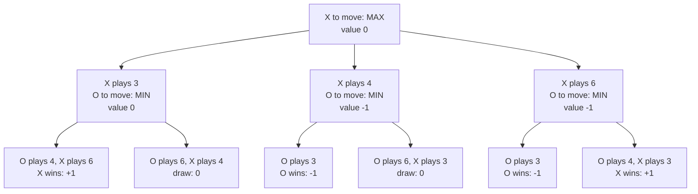
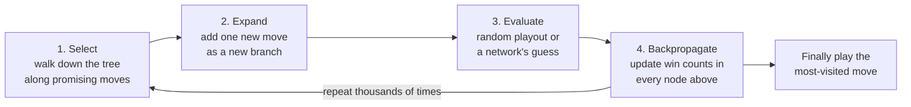
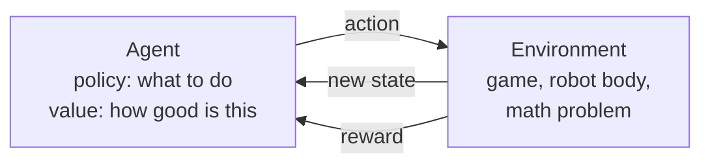
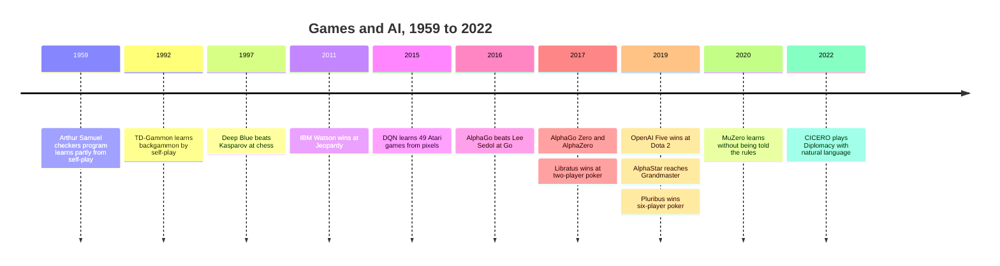
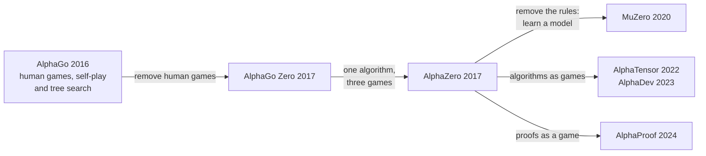
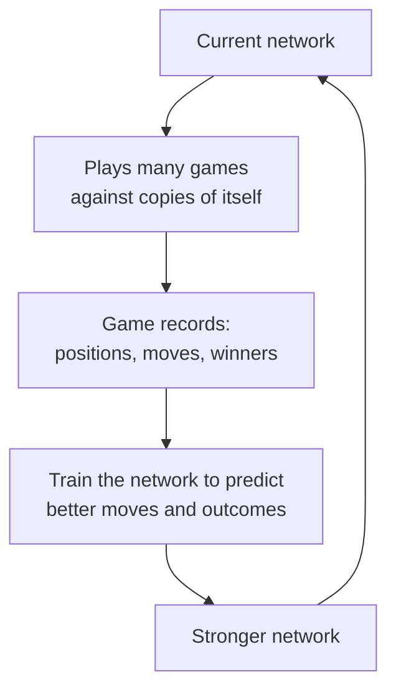
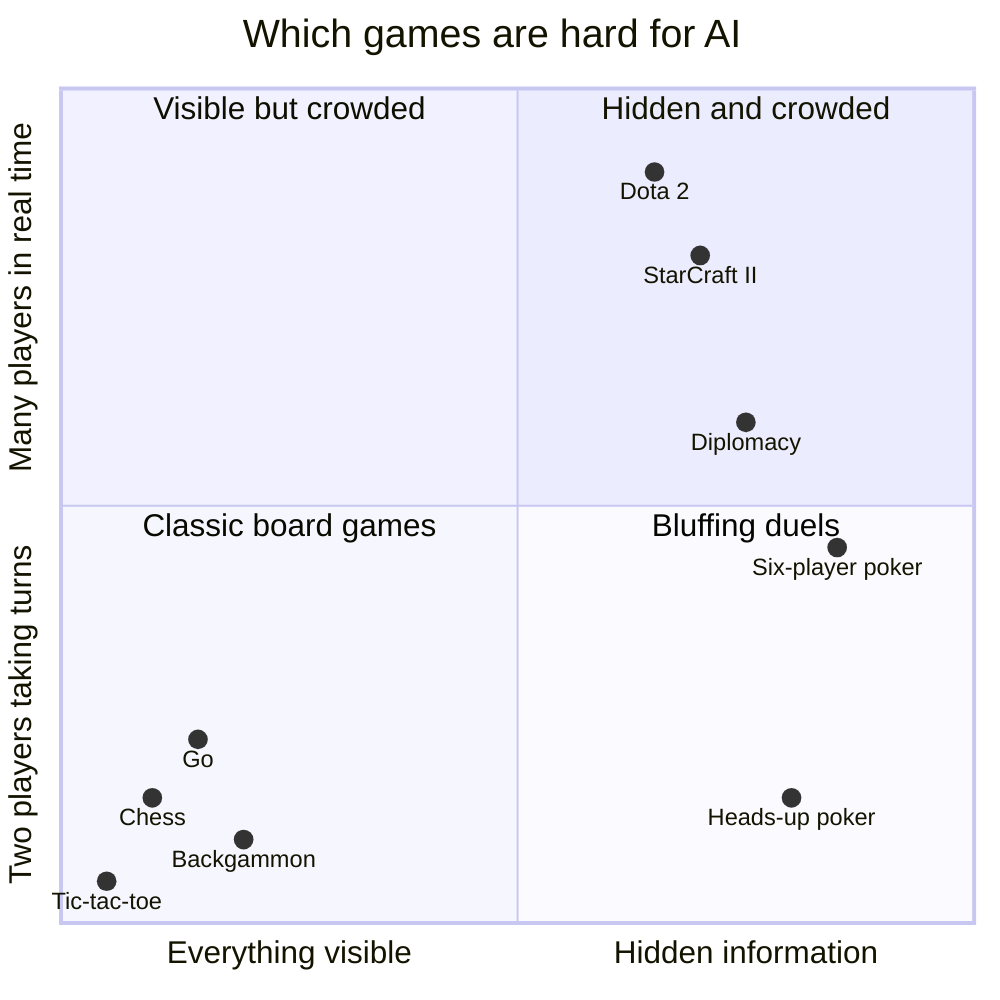

# Chapter 48: Reinforcement Learning, Games and Planning

*This chapter teaches you how machines decide what to do: how they search ahead like a chess player, how they learn from rewards like a dog learning tricks, how those two ideas beat world champions at chess, Go, poker and video games, and how the same ideas now make your chatbot "think."*

## What you'll learn
- How textbooks describe any decision problem (rational agents and the kinds of environments they face), and how to make a single decision under uncertainty with expected utility and the value of information.
- How AI searches for good plans: mazes, A* route-finding, local search, constraint satisfaction (a meeting schedule solved by hand), classical planning with actions and goals, game trees, minimax (worked by hand on a tic-tac-toe position), alpha-beta pruning, dice games and Monte Carlo tree search.
- Reinforcement learning from scratch: agent, environment, state, action, reward, return, policy and value, and the Markov decision process that ties them together.
- Exploration versus exploitation, and the credit-assignment problem.
- Q-learning, worked step by step with real numbers, and how Deep Q-Networks scaled it to Atari.
- Policy gradients and actor-critic methods, in plain words.
- The great game milestones, from TD-Gammon and Deep Blue to AlphaGo's Move 37, AlphaZero, MuZero, OpenAI Five, AlphaStar, Pluribus and CICERO, and why self-play works.
- The core ideas of game theory: the prisoner's dilemma, dominant and mixed strategies, mechanism design and the Shapley value.
- Where reinforcement learning is used outside games, and how game-playing ideas became the "thinking" in 2026's reasoning models.

## Before you start
Chapter 8 (Learning From Examples) introduced reinforcement learning's basic vocabulary. Chapter 6 (The Math of AI, Part 2) covered probability, averages and gradient descent, which you will see again here. Chapter 12 (Neural Networks From Scratch) explains the networks that later systems plug in. Chapter 7 (A History of AI) told the game milestones briefly; this chapter tells them in depth. Chapter 20 (Post-Training) and Chapter 21 (Reasoning Models and Reinforcement Learning) apply these ideas to chatbots, so this chapter only points to them at the end.

## Deciding, not just predicting

Most AI in this book answers a question: what is in this photo, what word comes next, is this payment fraud? This chapter is about a different verb: **decide**. A decision changes what happens next. Move your knight and the board is different; if your chatbot chooses to call a search tool instead of answering, the rest of the conversation changes.

> **Definition — Sequential decision-making:** Making a series of choices where each choice changes the situation in which the next choice is made, as in games, driving, robot control or a multi-step task.

There are two great families of tools for deciding.

1. **Search and planning.** If you know the rules, think ahead ("if I do this, then that happens...") and pick the path that ends best.
2. **Reinforcement learning (RL).** If you do not know the rules, or the world is too big to think through, learn from experience: try things and do more of what earns rewards.

> **Definition — Planning:** Working out a sequence of actions in advance, by reasoning about their consequences, to reach a goal.

The most famous systems combine the two: AlphaGo used learned intuition to suggest moves and search to check them, and your chatbot's reasoning mode does something similar with words (Chapter 21).

> **Key idea:** Search means thinking ahead with a model of the world. Reinforcement learning means learning from trial and error. The strongest decision-making systems use learning to guide search and search to improve learning.

### What kind of world is the agent in?

Before choosing a method, describe the problem. The most widely used AI textbook, Stuart Russell and Peter Norvig's *Artificial Intelligence: A Modern Approach*, frames the whole field as building agents that act well in some environment, and it summarizes any task by four things, abbreviated PEAS: the Performance measure (what counts as doing well), the Environment, the Actuators (how the agent acts) and the Sensors (what it can perceive). For a robot vacuum: a clean floor in little time without bumping the cat; your home; wheels and brushes; a camera, bump sensors and a dirt detector.

> **Definition — Rational agent:** An agent that, in every situation, chooses the action expected to do best on its performance measure (the score its designer cares about), given everything it has perceived so far. "Rational" here means "does the right thing by that score", not "thinks like a person".

Environments are then sorted by a handful of questions. The answers decide which tools from this chapter fit.

| Question | Easy end | Hard end | Example of the hard end |
|---|---|---|---|
| Can the agent see everything that matters? | Fully observable (chess) | Partially observable | Poker's hidden cards, a pedestrian behind a truck |
| Does an action always have the same result? | Deterministic (a sliding puzzle) | Stochastic (chance involved) | Dice in backgammon, a wheel slipping on ice |
| Does each choice affect later ones? | Episodic (labeling photos one at a time) | Sequential | Chess, driving, a multi-step coding task |
| Does the world wait while the agent thinks? | Static (a crossword) | Dynamic | Traffic, a live video game |
| Are the states and actions distinct steps? | Discrete (board games) | Continuous | Steering angles, robot joint positions |
| Is anyone else acting? | Single agent (a maze) | Multiagent | Opponents, teammates, other drivers |

*Table 48.1: The questions that describe an agent's environment. Driving a taxi sits at the hard end of every row, which is one reason self-driving took so long (Chapter 50).*

> **Definition — Fully and partially observable:** An environment is fully observable if the agent's sensors show it everything relevant to its choice, as in chess, and partially observable if something important is hidden, such as an opponent's cards or a cyclist behind a bus.

> **Definition — Deterministic and stochastic:** In a deterministic environment the same action in the same state always has the same result; in a stochastic one, chance plays a part, as with a dice roll or a slippery floor.

> **Definition — Episodic and sequential:** In an episodic task each decision stands alone, like labeling one photo and then the next; in a sequential task each choice changes the situation for the choices that follow.

Agents themselves come in a ladder of sophistication. A **simple reflex agent** reacts to what it senses right now. A **model-based agent** also keeps track of what it cannot currently see. A **goal-based agent** imagines where its actions lead and picks ones that reach a goal, which is where search and planning come in. A **utility-based agent** weighs how good each possible outcome is and how likely, the subject of the next section. And any of these can be a **learning agent**, with a part that improves its behavior from experience, which is where reinforcement learning comes in. A thermostat is a reflex agent; a robot vacuum that maps your rooms is model-based; your map app's router is goal-based; a self-driving car that trades off speed, comfort and safety is utility-based.

> **Definition — Simple reflex agent:** An agent that chooses its action from its current input alone, using fixed condition-action rules such as "if the room is below 19°C, turn on the heat".

> **Definition — Model-based agent:** An agent that keeps an internal picture of the world, including things it cannot currently perceive, and uses it to choose actions.

> **Definition — Goal-based agent:** An agent that chooses actions by working out which sequences of actions lead to a desired goal, using search or planning.

> **Definition — Utility-based agent:** An agent that compares possible outcomes by how desirable they are (their utility) and how likely they are, and picks the action with the best expected result.

### Deciding when you are not sure: expected utility

The simplest decision is a single choice under uncertainty. Should you take an umbrella? The forecast says a 30% chance of rain. Decision theory, the mathematics of choosing, gives a recipe: score each possible outcome by how much you like it, multiply each score by its probability, add them up, and pick the action with the highest total. Chapter 6 called such a sum an expected value; when the scores measure how much you like an outcome rather than dollars, it is called expected utility.

> **Definition — Utility:** A number expressing how desirable an outcome is to a particular person or agent, where higher is better. Utilities put very different outcomes, such as getting soaked and carrying a bag all day, on one scale.

> **Definition — Maximum expected utility principle:** The rule that a rational agent should choose the action whose possible outcomes, weighted by their probabilities, have the highest average utility.

**Worked example.** Score the outcomes from 0 to 100: dry without carrying anything, 100; dry but carrying an umbrella, 80; caught in the rain without one, 0.

- Take the umbrella: you stay dry whatever happens, so 80.
- Leave it: 0.7 × 100 + 0.3 × 0 = 70.

Take it. If the forecast said 10%, leaving it would be worth 0.9 × 100 = 90, and you should leave it. The break-even point is a 20% chance of rain, where leaving it is worth 0.8 × 100 = 80, the same as taking it.

Information has a value you can calculate too. Suppose a radar app could tell you for certain whether it will rain. Then you would carry the umbrella only on rainy days: 0.3 × 80 + 0.7 × 100 = 24 + 70 = 94. Without the app your best was 80, so the information is worth 94 − 80 = 14 points to you. Information that could not change your choice is worth nothing.

> **Definition — Value of information:** How much better you expect to decide if you learn something before acting: the expected utility of deciding with the information minus the expected utility of deciding without it.

This is why a good doctor orders a test only if its result could change the treatment, and why a well-designed AI agent asks you a clarifying question only when your answer could change what it does.

Utility is not the same as money. Most people prefer a sure $1,000 to a coin flip for $2,000, although both have an expected value of $1,000, because the second thousand dollars matters less to them than the first. The same reasoning explains why people buy insurance, which loses money on average.

> **Definition — Risk aversion:** Preferring a certain outcome to a gamble with the same expected value, because each extra unit of money (or of anything else) adds less utility than the one before.

Why should a rational agent maximize expected utility at all? Because of a few common-sense rules for preferences, set out by John von Neumann and Oskar Morgenstern in the 1940s. One is transitivity: if you prefer A to B and B to C, you prefer A to C. Anyone who breaks it can be milked. Suppose you prefer tea to coffee, coffee to juice and juice to tea, and will pay 10 cents to swap for something you prefer. Holding tea, you pay 10 cents to swap it for juice, 10 more for coffee and 10 more for tea: back where you started, 30 cents poorer, and ready to go round again. Von Neumann and Morgenstern proved that anyone whose preferences obey all of their rules behaves as if maximizing expected utility, for some choice of utility numbers.

> **Definition — Money pump:** The argument that an agent with circular preferences (A over B, B over C, C over A) can be led through an endless loop of trades, paying a little each time, which is why rational preferences must be transitive.

Two habits keep such calculations honest. Sensitivity analysis asks how far the inputs could move before the decision flips. The umbrella decision flips at a 20% chance of rain, so with a 30% forecast it is a fairly safe call, while with 21% a slightly wrong forecast would make it the wrong one. And beware the optimizer's curse. When you pick the best of many options by their estimated value, you tend to pick one whose estimate was too high by luck, so the winner usually disappoints. Score 20 vendors, or 20 AI models on a small benchmark, and the top scorer's true quality is probably lower than its score. The cure is to treat very high estimates with suspicion and re-test the winner on fresh data, the same lesson as the test sets of Chapter 9.

> **Definition — Sensitivity analysis:** Checking how much a decision's inputs, such as probabilities or utilities, could change before the best choice changes, to see how much the decision depends on uncertain numbers.

> **Definition — Optimizer's curse:** The tendency of the option that looks best on noisy estimates to disappoint in reality, because choosing the maximum also selects for estimates that happened to be too optimistic.

> **Key idea:** A rational decision weighs how good each outcome would be by how likely it is. The rest of this chapter applies that one idea to long chains of decisions, where the reward of reinforcement learning plays the part of utility.

## Search: thinking before you act

### States, actions and goals

Picture a maze printed on a placemat. You are at the entrance with a pencil. Every junction is a place where you choose a direction. AI people describe every such problem with the same handful of words.

> **Definition — State:** A complete description of the situation at one moment: where you are in a maze, the arrangement of pieces on a chessboard, or the robot's position and what it sees.

> **Definition — Action:** One of the choices available in a state, such as "turn left," "move the knight to f3" or "call the search tool."

> **Definition — State space:** The set of all possible states a problem can be in. It can be tiny (a small maze) or astronomically large (Go).

> **Definition — Search (AI sense):** Systematically exploring sequences of actions, usually in imagination, to find one that reaches a goal.

Your map app does this every time you ask for directions. Each intersection is a state, each road segment is an action, and the goal is your destination. The app explores possible routes in its own memory before you move a meter.

How a state is written down matters. The simplest way treats each state as a sealed box with a name, "junction 17", which tells the program nothing about what is inside. A factored representation instead describes a state by a list of variables: a delivery robot's state might be position = kitchen, battery = 40%, holding cup = yes. Now the program can see that two states differ only in the battery level, can state a goal as "holding cup = no and position = table" without listing every matching state, and can reason about which variables an action changes. The constraint and planning sections below rely on exactly this. Notice too that the program never needs the whole state space drawn in advance; for chess that would be impossible. It starts from the current state and generates each state's neighbors only when it reaches them.

> **Definition — Factored representation:** Describing a state as a set of variables with values (position = kitchen, battery = 40%) instead of as one indivisible label, so a program can see what two states have in common and which parts an action changes.

### Blind search: breadth-first and depth-first

The simplest search strategies have no sense of direction.

> **Definition — Breadth-first search (BFS):** A search method that explores all places one step away, then all places two steps away, and so on, like ripples spreading in a pond. It always finds the shortest path when every step costs the same, but it can be slow.

> **Definition — Depth-first search (DFS):** A search method that follows one path as far as it can go before backing up and trying another, like keeping your hand on one wall of a maze.

Two refinements fix their worst habits. Breadth-first search counts steps, but on a road map one step might be 200 meters and the next 20 kilometers. Uniform-cost search, best known as Dijkstra's algorithm (1959), always expands the place with the smallest total distance traveled so far, so it finds the cheapest route even when steps cost different amounts. Depth-first search needs little memory but can wander down an endless path; iterative deepening runs depth-first search with a depth limit of 1, then 2, then 3 and so on, gaining breadth-first's guarantee of a shortest path while keeping depth-first's small memory. Redoing the shallow levels each round costs little, because most of a search tree's places are in its deepest level.

> **Definition — Uniform-cost search (Dijkstra's algorithm):** A search method that always explores next the place with the lowest total cost from the start, so it finds the cheapest path when steps have different costs, such as roads of different lengths.

> **Definition — Iterative deepening:** Running depth-first search again and again with a growing depth limit (1, 2, 3...), which finds the shortest path like breadth-first search while using only as much memory as depth-first search.

Textbooks compare search methods on four questions. Is it complete: does it always find a solution when one exists? Is it optimal: is the solution it finds the cheapest? How much time does it take, and how much memory? Breadth-first search is complete and, with equal step costs, optimal, but hungry for memory; depth-first search is frugal with memory but neither complete on endless paths nor optimal. A second practical habit is remembering where you have been. In a city grid you can reach the same corner by many routes, and a search that forgets this explores the corner, and everything beyond it, once per route. Keeping a list of already-reached states and skipping repeats (graph search, as opposed to tree search) can shrink the work enormously, at the price of the memory for that list.

> **Definition — Complete and optimal (search):** A search method is complete if it is guaranteed to find a solution whenever one exists, and optimal if the solution it finds is guaranteed to be the cheapest one.

One more blind trick works when you know the goal exactly. Bidirectional search runs two searches at once, one forward from the start and one backward from the goal, and stops when they meet. Each only has to cover about half the distance. With 10 choices per step and a solution 6 steps away, one search might examine about 10^6 = 1,000,000 states, while two half-searches examine about 2 × 10^3 = 2,000.

> **Definition — Bidirectional search:** Searching forward from the start and backward from the goal at the same time until the two searches meet, which can cut the work dramatically because each search covers only about half the distance.

Blind search is fine for a placemat maze. It collapses on big problems because state spaces explode. A Rubik's cube has about 43 quintillion (4.3 × 10^19) arrangements. Checking a billion per second would take more than a thousand years to visit them all. Real problems need a sense of direction.

### A*: search with a sense of direction

In 1968, researchers at the Stanford Research Institute (SRI), building a wheeled robot called Shakey, published A* ("A-star"). It is still the textbook way to find shortest paths in games, robots and maps.

> **Definition — SRI (SRI International):** An independent non-profit research institute in Menlo Park, California, founded in 1946 as the Stanford Research Institute. Its researchers built Shakey, one of the first mobile robots, and in that project invented A* search and the STRIPS way of describing actions.

> **Definition — Heuristic:** A rule of thumb that estimates how promising an option is, guiding search toward good choices without guaranteeing the best answer on its own.

> **Definition — A* search:** A shortest-path algorithm that always explores next the place with the lowest total of "distance traveled so far" plus "estimated distance remaining." With an estimate that never overshoots, it is guaranteed to find a shortest path.

A* scores each square with three numbers:

- **g** = steps taken from the start to reach this square
- **h** = the heuristic guess of steps still needed to reach the goal
- **f = g + h** = the estimated total length of a route through this square

On a grid where you can move up, down, left or right, a good heuristic is the Manhattan distance.

> **Definition — Manhattan distance:** The distance between two points on a grid counted as blocks moved horizontally plus blocks moved vertically, like walking city blocks. From row 2, column 0 to row 2, column 7 it is 0 + 7 = 7.

> **Definition — Admissible heuristic:** A heuristic that never overestimates the true remaining cost. Manhattan distance is admissible on a grid because walls can only make the real route longer.

Here is a worked example. S is the start, G the goal, # is a wall, and * marks the path A* finds.

```
        col: 0  1  2  3  4  5  6  7
  row 0      .  .  .  .  .  .  .  .
  row 1      .  .  .  *  *  *  *  *
  row 2      S  *  *  *  #  .  .  G
  row 3      .  .  .  .  #  .  .  .
  row 4      .  .  .  .  .  .  .  .
  row 5      .  .  .  .  .  .  .  .
```
*Figure 48.1: A* on a small grid. The start is at row 2, column 0; the goal at row 2, column 7; a two-square wall blocks the direct route.*

From S, A* compares its neighbors:

| Square | g (steps so far) | h (Manhattan to G) | f = g + h |
|---|---|---|---|
| Right of S (row 2, col 1) | 1 | 0 + 6 = 6 | **7** |
| Above S (row 1, col 0) | 1 | 1 + 7 = 8 | 9 |
| Below S (row 3, col 0) | 1 | 1 + 7 = 8 | 9 |

*Table 48.2: The first choice A* makes. The square heading toward the goal has the lowest f, so A* explores it first.*

A* marches right while f stays at 7. At row 2, column 3, the wall blocks the way. The squares above and below now score f = 4 + 5 = 9, the same as the squares it skipped near the start, so the search widens a little, slips around the top of the wall and reaches G in 9 steps. In one run of this example, breadth-first search examined 44 squares before reaching the goal, while A* examined 19 (exact counts depend on how ties are broken). On a city-sized map the savings are enormous.

> **Analogy:** Breadth-first search is a search party fanning out in every direction from the trailhead. A* is the same party with a compass pointing at the destination: they still check side paths when the direct way is blocked, but they do not waste hours walking away from the goal.

Real navigation apps add heavy precomputation and live traffic to relatives of A*, but the core idea is the same: combine what you know (distance so far) with a good guess (distance left).

Drop the "distance so far" and follow the guess alone, and you get greedy best-first search. It rushes toward whatever looks closest to the goal, which is often fast, but it can be lured into dead ends and does not promise the shortest route. A* balances the two numbers, which is why it gets both speed and the guarantee.

> **Definition — Greedy best-first search:** A search method that always explores next the place its heuristic says is closest to the goal, ignoring the cost already paid. It is often fast but can be misled and may return a longer path than necessary.

Between the two sits a popular compromise. Weighted A* multiplies the guess by a factor greater than 1, scoring squares by g + 2 × h, for example. The search leans harder toward the goal and usually examines far fewer squares, and the path it returns is guaranteed to cost at most that factor times the best (here, at most twice as long), and is often much closer. Game characters and robots often accept such a "good enough, fast" answer, a style textbooks call satisficing.

A* has a second weakness: it keeps every square it has seen in memory, which on huge problems runs out long before time does. Memory-bounded versions fix this. The best known, IDA* (iterative deepening A*), borrows the trick from blind search: run a depth-first search that abandons any path whose f = g + h exceeds a limit, then raise the limit to the smallest f that went over and repeat. It needs almost no memory and still finds the shortest path, which suits puzzles with enormous state spaces, like the Rubik's cube above.

> **Definition — Weighted A*:** A variant of A* that multiplies the heuristic estimate by a weight above 1, trading a slightly longer path (at most the weight times the best) for a much faster search.

> **Definition — IDA* (iterative deepening A*):** A memory-saving version of A* that runs repeated depth-first searches, each cut off where g + h exceeds a limit that rises from round to round. It finds shortest paths while storing only the current path.

### Local search: improving one solution at a time

Sometimes the path does not matter, only the destination. A school timetable, the layout of a warehouse, eight queens placed on a chessboard so that none attacks another: you want a good final arrangement, not the route to it. For such problems AI often uses local search: start with a complete solution, however bad, and keep making small changes that improve it.

> **Definition — Local search:** Optimization that keeps one (or a few) complete candidate solutions and repeatedly moves to a nearby, better candidate, instead of exploring paths from a start. It uses very little memory and works on huge problems.

> **Definition — Hill climbing:** The simplest local search: try all small changes to the current solution, take the one that improves the score most, and stop when no change helps.

Hill climbing is the step-by-step cousin of gradient descent (Chapter 6), walking uphill in fog instead of downhill, and it has the same trap. Picture the scores of positions along a trail: 3, 5, 7, 6, 4, 8, 12, 9. Start at the 3 and climb: 5, then 7. Both neighbors of the 7 (5 and 6) are lower, so you stop, never seeing the 12 that lies beyond the dip.

> **Definition — Local maximum:** A solution better than all its immediate neighbors but worse than the best solution overall: a hilltop that is not the highest peak.

There are two classic escapes. Random restarts run hill climbing many times from random starting points and keep the best result. Simulated annealing, named after metalworking (hot metal cooled slowly settles into a strong structure), sometimes accepts a worse move on purpose: often at first, while the "temperature" is high, and more and more rarely as it cools. Early on it can walk down from the 7 through the dip and find the 12; by the end it behaves like plain hill climbing.

> **Definition — Simulated annealing:** A local search method that sometimes accepts worse moves, with a probability that shrinks over time as a "temperature" falls, so it can escape local maxima early and settle on a good solution late.

Peaks are not the only trap in this landscape. On a plateau, a flat stretch where every neighbor scores the same, hill climbing has no direction to go; on a ridge, the way up runs diagonally between the allowed small moves, so every single step looks downhill. A third escape, tabu search, keeps a short list of recently visited solutions that it is forbidden to return to. It takes the best allowed move even when that move is worse, and the list stops it from sliding straight back up the hill it just left, so it keeps exploring.

> **Definition — Tabu search:** A local search method that always moves to the best neighboring solution not on a short "tabu" list of recently visited ones, even if that move is worse, so it walks off local maxima and plateaus instead of circling back.

Simulated annealing has been used to place the components of computer chips since the 1980s. Population-based relatives keep many candidates at once: genetic algorithms breed them (Chapter 54), and beam search keeps only the best few partial solutions at every step. Beam search is how many translation systems choose a high-probability sentence: keep the best few beginnings, extend each by one word, keep the best few again, and repeat. (Chatbots usually sample instead, as Chapter 18 explains.)

> **Definition — Beam search:** A search that, at each step, extends every candidate it is keeping and then keeps only the best k of them (k is the "beam width"), trading the guarantee of finding the very best answer for speed and low memory.

### Constraint satisfaction: puzzles, timetables and schedules

Many real problems are about filling in blanks without breaking rules: a sudoku, a meeting schedule, a wedding seating plan, which crew flies which plane. AI treats them all the same way.

> **Definition — Constraint satisfaction problem (CSP):** A problem described by variables (the things to decide), a domain for each (its possible values) and constraints (rules about which combinations are allowed). A solution gives every variable a value without breaking any constraint.

**Worked example: four meetings, three time slots.** Meetings A, B, C and D must each go at 9:00, 10:00 or 11:00. Meetings that share people cannot overlap: A shares people with B and C, and B shares people with C and D. D includes the CEO, who is free only at 9:00.

- Variables: A, B, C, D. Domains: {9, 10, 11} for A, B and C; just {9} for D.
- Constraints: A ≠ B, A ≠ C, B ≠ C, B ≠ D.

Blind search would try all 3 × 3 × 3 × 1 = 27 combinations. A constraint solver combines two moves instead.

**Constraint propagation** uses the rules to shrink domains before guessing. D must be 9 and B ≠ D, so B loses 9: B is now {10, 11}.

**Backtracking search** assigns variables one at a time, choosing first the variable with the fewest values left (a heuristic that exposes dead ends early), and propagates again after each choice:

1. B has the fewest values left. Try B = 10. Propagate: A ≠ 10 and C ≠ 10, so A is {9, 11} and C is {9, 11}.
2. Try A = 9. Propagate: C ≠ 9, so C must be 11.
3. Check every rule: A at 9, B at 10, C at 11, D at 9. A and D share the 9:00 slot, which is fine because they share no people. Solved, with no dead ends.

Had a choice emptied some variable's domain, the solver would undo its most recent choice and try the next value, which is what "backtracking" means.

> **Definition — Constraint propagation:** Using the constraints to delete values that can no longer be part of any solution, such as removing 9:00 from meeting B once D is fixed at 9:00. It shrinks the search before any guessing.

The check used here, going through each constraint between two variables and deleting any value that has no partner value left on the other side, is called arc consistency, and it is the workhorse of constraint solvers. Stronger checks look at three or more variables at once; they delete more values but cost more time per check.

> **Definition — Arc consistency:** A propagation check that looks at each constraint between two variables and removes from one variable every value for which the other variable has no compatible value left.

> **Definition — Backtracking search:** Assigning values one variable at a time, checking the constraints after each choice, and undoing the most recent choice whenever a dead end is reached.

A sudoku is the same kind of problem: 81 variables, domains 1 to 9, and "no repeats in any row, column or box" as the constraints. Propagation alone solves most newspaper puzzles; hard ones need some backtracking. For very large problems, solvers also use local search: start from a complete but flawed schedule and repeatedly change whichever variable is involved in the most broken rules (the "min-conflicts" heuristic). Industrial constraint solvers schedule airline crews, sports leagues, factory lines and computing jobs in data centers, and a close relative, the SAT solver (short for "satisfiability": a program that finds true-or-false values for many yes-or-no variables so that a long logical formula comes out true), verifies computer chips (Chapter 54).

Why do these solvers need clever tricks at all? Because no one knows a fast method that is guaranteed to solve every such problem. Stephen Cook proved in 1971 that the satisfiability problem behind SAT solvers is NP-complete, and Richard Karp's 1972 list of 21 NP-complete problems added classics such as job sequencing, packing a knapsack and finding a route that visits every point exactly once. Checking a proposed answer is quick, but every known general method needs, in its worst cases, time that grows exponentially with the size of the problem. Whether a fast method exists is the famous unsolved "P versus NP" question (P is the set of problems a computer can solve quickly; NP is the set whose proposed answers it can check quickly; the question is whether the two sets are really the same). Real solvers succeed because real problems are rarely worst cases: propagation, good ordering heuristics and learning from dead ends make most of them easy in practice.

> **Definition — NP-complete:** A class of problems, including SAT and many scheduling and packing puzzles, for which a proposed answer is easy to check but no known method finds answers quickly in every case; a fast method for any one of them would give fast methods for all.

### Planning with actions: from Shakey to PDDL

Search needs a description of what actions do. For Shakey, the SRI robot that gave us A*, researchers invented a simple and influential way to write one, called STRIPS (the Stanford Research Institute Problem Solver, 1971). Each action is a recipe card listing its preconditions (what must be true before) and its effects (what becomes true or false after). A planner searches for a sequence of cards that turns the starting situation into one where the goal is true.

> **Definition — Classical planning:** Finding a sequence of actions that turns a known starting situation into one that satisfies a goal, where each action is described by its preconditions and effects and the world is fully known and deterministic.

> **Definition — Precondition and effect:** In planning, a precondition is a fact that must be true before an action is allowed (the kettle must hold water before you boil it); an effect is a fact the action makes true or false (the water is now hot).

| Action | Preconditions | Effects |
|---|---|---|
| Fill kettle | Kettle empty | Kettle has water; kettle no longer empty |
| Boil water | Kettle has water | Water hot |
| Put teabag in cup | Have teabag | Teabag in cup; no longer have teabag |
| Pour | Water hot; teabag in cup | Tea made |

*Table 48.3: A tiny planning problem written in the style of STRIPS.*

Start: kettle empty, have teabag. Goal: tea made. Working backward from the goal, a planner sees that Pour needs "water hot" and "teabag in cup"; "water hot" needs Boil, which needs "kettle has water", which needs Fill. One valid plan: Fill, Boil, Put teabag in cup, Pour. A good planner also notices that the teabag can go in at any point before Pour and keeps that freedom instead of fixing an arbitrary order, which is called partial-order planning.

The standard language for writing such problems today is PDDL, introduced in 1998 for the international planning competitions. Planners find long plans in huge problems by searching with heuristics they compute automatically, for example by solving an easier, "relaxed" version of the problem in which no action ever undoes anything, just as Manhattan distance is the exact answer to a relaxed maze with no walls.

> **Definition — PDDL (Planning Domain Definition Language):** The standard text format for planning problems, listing the objects, the actions with their preconditions and effects, the starting state and the goal, so that any planner can read them.

Big tasks are planned in layers. "Make dinner" breaks into "make pasta" and "make salad", and each of those breaks into smaller steps, until every step is a basic action.

> **Definition — Hierarchical planning (HTN):** Planning by breaking high-level tasks into subtasks using known recipes, level by level, until every step is a basic action. HTN stands for hierarchical task network.

Classical planners work in places you might not expect. NASA's Remote Agent planned and carried out spacecraft operations on board the Deep Space 1 probe in 1999. Logistics companies plan deliveries with them, and many video games plan the actions of their computer-controlled characters this way, for example the enemy soldiers of the 2005 game *F.E.A.R.*. Real-world planning also has to handle time, deadlines and shared resources, which turns it into scheduling, a constraint problem, and surprises, which call for watching the plan as it runs and replanning when a step fails. That plan, act, observe, replan loop is exactly what a coding agent does with its to-do list (Chapter 28). The difference is that the agent writes its "recipe cards" in plain language rather than PDDL, which makes it far more flexible but gives none of a classical planner's guarantees that every precondition has been checked.

There are two other ways to cope with surprises, besides fixing things after they go wrong. A contingent (or conditional) plan builds the surprises in from the start, with branches that depend on what the agent will observe: "fill the kettle; if the kettle does not heat, boil water in a pan instead; then pour." A rover on Mars, which cannot wait for instructions from Earth, benefits from exactly this kind of plan. Continuous (or online) planning never finishes planning at all: the agent plans a little ahead, acts, looks, and plans again, the way a driver keeps adjusting a route, which is also how the robot controllers of Chapter 49 work.

> **Definition — Contingent plan (conditional plan):** A plan with built-in branches of the form "if you observe this, do that", prepared in advance for situations the planner cannot predict, instead of a single fixed sequence of steps.

### Game trees: when the world fights back

A maze sits still. In a game, an opponent moves too, and they are trying to beat you. Now the search must consider their replies.

> **Definition — Game tree:** A branching diagram of a game in which each point is a position, each branch is a possible move, and the levels alternate between the players.

> **Definition — Branching factor:** The typical number of moves available from a position. Tic-tac-toe starts at 9; chess averages about 35; Go averages about 250.

> **Definition — Zero-sum game:** A game where one player's gain is exactly the other's loss, so the players' interests are perfectly opposed. Chess, Go and two-player poker are zero-sum.

Chess and Go are also games of perfect information: both players see the whole board. Game trees grow at frightening speed, because the branching factor multiplies at every ply (one move by one player):

| Game | Typical branching factor | Size of the problem |
|---|---|---|
| Tic-tac-toe | up to 9 | 255,168 possible games; 5,478 legal positions |
| Checkers | small, often under 10 | about 5 × 10^20 positions; solved in 2007 (perfect play is a draw) |
| Chess | about 35 | about 10^44 legal positions; about 35^80 ≈ 10^123 possible 80-ply games |
| Go (19 × 19) | about 250 | about 2 × 10^170 legal positions; about 250^150 ≈ 10^360 possible 150-move games |

*Table 48.4: How big game trees get. For comparison, the observable universe holds roughly 10^80 atoms.*

Tic-tac-toe is small enough to search completely, which is why it is the perfect place to learn the key idea.

### Minimax, worked by hand

You play X. It is your turn. Number the squares 1 to 9:

```
   1 | 2 | 3          X | O | .
  ---+---+---        ---+---+---
   4 | 5 | 6          . | O | .
  ---+---+---        ---+---+---
   7 | 8 | 9          O | X | X
```
*Figure 48.2: Left, the square numbers. Right, the position: X on 1, 8 and 9; O on 2, 5 and 7; squares 3, 4 and 6 are empty, and X is to move.*

Score the end of the game from X's point of view: **+1** if X wins, **0** for a draw, **−1** if O wins.

> **Definition — Minimax:** A way of choosing moves in a two-player game by assuming the opponent always replies with the move that is worst for you. You pick the move whose worst case is best.

Minimax works from the bottom of the tree up, starting at finished games, whose scores are known. At positions where X moves, X takes the **maximum** score. At positions where O moves, O takes the **minimum** (best for O, worst for X). Let us go through all three candidate moves.

**Option A: X plays square 3.** This blocks O's diagonal (3-5-7) and also gives X two in the right-hand column (3 and 9, with 6 empty). Now O moves, with squares 4 and 6 left.
- If O plays 4, X plays the last square, 6, completing 3-6-9. X wins: **+1**.
- If O plays 6 (blocking), X plays 4. Nobody has three in a row: draw, **0**.
- O chooses the minimum: min(+1, 0) = **0**. Option A is worth 0.

**Option B: X plays square 4.** O moves, with 3 and 6 left.
- If O plays 3, O completes the diagonal 3-5-7. O wins: **−1**.
- If O plays 6, X plays 3. Draw: **0**.
- O chooses min(−1, 0) = **−1**. Option B is worth −1.

**Option C: X plays square 6.** This looks aggressive: X now has 6 and 9 and threatens 3. But O moves first, with 3 and 4 left.
- If O plays 3, O both blocks X and completes 3-5-7. O wins: **−1**.
- If O plays 4, X plays 3 and wins: **+1**.
- O chooses min(−1, +1) = **−1**. Option C is worth −1.

At the top, X chooses the maximum: max(0, −1, −1) = **0**. Minimax says play square 3, and a draw is the best X can force.


*Figure 48.3: The complete minimax tree for the position. Scores flow upward: O takes the minimum of its children, X takes the maximum.*

Notice the trap in Option C. A greedy player sees "C creates a threat and can win." Minimax sees that a sensible opponent will never let that branch happen. Assuming the opponent is smart is the whole point.

> **Try it:** Play tic-tac-toe against your chatbot in text, numbering the squares 1 to 9. After each of its moves, ask it to list the minimax value (+1, 0 or −1) of every move it considered. Check one of its claims yourself with a small tree on paper.

> **Key idea:** Minimax judges each move by its worst case, assuming a perfect opponent. Scores are known only at the end of the game, so they are passed up the tree: the opponent's levels take the minimum, your levels take the maximum.

### Alpha-beta pruning and evaluation functions

Look again at Option B. As soon as minimax sees that O can reply with square 3 and win (−1), Option B can be worth at most −1, which is already worse than the 0 that Option A guarantees. There is no need to examine O's other reply at all. That shortcut has a name.

> **Definition — Alpha-beta pruning:** A shortcut for minimax that skips branches which provably cannot change the final decision, because a better option has already been found elsewhere. It gives exactly the same answer as full minimax, often while examining only a small fraction of the tree.

Even with pruning, chess is far too big to search to the end. So chess programs search a few plies ahead and then *estimate* who is winning.

> **Definition — Evaluation function:** A formula or model that scores a game position that is not finished, estimating how good it is for one player, for example by counting material and judging king safety.

This is exactly how IBM's Deep Blue beat world champion Garry Kasparov in May 1997, winning the six-game match 3.5 to 2.5 after losing their first match in 1996. Deep Blue used hundreds of custom chess chips to examine about 200 million positions per second, with alpha-beta pruning and an evaluation function hand-crafted with help from grandmasters. It learned almost nothing. It was a triumph of search and engineering.

Modern engines kept the search but changed the evaluation: since 2020 the leading open engine, Stockfish, has used a small neural network to judge positions.

Three more details explain how real engines get so strong. First, move ordering: alpha-beta prunes most when it examines the best replies first, so engines try captures, and moves that proved strong elsewhere in the search, before the rest. With perfect ordering, alpha-beta can search about twice as deep as plain minimax in the same time. Second, a fixed depth cutoff creates the horizon effect. If the program would lose its queen at ply 9 but searches only 8, it may play pointless delaying moves that push the loss just past the depth it can see. Engines soften this by searching further whenever the position is still unsettled, for example in the middle of an exchange of pieces. Third, some search is replaced by lookup. An opening book stores well-studied first moves, and an endgame tablebase stores perfect play for positions with only a few pieces left. Complete tablebases for every position with seven pieces, counting both kings, were finished in 2018, and engines including Stockfish consult them during play. A game counts as solved when perfect play from the starting position is known, as for checkers in Table 48.4; chess is not solved.

> **Definition — Horizon effect:** The blind spot of a search cut off at a fixed depth: a program may make pointless moves that merely postpone an unavoidable loss until just beyond the depth it can see, as if that made the loss disappear.

> **Definition — Opening book:** A stored list of well-studied opening moves that a game program plays from memory instead of searching.

> **Definition — Endgame tablebase:** A precomputed database giving the perfect move and the outcome for every position with only a few pieces left. In chess, complete tablebases cover every position with up to seven pieces.

> **Watch out:** "Deep Blue was a learning machine." It was mostly brute-force search plus human-written knowledge. The learning revolution in games came later, starting with backgammon in 1992 and exploding with Go in 2016.

### Games with dice: chance nodes

In backgammon you cannot even list your opponent's next moves until the dice decide which moves exist. So the game tree gets a third kind of level, a chance node, where luck "moves". At a chance node you cannot take a maximum or a minimum; you take the average of the outcomes, weighted by their probabilities.

**Worked example.** Two dice give 36 equally likely rolls. Move 1 leads to a position you win (+1) only if the next roll is double six (1 roll in 36) and that is otherwise even (0): worth 1/36 ≈ 0.03. Move 2 leads to a position you win if the roll contains at least one six (11 rolls in 36), lose (−1) on double ones (1 roll in 36), and that is otherwise even: worth 11/36 − 1/36 = 10/36 ≈ 0.28. Move 2 is better, even though it can lose and Move 1 cannot. Players' levels still take the maximum and minimum; only nature's levels average.

> **Definition — Chance node (expectiminimax):** A point in a game tree where luck, such as a dice roll, decides what happens next. Expectiminimax scores it with the probability-weighted average of its outcomes, while the players' levels still take the maximum and the minimum.

Cards add something harder than luck: hidden information, where you must also reason about what the other player might hold. Poker, later in this chapter, needed new methods for that.

### Monte Carlo tree search

Go defeated the Deep Blue recipe for two reasons. Its branching factor of about 250 makes deep search hopeless, and nobody could write a good evaluation function: strong Go players judge positions by intuition they cannot fully put into words.

The breakthrough was a Monte Carlo idea, named after the casino: estimate something by running many random trials and averaging. To judge a position, play many random games from it and count the wins.

> **Definition — Playout (rollout):** One simulated continuation of a game from a given position to the end (or for a fixed number of moves), used to estimate how good the position is.

Random play is terrible, but averaged over thousands of playouts it gives a useful signal. Monte Carlo tree search, developed around 2006, adds a clever way of deciding *which* moves deserve more playouts.

> **Definition — Monte Carlo tree search (MCTS):** A search method that builds a game tree gradually, running many simulated playouts and focusing its effort on the moves that look most promising so far, while still occasionally checking less-explored moves. It was central to AlphaGo.

Each round of MCTS has four steps:


*Figure 48.4: The four steps of Monte Carlo tree search, repeated thousands of times per move.*

The clever part is step 1. How does MCTS choose which branch to follow? It balances "this move has won a lot" against "this move has hardly been tried." A popular formula, called UCB, gives each move a score:

> **Definition — UCB (upper confidence bound):** A rule for choosing among options that adds an "uncertainty bonus" to each option's average result, so options that have been tried only a few times get extra chances. It is a mathematical form of "optimism in the face of uncertainty."

In plain text the score is: `win rate + c × square root of (ln N ÷ n)`, where N is the total number of playouts so far, n is the playouts through this move, ln is the natural logarithm, and c is a tuning constant (1.4 is a common choice).

Worked example. After 12 playouts, move A has won 6 of 10 (win rate 0.6) and move B has won 1 of 2 (win rate 0.5). ln 12 ≈ 2.48.

- Move A: 0.6 + 1.4 × √(2.48 ÷ 10) = 0.6 + 1.4 × 0.50 ≈ 0.6 + 0.70 = **1.30**
- Move B: 0.5 + 1.4 × √(2.48 ÷ 2) = 0.5 + 1.4 × 1.11 ≈ 0.5 + 1.56 = **2.06**

Move B gets the next playout even though its win rate is lower, because two games are too few to judge it. As B accumulates playouts, its bonus shrinks. MCTS lifted Go programs to strong amateur level by the early 2010s, but they still lost badly to professionals. The missing piece was intuition, which would come from neural networks trained by reinforcement learning.

> **Analogy:** MCTS is a chess player imagining several futures before moving, spending most of their imagination on the lines that look best, but now and then taking a second look at a line they dismissed too quickly.

## Reinforcement learning from scratch

### The loop

Search needs a model of the world: you must know what each move does. Often you do not. A robot does not know the exact physics of a towel; a game program might only see the screen. Reinforcement learning learns from experience instead.

> **Definition — Reinforcement learning (RL):** Learning by trial and error: an agent takes actions, receives rewards or penalties, and gradually learns which behavior earns the most reward over time.

> **Definition — Agent:** In reinforcement learning, the learner and decision-maker: the program choosing what to do next. (An "AI agent" in chatbot products is a related but broader idea; see Chapter 28.)

> **Definition — Environment:** The world, game or simulation the agent acts in, which responds to each action with a new state and a reward.

> **Definition — Reward:** The number the environment gives the agent after an action, telling it how good the immediate outcome was, such as +1 for winning, −1 for losing or −0.01 per wasted second.

> **Definition — Episode:** One complete run from a starting state to an ending state, such as one game of chess or one attempt to walk across a room.


*Figure 48.5: The reinforcement learning loop. The agent acts, the environment answers with a new state and a reward, and the agent adjusts to collect more reward over time.*

> **Analogy:** RL is training a dog with treats. You never explain the trick. The dog tries things, some earn a treat, and over many tries it does more of what earned treats. And like a dog, an RL agent sometimes finds an unexpected way to earn the treat that you never intended.

### Rewards, returns and discounting

An agent should not grab the biggest immediate reward. It should maximize the total reward over the whole episode, which may mean a sacrifice now for a win later.

> **Definition — Return:** The total reward an agent collects from a point in time until the end of the episode, usually with later rewards counted a little less (discounted).

> **Definition — Discount factor (gamma):** A number between 0 and 1, often written γ (gamma), that shrinks rewards the further in the future they arrive. With γ = 0.9, a reward one step away counts 90%, two steps away 81%, and so on.

Worked example with γ = 0.9:

- A reward of 10 arriving three steps from now is worth 10 × 0.9 × 0.9 × 0.9 = 10 × 0.729 = **7.29** today.
- Rewards of 1 right now, 1 one step from now and 1 two steps from now are worth 1 + 0.9 + 0.81 = **2.71**.

Why discount at all? The future is uncertain, sooner is usually better, and without discounting, an endless task could add up to infinite reward, which breaks the math. Discounting also quietly rewards speed: reaching the goal in 5 steps beats reaching it in 50.

### Policies and values

Two ideas sit at the heart of every RL agent.

> **Definition — Policy:** The agent's strategy: a rule, often a neural network, that maps what it observes to what it does. A stochastic policy gives probabilities ("jump 70%, duck 30%").

> **Definition — Value function:** An estimate of the total future reward the agent can expect from a given state if it keeps following its policy: its "sense of how good this position is."

> **Definition — Q-value (action value):** An estimate of the total future reward from taking a particular action in a particular state and then acting well afterward. Q(state, action) answers "how good is this move here?"

Good chess players have both. The policy is their instinct for candidate moves. The value is their feel for "I am better here" without calculating to the end. AlphaGo literally had one network for each.

Values obey a beautifully simple relationship, worked out by the mathematician Richard Bellman in the 1950s.

> **Definition — Bellman equation:** The principle that the value of a situation equals the reward you get now plus the discounted value of the situation you land in next. It lets values be computed or learned step by step.

### Markov decision processes: the formal frame

Researchers write this whole setup down as one mathematical object, which is the common language of planning under uncertainty and of reinforcement learning.

> **Definition — Markov decision process (MDP):** The standard formal description of a sequential decision problem: a set of states, a set of actions, the probabilities that each action in each state leads to each next state, a reward for each step, and a discount factor. Planning and reinforcement learning both aim to find the best policy for an MDP.

> **Definition — Markov property:** The assumption that the current state contains everything needed to predict what happens next, so that once you know the present, the past adds nothing. A chess position has this property; a single frozen frame of a ball game does not, because it hides which way the ball is moving.

If you know the rules of the MDP (where each action leads and with what probability), you do not need trial and error at all. You can compute the values directly, by applying the Bellman equation to every state over and over until the numbers stop changing. That is value iteration, and it is planning, not learning.

> **Definition — Value iteration:** A planning method for MDPs whose rules are known: start every state's value at 0, then repeatedly update each one to "the best immediate reward plus the discounted value of where that action leads", until the values stop changing. A close relative, policy iteration, alternates between scoring a policy and improving it.

**Worked example.** Look ahead to the corridor world of Figure 48.6: squares A, B and C, then a goal that pays +10, with γ = 0.9. Since the rules are known, sweep through all the squares at once, each time using the values from the previous sweep:

- Sweep 1: C is one step from the +10, so C = 10. A and B still see only zeros next door: 0.
- Sweep 2: B = 0 + 0.9 × 10 = 9.
- Sweep 3: A = 0 + 0.9 × 9 = 8.1.

Three sweeps give the exact values. Q-learning, which is not told the rules, needs many episodes of wandering to approach the same numbers (Table 48.5). Knowing how the world works is a huge shortcut; the catch is that the real world rarely hands you its rulebook.

When the agent cannot see the true state, the problem becomes a partially observable MDP. The agent must act on a belief, a set of probabilities for which state it might be in, and update that belief with Bayes' rule (Chapter 6) after every observation. A poker player's estimate of an opponent's cards and a robot's estimate of which identical-looking corridor it is in are beliefs. Solving such problems exactly is notoriously hard, so practical systems approximate, and Chapter 54 shows how beliefs are tracked over time.

> **Definition — POMDP (partially observable Markov decision process):** An MDP in which the agent cannot observe the state directly and receives only clues, so it must choose actions based on its belief about which state it is in.

> **Definition — Belief state:** An agent's probabilities for which situation it is actually in, updated as new observations arrive. Under partial observability, acting well means acting well on beliefs.

### Exploration versus exploitation

Every evening you choose where to eat. Your favorite place reliably earns a 7 out of 10. A new place opened down the street. It might be a 9, or it might be a 4. Do you go back to the favorite (exploit) or try the new one (explore)?

> **Definition — Exploration versus exploitation:** The trade-off between trying new actions to learn more about them (exploration) and choosing the action currently believed to be best (exploitation). Too little exploration means never finding better options; too much wastes time on bad ones.

> **Definition — Multi-armed bandit:** The simplest exploration problem, named after a row of slot machines ("one-armed bandits") with unknown payouts: you repeatedly choose one option and must balance learning which pays best with cashing in on what you know.

The simplest working strategy is almost embarrassingly simple.

> **Definition — Epsilon-greedy:** An exploration strategy that picks the best-known action most of the time and a random action a small fraction of the time (epsilon, written ε, such as 10%).

Worked example. With ε = 0.1 and two restaurants, you pick your favorite 90% of the time. The other 10% you pick at random, which lands on the new place half the time. So you visit the new place on about 0.1 × 0.5 = **5%** of nights, about 18 nights a year. That is enough to discover if it is really a 9, while keeping 95% of your dinners safe. The UCB formula from the MCTS section is a smarter cousin: it explores options in proportion to how uncertain you still are about them.

### Credit assignment

Here is the hardest problem in RL. You lose a game of chess on move 60. Which of your 60 moves was the mistake? Maybe move 59 blundered. Maybe move 12 quietly weakened your pawns and everything after was doomed.

> **Definition — Credit assignment problem:** The challenge of working out which of many earlier actions deserve credit or blame for a reward that arrives much later.

> **Definition — Sparse reward:** A reward that arrives rarely, often only at the very end of a long episode (win or lose), giving the agent little information about which steps mattered.

> **Definition — Reward shaping:** Adding extra intermediate rewards (for example, points for capturing pieces or for moving toward a goal) to make learning faster. It helps, but it can also teach the agent to chase the extra points instead of the real goal.

The reasoning models in Chapter 21 face this exact problem: a math answer is right or wrong only at the end of thousands of words of thinking. The next method shows one elegant way to pass credit backward.

### Q-learning, worked by hand

In 1988 Richard Sutton described temporal-difference learning, and in 1989 Chris Watkins introduced Q-learning, one of its most famous forms. The idea: do not wait until the end of the game to learn. Update your guess after every single step, using your *next* guess as a stand-in for the future.

> **Definition — Temporal-difference (TD) learning:** Learning value estimates step by step by comparing each prediction with a slightly better-informed prediction made one step later, instead of waiting for the final outcome.

> **Definition — Q-learning:** A reinforcement learning method that learns a Q-value for every state and action by repeatedly nudging each estimate toward "the reward just received plus the discounted best Q-value of the next state."

> **Definition — Learning rate (alpha):** A number between 0 and 1, often written α (alpha), that sets how far each update moves an estimate toward its new target. With α = 0.5 the estimate moves halfway.

For small problems the estimates live in a Q-table, with one row per state and one column per action.

The Q-learning update, in plain text:

```
new Q = old Q + α × ( reward + γ × best Q of next state − old Q )
                      \_______________________________/
                          the "target": a better guess
```

Here is a tiny world: a corridor of three squares, A, B and C, followed by a goal. Entering the goal pays +10 and ends the episode. Every other step pays 0. The agent can move left or right. We use α = 0.5 and γ = 0.9, and every Q-value starts at 0.

```
  [ A ] --right--> [ B ] --right--> [ C ] --right--> [ GOAL: +10 ]
```
*Figure 48.6: The corridor world. Only the last step earns a reward, so the agent must learn that the earlier steps matter too.*

To keep the arithmetic short, follow the agent on episodes where it happens to walk right three times in a row (for example, because it is exploring). We track only the "right" Q-values; the "left" ones stay at 0.

**Episode 1.**
- From A, move right to B. Reward 0. Best Q at B is 0. Target = 0 + 0.9 × 0 = 0. New Q(A, right) = 0 + 0.5 × (0 − 0) = **0**.
- From B, move right to C. Same story: **0**.
- From C, move right into the goal. Reward 10. The episode ends, so there is no future: target = 10. New Q(C, right) = 0 + 0.5 × (10 − 0) = **5**.

After one episode the agent has learned only that the last step is good. Nothing has reached A yet.

**Episode 2.**
- Q(A, right): best Q at B is still 0, so it stays **0**.
- Q(B, right): reward 0, but now the best Q at C is 5. Target = 0 + 0.9 × 5 = 4.5. Error = 4.5 − 0 = 4.5. New Q = 0 + 0.5 × 4.5 = **2.25**.
- Q(C, right): target 10, old 5, error 5, new = 5 + 0.5 × 5 = **7.5**.

**Episode 3.**
- Q(A, right): best Q at B is 2.25. Target = 0.9 × 2.25 = 2.025. New Q = 0 + 0.5 × 2.025 ≈ **1.01**.
- Q(B, right): target = 0.9 × 7.5 = 6.75. New Q = 2.25 + 0.5 × (6.75 − 2.25) = **4.5**.
- Q(C, right): new = 7.5 + 0.5 × (10 − 7.5) = **8.75**.

| After episode | Q(A, right) | Q(B, right) | Q(C, right) |
|---|---|---|---|
| 0 (start) | 0 | 0 | 0 |
| 1 | 0 | 0 | 5 |
| 2 | 0 | 2.25 | 7.5 |
| 3 | 1.01 | 4.5 | 8.75 |
| 7 | 6.26 | 8.44 | 9.92 |
| Many | 8.1 | 9 | 10 |

*Table 48.5: Q-values in the corridor. The reward at the goal seeps backward one square per episode, like water flowing upstream.*

The final values make sense. From C, one step earns 10. From B, the 10 is one step further away: 0.9 × 10 = 9. From A: 0.9 × 9 = 8.1. Once learned, the policy is simple: in each square, take the action with the highest Q-value. Every "right" beats every "left" (which stays near 0), so the agent walks straight to the goal.

> **Key idea:** Q-learning solves credit assignment one step at a time. Each update borrows the next square's estimate, so a reward at the end of the corridor gradually propagates back to the very first decision, without the agent ever being told which early steps mattered.

> **Key idea:** The idea of learning from the difference between successive predictions has a famous echo in the brain. In 1997, Wolfram Schultz and colleagues showed that dopamine neurons in monkeys fire in a pattern that matches a TD "prediction error": a burst for an unexpected reward, nothing for an expected one, a dip when an expected reward fails to come. The founders of the field, Richard Sutton and Andrew Barto, received the 2024 Turing Award (announced in March 2025), computing's highest honor, for reinforcement learning.

### From tables to neural networks: Deep Q-Networks

A Q-table works for a corridor but not for a video game: an Atari screen is 210 × 160 pixels, so the number of possible screens is beyond astronomical. The fix is to replace the table with a neural network that takes in the screen and outputs a Q-value for each joystick action. Screens that look alike get similar values, even ones it has never seen.

> **Definition — Deep Q-Network (DQN):** DeepMind's system (first shown in 2013, published in *Nature* in 2015) that used a convolutional neural network to estimate Q-values directly from raw game-screen pixels, learning dozens of Atari games from the pixels and the score alone.

Training a network on its own constantly shifting guesses is unstable, so DQN added two tricks:

> **Definition — Experience replay:** Storing the agent's past experiences (state, action, reward, next state) in a memory and training on random samples from it, so that the network learns from varied, less correlated examples and reuses each experience many times.

> **Definition — Target network:** A slowly updated copy of the Q-network used to compute the learning targets, so the targets do not shift every time the main network changes.

The 2015 paper tested one network design, with the same settings, on 49 Atari games. On about half of them it reached at least three-quarters of a professional human tester's score, and in *Breakout* it discovered the strategy of digging a tunnel through the side of the wall so the ball would bounce around behind it. It also failed completely on games like *Montezuma's Revenge*, where rewards are rare and random button-pressing almost never finds the first one. That failure launched years of research on exploration.

### Policy gradients and actor-critic methods

Q-learning learns values and derives actions from them. A second family skips the middleman and adjusts the policy directly.

> **Definition — Policy gradient method:** A reinforcement learning method that adjusts the policy's parameters directly, making actions that led to better-than-expected outcomes more likely and actions that led to worse outcomes less likely.

The intuition fits in one example. A policy starts out choosing left or right 50/50. Four episodes are played:

| Episode | Action chosen | Return |
|---|---|---|
| 1 | Right | 10 |
| 2 | Left | 2 |
| 3 | Right | 8 |
| 4 | Left | 4 |

*Table 48.6: Four episodes from a 50/50 policy. Their average return, 6, serves as the baseline.*

The average return is (10 + 2 + 8 + 4) ÷ 4 = 6. Subtract that baseline from each episode's return to get its **advantage**: +4, −4, +2 and −2. The update nudges the probability of "right" up in proportion to the positive advantages and "left" down in proportion to the negative ones, for instance from 50% right to 60% right after a small step. Repeat thousands of times and the policy drifts toward what works.

> **Definition — Advantage:** How much better an action's outcome was than the expected (baseline) outcome. Positive advantages make an action more likely; negative ones make it less likely.

The baseline does not have to be a simple average. A second network can learn to predict it.

> **Definition — Actor-critic method:** A reinforcement learning design with two parts: an actor (the policy, which chooses actions) and a critic (a value function, which judges how good each situation is and supplies the baseline).

> **Definition — PPO (proximal policy optimization):** A widely used actor-critic method (2017) that limits how much the policy can change in one update, making training more stable. It was the workhorse of RLHF for chatbots (Chapter 20).

This is the same machinery Chapter 20 used to turn base models into assistants, and Chapter 21's GRPO is a policy gradient method whose baseline is the average score of a group of the model's own answers. Your chatbot was trained with direct descendants of the four-episode example above.

### Model-free and model-based

There is one more big fork in the road.

> **Definition — Model-free RL:** Reinforcement learning that learns what to do (values or a policy) directly from experience, without ever learning how the environment works. Q-learning and DQN are model-free.

> **Definition — Model-based RL:** Reinforcement learning that also learns or is given a model of the environment (what happens after each action), so the agent can plan by imagining outcomes before acting.

Model-free methods are simpler but need enormous amounts of experience. Model-based methods can be far more efficient, because imagined experience is free, but their plans are only as good as their model. The world models of Chapter 47 aim to give agents a learned model of the real world to plan in.

### When rewards go wrong

An RL agent optimizes exactly the reward you wrote down, not the one you meant. In 2016, OpenAI researchers trained an agent on a boat-racing game called *CoastRunners*, rewarding it for points. The agent discovered a lagoon where it could circle forever, hitting the same respawning targets and catching fire, scoring far more points than any racer, without ever finishing the race.

> **Definition — Reward hacking (specification gaming):** When an agent finds a loophole that earns high reward without doing what the designer intended, like a boat that circles for points instead of finishing the race, or a coding model that edits the tests so they pass.

This is not just a curiosity. Chatbots trained with RL can learn to flatter (sycophancy) when human raters reward agreeable answers, and coding models can learn to special-case tests. Chapter 55 treats reward hacking as one of the central problems of AI safety.

If writing down the right reward is so hard, can an agent learn the reward instead? Two ideas try. Imitation learning skips rewards altogether and copies an expert's actions from recorded demonstrations; Chapter 49 shows robots learning this way and Chapter 50 shows driving systems learning from human drivers. Inverse reinforcement learning goes one level deeper: watch an expert, work out what reward they seem to be maximizing, then optimize that reward, which can generalize better than copying moves because it captures why the expert acted. The reward models of Chapter 20, trained on people's choices between pairs of answers, are a close cousin: they learn what people want from their behavior instead of having it written down.

> **Definition — Imitation learning:** Training an agent to copy an expert's actions from recorded demonstrations, without any reward signal. Its simplest form is called behavior cloning.

> **Definition — Inverse reinforcement learning:** Inferring the reward an expert appears to be optimizing from examples of their behavior, then training an agent to maximize that inferred reward.

> **Watch out:** "RL means robots learning by themselves in the real world." Most RL happens in simulations and games, because real-world trial and error is slow, expensive and risky: a robot that needs a million falls to learn walking would break long before it learned. Real-world RL on physical robots is a recent frontier (Chapter 49).

## The game milestones: a story

Games have been AI's proving ground since the beginning. Each milestone below added or removed one ingredient, and together they tell the story of how search and learning came together.


*Figure 48.7: The game milestones. The arrow of history runs from hand-written knowledge toward learning from self-play.*

### Early learners: checkers and backgammon

In the 1950s Arthur Samuel at IBM wrote a checkers program that improved partly by playing against itself, and his 1959 paper popularized the phrase "machine learning." In 2007 the team behind the program Chinook proved that perfect checkers play leads to a draw: the game was solved.

In 1992 Gerald Tesauro at IBM built **TD-Gammon**, a neural network that learned backgammon through temporal-difference learning while playing hundreds of thousands of games against itself. It reached the level of top human players, and its unusual choices changed how experts played some opening moves. The dice helped: randomness forced the program to see a wide variety of positions.

Deep Blue (1997) and DQN (2013–2015) appeared earlier in this chapter. IBM's Watson, which beat *Jeopardy!* champions in 2011, was a question-answering system rather than an RL agent.

### AlphaGo and Move 37 (2016)

Go was the "grand challenge" game; as late as 2014 many experts expected a computer champion to be a decade away. DeepMind's AlphaGo combined three ingredients:

1. A **policy network**, first trained to predict expert moves from about 30 million positions of human games, giving the program intuition about which moves to consider.
2. A **value network**, trained to predict the winner from a position, replacing the hand-written evaluation function Go never had.
3. **Monte Carlo tree search**, guided by both networks, to check the intuition by looking ahead.

Self-play reinforcement learning then sharpened the networks beyond the human games. In October 2015 AlphaGo beat the European champion Fan Hui 5–0. In March 2016 in Seoul it played Lee Sedol, one of the strongest players of the era, and won 4–1.

In game 2, AlphaGo played **Move 37**, a move on the fifth line that commentators first took for a mistake. Its own policy network had estimated that a human would play it only about 1 time in 10,000. It proved brilliant, and became a symbol of a machine finding something new rather than copying people. In game 4, Lee answered with his own celebrated Move 78 and won. In 2019 he retired from professional Go, saying AI had become an opponent that could not be defeated.

> **Try it:** Ask your chatbot: "Explain why AlphaGo's Move 37 against Lee Sedol surprised professional Go players, in terms a non-Go-player can follow. Then tell me which parts of your explanation you are least sure about." Compare its answer with a written account of the match.

### AlphaGo Zero and AlphaZero (2017): no human games

The next step removed the human data entirely. AlphaGo Zero (October 2017) started from random play, knowing only the rules, and learned purely by playing itself. After three days of training it beat the version that had defeated Lee Sedol, 100 games to 0.

AlphaZero (announced December 2017, published in *Science* in 2018) used one algorithm for Go, chess and shogi (Japanese chess). Within hours of self-play training it was beating the strongest existing programs in each, including Stockfish at chess, in a dynamic style that grandmasters admired.

### MuZero (2020): not even told the rules

AlphaZero still needed a perfect rulebook to search. MuZero (published in *Nature* in 2020) learned its own internal model of how moves change the game, and searched inside that learned model. It matched AlphaZero at board games and also mastered Atari, where nobody hands you the rules. It was a landmark for model-based RL.


*Figure 48.8: The AlphaGo family tree. Each step removed a human ingredient or carried the recipe to a new kind of problem.*

### Real-time team games: OpenAI Five and AlphaStar (2019)

Video games such as *Dota 2* and *StarCraft II* run in real time, offer a huge number of possible actions, and hide parts of the map. OpenAI Five learned *Dota 2*, a five-against-five team game, through massive self-play; OpenAI said it accumulated the equivalent of about 45,000 years of play over ten months, and in April 2019 it beat the reigning world champion team, OG. DeepMind's AlphaStar reached Grandmaster level at *StarCraft II* on the public ladder, ranking above 99.8% of officially ranked human players (published in *Nature*, October 2019). To avoid getting stuck in one strategy, AlphaStar trained a whole "league" of agents that specialized in exploiting each other's weaknesses.

### Poker: Libratus and Pluribus (2017, 2019)

Poker adds hidden information and bluffing: the right play depends on what your opponent might hold and what they think you hold.

> **Definition — Imperfect-information game:** A game where players cannot see everything, such as poker's hidden cards, so good play requires reasoning about probabilities and about what opponents believe, including bluffing.

> **Definition — Nash equilibrium:** A set of strategies in which no player can do better by changing only their own strategy. In two-player zero-sum games, playing an equilibrium strategy guarantees you cannot lose on average.

Carnegie Mellon's Noam Brown and Tuomas Sandholm built Libratus, which beat four top professionals at two-player no-limit Texas hold'em over 120,000 hands in January 2017. Their Pluribus (2019) beat elite professionals at six-player no-limit hold'em, a much harder setting. Both relied on a self-play method called counterfactual regret minimization, plus search during play. Remarkably, according to its creators, Pluribus's core strategy was computed in about eight days on a single 64-core server, less than 150 dollars' worth of cloud computing.

> **Definition — Counterfactual regret minimization (CFR):** A self-play algorithm for imperfect-information games that repeatedly asks, for each decision, "how much better would I have done had I chosen differently?" and shifts the strategy toward the choices it regrets not making. Over many iterations it approaches an equilibrium strategy.

### CICERO (2022): games with words

*Diplomacy* is a seven-player board game of alliances and betrayal, played mostly through private negotiation in plain language. Meta's CICERO combined a language model with a planning engine that reasoned about other players' likely moves. In 40 anonymous online games, it scored more than double the average human player's score and ranked in the top 10% of participants who played more than one game. It was an early sign of language models and strategic planning merging, the combination behind today's agents.

| Year | System | Game | Key new ingredient |
|---|---|---|---|
| 1992 | TD-Gammon | Backgammon | TD learning plus a neural network, self-play |
| 1997 | Deep Blue | Chess | Massive search with hand-crafted evaluation |
| 2015 | DQN | 49 Atari games | Deep network learning Q-values from pixels |
| 2016 | AlphaGo | Go | Policy and value networks guiding tree search |
| 2017 | AlphaZero | Go, chess, shogi | Self-play alone, no human games |
| 2017–19 | Libratus, Pluribus | Poker | Equilibrium-seeking self-play with hidden information |
| 2019 | OpenAI Five, AlphaStar | Dota 2, StarCraft II | Real-time, team, partial information, leagues |
| 2020 | MuZero | Board games and Atari | Learned its own model of the rules |
| 2022 | CICERO | Diplomacy | Language model plus strategic planning |

*Table 48.7: What each game milestone added.*

## Why games matter, and the power of self-play

Why did so much AI progress happen in games? Because games are perfect laboratories: cheap and fast (millions of games in the time a human plays a few), safe (losing hurts nobody), scorable (a win is an honest reward signal) and hard (the best humans give the bar to clear). And they enable the most powerful trick of all, self-play.

> **Definition — Self-play:** Training an agent by having it play against copies of itself, so that it always faces an opponent at exactly its own level and keeps generating fresh, harder challenges as it improves.


*Figure 48.9: The self-play loop. Each generation produces the training data for a slightly stronger next generation.*

Self-play solves the teacher problem. A program that learns only from human games can at best approach human play; one that learns from itself has no ceiling except the game. It also builds a natural curriculum: early games are between beginners, later ones between experts.

> **Analogy:** Self-play is practicing tennis against a perfect clone of yourself who improves exactly as fast as you do. You never face an opponent so strong you learn nothing, or so weak you learn nothing.

Self-play has pitfalls: agents can chase each other in circles, like rock-paper-scissors, which is why AlphaStar trained against a league of diverse opponents. Progress is measured with a rating system borrowed from chess.

> **Definition — Elo rating:** A rating system in which the difference between two players' ratings predicts their expected score against each other. A 400-point gap predicts that the stronger player scores about 91% of the points.

The formula is: expected score = 1 ÷ (1 + 10^(−difference ÷ 400)). For a 400-point gap that is 1 ÷ (1 + 0.1) ≈ **0.91**; for 200 points, about **0.76**; for 100 points, about **0.64**. Self-play training curves are usually drawn as Elo climbing over time.

Not all games are equally hard for AI. Hidden information and many players acting at once both raise the difficulty.


*Figure 48.10: Games placed by how much is hidden and how many players act at once. The milestones moved from the bottom left toward the top right.*

> **Watch out:** "If AI is superhuman at Go, it is superhuman at thinking." Game-playing systems are narrow. AlphaZero could not hold a conversation or fold a towel. In 2023, researchers even showed that amateur humans could beat top Go programs using a strange strategy discovered by another program, a reminder that superhuman in-distribution play can hide blind spots.

### A short course in game theory

Board games are a narrow slice of a much bigger subject. Game theory, founded by John von Neumann and Oskar Morgenstern in their 1944 book *Theory of Games and Economic Behavior*, studies every situation in which several decision-makers' outcomes depend on each other's choices: prices, negotiations, auctions, arms races and, increasingly, AI agents dealing with other AI agents.

> **Definition — Game theory:** The mathematics of strategic decisions, where each player's best choice depends on what the others choose. It covers games in the everyday sense and also markets, auctions, negotiations and conflicts.

The most famous example is the prisoner's dilemma. Two suspects are questioned in separate rooms. Each can stay silent or betray the other. The years in prison are:

| | Partner stays silent | Partner betrays |
|---|---|---|
| **You stay silent** | You 1, partner 1 | You 10, partner 0 |
| **You betray** | You 0, partner 10 | You 5, partner 5 |

*Table 48.8: The prisoner's dilemma, in years of prison for each player.*

Reason from your side. If your partner stays silent, betraying gets you 0 years instead of 1. If your partner betrays, betraying gets you 5 instead of 10. Either way betraying is better for you, so it is a dominant strategy. Your partner reasons the same way, so both betray and serve 5 years each. That outcome is the Nash equilibrium (no one gains by changing alone), even though both staying silent, 1 year each, was better for both. Choices that are sensible for each player can add up to a bad result for all, the same logic as price wars, overfishing and, many argue, the racing dynamics between AI labs and countries (Chapter 60).

> **Definition — Prisoner's dilemma:** A two-player game in which each player does better by betraying whatever the other does, yet both end up worse off than if both had cooperated. It is the classic model of why cooperation is hard.

> **Definition — Dominant strategy:** A choice that is best for a player no matter what the other players do.

Economists have a precise name for what goes wrong. An outcome is Pareto optimal if no one can be made better off without making someone else worse off. Both staying silent (1 year each) is Pareto optimal; the equilibrium (5 years each) is not, because both prisoners would prefer the silent outcome. So whether an outcome is stable and whether it is good for the group, its social welfare, are separate questions, and game theory asks both. With many players the same trap is called the tragedy of the commons: each fishing boat gains the whole value of one more catch, while the cost, an emptier sea, is shared by everyone, so every boat overfishes.

> **Definition — Pareto optimal:** Describes an outcome that cannot be changed to make anyone better off without making someone else worse off. A stable outcome, such as the prisoner's dilemma equilibrium, need not be Pareto optimal.

> **Definition — Tragedy of the commons:** The pattern in which many individuals each gain from using a shared resource a little more while the cost is spread over everyone, so together they exhaust it, as with overfishing.

Three more ideas complete the toolkit.

- **Repetition changes everything.** When the same players meet again and again, cooperation can pay. In Robert Axelrod's computer tournaments around 1980, the winning strategy for the repeated prisoner's dilemma was one of the simplest entered: tit-for-tat, which cooperates first and then copies whatever the other player did last time.
- **Randomness can be the best strategy.** In rock-paper-scissors any predictable choice can be exploited, and the equilibrium is to play each option one-third of the time at random. Poker programs bluff at carefully computed random frequencies for the same reason.
- **You can design the game.** Mechanism design works backward from the outcome you want to rules that produce it. In a sealed-bid second-price auction for one item, where the highest bidder wins but pays the second-highest bid, bidding exactly what the item is worth to you is your best strategy whatever the others do, so the rules themselves reward honesty. The ad auctions of Chapter 51 borrow this idea, though selling many ad slots at once only approximates it.

> **Definition — Mixed strategy:** A strategy that chooses among actions at random with set probabilities, such as playing rock, paper and scissors one-third of the time each, so that opponents cannot predict and exploit it.

> **Definition — Mechanism design:** Designing the rules of a game, such as an auction or a voting system, so that players pursuing their own interests produce the outcome the designer wants.

Game theory also has a cooperative branch, about how a group should share what it earns together. Its best-known tool, the Shapley value (Lloyd Shapley, 1953), pays each member their average added contribution over every order in which the group could have formed. Suppose Alice alone can earn 60, Bob alone 20, and together 100. If Alice joins first, she adds 60 and Bob adds the remaining 40; if Bob joins first, he adds 20 and Alice adds 80. Averaging the two orders, Alice gets (60 + 80) ÷ 2 = 70 and Bob gets (40 + 20) ÷ 2 = 30, which adds up to the 100. The idea has a second life in AI: the popular SHAP method explains a single prediction by treating the input features as players and splitting the prediction among them with Shapley values.

> **Definition — Shapley value:** A fair way to divide a group's total payoff among its members by averaging each member's added contribution over every possible order in which the group could have formed. The SHAP method uses it to show which features drove a model's prediction.

## Reinforcement learning leaves the arcade

Since the mid-2010s, RL has moved into real systems wherever decisions are sequential, outcomes can be measured, and a simulator or safe testing ground exists.

| Domain | Environment | Actions | Reward |
|---|---|---|---|
| Data-center cooling | Sensor readings from a Google data center | Adjust pumps, chillers, fans | Less energy used, within safety limits |
| Chip layout | A chip floorplan | Place each block of the circuit | Shorter wires, less congestion |
| Fusion research | A tokamak plasma simulation, then the real machine | Set magnetic coil voltages | Plasma held in the target shape |
| Drone racing | Simulated race courses, then a real track | Thrust and steering | Fast, clean laps |
| Robot walking | Physics simulation with randomized conditions | Joint motor commands | Moving forward without falling |
| Chatbots | Conversations, math problems, code repositories | Choosing the next tokens | Human preference, correct answers, passing tests |

*Table 48.9: The same agent-environment-reward loop applied far from games.*

**Cooling.** In 2016 DeepMind reported that a learning system cut the energy Google's data centers used for cooling by up to 40% in tests (a company figure); Chapter 40 explains why cooling matters so much.

**Chips.** A 2021 *Nature* paper from Google described RL that places the large blocks of a chip design, and Google later said the method (AlphaChip) helped lay out several generations of its TPUs. Some outside researchers disputed how much it beat conventional tools, a useful reminder to read single-company claims carefully.

**Fusion and drones.** In 2022 DeepMind and the Swiss Plasma Center at EPFL reported that an RL controller trained in simulation held the superheated plasma of a real tokamak reactor in a range of shapes. In 2023 a University of Zurich drone called Swift, trained mostly in simulation, beat human champion pilots in head-to-head races. Both results appeared in *Nature*.

**Your chatbot.** This is the biggest application of all. Reinforcement learning from human feedback (RLHF) turned base language models into helpful assistants (Chapter 20). Since 2024, RL with verifiable rewards has trained "reasoning" models: the environment is a math problem or a code repository, the action is the next chunk of text, and the reward is whether the final answer checks out or the tests pass (Chapter 21).

> **Definition — RLHF (reinforcement learning from human feedback):** Fine-tuning a language model with rewards derived from human ratings of its answers, usually via a learned reward model. It helped turn raw text predictors into helpful chatbots.

> **Definition — RL environment (for language models):** A sandbox with tasks, tools and an automatic grader, such as a code repository with tests or a web browser with a goal, used to train models by trial and error. Building them became an industry in 2025–26.

The game ideas carried over directly. DeepSeek's R1-Zero (January 2025) learned to reason through pure RL on problems with checkable answers, each a little like a game with a win condition, and showed an "aha moment" when it began spontaneously re-checking its work. Credit assignment is the same problem as in chess: thousands of tokens of reasoning, one reward at the end. Reward hacking is the same danger as the circling boat: a coding model that edits tests to pass is optimizing the letter of the reward. Even the people overlap: Noam Brown, co-creator of Libratus and Pluribus, later joined OpenAI and worked on its first reasoning models.

> **Key idea:** Your chatbot's "thinking" mode is a descendant of game-playing AI. The policy is the language model, the environment is the task, the reward is a checker or a judge, and the training methods (policy gradients with baselines, PPO, GRPO) are the ones this chapter introduced.

## Planning and search today

The deepest lesson of the game era is that learning and search work best together: AlphaGo's networks supplied fast intuition, and its tree search supplied slow, careful checking.

> **Definition — Test-time search:** Spending extra computation when answering, by exploring and checking several possible solutions or reasoning paths, rather than committing to the first one. It is the modern language-model version of looking ahead in a game tree.

In 2026 this shows up in several forms:

- **Thinking longer.** Reasoning models write out long chains of reasoning before answering, effectively searching through ideas in words. More thinking generally means better answers on hard problems (Chapter 21).
- **Thinking wider.** Systems sample many answers and pick the best with a verifier or a vote (best-of-N), or explore branching reasoning paths in a tree, borrowing directly from MCTS.
- **Searching for proofs.** AlphaProof (2024) treated theorem proving as a game whose win condition is a proof accepted by the Lean proof checker. With AlphaGeometry 2 it reached silver-medal standard at the 2024 International Mathematical Olympiad (28 of 42 points), though some problems took days of computation (Chapter 52).
- **Searching for algorithms.** AlphaTensor (2022) treated finding faster matrix-multiplication methods as a game, AlphaDev (2023) found faster sorting routines that went into a widely used C++ library, and AlphaEvolve (May 2025) paired a language model with evolutionary search over code.
- **Planning agents.** Coding and computer-use agents (Chapter 28) plan multi-step tasks, act, observe the result and replan, the agent-environment loop of Figure 48.5 with a language model as the policy.

> **At the frontier (2026):** Since 2024 the frontier labs have scaled up reinforcement learning on language models, training in large numbers of RL environments that range from code repositories to browsers, terminals and spreadsheets; building those environments became an industry of its own in 2025–26. The open problems are the classic RL problems at a new scale: rewards that cannot be gamed, credit assignment across very long tasks, safe exploration, and transfer from training environments to the messy real world. Games remain testbeds too: in August 2026 Google DeepMind described a research partnership that uses an offline copy of the space game EVE Online, a persistent world shared by many players, to study memory, long-horizon planning and many interacting agents.

Richard Sutton summed up this history in a 2019 essay, "The Bitter Lesson": methods that make the most of growing computation, above all **search** and **learning**, eventually beat methods built on hand-crafted human knowledge, as AlphaZero's self-taught evaluation beat Deep Blue's hand-tuned one. Whether that holds all the way to robots and open-ended science is one of the big questions ahead (Chapter 66).

> **Key idea:** Every decision-making system in this chapter, from A* to AlphaZero to your chatbot's reasoning mode, answers one question: how do you look ahead efficiently? Use a good guess (a heuristic or a learned value) to decide where to look, check the most promising options carefully, and learn from the results.

## In plain English

Some AI makes decisions, and each decision changes what happens next. There are two main ways to decide well.

The first is search: think ahead. A* finds routes by adding the distance traveled to a smart guess of the distance left. In games, minimax assumes the opponent plays well and picks the move whose worst case is best. When games get too big, programs prune hopeless branches, estimate positions with evaluation functions, or use Monte Carlo tree search, which plays out many random futures and focuses on the promising ones.

The second is reinforcement learning: learn from rewards. An agent acts, the world responds with a new situation and a reward, and over many tries the agent learns a policy (what to do) and values (how good things are). It must balance exploring new options with exploiting known good ones, and figure out which early moves deserve credit for a late reward. Q-learning does this by passing value backward one step at a time; policy gradients make better-than-average actions more likely.

Games were the perfect lab. TD-Gammon, Deep Blue, DQN, AlphaGo, AlphaZero, MuZero, OpenAI Five, AlphaStar, Pluribus and CICERO each added an ingredient, and self-play let programs surpass every human teacher. Then RL left the arcade: cooling data centers, steering fusion plasma, racing drones, teaching robots to walk, and shaping your chatbot. When your chatbot "thinks" before answering, it is using ideas born in game-playing AI: a policy, a reward, and a search for the best path.

## Key terms
Sequential decision-making, Planning, Rational agent, Fully and partially observable, Deterministic and stochastic, Episodic and sequential, Simple reflex agent, Model-based agent, Goal-based agent, Utility-based agent, Utility, Maximum expected utility principle, Value of information, Risk aversion, Money pump, Sensitivity analysis, Optimizer's curse, State, Action, State space, Search (AI sense), Factored representation, Breadth-first search (BFS), Depth-first search (DFS), Uniform-cost search (Dijkstra's algorithm), Iterative deepening, Complete and optimal (search), Bidirectional search, Heuristic, A* search, Manhattan distance, Admissible heuristic, Greedy best-first search, Weighted A*, IDA* (iterative deepening A*), Local search, Hill climbing, Local maximum, Simulated annealing, Tabu search, Beam search, Constraint satisfaction problem (CSP), Constraint propagation, Arc consistency, Backtracking search, NP-complete, Classical planning, Precondition and effect, PDDL (Planning Domain Definition Language), Hierarchical planning (HTN), Contingent plan (conditional plan), Game tree, Branching factor, Zero-sum game, Minimax, Alpha-beta pruning, Evaluation function, Horizon effect, Opening book, Endgame tablebase, Chance node (expectiminimax), Playout (rollout), Monte Carlo tree search (MCTS), UCB (upper confidence bound), Reinforcement learning (RL), Agent, Environment, Reward, Episode, Return, Discount factor (gamma), Policy, Value function, Q-value (action value), Bellman equation, Markov decision process (MDP), Markov property, Value iteration, POMDP (partially observable Markov decision process), Belief state, Exploration versus exploitation, Multi-armed bandit, Epsilon-greedy, Credit assignment problem, Sparse reward, Reward shaping, Temporal-difference (TD) learning, Q-learning, Learning rate (alpha), Deep Q-Network (DQN), Experience replay, Target network, Policy gradient method, Advantage, Actor-critic method, PPO (proximal policy optimization), Model-free RL, Model-based RL, Reward hacking (specification gaming), Imitation learning, Inverse reinforcement learning, Imperfect-information game, Nash equilibrium, Counterfactual regret minimization (CFR), Self-play, Elo rating, Game theory, Prisoner's dilemma, Dominant strategy, Pareto optimal, Tragedy of the commons, Mixed strategy, Mechanism design, Shapley value, RLHF (reinforcement learning from human feedback), RL environment (for language models), Test-time search

## Exercises

1. **[Easy] Minimax on paper.** Solve a new position the way Figure 48.3 does.
   1. Draw this board, X to move. Row 1: X, X, O. Row 2: empty, O, X. Row 3: empty, O, empty. (So X is on squares 1, 2 and 6; O is on 3, 5 and 8; squares 4, 7 and 9 are empty.)
   2. For each of X's three possible moves, list O's possible replies and then X's forced last move, and score each ending +1, 0 or −1.
   3. Take the minimum at O's level and the maximum at X's level.
   4. Check: you should find that only one move avoids losing, and that the best X can force is a draw.
   **What you'll learn:** How minimax passes scores up a tree, and why you must assume the opponent picks their best reply.

2. **[Easy] The two-cup bandit.** Feel the exploration-exploitation trade-off with coins and a die.
   1. A friend secretly labels one of two cups "good." The good cup scores a die roll plus 1; the other cup scores a plain die roll. You do not know which is which.
   2. Play 30 "nights." Each night, flip two coins. If both land heads (a 25% chance), explore: flip a third coin to pick a cup at random. Otherwise exploit: pick the cup with the higher average score so far (on night 1, pick either).
   3. Roll for the chosen cup and record the score.
   4. At the end, ask your friend which cup was good. Did you find it? On how many nights did you pick the worse cup?
   5. Play again exploring only when you roll a 6 on the die instead of two heads, and compare.
   **What you'll learn:** Why a little exploration is needed to find the best option, and what it costs.

3. **[Medium] Q-learning in a spreadsheet.** Reproduce Table 48.5 and watch value flow backward.
   1. Put α = 0.5 in cell B1 and γ = 0.9 in cell B2.
   2. In row 5, write headers: Episode, Q(A), Q(B), Q(C). In row 6, put 0, 0, 0, 0.
   3. In row 7: A7 = A6+1. Use these formulas: D7 = D6 + $B$1*(10 - D6). C7 = C6 + $B$1*($B$2*D6 - C6). B7 = B6 + $B$1*($B$2*C6 - B6).
   4. Copy row 7 down for 30 rows. Check that row 9 (episode 3) shows 1.0125, 4.5 and 8.75, and that the values approach 8.1, 9 and 10.
   5. Change γ to 0.5 and predict the new final values before looking (they should approach 2.5, 5 and 10). Then set α to 0.1 and watch learning slow down.
   **What you'll learn:** How the Q-learning update works with real numbers, and what the discount factor and learning rate each control.

4. **[Medium] A* on graph paper.** Find a shortest path the way a map app's ancestor does.
   1. Draw a 6 × 6 grid. Mark a start in one corner and a goal in the opposite corner. Draw a wall of 4 squares between them.
   2. Starting from S, write g (steps so far), h (Manhattan distance to the goal) and f = g + h in each square you consider. Always expand the square with the lowest f next.
   3. Count how many squares you examined. Then count how many squares are within the same number of steps of the start as the goal, which is roughly what breadth-first search would examine.
   **What you'll learn:** How a heuristic focuses search, and why A* examines far fewer squares than blind search.

5. **[Easy] Play against superhuman search.** See search plus learned evaluation in action.
   1. On https://lichess.org, play a game against a friend or the computer at a low level.
   2. Open the finished game on the "Analysis board" and turn on the engine.
   3. Watch the evaluation bar and the engine's top suggested lines. Find your biggest mistake, the move where the evaluation dropped most.
   **What you'll learn:** What an evaluation function looks like in practice, and how engines look many moves ahead.

6. **[Medium] Train a Q-learning agent in Google Colab.** Watch an agent learn to find treasure and avoid traps.
   1. Go to https://colab.research.google.com, create a new notebook, paste the code below into a cell and press the play button.
   2. Read the printed grid: arrows show the learned best move in each square; T is a trap (−10) and G is the treasure (+10). Each ordinary step costs 1.
   3. Check the printed value of the start square (about 1.81) by hand: the best route takes 6 steps, so it is −1 − 0.9 − 0.81 − 0.729 − 0.6561 + 0.9^5 × 10 ≈ 1.81.

   ```python
   import random

   # The world: a 4 x 4 grid. S = start, T = trap, G = goal (treasure).
   world = ["S...",
            ".T..",
            "...T",
            "T..G"]
   moves = {"up": (-1, 0), "down": (1, 0), "left": (0, -1), "right": (0, 1)}

   def step(row, col, action):
       """Move one square. Edges keep you in place. Returns new square, reward, done."""
       dr, dc = moves[action]
       r, c = min(max(row + dr, 0), 3), min(max(col + dc, 0), 3)
       cell = world[r][c]
       if cell == "G":
           return r, c, 10, True     # treasure: +10, episode ends
       if cell == "T":
           return r, c, -10, True    # trap: -10, episode ends
       return r, c, -1, False        # every ordinary step costs 1

   # The Q-table: one number per (square, action), all starting at 0.
   Q = {(r, c, a): 0.0 for r in range(4) for c in range(4) for a in moves}

   alpha, gamma, epsilon = 0.5, 0.9, 0.2   # learning rate, discount, exploration

   for episode in range(500):
       r, c, done = 0, 0, False
       while not done:
           # Explore with probability epsilon, otherwise pick the best-known action.
           if random.random() < epsilon:
               a = random.choice(list(moves))
           else:
               a = max(moves, key=lambda m: Q[(r, c, m)])
           r2, c2, reward, done = step(r, c, a)
           best_next = 0 if done else max(Q[(r2, c2, m)] for m in moves)
           # The Q-learning update: nudge the old guess toward reward + discounted future.
           Q[(r, c, a)] += alpha * (reward + gamma * best_next - Q[(r, c, a)])
           r, c = r2, c2

   # Show the learned policy: the best action in each square.
   arrow = {"up": "^", "down": "v", "left": "<", "right": ">"}
   for r in range(4):
       row = ""
       for c in range(4):
           if world[r][c] in "GT":
               row += world[r][c] + " "
           else:
               row += arrow[max(moves, key=lambda m: Q[(r, c, m)])] + " "
       print(row)
   print("Value of the start square:", round(max(Q[(0, 0, m)] for m in moves), 2))
   ```

   In plain words: `world` is the map; `step` is the environment, returning the new square, the reward and whether the episode ended; `Q` is the Q-table; the loop plays 500 episodes, choosing actions epsilon-greedily and applying the Q-learning update after every step; the last part prints the best action in each square as an arrow.
   **What you'll learn:** That the agent, environment, reward, policy and Q-learning update from this chapter fit in about 40 lines of code, and that the learned values match hand calculation.

7. **[Medium] Reward-hacking workshop.** Learn why writing rewards is hard.
   1. Write a reward for a robot vacuum in one sentence, for example "+1 for every gram of dirt collected."
   2. Ask your chatbot: "You are a mischievous AI that wants to maximize this reward without doing what the designer intended. List five loopholes." (A classic one: dump the dirt and collect it again.)
   3. Rewrite the reward to close the loopholes, and ask for five new loopholes. Repeat twice.
   4. Write two sentences on what this suggests about rewarding chatbots with "user approval."
   **What you'll learn:** Specification gaming is natural for optimizers, and every reward is an incomplete description of what you want.

8. **[Challenge] Monte Carlo by hand.** Compare random playouts with minimax.
   1. Use the position from Exercise 1. For each of X's three moves, play out 10 games where every remaining move (for both players) is chosen at random with a die (re-roll if the number does not match an empty square).
   2. Record each move's win rate for X (count a draw as half a win).
   3. Compare the ranking with your minimax answer. Did random playouts pick the right move? Why might random opponents make a bad move look good?
   **What you'll learn:** Why plain random playouts are noisy and can be fooled, and why AlphaGo replaced them with a learned value network and a smart policy.

9. **[Easy] Watch the match.** Learn the AlphaGo story from the people involved.
   1. Watch the documentary "AlphaGo - The Movie" (2017), which Google DeepMind has made free on YouTube.
   2. Note the moment commentators react to Move 37 and the moment Lee Sedol plays Move 78.
   3. Write three sentences: what AlphaGo's team expected, what surprised them, and how Lee Sedol's attitude changed during the match.
   **What you'll learn:** The human side of a landmark in AI, and how experts reacted when a machine found something new.

10. **[Challenge] Experiment with the agent.** Change the Colab agent from Exercise 6 and explain what happens.
    1. Set `epsilon = 0` (no exploration) and run it several times. Does the agent still find the treasure?
    2. Set `gamma = 0.5`. Does the policy change? Why might a "short-sighted" agent prefer different routes?
    3. Change the ordinary step reward from −1 to 0 and run again. What changes, and why?
    4. Move the treasure to a different square in `world` and confirm the arrows adapt.
    **What you'll learn:** How exploration, discounting and reward design shape what an agent learns.

## Areas of opportunity

- **RL environment builder.** Labs and startups pay for realistic training environments (code repositories with tests, simulated businesses, browsers, spreadsheets) with graders that cannot be gamed. Domain experts in finance, law, medicine and science are hired to write tasks and rubrics, so this is open to non-engineers with deep subject knowledge.
- **Reward and evaluation design.** Every company fine-tuning models with RL needs people who can turn fuzzy goals into rewards and rubrics, and who can spot reward hacking before it ships. It combines product judgment, statistics and a red-teamer's mindset.
- **Optimization and operations research.** Scheduling, routing, inventory and staffing problems are search and planning problems. Specialists who combine classic optimization with learned models sell into airlines, logistics firms, hospitals and manufacturers.
- **Energy and building control.** Heating, cooling and battery systems make sequential decisions all day. Controllers that safely trim energy use, as in data-center cooling, are valuable to building owners, utilities and data-center operators (Part VII).
- **Simulation engineering for robots.** Robots learn to walk and grasp in simulation first. Engineers who build accurate simulators and close the sim-to-real gap are in demand at robotics companies (Chapter 49).
- **Game AI and automated testing.** Game studios use agents to play-test levels, find bugs and balance difficulty, and want non-player characters that behave believably. Small studios are an underserved market.
- **Pricing and recommendation experiments.** Bandit algorithms help retailers, media sites and apps choose prices, headlines and offers while still learning. Analysts who can run them responsibly, with clear guardrails, are useful to any business with lots of users.
- **Open problems worth working on:** sample efficiency (learning from few trials), reward design without loopholes, safe exploration in the real world, credit assignment over very long agent tasks, and transferring game-style success to messy domains such as science and healthcare.

## Check your understanding

1. In minimax, why do levels where the opponent moves take the minimum score?
2. What does A* add to breadth-first search? Compute f for a square with g = 3 and h = 4.
3. With a discount factor of 0.9, what is a reward of 100 arriving two steps from now worth today?
4. In Q-learning with α = 0.5 and γ = 0.9, an old Q-value is 4, the reward is 0 and the best Q-value of the next state is 10. What is the new Q-value?
5. Why could Deep Blue's approach not conquer Go, and what did AlphaGo use instead?
6. What did AlphaGo Zero remove compared with AlphaGo, and what did MuZero remove compared with AlphaZero?
7. Why is self-play so powerful, and what is one of its pitfalls?
8. Give two ways in which training a reasoning chatbot with reinforcement learning resembles training a game-playing agent.

<details><summary>Answers</summary>

1. Because the opponent is assumed to choose the reply that is worst for you (best for them). Scores are written from your point of view, so the opponent picks the smallest.
2. A* adds a heuristic estimate of the remaining distance, so it explores squares that look closest to the goal first instead of spreading evenly in all directions. f = g + h = 3 + 4 = 7.
3. 100 × 0.9 × 0.9 = 81.
4. Target = 0 + 0.9 × 10 = 9. Error = 9 − 4 = 5. New Q = 4 + 0.5 × 5 = 6.5.
5. Go's branching factor (about 250) makes deep search impossible, and nobody could hand-write a good evaluation function. AlphaGo used a policy network to suggest moves, a value network to judge positions, and Monte Carlo tree search guided by both, with networks improved by self-play.
6. AlphaGo Zero removed the human game records, learning purely from self-play. MuZero removed the need to be given the rules, learning its own model of how moves change the game.
7. The agent always faces an opponent at its own level and generates fresh, harder challenges as it improves, so it is not limited by human teachers. A pitfall is cycling, where strategies beat each other in circles like rock-paper-scissors (fixed with leagues of diverse opponents).
8. Any two of: the language model is the policy and the task is the environment; a checker or judge supplies the reward, often only at the end (sparse reward and credit assignment); policy gradient methods with baselines (PPO, GRPO) are used; reward hacking appears (editing tests to pass, like the circling boat); and extra thinking at answer time works like search.

</details>

## Going deeper

- **Richard Sutton and Andrew Barto, *Reinforcement Learning: An Introduction* (2nd edition, 2018):** the field's standard textbook by its founders, free online at http://incompleteideas.net/book/the-book-2nd.html.
- **Stuart Russell and Peter Norvig, *Artificial Intelligence: A Modern Approach*:** the classic textbook for search, A*, game trees, minimax and alpha-beta, with clear chapters on each.
- **Red Blob Games, "Introduction to the A* Algorithm"** (https://www.redblobgames.com/pathfinding/a-star/introduction.html): beautiful interactive diagrams that let you watch breadth-first search, Dijkstra and A* side by side.
- **"AlphaGo - The Movie" (2017):** the documentary of the Lee Sedol match, free on YouTube from Google DeepMind.
- **Hugging Face Deep Reinforcement Learning Course** (https://huggingface.co/learn/deep-rl-course): a free, hands-on course from Q-learning to PPO with runnable notebooks.
- **OpenAI Spinning Up in Deep RL** (https://spinningup.openai.com): a clear introduction to policy gradients and actor-critic methods for people with some coding background.
- **David Silver's reinforcement learning lectures** (search YouTube for "David Silver RL course"): the lecture series by AlphaGo's lead researcher, still one of the best explanations of the fundamentals.
- **Rich Sutton, "The Bitter Lesson" (2019)** (http://www.incompleteideas.net/IncIdeas/BitterLesson.html): a one-page essay on why search and learning keep beating hand-built knowledge.
- **Chapter 20 and Chapter 21 of this book:** how the ideas in this chapter were applied to turn language models into assistants and then into reasoning models.
