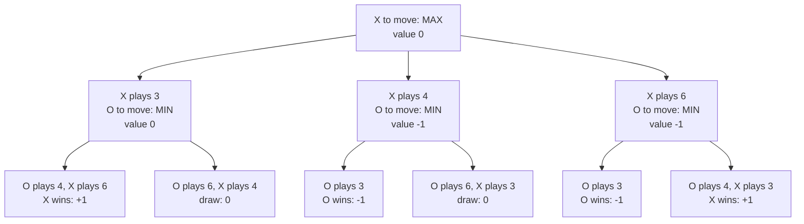
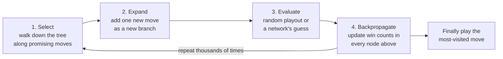
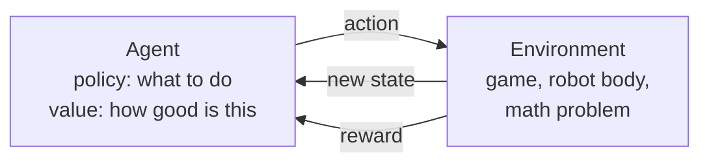

# Chapter 48: Reinforcement Learning, Games and Planning

*This chapter teaches you how machines decide what to do: how they search ahead like a chess player, how they learn from rewards like a dog learning tricks, how those two ideas beat world champions at chess, Go, poker and video games, and how the same ideas now make your chatbot "think."*

## What you'll learn
- How AI searches for good plans: mazes, A* route-finding, game trees, minimax (worked by hand on a tic-tac-toe position), alpha-beta pruning and Monte Carlo tree search.
- Reinforcement learning from scratch: agent, environment, state, action, reward, return, policy and value.
- Exploration versus exploitation, and the credit-assignment problem.
- Q-learning, worked step by step with real numbers, and how Deep Q-Networks scaled it to Atari.
- Policy gradients and actor-critic methods, in plain words.
- The great game milestones, from TD-Gammon and Deep Blue to AlphaGo's Move 37, AlphaZero, MuZero, OpenAI Five, AlphaStar, Pluribus and CICERO, and why self-play works.
- Where reinforcement learning is used outside games, and how game-playing ideas became the "thinking" in 2026's reasoning models.

## Before you start
Chapter 8 (Learning From Examples) introduced reinforcement learning's basic vocabulary. Chapter 6 (The Math of AI, Part 2) covered probability, averages and gradient descent, which you will see again here. Chapter 12 (Neural Networks From Scratch) explains the networks that later systems plug in. Chapter 7 (A History of AI) told the game milestones briefly; this chapter tells them in depth. Chapter 20 (Post-Training) and Chapter 21 (Reasoning Models and Reinforcement Learning) apply these ideas to chatbots, so this chapter only points to them at the end.

## Deciding, not just predicting

Most AI in this book answers a question: what is in this photo, what word comes next, will this card payment turn out to be fraud? This chapter is about a different verb: **decide**. A decision is special because it changes what happens next. If you move your knight, the board is different. If a robot steps left, it sees a different room. If your chatbot chooses to call a search tool instead of answering, the rest of the conversation changes.

> **Definition — Sequential decision-making:** Making a series of choices where each choice changes the situation in which the next choice is made, as in games, driving, robot control or a multi-step task.

There are two great families of tools for deciding.

1. **Search and planning.** If you know the rules of the world, you can think ahead: "if I do this, then that happens, then I could do this..." and pick the path that ends best.
2. **Reinforcement learning (RL).** If you do not know the rules, or the world is too big to think through, you can learn from experience: try things, see what earns rewards, and slowly do more of what works.

> **Definition — Planning:** Working out a sequence of actions in advance, by reasoning about their consequences, to reach a goal.

The most famous systems combine the two. AlphaGo used learned intuition to suggest promising moves and search to check them. Your chatbot's reasoning mode does something similar with words (Chapter 21). So we start with search, then build up reinforcement learning, then watch them meet.

> **Key idea:** Search means thinking ahead with a model of the world. Reinforcement learning means learning from trial and error. The strongest decision-making systems use learning to guide search and search to improve learning.

## Search: thinking before you act

### States, actions and goals

Picture a maze printed on a placemat. You are at the entrance with a pencil. Every junction is a place where you choose a direction. AI people describe every such problem with the same handful of words.

> **Definition — State:** A complete description of the situation at one moment: where you are in a maze, the arrangement of pieces on a chessboard, or the robot's position and what it sees.

> **Definition — Action:** One of the choices available in a state, such as "turn left," "move the knight to f3" or "call the search tool."

> **Definition — State space:** The set of all possible states a problem can be in. It can be tiny (a small maze) or astronomically large (Go).

> **Definition — Search (AI sense):** Systematically exploring sequences of actions, usually in imagination, to find one that reaches a goal.

Your map app does this every time you ask for directions. Each intersection is a state, each road segment is an action, and the goal is your destination. The app explores possible routes in its own memory before you move a meter.

### Blind search: breadth-first and depth-first

The simplest search strategies have no sense of direction.

> **Definition — Breadth-first search (BFS):** A search method that explores all places one step away, then all places two steps away, and so on, like ripples spreading in a pond. It always finds the shortest path but can be slow.

> **Definition — Depth-first search (DFS):** A search method that follows one path as far as it can go before backing up and trying another, like keeping your hand on one wall of a maze.

Blind search is fine for a placemat maze. It collapses on big problems because state spaces explode. A Rubik's cube has about 43 quintillion (4.3 × 10^19) arrangements. Checking a billion per second would take more than a thousand years to visit them all. Real problems need a sense of direction.

### A*: search with a sense of direction

In 1968, researchers at the Stanford Research Institute, building a wheeled robot called Shakey, published A* ("A-star"). It is still the textbook way to find shortest paths in games, robots and maps.

> **Definition — Heuristic:** A rule of thumb that estimates how promising an option is, guiding search toward good choices without guaranteeing the best answer on its own.

> **Definition — A* search:** A shortest-path algorithm that always explores next the place with the lowest total of "distance traveled so far" plus "estimated distance remaining." With an estimate that never overshoots, it is guaranteed to find a shortest path.

A* scores each square with three numbers:

- **g** = steps taken from the start to reach this square
- **h** = the heuristic guess of steps still needed to reach the goal
- **f = g + h** = the estimated total length of a route through this square

On a grid where you can move up, down, left or right, a good heuristic is the Manhattan distance.

> **Definition — Manhattan distance:** The distance between two points on a grid counted as blocks moved horizontally plus blocks moved vertically, like walking city blocks. From row 2, column 0 to row 2, column 7 it is 0 + 7 = 7.

> **Definition — Admissible heuristic:** A heuristic that never overestimates the true remaining cost. Manhattan distance is admissible on a grid because walls can only make the real route longer.

Here is a worked example. S is the start, G the goal, # is a wall, and * marks the path A* finds.

```
        col: 0  1  2  3  4  5  6  7
  row 0      .  .  .  .  .  .  .  .
  row 1      .  .  .  *  *  *  *  *
  row 2      S  *  *  *  #  .  .  G
  row 3      .  .  .  .  #  .  .  .
  row 4      .  .  .  .  .  .  .  .
  row 5      .  .  .  .  .  .  .  .
```
*Figure 48.1: A* on a small grid. The start is at row 2, column 0; the goal at row 2, column 7; a two-square wall blocks the direct route.*

From S, A* compares its neighbors:

| Square | g (steps so far) | h (Manhattan to G) | f = g + h |
|---|---|---|---|
| Right of S (row 2, col 1) | 1 | 0 + 6 = 6 | **7** |
| Above S (row 1, col 0) | 1 | 1 + 7 = 8 | 9 |
| Below S (row 3, col 0) | 1 | 1 + 7 = 8 | 9 |

*Table 48.1: The first choice A* makes. The square heading toward the goal has the lowest f, so A* explores it first.*

A* marches right while f stays at 7. At row 2, column 3, the wall blocks the way. The squares above and below now score f = 4 + 5 = 9, the same as the squares it skipped near the start, so the search widens a little, slips around the top of the wall and reaches G in 9 steps. In one run of this example, breadth-first search examined 44 squares before reaching the goal, while A* examined 19 (exact counts depend on how ties are broken). On a city-sized map the savings are millions of times larger.

> **Analogy:** Breadth-first search is a search party fanning out in every direction from the trailhead. A* is the same party with a compass pointing at the destination: they still check side paths when the direct way is blocked, but they do not waste hours walking away from the goal.

Real navigation apps use souped-up relatives of A*, plus heavy precomputation and live traffic predictions, but the core idea is the same: combine what you know (the distance so far) with a good guess (the distance left).

### Game trees: when the world fights back

A maze sits still. In a game, an opponent moves too, and they are trying to beat you. Now the search must consider their replies.

> **Definition — Game tree:** A branching diagram of a game in which each point is a position, each branch is a possible move, and the levels alternate between the players.

> **Definition — Branching factor:** The typical number of moves available from a position. Tic-tac-toe starts at 9; chess averages about 35; Go averages about 250.

> **Definition — Ply:** One move by one player. A full "move" in chess notation (White then Black) is two plies.

> **Definition — Zero-sum game:** A game where one player's gain is exactly the other's loss, so the players' interests are perfectly opposed. Chess, Go and two-player poker are zero-sum.

> **Definition — Perfect-information game:** A game where both players can see everything about the current position, as in chess and Go. Poker, with hidden cards, is an imperfect-information game.

Game trees grow at frightening speed, because the branching factor multiplies at every ply:

| Game | Typical branching factor | Size of the problem |
|---|---|---|
| Tic-tac-toe | up to 9 | 255,168 possible games; 5,478 legal positions |
| Checkers | small, often under 10 | about 5 × 10^20 positions; solved in 2007 (perfect play is a draw) |
| Chess | about 35 | about 10^44 legal positions; about 35^80 ≈ 10^123 possible 80-ply games |
| Go (19 × 19) | about 250 | about 2 × 10^170 legal positions; about 250^150 ≈ 10^360 possible 150-move games |

*Table 48.2: How big game trees get. For comparison, the observable universe holds roughly 10^80 atoms.*

Tic-tac-toe is small enough to search completely, which is why it is the perfect place to learn the key idea.

### Minimax, worked by hand

You play X. It is your turn. Number the squares 1 to 9:

```
   1 | 2 | 3          X | O | .
  ---+---+---        ---+---+---
   4 | 5 | 6          . | O | .
  ---+---+---        ---+---+---
   7 | 8 | 9          O | X | X
```
*Figure 48.2: Left, the square numbers. Right, the position: X on 1, 8 and 9; O on 2, 5 and 7; squares 3, 4 and 6 are empty, and X is to move.*

Score the end of the game from X's point of view: **+1** if X wins, **0** for a draw, **−1** if O wins.

> **Definition — Minimax:** A way of choosing moves in a two-player game by assuming the opponent always replies with the move that is worst for you. You pick the move whose worst case is best.

> **Definition — Terminal state:** A position where the game is over (a win, loss or draw), so its score is known without looking further.

Minimax works from the bottom of the tree up. At positions where X moves, X takes the **maximum** score. At positions where O moves, O takes the **minimum** (best for O, worst for X). Let us go through all three candidate moves.

**Option A: X plays square 3.** This blocks O's diagonal (3-5-7) and also gives X two in the right-hand column (3 and 9, with 6 empty). Now O moves, with squares 4 and 6 left.
- If O plays 4, X plays the last square, 6, completing 3-6-9. X wins: **+1**.
- If O plays 6 (blocking), X plays 4. Nobody has three in a row: draw, **0**.
- O chooses the minimum: min(+1, 0) = **0**. Option A is worth 0.

**Option B: X plays square 4.** O moves, with 3 and 6 left.
- If O plays 3, O completes the diagonal 3-5-7. O wins: **−1**.
- If O plays 6, X plays 3. Draw: **0**.
- O chooses min(−1, 0) = **−1**. Option B is worth −1.

**Option C: X plays square 6.** This looks aggressive: X now has 6 and 9 and threatens 3. But O moves first, with 3 and 4 left.
- If O plays 3, O both blocks X and completes 3-5-7. O wins: **−1**.
- If O plays 4, X plays 3 and wins: **+1**.
- O chooses min(−1, +1) = **−1**. Option C is worth −1.

At the top, X chooses the maximum: max(0, −1, −1) = **0**. Minimax says play square 3, and a draw is the best X can force.


*Figure 48.3: The complete minimax tree for the position. Scores flow upward: O takes the minimum of its children, X takes the maximum.*

Notice the trap in Option C. A greedy player who only looks at their own chances sees "C creates a threat and can win." Minimax sees that a sensible opponent will never let that branch happen. Assuming the opponent is smart is the whole point.

> **Key idea:** Minimax judges each move by its worst case, assuming a perfect opponent. Scores are known only at the end of the game, so they are passed up the tree: the opponent's levels take the minimum, your levels take the maximum.

### Alpha-beta pruning and evaluation functions

Look again at Option B. As soon as minimax sees that O can reply with square 3 and win (−1), Option B can be worth at most −1, which is already worse than the 0 that Option A guarantees. There is no need to examine O's other reply at all. That shortcut has a name.

> **Definition — Alpha-beta pruning:** A shortcut for minimax that skips branches which provably cannot change the final decision, because a better option has already been found elsewhere. It gives exactly the same answer as full minimax, often while examining only a small fraction of the tree.

Even with pruning, chess is far too big to search to the end. So chess programs search a few plies ahead and then *estimate* who is winning.

> **Definition — Evaluation function:** A formula or model that scores a game position that is not finished, estimating how good it is for one player, for example by counting material and judging king safety.

This is exactly how IBM's Deep Blue beat world champion Garry Kasparov in May 1997, winning the six-game match 3.5 to 2.5 after losing their first match in 1996. Deep Blue used hundreds of custom chess chips to examine about 200 million positions per second, with alpha-beta pruning and an evaluation function hand-crafted with help from grandmasters. It learned almost nothing. It was a triumph of search and engineering.

Modern chess engines kept the search but changed the evaluation. Since 2020 the leading open engine, Stockfish, has used a small neural network to evaluate positions, and engines far stronger than any human now run on a phone.

> **Watch out:** "Deep Blue was a learning machine." It was mostly brute-force search plus human-written knowledge. The learning revolution in games came later, starting with backgammon in 1992 and exploding with Go in 2016.

### Monte Carlo tree search

Go defeated the Deep Blue recipe for two reasons. Its branching factor of about 250 makes deep search hopeless, and nobody could write a good evaluation function: strong Go players judge positions by intuition they cannot fully put into words.

The breakthrough idea was to estimate positions by playing them out at random.

> **Definition — Monte Carlo method:** Estimating something by running many random trials and averaging the results, named after the casino. To estimate a position's win chance, play many random games from it and count the wins.

> **Definition — Playout (rollout):** One simulated continuation of a game from a given position to the end (or for a fixed number of moves), used to estimate how good the position is.

Random play is a terrible player, but averaged over thousands of playouts it gives a surprisingly useful signal. Monte Carlo tree search, developed around 2006, adds a clever way of deciding *which* moves deserve more playouts.

> **Definition — Monte Carlo tree search (MCTS):** A search method that builds a game tree gradually, running many simulated playouts and focusing its effort on the moves that look most promising so far, while still occasionally checking less-explored moves. It was central to AlphaGo.

Each round of MCTS has four steps:


*Figure 48.4: The four steps of Monte Carlo tree search, repeated thousands of times per move.*

The clever part is step 1. How does MCTS choose which branch to follow? It balances "this move has won a lot" against "this move has hardly been tried." A popular formula, called UCB, gives each move a score:

> **Definition — UCB (upper confidence bound):** A rule for choosing among options that adds an "uncertainty bonus" to each option's average result, so options that have been tried only a few times get extra chances. It is a mathematical form of "optimism in the face of uncertainty."

In plain text the score is: `win rate + c × square root of (ln N ÷ n)`, where N is the total number of playouts so far, n is the playouts through this move, ln is the natural logarithm, and c is a tuning constant (1.4 is a common choice).

Worked example. After 12 playouts, move A has won 6 of 10 (win rate 0.6) and move B has won 1 of 2 (win rate 0.5). ln 12 ≈ 2.48.

- Move A: 0.6 + 1.4 × √(2.48 ÷ 10) = 0.6 + 1.4 × 0.50 ≈ 0.6 + 0.70 = **1.30**
- Move B: 0.5 + 1.4 × √(2.48 ÷ 2) = 0.5 + 1.4 × 1.11 ≈ 0.5 + 1.56 = **2.06**

Move B gets the next playout even though its win rate is lower, because two games are too few to judge it. As B accumulates playouts, its bonus shrinks and its true quality shows. By 2012, Go programs built on MCTS had reached strong amateur level, but still lost badly to professionals. The missing piece was intuition, and that would come from neural networks trained by reinforcement learning.

> **Analogy:** MCTS is a chess player imagining several futures before moving, spending most of their imagination on the lines that look best, but now and then taking a second look at a line they dismissed too quickly.

## Reinforcement learning from scratch

### The loop

Search needs a model of the world: you must know what each move does. Often you do not. A robot does not know the exact physics of a towel. A game-playing program might only see the screen. Reinforcement learning learns what to do from experience instead.

> **Definition — Reinforcement learning (RL):** Learning by trial and error: an agent takes actions, receives rewards or penalties, and gradually learns which behavior earns the most reward over time.

> **Definition — Agent:** In reinforcement learning, the learner and decision-maker: the program choosing what to do next. (An "AI agent" in chatbot products is a related but broader idea; see Chapter 28.)

> **Definition — Environment:** The world, game or simulation the agent acts in, which responds to each action with a new state and a reward.

> **Definition — Reward:** The number the environment gives the agent after an action, telling it how good the immediate outcome was, such as +1 for winning, −1 for losing or −0.01 per wasted second.

> **Definition — Episode:** One complete run from a starting state to an ending state, such as one game of chess or one attempt to walk across a room.


*Figure 48.5: The reinforcement learning loop. The agent acts, the environment answers with a new state and a reward, and the agent adjusts to collect more reward over time.*

> **Analogy:** RL is training a dog with treats. You never explain the trick. The dog tries things, some earn a treat, and over many tries it does more of what earned treats. And like a dog, an RL agent sometimes finds an unexpected way to earn the treat that you never intended.

### Rewards, returns and discounting

An agent should not grab the biggest immediate reward. It should maximize the total reward over the whole episode, which may mean a sacrifice now for a win later.

> **Definition — Return:** The total reward an agent collects from a point in time until the end of the episode, usually with later rewards counted a little less (discounted).

> **Definition — Discount factor (gamma):** A number between 0 and 1, often written γ (gamma), that shrinks rewards the further in the future they arrive. With γ = 0.9, a reward one step away counts 90%, two steps away 81%, and so on.

Worked example with γ = 0.9:

- A reward of 10 arriving three steps from now is worth 10 × 0.9 × 0.9 × 0.9 = 10 × 0.729 = **7.29** today.
- Rewards of 1, 1 and 1 on the next three steps are worth 1 + 0.9 + 0.81 = **2.71**.

Why discount at all? The future is uncertain, sooner is usually better, and without discounting, an endless task could add up to infinite reward, which breaks the math. Discounting also quietly rewards speed: reaching the goal in 5 steps beats reaching it in 50.

### Policies and values

Two ideas sit at the heart of every RL agent.

> **Definition — Policy:** The agent's strategy: a rule, often a neural network, that maps what it observes to what it does. A stochastic policy gives probabilities ("jump 70%, duck 30%").

> **Definition — Value function:** An estimate of the total future reward the agent can expect from a given state if it keeps following its policy: its "sense of how good this position is."

> **Definition — Q-value (action value):** An estimate of the total future reward from taking a particular action in a particular state and then acting well afterward. Q(state, action) answers "how good is this move here?"

Good chess players have both. The policy is their instinct for candidate moves. The value is their feel for "I am better here" without calculating to the end. AlphaGo literally had one network for each.

Values obey a beautifully simple relationship, worked out by the mathematician Richard Bellman in the 1950s.

> **Definition — Bellman equation:** The principle that the value of a situation equals the reward you get now plus the discounted value of the situation you land in next. It lets values be computed or learned step by step.

### Exploration versus exploitation

Every evening you choose where to eat. Your favorite place reliably earns a 7 out of 10. A new place opened down the street. It might be a 9, or it might be a 4. Do you go back to the favorite (exploit) or try the new one (explore)?

> **Definition — Exploration versus exploitation:** The trade-off between trying new actions to learn more about them (exploration) and choosing the action currently believed to be best (exploitation). Too little exploration means never finding better options; too much wastes time on bad ones.

> **Definition — Multi-armed bandit:** The simplest exploration problem, named after a row of slot machines ("one-armed bandits") with unknown payouts: you repeatedly choose one option and must balance learning which pays best with cashing in on what you know.

The simplest working strategy is almost embarrassingly simple.

> **Definition — Epsilon-greedy:** An exploration strategy that picks the best-known action most of the time and a random action a small fraction of the time (epsilon, written ε, such as 10%).

Worked example. With ε = 0.1 and two restaurants, you pick your favorite 90% of the time. The other 10% you pick at random, which lands on the new place half the time. So you visit the new place on about 0.1 × 0.5 = **5%** of nights, about 18 nights a year. That is enough to discover if it is really a 9, while keeping 95% of your dinners safe. The UCB formula from the MCTS section is a smarter cousin: it explores options in proportion to how uncertain you still are about them.

> **Analogy:** Exploration versus exploitation is the restaurant choice you make every week. If you only ever exploit, you may eat at a merely good place for twenty years and never find the great one around the corner.

### Credit assignment

Here is the hardest problem in RL. You lose a game of chess on move 60. Which of your 60 moves was the mistake? Maybe move 59 blundered. Maybe move 12 quietly weakened your pawns and everything after was doomed.

> **Definition — Credit assignment problem:** The challenge of working out which of many earlier actions deserve credit or blame for a reward that arrives much later.

> **Definition — Sparse reward:** A reward that arrives rarely, often only at the very end of a long episode (win or lose), giving the agent little information about which steps mattered.

> **Definition — Reward shaping:** Adding extra intermediate rewards (for example, points for capturing pieces or for moving toward a goal) to make learning faster. It helps, but it can also teach the agent to chase the extra points instead of the real goal.

The reasoning models in Chapter 21 face this exact problem: a math answer is right or wrong only at the end of thousands of words of thinking. The next method shows one elegant way to pass credit backward.

### Q-learning, worked by hand

In 1988 Richard Sutton described temporal-difference learning, and in 1989 Chris Watkins introduced Q-learning, one of its most famous forms. The idea: do not wait until the end of the game to learn. Update your guess after every single step, using your *next* guess as a stand-in for the future.

> **Definition — Temporal-difference (TD) learning:** Learning value estimates step by step by comparing each prediction with a slightly better-informed prediction made one step later, instead of waiting for the final outcome.

> **Definition — Q-learning:** A reinforcement learning method that learns a Q-value for every state and action by repeatedly nudging each estimate toward "the reward just received plus the discounted best Q-value of the next state."

> **Definition — Learning rate (alpha):** A number between 0 and 1, often written α (alpha), that sets how far each update moves an estimate toward its new target. With α = 0.5 the estimate moves halfway.

> **Definition — Q-table:** A table with one row per state and one column per action, holding the agent's current Q-value estimates. Q-learning fills it in through experience.

The Q-learning update, in plain text:

```
new Q = old Q + α × ( reward + γ × best Q of next state − old Q )
                      \_______________________________/
                          the "target": a better guess
```

Here is a tiny world: a corridor of three squares, A, B and C, followed by a goal. Entering the goal pays +10 and ends the episode. Every other step pays 0. The agent can move left or right. We use α = 0.5 and γ = 0.9, and every Q-value starts at 0.

```
  [ A ] --right--> [ B ] --right--> [ C ] --right--> [ GOAL: +10 ]
```
*Figure 48.6: The corridor world. Only the last step earns a reward, so the agent must learn that the earlier steps matter too.*

To keep the arithmetic short, follow the agent on episodes where it happens to walk right three times in a row (for example, because it is exploring). We track only the "right" Q-values; the "left" ones stay at 0.

**Episode 1.**
- From A, move right to B. Reward 0. Best Q at B is 0. Target = 0 + 0.9 × 0 = 0. New Q(A, right) = 0 + 0.5 × (0 − 0) = **0**.
- From B, move right to C. Same story: **0**.
- From C, move right into the goal. Reward 10. The episode ends, so there is no future: target = 10. New Q(C, right) = 0 + 0.5 × (10 − 0) = **5**.

After one episode the agent has learned only that the last step is good. Nothing has reached A yet.

**Episode 2.**
- Q(A, right): best Q at B is still 0, so it stays **0**.
- Q(B, right): reward 0, but now the best Q at C is 5. Target = 0 + 0.9 × 5 = 4.5. Error = 4.5 − 0 = 4.5. New Q = 0 + 0.5 × 4.5 = **2.25**.
- Q(C, right): target 10, old 5, error 5, new = 5 + 0.5 × 5 = **7.5**.

**Episode 3.**
- Q(A, right): best Q at B is 2.25. Target = 0.9 × 2.25 = 2.025. New Q = 0 + 0.5 × 2.025 ≈ **1.01**.
- Q(B, right): target = 0.9 × 7.5 = 6.75. New Q = 2.25 + 0.5 × (6.75 − 2.25) = **4.5**.
- Q(C, right): new = 7.5 + 0.5 × (10 − 7.5) = **8.75**.

| After episode | Q(A, right) | Q(B, right) | Q(C, right) |
|---|---|---|---|
| 0 (start) | 0 | 0 | 0 |
| 1 | 0 | 0 | 5 |
| 2 | 0 | 2.25 | 7.5 |
| 3 | 1.01 | 4.5 | 8.75 |
| 7 | 6.26 | 8.44 | 9.92 |
| Many | 8.1 | 9 | 10 |

*Table 48.3: Q-values in the corridor. The reward at the goal seeps backward one square per episode, like water flowing upstream.*

The final values make sense. From C, one step earns 10. From B, the 10 is one step further away: 0.9 × 10 = 9. From A: 0.9 × 9 = 8.1. Once learned, the policy is simple: in each square, take the action with the highest Q-value. Every "right" beats every "left" (which stays near 0), so the agent walks straight to the goal.

> **Key idea:** Q-learning solves credit assignment one step at a time. Each update borrows the next square's estimate, so a reward at the end of the corridor gradually propagates back to the very first decision, without the agent ever being told which early steps mattered.

> **At the frontier (2026):** The idea of learning from the difference between successive predictions has a famous echo in the brain. In 1997, Wolfram Schultz and colleagues showed that dopamine neurons in monkeys fire in a pattern that matches a TD "prediction error": a burst for an unexpected reward, nothing for an expected one, a dip when an expected reward fails to come. The founders of the field, Richard Sutton and Andrew Barto, received the 2024 Turing Award (announced in March 2025), computing's highest honor, for reinforcement learning.
