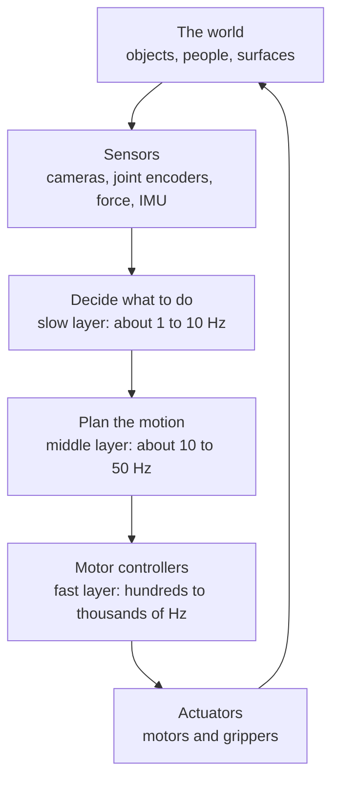
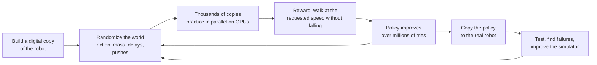
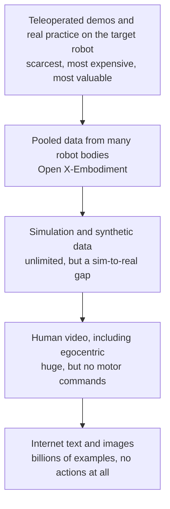
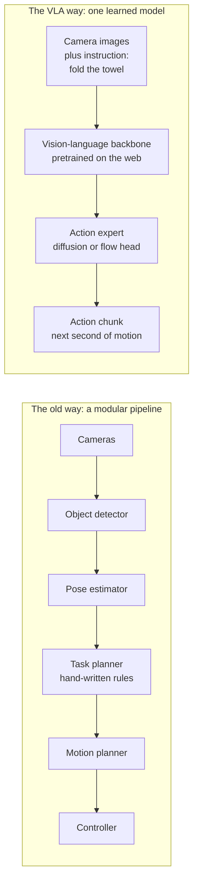
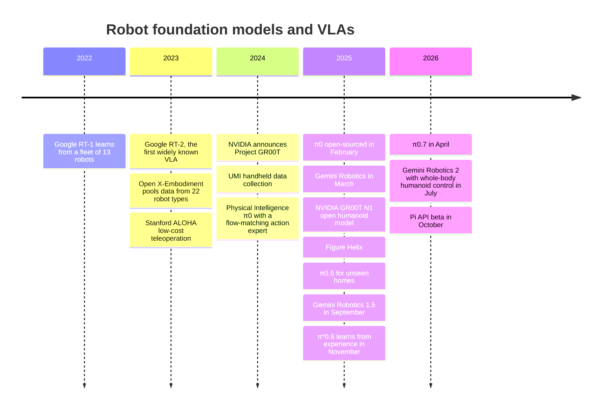
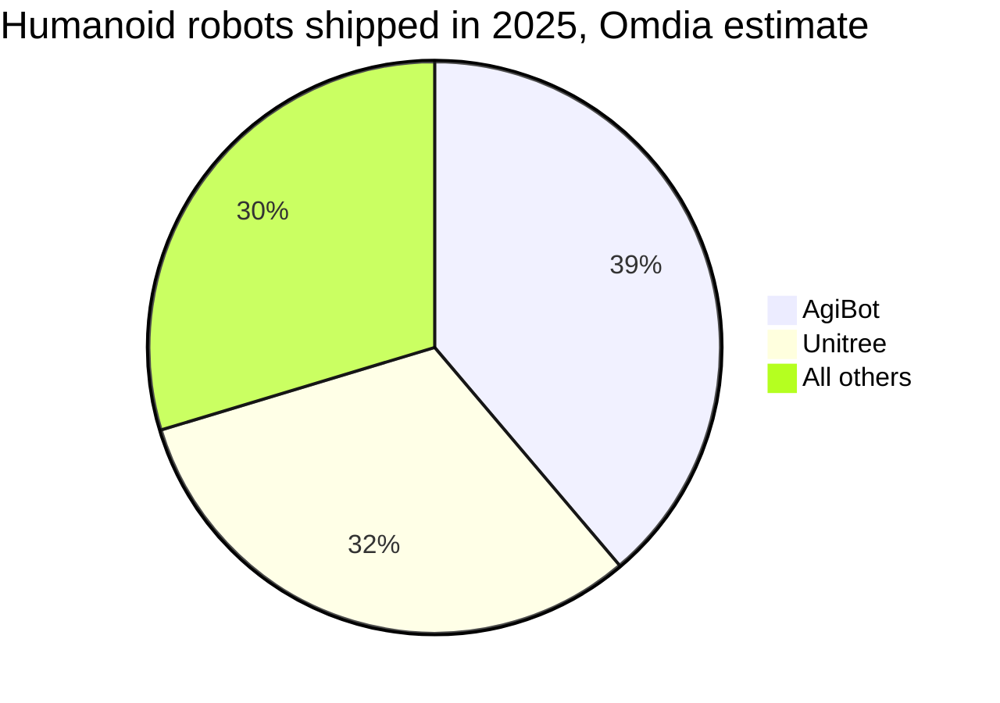
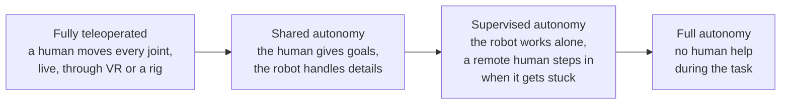

# Chapter 49: Robotics and Physical AI

*Why a chatbot that can write a recipe still cannot cook it, how robots are finally learning to use their hands, and how to tell a real deployment from a clever demo.*

## What you'll learn

- Why tasks a toddler finds easy, such as picking up a sock, are among the hardest problems in AI, and what Moravec's paradox says about it.
- How every robot runs a loop of sensing, deciding and acting, and why a mistake in the physical world costs more than a wrong chatbot answer.
- How robots learn to walk by practicing millions of times inside a simulator, and what the "sim-to-real gap" is.
- Why hands, cloth and cables are so hard, and why reliability, not cleverness, decides whether a robot is useful.
- Why there is no "internet of robot actions", and the clever ways labs collect robot data instead.
- How robot foundation models and vision-language-action models (VLAs) work, from Google's RT-2 to Physical Intelligence's π0.7 and Gemini Robotics 2.
- What world models add: robots that practice in imagination before touching anything real.
- The real state of the humanoid industry in late 2026, with deployment numbers and where they come from, how to spot a remote-controlled demo, and what safety rules apply.

## Before you start

Every term is defined as it appears, so you can read this chapter on its own. It helps to know Chapter 8 (Learning From Examples) for learning by copying examples, Chapter 15 (The Transformer, Piece by Piece) for the engine inside robot models, Chapter 16 (Generative Models) for diffusion and flow matching, Chapter 22 (Multimodal Models), where vision-language-action models and world models first appeared, Chapter 45 (Computer Vision) and Chapter 48 (Reinforcement Learning, Games and Planning). Cars, the biggest robots of all, get their own chapter (Chapter 50).

## Why your chatbot can write a recipe but no robot can cook it

Ask your chatbot for an omelette recipe and you have one in two seconds: three eggs, a knob of butter, a pinch of salt, medium heat. Now imagine a machine that actually makes the omelette in your kitchen. It has to find the fridge, open a door whose handle it has never seen, spot the eggs behind the milk, and pick one up without crushing it. It has to crack the egg on the rim of a bowl with just enough force, fish out a fragment of shell, whisk, find the pan, judge the heat, and fold the omelette before it burns. Every one of those steps involves friction, weight, slippery surfaces and objects that bend, spill or break.

As of late 2026, no robot can walk into a stranger's kitchen and do that reliably. Yet AI systems reached gold-medal standard at the International Mathematical Olympiad in 2025 (see Chapter 52). How can a machine solve olympiad geometry and still not crack an egg?

> **Definition — Robot:** A machine that senses its surroundings and physically acts on them with some degree of independence, from a factory arm to a robot vacuum to a walking humanoid.

> **Definition — Physical AI:** AI that perceives and acts in the physical world through a body, such as a robot arm, a humanoid, a drone or a car. The industry also calls this "embodied AI".

The puzzle has a name. In the 1980s the roboticist Hans Moravec pointed out that it is comparatively easy to make computers play checkers or pass intelligence tests at an adult level, and very hard to give them the perception and movement skills of a one-year-old.

> **Definition — Moravec's paradox:** The observation that tasks hard for humans (chess, calculus) are often easy for computers, while tasks easy for toddlers (walking, grasping, recognizing a face in bad light) are very hard for machines.

There are three reasons for the paradox, and they organize the rest of this chapter.

**Reason 1: evolution hid the difficulty from us.** Animals have been refining vision, balance and grasping for hundreds of millions of years. Abstract reasoning is a recent add-on. The old skills feel effortless precisely because they run below conscious awareness. You never think, "increase grip force on the egg by 10 percent because it is slipping." Your hand just does it.

**Reason 2: there is no internet of robot actions.** Your chatbot learned language from trillions of words that people had already written down (see Chapter 19). Nobody has written down the trillions of tiny muscle commands that make up a lifetime of cooking, folding and tidying. Robots have to collect their own experience, slowly and expensively. This "data problem" is the single biggest bottleneck in robotics today.

**Reason 3: the physical world has no undo button.** When your chatbot gives a bad answer, you click "regenerate". When a robot drops a glass, the glass is broken. When a 60-kilogram robot falls over next to a child, someone could be hurt. Physical mistakes are expensive, sometimes dangerous, and they compound: one slip can wreck every step that follows.

> **Key idea:** Robots are hard mostly because of data and generalization, not because of the metal. Motors and gears are a mature technology. What is missing is the experience that tells the motors what to do in situations nobody prepared the robot for.

> **Analogy:** Think of a toddler and a chess computer. The chess computer crushes every grandmaster but could not pick up a sock if you gave it a hand. The toddler cannot play chess but picks up socks, stacks blocks and walks across a cluttered room without thinking. What is easy for us is hard for machines, and the reverse.

## The sense–plan–act loop

The first robot that tried to reason about its own actions was Shakey, built at the Stanford Research Institute between 1966 and 1972. Shakey looked at the room with a camera, built an internal model of where the blocks and doorways were, worked out a plan, and then moved, very slowly. That pattern has a name, and every robot since has used some version of it.

> **Definition — Sensor:** A device that measures something about the world or the robot itself, such as a camera, a microphone, a touch sensor, a force sensor in the wrist or a joint angle sensor.

> **Definition — Actuator:** The part of a robot that makes it move, usually an electric motor with a gearbox, sometimes a hydraulic or air-driven piston.

> **Definition — Sense–plan–act loop:** The basic cycle of every robot: measure the world with sensors, decide what to do, send commands to the actuators, then measure again to see what happened.

Robots sense two kinds of things. They sense the outside world with cameras (including depth cameras that measure distance), lidar (laser range finders, explained in Chapter 50) and microphones. They also sense their own bodies: how far each joint has turned, how fast it is moving, how much force the wrist feels, and which way is down.

> **Definition — Proprioception:** A robot's (or person's) sense of its own body: joint angles, speeds, forces and balance. In robots it comes from encoders in each joint, force sensors and an inertial measurement unit.

> **Definition — IMU (inertial measurement unit):** A small sensor that measures acceleration and rotation, telling a robot (or your phone) which way is down and how it is tilting or turning.

A real robot does not run one loop. It runs several, stacked by speed. A slow layer decides the goal ("put the cup in the sink"). A middle layer turns that into motions ("move the hand along this path"). A fast layer keeps each motor at exactly the right angle and force, correcting hundreds or thousands of times per second.

> **Definition — Hertz (Hz):** Times per second. A control loop running at 500 Hz updates its commands 500 times every second.

> **Definition — Controller:** The software (and sometimes dedicated chip) that turns a desired motion into motor commands and corrects errors as they appear, usually running many times per second.


*Figure 49.1: The sense–plan–act loop, drawn as the stack of loops a modern robot actually runs. The frequencies are typical ranges, not exact figures.*

### Worked example: why speed of the loop matters

Suppose a robot hand is moving at 1 meter per second, about the speed you move your hand to catch a falling cup.

- At 10 Hz, the controller gets a new command every 0.1 seconds. The hand travels 1 m/s × 0.1 s = 0.1 m, or 10 centimeters, between updates. That is the width of a cup. The robot will overshoot or knock it over.
- At 500 Hz, the gap is 0.002 seconds, so the hand travels 1 × 0.002 = 0.002 m, or 2 millimeters, between updates. That is precise enough to adjust its grip as the cup slides.

This is why the big, slow AI model (the one that understands "put the cup in the sink") never talks to the motors directly. It might take a tenth of a second or more to think. Faster layers underneath keep the body stable while it thinks.

### Degrees of freedom: counting the joints

> **Definition — Degrees of freedom (DoF):** The number of independent ways a robot (or a body part) can move. A door hinge has 1. A typical factory robot arm has 6. A human arm from shoulder to wrist has about 7, and a human hand has more than 20.

> **Definition — End effector (gripper):** The "hand" at the end of a robot arm. It can be a two-finger pinch gripper, a suction cup, a tool such as a welding torch, or a multi-fingered hand.

Here is a rough, illustrative count for a humanoid robot (real designs vary a lot):

```
Body part          Joints (DoF)
2 legs x 6         12
2 arms x 7         14
waist               3
neck                2
2 hands x 11       22   (simple hands have 1; the best have 20+)
-----------------------
total              53
```
*Figure 49.2: An illustrative joint count for a humanoid. Each number is a motor that must be commanded many times per second.*

If each of those 53 joints receives one command 200 times a second, the robot's controllers must produce 53 × 200 = 10,600 numbers every second, and every one of them must be right, or the robot stumbles or drops what it is holding. A chatbot writing at 50 tokens per second, by comparison, produces 50 choices per second, and a bad choice costs you nothing but a reread.

> **Watch out:** "Robot" in the news can mean anything from a vacuum cleaner to a humanoid. Most of the world's industrial robots contain no machine learning at all. They replay precisely programmed motions inside safety cages, which is why they are so reliable. "AI robot" usually means a robot whose behavior is learned from data rather than programmed step by step.

## A field guide to robot bodies

Robots come in many shapes, and how much learned AI they contain varies enormously. The table below is your field guide.

| Type | Familiar example | Where it works | How much learned AI (2026) |
|---|---|---|---|
| Industrial arm | Car-factory welding and painting arms (first: Unimate at General Motors, 1961) | Caged cells in factories | Little; mostly pre-programmed motions, plus vision for picking |
| Collaborative robot (cobot) | Small arms that pack boxes next to people | Factory and lab benches | Some; force sensing and vision |
| Autonomous mobile robot (AMR) | Warehouse robots that carry shelves to workers (Amazon bought Kiva Systems in 2012) | Warehouses, hospitals | Navigation, mapping and fleet scheduling |
| Drone | Camera drones, delivery and military drones | Air | Flight control, obstacle avoidance, tracking (see Chapter 53) |
| Quadruped | Four-legged inspection robots (Boston Dynamics Spot, Unitree, ANYmal) | Plants, tunnels, construction sites | Walking learned with RL; inspection AI |
| Humanoid | Figure, Optimus, Atlas, Digit, Apollo, NEO, Unitree, AgiBot | Pilots in factories and warehouses; early home trials | The frontier: learned walking and learned manipulation |
| Surgical robot | The da Vinci system (cleared by the US FDA in 2000) | Operating rooms | Mostly remote-controlled by a surgeon, with AI assistance |
| Robot vacuum | Roomba (2002) and its successors | Homes | Mapping (SLAM, see Chapter 45) and obstacle recognition |
| Self-driving vehicle | Waymo robotaxis | Roads | Heavy; see Chapter 50 |

*Table 49.1: A field guide to robot bodies and how much learned AI each contains.*

> **Definition — Industrial robot:** A programmable machine arm, usually bolted to the floor inside a safety cage, that repeats precise motions such as welding, painting or moving parts.

> **Definition — Collaborative robot (cobot):** A robot arm designed to work next to people without a cage, using limits on speed and force so that a collision cannot seriously hurt anyone.

> **Definition — Autonomous mobile robot (AMR):** A wheeled robot that navigates on its own through a building, such as a warehouse cart or hospital delivery robot, using maps and sensors instead of painted lines or tracks.

> **Definition — Quadruped:** A four-legged walking robot, often called a robot dog, used for inspection and for carrying sensors over rough ground.

> **Definition — Humanoid robot:** A robot with a roughly human body shape (a torso, two arms, a head and usually two legs), designed to work in places built for people.

### Why build humanoids at all?

The case for humanoids is strong. The world is built for human bodies: stairs, door handles, shelves at shoulder height, tools shaped for five fingers, cars and forklifts with seats. A robot with a human shape can, in principle, use all of it without the building being redesigned. One body could do many jobs, which spreads the cost of development. And because the body matches ours, robots may be able to learn from the endless supply of videos of people doing things.

The case against is also strong. Legs are expensive, use a lot of energy and can fall. On a flat factory floor, wheels are cheaper and more stable, and some "humanoids" sold for factories in fact sit on wheeled bases. Specialized machines usually beat general ones on speed and cost: a dishwasher cleans more plates per hour than any robot washing them by hand ever will. And a heavy two-legged machine is harder to make safe around people than a wheeled one.

> **Analogy:** A humanoid is like a Swiss Army knife: one tool that can do many jobs, none of them as well as a dedicated tool. Whether that trade is worth it depends on how many different jobs you need done in the same place.

## Learning to walk: practice in a simulator

For decades, walking robots were programmed with carefully engineered control based on physics equations: engineers modeled the robot's mass, joints and contact with the ground, then wrote controllers to keep it balanced. That approach produced impressive machines, but each new skill took expert engineers months.

The method that changed this is reinforcement learning (RL) in simulation. Chapter 48 explains RL fully. Here is the short version.

> **Definition — Reinforcement learning (RL):** Learning by trial and error. An agent tries actions, receives a numerical reward or penalty, and gradually adjusts its behavior to collect more reward.

> **Definition — Policy:** The rule a robot or agent follows to choose actions from what it currently senses. In modern robots the policy is a neural network.

> **Definition — Reward function:** The formula that scores how well an agent is doing at each moment. For a walking robot it might add points for moving at the requested speed and subtract points for falling, wasting energy or jerky movement.

Real robots are terrible places to practice. They are slow (one second of practice takes one second), they break when they fall, and someone has to pick them up. So engineers build a digital copy of the robot inside a physics simulator and let it practice there.

> **Definition — Physics simulator:** Software that computes how objects move, collide and push on each other, so a virtual robot can practice in a virtual world. Many run on GPUs, which can simulate thousands of robots at once.

### Worked example: years of practice in an afternoon

In 2021, a team from ETH Zurich and NVIDIA (Rudin and colleagues) published a paper titled "Learning to Walk in Minutes Using Massively Parallel Deep Reinforcement Learning". The trick was to simulate thousands of robots side by side on a single GPU. Let us do the arithmetic with round, illustrative numbers.

- Simulate 4,000 robots at once, each experiencing time at the normal rate.
- Train for 20 minutes of wall-clock time.
- Total practice: 4,000 × 20 minutes = 80,000 robot-minutes.
- Convert: 80,000 ÷ 60 = about 1,333 robot-hours, or about 1,333 ÷ 24 = 56 robot-days of practice.

If the simulator also runs faster than real time, the multiplier grows further. A physical robot would need weeks of nonstop practice, a team to pick it up after every fall, and replacement parts, to gather the same experience.

### The sim-to-real gap

There is a catch. A simulator is never a perfect copy of reality. Real floors are a little more slippery than the model says, real motors respond a few milliseconds late, real cameras have glare, and real cables flex. A policy that walks beautifully in simulation can stumble on its first real step.

> **Definition — Sim-to-real gap:** The mismatch between a simulated world and the real one, which causes skills learned in simulation to fail or degrade when moved to a physical robot.

The main fix is wonderfully simple: make the simulation deliberately unreliable.

> **Definition — Domain randomization:** Training in many randomly varied versions of the simulation (different friction, weights, motor strengths, delays, lighting, random shoves) so that the real world looks like just one more variation.


*Figure 49.3: How robots learn to walk: practice in a randomized simulator, then transfer to the real body and feed what went wrong back into the simulator.*

This recipe has a strong track record. In 2019 OpenAI trained a robot hand called Dactyl in heavily randomized simulation and transferred it to a real hand that could manipulate a Rubik's cube. In 2019 and 2020, ETH Zurich researchers trained the four-legged ANYmal robot in simulation and sent it walking over rough outdoor terrain it had never seen. Today, the acrobatic videos of Chinese and American humanoids doing flips, kicks and dance routines come largely from this same recipe.

> **Analogy:** Sim-to-real is like a pilot training in a flight simulator. The first real landing still feels different. Domain randomization is like practicing in every kind of simulated weather, crosswind and engine fault, so the real day is never a total surprise.

> **Key idea:** Walking and acrobatics have become a largely solved engineering problem, thanks to RL in randomized simulation. A backflip looks harder than folding a towel, but it is easier for a robot: the body interacts with simple ground, while the towel is a different shape every time.

> **Watch out:** An acrobatics video tells you about the legs and the simulator. It tells you almost nothing about whether the robot can do useful work with its hands in a messy room, which is where the real difficulty lies.

Reward design has its own traps, the "reward hacking" of Chapter 48 and Chapter 55: simulated robots often learn odd gaits or exploit glitches in the simulated physics, because the reward never said "and walk like a sensible robot". Extra penalties rule these out.

## Hands: manipulation and dexterity

If walking is mostly solved, hands are the frontier.

> **Definition — Locomotion:** Moving the whole robot from place to place: walking, rolling, climbing or flying.

> **Definition — Manipulation:** Using hands or grippers to grasp, move, open, assemble or otherwise change objects.

> **Definition — Dexterous manipulation:** Fine, skillful hand work with several fingers, such as turning a key, threading a cable or screwing in a light bulb.

Why is manipulation so much harder than walking? Five reasons:

1. **Endless variety.** A walking robot meets floors, stairs and slopes. A kitchen robot meets thousands of different objects, each with its own weight, shape, stiffness and slipperiness.
2. **Chaotic contact.** When fingers touch an object, tiny changes in friction or angle can flip the outcome from "lifted" to "dropped". Simulators are much worse at modeling this kind of contact than at modeling feet on a floor, so the sim-to-real gap is wider.
3. **Occlusion.** At the moment of grasping, the hand blocks the camera's view of the object. The robot must act partly blind.
4. **Things that bend.** Cloth, cables, dough, bags and food change shape when touched. A towel can be crumpled in effectively infinite ways.
5. **Missing touch.** People rely heavily on touch. Try buttoning a shirt with thick winter gloves on. Most robot hands still have little or no sense of touch.

> **Definition — Tactile sensing:** Giving a robot a sense of touch with sensors in its fingertips or skin that measure pressure, slip and sometimes texture or temperature.

> **Definition — Deformable object:** An object that changes shape when handled, such as cloth, rope, cables, food or plastic bags. These are among the hardest things for robots to manipulate.

Grippers come in a few families. Two-finger parallel grippers are cheap and reliable and handle a surprising range of objects. Suction cups dominate warehouse picking, because boxes and packages have flat faces. Multi-fingered hands are the most capable and the hardest to control and keep working; NVIDIA's 2026 reference humanoid for researchers, for example, uses tactile hands from a company called Sharpa. Google DeepMind's Gemini Robotics 2, announced on July 30, 2026, was shown on dexterous tasks such as screwing in a light bulb and tying knots.

### Worked example: why 99.9 percent matters

A useful household or factory task is a chain of steps. Making tea might be: open cupboard, grasp mug, place mug, fill kettle, and so on, perhaps 10 to 50 small steps. If each step has some chance of failing, the chances multiply.

The probability of finishing a task of n steps, if each step succeeds with probability p and steps are independent, is p × p × ... × p = p to the power n.

| Success per step | 10-step task | 50-step task |
|---|---|---|
| 90% | 0.90^10 = 35% | 0.90^50 = 0.5% |
| 95% | 0.95^10 = 60% | 0.95^50 = 8% |
| 99% | 0.99^10 = 90% | 0.99^50 = 61% |
| 99.9% | 0.999^10 = 99% | 0.999^50 = 95% |

*Table 49.2: How per-step reliability compounds. A robot that is "95% good" at each step finishes a 50-step chore less than one time in ten.*

Now think about a shift. A warehouse robot doing 1,000 picks per shift at 99 percent success fails about 10 times; each failure needs a person to come and fix it. At 99.9 percent, it fails about once. That difference is the difference between a robot that needs a babysitter and one that saves labor.

There is good news hidden in the math: recovery. If a robot notices a failed grasp and simply tries again, and the two attempts are independent, the chance that both fail at 95 percent each is 0.05 × 0.05 = 0.0025. The step's effective success rises to 99.75 percent. Robots that can notice and fix their own mistakes improve much faster than robots that are merely better on the first try.

> **Key idea:** In robotics, the gap between a demo and a product is the gap between 90 percent and 99.9 percent. A video shows one success. A business needs thousands in a row.

## The robot data problem

Chapter 19 showed that a model like Llama 3 was pretrained on about 15.6 trillion tokens of text. Let us put that next to robot data.

### Worked example: the data gap

- 15.6 trillion tokens is roughly 11.7 trillion words, using the rule of thumb of about 0.75 words per token.
- A person reading 250 words per minute, nonstop, would need 11.7 trillion ÷ 250 = 46.8 billion minutes.
- That is 46.8 billion ÷ 60 ÷ 24 ÷ 365 = about 89,000 years of reading.

Now robots. Google's RT-1 robot model (2022) was trained on about 130,000 demonstrations collected by a fleet of 13 robots over 17 months, according to its paper. The largest pooled academic dataset of 2023, Open X-Embodiment, gathered more than a million robot episodes. Assume, generously and purely for illustration, that each episode lasts one minute. A million episodes is then 1,000,000 ÷ 60 = about 16,700 hours, or about two years of nonstop recording. Text gives chatbots tens of thousands of years of human experience to learn from. Robot datasets give robots a few years at most, spread over many different bodies.

> **Definition — Demonstration (episode):** One recorded attempt at a task, such as "pick up the cup and put it in the sink", including the camera images, the robot's joint positions and the actions taken at every moment.

> **Definition — Imitation learning (behavior cloning):** Teaching a robot by having it copy recorded human demonstrations: the model learns to predict the action a human operator took from what the cameras saw at that moment.

OpenAI wound down its robotics team in 2021, saying at the time that the field lacked the data to make fast progress. That was the dominant view until robot foundation models (next section) showed that web knowledge plus modest amounts of robot data could go further than expected. Here are the main ways labs fill the gap.

**1. Teleoperation.** A person controls the robot remotely while everything is recorded. Stanford's ALOHA rig (2023) used two small "leader" arms that a person moves by hand, while two "follower" arms copy every motion; it cost roughly $20,000 in parts, according to its creators, cheap by robotics standards. Humanoid companies use virtual-reality headsets and motion-capture gloves or suits so an operator can "become" the robot.

> **Definition — Teleoperation:** A human remotely controlling a robot in real time, either to record training demonstrations, to rescue a robot that is stuck, or to perform a task the robot cannot yet do by itself.

**2. Handheld grippers.** The Universal Manipulation Interface (UMI, 2024) took the robot out of data collection. A person carries a handheld gripper with a camera on it and does the task anywhere, in a home or a shop, with no robot present. The recordings are later converted into training data for a robot with a similar gripper.

> **Definition — UMI (Universal Manipulation Interface):** A handheld, camera-equipped gripper that people use to perform tasks naturally, producing robot training data without needing a robot on site.

**3. Pooled datasets across robot bodies.** Open X-Embodiment (2023) combined data from dozens of research labs and 22 types of robots into one dataset, and showed that a model trained on all of it often did better on each robot than a model trained on that robot's data alone.

> **Definition — Cross-embodiment:** Training one model on data from many different robot bodies so that skills learned on one robot transfer to others.

**4. Human video.** There are vast amounts of video of people cooking, assembling and cleaning, including "egocentric" video filmed from head-mounted cameras. Video shows what to do but not the exact motor commands, and human hands differ from robot hands. Pose estimation (see Chapter 45) can extract hand and body motion as a starting point. Physical Intelligence reported human-to-robot transfer results in December 2025.

> **Definition — Egocentric video:** Video recorded from a person's own point of view, usually with a head-mounted camera, showing their hands doing a task as they see it.

**5. Simulation and synthetic data.** Simulators and world models (later in this chapter) can generate unlimited practice, with the sim-to-real gap as the price.

> **Definition — Synthetic data:** Training data generated by a simulator or another model rather than recorded from the real world.

**6. The robots themselves.** Every robot deployed in the field can send back its experience, including its failures and the moments a human had to step in. Physical Intelligence's π\*0.6 (November 2025), described by the company as "a VLA that learns from experience", used reinforcement learning on real-world attempts to improve beyond its demonstrations.

> **Definition — Fleet learning:** Improving every robot (or car) in a fleet by pooling the experience gathered by all of them in the field and retraining a shared model.


*Figure 49.4: The robot data pyramid. Data near the top is closest to what the robot must do and costs the most per hour; data near the bottom is plentiful but further from real motor control.*

### Worked example: what teleoperation data costs

Using illustrative assumptions (not any company's real figures):

- A lab runs 100 teleoperation stations, two 8-hour shifts a day, 250 days a year: 100 × 16 × 250 = 400,000 station-hours a year.
- If an hour of operator time plus robot wear, space and supervision costs $50, the bill is 400,000 × $50 = $20 million a year.
- If half the recorded time is usable, that buys 200,000 hours of demonstrations, mostly on one robot design, in a handful of rooms.

That is why every source in the pyramid matters, and why "how much robot data do you have, and how diverse is it?" is one of the most important questions you can ask a robotics company.

### Why copying is not enough

Imitation learning has a well-known weakness. A robot copying demonstrations eventually makes a small error and drifts into a situation that never appeared in the demonstrations, because the human operator never made that mistake. Now it has no example to copy, so it makes a bigger error, and so on.

> **Definition — Compounding error:** In imitation learning, the way a small mistake moves the robot into unfamiliar situations where it makes larger mistakes, so errors snowball over a long task.

Two fixes dominate. The first is to collect corrections: let the robot run, and when it drifts, have a human take over and record how to recover, then add those recoveries to the training data. The second is reinforcement learning on the real robot, so it learns from its own successes and failures, which is what π\*0.6 did.

> **Analogy:** Teleoperation data is like a driving instructor with dual pedals. The learner watches and records how the instructor handles each situation. But a learner who only ever watched perfect driving has no idea what to do after drifting onto the shoulder. You also need practice recovering from your own mistakes.

> **Try it:** Search for "LeRobot" on huggingface.co and open one of the public robot datasets. Most have a visualizer: watch a few episodes side by side with the plotted joint positions. Count how many episodes the dataset has and estimate the total hours. You will see the data problem with your own eyes.

> **At the frontier (2026):** The leading robotics labs now combine all six sources. Physical Intelligence's public timeline lists human-to-robot transfer (December 2025), a memory system called MEM for tasks lasting 10 minutes or more (March 3, 2026), and a technique for precise manipulation called RL Token (March 19, 2026). The labs that win are increasingly the ones with the best data engine: the machinery for collecting, cleaning and learning from robot experience at scale.

## Robot foundation models and vision-language-action models

### The old way: a pipeline of hand-built modules

Until recently, a robot that cleared a table was built as a chain of separate programs. An object detector found the cups (see Chapter 45). A pose estimator worked out each cup's exact position and angle. A rule-based task planner decided the order ("cups before plates"). A motion planner computed a collision-free path for the arm. A controller drove the motors. Each module was built and tuned by specialists.

This works well in a controlled factory. It breaks in a home. A new kind of mug, an unexpected towel on the counter, or the instruction "clear everything except the vase" means writing new code, because no module understands what any of it means.

### The new way: one model that sees, reads and acts

The idea that changed robotics between 2023 and 2026 is to start from a model that already understands the world from the internet, and teach it to output movements.

> **Definition — Vision-language model (VLM):** A model that takes images and text together and can describe images, answer questions about them, or reason over them. Your chatbot becomes one when you upload a photo (see Chapter 22).

> **Definition — Vision-language-action model (VLA):** A robot model that takes camera images plus an instruction in plain language ("put the dishes in the sink") and outputs motor actions directly. It is built on top of a pretrained vision-language model so it inherits knowledge from the web.

> **Definition — Robot foundation model:** A large, general model pretrained on diverse robot data (and usually web data too) that can be adapted to many robots and many tasks, the way one chatbot model can be used for many jobs.


*Figure 49.5: Robot control the old way, as a chain of hand-built modules, and the VLA way, as one model trained end to end that turns images and words into motion.*

Here is what happens inside a VLA, step by step, when you tell a robot "put the red cup in the sink".

1. **Inputs.** The model receives images from two or three cameras (often one on the robot's head and one on each wrist), your sentence, and the robot's current joint positions.
2. **Understanding.** The images and words are turned into tokens and fed through a Transformer backbone that was first trained as a vision-language model on web images and text (see Chapter 15). Because of that pretraining, the model already knows what a cup, a sink and the color red look like, even if no robot demonstration ever involved this exact cup.
3. **Acting.** The model produces numbers for the motors. There are two main ways to do this, described next.
4. **Executing and repeating.** The robot carries out the first part of the motion, takes new pictures, and the cycle repeats several times a second.

### Two ways to output actions

**Actions as words.** Google's RT-2 (2023), the first widely known VLA, took a vision-language model and simply taught it to "write" actions as tokens. Each joint movement was divided into 256 small bins, and each bin became a token, the same way words are tokens. The robot's motion came out of the model like a sentence. RT-2's most famous result was understanding instructions that required web knowledge, such as picking up "the extinct animal" from a table of toys and choosing the toy dinosaur, something no robot demonstration had taught it.

> **Definition — Action tokens:** Robot movements chopped into a fixed set of small steps and treated like words in a vocabulary, so a language-style model can "write" motion one token at a time.

**Actions as smooth curves.** Writing motion token by token is slow and a little jerky. Physical Intelligence's π0 (October 31, 2024) added a separate "action expert" that generates continuous, smooth motion using flow matching, a cousin of the diffusion technique that image generators use (see Chapter 16). Where an image generator starts from random noise and refines it into a picture, the action expert starts from random noise and refines it into a smooth trajectory for every joint.

> **Definition — Flow matching:** A way of training a generator to turn random noise into realistic output (an image, or a robot trajectory) by learning which direction to move the noise at each step, along nearly straight paths, which makes generation fast.

> **Definition — Action expert:** The part of a VLA, separate from the vision-language backbone, that specializes in turning the model's understanding into precise, continuous motor commands.

### Action chunks: thinking ahead

A big Transformer cannot run 500 times a second. So VLAs predict a short burst of future motion at once and execute it while they compute the next burst.

> **Definition — Action chunking:** Having a robot policy predict a short sequence of future motions at once (for example, the next second) instead of one tiny step at a time, which makes movement smoother and gives the model time to think.

**Worked example.** Suppose the model predicts one second of motion at 50 commands per second, for a two-armed robot with 7 joints and 1 gripper per arm.

- Steps per chunk: 50.
- Numbers per step: 2 arms × (7 joints + 1 gripper) = 16.
- Numbers per chunk: 50 × 16 = 800.
- If one pass of the model takes 0.1 seconds, the robot executes 0.1 × 50 = 5 of those 50 steps while the next chunk is being computed. It always has 45 steps of slack, so it never freezes waiting for the model.

Low-level controllers then interpolate between those 50 commands at hundreds of hertz to keep the motors smooth. Stitching one chunk to the next without a visible hitch is its own engineering problem; Physical Intelligence published a "real-time action chunking" method for it in June 2025.

### A fast thinker and a slow thinker

Several 2025–2026 systems split the robot's mind in two. Figure AI's Helix model borrowed psychology's language of "System 2" (slow, deliberate thinking) and "System 1" (fast, automatic reaction): a larger vision-language model reasons about the scene a few times a second, and a smaller, faster network turns its intent into motion many times a second. Google DeepMind's Gemini Robotics 1.5 (September 25, 2025) paired an "embodied reasoning" model, Gemini Robotics-ER 1.5, which "thinks before acting" and plans steps, with a VLA that carries them out.

> **Definition — Embodied reasoning:** An AI model's ability to reason about physical space and objects for a robot: pointing to things in an image, judging distances and sizes, and planning a sequence of physical steps.

### The lineage, 2022 to 2026


*Figure 49.6: The rapid lineage of robot foundation models. Dates are announcement dates from the companies' own pages.*

A few milestones deserve a sentence each.

- **π0.5 (April 22, 2025)** aimed, in Physical Intelligence's words, at "open-world generalization": chores in homes the robot had never been trained in.
- **Gemini Robotics 1.5 (September 25, 2025)** transferred skills across different bodies (a two-armed ALOHA 2 robot, Apptronik's Apollo humanoid and Franka arms).
- **NVIDIA GR00T N1 (March 2025)** was billed as the first open humanoid foundation model. In June 2026 NVIDIA announced an Isaac GR00T reference humanoid for academic research: a Unitree H2 Plus body, Sharpa tactile hands and a Jetson Thor onboard computer, with Ai2, ETH Zurich, Stanford and UC San Diego named as users.
- **π0.7 (April 16, 2026)** was described as "a steerable model with emergent capabilities".
- **Gemini Robotics 2, ER 2 and On-Device 2 (July 30, 2026)** added whole-body humanoid control (walking, crouching and manipulating together), dexterous tasks and multi-robot collaboration, with Apptronik, Agile Robots and Boston Dynamics among named partners plus more than 100 trusted testers.

> **Definition — Onboard compute:** The computer chips inside the robot itself, as opposed to servers in a data center. Robots need fast local chips (such as NVIDIA's Jetson line) because waiting for a round trip over the internet is too slow and unreliable for balance and grasping.

> **Key idea:** A VLA is a chatbot's brain with a robot's hands bolted on. The web pretraining supplies common sense about objects and words; the robot data supplies the motor skill; the action expert and action chunks supply smooth, fast motion.

> **Analogy:** A VLA is like an apprentice cook who has read every cookbook and watched every cooking show but has never held a knife. They know what "dice an onion" means. The knife work still has to come from demonstrations and practice.

> **Watch out:** "Foundation model" does not mean "can do anything". Even the best VLAs in late 2026 succeed far less often on brand-new tasks in brand-new places than on rehearsed ones, and companies' demo videos show best cases. When a company says a capability is "emergent", read that as "we saw it happen in some tests", not "it works reliably".

> **At the frontier (2026):** Robot models are becoming platforms. On October 13, 2026, Physical Intelligence opened a beta of its Pi API under the banner "Frontier Models for Every Robot", and Google offers Gemini Robotics-ER 2 in preview to developers. If this follows the path chatbots took, robotics developers will increasingly rent a robot "brain" through an API instead of training their own, and compete on hardware, data and the specific job.

## World models: practicing in imagination

A robot that could predict what will happen before it acts could practice safely, plan ahead and learn from far less real experience. That is the promise of world models, which Chapter 22 introduced and Chapter 47 covers as products.

> **Definition — World model:** A model that predicts how an environment will change in response to actions. Some generate interactive worlds you can walk through; robots and agents can use them to "imagine" outcomes before acting or to practice safely.

There are two main flavors.

**Worlds you can see.** Google DeepMind's Genie 3 (August 2025) generates interactive 3D worlds at 720p and about 24 frames per second that stay consistent for minutes; a version called Project Genie opened to US Google AI Ultra subscribers on January 29, 2026, with sessions of about 60 seconds. NVIDIA's Cosmos family of "world foundation models" generates realistic video of driving and robot scenes for training. For robotics, these offer an endless supply of synthetic situations and a place to test a new policy before it touches a real robot.

**Predictions you cannot see.** Yann LeCun has long argued that predicting every pixel wastes effort on irrelevant detail (the exact pattern of leaves on a tree). His alternative predicts the future as an abstract summary instead.

> **Definition — JEPA (joint-embedding predictive architecture):** An approach championed by Yann LeCun in which a model learns by predicting the missing or future parts of its input as abstract vectors (embeddings), rather than predicting every pixel. Meta's V-JEPA 2 (2025) applied it to video.

Meta reported using V-JEPA 2 to let a robot arm plan simple moves by imagining their outcomes in this abstract space. LeCun left Meta in November 2025 to found Advanced Machine Intelligence Labs, which pursues this non-LLM path to world models. OpenAI's Sora reportedly continues as a world-model research project after its consumer video app closed in 2026.


*Figure 49.7: How a robot can use a world model to plan: imagine the outcome of several actions, pick the best, act, and learn from any surprise.*

Why labs care: real robot data is slow and scarce; imagination is cheap and fast; rare and dangerous situations (a child running into the room, a glass slipping) can be rehearsed thousands of times; and new policies can be tested before risking hardware.

The limits are real. Genie 3 holds a world together for minutes, not hours. Video models imitate how things look when they move rather than computing forces, which is why liquids, hands and collisions often go wrong in generated video (see Chapter 47). And a robot trained inside a flawed world model can learn to exploit the model's bugs, exactly like a robot exploiting glitches in a physics simulator.

> **Analogy:** A world model is a flight simulator the robot builds in its own head. A good one lets it rehearse the emergency before the real one. A bad one teaches it to fly a plane that does not exist.

## The humanoid industry in late 2026: hype versus deployments

Humanoid robots attract enormous investment and an endless stream of videos. The honest way to judge the industry is to ignore the videos and count three things: units shipped, hours of real work, and how much of that work was autonomous.

> **Key idea:** Count hours worked, not videos posted. A two-minute clip proves a robot succeeded once. A thousand hours of paid work proves something about a business.

### Units shipped

The research firm Omdia estimated that **13,318 humanoid robots were shipped worldwide in 2025**, with the Chinese company AgiBot (5,168) ahead of Unitree (4,200). Unitree itself claims more than 5,500. A different firm, Counterpoint, estimated about 16,000 installations, with China accounting for more than 80 percent. The estimates differ by about 20 percent, which is normal for a young market where companies report differently.


*Figure 49.8: Humanoid shipments in 2025 by company, from Omdia's estimate of 13,318 units in total. "All others" is the remainder (13,318 − 5,168 − 4,200 = 3,950).*

Put those numbers in context. AgiBot's share is 5,168 ÷ 13,318 = about 39 percent; Unitree's is about 32 percent. Chinese firms dominate by units, helped by low prices and by national and local industrial policies that treat humanoids as a priority industry. Industrial robot arms, by comparison, are installed at a rate of hundreds of thousands per year worldwide. And "shipped" does not mean "doing useful work": many humanoids go to universities, research labs, data-collection centers, schools and entertainment.

### Company by company

| Company | Robot | What has been reported (as of October 2026) | Source label |
|---|---|---|---|
| Figure AI (US) | Figure 02, Figure 03 | Figure 02 pilot at BMW's Spartanburg plant ran 10-hour shifts for 11 months, loading more than 90,000 parts over 1,250+ runtime hours. Figure 03 began work at BMW in 2026 on parts sequencing, using the Helix 02 model to coordinate hands, arms, torso and feet | Company claims |
| Agility Robotics (US) | Digit | Deployed or committed at nine customer sites with 65,000+ operating hours; at logistics firm GXO it reached 100,000 totes moved in November 2025; customers include Schaeffler, Toyota Canada and Mercado Libre | Company claims in an SEC filing |
| Boston Dynamics (owned by Hyundai) | Electric Atlas | Production version unveiled at CES on January 5, 2026. 2026 units go to Hyundai's robotics application center and Google DeepMind; factory work at Hyundai's Georgia EV plant is planned from 2028 | Company announcement |
| Tesla (US) | Optimus V3 | Production was slated to begin at Fremont in mid-2026, with a Texas factory targeted for 2027. Output figures were not independently confirmed as of October 2026 | Reports, unconfirmed |
| 1X (US/Norway) | NEO, for homes | Pre-orders opened October 28, 2025 at $20,000 or $499 per month, with US deliveries planned for 2026. Tasks it cannot do alone can be done by a remote 1X operator. Factory target of 100,000+ per year by end-2027. Consumer deliveries not confirmed as of October 2026 | Company claims |
| Apptronik (US) | Apollo | Gemini Robotics partner; Apollo was one of the bodies in Google's cross-embodiment results. No public deployment count found | Partner announcements |
| Unitree (China) | G1, H2 and others | 4,200 shipped in 2025 per Omdia (5,500+ per the company). Its H2 Plus body was chosen for NVIDIA's academic reference humanoid | Analyst estimate and company claim |
| AgiBot (China) | Several models | Largest shipper in 2025 per Omdia, with 5,168 units | Analyst estimate |

*Table 49.3: The humanoid industry by the numbers that exist. "Company claims" means the figure comes from the company and has not been independently audited.*

### Worked example: turning claims into human-equivalent work

**Figure 02 at BMW.** 1,250 runtime hours over 11 months. A full-time worker at 40 hours a week works about 11 × 4.33 × 40 = 1,905 hours in 11 months. So the pilot amounts to about 1,250 ÷ 1,905 = 0.66, or two-thirds, of one worker's time over the period. Throughput: 90,000 parts ÷ 1,250 hours = 72 parts per hour, a bit more than one per minute.

**Agility's Digit fleet.** 65,000 operating hours ÷ about 2,000 hours per full-time worker-year = about 32 worker-years of operation, accumulated across nine sites over several years.

**For comparison, robotaxis.** Waymo reported about 500,000 paid rides per week in spring 2026 (see Chapter 50). Self-driving cars are years ahead of humanoids in real deployment.

What these numbers do not tell you: how often a human stepped in, how the robot's speed compares with a person doing the same job, what the robot costs per hour, and whether the work was a small part of a bigger task chosen because it suits the robot. Those are the questions to ask next.

### Worked example: what does a robot cost per hour?

Take 1X's published subscription price of $499 per month, which is $499 × 12 = $5,988 a year. Assume, for illustration, the robot does 2 hours of useful chores a day, every day: 2 × 365 = 730 hours a year. The cost is $5,988 ÷ 730 = about $8.20 per hour of chores, before electricity. Whether that is a bargain depends on how fast and how well it does the chores, and on how much of it is done autonomously rather than by a remote operator.

For a factory robot, use illustrative assumptions: a $100,000 robot, written off over 5 years ($20,000 a year), plus $10,000 a year for maintenance and software, working two shifts for 4,000 hours a year. That is $30,000 ÷ 4,000 = $7.50 per hour. If it works at half a person's speed, the cost per person-hour of output doubles to $15, and you still need to add the cost of supervisors and remote help. This is why speed and intervention rates matter as much as the sticker price.

> **Definition — Robots-as-a-service (RaaS):** A business model in which customers pay a monthly or hourly fee for a robot's work, including maintenance and software updates, instead of buying the robot outright.

> **Watch out:** Pre-orders, "commitments", memoranda of understanding and pilots are not deployments. A "commercial agreement" with a carmaker may mean a handful of robots in a test area. Look for the number of robots doing paid work, the hours, and who measured them.

## Teleoperation honesty: puppet or pilot?

Many impressive robot videos are partly or entirely remote-controlled. That is not automatically dishonest. Teleoperation is how training data is collected, how stuck robots are rescued, and, in 1X's "expert mode" for NEO, how a home robot can do tasks it has not yet learned. The problem is when viewers are allowed to believe they are watching autonomy.

Robot control sits on a spectrum, not a switch.


*Figure 49.9: The spectrum from puppet to pilot. Most real robots in 2026, and all robotaxis, sit somewhere in the middle, with remote humans available to help.*

> **Definition — Shared autonomy:** A mode in which a human and a robot divide control, for example the human chooses which object to pick and the robot works out how to grasp it.

> **Definition — Remote assistance:** Help from a human operator who is not on site, who watches through the robot's cameras and either gives advice ("that object is a bag, not a box") or takes direct control for a moment.

> **Definition — Intervention rate:** How often a human has to step in to help or take over, usually counted per hour of operation or per task. It is the single most revealing number about real autonomy.

### How to tell a puppet from a pilot

1. **Read the caption and the fine print.** Look for "autonomous", "1x speed" (meaning real time) and "teleoperated". If a company would love to claim autonomy and does not, that silence is information.
2. **Check the speed.** Is the video sped up (2x, 4x, 10x)? Autonomous manipulation is often slow and hesitant, and speeding up the footage hides that. Watch clocks, liquids, and people in the background for clues.
3. **Count the cuts.** A single continuous take is more convincing than many short clips, which can hide failures and resets between attempts.
4. **Ask about attempts.** Does the company say how many tries it took, or give a success rate over many trials?
5. **Ask whether the setting is new.** The same rehearsed kitchen with the same objects proves much less than a home the robot has never seen.
6. **Be extra skeptical at live events.** A humanoid mingling with a crowd, bantering in real time and gesturing perfectly is exactly the situation where a remote human operator (and a human voice) is easiest to hide. Robots at product events have been reported afterwards to be remotely assisted.
7. **Look for the operator.** Off-camera people, VR headsets, cables (tethers), and overhead safety harnesses are all clues about what is really going on.
8. **Look for published numbers.** Companies confident in their autonomy publish papers, success rates and intervention rates. Videos alone are marketing.

**Worked example: why intervention rates decide the business.** Suppose each robot needs remote help 3 times an hour and each rescue takes 2 minutes. One operator then spends 3 × 2 = 6 minutes per robot per hour, so at most 60 ÷ 6 = 10 robots per operator, and fewer in practice because rescues do not arrive neatly spaced. Cut interventions to once every 2 hours (0.5 per hour, so 1 minute per robot-hour) and one operator could in principle watch 60 robots. The economics of the whole industry turns on this ratio, and the same is true for robotaxis (see Chapter 50).

> **Watch out:** Remote operation of a home robot means a stranger may be looking through cameras inside your home. Before inviting one in, ask: when can operators see through the cameras, are sessions scheduled and logged, can you block rooms, and are faces and documents blurred?

> **Try it:** Pick any recent humanoid video from a company's social media account. Apply the eight checks above and write one sentence per check. Then ask your chatbot to look at the video's caption and the company's description with you and list what is actually claimed. Notice how often "autonomous" is not said at all.

## Safety: robots near people

Factory robots have an excellent safety record largely because they are kept away from people: cages, light curtains that stop the robot when someone walks in, and big red emergency-stop buttons. International standards codify this. ISO 10218 covers industrial robot safety. ISO/TS 15066 adds rules for collaborative robots, including limits on how much force and pressure a robot may apply to different parts of the human body. ISO 13482 covers personal care robots.

> **Definition — Emergency stop (e-stop):** A dedicated, hard-wired button or signal that immediately and reliably halts a robot's motion, independent of its normal software.

Cobots follow two main strategies: power and force limiting (keep motors weak enough and stop instantly on unexpected contact) and speed and separation monitoring (slow down as a person approaches and stop if they get too close).

Humanoids raise new problems.

- **They fall when stopped.** A robot arm that loses power simply stops. A walking robot is constantly balancing; cut its power and it collapses, which can hurt someone nearby.

> **Definition — Dynamic stability:** Staying upright by constantly correcting balance, as a walking person or legged robot does, rather than by resting on a wide base. A dynamically stable robot falls if its control stops.

- **They are heavy and strong**, with pinch points at every joint and large lithium batteries that can overheat if damaged.
- **Learned behavior is harder to certify.** A traditional robot's motions are code engineers can inspect. A learned policy's behavior lives in millions of numbers, and every software update can change it, so every update needs re-testing.
- **Language is a new attack surface.** A robot that takes instructions in plain language can, in principle, be talked into doing something unsafe, the physical cousin of the prompt-injection attacks on chatbots and agents described in Chapter 31 and Chapter 58.
- **Homes are the hardest environment.** Children, pets, stairs, clutter, and people who did not read the manual. Standards bodies are working on rules aimed specifically at legged and humanoid robots, but as of late 2026 the rulebook for humanoids in homes is far from complete.

> **Key idea:** The safest robots today are the ones kept apart from people. The commercial promise of humanoids depends on working right next to people, so safety engineering, not just AI capability, will set the pace.

## What to watch next

Robotics is the branch of AI where the gap between excitement and deployment is widest, and also where the pace of research has quickened most since 2023. Both sides of the "ChatGPT moment for robots" debate deserve a hearing.

**The optimistic case.** VLAs showed that web knowledge transfers to robots, so each new robot needs far less data. Data collection is industrializing, models improve every few months and are now offered through APIs, hardware costs are falling fast, especially in China, and over ten thousand humanoids a year already ship.

**The skeptical case.** Data remains the bottleneck and the physical world's long tail is endless. Products need 99.9 percent reliability across thousands of tasks, not 90 percent on a rehearsed demo, and humanoid safety standards are unfinished. Self-driving cars, one task on roads built for it, took about 15 years from the DARPA challenges to robotaxis at scale. General-purpose home robots are a harder problem.

Signals worth watching in 2027 and beyond:

1. **Published intervention rates and paid hours**, not videos, from humanoid companies.
2. **Robots succeeding in homes they have never seen**, at high reliability, over long tasks.
3. **Cost per hour** of robot work falling below local wages for real jobs.
4. **Confirmed deliveries** of consumer home robots and independent production figures for Optimus.
5. **World-model training** that measurably improves real robots.
6. **The API economy**: developers building products on rented robot models such as the Pi API and Gemini Robotics-ER.
7. **Safety standards** for humanoids being finished and adopted.

## In plain English

Chatbots are good at things we find hard, like writing and math, but robots are still bad at things a toddler finds easy, like picking up a sock or folding a towel. That is Moravec's paradox, and the main reason is data: chatbots learned from trillions of words people had already written, but nobody ever recorded the trillions of tiny movements that make up a lifetime of cooking and cleaning.

Every robot runs a loop: sense the world, decide, move, sense again, with fast inner loops keeping its motors steady. Walking is now learned mostly by practicing millions of times in a computer simulation with randomized physics, then copying the result onto the real robot. That works so well that robot backflips are no longer impressive. Hands are the real frontier, because objects vary endlessly, cloth bends, and every small failure multiplies over a long task. A robot that is 95 percent reliable per step finishes a 50-step chore less than one time in ten.

To get data, labs puppet robots remotely, carry camera-equipped grippers around, pool data across many robot types, mine videos of people, simulate, and let robots learn from their own practice. The new robot brains, vision-language-action models, start from a chatbot-style model that already understands images and words, then learn to output smooth bursts of movement. World models let robots imagine before acting.

Humanoid companies shipped about 13,000 robots in 2025, mostly from China, but real paid work is still measured in thousands of hours, not millions. Many demos are remote-controlled, so check captions, speed, cuts and intervention rates before believing what you see.

## Key terms

Robot, Physical AI, Moravec's paradox, Sensor, Actuator, Sense–plan–act loop, Proprioception, IMU (inertial measurement unit), Hertz (Hz), Controller, Degrees of freedom (DoF), End effector (gripper), Industrial robot, Collaborative robot (cobot), Autonomous mobile robot (AMR), Quadruped, Humanoid robot, Reinforcement learning (RL), Policy, Reward function, Physics simulator, Sim-to-real gap, Domain randomization, Locomotion, Manipulation, Dexterous manipulation, Tactile sensing, Deformable object, Demonstration (episode), Imitation learning (behavior cloning), Teleoperation, UMI (Universal Manipulation Interface), Cross-embodiment, Egocentric video, Synthetic data, Fleet learning, Compounding error, Vision-language model (VLM), Vision-language-action model (VLA), Robot foundation model, Action tokens, Flow matching, Action expert, Action chunking, Embodied reasoning, Onboard compute, World model, JEPA (joint-embedding predictive architecture), Robots-as-a-service (RaaS), Shared autonomy, Remote assistance, Intervention rate, Emergency stop (e-stop), Dynamic stability

## Exercises

1. **[Easy] Robot-demo detective.** (1) Find three robot videos from company channels: one from Physical Intelligence (pi.website), one from a humanoid company such as Figure or 1X, and one acrobatics clip from Unitree. (2) For each, answer the eight checks from the "puppet or pilot" section: caption, speed, cuts, attempts, new setting, live event, operator clues, published numbers. (3) Give each video a score from 1 (probably a puppet) to 4 (convincingly autonomous) and write one sentence explaining your score. **What you'll learn:** how to watch robot videos critically, and why "autonomous, 1x speed, single take, new environment" is the gold standard.

2. **[Easy] Be the robot.** (1) Put on thick winter gloves. (2) Try to button a shirt, pick up a single coin from a table, and tie a shoelace. (3) Now ask a friend to give you instructions while you keep your eyes closed and move only when told ("move your hand 10 centimeters left"), to make a cup of tea or pour a glass of water. (4) Note which tasks became hardest and why. **What you'll learn:** how much people rely on touch and constant visual feedback, and why robots with poor sensing struggle with tasks that feel trivial.

3. **[Easy] Moravec's list.** (1) Write down ten household tasks, from easy for you (wiping a table) to hard for you (doing taxes). (2) Next to each, guess whether a robot or an AI could do it reliably today. (3) Ask your chatbot to do the same ranking for "difficulty for a robot in late 2026" and to explain its reasoning. (4) Compare the two lists. **What you'll learn:** Moravec's paradox in your own life: the tasks easiest for you are often hardest for machines.

4. **[Medium] The reliability spreadsheet.** (1) In a spreadsheet, put per-step success rates 0.90, 0.95, 0.98, 0.99, 0.995 and 0.999 in column A. (2) In row 1, put task lengths 5, 10, 20, 50 and 100 steps. (3) In each cell, compute success to the power of steps (for example `=A2^B1`, adjusting the cell references). (4) Add a second table where each step gets one retry: replace p with `1-(1-p)^2`. (5) Find the smallest per-step rate that completes a 50-step task 90 percent of the time, with and without retries. **What you'll learn:** why reliability compounds, why 99.9 percent matters, and how much recovery behaviors help.

5. **[Medium] Point like a robot.** (1) In Google AI Studio (aistudio.google.com, free account), select a Gemini Robotics-ER model if it is available to you, or any recent multimodal Gemini model. (2) Upload a photo of your kitchen counter or desk. (3) Ask: "Point to the objects I'd need to make tea, return their coordinates, and give a step-by-step plan for a robot arm." (4) Check whether the points land on the right objects and whether the plan would actually work physically (would the arm knock something over?). **What you'll learn:** how vision-language models ground words in pixels, the "brain" layer of a VLA, and where spatial reasoning still breaks.

6. **[Medium] Explore a real robot dataset.** (1) Go to huggingface.co and search for "lerobot". (2) Open two datasets, one from a two-armed robot and one from a single arm. (3) For each, write down the number of episodes, the frames per second, the number of cameras and the tasks covered. (4) Estimate total hours (episodes × average episode length). (5) Compare with the "89,000 years of reading" figure from this chapter. **What you'll learn:** what robot training data actually looks like and how small it is next to text data.

7. **[Medium] Humanoid deployment ledger.** (1) Make a spreadsheet with columns: company, claim, date, source type (company post, SEC filing, analyst, independent journalist), robots involved, hours of work, autonomous or assisted, and "still unknown". (2) Fill in the eight companies from Table 49.3 using this chapter, then update two rows with the newest news you can find. (3) For each row, convert hours into worker-years (hours ÷ 2,000). **What you'll learn:** to separate claims from evidence, and to measure the industry in hours worked rather than videos.

8. **[Challenge] Robot economics.** (1) Pick a job, for example moving boxes in a warehouse. (2) Look up a typical local hourly wage for it. (3) In a spreadsheet, model a robot: purchase price (try $50,000, $100,000 and $150,000), years of use, yearly maintenance, hours worked per year, speed relative to a person (try 0.5, 0.75 and 1.0), and interventions per hour with each taking 2 minutes of a $30-per-hour remote operator's time. (4) Compute the robot's cost per person-hour of output for every combination. (5) Find which variable matters most. **What you'll learn:** that speed, uptime and intervention rates matter as much as sticker price in deciding whether robots replace or assist human work.

9. **[Challenge] Plan, then break, a robot task.** (1) Ask your chatbot: "You control a two-armed robot with parallel grippers and two cameras. Break the task 'fold this T-shirt' into the smallest physical steps you can, with what the robot must sense at each step." (2) For each step, estimate a success probability with the chatbot's help and compute the overall success. (3) Ask the chatbot to identify the three steps most likely to fail and propose a recovery behavior for each. (4) Recompute with one retry per risky step. **What you'll learn:** task decomposition, the deformable-object problem, and how recovery changes reliability.

## Areas of opportunity

- **Teleoperation and robot data collection.** Operating robots remotely to collect demonstrations is a new job category, and robot data collection is becoming a service business. Robotics labs and humanoid companies pay for diverse, high-quality demonstrations in many real environments, because data is their bottleneck.
- **Robot fleet technicians and field deployment engineers.** Every deployed robot needs installation, calibration, maintenance and on-site problem solving. People from mechanical, electrical or industrial-maintenance backgrounds can move into these roles with modest retraining.
- **Integration for small factories and warehouses.** Large companies have in-house robotics teams; small manufacturers do not. Consultants who can pick an off-the-shelf arm or mobile robot, add a VLA or vision model through an API, and make it work reliably on one specific task can charge well for it.
- **Robots-as-a-service.** Renting robot labor by the hour or month, with maintenance and remote support included, lowers the barrier for customers who cannot buy and maintain robots themselves.
- **Specialized grippers and tactile sensors.** Touch sensing and robust, affordable dexterous hands are among the biggest hardware gaps. Component makers that solve durability and cost will sell to every humanoid and arm maker.
- **Simulation and world-model environments.** Building realistic simulated scenes, synthetic data pipelines and robot "gyms" is a growth area. Game developers and 3D artists have directly transferable skills.
- **Safety certification and standards.** Humanoid and learned-policy safety standards are still being written. Safety engineers who understand both functional safety and machine learning, and auditors who can test learned behavior, will be in demand.
- **Evaluation and benchmarking of robot models.** Independent, repeatable measurements of success rates and intervention rates are scarce. Labs, buyers and investors need them to separate real progress from demos.
- **Eldercare and accessibility (longer term).** Assistance with lifting, fetching and household tasks for older and disabled people is a large unmet need, though reliable home robots remain an unsolved problem.
- **Open problems worth working on.** Manipulating cloth, cables and food; 99.9 percent reliability over long shifts; safe operation around people; learning from human video at scale; generalizing to new homes; battery life; and standards for disclosing teleoperation and protecting privacy.

## Check your understanding

1. State Moravec's paradox in one sentence and give the three reasons this chapter offers for it.
2. A robot hand moves at 0.5 meters per second. How far does it move between updates at 20 Hz and at 1,000 Hz?
3. Why does domain randomization help a policy trained in simulation work on a real robot?
4. A robot succeeds at each step 98 percent of the time. What is its chance of completing a 30-step task? What if each step gets one independent retry?
5. Name four sources of robot training data and one weakness of each.
6. What does the "action expert" in a model like π0 do, and why is action chunking needed?
7. Figure reported 90,000 parts loaded over 1,250 runtime hours. How many parts per hour is that, and what three questions would you ask before concluding the robot is commercially useful?
8. Why is the intervention rate the most revealing number about a robot's autonomy?

<details><summary>Answers</summary>

1. Tasks that are hard for humans, like chess or calculus, are often easy for computers, while tasks easy for toddlers, like walking and grasping, are hard for robots. The reasons: evolution made perception and movement feel effortless to us while hiding how complex they are; there is no internet-scale record of physical actions to learn from; and the physical world has no undo button, so mistakes are costly and compound.
2. At 20 Hz the gap is 0.05 seconds, so 0.5 × 0.05 = 0.025 m, or 2.5 centimeters. At 1,000 Hz the gap is 0.001 seconds, so 0.5 × 0.001 = 0.0005 m, or half a millimeter.
3. Because the policy has practiced in many versions of the world with different friction, weights, delays and pushes, it learns behavior that works across all of them. The real world, which never exactly matches any one simulation, then looks like just one more variation it has already handled.
4. 0.98 to the power 30 is about 0.545, so about 55 percent. With one retry, each step succeeds with probability 1 − 0.02 × 0.02 = 0.9996, and 0.9996 to the power 30 is about 0.988, so about 99 percent.
5. Teleoperation (accurate and on the right robot, but slow and expensive); handheld grippers like UMI (cheap and collected anywhere, but the gripper must match the robot's); pooled cross-robot datasets like Open X-Embodiment (diverse, but different bodies and setups); human video (huge, but no motor commands and different hands); simulation (unlimited, but a sim-to-real gap); fleet experience and RL (directly relevant, but requires robots already deployed and can be risky).
6. The action expert turns the backbone's understanding of the scene and instruction into smooth, continuous motor trajectories, using flow matching to refine random noise into motion. Action chunking is needed because the big model is too slow to run at the hundreds of hertz motors need, so it predicts about a second of motion at once and the robot executes it while the next chunk is computed.
7. 90,000 ÷ 1,250 = 72 parts per hour. Questions: how often did humans intervene or assist; how does that speed compare with a person doing the same job; and what did the robot cost per hour including maintenance and supervision? (Also: was the task chosen because it suits the robot, and is the figure independently verified?)
8. Because it measures directly how much of the work the robot did on its own. It also sets the economics: the number of robots one remote operator can supervise, and therefore the real cost per hour of robot labor.

</details>

## Going deeper

- **Hans Moravec, *Mind Children* (1988)** — the book where Moravec set out the paradox that bears his name, still a thought-provoking read on why perception and movement are hard.
- **Kevin Lynch and Frank Park, *Modern Robotics* (free PDF and Coursera course from Northwestern University)** — the standard modern introduction to how robot arms move, with videos for beginners.
- **Russ Tedrake's MIT course notes *Robotic Manipulation* and *Underactuated Robotics* (free online)** — clear, current explanations of grasping, walking and control from one of the field's best teachers.
- **Hugging Face Learn, Robotics course and the LeRobot project (huggingface.co/learn)** — free, hands-on introduction to modern learned robotics with real datasets and low-cost robot arms.
- **"RT-2: Vision-Language-Action Models Transfer Web Knowledge to Robotic Control" (Brohan et al., 2023)** — the paper that made VLAs famous; the project page has short videos that show web knowledge reaching a robot.
- **"Open X-Embodiment: Robotic Learning Datasets and RT-X Models" (2023)** — the pooled-data paper, showing why cross-embodiment training helps.
- **Physical Intelligence's research page (pi.website)** — primary source for π0 through π0.7 and the Pi API, with readable blog posts and videos labeled by speed and autonomy.
- **Google DeepMind's Gemini Robotics page (deepmind.google/models/gemini-robotics)** — primary source for Gemini Robotics 1.5 and 2 and the ER models, including what developers can try.
- **Sergey Levine's UC Berkeley Deep Reinforcement Learning course, CS 285 (free lecture videos)** — the deep dive on RL and imitation learning for robots, for readers ready for some math.
