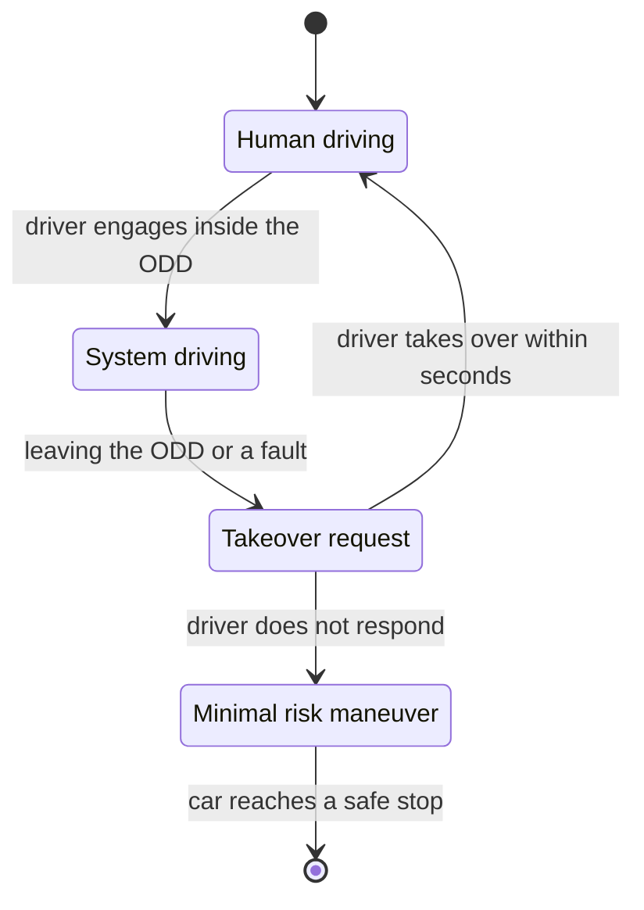
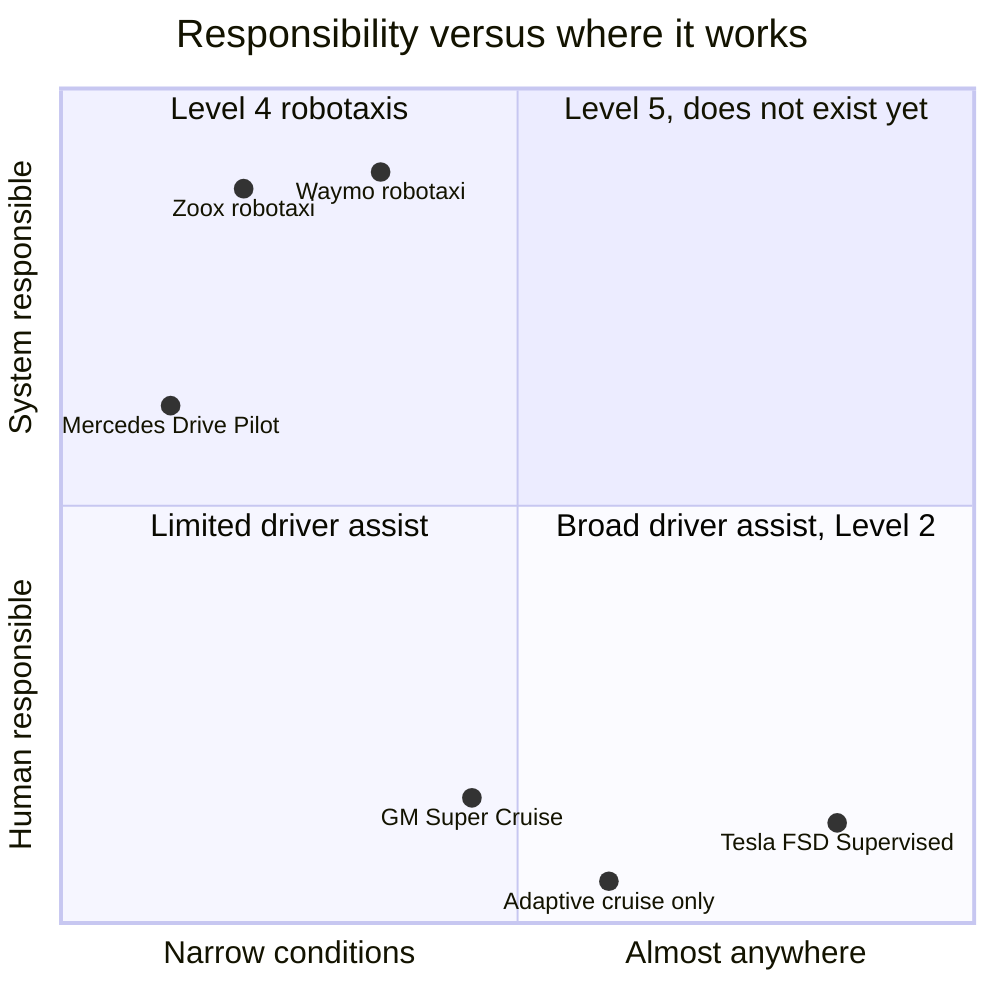
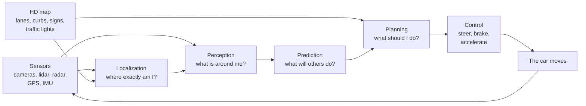
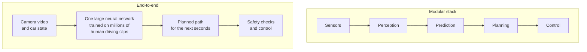
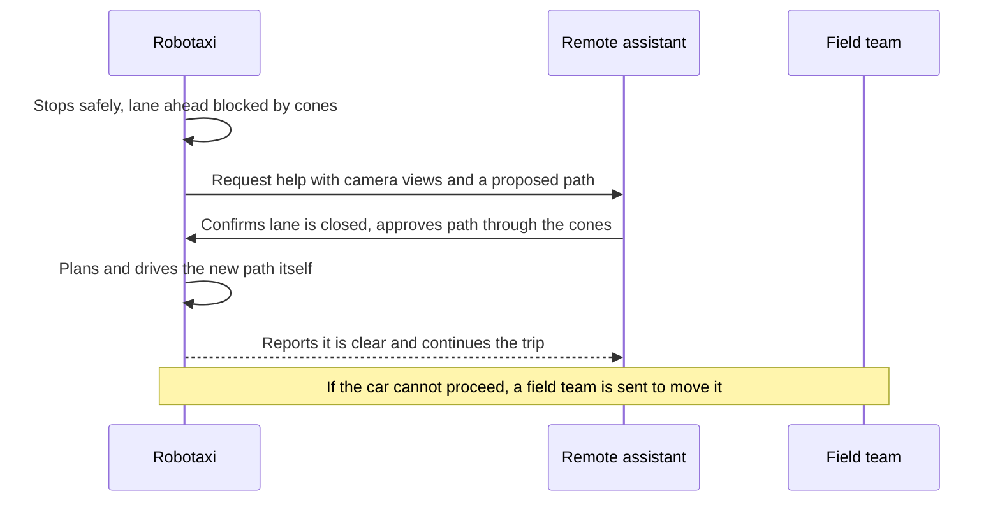
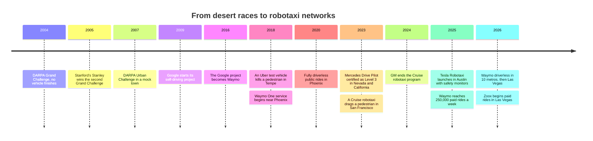
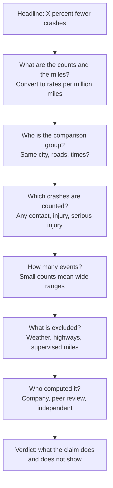

# Chapter 50: Self-Driving Vehicles

*How a car drives itself, who is responsible when it does, how robotaxis went from a desert race to hundreds of thousands of paid rides a week, and how to check the safety numbers for yourself.*

## What you'll learn

- The six SAE levels of driving automation, organized around the question that matters most: who is responsible.
- Why the driver assistance in your own car (Level 2) and a robotaxi with nobody at the wheel (Level 4) are different products, not two points on one slider.
- How the classic driving software works, from localization and perception to prediction, planning and control, and how "end-to-end" driving replaces it with one large network.
- What cameras, radar and lidar each see, how sensor fusion combines them, and the strongest arguments on both sides of the Waymo versus Tesla debate.
- The history from the DARPA desert races through the Uber and Cruise crashes to the services running in 2026.
- The 2026 landscape with real numbers and their sources: Waymo, Tesla, Zoox, Baidu Apollo Go, Pony.ai, WeRide and driverless trucks.
- How to read a "% fewer crashes" claim step by step, including how much driving it takes to prove anything about rare events.
- How self-driving vehicles are regulated in the United States and elsewhere.

## Before you start

Every term is defined as it appears, so you can read this chapter on its own. Chapter 49 (Robotics and Physical AI) is the most useful companion: a self-driving car is a robot, and that chapter's sense–plan–act loop, simulation, fleet learning and teleoperation honesty all apply here. Chapter 45 (Computer Vision) explains object detection, segmentation, depth and point clouds. Chapter 6 (Probability, Statistics and Learning by Slopes) and Chapter 9 (Evaluation, Overfitting and Metrics) give you the probability and base-rate thinking used to read safety claims. Chapter 48 (Reinforcement Learning, Games and Planning) covers search and planning.

## A car is a robot that must never drop the cup

Ask your chatbot for directions to a restaurant and it will list the turns in a second. If one instruction is wrong, you notice and ask again. A self-driving car has to *follow* those directions at 65 miles per hour, surrounded by cyclists, delivery vans, children and other drivers who do not always follow the rules, and a single wrong decision can kill someone. Chapter 49 said the physical world has no undo button. On the road, that is literally true.

> **Definition — Autonomous vehicle (AV):** A vehicle that can drive itself for some or all of a trip, sensing the road and controlling steering, speed and braking without a human doing it.

> **Definition — Automated driving system (ADS):** The combination of sensors, computers and software that performs the entire driving task on its own, at least within certain conditions. It is the technical name for the "driver" in a self-driving car.

> **Definition — Advanced driver-assistance system (ADAS):** Features that help a human driver, such as automatic emergency braking, adaptive cruise control and lane centering, while the human remains the driver.

> **Definition — Robotaxi:** A self-driving taxi with no human driver, booked through an app like a normal ride-hailing service.

Why is driving so hard to automate when it is something tens of millions of ordinary people do every day? Because ordinary people are, per mile, surprisingly good at it. Around 40,000 people die on US roads in a typical recent year, out of roughly 3 trillion miles driven. That is a little over 1 death per 100 million miles.

### Worked example: how rare is a fatal mistake?

- Fatality rate: about 1.3 deaths per 100 million miles. That is one death per 100,000,000 ÷ 1.3 = about 77 million miles.
- A typical American drives roughly 13,000 to 14,000 miles a year. Using 13,500: 77,000,000 ÷ 13,500 = about 5,700 years of driving per death.

So the average human driver, for all our texting and tiredness, goes thousands of lifetimes between fatal crashes. A self-driving system has to be at least that good, which means handling events so rare that most human drivers never see them: a mattress falling off a truck, a horse on the highway, a police officer waving traffic through a red light, a child chasing a ball from between parked cars.

> **Definition — Long tail (edge cases):** The enormous collection of rare, unusual situations that each almost never happens but that together happen all the time across millions of miles. Handling the long tail is the hardest part of self-driving.

> **Key idea:** Getting a car to handle ordinary driving most of the time was demonstrated by research teams more than 15 years ago. The entire difficulty of self-driving lies in the last fraction of a percent: rare situations, handled safely, every time, at the scale of hundreds of millions of miles.

> **Watch out:** You may have read that "94 percent of crashes are caused by human error". That figure comes from a 2015 NHTSA summary that assigned a "critical reason" to each crash, defined as the last failure in the chain of events. NHTSA itself noted this is not the same as the cause of, or blame for, the crash. It does not mean robots could prevent 94 percent of crashes.

## The SAE levels: organized by who is responsible

You have probably heard of "Level 2" or "Level 4" self-driving. The levels come from a standard published by SAE International (originally the Society of Automotive Engineers), called J3016, first issued in 2014 and updated several times since. The levels are often explained in terms of how clever the car is. That is the wrong way to think about them. They describe **who is responsible for the driving**, in the design of the system.

To read the levels, you need three ideas.

> **Definition — Dynamic driving task (DDT):** Everything involved in actually operating a vehicle in traffic: steering, accelerating, braking, watching the road, reacting to other road users, and signaling. It excludes trip planning, such as choosing the destination.

> **Definition — Fallback:** Who or what handles things when the automated system fails or reaches the edge of what it can do: either a human who must take over, or the system itself bringing the vehicle to a safe stop.

> **Definition — Operational design domain (ODD):** The specific conditions an automated driving system is designed to work in, such as which streets or cities, which speeds, which weather, and which times of day.

> **Definition — SAE levels of driving automation:** A 0–5 scale from the J3016 standard. Levels 0–2 mean a human drives and supervises at all times; Level 3 means the system drives but a human must take over when asked; Level 4 means no human is needed within a limited operational design domain; Level 5 means no human is needed anywhere a human could drive.

| Level | Name | Who steers and controls speed? | Who watches the road? | Who is the fallback? | Where? | Examples |
|---|---|---|---|---|---|---|
| 0 | No driving automation | Human | Human | Human | Anywhere | Warnings; automatic emergency braking acts only for a moment |
| 1 | Driver assistance | Human, with the system helping on steering *or* speed | Human | Human | Most roads | Adaptive cruise control on its own |
| 2 | Partial automation | System does steering *and* speed | **Human, at all times** | **Human, instantly** | Where the feature allows | Tesla FSD (Supervised), GM Super Cruise |
| 3 | Conditional automation | System | System, while engaged | **Human, when the system asks** | Limited conditions only | Mercedes-Benz Drive Pilot |
| 4 | High automation | System | System | **System** (it stops safely by itself) | Limited conditions only | Waymo, Zoox, Baidu Apollo Go robotaxis |
| 5 | Full automation | System | System | System | Everywhere a human could drive | None exists |

*Table 50.1: The SAE levels organized by responsibility. The great divide is between Level 2, where the human is always the driver, and Level 3 and above, where the system is the driver while it is engaged.*

> **Definition — Adaptive cruise control:** A driver-assistance feature that keeps a set speed and automatically slows down and speeds up to keep a safe gap to the car in front.

> **Definition — Lane centering:** A driver-assistance feature that steers to keep the car in the middle of its lane.

> **Definition — Minimal risk condition:** A safe, stable state an automated vehicle brings itself to when it cannot or should not continue, such as stopping at the side of the road with hazard lights on.

### Level 2: the human is the driver, even with hands off the wheel

At Level 2 the car can steer, brake and accelerate, sometimes for hours, but you remain the driver. You must watch the road every second and be ready to act instantly, because the system may not warn you before it makes a mistake. Some Level 2 systems, such as GM's Super Cruise, allow hands-free driving on approved roads. Hands-free is not eyes-free: a camera checks that you are looking at the road.

> **Definition — Driver monitoring system:** A camera or sensor inside the car that checks whether the driver is paying attention (eyes on the road, hands near the wheel) and warns or disengages the system if not.

Level 2 creates a well-known human-factors trap. The better the system gets, the less often you need to intervene, and the harder it becomes to stay alert.

> **Definition — Automation complacency:** The tendency of people supervising an automated system to stop paying close attention when it usually works, so they react too slowly on the rare occasion it fails.

### Level 3: the car drives, but may hand back

At Level 3, while the system is engaged inside its operational design domain, the system is the driver. You may look away from the road. But the system can ask you to take over, and you must do so within a short time. Mercedes-Benz Drive Pilot became the first SAE Level 3 system certified in the United States, in Nevada and California in 2023. Its initial US version worked only on approved highways, in dense traffic, at speeds up to about 40 miles per hour, in good weather and daylight.

> **Try it:** Ask your chatbot: "My car's manual says its highway assist lets me take my hands off the wheel. Is it Level 2 or Level 3, and who is responsible if it crashes?" Then ask it which question in the SAE table decides the answer. A good answer will point to whether you must keep watching the road.


*Figure 50.1: The Level 3 handoff. Responsibility passes from the human to the system and, when the system asks, back again. If the human does not respond, the system must bring the car to a minimal risk condition.*

### Level 4: no driver needed, but only in a defined area

At Level 4 there is no fallback driver at all. Inside its operational design domain (for a robotaxi, a mapped service area within a set of cities, in certain weather), the system drives and handles every problem itself, including pulling over safely if something goes wrong. Outside that area, it simply does not drive. This is what Waymo, Zoox and Baidu Apollo Go operate.

> **Definition — Geofence:** The boundary of the area in which a self-driving service is allowed to operate. A robotaxi will not accept a trip that leaves its geofence.

### Level 5: nobody has it

A Level 5 car could drive anywhere a competent human could, in any conditions a human could manage. As of late 2026, no such system exists, and many experts doubt it is a useful goal. Level 4 services that keep expanding their areas and conditions are the practical path.


*Figure 50.2: Where today's systems sit. Positions are approximate and illustrative. Broad coverage with the human responsible (bottom right) and system responsibility in limited areas (top left) are different products; nothing yet sits in the top right.*

> **Analogy:** At Level 2 you are a driving instructor sitting in the driver's seat with your hands hovering near the wheel, legally responsible for everything the student does. At Level 4 you are a passenger in the back seat of a taxi, but the taxi only goes to neighborhoods the company has mapped.

> **Watch out:** Tesla's consumer Full Self-Driving, now officially named "FSD (Supervised)", is a Level 2 system. The person in the driver's seat is legally the driver and must watch the road at all times. Tesla's Robotaxi service, which runs in a few cities, is a separate, limited operation. Calling a Level 2 system "self-driving" is the most common confusion in this whole field.

> **Key idea:** The levels describe who is responsible, not how smart the software is. A brilliant system that still needs a human to supervise is Level 2. A cautious robotaxi that only drives in one city, but needs nobody, is Level 4.

## The driving stack: how a car turns pixels into steering

Inside a classic self-driving system, the work is divided into stages, like an assembly line. Each stage has its own engineers, its own tests and its own outputs.

> **Definition — Modular driving stack:** The classic design of self-driving software as a pipeline of separate stages (localization, perception, prediction, planning and control), each built and tested on its own.


*Figure 50.3: The classic driving stack. Sensors feed localization and perception; an HD map provides prior knowledge; prediction and planning decide what to do; control turns the plan into steering and braking, many times per second.*

### Localization: where exactly am I?

Your phone's GPS is accurate to several meters. A car needs to know which lane it is in, to within a few centimeters.

> **Definition — GNSS (GPS):** Satellite positioning (GPS is the US system; GNSS is the general term). It gives a position accurate to a few meters, which is not enough on its own to stay in a lane.

> **Definition — IMU (inertial measurement unit):** A sensor that measures acceleration and rotation, letting the car track how it is moving between other position fixes, for example in a tunnel.

> **Definition — Localization:** Working out the vehicle's exact position and heading, typically to within centimeters, by matching what its sensors see against a stored map and combining that with GPS, the IMU and wheel movement.

> **Definition — HD map:** A high-definition map, accurate to centimeters, that records every lane, curb, crosswalk, sign and traffic light. It gives a self-driving car prior knowledge of the road before it arrives.

An HD map is like reading the exam questions in advance: the car already knows where the lanes and traffic lights should be, so its sensors only need to find what has changed, such as cars, people and roadworks. The price is that the map must be built and kept current for every street in the service area, which is one reason robotaxis expand city by city. Waymo uses HD maps. Tesla's approach avoids them and tries to read the road from cameras each time.

> **Try it:** Open Google Maps or Apple Maps in satellite or 3D view at the most complicated intersection near you. List everything an HD map would need to record there: each lane and turn arrow, crosswalks, stop lines, every traffic signal and which lane it controls, curbs and bus stops. Then imagine keeping that list correct through a month of roadworks.

### Perception: what is around me?

Perception turns raw sensor data into a list of things and where they are. It uses the computer-vision tools of Chapter 45: object detection, segmentation, depth estimation and tracking.

> **Definition — Perception:** The stage of a self-driving system that detects and tracks the objects around the vehicle (cars, cyclists, pedestrians, cones, debris) and identifies lanes, signs and traffic-light colors.

> **Definition — Object tracking:** Following the same object from one sensor frame to the next so the system knows its speed and direction, not just its current position.

Modern systems usually combine every camera and sensor into a single top-down picture of the surroundings.

> **Definition — Bird's-eye view (BEV):** A top-down map of the area around the vehicle, built by combining all cameras and sensors, on which objects, lanes and free space are drawn as if seen from directly above.

> **Definition — Occupancy grid:** A representation that divides the space around the car into small cells and estimates whether each cell is occupied. It lets the car avoid obstacles it cannot name, such as an odd-shaped piece of debris.

### Prediction: what will everyone else do?

Knowing where a cyclist is now is not enough. The car must guess where she will be in the next few seconds.

> **Definition — Prediction (motion forecasting):** Estimating the likely future paths of every other road user over the next several seconds, usually as several possible futures, each with a probability.

Prediction is hard because road users interact. Whether a pedestrian steps off the curb depends on whether your car is slowing down. Whether a driver lets you merge depends on how you merge. Good systems predict several futures ("the cyclist continues straight, 70 percent; turns left across our lane, 25 percent; stops, 5 percent") and plan to be safe in all of them.

### Planning: what should I do?

> **Definition — Motion planning:** Choosing the vehicle's path and speed for the next several seconds: which lane, how fast, when to brake, when to go.

> **Definition — Cost function:** A formula that scores each candidate plan by adding up penalties, for example for getting too close to others, braking harshly, breaking traffic rules or making no progress. The planner picks the plan with the lowest total cost.

A planner might generate hundreds of candidate trajectories every tenth of a second, score each one with its cost function against every predicted future, and choose the best. It must balance safety with being a good road citizen: a car that brakes for every shadow is safe in one sense but causes rear-end crashes and blocks traffic.

### Control: make the car do it

> **Definition — Control (vehicle control):** The final stage that turns the planned path into precise steering angles, throttle and brake commands, correcting many times per second for bumps, slopes and tire grip.

### One scene, five stages

Here is a single scene passing through the stack.

1. **Localization:** "We are in the right lane of Main Street, 42 meters before the intersection, heading north at 11 meters per second."
2. **Perception:** "Cyclist, 12 meters ahead, at the right edge of our lane, moving at 5 meters per second. Parked van on the right. Traffic light ahead is green."
3. **Prediction:** "Cyclist continues straight, 70 percent. Swerves left around the van door zone within 2 seconds, 25 percent. Stops, 5 percent."
4. **Planning:** "Slow from 11 to 7 meters per second, stay 1.5 meters to her left, do not pass until after the van."
5. **Control:** "Brake at 20 percent, steer 0.5 degrees left."

Then everything repeats, typically 10 or more times per second.

### Worked example: why milliseconds and meters matter

**Delay.** At 30 meters per second (about 67 miles per hour), every 100 milliseconds the system spends thinking is 30 × 0.1 = 3 meters traveled before it reacts.

**Stopping distance.** Take a car at 65 miles per hour, which is about 29 meters per second, braking hard at about 7 meters per second squared on dry road.

- Braking distance = speed² ÷ (2 × deceleration) = 29 × 29 ÷ (2 × 7) = 841 ÷ 14 = about 60 meters.
- A human with a 1.5-second reaction time travels 29 × 1.5 = 43.5 meters before even touching the brake. Total: about 104 meters.
- A system that reacts in 0.3 seconds travels 29 × 0.3 = 8.7 meters first. Total: about 69 meters.

The faster reaction saves about 35 meters, which is several car lengths. But it also shows what the sensors must do: to stop for an obstacle at highway speed, the car must detect and correctly recognize it about 70 to 100 meters away, more in rain. A heavy truck brakes more gently (assume 4 meters per second squared for illustration: 841 ÷ 8 = about 105 meters of braking alone), so driverless trucks need to see well beyond 150 meters.

> **Key idea:** The modular stack is interpretable. When something goes wrong, engineers can ask which stage failed: did perception miss the object, did prediction misjudge it, or did planning choose badly? That makes it easier to test and to explain to regulators, at the cost of hand-designed interfaces between stages that can lose useful information.

## End-to-end driving: one network from pixels to steering

Notice a weakness in the assembly line. Perception passes along a list of boxes: "pedestrian, here, moving this way." It does not pass along that the pedestrian is looking at her phone, or that she just waved the car through. Each handoff between stages throws away information that the next stage might have used. And each stage contains hand-written rules that engineers must maintain.

The alternative is to train one large neural network to go straight from sensor data to a driving plan.

> **Definition — End-to-end driving:** Replacing the hand-built pipeline with one large neural network trained to map sensor input (mostly camera video) directly to a driving path or to steering and speed commands.

> **Definition — Imitation learning (behavior cloning):** Training a model to copy the actions of human experts. For driving, the network learns from millions of recorded clips what a good human driver did in the same situation.

The approach follows the pattern of the rest of modern AI: replace hand-written rules with a big network and a lot of data (the "Bitter Lesson" of Chapter 13). Tesla relies on end-to-end neural networks trained on data from its customer fleet. The UK start-up Wayve has also championed learned, end-to-end driving. Waymo published research in 2024 on an end-to-end driving model built on its parent company's Gemini models.


*Figure 50.4: The modular stack hands information from stage to stage; an end-to-end system learns the whole mapping at once, usually with safety checks still applied to its output.*

**The case for end-to-end.** It improves automatically as you add more data and computing power. It can pick up subtle cues no engineer thought to write down. It avoids thousands of hand-written rules. And a company with millions of cars on the road can collect training data at a scale no test fleet can match.

**The case for caution.** One giant network is hard to inspect: when it makes a mistake, there is no stage to blame and fix. It copies human habits, including bad ones like rolling through stop signs, unless the data is filtered. Rare events are still rare in the training data. And proving to a regulator, or to yourself, that it is safe enough requires enormous amounts of testing.

> **Definition — Shadow mode:** Running new driving software silently in the background on cars driven by humans or by older software, comparing what it *would* have done with what actually happened, without letting it control the car.

> **At the frontier (2026):** The sharp line between the two camps has blurred. Both Waymo and Tesla now use large learned models; modular systems contain big neural networks inside each stage, and end-to-end systems add structure, safety checks and intermediate outputs engineers can inspect. The live debate is about sensors, validation and scale rather than "learned versus hand-coded".

## Sensors and sensor fusion

A self-driving car has to see in every direction, at long range, day and night, in rain and glare. No single sensor does all of that.

> **Definition — Lidar:** A sensor that fires laser pulses and times their reflections to measure distance, building a precise 3D picture of the surroundings. The name comes from "light detection and ranging".

> **Definition — Point cloud:** A 3D scene represented as a large set of dots, each with an x, y, z position, the typical output of a lidar sensor.

> **Definition — Time of flight:** Measuring distance by timing how long a pulse (of light, radio or sound) takes to travel to an object and back.

**Worked example: timing a laser.** Light travels about 300,000 kilometers per second, which is 0.3 meters per nanosecond (billionth of a second). For an object 150 meters away, the pulse travels 300 meters there and back, which takes 300 ÷ 0.3 = 1,000 nanoseconds, or one microsecond. A lidar measures that time and converts it back into distance, for hundreds of thousands to millions of pulses per second, sweeping the scene to build a point cloud.

> **Try it:** If you have a recent iPhone Pro or iPad Pro, open the built-in Measure app, which uses a small lidar sensor on the back. Measure a doorway, then try a window or a mirror. Glass and shiny surfaces confuse it, for the same reasons they can confuse a car's lidar.

> **Definition — Radar:** A sensor that sends out radio waves and measures their echoes to find the distance and speed of objects. It works in rain, fog and darkness but gives a much blurrier picture than lidar or cameras.

> **Definition — Ultrasonic sensor:** A short-range sensor that uses sound pulses, like a bat, to detect obstacles within a few meters. Used mainly for parking.

| Sensor | How it works | Strengths | Weaknesses |
|---|---|---|---|
| Camera | Records light, like an eye | Cheap; sees color, text, traffic lights, brake lights, hand signals; very rich detail | No direct distance measurement; struggles with glare, darkness and dirt on the lens |
| Lidar | Times laser pulses | Precise 3D distance, day or night | More expensive; degraded by heavy rain, fog and snow; cannot read colors or signs |
| Radar | Times radio echoes; measures speed directly from the echo's frequency shift | Works in bad weather; measures speed instantly; long range | Coarse detail; confused by metal objects such as manhole covers and bridges |
| Ultrasonic | Times sound echoes | Very cheap; good for the last meter when parking | Range of only a few meters |

*Table 50.2: The main self-driving sensors and what each is good and bad at.*

> **Definition — Sensor fusion:** Combining readings from several different sensors into one more reliable picture of the world, so each sensor's weaknesses are covered by another's strengths.

Fusion can happen late (each sensor's software detects objects, and the detections are merged) or early (raw data from all sensors is fed into one network that learns to combine it). Either way, the point is redundancy: a camera dazzled by a low sun can be backed up by lidar and radar, which do not care about glare.

> **Analogy:** Lidar is like a bat's echolocation using light: precise distance, no color. Radar is echolocation with radio: it sees through fog but blurrily. Cameras are eyes: rich detail and color, but no built-in measure of distance, so depth must be inferred, as you do when you judge distance with one eye closed.

### The Waymo versus Tesla debate

This is the best-known argument in the field, and both sides have serious points. Waymo's robotaxis carry a full sensor suite: lidars, radars and between about 13 and 29 cameras depending on the vehicle generation, plus HD maps. Tesla's cars use cameras only, about 8 of them; it removed radar from new cars in 2021.

**The strongest case for cameras only.** Humans drive with two eyes, and roads are designed to be read visually. Cameras are cheap, so every car a company sells can carry them, turning millions of customers into data collectors; Tesla reported that cumulative supervised FSD miles were approaching 12 billion on its second-quarter 2026 earnings call. Extra sensors add cost, complexity and the problem of what to do when sensors disagree. And end-to-end learning gets better with every additional mile of data.

**The strongest case for multiple sensors.** Lidar and radar measure distance directly instead of inferring it, and they work in darkness and glare where cameras struggle. Different sensors fail in different ways, so they back each other up, which matters when the goal is to be far safer than humans, not merely as good. Cross-checking sensors makes it easier to validate safety. Sensor prices have fallen sharply. And Waymo has accumulated, by its own figures, 271.3 million rider-only miles through June 2026, by far the most driverless experience published by anyone.

**What would settle it.** Large amounts of published, independently checkable safety data from camera-only vehicles running without supervision, and the full cost per mile of each approach at scale. As of late 2026, the multi-sensor approach has far more driverless miles behind it, and the camera-only approach has far more cars on the road.

> **Watch out:** The debate is often framed as "lidar versus AI". It is not. Both companies use large learned neural networks. The disagreement is about which sensors to feed them, whether to use HD maps, and how to prove the result is safe.

## Testing a driver that never sleeps

How do you test a driver before trusting it with passengers? Self-driving companies use a ladder of methods, each cheaper and broader than the one above it, and each less like the real thing.

> **Definition — Scenario simulation:** Testing driving software in a virtual world, including replaying real recorded drives with changes ("what if that pedestrian had stepped out one second earlier?") and generating rare, dangerous situations that would be unethical to stage on real roads.

> **Definition — Closed-course testing:** Testing on a private track where staged situations (a dummy pedestrian, a sudden cut-in) can be repeated safely.

> **Definition — Safety driver (safety monitor):** An employee who rides in a test vehicle ready to intervene. A safety driver sits behind the wheel; a "safety monitor" usually sits in the passenger seat with a stop button.

> **Definition — Disengagement:** A moment when the automated system hands control back to a human, or a human takes over, during testing.

California has required companies testing self-driving cars on its roads to report their disengagements every year, and journalists often rank companies by "miles per disengagement". Treat that ranking with care. A company testing in quiet suburbs will have fewer disengagements than one testing in a dense downtown. Some companies tell safety drivers to take over at the first doubt; others do not. The number tells you something, but it is not a safety score.

### Remote assistance: the humans behind the robotaxi

Driverless does not mean humanless. When a robotaxi meets something confusing, such as a lane blocked by a fire truck or a police officer directing traffic, it can ask a human in a remote operations center for help.

> **Definition — Remote assistance:** Help for an automated vehicle from a human at a remote center, who sees through the vehicle's cameras and answers its questions or suggests a route, while the vehicle itself keeps driving.

> **Definition — Remote driving (teleoperation):** A remote human directly steering and braking a vehicle in real time over a wireless link. Most robotaxi companies avoid it at normal speeds, because network delays and dropouts make it risky.


*Figure 50.5: A typical remote-assistance exchange. The human gives advice; the vehicle still does the driving. The same "puppet or pilot" questions from Chapter 49 apply.*

**Worked example: how many remote helpers does a fleet need?** Use illustrative assumptions, not any company's figures. A fleet of 3,500 robotaxis operates 16 hours a day: 3,500 × 16 = 56,000 vehicle-hours a day. Suppose a car asks for help once every 5 hours of driving: 56,000 ÷ 5 = 11,200 requests a day. If each takes 1 minute of a person's attention, that is 11,200 minutes, or about 187 person-hours a day, an average of about 12 people on duty across the 16 hours, before allowing for breaks and busy peaks. Halve the request rate and you halve the staff. Just as with humanoids in Chapter 49, the ratio of vehicles to remote humans is one of the most important numbers in the business, and one companies rarely publish.

> **Analogy:** Remote assistance is less like flying a drone by remote control and more like a delivery driver phoning the office: "The street is blocked, can I go round the back?" The office answers the question; the driver still drives.

## A short history: from the desert to the city


*Figure 50.6: Twenty-two years from a desert race nobody finished to robotaxi networks in a dozen cities.*

### The desert races (2004–2007)

In 2004 the US military research agency DARPA offered a $1 million prize to any driverless vehicle that could cross about 150 miles of Mojave Desert. Not one finished; the best entry managed about 7 miles before getting stuck. Eighteen months later, at the second Grand Challenge in 2005, five vehicles finished a 132-mile course. The winner was Stanley, a modified Volkswagen Touareg from Stanford University's team led by Sebastian Thrun, which took just under seven hours. Part of Stanley's edge was machine learning: it learned to recognize drivable road in its camera images farther ahead than its laser sensors could see, so it could drive faster safely.

In 2007 the DARPA Urban Challenge moved the contest to a mock town with traffic, intersections and parking lots, with robots required to obey California road rules. Carnegie Mellon University's Boss won. Many of the engineers from these teams went on to found and staff the self-driving industry.

### Google, Waymo and the long road to driverless

Google started its self-driving project in 2009, hiring veterans of the DARPA races. It became a separate Alphabet company, Waymo, in 2016. Waymo opened its Waymo One service near Phoenix in 2018 and began offering fully driverless public rides there in 2020, more than a decade after the project began.

### Two crashes that shaped the industry

**Uber, Tempe, Arizona, March 2018.** An Uber test vehicle, with a safety driver behind the wheel, struck and killed a pedestrian walking her bicycle across a road at night. It was the first known pedestrian death involving a self-driving test car. The US National Transportation Safety Board (NTSB) investigation found that the system detected her more than five seconds before impact but repeatedly changed its mind about what she was (a vehicle, a bicycle, an unknown object) and did not predict her path correctly, partly because the system had not been designed to expect pedestrians crossing outside crosswalks. The car's built-in automatic emergency braking had been turned off during self-driving mode, and the safety driver was looking down at a phone streaming a TV show. Uber halted testing and in 2020 sold its self-driving unit to Aurora. The lessons: perception and prediction failures, automation complacency in safety drivers, and the need for a strong safety culture.

**Cruise, San Francisco, October 2023.** A pedestrian was hit by a human-driven car and thrown into the path of a Cruise robotaxi, which braked hard but struck her. The robotaxi then tried to pull over to the side of the road, as it was designed to do after a collision, and dragged her about 6 meters (20 feet). California regulators suspended Cruise's driverless permits within weeks and said the company had not initially shown them the full footage. Cruise, owned by General Motors, never recovered: GM ended its robotaxi program in December 2024. The lessons: a "safe" fallback maneuver can be the wrong one, and trust with regulators and the public, once lost, may not come back.

> **Key idea:** In the history of self-driving, the crashes that mattered most were not only technical failures. They were failures of safety culture and transparency, and they set the whole industry back.

### Level 3 arrives, and Tesla's robotaxi

Mercedes-Benz Drive Pilot became the first Level 3 system certified in the United States in 2023, in Nevada and then California. Tesla launched its Robotaxi service in Austin, Texas, in June 2025, with safety monitors aboard at first.

## The 2026 landscape, with numbers

Here is where the field stood as of October 2026. Almost all of these figures come from the companies themselves, sometimes through regulatory filings, and they are labeled that way.

### Waymo (Alphabet)

Waymo is the clear leader in driverless miles and rides.

- **Rides:** about **500,000 paid rides per week** in spring 2026, up from 250,000 in April 2025, with a target of **1 million per week by the end of 2026** (company figures as reported by the press). More than 20 million cumulative trips.
- **Fleet:** about 3,500 vehicles.
- **Miles:** **271.3 million rider-only miles** through June 2026 (company safety data).
- **Cities:** a March 2026 expansion brought driverless service to 10 metro areas: Phoenix, the San Francisco Bay Area, Los Angeles, Austin, Atlanta, Miami, Dallas, Houston, San Antonio and Orlando. Las Vegas went fully driverless on July 8, 2026, with Denver, San Diego and Tampa named as next.
- **Abroad:** London service targeted for 2026 with testing underway; Tokyo commercial driverless service targeted for 2027. As of mid-2026 there were no paid driverless Waymo rides outside the United States.

> **Definition — Rider-only miles:** Miles driven by an automated vehicle with no human driver or safety monitor on board, only passengers or nobody at all.

**Worked example: what those numbers mean.**

- **Rides per car:** 500,000 rides per week ÷ 3,500 vehicles = about 143 rides per vehicle per week, or about 20 per day.
- **Miles in human terms:** 271.3 million miles ÷ about 13,500 miles per year for a typical American driver = about 20,000 years of one person's driving.
- **Growth:** going from 250,000 to 500,000 weekly rides took about a year. Reaching 1 million by the end of 2026 would require another doubling in roughly eight months, a faster pace. Whether Waymo hit that target was not known as of October 2026.

```
Waymo paid rides per week (company figures as reported)

Apr 2025     #########                          250,000
Spring 2026  ##################                 500,000
End 2026     ####################################  1,000,000 target
```
*Figure 50.7: Waymo's reported weekly paid rides and its stated end-of-2026 target. Each # is about 28,000 rides.*

### Tesla

- **Robotaxi:** launched in Austin in June 2025 with safety monitors aboard. By April 2026, rides with no employee on board were running in Austin, Dallas and Houston, and later reports add Miami and other Florida cities. One September 2026 report said the unsupervised fleet had passed 1 million miles with roughly 200 or more vehicles, a figure from a secondary source that had not been confirmed independently. The Bay Area service still uses safety drivers.
- **Consumer FSD (Supervised):** a **Level 2** system; the driver must supervise. Elon Musk called unsupervised FSD for customer cars in the fourth quarter of 2026 "a guess", and Tesla has missed several earlier targets for this. Cumulative supervised FSD miles were approaching 12 billion, according to Tesla's second-quarter 2026 earnings call.

**Worked example: comparing miles honestly.** Waymo's 271.3 million rider-only miles versus the roughly 1 million unsupervised Tesla Robotaxi miles in one report is a ratio of about 271. And Tesla's 12 billion supervised miles, while a vast amount of data for training, cannot by themselves show how safe the cars would be without supervision, because a human was there to catch mistakes. Every crash a human prevented is invisible in those miles.

> **Key idea:** Supervised miles and unsupervised miles measure different things. Supervised miles show how much data a company has. Only unsupervised miles show how safe the system is on its own.

### Zoox (Amazon)

Zoox builds a purpose-built robotaxi with no steering wheel or pedals, with seats facing each other.

> **Definition — Purpose-built robotaxi:** A vehicle designed from scratch to be driven only by an automated system, with no steering wheel or pedals, rather than a normal car fitted with self-driving equipment.

By March 2026, Zoox had about 2 million autonomous miles and more than 350,000 riders on free rides in Las Vegas and in an early-rider program in San Francisco, with Austin and Miami coming. On July 30, 2026, it received the National Highway Traffic Safety Administration's first commercial exemption for a purpose-built robotaxi, capped at 2,500 vehicles a year. Paid rides began in Las Vegas on August 10, 2026.

### China and the Middle East

- **Baidu Apollo Go:** more than 20 million cumulative rides by February 2026, a weekly peak of over 300,000 in the fourth quarter of 2025, and about 3.2 million fully driverless rides in the first quarter of 2026 (company figures). That quarter works out to 3,200,000 ÷ 13 weeks = about 246,000 driverless rides a week, the same order of magnitude as Waymo. It runs driverless commercial service in Dubai and Abu Dhabi, and road tests in London in 2026 with public rides planned for 2027.
- **Pony.ai:** a global robotaxi fleet of **1,975 vehicles as of June 30, 2026**, targeting more than 3,500 by year-end (company figures from a US securities filing).
- **WeRide:** operates robotaxis in China and Abu Dhabi.

### Trucks and delivery robots

> **Definition — Hub-to-hub autonomous trucking:** A model in which driverless trucks run long highway legs between freight terminals near highways, with human drivers or local services handling the complicated city streets at each end.

Highways are simpler than city streets in some ways (no pedestrians, no cyclists, clearer rules) and harder in others (high speeds, long stopping distances, heavy vehicles). The business case is strong: US rules limit a truck driver to 11 hours of driving a day, while a driverless truck could in principle run nearly around the clock. Aurora, which bought Uber's self-driving unit, is the best-known US company pursuing driverless trucks. Small sidewalk delivery robots, meanwhile, already deliver food on many university campuses and in some city neighborhoods.

| Operator | Where | Key figures (as of 2026) | Source label |
|---|---|---|---|
| Waymo | 11 US metros driverless; London and Tokyo planned | ~500,000 paid rides/week (spring); ~3,500 vehicles; 271.3M rider-only miles (to June) | Company figures |
| Tesla Robotaxi | Austin, Dallas, Houston, Florida cities; Bay Area with safety drivers | ~1M unsupervised miles, ~200+ vehicles (September report) | Single secondary report |
| Tesla FSD (Supervised) | Customer cars, Level 2 | ~12B cumulative supervised miles (Q2 call) | Company figures |
| Zoox | Las Vegas (paid from August 10), San Francisco, Austin and Miami coming | ~2M autonomous miles, 350,000+ riders on free rides (March) | Company figures |
| Baidu Apollo Go | China, Dubai, Abu Dhabi; London tests | 20M+ cumulative rides (February); ~3.2M driverless rides in Q1 | Company figures |
| Pony.ai | China and abroad | 1,975 vehicles (June 30), 3,500+ targeted by year-end | Company securities filing |
| WeRide | China, Abu Dhabi | Fleet figures not broken out in sources found | Company statements |

*Table 50.3: The robotaxi landscape in 2026. Nearly every number is self-reported; independent checks are rare outside safety data.*

> **At the frontier (2026):** The race has shifted from "can it work?" to "how fast can it scale?" The leading questions in late 2026 are whether Waymo reaches its target of 1 million weekly rides, whether purpose-built vehicles like Zoox's can grow under exemption caps, whether camera-only robotaxis can match multi-sensor safety records with published data, and which company first runs paid driverless rides in Europe.

> **Watch out:** "Self-driving cars are always five years away" is out of date. Robotaxis with nobody in the driver's seat already give hundreds of thousands of paid rides every week in the US and China. What remains true is that they work in limited areas and conditions (Level 4), not everywhere (Level 5).

## How to read a "% fewer crashes" claim

Every self-driving company publishes safety comparisons, and headlines repeat them: "80 percent fewer injury crashes than humans." Here is how to read such a claim like a scientist. We will practice on a made-up company first, then apply the method to Waymo's real figures.

> **Definition — Crash rate:** The number of crashes divided by the distance driven, usually stated per million miles, so that fleets of different sizes can be compared fairly.

> **Definition — Human benchmark:** The crash rate of human drivers used for comparison, ideally measured in the same places, on the same kinds of roads and at the same times as the automated vehicles drive.

### Worked example: RoboCab, a fictional robotaxi company

RoboCab announces: "RoboCab had 80 percent fewer injury crashes than human drivers."

**Step 1: Turn the claim into rates.** RoboCab drove 50 million miles and had 30 crashes involving an injury. Its rate is 30 ÷ 50 = 0.6 injury crashes per million miles. The human benchmark it chose is 3.0 per million miles. The reduction is 1 − (0.6 ÷ 3.0) = 1 − 0.2 = 0.8, or 80 percent fewer. The arithmetic checks out. Now the real questions.

**Step 2: Check the comparison group.** Where does 3.0 come from? If it is a national average that includes rural highways, icy winters and drunk drivers at 2 a.m., while RoboCab drives only in one sunny city at moderate speeds, the comparison flatters RoboCab. The fair benchmark is human driving in the same city, on the same kinds of roads, at the same times.

**Step 3: Check for underreporting.** Self-driving companies in the US must report every crash to regulators, even minor bumps. Many minor human crashes are never reported to police or insurers. A benchmark built from police reports therefore undercounts human crashes, making the robots look worse. Careful studies adjust for this, but the size of the adjustment is itself an estimate you should look for.

> **Definition — Underreporting:** When many events, such as minor crashes, never make it into official records, so rates calculated from those records are too low.

**Step 4: Check what is counted.** "Any contact", "police-reported", "injury", "airbag deployed" and "serious injury or worse" are different categories with very different counts. A company can choose the category that looks best. A trustworthy report shows several.

**Step 5: Check the uncertainty.** Severe crashes are rare, and small counts bounce around by luck. Suppose RoboCab had 2 serious-injury crashes in its 50 million miles, a rate of 2 ÷ 50 = 0.04 per million miles, against a human benchmark of 0.25 per million miles. That looks like 1 − (0.04 ÷ 0.25) = 84 percent fewer. But with only 2 events, the true long-run count could easily have been different. Standard statistics for rare counts (the Poisson distribution, the usual mathematical model for counting rare, independent events such as crashes; Chapter 6 covers the probability basics behind it) say that when you observe 2 events, the true expected number is plausibly anywhere from about 0.24 to about 7.2 (a 95 percent confidence interval).

> **Definition — Confidence interval:** A range of values that, given the data and the statistical method, is likely to contain the true value. A "95 percent confidence interval" is built so that ranges made this way capture the truth about 95 percent of the time.

- Low end: 0.24 ÷ 50 = 0.005 per million miles, which is 1 − (0.005 ÷ 0.25) = 98 percent fewer.
- High end: 7.2 ÷ 50 = 0.144 per million miles, which is 1 − (0.144 ÷ 0.25) = 42 percent fewer.

The honest headline is "somewhere between about 42 percent and 98 percent fewer serious-injury crashes". That is still good news, but a long way from a precise "84 percent".

> **Analogy:** Judging a fleet's safety from two serious crashes is like judging a basketball player's free-throw percentage from two shots. If both went in, you would not announce "100 percent shooter". You need many more attempts before the number settles down.

**Step 6: Ask how many miles it takes to prove anything.** For the rarest events, deaths, there is a handy shortcut.

> **Definition — Rule of three:** A statistics rule of thumb: if something has not happened at all in n independent trials (or miles), you can be about 95 percent confident its true rate is below 3 ÷ n.

Human drivers cause a little over 1 death per 100 million miles. In 2016, the RAND Corporation's report *Driving to Safety* used a benchmark of 1.09 deaths per 100 million miles and asked how far a self-driving fleet must drive with no deaths at all to be 95 percent confident it is at least that safe. Use the rule of three: n = 3 ÷ (1.09 ÷ 100,000,000) = 3 ÷ 0.0000000109 = about 275 million miles. And that only shows "no worse than humans". Showing that a fleet is, say, 20 percent *better* than humans at avoiding deaths takes billions of miles, because you have to measure a small difference between two rare events. This is why safety reports focus on more common categories, such as injury crashes, where differences show up sooner.


*Figure 50.8: A checklist for any "% fewer crashes" claim, from AI cars or anything else.*

**Step 7: Check what is excluded.** Does the fleet avoid snow, heavy rain or highways? Were the miles supervised, so that a human prevented crashes that would otherwise have happened? Did remote assistants or field teams help?

**Step 8: Check who computed it and who was at fault.** Company-computed figures are a starting point, not the final word. Peer review and independent analyses add confidence. And "involved in a crash" is not the same as "caused a crash": many robotaxi crashes involve the robotaxi being hit while stopped. Good analyses report both involvement and contribution.

### Applying the method to Waymo

Waymo's safety data hub reports, for **271.3 million rider-only miles** through June 2026, compared with human drivers in the same cities:

- about **95 percent fewer crashes causing serious injury or worse** (94.82 percent precisely),
- **82 percent fewer** injury-reported crashes,
- **93 percent fewer** crashes injuring pedestrians,
- **82 percent fewer** crashes in which an airbag deployed.

Now run the checklist.

- **Comparison group:** human drivers in the same cities, which is the right idea. The benchmark is computed by Waymo, which has an obvious interest in the result.
- **Categories:** several are reported, including more common ones (injury) and rarer, more serious ones. That is good practice.
- **Uncertainty:** with over 270 million miles, even the serious categories now contain enough events to give reasonably tight ranges, and the mileage is at the scale where the rule of three starts to say something about the rarest events, too.
- **Peer review and independent checks:** a peer-reviewed paper by Waymo staff (Kusano and colleagues, in the journal *Traffic Injury Prevention*), covering about 56.7 million miles through January 2025, found large reductions. An analysis attributed to the Insurance Institute for Highway Safety reportedly estimated somewhat smaller, but still large, reductions (for example, around 81 percent fewer injury crashes).
- **Exclusions:** Waymo avoids heavy snow and, for most of its history, most highway driving. Its miles are therefore not the same mix as typical human driving.

**Verdict:** strong evidence of large reductions in crashes within the cities, roads and conditions where Waymo operates; not evidence about blizzards or long-distance highway driving; and the most extensive driverless safety record anyone has published.

> **Watch out:** Some driver-assistance safety reports compare miles driven with the system switched on, mostly on highways, against national averages that include city streets, rural roads and bad weather. Highways have fewer crashes per mile anyway, and a human was supervising. That comparison mixes apples and oranges, so be wary of it whoever publishes it.

> **Try it:** Paste a recent "X percent safer" headline about any AI system, a car, a medical tool or a fraud detector, into your chatbot along with this chapter's eight steps, and ask it to list which steps the article answers and which it leaves out. Then read the original source yourself to check the chatbot's summary.

## Rules of the road for robots: regulation

Who decides whether a car with nobody in it may drive down your street? In most countries the answer is split between national and local governments, and the rules were written for human drivers.

### The United States

The federal and state governments divide the job.

> **Definition — NHTSA (National Highway Traffic Safety Administration):** The US federal agency that sets safety standards for vehicles and their equipment, investigates defects, orders recalls and collects crash data.

> **Definition — FMVSS (Federal Motor Vehicle Safety Standards):** The US federal safety rules every new vehicle must meet. Many were written assuming a human driver with a steering wheel and pedals, so vehicles without them need exemptions.

> **Definition — Vehicle safety recall:** A formal action to fix a safety defect in vehicles already sold. For self-driving and driver-assistance systems, recalls are often fixed by a software update sent wirelessly.

> **Definition — Over-the-air (OTA) update:** New software sent to a vehicle wirelessly, like a phone update, without a visit to a garage.

- **Federal (NHTSA):** sets vehicle safety standards, grants exemptions from them, investigates defects and orders recalls. Since 2021, a Standing General Order has required companies to report crashes involving automated driving systems and Level 2 driver-assistance systems. Zoox's July 2026 exemption, capped at 2,500 vehicles a year, was the first commercial exemption granted for a purpose-built robotaxi. Waymo, Cruise, Zoox and Tesla have all issued recalls for their automated or driver-assistance systems that were fixed with software updates.
- **States:** control driver licensing, traffic laws, insurance requirements and permits to operate on their roads. California, for example, requires permits from its Department of Motor Vehicles to test and deploy self-driving cars and separate approval from its Public Utilities Commission to charge passengers. Some states, such as Arizona and Texas, have taken a more permissive approach, which is partly why so many services launched there.

> **Definition — Standing General Order (crash reporting):** A 2021 NHTSA order requiring companies to report crashes involving vehicles equipped with automated driving systems or Level 2 driver-assistance systems, creating a public crash database.

For most of the robotaxi era, the US has had no comprehensive federal law written specifically for self-driving cars; the system has relied on NHTSA's general powers plus a patchwork of state laws. Check for changes, as of October 2026, before relying on any of this for a decision.

### Who is liable?

At Level 2, the human driver is responsible, just as in an ordinary car. At Levels 3 and 4, while the system is driving, responsibility shifts toward the company that built or operates it. Mercedes-Benz has said it accepts responsibility for Drive Pilot's driving while the system is engaged. For a robotaxi, the operating company is in effect the driver of every car in its fleet.

> **Key idea:** At Level 4, the company is the driver. Responsibility moves from millions of individual motorists to a handful of companies, which changes insurance, liability and what regulators need to see before saying yes.

### Elsewhere

- **United Kingdom:** the Automated Vehicles Act 2024 makes the company behind an authorized self-driving system legally responsible for how the car drives while the system is in control; the person in the seat becomes a "user-in-charge" who is not liable for the driving itself. Waymo and Baidu both planned London services.
- **China:** robotaxis are permitted city by city, with local governments granting test and commercial licenses. Baidu Apollo Go and Pony.ai have grown under this system.
- **United Arab Emirates:** Dubai and Abu Dhabi host driverless commercial service from Baidu Apollo Go, and WeRide operates robotaxis in Abu Dhabi.
- **Germany and Japan** have also created legal routes for Level 4 operation in defined areas.

## Open problems and what to watch

Self-driving has moved from "if" to "how fast and where", but several hard problems remain.

- **Weather.** Heavy snow hides lane markings and coats sensors; most robotaxi services avoid it.
- **Highways at scale.** High speeds mean long stopping distances and severe crashes, and highway driverless service is still limited.
- **Emergency scenes and human direction.** Police hand signals, fire hoses across the road and flooded streets are rare, varied and high-stakes.
- **Dense, chaotic traffic.** Cities in much of the developing world, with mixed traffic, few lane markings and very different driving norms, are a different challenge from Phoenix or Los Angeles.
- **Proving safety.** Building a convincing statistical safety case, as the rule of three shows, takes hundreds of millions of miles, and every software update raises the question of whether old evidence still applies.
- **Economics.** Vehicle and sensor costs, depots, charging, cleaning, insurance and remote assistance all have to fall below what a ride is worth.
- **Jobs.** Ride-hailing, taxi and truck driving employ millions of people; how fast automation arrives and what happens to those workers is part of the broader debate in Chapter 60.

Signals worth watching in 2027:

1. Whether Waymo reaches 1 million paid rides a week, and how fast it adds cities and highways.
2. The first paid driverless rides outside the US and China for a US company (London was the 2026 target).
3. Whether Tesla delivers unsupervised FSD to customer cars, and what independent safety data its Robotaxi service produces.
4. How fast Zoox scales under its 2,500-vehicle-a-year exemption.
5. Chinese operators' expansion in the Middle East and Europe.
6. Driverless trucks on long highway corridors.
7. Independent, peer-reviewed safety analyses for every operator, not just the leader.

## In plain English

A self-driving car is a robot that has to be extraordinarily reliable, because human drivers, for all their faults, go about 77 million miles per death on US roads. The SAE levels are best read as a map of responsibility. At Level 2, which includes Tesla's consumer FSD (Supervised) and GM's Super Cruise, the car steers and brakes but you are the driver and must watch the road every second. At Level 3, the car drives in narrow conditions but may hand control back to you. At Level 4, robotaxis like Waymo, Zoox and Baidu Apollo Go need nobody, but only inside the areas and conditions they were designed for. Level 5, anywhere and any conditions, does not exist.

Inside, a classic self-driving system works out exactly where it is, detects everything around it, predicts what others will do, plans a safe path, and steers and brakes, ten or more times a second. The newer "end-to-end" approach trains one big network to go from camera video to a driving path; in practice both camps now use large learned models, and the real arguments are about sensors and proof. Waymo uses lidar, radar, cameras and detailed maps; Tesla uses cameras only.

After the DARPA desert races of 2004–2007, Google's project became Waymo, and two crashes, Uber's in 2018 and Cruise's in 2023, taught the industry hard lessons about safety culture and honesty. By mid-2026, Waymo was running driverless service in 11 US metro areas and had reported about 500,000 paid rides a week, and Baidu ran a similar volume in China.

When you see "X percent fewer crashes", convert it to rates, check the comparison group, the crash category, the number of events, what was excluded and who did the math. Rare events need hundreds of millions of miles to judge.

## Key terms

Autonomous vehicle (AV), Automated driving system (ADS), Advanced driver-assistance system (ADAS), Robotaxi, Long tail (edge cases), Dynamic driving task (DDT), Fallback, Operational design domain (ODD), SAE levels of driving automation, Adaptive cruise control, Lane centering, Minimal risk condition, Driver monitoring system, Automation complacency, Geofence, Modular driving stack, GNSS (GPS), IMU (inertial measurement unit), Localization, HD map, Perception, Object tracking, Bird's-eye view (BEV), Occupancy grid, Prediction (motion forecasting), Motion planning, Cost function, Control (vehicle control), End-to-end driving, Imitation learning (behavior cloning), Shadow mode, Lidar, Point cloud, Time of flight, Radar, Ultrasonic sensor, Sensor fusion, Scenario simulation, Closed-course testing, Safety driver (safety monitor), Disengagement, Remote assistance, Remote driving (teleoperation), Rider-only miles, Purpose-built robotaxi, Hub-to-hub autonomous trucking, Crash rate, Human benchmark, Underreporting, Confidence interval, Rule of three, NHTSA (National Highway Traffic Safety Administration), FMVSS (Federal Motor Vehicle Safety Standards), Vehicle safety recall, Over-the-air (OTA) update, Standing General Order (crash reporting)

## Exercises

1. **[Easy] What level is your car?** (1) Pick your own car, a rental, or a car you would like to buy, and find its driver-assistance features in the manual or on the maker's website. (2) For each feature, answer the three questions from Table 50.1: who steers and controls speed, who watches the road, who is the fallback? (3) Assign an SAE level. (4) Find the sentence in the manual that says the driver must supervise, if there is one. **What you'll learn:** that SAE levels are about responsibility, and that almost every feature sold to consumers today is Level 2 or below.

2. **[Easy] Sensor spotting.** (1) Search for photos of a Waymo vehicle, a Zoox vehicle and a Tesla Model Y. (2) On each, find and count the visible sensors: spinning or dome-shaped lidars, camera housings, radar panels. (3) Match each to a row of Table 50.2 and note what each covers (front, sides, rear, close range). **What you'll learn:** what a multi-sensor robotaxi physically looks like compared with a camera-only car, and why redundancy needs sensors pointing in every direction.

3. **[Easy] Narrate the stack.** (1) Find a video of a full robotaxi ride; several companies and riders post them, and some show the car's own visualization of what it sees. (2) Pause at five interesting moments (a pedestrian, a merge, an unprotected left turn, a cyclist, a double-parked truck). (3) For each, write one line each for perception, prediction, planning and control, as in the cyclist example in this chapter. **What you'll learn:** to see the driving stack in action and to notice how much of driving is predicting other people.

4. **[Medium] Stopping-distance spreadsheet.** (1) In a spreadsheet, list speeds from 20 to 80 miles per hour in steps of 10. (2) Convert each to meters per second (multiply by 0.447). (3) Compute reaction distance for a 1.5-second human and a 0.3-second system (speed × time). (4) Compute braking distance as speed² ÷ (2 × 7) for a car and speed² ÷ (2 × 4) for a loaded truck (illustrative values). (5) Add them up and chart total stopping distance against speed. (6) Find the speed at which a truck needs more than 150 meters to stop. **What you'll learn:** why sensor range and reaction time matter, and why highway trucking is a harder perception problem than city robotaxis.

5. **[Medium] Read a safety claim like a scientist.** (1) Open Waymo's safety hub (waymo.com/safety/impact). (2) Write down the headline percentages, the total miles, the comparison group and the date range. (3) Find what conditions are excluded or underrepresented (weather, highways). (4) Search for one independent analysis or news article that critiques or confirms the numbers. (5) Apply all eight steps from this chapter and write a three-sentence verdict. **What you'll learn:** operational design domains, benchmarks, base rates and conflicts of interest, skills that transfer to every "AI is X percent better" claim.

6. **[Medium] Rule of three and wide ranges.** (1) Using the rule of three, compute how many miles with zero deaths a fleet needs to show, with 95 percent confidence, that its fatality rate is below 1.2 per 100 million miles. (2) Repeat for a benchmark of 0.5 serious-injury crashes per million miles. (3) Now suppose a company reports 3 serious-injury crashes in 60 million miles against a human benchmark of 0.2 per million. Compute the headline percentage reduction. (4) Using the 95 percent range for 3 observed events, about 0.62 to 8.8, compute the low and high ends of the reduction. **What you'll learn:** why rare events need enormous mileage, and why honest safety claims come with ranges.

7. **[Medium] Be the planner.** (1) Describe this scene to your chatbot: "You are a self-driving car going 25 mph on a residential street. A ball rolls into the road from between two parked cars 20 meters ahead. No person is visible." (2) Ask it to list possible futures with rough probabilities, then choose a speed and path and explain the cost trade-offs. (3) Ask what it would do differently at 45 mph, and compute the stopping distance yourself to check. (4) Discuss: why can a chatbot reason about this well but not actually drive the car? **What you'll learn:** prediction, planning under uncertainty and cost functions, and the gap between reasoning in text and real-time control.

8. **[Challenge] Robotaxi unit economics.** (1) In a spreadsheet, set up illustrative inputs: vehicle and sensor cost (try $80,000, $150,000 and $250,000), years of service (try 5), rides per vehicle per day (start with 20, from this chapter's Waymo worked example), average fare (look up a typical local ride-hail fare), and yearly costs for charging, cleaning, insurance, maintenance and depots. (2) Add remote assistance: requests per vehicle-hour times minutes per request times an hourly wage. (3) Compute cost per ride and profit per vehicle per year. (4) Find the break-even rides per day for each vehicle cost. **What you'll learn:** what has to be true for robotaxis to make money, and which inputs (utilization, vehicle cost, remote staff) matter most.

9. **[Challenge] Explore real crash reports.** (1) Search nhtsa.gov for "Standing General Order crash reporting" and download the latest data file for automated driving systems. (2) Open it in a spreadsheet and count crashes by company for the most recent six months. (3) Look at a sample of 20 narratives: was the automated vehicle moving or stopped, and who appeared to be at fault? (4) Explain in writing why the counts alone cannot tell you which company is safer, and what extra number you would need. **What you'll learn:** what raw crash data looks like, why counts without miles are meaningless, and the difference between involvement and fault.

## Areas of opportunity

- **Remote assistance operators and fleet operations managers.** Every robotaxi fleet needs people who answer vehicles' questions, coordinate field teams and manage depots. These roles are growing with each new city and suit people with dispatch, logistics or transportation backgrounds.
- **AV safety analysts.** Companies, insurers, regulators and journalists need people who can build fair human benchmarks, analyze crash data, compute uncertainty and write safety cases. Statistics plus domain knowledge is the core skill set.
- **Mapping and simulation specialists.** HD maps must be built and kept current, and scenario libraries of rare situations must be created for testing. 3D artists, GIS specialists and game developers have transferable skills.
- **Depots, charging and cleaning for robotaxi fleets.** Vehicles with no driver still need charging, cleaning, inspection and minor repairs, often overnight. Local service businesses that can do this reliably will be paid by fleet operators expanding into new cities.
- **Insurance products for automated vehicles.** As liability shifts from drivers to companies, insurers need new products for fleets, manufacturers and Level 3 owners, priced using data rather than driver age and history.
- **Policy and regulatory roles.** Cities, states and national agencies need staff who understand ODDs, permits, crash reporting and liability. Policy fluency in this field is scarce.
- **Autonomous trucking corridors.** Freight terminals near highways, maintenance, remote monitoring and the "first and last mile" handoff around hub-to-hub trucking are emerging businesses.
- **Accessibility services.** Robotaxis could give independent mobility to elderly and disabled riders and people who cannot drive. Designing vehicles, apps and pickup procedures for these riders is both a business and a public good.
- **Open problems worth working on.** Driving in snow and heavy rain; highway speeds at scale; interacting with police and emergency scenes; statistically convincing safety cases that survive software updates; mixed traffic in dense cities in the developing world; and the cost of sensors and vehicles.

## Check your understanding

1. At Levels 2, 3 and 4, who is the fallback when something goes wrong?
2. Why is a hands-free system like GM Super Cruise still Level 2?
3. Name the stages of the classic driving stack and give a one-line example of each stage's output for a scene with a cyclist.
4. A car travels at 25 meters per second. How far does it travel during a 1.5-second human reaction and during a 0.3-second system reaction? What is its braking distance at 7 meters per second squared?
5. Give the strongest argument for camera-only driving and the strongest argument for adding lidar and radar.
6. A company reports 3 serious-injury crashes in 60 million miles, against a human benchmark of 0.2 per million miles. What percentage reduction is that, and why should you be cautious about it?
7. Using the rule of three, how many miles with zero deaths would a fleet need to be 95 percent confident its death rate is below 1 per 100 million miles?
8. Why do billions of supervised Level 2 miles not prove that a system is safe without supervision?

<details><summary>Answers</summary>

1. At Level 2, the human driver, instantly and at all times. At Level 3, the human, but only when the system asks them to take over (and if they do not respond, the system must reach a minimal risk condition). At Level 4, the system itself, which must bring the vehicle to a safe stop on its own.
2. Because the human is still responsible for watching the road and taking over instantly; the system may fail without warning. Hands-free is not eyes-free, and a driver monitoring camera checks that the driver is paying attention.
3. Localization: "we are in the right lane, 42 meters before the intersection." Perception: "cyclist 12 meters ahead at the lane edge, moving at 5 meters per second." Prediction: "70 percent continues straight, 25 percent swerves left within 2 seconds." Planning: "slow to 7 meters per second and keep 1.5 meters to her left." Control: "brake at 20 percent, steer 0.5 degrees left."
4. Human: 25 × 1.5 = 37.5 meters. System: 25 × 0.3 = 7.5 meters. Braking: 25 × 25 ÷ (2 × 7) = 625 ÷ 14 = about 45 meters. Totals: about 82 meters for the human and 52 meters for the system.
5. For cameras only: roads are designed for vision and humans drive with eyes; cameras are cheap enough to put on every car sold, giving vast amounts of training data from a huge fleet, and avoiding the cost and conflicts of extra sensors. For lidar and radar: they measure distance directly and work in darkness and glare, they fail in different ways from cameras so they back each other up, and that redundancy makes it easier to be much safer than humans and to prove it.
6. 3 ÷ 60 = 0.05 per million miles; 1 − (0.05 ÷ 0.2) = 75 percent fewer. Caution: with only 3 events, the plausible range for the true count is about 0.62 to 8.8, giving rates of about 0.010 to 0.147 per million and reductions anywhere from about 27 percent to about 95 percent. You should also check the comparison group, underreporting, exclusions, fault and who computed it.
7. n = 3 ÷ (1 ÷ 100,000,000) = 300 million miles.
8. Because a human was supervising and stepped in whenever the system was about to make a mistake, so crashes the human prevented never appear in the data. Supervised miles show how much data a company has collected; only unsupervised miles show how the system performs on its own.

</details>

## Going deeper

- **SAE J3016, "Taxonomy and Definitions for Terms Related to Driving Automation Systems" (sae.org)** — the standard that defines the levels; SAE's free one-page chart of the levels is the best quick reference.
- **Waymo's Safety Impact hub (waymo.com/safety/impact)** — the largest published driverless safety dataset, with methodology notes and links to peer-reviewed papers.
- **Nidhi Kalra and Susan Paddock, *Driving to Safety* (RAND Corporation, 2016)** — the short, clear report that showed how many miles it takes to prove a self-driving fleet is safe; free online.
- **NTSB Highway Accident Report on the 2018 Uber crash in Tempe (ntsb.gov)** — a detailed public investigation of how perception, prediction, emergency braking and human supervision all failed together.
- **Sebastian Thrun and colleagues, "Stanley: The Robot that Won the DARPA Grand Challenge" (Journal of Field Robotics, 2006)** — a readable account of the car that started the modern era.
- **Alex Davies, *Driven: The Race to Create the Autonomous Car* (2021)** — a narrative history of the people and companies from the DARPA races to the robotaxi era.
- **Sebastian Thrun, Wolfram Burgard and Dieter Fox, *Probabilistic Robotics* (2005)** — the classic textbook on localization, mapping and reasoning under uncertainty, for readers ready for the math.
- **NHTSA's automated vehicles and crash reporting pages (nhtsa.gov)** — the primary US source for crash data under the Standing General Order, exemptions and recalls.
- **Waymo Research (waymo.com/research)** — papers on perception, prediction, simulation and end-to-end driving, plus the Waymo Open Dataset used by researchers worldwide.
