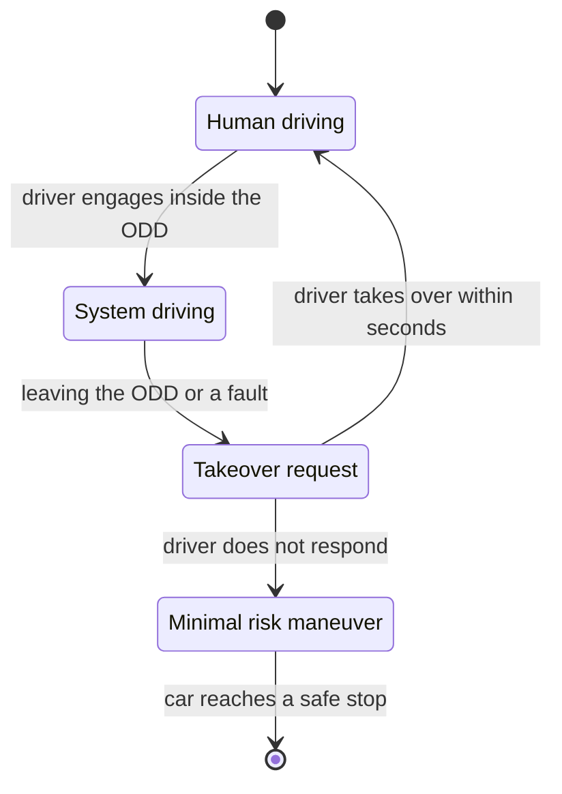
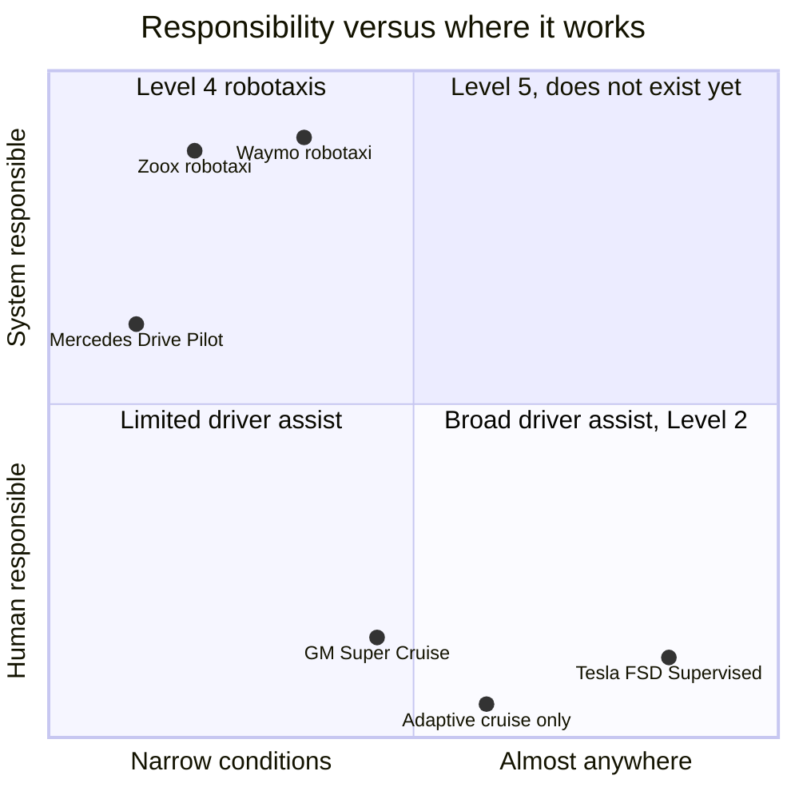
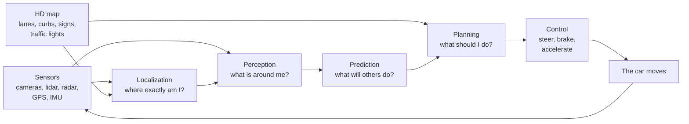
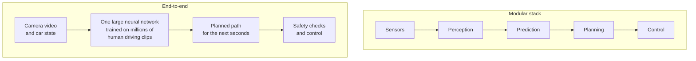

# Chapter 50: Self-Driving Vehicles

*How a car drives itself, who is responsible when it does, how robotaxis went from a desert race to hundreds of thousands of paid rides a week, and how to check the safety numbers for yourself.*

## What you'll learn

- The six SAE levels of driving automation, organized around the question that matters most: who is responsible.
- Why the driver assistance in your own car (Level 2) and a robotaxi with nobody at the wheel (Level 4) are different products, not two points on one slider.
- How the classic driving software works, from localization and perception to prediction, planning and control, and how "end-to-end" driving replaces it with one large network.
- What cameras, radar and lidar each see, how sensor fusion combines them, and the strongest arguments on both sides of the Waymo versus Tesla debate.
- The history from the DARPA desert races through the Uber and Cruise crashes to the services running in 2026.
- The 2026 landscape with real numbers and their sources: Waymo, Tesla, Zoox, Baidu Apollo Go, Pony.ai, WeRide and driverless trucks.
- How to read a "% fewer crashes" claim step by step, including how much driving it takes to prove anything about rare events.
- How self-driving vehicles are regulated in the United States and elsewhere.

## Before you start

Every term is defined as it appears, so you can read this chapter on its own. Chapter 49 (Robotics and Physical AI) is the most useful companion: a self-driving car is a robot, and that chapter's sense–plan–act loop, simulation, fleet learning and teleoperation honesty all apply here. Chapter 45 (Computer Vision) explains object detection, segmentation, depth and point clouds. Chapter 6 (Probability, Statistics and Learning by Slopes) and Chapter 9 (Evaluation, Overfitting and Metrics) give you the probability and base-rate thinking used to read safety claims. Chapter 48 (Reinforcement Learning, Games and Planning) covers search and planning.

## A car is a robot that must never drop the cup

Ask your chatbot for directions to a restaurant and it will list the turns in a second. If one instruction is wrong, you notice and ask again. A self-driving car has to *follow* those directions at 65 miles per hour, surrounded by cyclists, delivery vans, children and other drivers who do not always follow the rules, and a single wrong decision can kill someone. Chapter 49 said the physical world has no undo button. On the road, that is literally true.

> **Definition — Autonomous vehicle (AV):** A vehicle that can drive itself for some or all of a trip, sensing the road and controlling steering, speed and braking without a human doing it.

> **Definition — Automated driving system (ADS):** The combination of sensors, computers and software that performs the entire driving task on its own, at least within certain conditions. It is the technical name for the "driver" in a self-driving car.

> **Definition — Advanced driver-assistance system (ADAS):** Features that help a human driver, such as automatic emergency braking, adaptive cruise control and lane centering, while the human remains the driver.

> **Definition — Robotaxi:** A self-driving taxi with no human driver, booked through an app like a normal ride-hailing service.

Why is driving so hard to automate when it is something tens of millions of ordinary people do every day? Because ordinary people are, per mile, surprisingly good at it. Around 40,000 people die on US roads in a typical recent year, out of roughly 3 trillion miles driven. That is a little over 1 death per 100 million miles.

### Worked example: how rare is a fatal mistake?

- Fatality rate: about 1.3 deaths per 100 million miles. That is one death per 100,000,000 ÷ 1.3 = about 77 million miles.
- A typical American drives roughly 13,000 to 14,000 miles a year. Using 13,500: 77,000,000 ÷ 13,500 = about 5,700 years of driving per death.

So the average human driver, for all our texting and tiredness, goes thousands of lifetimes between fatal crashes. A self-driving system has to be at least that good, which means handling events so rare that most human drivers never see them: a mattress falling off a truck, a horse on the highway, a police officer waving traffic through a red light, a child chasing a ball from between parked cars.

> **Definition — Long tail (edge cases):** The enormous collection of rare, unusual situations that each almost never happens but that together happen all the time across millions of miles. Handling the long tail is the hardest part of self-driving.

> **Key idea:** Getting a car to drive itself 99 percent of the time was achieved in research labs more than 15 years ago. The entire difficulty of self-driving lies in the last fraction of a percent: rare situations, handled safely, every time, at the scale of hundreds of millions of miles.

> **Watch out:** You may have read that "94 percent of crashes are caused by human error". That figure comes from a 2015 NHTSA summary that assigned a "critical reason" to each crash, defined as the last failure in the chain of events. NHTSA itself noted this is not the same as the cause of, or blame for, the crash. It does not mean robots could prevent 94 percent of crashes.

## The SAE levels: organized by who is responsible

You have probably heard of "Level 2" or "Level 4" self-driving. The levels come from a standard published by SAE International (originally the Society of Automotive Engineers), called J3016, first issued in 2014 and updated several times since. The levels are often explained in terms of how clever the car is. That is the wrong way to think about them. They describe **who is responsible for the driving**, in the design of the system.

To read the levels, you need three ideas.

> **Definition — Dynamic driving task (DDT):** Everything involved in actually operating a vehicle in traffic: steering, accelerating, braking, watching the road, reacting to other road users, and signaling. It excludes trip planning, such as choosing the destination.

> **Definition — Fallback:** Who or what handles things when the automated system fails or reaches the edge of what it can do: either a human who must take over, or the system itself bringing the vehicle to a safe stop.

> **Definition — Operational design domain (ODD):** The specific conditions an automated driving system is designed to work in, such as which streets or cities, which speeds, which weather, and which times of day.

> **Definition — SAE levels of driving automation:** A 0–5 scale from the J3016 standard. Levels 0–2 mean a human drives and supervises at all times; Level 3 means the system drives but a human must take over when asked; Level 4 means no human is needed within a limited operational design domain; Level 5 means no human is needed anywhere a human could drive.

| Level | Name | Who steers and controls speed? | Who watches the road? | Who is the fallback? | Where? | Examples |
|---|---|---|---|---|---|---|
| 0 | No driving automation | Human | Human | Human | Anywhere | Warnings; automatic emergency braking acts only for a moment |
| 1 | Driver assistance | Human, with the system helping on steering *or* speed | Human | Human | Most roads | Adaptive cruise control on its own |
| 2 | Partial automation | System does steering *and* speed | **Human, at all times** | **Human, instantly** | Where the feature allows | Tesla FSD (Supervised), GM Super Cruise |
| 3 | Conditional automation | System | System, while engaged | **Human, when the system asks** | Limited conditions only | Mercedes-Benz Drive Pilot |
| 4 | High automation | System | System | **System** (it stops safely by itself) | Limited conditions only | Waymo, Zoox, Baidu Apollo Go robotaxis |
| 5 | Full automation | System | System | System | Everywhere a human could drive | None exists |

*Table 50.1: The SAE levels organized by responsibility. The great divide is between Level 2, where the human is always the driver, and Level 3 and above, where the system is the driver while it is engaged.*

> **Definition — Adaptive cruise control:** A driver-assistance feature that keeps a set speed and automatically slows down and speeds up to keep a safe gap to the car in front.

> **Definition — Lane centering:** A driver-assistance feature that steers to keep the car in the middle of its lane.

> **Definition — Minimal risk condition:** A safe, stable state an automated vehicle brings itself to when it cannot or should not continue, such as stopping at the side of the road with hazard lights on.

### Level 2: the human is the driver, even with hands off the wheel

At Level 2 the car can steer, brake and accelerate, sometimes for hours, but you remain the driver. You must watch the road every second and be ready to act instantly, because the system may not warn you before it makes a mistake. Some Level 2 systems, such as GM's Super Cruise, allow hands-free driving on approved roads. Hands-free is not eyes-free: a camera checks that you are looking at the road.

> **Definition — Driver monitoring system:** A camera or sensor inside the car that checks whether the driver is paying attention (eyes on the road, hands near the wheel) and warns or disengages the system if not.

Level 2 creates a well-known human-factors trap. The better the system gets, the less often you need to intervene, and the harder it becomes to stay alert.

> **Definition — Automation complacency:** The tendency of people supervising an automated system to stop paying close attention when it usually works, so they react too slowly on the rare occasion it fails.

### Level 3: the car drives, but may hand back

At Level 3, while the system is engaged inside its operational design domain, the system is the driver. You may look away from the road. But the system can ask you to take over, and you must do so within a short time. Mercedes-Benz Drive Pilot became the first SAE Level 3 system certified in the United States, in Nevada and California in 2023. Its initial US version worked only on approved highways, in dense traffic, at speeds up to about 40 miles per hour, in good weather and daylight.

*Figure 50.1: The Level 3 handoff. Responsibility passes from the human to the system and, when the system asks, back again. If the human does not respond, the system must bring the car to a minimal risk condition.*

### Level 4: no driver needed, but only in a defined area

At Level 4 there is no fallback driver at all. Inside its operational design domain (for a robotaxi, a mapped service area within a set of cities, in certain weather), the system drives and handles every problem itself, including pulling over safely if something goes wrong. Outside that area, it simply does not drive. This is what Waymo, Zoox and Baidu Apollo Go operate.

> **Definition — Geofence:** The boundary of the area in which a self-driving service is allowed to operate. A robotaxi will not accept a trip that leaves its geofence.

### Level 5: nobody has it

A Level 5 car could drive anywhere a competent human could, in any conditions a human could manage. As of late 2026, no such system exists, and many experts doubt it is a useful goal. Level 4 services that keep expanding their areas and conditions are the practical path.

*Figure 50.2: Where today's systems sit. Positions are approximate and illustrative. Broad coverage with the human responsible (bottom right) and system responsibility in limited areas (top left) are different products; nothing yet sits in the top right.*

> **Analogy:** At Level 2 you are a driving instructor sitting in the driver's seat with your hands hovering near the wheel, legally responsible for everything the student does. At Level 4 you are a passenger in the back seat of a taxi, but the taxi only goes to neighborhoods the company has mapped.

> **Watch out:** Tesla's consumer Full Self-Driving, now officially named "FSD (Supervised)", is a Level 2 system. The person in the driver's seat is legally the driver and must watch the road at all times. Tesla's Robotaxi service, which runs in a few cities, is a separate, limited operation. Calling a Level 2 system "self-driving" is the most common confusion in this whole field.

> **Key idea:** The levels describe who is responsible, not how smart the software is. A brilliant system that still needs a human to supervise is Level 2. A cautious robotaxi that only drives in one city, but needs nobody, is Level 4.

## The driving stack: how a car turns pixels into steering

Inside a classic self-driving system, the work is divided into stages, like an assembly line. Each stage has its own engineers, its own tests and its own outputs.

> **Definition — Modular driving stack:** The classic design of self-driving software as a pipeline of separate stages (localization, perception, prediction, planning and control), each built and tested on its own.

*Figure 50.3: The classic driving stack. Sensors feed localization and perception; an HD map provides prior knowledge; prediction and planning decide what to do; control turns the plan into steering and braking, many times per second.*

### Localization: where exactly am I?

Your phone's GPS is accurate to several meters. A car needs to know which lane it is in, to within a few centimeters.

> **Definition — GNSS (GPS):** Satellite positioning (GPS is the US system; GNSS is the general term). It gives a position accurate to a few meters, which is not enough on its own to stay in a lane.

> **Definition — IMU (inertial measurement unit):** A sensor that measures acceleration and rotation, letting the car track how it is moving between other position fixes, for example in a tunnel.

> **Definition — Localization:** Working out the vehicle's exact position and heading, typically to within centimeters, by matching what its sensors see against a stored map and combining that with GPS, the IMU and wheel movement.

> **Definition — HD map:** A high-definition map, accurate to centimeters, that records every lane, curb, crosswalk, sign and traffic light. It gives a self-driving car prior knowledge of the road before it arrives.

An HD map is like reading the exam questions in advance: the car already knows where the lanes and traffic lights should be, so its sensors only need to find what has changed, such as cars, people and roadworks. The price is that the map must be built and kept current for every street in the service area, which is one reason robotaxis expand city by city. Waymo uses HD maps. Tesla's approach avoids them and tries to read the road from cameras each time.

### Perception: what is around me?

Perception turns raw sensor data into a list of things and where they are. It uses the computer-vision tools of Chapter 45: object detection, segmentation, depth estimation and tracking.

> **Definition — Perception:** The stage of a self-driving system that detects and tracks the objects around the vehicle (cars, cyclists, pedestrians, cones, debris) and identifies lanes, signs and traffic-light colors.

> **Definition — Object tracking:** Following the same object from one sensor frame to the next so the system knows its speed and direction, not just its current position.

Modern systems usually combine every camera and sensor into a single top-down picture of the surroundings.

> **Definition — Bird's-eye view (BEV):** A top-down map of the area around the vehicle, built by combining all cameras and sensors, on which objects, lanes and free space are drawn as if seen from directly above.

> **Definition — Occupancy grid:** A representation that divides the space around the car into small cells and estimates whether each cell is occupied. It lets the car avoid obstacles it cannot name, such as an odd-shaped piece of debris.

### Prediction: what will everyone else do?

Knowing where a cyclist is now is not enough. The car must guess where she will be in the next few seconds.

> **Definition — Prediction (motion forecasting):** Estimating the likely future paths of every other road user over the next several seconds, usually as several possible futures, each with a probability.

Prediction is hard because road users interact. Whether a pedestrian steps off the curb depends on whether your car is slowing down. Whether a driver lets you merge depends on how you merge. Good systems predict several futures ("the cyclist continues straight, 70 percent; turns left across our lane, 25 percent; stops, 5 percent") and plan to be safe in all of them.

### Planning: what should I do?

> **Definition — Motion planning:** Choosing the vehicle's path and speed for the next several seconds: which lane, how fast, when to brake, when to go.

> **Definition — Cost function:** A formula that scores each candidate plan by adding up penalties, for example for getting too close to others, braking harshly, breaking traffic rules or making no progress. The planner picks the plan with the lowest total cost.

A planner might generate hundreds of candidate trajectories every tenth of a second, score each one with its cost function against every predicted future, and choose the best. It must balance safety with being a good road citizen: a car that brakes for every shadow is safe in one sense but causes rear-end crashes and blocks traffic.

### Control: make the car do it

> **Definition — Control (vehicle control):** The final stage that turns the planned path into precise steering angles, throttle and brake commands, correcting many times per second for bumps, slopes and tire grip.

### One scene, five stages

Here is a single scene passing through the stack.

1. **Localization:** "We are in the right lane of Main Street, 42 meters before the intersection, heading north at 11 meters per second."
2. **Perception:** "Cyclist, 12 meters ahead, at the right edge of our lane, moving at 5 meters per second. Parked van on the right. Traffic light ahead is green."
3. **Prediction:** "Cyclist continues straight, 70 percent. Swerves left around the van door zone within 2 seconds, 25 percent. Stops, 5 percent."
4. **Planning:** "Slow from 11 to 7 meters per second, stay 1.5 meters to her left, do not pass until after the van."
5. **Control:** "Brake at 20 percent, steer 0.5 degrees left."

Then everything repeats, typically 10 or more times per second.

### Worked example: why milliseconds and meters matter

**Delay.** At 30 meters per second (about 67 miles per hour), every 100 milliseconds the system spends thinking is 30 × 0.1 = 3 meters traveled before it reacts.

**Stopping distance.** Take a car at 65 miles per hour, which is about 29 meters per second, braking hard at about 7 meters per second squared on dry road.

- Braking distance = speed² ÷ (2 × deceleration) = 29 × 29 ÷ (2 × 7) = 841 ÷ 14 = about 60 meters.
- A human with a 1.5-second reaction time travels 29 × 1.5 = 43.5 meters before even touching the brake. Total: about 104 meters.
- A system that reacts in 0.3 seconds travels 29 × 0.3 = 8.7 meters first. Total: about 69 meters.

The faster reaction saves about 35 meters, which is several car lengths. But it also shows what the sensors must do: to stop for an obstacle at highway speed, the car must detect and correctly recognize it about 70 to 100 meters away, more in rain. A heavy truck brakes more gently (assume 4 meters per second squared for illustration: 841 ÷ 8 = about 105 meters of braking alone), so driverless trucks need to see well beyond 150 meters.

> **Key idea:** The modular stack is interpretable. When something goes wrong, engineers can ask which stage failed: did perception miss the object, did prediction misjudge it, or did planning choose badly? That makes it easier to test and to explain to regulators, at the cost of hand-designed interfaces between stages that can lose useful information.

## End-to-end driving: one network from pixels to steering

Notice a weakness in the assembly line. Perception passes along a list of boxes: "pedestrian, here, moving this way." It does not pass along that the pedestrian is looking at her phone, or that she just waved the car through. Each handoff between stages throws away information that the next stage might have used. And each stage contains hand-written rules that engineers must maintain.

The alternative is to train one large neural network to go straight from sensor data to a driving plan.

> **Definition — End-to-end driving:** Replacing the hand-built pipeline with one large neural network trained to map sensor input (mostly camera video) directly to a driving path or to steering and speed commands.

> **Definition — Imitation learning (behavior cloning):** Training a model to copy the actions of human experts. For driving, the network learns from millions of recorded clips what a good human driver did in the same situation.

The approach follows the pattern of the rest of modern AI: replace hand-written rules with a big network and a lot of data (the "Bitter Lesson" of Chapter 13). Tesla relies on end-to-end neural networks trained on data from its customer fleet. The UK start-up Wayve has also championed learned, end-to-end driving. Waymo published research in 2024 on an end-to-end driving model built on its parent company's Gemini models.

*Figure 50.4: The modular stack hands information from stage to stage; an end-to-end system learns the whole mapping at once, usually with safety checks still applied to its output.*

**The case for end-to-end.** It improves automatically as you add more data and computing power. It can pick up subtle cues no engineer thought to write down. It avoids thousands of hand-written rules. And a company with millions of cars on the road can collect training data at a scale no test fleet can match.

**The case for caution.** One giant network is hard to inspect: when it makes a mistake, there is no stage to blame and fix. It copies human habits, including bad ones like rolling through stop signs, unless the data is filtered. Rare events are still rare in the training data. And proving to a regulator, or to yourself, that it is safe enough requires enormous amounts of testing.

> **Definition — Shadow mode:** Running new driving software silently in the background on cars driven by humans or by older software, comparing what it *would* have done with what actually happened, without letting it control the car.

> **At the frontier (2026):** The sharp line between the two camps has blurred. Both Waymo and Tesla now use large learned models; modular systems contain big neural networks inside each stage, and end-to-end systems add structure, safety checks and intermediate outputs engineers can inspect. As research notes for this book put it, the live debate is about sensors, validation and scale rather than "learned versus hand-coded".

## Sensors and sensor fusion

A self-driving car has to see in every direction, at long range, day and night, in rain and glare. No single sensor does all of that.

> **Definition — Lidar:** A sensor that fires laser pulses and times their reflections to measure distance, building a precise 3D picture of the surroundings. The name comes from "light detection and ranging".

> **Definition — Point cloud:** A 3D scene represented as a large set of dots, each with an x, y, z position, the typical output of a lidar sensor.

> **Definition — Time of flight:** Measuring distance by timing how long a pulse (of light, radio or sound) takes to travel to an object and back.

**Worked example: timing a laser.** Light travels about 300,000 kilometers per second, which is 0.3 meters per nanosecond (billionth of a second). For an object 150 meters away, the pulse travels 300 meters there and back, which takes 300 ÷ 0.3 = 1,000 nanoseconds, or one microsecond. A lidar measures that time and converts it back into distance, for hundreds of thousands to millions of pulses per second, sweeping the scene to build a point cloud.

> **Definition — Radar:** A sensor that sends out radio waves and measures their echoes to find the distance and speed of objects. It works in rain, fog and darkness but gives a much blurrier picture than lidar or cameras.

> **Definition — Ultrasonic sensor:** A short-range sensor that uses sound pulses, like a bat, to detect obstacles within a few meters. Used mainly for parking.

| Sensor | How it works | Strengths | Weaknesses |
|---|---|---|---|
| Camera | Records light, like an eye | Cheap; sees color, text, traffic lights, brake lights, hand signals; very rich detail | No direct distance measurement; struggles with glare, darkness and dirt on the lens |
| Lidar | Times laser pulses | Precise 3D distance, day or night | More expensive; degraded by heavy rain, fog and snow; cannot read colors or signs |
| Radar | Times radio echoes; measures speed directly from the echo's frequency shift | Works in bad weather; measures speed instantly; long range | Coarse detail; confused by metal objects such as manhole covers and bridges |
| Ultrasonic | Times sound echoes | Very cheap; good for the last meter when parking | Range of only a few meters |

*Table 50.2: The main self-driving sensors and what each is good and bad at.*

> **Definition — Sensor fusion:** Combining readings from several different sensors into one more reliable picture of the world, so each sensor's weaknesses are covered by another's strengths.

Fusion can happen late (each sensor's software detects objects, and the detections are merged) or early (raw data from all sensors is fed into one network that learns to combine it). Either way, the point is redundancy: a camera dazzled by a low sun can be backed up by lidar and radar, which do not care about glare.

> **Analogy:** Lidar is like a bat's echolocation using light: precise distance, no color. Radar is echolocation with radio: it sees through fog but blurrily. Cameras are eyes: rich detail and color, but no built-in measure of distance, so depth must be inferred, as you do when you judge distance with one eye closed.

### The Waymo versus Tesla debate

This is the best-known argument in the field, and both sides have serious points. Waymo's robotaxis carry a full sensor suite: lidars, radars and between about 13 and 29 cameras depending on the vehicle generation, plus HD maps. Tesla's cars use cameras only, about 8 of them; it removed radar from new cars in 2021.

**The strongest case for cameras only.** Humans drive with two eyes, and roads are designed to be read visually. Cameras are cheap, so every car a company sells can carry them, turning millions of customers into data collectors; Tesla reported that cumulative supervised FSD miles were approaching 12 billion on its second-quarter 2026 earnings call. Extra sensors add cost, complexity and the problem of what to do when sensors disagree. And end-to-end learning gets better with every additional mile of data.

**The strongest case for multiple sensors.** Lidar and radar measure distance directly instead of inferring it, and they work in darkness and glare where cameras struggle. Different sensors fail in different ways, so they back each other up, which matters when the goal is to be far safer than humans, not merely as good. Cross-checking sensors makes it easier to validate safety. Sensor prices have fallen sharply. And Waymo has accumulated, by its own figures, 271.3 million rider-only miles through June 2026, by far the most driverless experience published by anyone.

**What would settle it.** Large amounts of published, independently checkable safety data from camera-only vehicles running without supervision, and the full cost per mile of each approach at scale. As of late 2026, the multi-sensor approach has far more driverless miles behind it, and the camera-only approach has far more cars on the road.

> **Watch out:** The debate is often framed as "lidar versus AI". It is not. Both companies use large learned neural networks. The disagreement is about which sensors to feed them, whether to use HD maps, and how to prove the result is safe.
