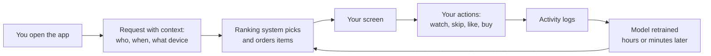
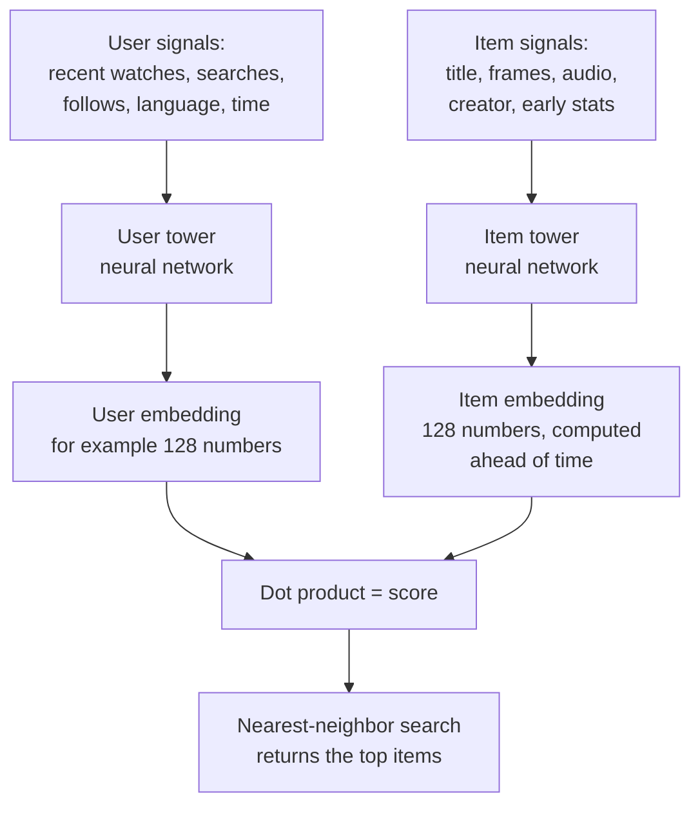
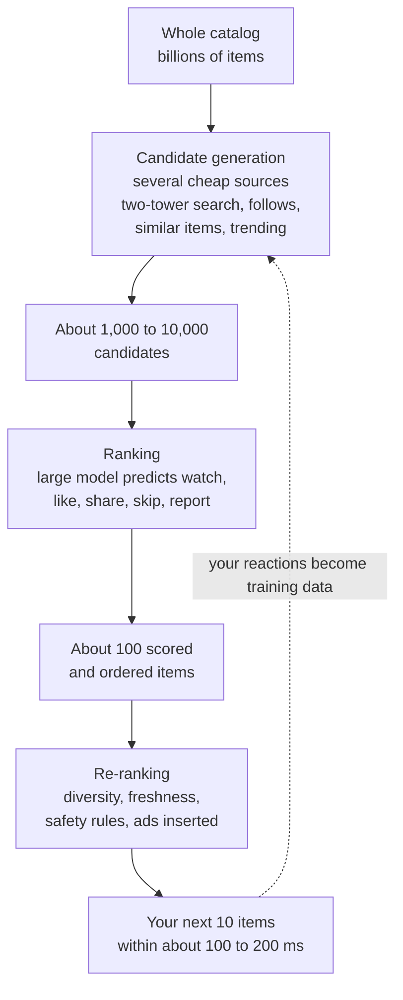
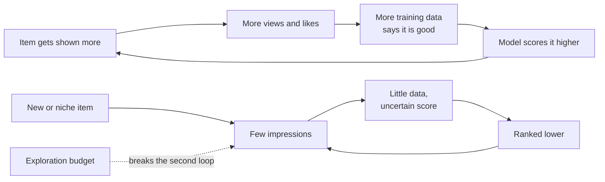
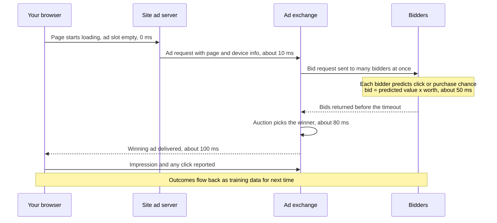
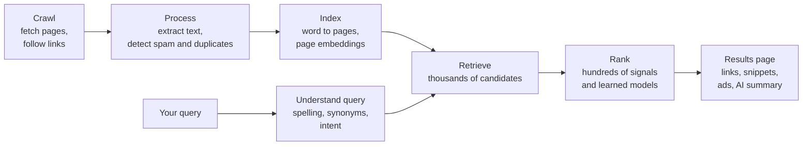
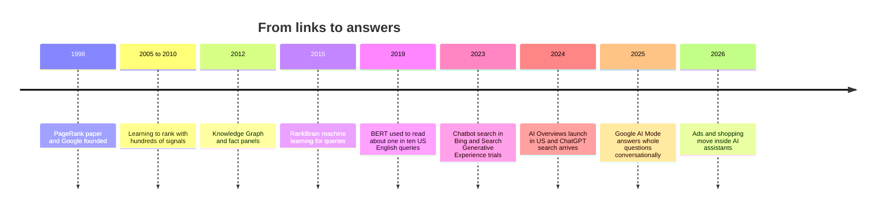
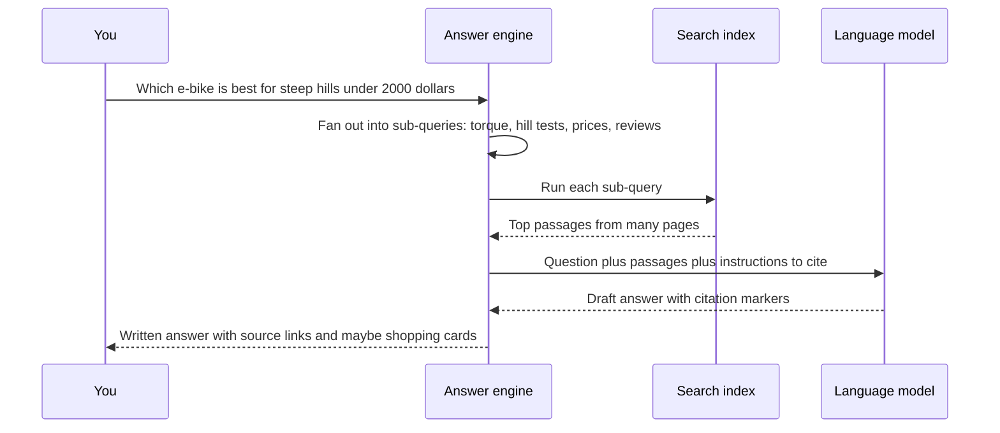

# Chapter 51: Recommenders, Search and Ads: The AI You Use Without Noticing

*How the systems that choose your next video, your search results and the ads around them actually work, what they are optimized for, and what is changing now that chatbots answer questions directly.*

## What you'll learn
- Why your feed, your search results and the ads you see are all the same kind of AI: a ranking system that learns from what you do.
- How recommenders learn taste, from "people like you also liked" to matrix factorization, worked by hand on a tiny ratings table.
- How embeddings and the two-tower model let a service search billions of items in milliseconds.
- The candidate generation, ranking and re-ranking funnel that every large feed uses, and why it has to be a funnel.
- What feeds are optimized for, and what the evidence says (and does not say) about filter bubbles, polarization and compulsive use.
- How an ad is chosen in about a tenth of a second: click prediction, auctions, lookalike audiences, automated campaigns and the privacy changes that reshaped them.
- How web search evolved from PageRank to learning to rank to BERT to AI Overviews and answer engines, and what that means for anyone who runs a website.

## Before you start
This chapter leans on several earlier ones. Chapter 5 (The Math of AI, Part 1) introduced vectors and the dot product, which power almost everything here. Chapter 9 (Is the Model Any Good?) covered metrics such as precision and recall. Chapter 10 (The Classical Machine Learning Toolkit) gave a first look at recommenders, collaborative filtering and the Netflix Prize; this chapter goes much deeper. Chapter 14 told the story of embeddings, and Chapter 27 (Retrieval) explained keyword search, semantic search, vector databases and retrieval-augmented generation (RAG). If you have read those, you have every tool you need. If not, each idea is recapped briefly where it appears.

## The feed is an AI

### The AI you met before breakfast

Think about the first ten minutes after you woke up today. Maybe you checked a short-video app, scrolled a news feed, glanced at a shopping app, or searched for the weather. Every one of those screens was assembled for you, a moment before you saw it, by a machine learning system. Nobody at the company chose which video you would see first. A model did, by predicting what you were most likely to watch, like or buy.

This is the AI most people meet most often. Chatbots get the headlines, but recommendation and ranking systems have shaped what billions of people watch, read and buy for more than a decade. Netflix's own researchers wrote in 2015 that about 80 percent of the hours streamed on the service came from recommendations rather than from searching. YouTube's product chief said in 2018 that more than 70 percent of watch time came from recommendations. Those figures are the companies' own and are now several years old, but they make the point: for many services, the recommender is the product.

> **Definition — Recommender system:** Software that predicts which items (videos, products, posts, songs, articles) a person is likely to want and ranks them, so the most promising appear first. Your social feed, your streaming home screen and "customers also bought" are all recommender systems.

> **Definition — Ranking:** Putting a set of candidate items in order of predicted value for a particular person at a particular moment. Ranking is the shared heart of feeds, search engines and ad systems.

> **Definition — Feed:** A continuously updated, personalized list of items (posts, videos, stories) that an app chooses and orders for you, usually with infinite scrolling.

### Three siblings: recommenders, search and ads

Recommenders, search engines and ad systems look different on the screen, but underneath they solve the same problem: out of a huge pile of items, which few should this person see right now, and in what order?

| | Recommender (feed) | Search engine | Ad system |
|---|---|---|---|
| What starts it | You open the app; no question asked | You type a query | A page or feed loads with an empty ad slot |
| Pile of items | Billions of videos, posts or products | Hundreds of billions of web pages | Millions of active ads |
| What it predicts | Will you watch, like, share, skip? | Is this page relevant and trustworthy for this query? | Will you click or buy, and what is that worth to the advertiser? |
| Who pays | Usually advertisers, indirectly | Mostly advertisers, beside the results | Advertisers, per view or per click |
| Main signal | Your past behavior and that of similar people | Your words, plus links and behavior across the web | Your behavior, context and the advertiser's bid |

The big difference is the query. A search engine has your words to go on. A recommender has none: it must guess what you want from what you did before. An ad system does both and adds money to the mix, because every slot is sold.

> **Key idea:** Feeds, search results and ads are all ranking systems. They take a giant pile of items, predict how much each one is worth showing to you right now, and show the top few. Learn how one works and you understand the other two.

### Every swipe is a training signal

When you rate a film five stars, you give the system explicit feedback. But most of what these systems learn from is implicit: what you did, not what you said. You watched a 40-second video to the end. You scrolled past a post in half a second. You paused on a photo. You searched, clicked the third result, came back after four seconds and clicked the fifth. Each of these actions is logged, and the logs become tomorrow's training data.

> **Definition — Explicit feedback:** A deliberate rating or judgment from a user, such as five stars, a thumbs-up or "not interested." It is clear but rare.

> **Definition — Implicit feedback:** Information inferred from behavior rather than stated: clicks, watch time, skips, scrolls, purchases, return visits. It is noisy (you may have left a video playing while you made tea) but abundant, so most modern recommenders learn mainly from it.

> **Definition — Engagement:** Measurable user interaction with a service, such as watch time, likes, comments, shares and how often people come back. Platforms often use engagement as the target their ranking models optimize.

Implicit feedback is noisy in a specific way: it records what you were shown and what you did, never what you would have done with an item you were not shown. If you never saw a documentary, the system cannot learn whether you would have liked it. This "you only learn about what you showed" problem returns several times in this chapter.


*Figure 51.1: The loop behind every feed. What you do with today's screen becomes training data for tomorrow's ranking.*

> **Analogy:** A recommender is like a shopkeeper who remembers everything you ever lingered over, and everything every other customer lingered over too, and rearranges the front table each time you walk in. The shopkeeper never asks what you want. They watch.

> **Try it:** Open YouTube, TikTok, Instagram or any shopping app. On one recommended item, find the menu (usually three dots) and look for options such as "Not interested," "Don't recommend channel" or "Why am I seeing this?" Note what each option says it will change. These are the explicit-feedback buttons the system offers you, and they are far less used than the implicit signals it collects anyway.

## How a recommender learns your taste

Chapter 10 introduced the two classic families of recommenders. Here is a quick recap, then we go much deeper into the one that won.

### Content-based filtering: more of what you liked

The simplest approach looks at the items themselves. If you watched three cooking videos, show more cooking videos. If you bought a mystery novel, suggest other mysteries. The system needs a description of each item: its genre, topic, author, tags, or nowadays an embedding computed from its text, images and sound.

> **Definition — Content-based filtering:** Recommending items whose content or attributes (genre, topic, ingredients, visual style) resemble those of items you already liked. It works without data from other users, but tends to keep showing you more of the same.

Content-based filtering has two strengths. It works for a brand-new item the moment it is uploaded, because it only needs the item's content. And it is easy to explain ("because you watched cooking videos"). Its weakness is that it rarely surprises you. It cannot know that people who love cooking videos often also love travel vlogs, because that link lives in people's behavior, not in the videos' content.

### Collaborative filtering: people like you

Collaborative filtering ignores what the items are and looks only at who liked what. If you and a stranger agreed on twenty films, and the stranger loved a twenty-first that you have not seen, you will probably like it too.

> **Definition — Collaborative filtering:** Recommending items based on patterns in many people's behavior: items liked by users similar to you, or items similar to ones you liked as judged by who else liked them. It needs no knowledge of what the items are.

There are two flavors. **User-based** collaborative filtering finds your "taste twins" and borrows their opinions. **Item-based** collaborative filtering finds items that tend to be liked by the same people. Amazon described its item-to-item version in a 2003 paper, and "customers who bought this item also bought" became one of the most copied features on the web. Item-based methods scale better, because a store has far fewer products than customers and item relationships change slowly.

Here is item-based similarity worked by hand. Suppose five shoppers either bought (1) or did not buy (0) three products:

```
             Tent   Sleeping bag   Toaster
  Shopper 1    1         1            0
  Shopper 2    1         1            0
  Shopper 3    0         1            1
  Shopper 4    1         1            0
  Shopper 5    0         0            1
```
*Figure 51.2: A tiny purchase table. Each product's column is a vector of who bought it.*

Treat each column as a vector. The tent is (1, 1, 0, 1, 0), the sleeping bag (1, 1, 1, 1, 0) and the toaster (0, 0, 1, 0, 1). Cosine similarity (Chapter 5) is the dot product divided by the two lengths.

- Tent and sleeping bag: dot product = 1 + 1 + 0 + 1 + 0 = 3. Lengths are √3 ≈ 1.73 and √4 = 2. Cosine = 3 ÷ (1.73 × 2) ≈ 0.87.
- Tent and toaster: dot product = 0. Cosine = 0.
- Sleeping bag and toaster: dot product = 1 (Shopper 3). Lengths 2 and √2 ≈ 1.41. Cosine = 1 ÷ 2.83 ≈ 0.35.

So when someone puts a tent in their basket, the store suggests the sleeping bag (0.87) and not the toaster (0). Nobody told the system that tents and sleeping bags both involve camping. It learned that from baskets.

> **Definition — Cosine similarity:** A measure of how closely two lists of numbers point in the same direction, from -1 (opposite) through 0 (unrelated) to 1 (identical direction). It is the dot product divided by the product of the two lengths, and it is the standard way to compare embeddings.

> **Analogy:** Collaborative filtering is "people who bought this also bought" at planetary scale. It is the friend with eerily similar taste whose recommendations you trust, except the system has millions of such friends for you and can ask all of them at once.

### Matrix factorization: discovering hidden tastes

Neighbor-based methods hit a wall. Real tables are almost entirely empty: a typical person has rated or watched a tiny fraction of everything available, so two people rarely overlap enough to compare. The breakthrough that dominated the Netflix Prize (2006 to 2009, recapped in Chapter 10) was a different idea: assume that a few hidden "taste dimensions" explain most ratings, and learn them.

> **Definition — Rating matrix:** A table with one row per user and one column per item, where each cell holds that user's rating or interaction with that item. In real systems almost all cells are empty.

> **Definition — Sparsity:** The fraction of a table that is empty. Recommendation tables are extremely sparse, often with well over 99 percent of cells unknown, which is what makes the problem hard.

> **Definition — Latent factor:** A hidden dimension, learned from data rather than named by a person, that helps explain behavior. In a film recommender one factor might end up resembling "how much action" and another "how much romance," but nobody labels them.

> **Definition — Matrix factorization:** Approximating a big, mostly empty user-by-item table as the product of two much smaller tables: one giving each user a short list of taste numbers and one giving each item a short list of trait numbers. A predicted rating is the dot product of a user's tastes and an item's traits.

Here is one worked completely. Four friends have rated four films on a 1 to 5 scale. A question mark means they have not seen it.

```
              Alien   Star Wars   Titanic   Notebook
  Ana           5         5          ?          1
  Ben           ?         4          2          2
  Cy            1         ?          5          5
  Dee           2         3          4          ?
```
*Figure 51.3: A tiny rating matrix. Twelve cells are known, four are blank. The recommender's job is to fill the blanks.*

Matrix factorization says: give every person two taste numbers and every film two trait numbers. Suppose training (which we will see in a moment) produced these:

```
  USER TASTES (2 numbers each)     FILM TRAITS (2 numbers each)
               f1     f2                         f1     f2
  Ana          5.0    1.0          Alien         1.0    0.0
  Ben          4.0    2.0          Star Wars     0.9    0.2
  Cy           1.0    5.0          Titanic       0.1    1.0
  Dee          2.0    4.0          Notebook      0.0    1.0
```
*Figure 51.4: The learned factors. Looking at them, f1 behaves like "likes action" and f2 like "likes romance," but the algorithm was never told those words.*

A predicted rating is the dot product of the person's row and the film's row:

- Ana and Titanic (a blank): 5.0 × 0.1 + 1.0 × 1.0 = 0.5 + 1.0 = **1.5 stars**. Do not recommend.
- Ben and Alien (a blank): 4.0 × 1.0 + 2.0 × 0.0 = **4.0 stars**. Recommend.
- Cy and Star Wars (a blank): 1.0 × 0.9 + 5.0 × 0.2 = 0.9 + 1.0 = **1.9 stars**. Do not recommend.
- Dee and Notebook (a blank): 2.0 × 0.0 + 4.0 × 1.0 = **4.0 stars**. Recommend.

Now check the model against ratings we already know. Ana and Star Wars: 5.0 × 0.9 + 1.0 × 0.2 = 4.7, against a real 5 (error 0.3). Ben and Titanic: 4.0 × 0.1 + 2.0 × 1.0 = 2.4, against a real 2 (error 0.4 too high). Dee and Star Wars: 2.0 × 0.9 + 4.0 × 0.2 = 2.6, against a real 3. Doing all twelve known cells, seven are exact and five are off by 0.1 to 0.4. The squared errors add up to 0.46; divide by 12 and take the square root and you get a typical error (the root mean squared error, the Netflix Prize's metric) of about 0.2 stars.

```
  FULL PREDICTED TABLE  (* = a blank the model filled in)
              Alien   Star Wars   Titanic   Notebook
  Ana          5.0       4.7        1.5*       1.0
  Ben          4.0*      4.0        2.4        2.0
  Cy           1.0       1.9*       5.1        5.0
  Dee          2.0       2.6        4.2        4.0*
```
*Figure 51.5: Tastes times traits fill every cell. The known cells are reproduced closely and the blanks get sensible guesses.*

> **Key idea:** Matrix factorization compresses millions of scattered ratings into a short "taste vector" per person and a "trait vector" per item. A recommendation is a dot product: multiply matching numbers and add them up. That simple operation runs trillions of times a day across the services you use.

### How the factors are learned

Where did those numbers come from? Nobody typed them in. Training starts with small random numbers and improves them step by step with stochastic gradient descent, the same "walk downhill" idea from Chapter 6.

> **Definition — Stochastic gradient descent (SGD):** A training method that looks at one example (or a small batch) at a time, measures the error, and nudges every adjustable number a little in the direction that would have reduced that error. Repeated millions of times, the nudges add up to a good model.

> **Definition — Learning rate:** The size of each nudge in gradient descent. Too large and training overshoots and bounces around; too small and it crawls.

Here is one real step. Suppose training starts with Ana's tastes at (0.5, 0.8) and Alien's traits at (0.9, 0.3).

1. **Predict.** 0.5 × 0.9 + 0.8 × 0.3 = 0.45 + 0.24 = 0.69 stars.
2. **Measure the error.** Ana actually gave Alien 5 stars, so the error is 5 − 0.69 = 4.31. The guess was far too low.
3. **Nudge Ana's tastes toward Alien's traits.** With a learning rate of 0.1, add 0.1 × 4.31 × (0.9, 0.3) = (0.388, 0.129). Ana becomes (0.888, 0.929).
4. **Nudge Alien's traits toward Ana's (old) tastes.** Add 0.1 × 4.31 × (0.5, 0.8) = (0.216, 0.345). Alien becomes (1.116, 0.645).
5. **Predict again.** 0.888 × 1.116 + 0.929 × 0.645 ≈ 0.991 + 0.599 = 1.59 stars.

One step moved the prediction from 0.69 to 1.59, closer to the true 5. Now repeat for every known rating, over and over. Each rating pulls its user and its item a little toward each other (or apart, if the guess was too high). After a few thousand passes on our tiny table, the predictions settle. Exercise 9 lets you run exactly this in Google Colab and watch the error fall.

Real systems add three refinements that the Netflix Prize made famous:

- **Bias terms.** Some people rate everything generously; some films are rated highly by almost everyone. Before modeling taste, a good model predicts a baseline: the overall average rating, plus a "this user is generous or harsh" adjustment, plus a "this film is loved or panned" adjustment. Netflix Prize teams found that these simple baselines alone captured a surprisingly large share of what can be predicted.
- **Regularization.** With millions of numbers to learn and few ratings per person, the model can memorize noise. Regularization adds a small penalty for large numbers, pulling factors gently toward zero unless the data insists (Chapter 9 explains why this fights overfitting).
- **Time.** Tastes drift, and a film's reputation changes. Winning Netflix Prize entries modeled how both evolve.

> **Definition — Bias term (recommenders):** A per-user or per-item adjustment that captures general tendencies, such as a user who rates everything highly or a film that almost everyone likes, separately from personal taste.

> **Definition — Regularization:** A penalty added during training that discourages extreme parameter values, so a model captures general patterns instead of memorizing quirks of its training data.

### Why factorization scales

The tiny example hides the real magic, which is compression. The Netflix Prize dataset had about 100 million ratings from about 480,000 users on 17,770 films. The full table has 480,000 × 17,770 ≈ 8.5 billion cells, so only about 1.2 percent were filled. With 50 factors per user and per film, the model needs (480,000 + 17,770) × 50 ≈ 25 million numbers to fill in all 8.5 billion cells. It describes the table with roughly 340 times fewer numbers than the table has cells, and that forced squeezing is what makes it generalize: there is no room to memorize, only room to find patterns.

Most services today do not have star ratings at all. They have implicit signals: plays, purchases, clicks. A widely used 2008 variant of matrix factorization treats each interaction as a preference with a "confidence" (watching a show ten times is stronger evidence than watching it once) and learns from the empty cells too, treating them as weak "probably not interested" evidence. The core idea, a dot product between a user vector and an item vector, stays the same.

> **Watch out:** "The algorithm knows I love action films" is the wrong mental picture. Learned factors rarely line up neatly with human categories. One factor might mix "violent," "1990s" and "watched late at night." The system does not understand genres; it found numbers that predict behavior. That is why its suggestions can seem uncanny one day and baffling the next.

### Cold start and the need to explore

Matrix factorization has an obvious hole. A brand-new user has no ratings, so no taste vector. A video uploaded one minute ago has no viewers, so no trait vector. This is the cold-start problem.

> **Definition — Cold-start problem:** The difficulty of recommending to a brand-new user or recommending a brand-new item when there is no behavior history to learn from.

Services patch it in several ways. They ask new users to pick a few interests at sign-up. They use content (an item's text, images and audio turned into an embedding) until behavior data arrives. They use context such as country, language, device and time of day. And they deliberately show new items to small test audiences to see how they do.

That last trick is exploration, and it is a genuine dilemma. Every slot shown to an untested item is a slot not shown to a proven favorite. But if a system only ever shows what it already knows works, new creators never get seen, and the system never learns whether its beliefs are wrong.

> **Definition — Exploration vs exploitation:** The trade-off between showing what is known to work (exploit) and trying uncertain options to learn about them (explore). Too little exploration and a system gets stuck; too much and users see a lot of misses.

> **Definition — Multi-armed bandit:** A family of methods for balancing exploration and exploitation, named after a gambler choosing among slot machines with unknown payouts. Recommenders and ad systems use bandit methods to give new items a fair trial without wasting too many impressions.

> **Analogy:** Exploration vs exploitation is choosing a restaurant. Go back to your favorite (exploit) and you will have a good meal. Try the new place (explore) and you might find a better favorite, or have a bad dinner. A sensible person mostly exploits and occasionally explores. So does a well-designed feed.

## Embeddings and the two-tower model

### From factors to embeddings

Matrix factorization's user and item vectors are early examples of embeddings: lists of numbers placed so that similar things land near each other (Chapter 14). Modern recommenders keep that idea but compute the vectors with neural networks that can use far more than a user ID and an item ID.

> **Definition — Embedding:** A list of numbers that represents something (a word, a video, a product, a user) so that similar things have similar numbers. Embeddings let computers measure similarity with simple arithmetic such as the dot product.

A user's embedding can be computed from their recent watch history, searches, follows, location, language and the time of day. An item's embedding can be computed from its title, description, image frames, audio, creator and early engagement. Because the item side uses content, a brand-new video gets a sensible embedding immediately, which softens cold start.

### The two-tower model

The workhorse architecture for this is called the two-tower model, and its shape explains its popularity.

> **Definition — Two-tower model:** A recommender design with two separate neural networks ("towers"): one turns everything known about a user and their context into a user embedding, the other turns everything known about an item into an item embedding. The score for a user-item pair is the dot product of the two embeddings.


*Figure 51.6: The two-tower model. Items are embedded in advance and stored in an index; at request time only the user tower runs, then a fast nearest-neighbor search finds the items whose embeddings best match.*

The trick is that the towers never look at each other until the very last step. All item embeddings can be computed ahead of time, overnight or as items are uploaded, and stored in a vector index. When you open the app, the system runs only the user tower once, producing your embedding, then asks the index: which of these billions of item vectors have the largest dot product with this one? Chapter 27 explained how approximate nearest-neighbor indexes such as HNSW answer that in milliseconds by checking only a tiny fraction of the vectors.

> **Definition — Approximate nearest neighbor (ANN) search:** Finding the stored vectors closest to a query vector without comparing against every one, by using a clever index. It trades a small chance of missing the very best match for enormous speed.

A tiny worked example. Suppose embeddings have just three numbers, which you can think of as "cooking," "gaming" and "travel" (real ones have 64 to several hundred unlabeled numbers). Your user tower outputs (0.8, 0.1, 0.5). Three videos in the index:

- Pasta tutorial (0.9, 0.0, 0.2): 0.8 × 0.9 + 0.1 × 0.0 + 0.5 × 0.2 = 0.72 + 0 + 0.10 = **0.82**
- Speedrun record (0.0, 0.95, 0.1): 0 + 0.095 + 0.05 = **0.145**
- Tokyo street food (0.6, 0.0, 0.8): 0.48 + 0 + 0.40 = **0.88**

Tokyo street food comes first, the pasta tutorial second, the speedrun a distant third. The street-food video wins because it matches two of your interests at once, which is exactly the kind of cross-topic leap that pure content-based filtering misses.

> **Definition — Embedding table:** A huge lookup table that stores a learned vector for every user ID, item ID, hashtag or other category a model knows about. In large recommenders these tables can hold billions of rows and dominate the model's memory, which makes recommendation a memory-heavy workload (Chapter 33 explains why memory is often the bottleneck).

### Reading your history like a sentence

A list of what you watched is a sequence, and order matters: what you watched in the last five minutes says more about your next choice than what you watched last year. Since about 2018, recommenders have borrowed the Transformer (Chapter 15) to read your recent actions the way a language model reads words, using attention to weigh which past actions matter for the next one.

> **Definition — Sequential recommendation:** Treating a user's history as an ordered sequence of actions and predicting the next action, often with the same attention-based models used for language.

> **At the frontier (2026):** The biggest platforms are pushing recommenders toward the "foundation model" pattern that worked for chatbots. Meta published research in 2024 on "generative recommenders" that treat a person's stream of actions like a sentence and predict the next action with a very large Transformer-style model, reporting that quality kept improving as the model grew, much like language-model scaling laws (Chapter 19). Google researchers proposed giving every item a short code of "semantic ID" tokens so a model can generate recommendations token by token, the way a chatbot generates words. Language models are also used to understand item content (reading a product page or a video transcript) and to describe a person's interests in words. As of late 2026 these ideas are in production at some of the largest companies, alongside, not instead of, the funnel described next.

## The funnel: candidate generation, ranking and re-ranking

### Why it has to be a funnel

A short-video platform might hold billions of videos. It has a budget of roughly a tenth to a fifth of a second to fill your screen. The best ranking models are large neural networks that look at hundreds of signals about you, the video and the moment. Suppose such a model needs a tenth of a millisecond of computing per item (an illustrative number). Scoring 1,000 items takes 1,000 × 0.1 ms = 100 ms: tight, but possible, especially spread across many chips. Scoring a billion items would take 1,000,000,000 × 0.1 ms = 100,000 seconds, about 28 hours. For one screen, for one person.

So no large service runs its best model on everything. It runs a cascade: cheap methods narrow billions to thousands, a heavier model orders the thousands, and a final pass adjusts the top of the list.


*Figure 51.7: The recommendation funnel. Each stage handles fewer items with a more expensive model. The numbers are typical orders of magnitude, not any one company's figures.*

> **Definition — Candidate generation (retrieval):** The first stage of a recommender, which quickly narrows billions of items to a few thousand plausible ones, using cheap methods such as embedding search, followed accounts and "similar items" lists.

> **Definition — Ranking model:** The second stage, a larger and slower model that scores each candidate by predicting how you will react to it, using hundreds or thousands of signals.

> **Definition — Re-ranking:** The final stage, which adjusts the ranked list with rules and lighter models: mixing topics for variety, boosting fresh items, removing policy-violating content, spacing out items from the same creator and inserting ads.

> **Definition — Latency:** The delay between a request and its answer. A feed must respond in a fraction of a second or people notice, so every stage of the funnel has a strict time budget.

When Twitter (now X) published its recommendation code in March 2023, its engineering blog described this shape: for each request, about 1,500 candidate posts were pulled from a pool of hundreds of millions, scored by a neural network, then filtered and adjusted by rules. A widely cited 2016 YouTube paper described the same two main stages, candidate generation and ranking. The details differ by company and change constantly; the shape does not.

### Stage 1: candidate generation

Candidate generation pulls from several sources at once and merges them:

- **Embedding search:** the two-tower model's nearest neighbors to your user embedding.
- **Social graph:** recent posts from accounts you follow, or that your friends engaged with.
- **Item-to-item:** things similar to what you just watched or bought.
- **Trending and fresh:** popular items in your region and new uploads that need exploration.

Recall matters most here. A candidate that is not retrieved can never be shown, no matter how good the ranking model is. Precision matters less, because the ranker will sort the good from the mediocre.

### Stage 2: ranking, a model that predicts many things at once

The ranking model is where most of the intelligence lives. It does not predict one thing; it predicts many. For each candidate it might estimate the probability that you click, like, comment, share, follow the creator, watch past 10 seconds, watch to the end, tap "not interested" or report it, plus the expected seconds of watch time. Learning many related predictions with one shared network is called multi-task learning.

> **Definition — Multi-task learning:** Training one model to make several related predictions at once (click, like, share, watch time), so the tasks share what they learn. Ranking models in feeds and ads are almost always multi-task.

Those predictions are then combined into a single score with weights the company chooses. Here is a worked example with illustrative numbers. Three candidate videos:

| | P(like) | P(share) | Expected watch | P(not interested) |
|---|---|---|---|---|
| A: cooking tutorial | 0.10 | 0.02 | 30 seconds | 0.01 |
| B: angry argument clip | 0.06 | 0.08 | 20 seconds | 0.05 |
| C: a friend's holiday photos | 0.30 | 0.01 | 10 seconds | 0.00 |

Suppose the company scores each video as 10 × P(like) + 20 × P(share) + 0.1 × (watch seconds) − 40 × P(not interested).

- A: 10 × 0.10 + 20 × 0.02 + 0.1 × 30 − 40 × 0.01 = 1.0 + 0.4 + 3.0 − 0.4 = **4.0**
- B: 0.6 + 1.6 + 2.0 − 2.0 = **2.2**
- C: 3.0 + 0.2 + 1.0 − 0 = **4.2**

The friend's photos rank first, the tutorial second, the angry clip last. Now suppose a product team decides shares are what spread the app and triples the share weight from 20 to 60:

- A: 1.0 + 1.2 + 3.0 − 0.4 = **4.8**
- B: 0.6 + 4.8 + 2.0 − 2.0 = **5.4**
- C: 3.0 + 0.6 + 1.0 − 0 = **4.6**

The angry clip jumps from last to first. Nothing about the model's predictions changed. Only the weights did, and the weights are a human value judgment written as numbers.

> **Key idea:** A ranking model predicts behavior; people decide what behavior counts. The final weights that turn "probability of share" and "seconds watched" into one score are a company's values in numerical form, and small changes to them can change what millions of people see.

### Stage 3: re-ranking

If the ranker's top 10 were shown as-is, you might get ten nearly identical videos from one creator. Re-ranking fixes the list as a whole rather than item by item. It enforces variety (no more than a couple of items in a row on the same topic), gives fresh items a chance, removes content that breaks policies or that you have blocked, applies regional rules, and slots in ads at set intervals. It also corrects for position: items at the top get more clicks simply because they are at the top.

> **Definition — Position bias:** The tendency of people to click or watch items shown at the top of a list more, regardless of quality. Systems must correct for it, or they learn that "whatever we showed first is best" and keep showing it.

> **Watch out:** "The feed shows me what I like" is only half true. The feed shows what its models predict you will engage with, filtered by business and safety rules, mixed with exploration and ads. What you see also shapes what you come to like. Your feed is a conversation between you and a set of objectives you did not choose.

## Measuring a recommender

### Offline metrics

Before a new model meets real users, engineers test it on logged history: hide some of what people actually did, ask the model to rank items, and see whether the hidden items come out near the top. Common scores are precision at k ("of the top 10 shown, how many did the user engage with?"), recall at k ("of everything the user engaged with, how much appeared in the top 10?") and a position-aware score called NDCG.

> **Definition — NDCG (normalized discounted cumulative gain):** A ranking score between 0 and 1 that rewards putting the most relevant items at the top. Each item's relevance is divided by a discount that grows with its position, the results are summed, and the total is divided by the best possible total.

A worked NDCG example. A search engine shows five results whose relevance (judged by people, 0 to 3) is, in order: 0, 2, 3, 0, 1. The discount for position n is log2(n + 1): 1.0, 1.585, 2.0, 2.322, 2.585.

- Shown order: 0 ÷ 1.0 + 2 ÷ 1.585 + 3 ÷ 2.0 + 0 ÷ 2.322 + 1 ÷ 2.585 = 0 + 1.262 + 1.5 + 0 + 0.387 = 3.149.
- Best possible order (3, 2, 1, 0, 0): 3 ÷ 1.0 + 2 ÷ 1.585 + 1 ÷ 2.0 = 3 + 1.262 + 0.5 = 4.762.
- NDCG = 3.149 ÷ 4.762 ≈ 0.66.

Moving the best result from third place to first would raise the score to near 1. The metric captures what you feel as a user: the right answer on line three is worse than the right answer on line one.

### Online experiments

Offline metrics are cheap but limited, because logs only contain reactions to what the old system chose to show. The real test is an online experiment.

> **Definition — A/B test:** An experiment that randomly shows some users version A and others version B, then compares outcomes. Randomization makes the difference in outcomes attributable to the change itself (Chapter 54 explains why randomization is the gold standard for cause and effect).

Large platforms run hundreds or thousands of A/B tests at once, each on a small slice of users. A new ranking model ships if it wins on the main metric without hurting guardrail metrics.

> **Definition — Guardrail metric:** A measure that must not get worse when a change ships, even if the main metric improves: for example, reports of harmful content, unsubscribes, app crashes or complaints.

> **Definition — Proxy metric:** A quantity that is easy to measure quickly (clicks, watch time this week) used in place of the goal you actually care about but cannot measure directly (long-term satisfaction, well-being, trust).

Two traps run through recommender measurement. First, novelty effects: people click a new design because it is new, and the gain fades. Companies keep long-running "holdout" groups who never get a change, to see whether effects last months. Second, proxy metrics drift away from real goals, which is Goodhart's law (Chapter 9): when a measure becomes a target, it stops being a good measure. Clicks are easy to count; satisfaction is not. A system that maximizes clicks learns clickbait.

## What feeds optimize, and the side effects

### From clicks to watch time to "meaningful interactions"

What a feed optimizes is a choice, and the history of those choices is instructive. In 2012 YouTube changed its recommendations to reward watch time rather than clicks, because ranking by clicks had rewarded misleading thumbnails: people clicked, felt cheated and left. Watch time was a better proxy for "people valued this." It also rewarded long videos and binge sessions. In 2018 Facebook announced it would rank by "meaningful social interactions," favoring posts that drew comments and shares between friends over passive video. Internal documents later reported by the *Wall Street Journal* in 2021 suggested that the change also rewarded posts that provoked angry argument, because anger drives comments. Each change fixed one proxy's problems and created new ones. That is Goodhart's law at the scale of a billion users.

### Filter bubbles and echo chambers

> **Definition — Filter bubble:** The worry, popularized by the writer Eli Pariser in 2011, that personalization shows each person mostly what fits their existing views, so they stop encountering other perspectives. Research on how large the effect really is has produced mixed results.

> **Definition — Echo chamber:** A social environment, online or off, where people mostly hear opinions that repeat their own, often because they chose like-minded friends and sources.

> **Definition — Polarization:** The growing distance or hostility between groups, such as political parties. Researchers distinguish disagreement on issues from dislike of the other side ("affective polarization").

The worry is intuitive: a system trained to give you more of what you engage with will narrow your world. The evidence is more complicated than the worry, and an honest account has to give both sides their strongest form.

**The case that the effects are smaller than feared.** In 2023 a team of independent academics working with Meta published a set of large experiments in *Science* and *Nature* on Facebook and Instagram around the 2020 US election. In one, tens of thousands of consenting users were switched from the ranked feed to a simple reverse-chronological one for three months. They spent less time on the platforms and saw a different mix of content, but measures of their political polarization and attitudes did not detectably change. In another, reducing how much content users saw from like-minded sources also did not detectably change polarization. Several studies of YouTube have similarly found that exposure to extreme channels is concentrated among a small group of people who already sought them out, often through subscriptions and links from other sites, rather than typical users being dragged down a "rabbit hole" by recommendations. People also choose echo chambers themselves: whom they follow matters a great deal.

**The case that the effects are real and under-measured.** Critics point out that three months is short, that the experiments changed one person's feed while their friends' feeds stayed the same, and that a platform's effect on society may come through what it rewards creators and publishers for making, not just through what one user sees. Engagement-weighted ranking shapes the whole media ecosystem: if outrage earns reach, everyone learns to write outrage. Studies conducted with a company's cooperation can only test what the company allows, at a time it chooses. And small average effects can hide large effects on a vulnerable minority.

The fairest summary as of late 2026: the strong claim that algorithms by themselves created today's political divisions is not supported by the best experiments; the weaker claim that engagement optimization shapes what gets made and amplified, with effects that are hard to measure, remains plausible and actively studied.

### Compulsive use

The other side effect is time. Features such as infinite scroll and autoplay remove natural stopping points, and a feed that mixes some great items unpredictably among ordinary ones resembles what psychologists call a variable reward schedule, the pattern that makes slot machines compelling.

> **Definition — Infinite scroll:** A design in which new items load automatically as you reach the bottom, so a feed never ends.

> **Definition — Autoplay:** Automatically starting the next video when one finishes, so continuing requires no decision while stopping does.

Whether heavy social media use causes harm, especially to teenagers, is one of the most argued questions in social science. One camp argues that the timing of rising teen anxiety and depression in several countries, together with experimental and survey evidence, points to smartphones and social feeds as a major cause. The other camp argues that the measured effects in most studies are small, that causation is hard to separate from correlation (anxious teens may scroll more), and that blaming apps can distract from other causes. Lawmakers have not waited for a verdict. New York passed its SAFE for Kids Act in 2024 to restrict algorithmic "addictive feeds" for minors without parental consent, and the European Union's Digital Services Act requires the largest platforms to offer users at least one feed option that is not based on profiling them.

> **Definition — Digital Services Act (DSA):** A European Union law, fully applicable since 2024, that sets rules for online platforms, including transparency about recommender systems and, for the largest platforms, an option to use a feed not based on personal profiling.

### Feedback loops and popularity bias

Recommenders also shape the world they learn from. Popular items get shown more, so they collect more interactions, so the model rates them higher, so they get shown more. Niche items and new creators struggle to break through, which is why exploration matters.

> **Definition — Feedback loop:** A cycle in which a system's outputs change the data it later learns from. In recommenders, what gets shown gets engagement, and what gets engagement gets shown.

> **Definition — Popularity bias:** The tendency of recommenders to over-recommend already popular items, because they have the most data, at the expense of niche or new items.


*Figure 51.8: Two feedback loops. Popular items reinforce themselves; new items stay invisible unless the system deliberately spends some impressions exploring.*

> **At the frontier (2026):** Platforms are experimenting with optimizing for longer-term goals than the next click: surveys asking people whether a post was "worth your time," models trained to predict satisfaction weeks later, and user controls to reset recommendations or tune topics. Researchers have proposed "bridging" ranking, which boosts content that people on opposite sides of a divide both rate positively, an idea used in X's Community Notes. Whether long-term well-being can be measured well enough to optimize is one of the field's open problems.

> **Watch out:** "My phone is listening to my conversations to show me ads" is a popular belief, but there is no credible evidence of mass secret audio eavesdropping for advertising. The eerie accuracy comes from data you do share: searches, location, purchases, the apps and pages you use, who you are connected to, and models that find people similar to you. That is unsettling enough on its own, and it is the real thing to manage.

## Advertising: an auction in the blink of an eye

### Why ads are an AI problem

Most of the free internet is paid for by advertising, and advertising provides the large majority of the revenue of both Alphabet (Google's parent) and Meta. Every time a page or feed loads with an ad slot, a system must decide, in a fraction of a second, which of many thousands of eligible ads to show and what to charge. That decision is a ranking problem with money attached.

> **Definition — Impression:** One showing of an ad (or any item) to one person. Ad prices are often quoted per thousand impressions.

> **Definition — Click-through rate (CTR):** The fraction of people shown an item who click on it. An ad shown 1,000 times and clicked 15 times has a CTR of 1.5 percent. Predicting CTR accurately is the core of ad AI.

> **Definition — Conversion:** The action an advertiser actually wants after a click, such as a purchase, sign-up or app install.

> **Definition — CPM, CPC and CPA:** Three ways of pricing ads. CPM is cost per thousand impressions, CPC is cost per click and CPA is cost per acquisition (per conversion).

### Predicting the click

An ad system's first job is to estimate, for this person, this ad and this context, the probability of a click or a conversion. The features are familiar from feeds: the person's history and interests, the page or search query, the device and time, and the ad's own history. For years the standard model was logistic regression (Chapter 8) over enormous numbers of features; today it is deep multi-task networks much like feed rankers.

One thing is different: the predictions must be calibrated. A feed only needs to get the order right. An ad system multiplies its predicted probability by real money, so if it says 2 percent when the truth is 1 percent, advertisers are overcharged or the auction picks the wrong winner. Calibration (Chapter 8) is a money issue here.

### The auction, worked by hand

> **Definition — Ad auction:** The process that decides which ad wins a slot and what it pays. Modern ad auctions rank ads by bid combined with predicted response and quality, not by bid alone.

Consider a search for "running shoes" with one top ad slot. Three advertisers have bids (the most they will pay per click) and the system has predicted each ad's CTR for this person:

| Advertiser | Bid per click | Predicted CTR | Expected value per impression (bid × CTR) |
|---|---|---|---|
| Ace Shoes | $2.00 | 1.0% | $0.020 |
| Bolt Sports | $1.00 | 3.0% | $0.030 |
| Cobble Store | $4.00 | 0.4% | $0.016 |

Ranking by bid alone would give the slot to Cobble Store, but its ad is rarely clicked, so the platform would earn little and users would see an unappealing ad. Ranking by bid × predicted CTR gives the slot to Bolt Sports, the lowest bidder, because its ad is the one people actually want.

What does Bolt pay? In the classic second-price style used for search ads, the winner pays just enough to keep its position: the runner-up's score divided by the winner's own CTR. That is $0.020 ÷ 0.03 ≈ $0.67 per click, well below Bolt's $1.00 bid. If there were a second slot, Ace would take it and pay Cobble's score divided by its own CTR: $0.016 ÷ 0.01 = $1.60 per click. Real systems add quality and user-experience adjustments, minimum prices and position effects, but this is the core logic. Meta describes its auction in similar terms: the winner is the ad with the highest "total value," combining the advertiser's bid, the estimated chance the person takes the desired action, and an ad-quality term.

> **Definition — Second-price auction:** An auction where the winner pays roughly the second-highest bid (or the price needed to beat it) rather than its own bid. It encourages bidders to bid their true value.

> **Definition — First-price auction:** An auction where the winner pays exactly what it bid. Much of programmatic display advertising moved to first-price auctions around 2019, so bidding software now shades bids below true value.

> **Key idea:** In an ad auction, a better ad can beat a bigger budget. Because the platform ranks by bid times predicted response, a relevant ad with a modest bid wins over an irrelevant ad with a large one, and accurate click prediction is worth a great deal of money.

### Real-time bidding: the whole thing in about 100 milliseconds

On many websites and apps, the ad slot is not sold by one company's internal auction but on an open exchange. The page tells an exchange it has a slot; the exchange asks many bidders at once; their software decides whether and how much to bid; the exchange runs an auction; the winning ad loads. All of this happens while the page is loading.

> **Definition — Real-time bidding (RTB):** Buying individual ad impressions through automated auctions held in fractions of a second as a page or app loads, with advertisers' software bidding on each impression separately.

> **Definition — Ad exchange:** A marketplace that connects websites and apps selling ad slots with many advertisers' bidding systems and runs the auctions between them.


*Figure 51.9: An ad auction in a blink. The timings are illustrative; exchanges typically give bidders on the order of 100 milliseconds to answer.*

### Lookalikes and automated campaigns

Two developments moved targeting decisions from people to models.

> **Definition — Lookalike audience:** A group of people a platform's model judges to be similar to an advertiser's existing customers, found by comparing behavior and embeddings. Facebook introduced the feature in 2013.

A lookalike audience works like the two-tower search from earlier: the advertiser uploads a list of customers, the platform finds their embeddings, and it searches for the millions of other people whose embeddings sit nearby.

The second development hands nearly the whole campaign to AI. With Google's Performance Max (2021) and Meta's Advantage+ campaigns (from 2022), an advertiser supplies a goal (sales, sign-ups), a budget, a conversion target and some images, videos and text, and the platform's models decide where the ads run, who sees them, how much to bid for each impression and which combination of creative to show.

> **Definition — Automated campaign:** An advertising campaign in which the platform's AI, not the advertiser, chooses audiences, placements, bids and creative combinations to meet a stated goal and budget.

The trade-off is control for performance. Many advertisers report better results, because the platform's models see far more data than any marketing team. But advertisers see less about where their money went, and they must trust the platform's own measurement of its own results.

### The privacy shake-up

For two decades, ad targeting relied on following people across websites and apps with third-party cookies and device advertising IDs. That has been squeezed from several directions.

> **Definition — Third-party cookie:** A small file placed in your browser by a company other than the site you are visiting, typically an ad network, which lets it recognize you across many websites.

> **Definition — App Tracking Transparency (ATT):** Apple's rule, introduced with iOS 14.5 in April 2021, that apps must ask your permission before tracking you across other companies' apps and websites. Most users decline.

ATT had a large effect. Meta told investors in early 2022 that it expected the change to cost it about $10 billion in revenue that year, because it could no longer see as clearly which ads led to purchases on other sites. Europe's GDPR (2018) brought consent requirements and cookie banners. Google spent years planning to remove third-party cookies from Chrome, then decided in 2024 and 2025 not to force their removal after all. The net effect is a shift toward first-party data (what a company learns directly from its own customers), modeled measurement (statistical estimates filling gaps where tracking is blocked) and retail media networks, ad businesses run by retailers such as Amazon, Walmart and grocery chains that can show ads to shoppers and see actual purchases in their own stores.

> **Definition — First-party data:** Information a company collects directly from its own customers and users, such as purchases on its site or app activity, as opposed to data bought from or tracked by others.

> **Definition — Retail media network:** An advertising business run by a retailer that sells ad space on its own website, app or stores, using its customers' shopping data to target ads and measure sales.

### Generative ad creative, and ads inside chatbots

Generative AI (Chapter 47) now makes the ads themselves. Advertisers on the major platforms can generate background scenes for product photos, expand images to new shapes, write dozens of headline variants and turn a still image into a short video. The automated campaign then tests the variants and shows the winners. This lowers costs for small businesses that could never afford a photo shoot. It also brings risks: scam ads using AI-generated celebrity endorsements and deepfaked voices are a growing problem (Chapter 58).

> **At the frontier (2026):** Ads are arriving inside AI assistants. OpenAI announced in January 2026 that it would test ads in ChatGPT, and they were appearing for some users by March 2026; it had already launched an Agentic Commerce Protocol with Stripe in September 2025 so purchases can happen inside a conversation. The open questions are the ones search faced twenty-five years ago, sharpened: how clearly paid content is separated from the answer, whether sponsors can influence what the model says, and how the advertiser's auction interacts with a model that writes a single answer instead of a list of links.

## Search: from PageRank to answer engines

### What happens when you search

A web search engine does most of its work before you type anything.

> **Definition — Web crawler:** A program that automatically visits web pages, reads them and follows their links to find more pages, so a search engine knows what exists. Google's is called Googlebot.

> **Definition — Search index:** A giant pre-built lookup structure recording which pages contain which words and concepts, so a search can be answered in milliseconds instead of reading the web anew. Google says its index holds hundreds of billions of pages.

> **Definition — Inverted index:** The core data structure of a search index: for every word, a list of the pages that contain it, like the index at the back of a book but for the whole web.


*Figure 51.10: How web search works. Crawling and indexing run continuously in the background; retrieval and ranking happen in a fraction of a second when you search. Notice it is the same funnel shape as a feed.*

### PageRank: votes from important pages

Early search engines ranked pages mostly by how often your words appeared on them, which was easy to game by stuffing a page with keywords. In 1998 Larry Page and Sergey Brin published the idea behind Google: a link from one page to another is a vote, and votes from important pages count more.

> **Definition — PageRank:** Google's original ranking algorithm (1998), which scores each page by the number and importance of the pages linking to it. A page is important if important pages link to it.

That definition sounds circular, and it is solved by iterating. Imagine a "random surfer" who clicks links at random, and 15 percent of the time gets bored and jumps to a random page. A page's PageRank is the share of time the surfer spends on it. The formula, with a damping factor of 0.85, is: PageRank of a page = 0.15 ÷ (number of pages) + 0.85 × (sum, over each page linking to it, of that page's PageRank divided by its number of outgoing links).

Here is a four-page web:

```
     +-----+  ------------>  +-----+
     |  A  |                 |  B  |
     +-----+  --+            +-----+
        ^       |               |
        |       v               v
        |     +-----+  <--------+
        +---- |  C  |  <---------------+
              +-----+               +-----+
                                    |  D  |
                                    +-----+
   Links: A->B, A->C, B->C, C->A, D->C
```
*Figure 51.11: A four-page web. C receives three links; A receives one, but from C; nobody links to D.*

Start every page at 0.25. Each round, each page passes its score along its outgoing links. With 4 pages, the "bored jump" part is 0.15 ÷ 4 = 0.0375.

- Round 1: A = 0.0375 + 0.85 × (C's 0.25 ÷ 1) = 0.25. B = 0.0375 + 0.85 × (A's 0.25 ÷ 2) = 0.144. C = 0.0375 + 0.85 × (0.125 from A + 0.25 from B + 0.25 from D) = 0.569. D = 0.0375, since nobody links to it.
- Round 2: A = 0.0375 + 0.85 × 0.569 = 0.521. B = 0.144. C = 0.0375 + 0.85 × (0.125 + 0.144 + 0.0375) = 0.298. D = 0.0375.
- Keep going and the scores settle at about **C 0.39, A 0.37, B 0.20, D 0.04**.

Notice A. It has only one incoming link, while C has three, yet A ends up almost as important as C, because its one link comes from the most important page. That is PageRank's insight: not just how many votes, but whose.

### Learning to rank and the age of hundreds of signals

PageRank was never the whole story, and over time it became one signal among hundreds: how well the words match (Chapter 27 explains the keyword-scoring method BM25), freshness, location, page speed, whether people who click a result come straight back, and much more. Combining hundreds of signals by hand is impossible, so from the mid-2000s search engines learned the combination from data.

> **Definition — Learning to rank:** Training a machine learning model to order search results, using examples of queries paired with results that people judged more or less relevant, or that users chose.

Where do the "right answers" come from? Partly from clicks, with careful corrections for position bias. Partly from paid human raters: Google publishes the guidelines its thousands of search quality raters follow, which ask them to judge pages for experience, expertise, authoritativeness and trustworthiness. Raters do not directly change rankings; their judgments are used to train and test the ranking models.

Search also learned facts, not just pages. In 2012 Google launched its Knowledge Graph ("things, not strings"), a database of entities and relationships that powers the fact panels beside results (Chapter 54 covers knowledge graphs).

### Neural search: understanding the question

The next shift was understanding meaning. In 2015 Google confirmed it was using a machine learning system called RankBrain to interpret unfamiliar queries. In October 2019 it announced it was using BERT, an early Transformer language model (Chapter 15), to understand queries, saying it affected about one in ten English searches in the US. Its example: in "2019 brazil traveler to usa need a visa," the little word "to" matters, because the traveler is Brazilian going to the US, not the reverse. Keyword matching ignores such words; a Transformer reads them in context.

Search engines also adopted the embedding-based retrieval described in Chapter 27: turning queries and pages into vectors so that a search for "how to fix a dripping tap" finds a page titled "repairing a leaky faucet." In practice they use hybrid search, combining keyword and semantic methods.


*Figure 51.12: The evolution of web search, from counting links to writing answers.*

### AI Overviews and answer engines

The latest shift changes what a search engine is. Instead of returning ten links, it writes an answer.

> **Definition — Answer engine:** A search product that responds to a question with a written answer composed by a language model from retrieved web pages, usually with citations, rather than mainly a list of links. Perplexity, ChatGPT search and Google's AI Mode are examples.

> **Definition — AI Overview:** Google's AI-written summary that appears at the top of some search results, launched broadly in the US in May 2024 after a year of testing, with links to the sources it drew on.

Under the hood, an answer engine is retrieval-augmented generation (Chapter 27) at the scale of the web. When you ask a complex question, the system may break it into many smaller searches, a technique Google calls "query fan-out," gather the best passages, and have a language model write a response grounded in them.

> **Definition — Retrieval-augmented generation (RAG):** A design in which a system first searches a collection of documents for relevant passages, then gives them to a language model with the question so it writes an answer based on that evidence.


*Figure 51.13: How an answer engine responds. It is the search funnel plus a language model that reads the winners and writes.*

Answer engines inherit both the strengths and the weaknesses of chatbots (Chapter 18). When AI Overviews launched in 2024, screenshots spread of it repeating jokes from forum posts as advice, such as adding glue to pizza sauce so the cheese sticks. The system had retrieved a satirical source and summarized it faithfully. The lesson is general: an answer engine is only as good as what it retrieves and how well it judges sources, and a fluent summary hides which source was weak.

> **Try it:** Ask the same factual question ("How long should I boil an egg for a jammy yolk?" or a question about your local area) in a traditional search engine, in Google with an AI Overview, and in a chatbot with web search on. For each answer, click every citation and check whether the cited page actually says what the answer claims. Count how often you would have needed to click at all.

## What changes for websites: from SEO to GEO

For twenty-five years the deal of the web was simple: publishers let search engines crawl their pages for free, and search engines sent them visitors. Answer engines strain that deal, because the answer is on the search page and the visitor may never click.

> **Definition — Search engine optimization (SEO):** The practice of shaping a website's content and structure so search engines rank it higher.

> **Definition — Zero-click search:** A search that ends without the person clicking through to any website, because the answer (a fact panel, a snippet or an AI summary) was shown on the results page.

How big is the change? A Pew Research Center analysis of real browsing by US adults in March 2025 found that people who saw an AI summary clicked a traditional search result in about 8 percent of visits, compared with about 15 percent when no summary appeared, and clicked a link inside the summary itself only about 1 percent of the time. Many publishers report falling search traffic. Google argues that the clicks that remain are of higher quality. Some publishers have signed licensing deals with AI companies; others block AI crawlers or sue (Chapter 11 covers the crawler-blocking shift and Chapter 58 the copyright cases).

A new practice has grown up alongside SEO.

> **Definition — Generative engine optimization (GEO):** Shaping content so that AI answer engines retrieve it, trust it and cite it in their answers. The term comes from a 2023 research paper that tested which content changes made sources more visible in AI-generated answers.

| | Classic SEO | GEO for answer engines |
|---|---|---|
| Goal | Rank high in a list of links | Be retrieved, quoted and cited in a written answer |
| Unit that matters | The whole page | Passages that make sense on their own |
| What helps | Keywords, links from other sites, speed | Clear direct answers, original facts and figures, cited sources, named authors, freshness |
| Measured by | Ranking position and clicks | Mentions and citations in AI answers, often without clicks |
| Main risk | Algorithm updates | Being summarized without credit or traffic |

Practical GEO advice is mostly good writing made explicit: answer the question near the top in plain sentences; use headings that match how people ask; publish original data, prices, specifications and first-hand experience that a model cannot get elsewhere; cite your own sources; keep pages up to date and crawlable; and be mentioned by other reputable sites, since answer engines draw on the whole web's view of you. The research paper that named GEO found that adding citations, quotations from relevant sources and statistics tended to make content more visible in generated answers.

> **Watch out:** Be skeptical of anyone selling guaranteed placement in ChatGPT or AI Overviews. These systems change often, are personalized, and do not publish their ranking rules. A proposed convention called llms.txt (a plain-text guide to a site for AI models) has been discussed since 2024, but as of late 2026 there is little public evidence that major answer engines rely on it. The durable strategy is being the best, clearest, most citable source on your topic.

Marketing teams have taken this up as a new specialty; Chapter 53 covers its business side.

## In plain English

The AI you use most is not a chatbot. It is the system that picks your next video, orders your search results and chooses your ads. All three are ranking machines: out of billions of items, guess which few are worth showing you right now.

They learn mostly from what you do, not what you say: what you watch to the end, skip, click or buy. The classic method, matrix factorization, gives every person a short list of "taste" numbers and every item a list of "trait" numbers, and predicts a rating with a dot product. Modern systems compute those numbers with neural networks (the two-tower model) and find matches with fast nearest-neighbor search.

Because good models are expensive, every large service uses a funnel: cheap methods pull a few thousand candidates from billions, a big model predicts how you will react to each, and a final pass adds variety, removes rule-breaking content and slots in ads, all in about a fifth of a second. The company then combines predictions (likes, shares, watch time) with weights it chooses, and those weights are value choices that change what millions of people see. Evidence on filter bubbles and polarization is more mixed than headlines suggest, but engagement optimization clearly shapes what gets made and amplified.

Ads add an auction: the platform ranks ads by bid times predicted click, so a relevant ad can beat a bigger budget, and the whole thing runs in about 100 milliseconds. Privacy changes such as Apple's tracking prompt pushed the industry toward first-party data and automated campaigns.

Search went from counting links (PageRank) to learned ranking, to Transformers that read your question, to answer engines that write the reply themselves. That shift means fewer clicks for websites and a new craft, GEO: being the source an AI chooses to quote.

## Key terms
Recommender system, ranking, feed, explicit feedback, implicit feedback, engagement, content-based filtering, collaborative filtering, cosine similarity, rating matrix, sparsity, latent factor, matrix factorization, stochastic gradient descent (SGD), learning rate, bias term (recommenders), regularization, cold-start problem, exploration vs exploitation, multi-armed bandit, embedding, two-tower model, approximate nearest neighbor (ANN) search, embedding table, sequential recommendation, candidate generation (retrieval), ranking model, re-ranking, latency, multi-task learning, position bias, NDCG (normalized discounted cumulative gain), A/B test, guardrail metric, proxy metric, filter bubble, echo chamber, polarization, infinite scroll, autoplay, Digital Services Act (DSA), feedback loop, popularity bias, impression, click-through rate (CTR), conversion, CPM, CPC and CPA, ad auction, second-price auction, first-price auction, real-time bidding (RTB), ad exchange, lookalike audience, automated campaign, third-party cookie, App Tracking Transparency (ATT), first-party data, retail media network, web crawler, search index, inverted index, PageRank, learning to rank, answer engine, AI Overview, retrieval-augmented generation (RAG), search engine optimization (SEO), zero-click search, generative engine optimization (GEO)

## Exercises

1. **[Easy] The invisible-ranking audit.** Notice how much of your day is ranked for you.
   1. For one day, keep a note on your phone. Each time you see a list that software ordered for you, write it down: a feed, search results, "recommended for you," a shopping page, a playlist, a "people you may know" panel, an ad.
   2. Tag each one R (recommender, no query), S (search, you typed something) or A (ad, someone paid).
   3. For three of them, guess which of your actions most likely shaped what you saw (a recent search, a video you finished, a purchase, your location).
   4. Count the totals. Compare the number of ranked lists with the number of times you used a chatbot that day.
   **What you'll learn:** ranking systems, not chatbots, are the AI you meet most, and they learn mostly from implicit signals you rarely think about.

2. **[Easy] Read your own ad profile.** See what the ad systems think they know about you.
   1. Signed in to Google, open myadcenter.google.com and look at the topics and brands listed for you. On Instagram or Facebook, open Accounts Center, then Ad preferences.
   2. Write down five inferred interests. Mark each as accurate, outdated or wrong.
   3. On three real ads in your feeds, open the menu and choose "Why am I seeing this ad?" Record the reasons given (age, location, interests, a list the advertiser uploaded, similarity to the advertiser's customers).
   4. Turn off one topic or advertiser and note what the settings say this changes.
   **What you'll learn:** targeting comes from behavior, demographics, advertiser lists and lookalike modeling, not from your microphone, and you have some controls over it.

3. **[Medium] Reverse-engineer a feed in three days.** Watch a recommender learn from scratch.
   1. Open YouTube in a private or incognito browser window, not signed in (or create a fresh account on a short-video app you do not normally use).
   2. Day 1: search for one niche topic, such as woodworking or birdwatching. Watch five of its videos to the end. On the home page, skip anything else within two seconds.
   3. Each day, write down the topics of the first 20 recommendations on the home page (or the first 20 in the feed) and count how many are on your chosen topic.
   4. Day 3: use "Not interested" on three on-topic videos and see whether the next 20 change.
   5. Plot the on-topic count for each day.
   **What you'll learn:** how quickly a recommender narrows onto implicit signals, how cold start is handled, and how much (or little) the explicit "not interested" button moves it.

4. **[Medium] Matrix factorization in a spreadsheet.** Rebuild this chapter's worked example and run one learning step.
   1. In Google Sheets or Excel, type the user tastes: A2:C5 = Ana 5 1, Ben 4 2, Cy 1 5, Dee 2 4 (name in column A, factor 1 in B, factor 2 in C).
   2. Type film names in B7:E7 (Alien, Star Wars, Titanic, Notebook), factor 1 traits in B8:E8 (1.0, 0.9, 0.1, 0.0) and factor 2 traits in B9:E9 (0.0, 0.2, 1.0, 1.0).
   3. In B12 type `=$B2*B$8+$C2*B$9` and copy it across to E12 and down to row 15. This is the predicted table; check it matches Figure 51.5.
   4. Type the real ratings in B18:E21 from Figure 51.3, leaving the four question-mark cells empty.
   5. In B24 type `=IF(B18="","",B18-B12)` and copy it to B24:E27 (the errors). In G24 type `=SQRT(SUMSQ(B24:E27)/COUNT(B24:E27))`. You should get about 0.196.
   6. Now one learning step. Put Ana's starting tastes 0.5 and 0.8 in two cells and Alien's starting traits 0.9 and 0.3 in two more, and a learning rate of 0.1. Compute the prediction (0.69), the error (5 minus the prediction) and the four updated numbers using the rule in the chapter. Check that the new prediction is about 1.59.
   7. Change Dee's factor 2 from 4 to 3. Which predictions change, and does the error go up or down?
   **What you'll learn:** a recommendation is a dot product, the fit is measured by RMSE, and learning is repeated small nudges toward the known ratings.

5. **[Medium] Write a feed constitution.** Discover that ranking weights are value choices.
   1. Copy the three-video table from the ranking section (cooking tutorial, angry argument clip, friend's holiday photos) into a spreadsheet, with columns for P(like), P(share), watch seconds and P(not interested).
   2. Add a score column using the chapter's weights (10, 20, 0.1 per second, minus 40) and check you get 4.0, 2.2 and 4.2.
   3. Design three alternative weight sets for three goals: maximize time in the app; maximize "time well spent" (you decide what that means); maximize contact with friends. Record the ranking each produces.
   4. Add a fourth column of your own, such as "P(user says this was worth their time)," invent plausible values, and give it a weight.
   5. Write a five-sentence "feed constitution" stating what your feed should optimize and what it must never do.
   **What you'll learn:** the same predictions give very different feeds under different weights, and choosing the weights is a decision about values, not a technical detail.

6. **[Medium] Run an ad auction.** Work out who wins and who pays.
   1. Five advertisers bid for two ad slots on one search. Bids per click and predicted CTRs: A $1.50 at 2.0%; B $3.00 at 0.8%; C $0.80 at 5.0%; D $2.00 at 1.0%; E $5.00 at 0.3%.
   2. Compute each score = bid × CTR and rank them. (You should find C, A, B, D, E.)
   3. Compute what the two winners pay per click with the second-price rule: the score of the ad ranked just below, divided by the winner's own CTR. (C pays $0.60, A pays $1.20.)
   4. Estimate the platform's revenue from slot 1 per 1,000 impressions (expected clicks × price per click).
   5. Advertiser B rewrites its ad and its CTR rises to 1.5%. Re-run the auction. Who wins now, and what does each winner pay?
   **What you'll learn:** ad auctions reward relevance as well as money, and better click prediction changes both the winner and the price.

7. **[Medium] PageRank by hand.** Compute the chapter's four-page example and then try to game it.
   1. In a spreadsheet, label columns A, B, C, D and put 0.25 in each cell of row 2.
   2. In row 3 type: A3 `=0.0375+0.85*C2`, B3 `=0.0375+0.85*A2/2`, C3 `=0.0375+0.85*(A2/2+B2+D2)`, D3 `=0.0375`.
   3. Copy row 3 down to row 40. The values should settle near A 0.37, B 0.20, C 0.39, D 0.04, and each row should add up to 1.
   4. Add a link from D to A (D now has two outgoing links, so it passes D/2 to each of A and C). Update the formulas and see what changes (A rises to about 0.38).
   5. Now imagine a spammer creates two new pages, E and F, that link only to D. With six pages the "bored jump" term becomes 0.15 ÷ 6 = 0.025. Rebuild the formulas. D rises only to about 0.07.
   **What you'll learn:** PageRank rewards links from important pages, not just many links, which is why link farms of unimportant pages achieve little.

8. **[Medium] Search engine versus answer engine.** Measure zero-click search yourself.
   1. Write six questions: two simple facts, two "best product for X" questions, one local question and one about a recent event.
   2. Ask each in a classic search engine (count the results you had to open to get a good answer), in Google with an AI Overview or AI Mode if available to you, and in a chatbot with web search turned on.
   3. For every AI answer, open each citation and mark whether it supports the claim: yes, partly, or no.
   4. In a table, record for each tool: answers that needed zero clicks, citation accuracy, and any outright errors.
   **What you'll learn:** how answer engines change what a click is worth, and why checking citations is a skill you now need.

9. **[Challenge] Train a recommender in Google Colab.** Run matrix factorization with stochastic gradient descent on this chapter's rating table and watch the error fall. No downloads or API keys are needed.
   1. Go to colab.research.google.com, create a new notebook, paste the code below into one cell and press Shift+Enter.

   ```python
   import numpy as np

   # 1. The ratings table from the chapter. 0 means "not rated yet".
   users  = ["Ana", "Ben", "Cy", "Dee"]
   movies = ["Alien", "Star Wars", "Titanic", "Notebook"]
   R = np.array([
       [5, 5, 0, 1],   # Ana
       [0, 4, 2, 2],   # Ben
       [1, 0, 5, 5],   # Cy
       [2, 3, 4, 0],   # Dee
   ], dtype=float)

   # 2. Settings you can change.
   k = 2              # number of hidden taste factors
   lr = 0.02          # learning rate: how big each correction step is
   reg = 0.02         # regularization: a gentle pull toward small numbers
   epochs = 3000      # passes over all known ratings

   # 3. Start with small random tastes (users) and traits (movies).
   rng = np.random.default_rng(seed=0)
   U = rng.normal(0.5, 0.1, size=(len(users), k))
   M = rng.normal(0.5, 0.1, size=(len(movies), k))

   known = [(u, m) for u in range(len(users))
            for m in range(len(movies)) if R[u, m] > 0]

   # 4. Training: for every known rating, predict, measure the error,
   #    and nudge both the user's and the movie's numbers.
   for epoch in range(epochs + 1):
       total_sq_error = 0.0
       for u, m in known:
           pred = U[u] @ M[m]          # dot product = predicted stars
           err = R[u, m] - pred        # positive if we guessed too low
           total_sq_error += err ** 2
           U_old = U[u].copy()
           U[u] += lr * (err * M[m] - reg * U[u])
           M[m] += lr * (err * U_old - reg * M[m])
       if epoch in (0, 10, 100, 1000, epochs):
           rmse = (total_sq_error / len(known)) ** 0.5
           print(f"epoch {epoch:5d}  typical error (RMSE) = {rmse:.3f} stars")

   # 5. Print every prediction; starred cells were blanks in the table.
   P = U @ M.T
   print("\n            " + "  ".join(f"{t:>9}" for t in movies))
   for u, name in enumerate(users):
       cells = [f"{P[u, m]:8.1f}{'*' if R[u, m] == 0 else ' '}"
                for m in range(len(movies))]
       print(f"{name:>10}  " + "  ".join(cells))
   print("\n* = a rating the model filled in")
   ```

   2. Read what each part does: part 1 stores the table (0 marks a blank); part 2 holds the settings; part 3 starts every user and film with random numbers; part 4 is the learning loop from the chapter (predict, error, nudge), printing the typical error now and then; part 5 multiplies all tastes by all traits and prints the filled-in table.
   3. Check the output: the error should fall from about 3 stars to a few hundredths, and the four blanks should be filled with values close to the chapter's (Ana's Titanic low, Ben's Alien high, Cy's Star Wars low, Dee's Notebook high).
   4. Experiment: set `k = 1` and run again (one taste dimension cannot capture both action and romance well); set `reg = 0.5` (predictions become timid); add a new cell with `print(np.round(U, 2)); print(np.round(M, 2))` to see the learned tastes and traits. They differ from the chapter's hand-picked ones (Ana comes out near 2.4 and 0.2 rather than 5 and 1, and Alien near 2.1 and 0.3 rather than 1 and 0), because many different sets of factors multiply to the same predictions. Changing `seed=0` to `seed=1` gives slightly different factors again but almost identical predictions.
   5. Add a fifth user who rated only Alien 5 and Titanic 1, and see what the model predicts for the other two films.
   **What you'll learn:** what training a recommender actually looks like, how factors, learning rate and regularization behave, and that learned numbers are not unique even when predictions agree.

10. **[Challenge] A GEO audit of a real page.** Test whether answer engines can find and quote a website, then improve it.
    1. Pick a website you know well and are allowed to edit, or a local business or club site you can advise.
    2. Write five questions a customer might ask that the site should answer (opening hours, price of a service, what makes it different, a how-to).
    3. Ask each question in two answer engines (for example a chatbot with web search, and Google AI Mode or Perplexity). Record whether the site is cited, quoted correctly, or ignored, and which sources appear instead.
    4. Score the most relevant page against the chapter's GEO checklist: direct answer near the top, headings that match real questions, original facts and figures, named author and date, sources cited, crawlable text rather than text inside images.
    5. Rewrite one section to fix the biggest gaps. If you can publish it, re-test the same questions after a few weeks.
    **What you'll learn:** how answer engines select sources, why clear and citable content matters more than keywords, and that results vary and must be measured rather than promised.

## Areas of opportunity

- **Recommendation and ranking engineering.** Every streaming service, marketplace, news app and online store needs ranking engineers who understand embeddings, multi-task rankers, the funnel and experimentation. The skills transfer between industries, and companies pay well because small ranking gains move revenue directly.
- **Experimentation and causal analysis.** Product teams run constant A/B tests and need analysts who can design them, spot novelty effects, choose guardrail metrics and explain results honestly. Any company with an app or website will pay for people who can say what actually caused a change.
- **Recommenders for small and niche businesses.** Embedding-based "similar items" and "you may also like" features are now cheap to build with open models, yet many independent shops, publishers, libraries and course platforms still show generic bestseller lists. A consultant or small software product that adds good recommendations can show a measurable lift in sales.
- **Retail media and first-party data.** As tracking across sites declines, retailers, grocery chains, travel sites and marketplaces are building their own ad businesses on their customer data. They need people who understand ad auctions, measurement and privacy rules.
- **AI-search visibility (GEO) services.** Brands, local businesses and publishers want to know whether answer engines mention them and how to be cited. There is demand for honest measurement and content work, and a reputation advantage for providers who avoid promising guaranteed placement.
- **Tools that give users control over feeds.** Browser extensions, alternative clients and settings that let people tune what they see, filter topics or rank by their own goals are an open product space, encouraged by rules such as the EU's requirement for non-profiled feed options.
- **Trust, safety and integrity work.** Re-ranking rules, scam-ad detection, deepfake ad review and harmful-content policies employ large teams at every platform, combining policy judgment with data skills.
- **Privacy engineering and privacy-preserving measurement.** Measuring whether ads work without tracking individuals (aggregated reporting, clean rooms, differential privacy) is a technical field with too few experts.
- **Open problems.** Optimizing for long-term satisfaction and well-being instead of short-term engagement; measuring what feeds do to society, not just to individuals; fair pay for publishers when AI answers directly; and keeping answer engines accurate when the web they read is full of spam and AI-written pages.

## Check your understanding

1. In what sense are a feed, a search engine and an ad system "the same kind of AI," and what is the main difference between a recommender and a search engine?
2. Why do modern recommenders rely mostly on implicit feedback, and what is one weakness of learning from it?
3. In matrix factorization, how is a predicted rating calculated? Using the chapter's factors, what does the model predict for Ben and Notebook, and how does that compare with his real rating?
4. Explain why large services use a funnel of candidate generation, ranking and re-ranking instead of scoring every item with their best model.
5. In the chapter's ranking example, the angry clip moved from last to first. What changed, and what does this tell you about who decides what a feed promotes?
6. Summarize the strongest evidence that recommendation algorithms are not the main driver of political polarization, and the strongest counterargument.
7. In an ad auction, why can an advertiser with a lower bid win the top slot, and how does a second-price rule decide what it pays?
8. What changes for a website owner when search engines answer questions directly, and what is generative engine optimization?

<details><summary>Answers</summary>

1. All three take a huge pile of items and rank a few for one person at one moment, using predictions learned from behavior. A search engine has your query to go on; a recommender has no query and must infer what you want from past behavior and context. An ad system adds an auction, because each slot is sold.
2. Explicit ratings are rare, while implicit signals such as clicks, watch time, skips and purchases are abundant for every user. Weaknesses: they are noisy (a video left playing is not a video loved), and they only describe reactions to what the system chose to show, never to items you were not shown.
3. It is the dot product of the user's taste vector and the item's trait vector. Ben (4.0, 2.0) and Notebook (0.0, 1.0) give 4.0 × 0.0 + 2.0 × 1.0 = 2.0, which matches his real rating of 2 exactly.
4. The best ranking models are expensive per item. At an illustrative 0.1 ms per item, scoring 1,000 candidates takes about 100 ms, but scoring a billion would take about 28 hours. Cheap methods (embedding search, follows, similar items) narrow billions to thousands, the big model orders those, and re-ranking adjusts the final list, all within a fraction of a second.
5. Only the weight on shares changed, from 20 to 60; the model's predictions stayed the same. The final weights are a value choice made by people at the company, so a small product decision can change what millions of people see.
6. Large 2023 experiments with Facebook and Instagram users found that switching to a chronological feed, or reducing like-minded content, for three months did not detectably change polarization, and YouTube studies found extreme content was mostly reached by people already seeking it. Counterarguments: the studies were short and changed individuals rather than whole networks, they were run with the company's cooperation, and engagement ranking may shape what creators and publishers produce for everyone, which individual experiments cannot measure.
7. Ads are ranked by bid times predicted click-through rate (plus quality terms), so a relevant ad that people click often can beat a higher bid that few click. Under a second-price rule the winner pays just enough to keep its position: the next ad's score divided by the winner's own CTR, which is usually less than its bid.
8. Fewer visitors click through, because the answer appears on the results page (zero-click search), and being cited in an AI-written answer becomes as important as ranking in a list. Generative engine optimization means making content easy for answer engines to retrieve, trust and quote: direct answers, original facts, clear structure, cited sources, named authors, freshness and crawlability.

</details>

## Going deeper

- **Koren, Bell and Volinsky, "Matrix Factorization Techniques for Recommender Systems" (IEEE Computer, 2009).** A short, readable account of the methods that won the Netflix Prize, by members of the winning team.
- **Covington, Adams and Sargin, "Deep Neural Networks for YouTube Recommendations" (RecSys 2016).** The classic description of the two-stage candidate generation and ranking design, with clear diagrams.
- **Google Developers, "Recommendation Systems" course (developers.google.com/machine-learning/recommendation).** A free short course covering candidate generation, embeddings, two-tower models and re-ranking, with exercises.
- **Brin and Page, "The Anatomy of a Large-Scale Hypertextual Web Search Engine" (1998).** The original Google paper, surprisingly approachable, with PageRank and the first index design.
- **Manning, Raghavan and Schütze, *Introduction to Information Retrieval* (Cambridge University Press, 2008; free online).** The standard textbook on indexing, ranking and evaluation metrics such as NDCG.
- **Google Search Central, "How Search works" and the Search Quality Rater Guidelines (developers.google.com/search).** Google's own explanation of crawling, indexing and ranking, and the guidelines its human raters use.
- **Guess, Nyhan and colleagues, the 2023 US 2020 Facebook and Instagram Election Studies (Science and Nature, July 2023).** The largest experiments to date on feeds and polarization; read them with the critiques that followed.
- **Aggarwal and colleagues, "GEO: Generative Engine Optimization" (2023, arXiv:2311.09735).** The paper that named GEO and tested which content changes make sources more visible in AI answers.
- **Pariser, *The Filter Bubble* (2011).** The book that framed the debate; useful to read alongside the later evidence.
