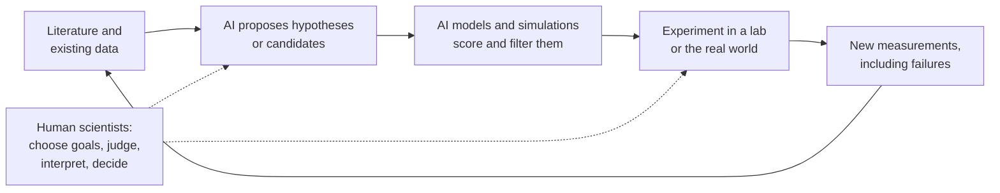
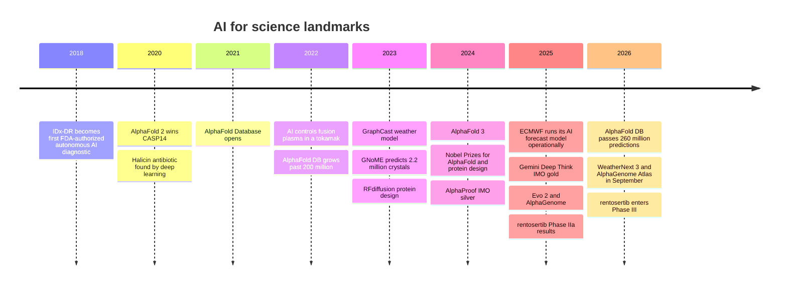
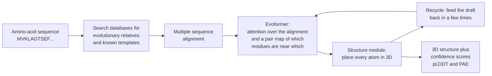
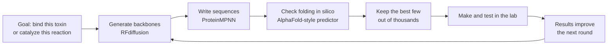
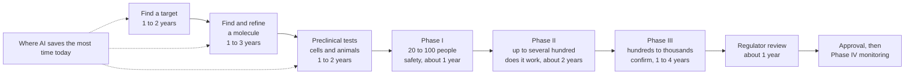
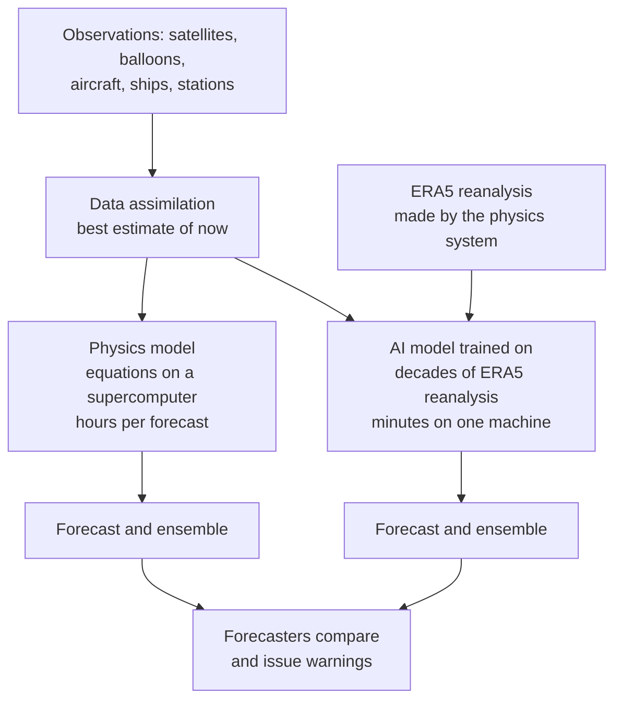
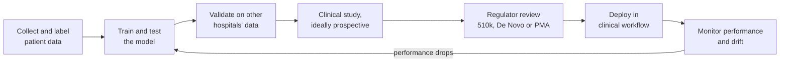

# Chapter 52: AI for Science and Medicine

*What AI has genuinely changed in biology, chemistry, weather, mathematics and medicine, how the landmark systems work, and why a breakthrough on a computer still has to pass the slow test of reality.*

## What you'll learn
- The three ways AI helps science: fast stand-ins for slow experiments, search through enormous possibility spaces, and automating parts of the research loop itself.
- How AlphaFold predicts a protein's 3D shape from its sequence, what its confidence colors mean, and why it earned a share of the 2024 Nobel Prize in Chemistry.
- How protein design, DNA language models and variant-effect predictors run biology in reverse and read the genome.
- Why an "AI-discovered drug" still takes about a decade, with the clinical-trial phases and attrition worked out in numbers.
- How AI weather models such as GraphCast, GenCast, WeatherNext 2 and ECMWF's AIFS forecast in minutes what supercomputers take hours to compute, and what they still depend on.
- What AI has actually achieved in mathematics, from formal proofs in Lean to olympiad gold, and how to read the claims.
- Where AI stands in medicine: imaging, pathology, the first autonomous diagnostic, ambient scribes, a famous sepsis-prediction failure, the FDA's list of AI devices and chatbots answering patients.

## Before you start
This chapter draws on several earlier ones. Chapter 9 (Is the Model Any Good?) explained sensitivity, specificity and base rates, which you will need for the medical sections. Chapter 15 (The Transformer) and Chapter 16 (Generative Models) explained attention and diffusion, the engines inside AlphaFold 3 and protein design tools. Chapter 17 introduced graph neural networks, which power AI weather models. Chapter 21 (Reasoning Models) showed why "verifiable rewards" such as proof checkers make mathematics a natural training ground, and Chapter 48 told the story of AlphaGo and reinforcement learning. Chapter 54 discusses neuro-symbolic AI, which overlaps with the mathematics section here. You do not need any biology or chemistry: every scientific idea is explained from scratch.

## Why science is a special kind of AI problem

### Prediction, search and automation

When you ask a chatbot a question, a good answer is one you find useful. In science, a good answer is one that turns out to be true when someone checks it against nature. That single difference shapes everything in this chapter.

AI helps science in three broad ways.

1. **Fast stand-ins for slow measurements.** Some questions can be answered by an experiment or a physics simulation, but slowly and expensively: months to determine a protein's shape in the lab, hours on a supercomputer to forecast the weather. A model trained on past results can give a good approximate answer in seconds. This is the AlphaFold and GraphCast story.
2. **Search through enormous spaces.** The number of possible drug-like molecules, protein sequences, crystal structures or proof steps is astronomically large. AI can propose promising candidates and rank them so humans test the best few. This is the protein design, materials and mathematics story.
3. **Automating the research loop.** Language-model agents can now read papers, propose hypotheses and plan experiments, and robotic labs can run some experiments without a person at the bench. This is the newest and least proven story.

> **Definition — Surrogate model:** A fast AI model trained to imitate a slow process, such as a physics simulation or a lab measurement, so that answers that once took hours or months can be estimated in seconds.

> **Definition — Simulation:** Using a computer to calculate how a system behaves by applying known rules, such as the equations of fluid flow for the atmosphere or quantum mechanics for molecules. Simulations can be accurate but very slow.

> **Definition — In silico:** Done by computer rather than in a living thing (in vivo) or a test tube (in vitro). An "in silico screen" tests millions of molecules by calculation before any are made.

> **Definition — Wet lab:** A laboratory where experiments are done with real chemicals, cells and organisms, as opposed to a "dry lab" of computers. Wet-lab confirmation is the final judge of most AI predictions in biology and chemistry.


*Figure 52.1: The AI-for-science loop. AI can speed up proposing and filtering, but the experiment remains the bottleneck and the final judge.*

> **Key idea:** In science, AI's output is a proposal, not a result. AlphaFold's structures, an AI weather forecast, a generated molecule and an AI "hypothesis" all become knowledge only after they are checked against reality. The most useful AI systems in science are the ones whose outputs can be checked quickly and cheaply.

### A short history of the landmarks


*Figure 52.2: A decade of AI-for-science landmarks covered in this chapter.*

## Proteins: from string to shape

### What a protein is

Almost everything that happens in your body is done by proteins. Hemoglobin carries oxygen in your blood. Insulin tells cells to absorb sugar. Antibodies grab viruses. Enzymes digest your lunch. Each protein is a molecular machine, and its job depends on its precise 3D shape, the way a key's job depends on the shape of its teeth.

> **Definition — Protein:** A molecular machine in living things, built as a chain of amino acids that folds into a precise 3D shape. The shape determines what the protein does.

> **Definition — Amino acid:** One of 20 small chemical building blocks that link together in a chain to make proteins. Biologists write each with a single letter, so a protein's recipe looks like a string such as "MVKLAGTSEF...".

A protein starts life as a long string of amino acids, typically a few hundred, linked in an order written in your DNA. That string then folds, in a fraction of a second, into a specific tangle of spirals, sheets and loops. In the 1960s the biochemist Christian Anfinsen showed that the string alone contains enough information to determine the folded shape: unfold a protein in a test tube and it can refold by itself. He shared the 1972 Nobel Prize in Chemistry for it. That raised a question that occupied biology for fifty years.

> **Definition — Protein folding problem:** The challenge of predicting a protein's 3D shape from its amino-acid sequence alone. It was considered one of biology's grand problems for about fifty years, until AlphaFold 2 largely solved it for single protein chains in 2020.

Why is it hard? Each link in the chain can twist in several ways. Suppose, as a rough illustration, each of 100 amino acids could take just 3 positions. The number of possible shapes is 3^100, about 5 × 10^47. A computer checking ten trillion (10^13) shapes per second would need about 5 × 10^34 seconds to try them all, more than 10^17 times the age of the universe (about 4 × 10^17 seconds). This is known as Levinthal's paradox: real proteins clearly do not search every shape, yet they find the right one almost instantly. Brute force was never an option.

### Measuring shapes the slow way

Scientists can measure protein structures in the lab, but it is hard. The classic method, X-ray crystallography, requires coaxing the protein into a crystal and firing X-rays through it. A newer method, cryo-electron microscopy, freezes proteins and photographs them with electron beams. Determining a single structure has often taken a year or more of skilled work, and some proteins resist every method.

> **Definition — X-ray crystallography:** A lab method that determines a molecule's 3D structure by growing it into a crystal and measuring how the crystal scatters X-rays. It produced most known protein structures.

> **Definition — Cryo-EM (cryo-electron microscopy):** A lab method that freezes molecules in thin ice and images them with an electron microscope, then combines many images into a 3D structure. It works for large complexes that will not crystallize.

> **Definition — PDB (Protein Data Bank):** The free global archive, founded in 1971, of experimentally determined 3D structures of proteins and other biological molecules. Its roughly two hundred thousand structures became AlphaFold's training data.

The result was a huge gap. Sequencing DNA got cheap, so scientists knew hundreds of millions of protein sequences, but only about two hundred thousand experimentally determined structures: roughly one structure for every thousand sequences. Predicting structure from sequence would close that gap.

Since 1994, a competition called CASP has tested prediction methods every two years. Organizers collect proteins whose structures have just been solved in the lab but not yet published, competitors predict them blind, and the predictions are scored against the real shapes.

> **Definition — CASP (Critical Assessment of protein Structure Prediction):** A blind competition held every two years since 1994 in which teams predict the 3D shapes of proteins whose structures have been measured but not yet released, giving an honest test of prediction methods.

### AlphaFold 2: how it works

At CASP14 (the competition's 14th round) in 2020, Google DeepMind's AlphaFold 2 achieved a median score of about 92 out of 100 on the competition's main accuracy measure, roughly the level of agreement between two lab measurements of the same protein. The organizers declared the problem largely solved for single protein chains.

The key insight comes from evolution. Proteins that do the same job in humans, mice, fish and yeast have similar but not identical sequences. Look at many of these relatives side by side and patterns appear. If two positions in the chain always change together, they are probably touching in the folded shape.

```
  Position:   1  2  3  4  5  6  7  8  9  10
  Human       M  V  K  L  A  G  T  S  E  F
  Mouse       M  V  K  L  S  G  T  A  E  F
  Fish        M  I  E  L  A  G  S  A  K  F
  Frog        M  V  E  L  A  G  T  S  K  Y
  Yeast       M  L  K  I  A  G  T  S  E  F
                    ^                 ^
         K (positive) at 3 pairs with E (negative) at 9;
         when 3 flips to E, 9 flips to K. They co-evolve,
         so they probably sit side by side in the 3D shape.
```
*Figure 52.3: Co-evolution in a multiple sequence alignment. K and E are amino acids with opposite electric charges, which attract each other. Positions 3 and 9 swap together across species, a clue that they touch in the folded protein. AlphaFold learns to read thousands of such clues at once.*

> **Definition — Multiple sequence alignment (MSA):** A table lining up the sequences of related proteins from many species, position by position, so that conserved positions and positions that change together can be spotted.

> **Definition — Co-evolution:** The pattern in which two positions in a protein mutate together across species, because a change at one must be compensated by a change at the other to keep the protein working. It often means the two positions touch in 3D.

AlphaFold 2 turns that clue into a full structure in a few stages.


*Figure 52.4: The AlphaFold 2 pipeline. The core network, the Evoformer, uses attention to reason jointly about the evolutionary alignment and about which pairs of amino acids are close in space.*

1. **Gather relatives.** Search large sequence databases for related proteins and line them up into a multiple sequence alignment. Also look for any similar structures already in the PDB.
2. **Reason about pairs.** The Evoformer, a Transformer-style network (Chapter 15), repeatedly passes information between two representations: the alignment, and a "pair map" that estimates, for every pair of amino acids, how close they are and how they are oriented. (Biologists call each amino acid in a chain a residue, the word used in Figure 52.4.)
3. **Build the shape.** A structure module turns the pair map into 3D coordinates for every atom, treating each amino acid as a small rigid piece that it rotates and moves into place.
4. **Recycle.** The draft structure is fed back through the network a few times, refining it.
5. **Report confidence.** For each amino acid, AlphaFold outputs a confidence score from 0 to 100, and for each pair of regions, an estimate of how sure it is about their relative position.

> **Definition — AlphaFold:** Google DeepMind's family of protein-structure prediction systems. AlphaFold 2 (2020) predicts the shape of single protein chains from their sequences with near-experimental accuracy; AlphaFold 3 (2024) extends prediction to complexes of proteins with DNA, RNA and small drug-like molecules.

> **Definition — pLDDT (predicted local distance difference test):** AlphaFold's confidence score for each amino acid, from 0 to 100, usually shown as colors on the structure: dark blue for very confident (above 90), light blue, yellow, and orange for low confidence (below 50).

> **Definition — PAE (predicted aligned error):** AlphaFold's estimate of how far off the relative position of two parts of a protein might be, shown as a square heat map. Low error between two regions means AlphaFold is confident about how they sit relative to each other.

> **Analogy:** Protein folding is origami from a string of beads. The order of the beads determines the final shape, and the shape determines the job, like a key fitting a lock. AlphaFold learned to look at a bead string and picture the finished origami, partly by noticing which beads have "kept in touch" across a billion years of evolution.

### The AlphaFold Database and the Nobel Prize

In 2021 DeepMind and the European Bioinformatics Institute (EMBL-EBI, part of the European Molecular Biology Laboratory, an intergovernmental research organization) opened the AlphaFold Protein Structure Database, free to everyone, starting with nearly every protein in the human body. In 2022 they expanded it to over 200 million predictions, covering nearly every catalogued protein known to science. As of October 2026 the database describes over 260 million structure predictions, and that month it added AI-mined links from individual amino acids and mutations to the research papers that discuss them.

The effect on everyday biology was large. A graduate student who once spent a year trying to crystallize a protein can now look up a predicted structure in seconds, then use lab time to test a specific idea about how it works. In 2024 the Nobel Prize in Chemistry went half to David Baker for computational protein design and half jointly to Demis Hassabis and John Jumper of Google DeepMind for protein structure prediction. (The same year, the Physics prize went to John Hopfield and Geoffrey Hinton for foundational work on neural networks.)

> **Analogy:** The AlphaFold Database is a free library of 3D origami instructions for nearly every known protein. You still have to fold the paper yourself to be sure, but you no longer start from a blank sheet.

### AlphaFold 3 and the limits

AlphaFold 3, published in May 2024, predicts how proteins fit together with DNA, RNA (a close chemical cousin of DNA that carries working copies of genetic instructions around the cell), ions (electrically charged atoms) and small molecules such as drugs. It replaced the structure module with a diffusion model (Chapter 16) that starts from a cloud of randomly placed atoms and refines it into a structure. Researchers can use it through the free AlphaFold Server for non-commercial work, and DeepMind released the code for academic use in late 2024.

> **Definition — Ligand:** A small molecule, such as a drug, hormone or metal ion, that binds to a specific site on a protein. Predicting how a candidate drug sits in its target's pocket is central to drug design.

AlphaFold is extraordinary, and it has limits that matter.

- **Proteins move.** AlphaFold predicts one static shape, but many proteins flex, open and close, or switch shapes to do their jobs.
- **Some proteins have no fixed shape.** Large stretches of many proteins are floppy and disordered. AlphaFold usually marks these with low confidence, and that low confidence is itself useful information.
- **Confidence is not proof.** High pLDDT means the model is sure, not that it is right. Predictions for unusual proteins, designed proteins and the effects of single mutations need experimental checking.
- **Structure is not function.** Knowing a protein's shape does not tell you what it does in a living cell, which other molecules it meets, or how to make a drug that changes it safely.

> **Definition — Intrinsically disordered region:** A stretch of a protein that has no fixed 3D shape and stays flexible, often to grab different partners. AlphaFold usually shows such regions as orange, low-confidence spaghetti.

> **Watch out:** "AlphaFold solved biology" is a common overstatement. It solved a specific, central problem, predicting static structures of proteins, extremely well. Proteins move, interact and behave differently inside cells, and turning a structure into a medicine still takes years of experiments and trials. As of late 2026, no drug designed with AI had yet been approved.

> **Try it:** Go to alphafold.ebi.ac.uk and search "green fluorescent protein." Open a result, rotate the structure with your mouse, and look at the colors. The barrel-shaped core should be dark blue (very confident). Then search for a human protein you have heard of, such as "p53," and find the orange, low-confidence regions: those are its floppy, disordered parts.

## Designing proteins: running the problem backwards

### From prediction to invention

AlphaFold answers "given this sequence, what shape?" Protein design asks the reverse: "given the shape or job I want, what sequence will fold into it?" If you could answer that reliably, you could design enzymes that break down plastic, proteins that grab a virus, or sensors that glow in the presence of a toxin. Nature has explored only a tiny corner of all possible proteins.

> **Definition — Protein design:** Creating new amino-acid sequences that fold into a desired shape or perform a desired function, often one that no natural protein performs.

> **Definition — Binder:** A protein designed to attach tightly and specifically to a target molecule, such as a viral protein or a toxin, for example to block it.

> **Definition — Enzyme:** A protein that speeds up a specific chemical reaction, such as breaking down a sugar or a pollutant. Enzymes are the workhorses of biology and industry.

David Baker's lab at the University of Washington has led this field for decades. Its 2023 tool RFdiffusion applies the diffusion idea from image generation (Chapter 16) to protein backbones: start from random noise and denoise step by step into a new protein shape that meets your specification, such as "a shape that wraps around this part of that virus." A second tool, ProteinMPNN, then writes a sequence likely to fold into that backbone, a step called inverse folding. A structure predictor checks whether the sequence really folds as intended. Only the designs that pass every computational check are made in the lab.

> **Definition — Inverse folding:** Finding an amino-acid sequence that will fold into a given 3D backbone shape, the reverse of structure prediction.


*Figure 52.5: A modern protein design pipeline. Thousands of computer designs are filtered down to tens or hundreds that are actually made and tested.*

The results are real. In a 2025 *Nature* paper, Baker's group reported designed proteins that neutralize deadly "three-finger" toxins from snake venom and protected mice in lab tests, a possible route to cheaper, more stable antivenoms. Designed proteins have reached human use too: a COVID-19 vaccine built on a computer-designed protein nanoparticle was approved in South Korea in 2022.

### Protein language models

Another approach treats protein sequences like text. Just as a chatbot learns grammar by predicting missing words, a protein language model learns the "grammar" of proteins by predicting masked amino acids across hundreds of millions of natural sequences.

> **Definition — Protein language model:** A Transformer trained on huge numbers of protein sequences, predicting hidden amino acids the way a language model predicts hidden words. It learns which sequences are plausible, and can be used to predict structure and function or to generate new proteins.

The startup EvolutionaryScale's ESM3 model, announced in 2024, was trained on sequences, structures and functions together. Its developers used it to generate a new green fluorescent protein, which they called esmGFP, that glows in the lab yet shares only about 58 percent of its sequence with the closest known natural fluorescent protein. The company estimated the gap would have taken nature over 500 million years of evolution to cross.

> **Watch out:** Tools that design helpful proteins could in principle help design harmful ones. In a 2025 *Science* paper, a Microsoft-led team reported that AI-redesigned versions of known toxins could slip past the screening software that DNA-synthesis companies (firms that manufacture custom DNA to order) use to block dangerous orders, and the team worked with those companies to patch the screens before publishing. Biosecurity screening for AI-designed sequences is an active area (Chapter 58 covers biological misuse).

## Genomics: reading the code of life

### DNA in one minute

> **Definition — DNA:** The molecule that stores genetic instructions, written in an alphabet of four chemical letters (A, C, G and T). The human genome is about 3.1 billion letters long.

> **Definition — Gene:** A stretch of DNA that contains the instructions for making a protein (or another functional molecule). Humans have about 20,000 protein-coding genes, which make up only around 1 to 2 percent of the genome.

> **Definition — Genome:** An organism's complete set of DNA. Reading it is called sequencing.

Most of the genome does not code for proteins. Much of it is regulatory DNA: switches and dials that decide which genes turn on, in which cells, when and how strongly. A liver cell and a brain cell carry the same genome; regulation is why they differ.

> **Definition — Regulatory DNA:** Non-coding stretches of DNA that control when, where and how strongly genes are switched on. Many disease-linked DNA changes fall in these regions rather than in genes themselves.

Every person carries millions of small differences from the reference genome. Most are harmless. Some cause disease. When a clinic sequences a patient with a suspected genetic condition, it often finds a change that has never been seen before and cannot say whether it matters.

> **Definition — Variant:** A difference in a person's DNA compared with a reference sequence, such as one letter swapped for another.

> **Definition — Missense variant:** A single-letter DNA change that swaps one amino acid for another in the protein the gene encodes. Some are harmless; some break the protein and cause disease.

> **Definition — Variant of uncertain significance (VUS):** A genetic variant whose effect on health is unknown. These are the most common result of clinical genetic tests and a major frustration for patients and doctors.

### Three kinds of genome AI

**Variant-effect prediction: AlphaMissense (2023).** Google DeepMind adapted AlphaFold's ideas to ask whether a missense variant is likely harmful. It scored all of about 71 million possible single-amino-acid changes in human proteins and classified 89 percent of them as likely harmful or likely benign. Human experts had confirmed the effect of only about 0.1 percent of them. These are predictions to prioritize, not diagnoses: a doctor still needs other evidence.

**DNA language models: Evo 2 (2025).** The Arc Institute, a nonprofit biomedical research institute in California, with the chip company NVIDIA, trained Evo 2 on DNA itself, roughly 9 trillion letters from more than 100,000 species across the tree of life, according to its developers. Like a language model reading text, it learns which DNA sequences are "grammatical" in nature, and it can read up to about a million letters at once. It can score whether a mutation looks damaging and generate new DNA sequences.

> **Definition — NVIDIA:** An American chip company that designs most of the GPUs (graphics processing units, introduced in Chapter 1) used to train and run AI models, along with the networking gear that links them and CUDA, the software for programming them. Chapter 35 tells its story.

> **Definition — DNA language model:** A model trained to predict DNA letters from their surroundings across many genomes, so it learns which sequences are biologically plausible and can estimate the effect of changes.

**Regulatory-code models: AlphaGenome (2025).** Google DeepMind's AlphaGenome reads up to a million DNA letters and predicts thousands of molecular measurements at once, such as how strongly nearby genes are expressed (switched on) in different tissues and how their messages are spliced (cut and rejoined before the cell uses them to build a protein). That lets it estimate what a variant in the non-coding "dark matter" of the genome might do, which earlier tools largely could not. In September 2026 DeepMind released AlphaGenome Atlas, precomputed predictions for about 9 billion possible single-letter DNA changes in the human genome, free for academic research and, the company stresses, not validated for clinical use.

> **At the frontier (2026):** Genomics models are moving from single tasks to "virtual cell" ambitions: models that combine DNA, gene activity in single cells, protein structure and the literature to predict how a cell will respond to a drug or a genetic change. As of late 2026 these are research projects with promising benchmarks; the hard test is whether their predictions hold up in experiments they were not trained on.

## Drug discovery: why an AI-discovered drug still takes a decade

### The pipeline

Headlines about "AI-discovered drugs" often give the impression that a model invents a cure and it reaches pharmacies soon after. To see why that does not happen, you need the whole pipeline.

> **Definition — Drug target:** A molecule in the body, usually a protein, whose activity a drug aims to change in order to treat a disease.

> **Definition — Small molecule:** A drug made of a relatively small chemical compound, such as aspirin, that can usually be taken as a pill. Most AI drug-design work so far has focused on small molecules.

> **Definition — Lead compound:** A promising molecule that acts on the target and is then refined by chemists to be more potent, safer and better absorbed before it becomes a drug candidate.

> **Definition — Preclinical studies:** Tests of a drug candidate in cells and animals, before any human receives it, to check that it works on the target and to look for toxicity.

> **Definition — Clinical trial:** A carefully regulated study that tests a treatment in people, run in phases of increasing size.

> **Definition — Phase I, II and III trials:** The three main stages of clinical testing. Phase I gives the drug to a small group (often 20 to 100 people) mainly to check safety and dosing. Phase II tests whether it works in up to several hundred patients. Phase III confirms benefit and safety in hundreds to thousands of patients, usually against a placebo or the current best treatment.

> **Definition — Randomized controlled trial (RCT):** A study in which participants are randomly assigned to receive the treatment or a comparison (such as a placebo), so that differences in outcomes can be attributed to the treatment. It is the gold standard for medical evidence.

> **Definition — Placebo:** An inactive treatment, such as a sugar pill, given to the comparison group in a trial so that the effect of simply being treated can be separated from the effect of the drug.

> **Definition — FDA (Food and Drug Administration):** The US government agency that decides whether drugs and medical devices can be sold in the United States, based on evidence of safety and effectiveness.


*Figure 52.6: The drug development pipeline with typical durations. Phase IV is the safety monitoring that continues after approval, once many more people take the drug. AI mainly speeds up the left side. The clinical phases on the right are paced by human biology, patient recruitment and the need to watch outcomes over months or years.*

### The attrition, worked in numbers

The pipeline is long, and most candidates fail along it. One large industry analysis of clinical trials from 2011 to 2020 found that roughly half of drugs passed Phase I, under a third of those passed Phase II, a little over half of those passed Phase III, and about nine in ten of the drugs submitted were approved. Follow 100 drug candidates entering Phase I:

```
  Enter Phase I         100  ##################################
  Pass Phase I  (~52%)   52  ##################
  Pass Phase II (~29%)   15  #####
  Pass Phase III (~58%)   9  ###
  Approved      (~91%)    8  ###

  About 8 in 100 drugs that start human trials reach patients.
  Phase II, the first real test of whether a drug works,
  is where most candidates die.
```
*Figure 52.7: Clinical attrition. The percentages are rounded from a large 2011 to 2020 industry analysis and vary widely by disease area.*

Failures are what make drugs expensive. Published estimates of the full cost of bringing one new drug to market, counting the many failures along the way, vary widely, from around one billion to more than two billion dollars. Most of the cost sits in the clinical phases.

Now see where AI fits. Suppose AI shortens target discovery, molecule design and preclinical work from about 4.5 years to about 2 years, which is roughly what the most successful AI-first companies claim for their best programs.

```
  Years:          0   2   4   6   8   10  12
                  |---|---|---|---|---|---|
  Traditional     DDDDDDDDD112222333333RR   about 11.5 years
  AI-accelerated  DDDD112222333333RR        about 9 years

  D = discovery and preclinical   1 = Phase I   2 = Phase II
  3 = Phase III                   R = regulator review
  (each character is about half a year)
```
*Figure 52.8: Why speeding up discovery saves years, not a decade. The clinical phases are unchanged, so the total falls only from about 11.5 to about 9 years.*

The bigger prize would be raising the success rate in Phase II and III, because every late failure wastes years and hundreds of millions of dollars. Here the evidence is still thin. One 2024 analysis of the small number of AI-discovered molecules that had completed early trials found that roughly 80 to 90 percent passed Phase I, well above historical averages, while the Phase II success rate, about 40 percent, looked similar to the historical figure. The samples were small, and Phase I mainly tests safety, which is what AI-optimized molecules are designed for.

> **Key idea:** AI can compress the discovery stage from years to months, but a drug must still be tested in people over years, because the questions that matter (Is it safe? Does it work? Are the benefits worth the side effects?) can only be answered by human biology over time. The real test of AI drug discovery is whether it raises the share of candidates that succeed in Phase II and III.

### The cases

**Halicin (2020).** A team at MIT trained a neural network to predict whether molecules would kill bacteria, then screened a library of over 100 million compounds. It flagged halicin, a molecule originally studied for diabetes, which killed many drug-resistant bacteria in lab and mouse tests. It showed the power of AI screening; as of late 2026 it had not become an approved medicine.

**Rentosertib (Insilico Medicine).** This is the most advanced case where AI chose both the target and the molecule. Insilico's AI identified a protein called TNIK as a target for idiopathic pulmonary fibrosis, a deadly scarring of the lungs, and its generative chemistry software designed a molecule to block it. In June 2025 the company published Phase IIa results (Phase IIa is the small, early part of Phase II that looks for a first sign the drug works) in *Nature Medicine*: in 71 patients over 12 weeks, lung capacity rose by an average of 98.4 mL in the group taking 60 mg daily, compared with a fall of 20.3 mL on placebo. That is an encouraging signal. It was also a small, short trial, and larger, longer trials are needed before anyone can say the drug works. The first of those is now running: according to its ClinicalTrials.gov record (NCT07687459), a Phase III trial began on September 9, 2026, aiming to enroll about 320 patients at hospitals in China and compare the drug with a placebo over 52 weeks; the record estimates that measurements for its main outcome will be complete in late 2029.

**Isomorphic Labs.** Google DeepMind's drug-discovery spin-out, led by Demis Hassabis, builds on AlphaFold 3 and has partnerships with large drug companies including Eli Lilly and Novartis. According to secondary reporting, it had not yet dosed a human by May 2026, with first-in-human trials expected by the end of 2026 after slipping from 2025. In late September 2026 the company itself still described its work as preclinical, writing that its data were helping it "gear up for clinical developments." If accurate, that timeline is itself a lesson: even the best-funded, most capable AI drug company needs years to reach the clinic.

> **Watch out:** "AI-designed drug" covers very different claims: a molecule screened by AI from an existing library, a molecule generated by AI against a target humans chose, or a target and molecule both chosen by AI. Ask which one, then ask which trial phase it has reached and how many patients were in it. As of late 2026, AI-discovered drugs had reached late-stage trials (rentosertib's Phase III began in September 2026) but none had been approved.

## Materials and chemistry: searching for new stuff

### Why new materials are hard to find

Better batteries, solar cells, catalysts for clean fuels, superconductors and lighter alloys all come down to finding the right arrangement of atoms. The space of possible combinations is vast, and making and testing a new compound in a lab can take weeks.

> **Definition — Crystal structure:** The repeating 3D arrangement of atoms in a solid material, like the pattern of a tiled floor extended in three dimensions. It largely determines a material's properties.

> **Definition — Stable material:** A compound whose atoms will not spontaneously rearrange into a different, lower-energy combination, so it can in principle be made and will last. Most hypothetical compounds are unstable.

For decades the main computer tool was a quantum-physics method called density functional theory, which calculates a material's energy and properties from first principles.

> **Definition — DFT (density functional theory):** A physics-based computer method for calculating the energy and properties of molecules and materials from quantum mechanics. It is accurate enough to be trusted for many purposes but slow, taking hours or days per material.

### GNoME and the robot lab

In November 2023 Google DeepMind published GNoME (Graph Networks for Materials Exploration), a graph neural network (Chapter 17) that treats a crystal as atoms (nodes) joined by bonds (edges) and predicts its stability far faster than DFT. Working in rounds, GNoME proposed candidates, DFT checked the most promising, and the results retrained the model. It predicted 2.2 million new crystal structures, about 380,000 of them stable, and contributed them to the open Materials Project database. DeepMind reported that other labs had independently made several hundred of its predicted materials.

In the same issue of *Nature*, a team at Lawrence Berkeley National Laboratory described the A-Lab, a robotic lab that chose recipes using AI and the literature, then mixed, heated and analyzed powders with little human help. Over 17 days it reported making 41 of 58 target compounds. The work also shows why verification matters: in 2024 other scientists published critiques arguing that some of the A-Lab's products had been misidentified or were not truly new. The debate was healthy science, and a reminder that automated discovery needs the same scrutiny as human discovery.

> **Definition — Self-driving lab:** A laboratory where robots carry out experiments chosen by AI, and the results automatically feed back to choose the next experiment, closing the loop with little human handling.

> **Definition — Machine-learned interatomic potential:** An AI model that predicts the forces between atoms almost as accurately as quantum calculations but thousands of times faster, letting scientists simulate how materials and molecules move over longer times.

Language models have also learned to drive lab equipment. In a 2023 *Nature* paper, a Carnegie Mellon team showed "Coscientist," a GPT-4-based agent that read equipment manuals, planned chemistry experiments and ran them on automated lab hardware.

Molecule models have even reached the sense of smell, often called the hardest human sense to put into numbers, because there is no simple physical scale for it the way wavelength underlies color. In a 2023 *Science* paper, a team led by Brian Lee and Alexander Wiltschko used graph neural networks to build a "principal odor map", a space in which molecules that smell alike sit close together, so that the smell of a new molecule can be predicted from its structure. On 400 molecules the model had never seen, its predicted odor profiles matched the average of a trained human panel more closely than the median panelist did. The authors see it as a step toward digitizing odors. It is a reminder that machine perception reaches beyond sight and sound: touch and body sense are just as central for robots (Chapter 49).

> **Definition — Principal odor map:** A map, learned by a neural network from molecular structures and human odor ratings, that places molecules with similar smells close together, so the smell of an untested molecule can be predicted from its position.

> **Watch out:** "AI discovered 2.2 million new materials" means AI predicted 2.2 million structures that are probably stable. It does not mean 2.2 million useful materials exist in jars. Each still needs to be made, characterized and tested for a real application, and most will never be. Prediction counts are a measure of search, not of discovery.

## Weather and climate: forecasting in a minute

### The physics way

Modern weather forecasting is one of science's great achievements. Every day, millions of observations from satellites, weather balloons, aircraft, ships and ground stations are blended into a best estimate of the atmosphere's current state. Then supercomputers solve the equations of fluid flow, heat and moisture forward in time.

> **Definition — Numerical weather prediction (NWP):** Forecasting the weather by solving the physical equations of the atmosphere on a supercomputer, starting from the best estimate of current conditions.

> **Definition — Data assimilation:** The process of combining millions of scattered, imperfect observations with a previous forecast to produce the best estimate of the atmosphere's current state, the starting point for every forecast.

> **Definition — Ensemble forecast:** Running many forecasts from slightly different starting points or model settings to see the range of possible outcomes. If 35 of 50 members bring rain to your town, the forecast says a 70 percent chance of rain.

The best physics model, run by the European Centre for Medium-Range Weather Forecasts (ECMWF), takes hours on a supercomputer, and the ensemble version runs 51 forecasts each time. That is expensive, which limits how often and how finely forecasts can be made.

### The learned way

Here is the idea behind AI weather models. ECMWF has produced a reanalysis called ERA5: a consistent reconstruction of the global weather, hour by hour, going back to 1940, made by running the physics model over the historical observations.

> **Definition — Reanalysis:** A consistent, decades-long reconstruction of past weather, made by feeding historical observations through one fixed modern forecasting system. ECMWF's ERA5 is the main training data for AI weather models.

Train a neural network on decades of ERA5 to answer one question: given the state of the atmosphere now, what will it be six hours from now? Then apply it repeatedly, feeding each output back in as the next input, exactly as a chatbot generates one token at a time (Chapter 18).

> **Definition — Autoregressive rollout:** Producing a long forecast by predicting one short step ahead, then feeding that prediction back in to predict the next step, again and again. Errors can accumulate along the way.

Google DeepMind's GraphCast, published in *Science* in 2023, made the case. It works on a grid with one point every 0.25 degrees of latitude and longitude: 1,440 points around each circle of latitude and 721 from pole to pole, so 1,440 × 721 = 1,038,240 locations. At each one it tracks 5 surface quantities plus 6 atmospheric quantities at 37 heights, 5 + 6 × 37 = 227 numbers per point. The whole state of the planet's weather is about 1,038,240 × 227 ≈ 236 million numbers. A 10-day forecast in 6-hour steps is 10 × 4 = 40 steps. GraphCast produced it in under a minute on a single Google TPU machine and was more accurate than ECMWF's flagship physics forecast on 90 percent of the 1,380 test targets its authors measured.


*Figure 52.9: Physics versus learned forecasting. The AI model replaces the expensive simulation step, but it still starts from data assimilation and was trained on reanalysis that the physics system produced.*

Other groups reached similar results: Huawei's Pangu-Weather and NVIDIA's FourCastNet among them. Then came probability.

| Model | Who | When | What it showed |
|---|---|---|---|
| GraphCast | Google DeepMind | 2023 | A 10-day global forecast in under a minute, beating the leading physics forecast on most measures |
| GenCast | Google DeepMind | December 2024 | A diffusion-based ensemble for 15 days ahead, more skillful than ECMWF's physics ensemble on about 97 percent of targets tested |
| AIFS (Artificial Intelligence Forecasting System) | ECMWF | Operational February 2025 | Europe's main forecasting center running an AI model in daily operations alongside its physics model |
| WeatherNext 2 | Google DeepMind | November 2025 | Hundreds of forecast scenarios in under a minute on one TPU, 8 times faster than its predecessor, powering forecasts in Google Search, Gemini and Google's Pixel phones |
| WeatherNext 3 | Google DeepMind and Google Research | September 2026 | A new forecast every hour, fed with live satellite observations, with temperature and moisture at 5 km detail; Google reports much better rain forecasts and uses it in Search, Gemini and Maps |

GenCast matters because a single forecast is less useful than a probability. It uses diffusion (Chapter 16) to generate many plausible weather futures, an ensemble, which lets forecasters say "70 percent chance of heavy rain" or show a spread of possible hurricane tracks. In 2025 Google DeepMind said the US National Hurricane Center was evaluating its experimental tropical-cyclone model during that season. In August 2026, with a paper in *Nature*, DeepMind reported that the model's three-day forecasts of a storm's track, strength and wind field were as good as earlier models' two-day forecasts, and said it had helped the Hurricane Center anticipate the rapid strengthening of Hurricane Melissa before it struck Jamaica in 2025.

> **Analogy:** A physics weather model is a physicist solving the equations from scratch every time. An AI weather model is an experienced forecaster who has studied forty years of weather maps and recognizes how situations like today's usually unfold. The forecaster is much faster, but only because the physicist spent decades making those maps.

### What AI weather models still depend on

- **They need the physics system.** They are trained on reanalysis that the physics system produced, and each forecast starts from data assimilation, which still uses traditional methods. They have replaced one expensive step, not the whole chain. A newer generation is starting to test that limit: Google says WeatherNext 3 (September 2026) learns directly from raw satellite observations and weather-station readings, feeding live satellite images into every forecast alongside the traditional analysis, so it can issue a new forecast every hour instead of waiting for the next analysis, which arrives about six hours late.
- **Extremes are hard.** Record-breaking events are, by definition, rare or absent in the training data. Early AI models also tended to smooth out the peak intensity of storms.
- **Climate is a different problem.** Forecasting the next two weeks is about following today's weather forward. Projecting the climate of 2080 means simulating a world with conditions no training data covers, and physical consistency (conserving energy and water) matters over decades. Hybrid approaches, such as Google's NeuralGCM (2024), which pairs a physics core with learned components, are one answer.

> **Watch out:** "AI weather models don't need physics" is wrong. They learn from decades of physics-based reanalysis and start each forecast from observations processed by traditional data assimilation. They are a powerful shortcut through the most expensive part of the pipeline, built on top of everything meteorology already knew.

> **Try it:** Open charts.ecmwf.int and search for the AIFS charts and the matching IFS charts (the Integrated Forecasting System, ECMWF's physics model) for the same day and variable, such as mean sea-level pressure or precipitation. Compare the two forecasts for your region five days ahead. Note where they agree and where they differ, then check what actually happened five days later.

## Mathematics: proofs a computer can check

### Why math is special

Mathematics has a property almost no other field has: an answer can be checked with certainty. If a proof is written in a formal language, a program can verify every step. That makes math the ideal training ground for AI, because a model can attempt millions of proofs and get a perfectly reliable reward signal for each one (Chapter 21 explains these "verifiable rewards").

> **Definition — Formal proof:** A proof written in a precise computer language so that software can check every logical step mechanically, leaving no room for gaps or hand-waving.

> **Definition — Proof assistant:** Software that checks formal proofs and helps humans write them. Lean, created by Leonardo de Moura at Microsoft Research in 2013, is the most widely used today, with a large community-built library of formalized mathematics called Mathlib.

> **Definition — Autoformalization:** Using AI to translate ordinary mathematical writing into a formal language such as Lean, so it can be checked by a proof assistant.

Lean has gone from a niche tool to a serious part of mathematics. In 2023 Terence Tao led a group that formalized the proof of a newly settled conjecture (a statement mathematicians believe is true but have not yet proved) in about three weeks, and Kevin Buzzard leads a long-running project to formalize the proof of Fermat's Last Theorem.

> **Analogy:** A proof checker is a merciless spell-checker for logic. It accepts nothing that is not fully justified, which makes it annoying for humans and perfect as a referee for AI training: a model cannot bluff its way past it.

### Olympiad results, from silver to gold

The International Mathematical Olympiad (IMO) is the world's top competition for pre-university students: six problems over two days of 4.5 hours each, worth 7 points each, for a maximum of 42.

> **Definition — IMO (International Mathematical Olympiad):** An annual competition for the world's best pre-university mathematicians. Its problems require creative proofs rather than calculation, which made it a famous test for AI reasoning.

- **AlphaGeometry (published January 2024).** Google DeepMind paired a language model, which suggests creative constructions such as "draw this extra line," with a symbolic deduction engine that grinds out the logical consequences. Trained on 100 million synthetic examples, it solved 25 of 30 past olympiad geometry problems within the time limit, close to the average human gold medalist and far above the previous best system's 10.
- **AlphaProof and AlphaGeometry 2 (IMO 2024).** AlphaProof learned by reinforcement learning to write proofs in Lean, attempting huge numbers of auto-formalized problems and learning from the ones the checker accepted. Together the two systems scored 28 out of 42, silver-medal standard, but the problems had to be translated into Lean by humans first, and some took days of computation.
- **Gemini Deep Think (IMO 2025).** An advanced version of Gemini with Deep Think scored 35 out of 42, gold-medal standard, solving five of six problems in natural language within the 4.5-hour limit. Its answers were officially graded by IMO coordinators. OpenAI announced that an experimental model also scored 35 out of 42, graded by former medalists rather than by the official coordinators.
- **IMO 2026 (July, Shanghai): unverified claims.** After the 2026 olympiad, news reports and social media carried claims that several AI systems had achieved perfect scores of 42, including a *South China Morning Post* report about a model from the Chinese company RedNote and similar claims about other companies' systems. As of this writing we could not confirm that any 2026 AI result was officially certified by the IMO, so treat these as claims, not established results.

> **Definition — Neuro-symbolic AI:** Systems that combine neural networks, which supply intuition and suggestions, with symbolic components such as logic engines or proof checkers, which supply rigor. AlphaGeometry and AlphaProof are examples (Chapter 54 discusses the approach in depth).

The shift from 2024 to 2025 is the striking part: from formal proofs with days of computation and human translation, to natural-language proofs within the human time limit. Much of the gain came from reasoning models trained to "think" at length (Chapter 21).

### Beyond competitions

Competition problems are hard, but they are designed to have neat solutions that fit on a few pages, and similar problems exist in the training data. Research mathematics means choosing which questions matter, building new theories and working for years. Three developments show AI starting to contribute there, and one shows how to read claims carefully.

- **FunSearch (2023).** DeepMind paired a language model with an automatic evaluator in an evolutionary loop (generate programs, score them, keep the best, mutate). It found new constructions for a combinatorics puzzle called the cap set problem, larger than any previously known in one setting.
- **AlphaEvolve (May 2025).** A Gemini-powered evolutionary coding agent in the same spirit found a way to multiply two 4 × 4 matrices of complex numbers using 48 multiplications, the first improvement in that setting since Strassen's 1969 method, and slightly improved bounds on several open problems. An August 2026 preprint reported using it to nudge down the best known bound on the exponent of matrix multiplication to about 2.371177 (the exponent describes how fast the work of multiplying two n × n matrices grows as n grows; the schoolbook method of Chapter 5 has exponent 3, because it takes n × n × n multiplications), a result still awaiting full peer review.
- **A cautionary episode (October 2025).** An OpenAI executive announced that GPT-5 had "found solutions" to ten open problems posed by the mathematician Paul Erdős. Within days the claim was withdrawn: the maintainer of the website listing the problems explained they were marked open only because he had not known of existing solutions, which the model had found in the literature. Finding forgotten results is genuinely useful. It is not the same as discovery, and the difference matters.

> **Watch out:** "An AI got IMO gold, so it is a better mathematician than mathematicians" does not follow. Stanford's 2026 AI Index noted a model that won IMO gold yet read analog clocks correctly only about half the time. AI capability is jagged: superhuman in some narrow tasks, unreliable in nearby ones. In mathematics, AI is becoming a strong assistant for search, checking and literature, not yet a replacement for the people who decide what is worth proving.

## AI co-scientists and autonomous labs

The newest ambition is to automate the scientist, not just one tool. Language-model agents (Chapter 28) can read thousands of papers, propose hypotheses, critique each other and draft experimental plans.

> **Definition — AI co-scientist:** An AI system, usually several cooperating language-model agents, that reads the scientific literature, generates and debates hypotheses and proposes experiments for human scientists to run.

Google's AI co-scientist, described in February 2025, is a multi-agent Gemini system in which agents generate hypotheses, review them, hold "tournaments" to rank them and refine the winners. Its reported results include drug-repurposing candidates (existing medicines that might treat a different disease) for acute myeloid leukemia, a blood cancer, that inhibited cancer cells in lab tests, candidate treatments for liver fibrosis (scarring of the liver), and an independent re-derivation of a hypothesis about how certain bacteria share genes that a research team had reached but not yet published. Other efforts include the nonprofit FutureHouse's research agents and the Tokyo startup Sakana AI's "AI Scientist," which drafts entire machine-learning papers.

> **Analogy:** An AI co-scientist is a tireless research assistant who has read every paper in the field, brainstorms hundreds of hypotheses and argues about them all night, but cannot pick up a pipette. Its ideas are cheap; testing them is not.

The limits are clear. A hypothesis is worth little until an experiment tests it, and wet-lab experiments remain slow and costly. AI systems tend to recombine existing ideas, which can be valuable, but genuinely new ideas are harder to recognize and verify. And a flood of AI-generated hypotheses and papers could overwhelm the peer review that keeps science honest.

> **Definition — Reproducibility:** Whether an independent team, following the same methods, gets the same result. It is the basic test of a scientific finding, and many published results in biology and psychology have failed it.

> **Definition — Peer review:** The process in which independent experts evaluate a scientific paper before publication. It is imperfect and already strained by the volume of papers.

> **At the frontier (2026):** Labs and startups are connecting AI agents to automated "cloud labs" so that a model can design an experiment, have robots run it overnight and read the results in the morning. The most credible projects focus on narrow, well-instrumented tasks (testing many enzyme variants, optimizing a reaction) where measurements are fast and unambiguous. The open question for 2027 and beyond is whether such systems can produce important discoveries that hold up under independent replication, not just many results.

## Physics, astronomy and fusion

AI is now routine across the physical sciences, usually as a specialized tool rather than a headline.

- **Fusion.** In 2022 Google DeepMind and the Swiss Plasma Center reported in *Nature* that a reinforcement-learning controller (Chapter 48) had learned to shape and hold the super-hot plasma (gas so hot that its atoms break apart into electrically charged particles) inside a tokamak, a doughnut-shaped fusion reactor, by adjusting its magnetic coils thousands of times per second. Other groups use AI to predict and avoid plasma instabilities before they happen.
- **Particle physics.** At the Large Hadron Collider, the world's largest particle accelerator, near Geneva, particle bunches cross about 40 million times per second, far too many collisions to store. Fast "trigger" systems, increasingly using machine learning on specialized chips, decide in microseconds which collisions to keep, roughly a thousand per second.
- **Astronomy.** Neural networks sift telescope data for exoplanets, planets orbiting stars other than our Sun (a 2017 project found an eighth planet around the star Kepler-90 in archived NASA data), classify millions of galaxies, and find gravitational lenses, where a galaxy's gravity bends the light of something behind it.

> **Definition — Tokamak:** A doughnut-shaped device that uses powerful magnetic fields to confine plasma hot enough for nuclear fusion. Keeping the plasma stable is a fast, delicate control problem.

> **Definition — Trigger system:** The fast filter at a particle collider that decides, in millionths of a second, which collision events to record and which to discard forever.

> **Definition — NASA (National Aeronautics and Space Administration):** The United States government's space agency, which runs space missions, satellites, space telescopes and robotic probes such as the Mars rovers. It makes much of their data freely available to researchers and the public.

## AI in medicine

Medicine is where AI meets the highest stakes and the strictest rules. A wrong movie recommendation wastes an evening; a wrong diagnosis can cost a life. That is why medical AI is regulated as a medical device, and why "it scored well on a test set" is only the start of the story.

### The regulator's view

In the United States, software that diagnoses, treats or informs clinical decisions can count as a medical device and needs FDA authorization before it can be marketed for that use.

> **Definition — SaMD (software as a medical device):** Software that performs a medical purpose by itself, such as detecting a disease on a scan, without being part of a physical device. Most medical AI is regulated in this category.

> **Definition — 510(k) clearance:** The FDA's most common route to market for a medical device, granted by showing the device is "substantially equivalent" to one already legally sold. Most AI medical devices are cleared this way.

> **Definition — De Novo authorization:** The FDA route for a new kind of low-to-moderate-risk device with no existing equivalent. A De Novo authorization creates a category that later devices can use as their comparison.

> **Definition — PMA (premarket approval):** The FDA's strictest route, for high-risk devices, requiring direct evidence of safety and effectiveness, usually from clinical studies.

The FDA keeps a public list of AI-enabled medical devices it has authorized. It counted about 1,451 through the end of 2025; one secondary analysis counted 1,614 as of June 29, 2026. About three-quarters are in radiology. The FDA notes that the list is not exhaustive. Most of these are narrow tools: find a suspected bleed on a head CT (computed tomography, a scan that combines many X-rays into 3D slices), measure the heart's pumping on an ultrasound, flag a suspicious spot on a mammogram.


*Figure 52.10: The life cycle of a medical AI device. The steps that most often get skipped or rushed are external validation, prospective studies and monitoring after deployment.*

### Imaging and pathology

Radiology dominates because images are digital, plentiful and come with labels in the form of radiologists' reports. Most tools are assistive: they flag, measure or prioritize, and a clinician decides.

> **Definition — Computer-aided detection (CAD):** Software that marks suspicious areas on medical images, such as possible tumors on a mammogram, for a clinician to review.

The strongest evidence comes from randomized trials. In Sweden's MASAI (Mammography Screening with Artificial Intelligence) trial, which randomized about 80,000 women in breast-cancer screening, interim results published in 2023 found that AI-supported screening detected about 20 percent more cancers than standard double reading by two radiologists, while cutting radiologists' screen-reading workload by about 44 percent. In pathology, where tissue slides are now scanned into enormous digital images, the FDA authorized its first AI tool to help pathologists spot prostate cancer, Paige Prostate, in 2021.

### The first autonomous diagnosis

In April 2018 the FDA authorized IDx-DR, the first AI system allowed to make a screening decision without a specialist reviewing the image. It checks retinal photos (pictures of the retina, the light-sensitive layer at the back of the eye) of people with diabetes for diabetic retinopathy, damage to the retina's blood vessels and a leading cause of blindness. A nurse or technician in a primary-care clinic takes the photos; the software says either "refer to an eye specialist" or "rescreen in 12 months." In its pivotal study of 900 people with diabetes at 10 primary-care sites, it had a sensitivity of 87.2 percent and a specificity of 90.7 percent.

> **Definition — Autonomous AI diagnostic:** An AI system authorized to make a diagnostic or screening decision without a clinician interpreting the result first. IDx-DR (2018) was the first FDA-authorized example.

> **Definition — Sensitivity:** The share of people who really have a condition that a test correctly flags. A sensitivity of 87 percent means 13 of every 100 sick people are missed.

> **Definition — Specificity:** The share of people without the condition whom a test correctly clears. A specificity of 91 percent means about 9 of every 100 healthy people are wrongly flagged.

> **Definition — Positive predictive value (PPV):** Of the people a test flags, the share who actually have the condition. Unlike sensitivity and specificity, it depends heavily on how common the condition is.

> **Definition — Prevalence:** How common a condition is in the group being tested, for example 10 percent of people screened.

What do those numbers mean for a patient? Suppose, for illustration, that 10 percent of a clinic's diabetic patients have disease serious enough to need referral, and 1,000 are screened.

```
              1,000 people with diabetes screened
                /                              \
     100 have the disease               900 do not
        /            \                   /            \
  87 flagged      13 missed       84 flagged      816 cleared
  true positive   false negative  false positive  true negative

  Flagged:  87 + 84  = 171, of whom 87 are sick   PPV = 51%
  Cleared: 816 + 13  = 829, of whom 816 are fine  NPV = 98.4%
```
*Figure 52.11: Screening arithmetic with IDx-DR's published sensitivity and specificity and an illustrative 10 percent prevalence.*

About half of the people flagged are actually sick, which is fine for a screening test: they get a specialist visit, which they might not otherwise have had at all. A "cleared" result is right 98 percent of the time, a figure called the negative predictive value. If the clinic screened a healthier group with 2 percent prevalence, the PPV would fall to about 16 percent, because false alarms from the large healthy group would swamp the true cases. The same model gives very different meanings to "positive" in different populations, a point Chapter 9 made with natural frequencies.

> **Definition — Negative predictive value (NPV):** Of the people a test clears, the share who truly do not have the condition. Like PPV, it depends on how common the condition is in the group tested.

> **Key idea:** A medical AI's accuracy is not one number. Sensitivity and specificity describe the model; what a positive or negative result means for a patient depends on how common the disease is in the people being tested. Always ask "accurate for whom, and compared with what?"

### When a model fails in the wild: sepsis

Sepsis, the body's overwhelming response to infection, kills many hospital patients, and catching it early saves lives. So hospitals eagerly adopted prediction models that watch patients' records and raise alerts. The most widely used was a proprietary model built into the electronic health record system (the digital patient chart) sold by Epic, the largest US maker of hospital record software. In 2021 researchers at the University of Michigan published an independent evaluation in *JAMA Internal Medicine*, a journal of the American Medical Association, covering tens of thousands of hospitalizations. They found an AUC (Chapter 9: a score from 0.5, no better than a coin flip, to 1.0, perfect, for how well a model ranks patients who develop sepsis above those who do not) of 0.63, well below the figures the developer had reported. The model missed about two-thirds of sepsis cases while generating alerts for about 18 percent of all hospitalized patients.

> **Definition — External validation:** Testing a model on data from a different hospital, time period or population than it was developed on. Models that look excellent internally often perform worse externally.

> **Definition — Dataset shift:** A change between the data a model was trained on and the data it meets in use, such as different patients, equipment, coding practices or treatments. It is the most common reason medical AI underperforms after deployment.

> **Definition — Alert fatigue:** When clinicians receive so many automated warnings, most of them false, that they start ignoring or overriding them, including the important ones.

> **Definition — Retrospective vs prospective study:** A retrospective study tests a model on records collected in the past; a prospective study follows patients forward in time as the model is actually used. Prospective evidence is far more convincing, and randomized prospective trials are best.

The sepsis story is not that prediction cannot work. A different system, TREWS (Targeted Real-time Early Warning System), developed at Johns Hopkins University, was associated with lower death rates in a large 2022 prospective study when clinicians confirmed its alerts promptly, though that study was not randomized. The story is that a model's published accuracy is a claim to be tested, that it must be validated where it will be used, and that the way an alert fits into a busy ward matters as much as the model.

> **Watch out:** "The model has an AUC of 0.9" says little about whether patients benefit. Ask: was it tested on another hospital's data, was it studied prospectively, did outcomes (deaths, complications, time to treatment) improve, and how many false alarms did clinicians receive? Many medical AI products have strong retrospective numbers and little evidence of patient benefit.

### Ambient scribes: AI that listens

The fastest-spreading clinical AI tool by the mid-2020s is not a diagnostic at all. It is paperwork. Doctors spend hours a day writing notes in electronic health records, a major driver of burnout.

> **Definition — Ambient AI scribe:** Software that listens, with consent, to a conversation between clinician and patient, then drafts the clinical note for the clinician to review, edit and sign.

Abridge (rated "Best in KLAS" for ambient speech in 2025 and 2026, an annual award from KLAS Research, a firm that rates health-care software based on surveys of its users) and Microsoft's Dragon Copilot, formed in March 2025 from its DAX Copilot and Dragon Medical One products, lead the market, while Epic's built-in tool adds pressure. Reported outcomes include a 27 percent reduction in time spent on notes per appointment at Intermountain Health. The risks are familiar from Chapter 18: a scribe can mishear, omit or invent a detail, so the clinician must review every note, and patients must be told the conversation is being recorded and processed.

### Patients asking chatbots

You may already have asked a chatbot about a symptom or a lab result. You are not alone: ChatGPT alone reached about 900 million weekly users in February 2026, and in January 2026 OpenAI launched ChatGPT Health, a health-focused experience. Language models score highly on medical exam questions: Google reported in 2023 that its Med-PaLM 2 reached 86.5 percent on a benchmark of US medical licensing exam-style questions.

But exam scores are not patient outcomes. A randomized study led by Oxford researchers with about 1,300 UK participants, released in 2025, found that language models given medical scenarios on their own usually identified the relevant conditions, yet members of the public who used those same models to work through the scenarios did no better than people who used ordinary resources such as web search. The bottleneck was the conversation: people left out key details, and they did not always follow good advice. Similarly, Microsoft reported in mid-2025 that its diagnostic AI system solved about 85 percent of difficult published case records, against about 20 percent for experienced physicians in the comparison; but those physicians were barred from consulting colleagues, books or search, and published case puzzles are not live patients. Results like these show capability, not proven benefit.

> **Try it:** Ask your chatbot to explain a common blood test result, such as LDL (the so-called "bad" cholesterol): "What does a high LDL cholesterol number mean, and what questions should I ask my doctor?" Then ask it, "What would you need to know about me to give better information, and what should I not rely on you for?" Notice how it handles uncertainty, whether it suggests seeing a clinician, and whether its answer depends on details you did not give. Do not paste identifying medical records into a chatbot unless you understand its privacy settings.

### How to read a medical AI claim

| Question to ask | Weak answer | Strong answer |
|---|---|---|
| What data was it tested on? | The developer's own hospital, retrospectively | Several other hospitals, prospectively |
| Compared with what? | Nothing, or doctors working under artificial limits | Current standard care in real conditions |
| What outcome was measured? | Accuracy or AUC on a test set | Patient outcomes: deaths, complications, time to treatment |
| Who might it fail? | Not reported | Results broken down by age, sex, ethnicity, equipment, site |
| What is its regulatory status? | "AI-powered" marketing language | FDA-authorized for a stated use, with the pathway named |
| What happens after launch? | Nothing planned | Ongoing monitoring for drift and errors |

> **At the frontier (2026):** The frontier in medical AI is moving from single-task tools toward multimodal "generalist" models that read images, notes, lab results and genomes together, and toward AI agents that handle administrative work such as prior authorizations (getting an insurer's approval before a treatment) and medical coding (turning a visit into the standard billing codes insurers require, a different meaning of "coding" from writing software). The hard problems are not mainly technical: proving patient benefit in trials, assigning liability when AI contributes to an error, monitoring models after deployment, protecting privacy, and making sure tools work for every population, including the low-resource clinics that could benefit most.

## In plain English

AI is changing science by doing three things: giving fast answers where experiments or simulations are slow, searching huge spaces of possibilities, and starting to automate parts of research itself. In every case, the computer's answer is a proposal that reality has to confirm.

The clearest success is AlphaFold. Proteins are strings of amino acids that fold into shapes, and the shape decides the job. By learning from evolution's patterns and from known structures, AlphaFold predicts shapes with near-lab accuracy, and its free database now holds over 260 million predictions. That earned a share of the 2024 Nobel Prize in Chemistry. Designers now run the problem backwards to invent new proteins, and DNA models read the genome to guess which mutations matter.

Drugs are harder. AI can shrink the discovery stage from years to months, but every drug must still pass Phase I, II and III trials in people, which take years, and only about 8 in 100 drugs entering trials are approved. The most advanced AI-designed drug, rentosertib, showed a promising signal in a small trial and entered a Phase III trial in September 2026; none had been approved by late 2026.

AI weather models trained on decades of reconstructed weather now forecast in minutes, and Europe's main forecasting center runs one daily, though they still rely on traditional observations and physics. In math, AI went from olympiad silver in 2024 to gold in 2025; claims of perfect 2026 scores were unverified. In medicine there are over a thousand FDA-authorized AI devices, mostly in radiology, plus scribes that write doctors' notes. But a famous sepsis model failed outside its developer's tests, a reminder to ask how any medical AI was validated and whether patients actually benefit.

## Key terms
Surrogate model, simulation, in silico, wet lab, protein, amino acid, protein folding problem, X-ray crystallography, cryo-EM (cryo-electron microscopy), PDB (Protein Data Bank), CASP (Critical Assessment of protein Structure Prediction), multiple sequence alignment (MSA), co-evolution, AlphaFold, pLDDT (predicted local distance difference test), PAE (predicted aligned error), ligand, intrinsically disordered region, protein design, binder, enzyme, inverse folding, protein language model, DNA, gene, genome, regulatory DNA, variant, missense variant, variant of uncertain significance (VUS), NVIDIA, DNA language model, drug target, small molecule, lead compound, preclinical studies, clinical trial, Phase I, II and III trials, randomized controlled trial (RCT), placebo, FDA (Food and Drug Administration), crystal structure, stable material, DFT (density functional theory), self-driving lab, machine-learned interatomic potential, principal odor map, numerical weather prediction (NWP), data assimilation, ensemble forecast, reanalysis, autoregressive rollout, formal proof, proof assistant, autoformalization, IMO (International Mathematical Olympiad), neuro-symbolic AI, AI co-scientist, reproducibility, peer review, tokamak, trigger system, NASA (National Aeronautics and Space Administration), SaMD (software as a medical device), 510(k) clearance, De Novo authorization, PMA (premarket approval), computer-aided detection (CAD), autonomous AI diagnostic, sensitivity, specificity, positive predictive value (PPV), negative predictive value (NPV), prevalence, external validation, dataset shift, alert fatigue, retrospective vs prospective study, ambient AI scribe

## Exercises

1. **[Easy] Explore proteins in the AlphaFold Database.** See sequence-to-structure prediction and confidence scores for yourself.
   1. Go to alphafold.ebi.ac.uk and search "hemoglobin human." Open the entry for the hemoglobin subunit alpha.
   2. Rotate the 3D structure with your mouse. Read the color key and note which parts are dark blue (very confident) and which, if any, are orange (low confidence).
   3. Search "green fluorescent protein" and open an entry. Describe the overall shape in one sentence (it is a barrel).
   4. Search "p53 human." Find the long orange, low-confidence stretches and write down roughly where they are in the chain (the page shows the sequence positions).
   5. Optional: at rcsb.org, search "1EMA," an experimentally measured GFP structure, and compare its shape with AlphaFold's prediction.
   **What you'll learn:** what a predicted structure looks like, how to read pLDDT colors, and that low confidence often marks genuinely floppy, disordered regions rather than a failure.

2. **[Easy] Tour the FDA's list of AI medical devices.** See what medical AI is actually authorized for.
   1. Search the web for "FDA Artificial Intelligence-Enabled Medical Devices" and open the fda.gov page.
   2. Download the list (it is offered as a spreadsheet) or use the table on the page.
   3. Count how many devices are listed under radiology compared with the total. Is it close to the three-quarters mentioned in this chapter?
   4. Find the three most recent entries and, for each, write down the company, the medical specialty and what the device does in one sentence.
   5. Search the list for "IDx" (IDx-DR, later renamed LumineticsCore) and note the date and the authorization number.
   **What you'll learn:** most authorized medical AI is narrow, assistive and image-based, and the regulatory record is public for anyone to check.

3. **[Medium] AI versus physics forecast diary.** Judge AI weather models with your own eyes over a week.
   1. Open charts.ecmwf.int. Find a chart from the AIFS (the AI model) and the same chart from the IFS (the physics model), for example mean sea-level pressure or total precipitation, at the same forecast time.
   2. Each day for seven days, write down both models' forecasts for your region five days ahead (for example "rain band over my area" or "high pressure, dry").
   3. When each target day arrives, record what actually happened and score each model: right, partly right or wrong.
   4. Also find an ensemble chart or "plume" (a chart that draws every ensemble member's forecast as its own line over the coming days) for a city near you and estimate the share of ensemble members that bring rain on one day.
   5. At the end, write three sentences: which model did better for your region, how confident you are given only seven days, and what the ensemble added.
   **What you'll learn:** AI forecasting is operational, forecasts should be judged over many days rather than one memorable miss, and ensembles turn a forecast into a probability.

4. **[Medium] The drug attrition spreadsheet.** Find out where AI would have to help to matter most.
   1. In a spreadsheet, start with 100 candidates entering Phase I. Multiply by 0.52 (pass Phase I), then by 0.289 (pass Phase II), then 0.578 (pass Phase III), then 0.906 (approved). You should end with about 7.9 approvals.
   2. Add illustrative costs per candidate per phase: Phase I $5 million, Phase II $20 million, Phase III $100 million. Multiply each phase's cost by the number of candidates entering it, add them up, and divide by the number of approvals. You should get about $387 million in clinical costs per approved drug (real costs vary widely; these round numbers are for practice).
   3. Scenario A: AI raises the Phase II success rate from 28.9 to 40 percent. Recompute approvals (about 10.9) and cost per approval (about $332 million).
   4. Scenario B: AI shortens discovery by 2.5 years but leaves all success rates unchanged. What happens to the number of approvals and the clinical cost per approval?
   5. Write two sentences on which scenario is worth more, and why.
   **What you'll learn:** late-stage failures drive the cost of drugs, so improving the odds of success matters more than speeding up early discovery.

5. **[Medium] Read a real clinical trial record.** Learn to check an "AI drug" headline against the source.
   1. Go to clinicaltrials.gov and search for "rentosertib" (you can also try its code name, INS018_055, which finds the earlier trials too).
   2. Open one trial record. Write down: the phase, the number of participants (enrollment), the condition, the primary outcome measure, the trial's status and where it is running.
   3. Compare with this chapter's description of the Phase IIa results. Is the trial you found the same one, or a later one?
   4. Search for one other drug described in the news as "AI-discovered" and repeat steps 2 and 3.
   **What you'll learn:** how to find the facts behind a headline, and how far along (and how small) most AI-discovered drug trials still are.

6. **[Medium] Screening arithmetic.** Work out what a positive AI screening result means in different populations.
   1. Use IDx-DR's published figures: sensitivity 87.2 percent, specificity 90.7 percent.
   2. For 1,000 people at 10 percent prevalence, draw the tree from Figure 52.11 and check you get a PPV of about 51 percent.
   3. Repeat for 2 percent prevalence (you should get a PPV of about 16 percent) and 30 percent prevalence (about 80 percent).
   4. Now consider an alert system that catches only 33 percent of true cases and flags 18 percent of all patients, in a ward where 7 percent of patients develop the condition. Out of 1,000 patients, how many true cases are caught, how many alerts are false, and what is the PPV? (Hint: 7 percent of 1,000 is 70 true cases, and 18 percent of 1,000 is 180 alerts in total. You should find about 23 cases caught, about 157 false alerts and a PPV of about 13 percent.)
   5. Write one sentence on why a clinician might start ignoring the alerts in step 4.
   **What you'll learn:** sensitivity and specificity describe a model, but what its results mean for patients depends on prevalence, and too many false alarms cause alert fatigue.

7. **[Medium] Play co-scientist, then check for novelty.** See what AI hypothesis generation is good and bad at.
   1. Choose a safe, everyday scientific question, such as "Why do some people get bitten by mosquitoes more than others?" or "Why does bread go stale faster in the fridge?"
   2. Ask a chatbot: "Propose five specific, testable hypotheses for this question. For each, describe an experiment a small lab or a careful amateur could run, what result would support it and what would refute it."
   3. For each hypothesis, search Google Scholar (scholar.google.com) or PubMed (pubmed.ncbi.nlm.nih.gov) for existing research. Label each as already well studied, partly studied or apparently new.
   4. Rate each hypothesis from 1 to 5 on how cheap and fast it would be to test.
   5. Write a short paragraph: how many ideas were genuinely new, and which one would you actually test first?
   **What you'll learn:** AI is fast at producing plausible hypotheses, many of which are already known, and the experiment, not the idea, is usually the bottleneck.

8. **[Challenge] Fold a protein complex with AlphaFold Server.** Run a structure prediction yourself and see how partners change confidence.
   1. Go to alphafoldserver.com and sign in with a Google account (it is free for non-commercial use, with a daily limit on jobs).
   2. Create a job with two protein chains. Paste human insulin's A chain, `GIVEQCCTSICSLYQLENYCN`, as the first chain and its B chain, `FVNQHLCGSHLVEALYLVCGERGFFYTPKT`, as the second.
   3. Run the job. When it finishes, view the structure colored by pLDDT and look at the PAE plot. Is AlphaFold confident about how the two chains sit together?
   4. Run a second job with only the B chain. Compare its confidence with the two-chain result.
   5. Write three sentences on what changed and why a partner chain might make a prediction more confident.
   **What you'll learn:** how AlphaFold 3 handles complexes, how to read the PAE plot, and that a protein's shape can depend on what it binds to.

9. **[Challenge] Prove things the way AlphaProof does.** Experience formal proof in Lean.
   1. Go to adam.math.hhu.de and choose the "Natural Number Game."
   2. Complete at least the first world (the Tutorial), in which you prove simple facts such as 2 + 2 = 4 from basic rules, using tactics (the short commands you type to make each proof step) like `rfl` and `rw`; the game introduces each one as you need it.
   3. Each time Lean rejects a step, read the error and fix it. Count how many attempts you needed.
   4. Write a paragraph on why a proof checker that accepts only fully justified steps is useful for training AI with reinforcement learning, and what it cannot check (for example, whether a theorem is interesting).
   **What you'll learn:** what a formal proof is, why it can be checked with certainty, and why mathematics became a proving ground for AI reasoning.

10. **[Medium] Audit a medical AI headline.** Apply the chapter's checklist to a real claim.
    1. Find a recent news story or press release claiming an AI system diagnoses or predicts a disease "as well as" or "better than" doctors.
    2. Find the underlying paper or regulatory filing if one exists (follow links, or search the product name with "FDA" or the journal name).
    3. Fill in the table from "How to read a medical AI claim": test data, comparison, outcome measured, subgroup results, regulatory status, monitoring plan.
    4. Rate the claim's strength from 1 to 5 and write two questions you would ask the developer.
    **What you'll learn:** how to separate test-set accuracy from proven patient benefit, the skill that matters most for judging medical AI.

## Areas of opportunity

- **Computational biology and "AI plus wet lab" science.** Biotech companies, research institutes and universities need people who combine machine learning with lab biology or chemistry. The rare combination of someone who can both run AlphaFold-style tools and design the experiment that tests their output is especially valued.
- **Protein design for industry.** Designed enzymes for food processing, detergents, plastic recycling and green chemistry, and binders for diagnostics, are a growing business. Companies pay for proteins that work at industrial temperatures and costs, not just in papers.
- **AI-native drug discovery, done honestly.** Startups and drug companies need computational chemists, biologists and clinical-trial experts. The open opportunity is improving Phase II and III success, through better targets, patient selection and trial design, where the money is lost today.
- **Lab automation and contract self-driving labs.** Building, programming and running robotic labs is a scarce skill. Services that run automated experiments for smaller research groups, the way cloud computing serves software teams, are an emerging business.
- **Materials informatics.** Battery, solar, catalyst and semiconductor companies hire people who can use machine-learned potentials and generative materials models to narrow down candidates before costly lab work.
- **Weather and climate risk analytics.** Cheap, fast AI forecasts and ensembles make tailored forecasting affordable for insurers, farmers, energy traders, airlines and event organizers, who pay for decisions ("Should we harvest this week?") rather than maps.
- **Clinical AI implementation and validation.** Hospitals need specialists who can validate a vendor's model on local data, integrate it into workflows, monitor it for drift and manage alert fatigue. Regulatory and quality professionals who understand FDA pathways for AI are in demand at device companies.
- **Ambient documentation and administrative AI.** Scribes, prior-authorization automation and medical-coding assistants are among the fastest-adopted health AI tools. Roles include clinical informaticists, implementation managers and specialists who audit AI-written notes.
- **Formal verification and math tooling.** Autoformalization, Lean libraries and AI proof assistants need mathematicians who can write formal mathematics, and the same skills apply to verifying software and chip designs, where companies pay for proofs of correctness.
- **Open problems.** Models of proteins and cells in motion rather than snapshots; reliable predictions for extreme weather beyond the training record; AI hypotheses that are new rather than recombined; prospective trials showing patient benefit from medical AI; and fair performance across populations and low-resource clinics.

## Check your understanding

1. Name the three broad ways AI helps science, with one example of each from this chapter.
2. Why could AlphaFold not simply try every possible shape for a protein, and what clue from evolution does it use instead?
3. What does a low pLDDT score on part of a predicted structure usually mean, and why is a high score not proof the prediction is right?
4. Explain why an AI-discovered drug still takes about a decade, and where AI would need to help to make the biggest difference.
5. What do AI weather models like GraphCast replace in the forecasting chain, and what do they still depend on?
6. How did AI's olympiad mathematics results change between 2024 and 2025, and how should you treat the claims about IMO 2026?
7. IDx-DR has a sensitivity of about 87 percent and a specificity of about 91 percent. Why does the share of flagged patients who are really sick depend on the population being screened?
8. What went wrong with the widely used sepsis prediction model, and what general lessons does it teach about medical AI?

<details><summary>Answers</summary>

1. Fast stand-ins for slow measurements or simulations (AlphaFold for lab structure determination, GraphCast for physics weather simulation); search through enormous spaces (protein design with RFdiffusion, GNoME's crystal candidates, AlphaEvolve and AlphaProof searching for programs and proofs); automating the research loop (Google's AI co-scientist, the A-Lab and Coscientist running experiments with robots).
2. The number of possible shapes is astronomically large: even a crude estimate for 100 amino acids gives about 5 × 10^47 shapes, which would take far longer than the age of the universe to check. AlphaFold instead reads a multiple sequence alignment of related proteins from many species; positions that mutate together (co-evolve) are probably in contact, and the network turns thousands of such clues, plus knowledge from known structures, into a 3D shape.
3. Low pLDDT usually marks a region AlphaFold is unsure about, often because it is genuinely flexible or disordered and has no single fixed shape. A high score means the model is confident, not that it is correct; unusual or designed proteins, mutations and moving proteins still need experimental checks.
4. AI mainly speeds up target finding, molecule design and preclinical work, but every drug must still pass Phase I, II and III trials in people, which together take many years and are paced by biology, recruitment and the need to watch outcomes over time. Only about 8 in 100 drugs entering trials are approved, and most fail in Phase II, so the biggest gain would come from raising the success rate in Phase II and III, not just from faster discovery.
5. They replace the expensive step of solving the physics equations forward in time on a supercomputer, producing a forecast in about a minute on one machine. They still depend on traditional observations and data assimilation to estimate the starting state, and on decades of reanalysis data produced by the physics system for training; extremes outside the training record and long-term climate projection remain harder.
6. In 2024 AlphaProof and AlphaGeometry 2 reached silver standard (28 of 42) working in Lean, with problems translated by humans and some taking days. In 2025 an advanced Gemini Deep Think reached gold standard (35 of 42) in natural language within the 4.5-hour limit, officially graded, and OpenAI reported the same score graded by former medalists. Reported perfect scores at IMO 2026 had not been confirmed as officially certified at the time of writing, so they should be treated as claims.
7. Positive predictive value depends on prevalence. In a population where the disease is common, most positives are true; where it is rare, the false positives from the large healthy group outnumber the true cases. With 10 percent prevalence about 51 percent of flagged patients are sick; at 2 percent prevalence only about 16 percent are.
8. An independent evaluation at the University of Michigan found it performed much worse than its developer reported (an AUC of 0.63), missed about two-thirds of sepsis cases and alerted on about 18 percent of all hospitalized patients, which invites alert fatigue. Lessons: validate models externally on the population where they will be used, prefer prospective evidence and patient outcomes over retrospective accuracy, watch for dataset shift, and design alerts that fit clinical workflow.

</details>

## Going deeper

- **Jumper and colleagues, "Highly accurate protein structure prediction with AlphaFold" (Nature, 2021).** The AlphaFold 2 paper; the figures and the methods overview are readable even if the details are not.
- **Nobel Prize in Chemistry 2024, popular science background (nobelprize.org).** A clear, illustrated explanation of protein structure prediction and computational protein design for non-specialists.
- **EMBL-EBI Training, "AlphaFold: A practical guide" (free online course, ebi.ac.uk/training).** How to read and use AlphaFold predictions, pLDDT and PAE, from the team that runs the database.
- **Lam and colleagues, "Learning skillful medium-range global weather forecasting" (Science, 2023).** The GraphCast paper, with an accessible introduction to how learned forecasting compares with physics.
- **ECMWF's AIFS pages and open charts (ecmwf.int and charts.ecmwf.int).** The world's leading forecast center explaining, and openly publishing, its operational AI forecasts.
- **Google DeepMind's blog posts on AlphaProof, AlphaGeometry and AlphaEvolve (deepmind.google).** Primary accounts of the mathematics results, with examples of the proofs and algorithms found.
- **Kevin Buzzard and the Lean community, "Mathematics in Lean" and the Natural Number Game.** Free introductions to formal proof, from playful to serious.
- **Eric Topol, *Deep Medicine* (2019).** A physician's balanced account of how AI could change medicine, still useful for its framing of what to hope for and what to test.
- **US FDA, "Artificial Intelligence-Enabled Medical Devices" (fda.gov).** The official list of authorized AI devices and the agency's guidance on how they are regulated.
