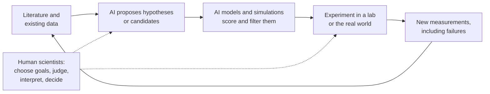
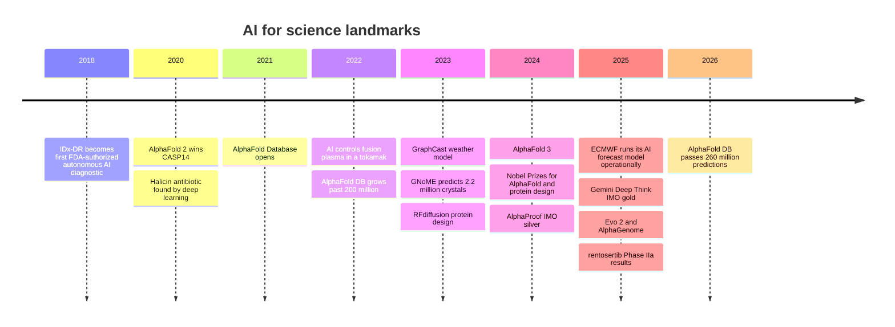
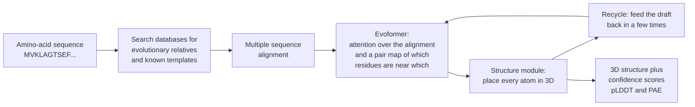
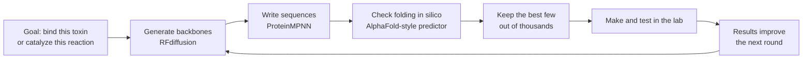
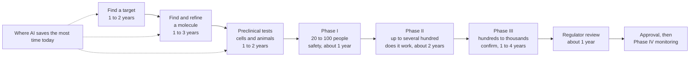

# Chapter 52: AI for Science and Medicine

*What AI has genuinely changed in biology, chemistry, weather, mathematics and medicine, how the landmark systems work, and why a breakthrough on a computer still has to pass the slow test of reality.*

## What you'll learn
- The three ways AI helps science: fast stand-ins for slow experiments, search through enormous possibility spaces, and automating parts of the research loop itself.
- How AlphaFold predicts a protein's 3D shape from its sequence, what its confidence colors mean, and why it earned a share of the 2024 Nobel Prize in Chemistry.
- How protein design, DNA language models and variant-effect predictors run biology in reverse and read the genome.
- Why an "AI-discovered drug" still takes about a decade, with the clinical-trial phases and attrition worked out in numbers.
- How AI weather models such as GraphCast, GenCast, WeatherNext 2 and ECMWF's AIFS forecast in minutes what supercomputers take hours to compute, and what they still depend on.
- What AI has actually achieved in mathematics, from formal proofs in Lean to olympiad gold, and how to read the claims.
- Where AI stands in medicine: imaging, pathology, the first autonomous diagnostic, ambient scribes, a famous sepsis-prediction failure, the FDA's list of AI devices and chatbots answering patients.

## Before you start
This chapter draws on several earlier ones. Chapter 9 (Is the Model Any Good?) explained sensitivity, specificity and base rates, which you will need for the medical sections. Chapter 15 (The Transformer) and Chapter 16 (Generative Models) explained attention and diffusion, the engines inside AlphaFold 3 and protein design tools. Chapter 17 introduced graph neural networks, which power AI weather models. Chapter 21 (Reasoning Models) showed why "verifiable rewards" such as proof checkers make mathematics a natural training ground, and Chapter 48 told the story of AlphaGo and reinforcement learning. Chapter 54 discusses neuro-symbolic AI, which overlaps with the mathematics section here. You do not need any biology or chemistry: every scientific idea is explained from scratch.

## Why science is a special kind of AI problem

### Prediction, search and automation

When you ask a chatbot a question, a good answer is one you find useful. In science, a good answer is one that turns out to be true when someone checks it against nature. That single difference shapes everything in this chapter.

AI helps science in three broad ways.

1. **Fast stand-ins for slow measurements.** Some questions can be answered by an experiment or a physics simulation, but slowly and expensively: months to determine a protein's shape in the lab, hours on a supercomputer to forecast the weather. A model trained on past results can give a good approximate answer in seconds. This is the AlphaFold and GraphCast story.
2. **Search through enormous spaces.** The number of possible drug-like molecules, protein sequences, crystal structures or proof steps is astronomically large. AI can propose promising candidates and rank them so humans test the best few. This is the protein design, materials and mathematics story.
3. **Automating the research loop.** Language-model agents can now read papers, propose hypotheses and plan experiments, and robotic labs can run some experiments without a person at the bench. This is the newest and least proven story.

> **Definition — Surrogate model:** A fast AI model trained to imitate a slow process, such as a physics simulation or a lab measurement, so that answers that once took hours or months can be estimated in seconds.

> **Definition — Simulation:** Using a computer to calculate how a system behaves by applying known rules, such as the equations of fluid flow for the atmosphere or quantum mechanics for molecules. Simulations can be accurate but very slow.

> **Definition — In silico:** Done by computer rather than in a living thing (in vivo) or a test tube (in vitro). An "in silico screen" tests millions of molecules by calculation before any are made.

> **Definition — Wet lab:** A laboratory where experiments are done with real chemicals, cells and organisms, as opposed to a "dry lab" of computers. Wet-lab confirmation is the final judge of most AI predictions in biology and chemistry.


*Figure 52.1: The AI-for-science loop. AI can speed up proposing and filtering, but the experiment remains the bottleneck and the final judge.*

> **Key idea:** In science, AI's output is a proposal, not a result. AlphaFold's structures, an AI weather forecast, a generated molecule and an AI "hypothesis" all become knowledge only after they are checked against reality. The most useful AI systems in science are the ones whose outputs can be checked quickly and cheaply.

### A short history of the landmarks


*Figure 52.2: A decade of AI-for-science landmarks covered in this chapter.*

## Proteins: from string to shape

### What a protein is

Almost everything that happens in your body is done by proteins. Hemoglobin carries oxygen in your blood. Insulin tells cells to absorb sugar. Antibodies grab viruses. Enzymes digest your lunch. Each protein is a molecular machine, and its job depends on its precise 3D shape, the way a key's job depends on the shape of its teeth.

> **Definition — Protein:** A molecular machine in living things, built as a chain of amino acids that folds into a precise 3D shape. The shape determines what the protein does.

> **Definition — Amino acid:** One of 20 small chemical building blocks that link together in a chain to make proteins. Biologists write each with a single letter, so a protein's recipe looks like a string such as "MVKLAGTSEF...".

A protein starts life as a long string of amino acids, typically a few hundred, linked in an order written in your DNA. That string then folds, in a fraction of a second, into a specific tangle of spirals, sheets and loops. In the 1960s the biochemist Christian Anfinsen showed that the string alone contains enough information to determine the folded shape: unfold a protein in a test tube and it can refold by itself. He shared the 1972 Nobel Prize in Chemistry for it. That raised a question that occupied biology for fifty years.

> **Definition — Protein folding problem:** The challenge of predicting a protein's 3D shape from its amino-acid sequence alone. It was considered one of biology's grand problems for about fifty years, until AlphaFold 2 largely solved it for single protein chains in 2020.

Why is it hard? Each link in the chain can twist in several ways. Suppose, as a rough illustration, each of 100 amino acids could take just 3 positions. The number of possible shapes is 3^100, about 5 × 10^47. A computer checking ten trillion (10^13) shapes per second would need about 5 × 10^34 seconds to try them all, more than 10^17 times the age of the universe (about 4 × 10^17 seconds). This is known as Levinthal's paradox: real proteins clearly do not search every shape, yet they find the right one almost instantly. Brute force was never an option.

### Measuring shapes the slow way

Scientists can measure protein structures in the lab, but it is hard. The classic method, X-ray crystallography, requires coaxing the protein into a crystal and firing X-rays through it. A newer method, cryo-electron microscopy, freezes proteins and photographs them with electron beams. Determining a single structure has often taken a year or more of skilled work, and some proteins resist every method.

> **Definition — X-ray crystallography:** A lab method that determines a molecule's 3D structure by growing it into a crystal and measuring how the crystal scatters X-rays. It produced most known protein structures.

> **Definition — Cryo-EM (cryo-electron microscopy):** A lab method that freezes molecules in thin ice and images them with an electron microscope, then combines many images into a 3D structure. It works for large complexes that will not crystallize.

> **Definition — PDB (Protein Data Bank):** The free global archive, founded in 1971, of experimentally determined 3D structures of proteins and other biological molecules. Its roughly two hundred thousand structures became AlphaFold's training data.

The result was a huge gap. Sequencing DNA got cheap, so scientists knew hundreds of millions of protein sequences, but only about two hundred thousand experimentally determined structures: roughly one structure for every thousand sequences. Predicting structure from sequence would close that gap.

Since 1994, a competition called CASP has tested prediction methods every two years. Organizers collect proteins whose structures have just been solved in the lab but not yet published, competitors predict them blind, and the predictions are scored against the real shapes.

> **Definition — CASP (Critical Assessment of protein Structure Prediction):** A blind competition held every two years since 1994 in which teams predict the 3D shapes of proteins whose structures have been measured but not yet released, giving an honest test of prediction methods.

### AlphaFold 2: how it works

At CASP14 in 2020, Google DeepMind's AlphaFold 2 achieved a median score of about 92 out of 100 on the competition's main accuracy measure, roughly the level of agreement between two lab measurements of the same protein. The organizers declared the problem largely solved for single protein chains.

The key insight comes from evolution. Proteins that do the same job in humans, mice, fish and yeast have similar but not identical sequences. Look at many of these relatives side by side and patterns appear. If two positions in the chain always change together, they are probably touching in the folded shape.

```
  Position:   1  2  3  4  5  6  7  8  9  10
  Human       M  V  K  L  A  G  T  S  E  F
  Mouse       M  V  K  L  S  G  T  A  E  F
  Fish        M  I  E  L  A  G  S  A  K  F
  Frog        M  V  E  L  A  G  T  S  K  Y
  Yeast       M  L  K  I  A  G  T  S  E  F
                    ^                 ^
         K (positive) at 3 pairs with E (negative) at 9;
         when 3 flips to E, 9 flips to K. They co-evolve,
         so they probably sit side by side in the 3D shape.
```
*Figure 52.3: Co-evolution in a multiple sequence alignment. Positions 3 and 9 swap together across species, a clue that they touch in the folded protein. AlphaFold learns to read thousands of such clues at once.*

> **Definition — Multiple sequence alignment (MSA):** A table lining up the sequences of related proteins from many species, position by position, so that conserved positions and positions that change together can be spotted.

> **Definition — Co-evolution:** The pattern in which two positions in a protein mutate together across species, because a change at one must be compensated by a change at the other to keep the protein working. It often means the two positions touch in 3D.

AlphaFold 2 turns that clue into a full structure in a few stages.


*Figure 52.4: The AlphaFold 2 pipeline. The core network, the Evoformer, uses attention to reason jointly about the evolutionary alignment and about which pairs of amino acids are close in space.*

1. **Gather relatives.** Search large sequence databases for related proteins and line them up into a multiple sequence alignment. Also look for any similar structures already in the PDB.
2. **Reason about pairs.** The Evoformer, a Transformer-style network (Chapter 15), repeatedly passes information between two representations: the alignment, and a "pair map" that estimates, for every pair of amino acids, how close they are and how they are oriented.
3. **Build the shape.** A structure module turns the pair map into 3D coordinates for every atom, treating each amino acid as a small rigid piece that it rotates and moves into place.
4. **Recycle.** The draft structure is fed back through the network a few times, refining it.
5. **Report confidence.** For each amino acid, AlphaFold outputs a confidence score from 0 to 100, and for each pair of regions, an estimate of how sure it is about their relative position.

> **Definition — AlphaFold:** Google DeepMind's family of protein-structure prediction systems. AlphaFold 2 (2020) predicts the shape of single protein chains from their sequences with near-experimental accuracy; AlphaFold 3 (2024) extends prediction to complexes of proteins with DNA, RNA and small drug-like molecules.

> **Definition — pLDDT (predicted local distance difference test):** AlphaFold's confidence score for each amino acid, from 0 to 100, usually shown as colors on the structure: dark blue for very confident (above 90), light blue, yellow, and orange for low confidence (below 50).

> **Definition — PAE (predicted aligned error):** AlphaFold's estimate of how far off the relative position of two parts of a protein might be, shown as a square heat map. Low error between two regions means AlphaFold is confident about how they sit relative to each other.

> **Analogy:** Protein folding is origami from a string of beads. The order of the beads determines the final shape, and the shape determines the job, like a key fitting a lock. AlphaFold learned to look at a bead string and picture the finished origami, partly by noticing which beads have "kept in touch" across a billion years of evolution.

### The AlphaFold Database and the Nobel Prize

In 2021 DeepMind and the European Bioinformatics Institute (EMBL-EBI) opened the AlphaFold Protein Structure Database, free to everyone, starting with nearly every protein in the human body. In 2022 they expanded it to over 200 million predictions, covering nearly every catalogued protein known to science. As of October 2026 the database describes over 260 million structure predictions, and that month it added AI-mined links from individual amino acids and mutations to the research papers that discuss them.

The effect on everyday biology was large. A graduate student who once spent a year trying to crystallize a protein can now look up a predicted structure in seconds, then use lab time to test a specific idea about how it works. In 2024 the Nobel Prize in Chemistry went half to David Baker for computational protein design and half jointly to Demis Hassabis and John Jumper of Google DeepMind for protein structure prediction. (The same year, the Physics prize went to John Hopfield and Geoffrey Hinton for foundational work on neural networks.)

> **Analogy:** The AlphaFold Database is a free library of 3D origami instructions for nearly every known protein. You still have to fold the paper yourself to be sure, but you no longer start from a blank sheet.

### AlphaFold 3 and the limits

AlphaFold 3, published in May 2024, predicts how proteins fit together with DNA, RNA, ions and small molecules such as drugs. It replaced the structure module with a diffusion model (Chapter 16) that starts from a cloud of randomly placed atoms and refines it into a structure. Researchers can use it through the free AlphaFold Server for non-commercial work, and DeepMind released the code for academic use in late 2024.

> **Definition — Ligand:** A small molecule, such as a drug, hormone or metal ion, that binds to a specific site on a protein. Predicting how a candidate drug sits in its target's pocket is central to drug design.

AlphaFold is extraordinary, and it has limits that matter.

- **Proteins move.** AlphaFold predicts one static shape, but many proteins flex, open and close, or switch shapes to do their jobs.
- **Some proteins have no fixed shape.** Large stretches of many proteins are floppy and disordered. AlphaFold usually marks these with low confidence, and that low confidence is itself useful information.
- **Confidence is not proof.** High pLDDT means the model is sure, not that it is right. Predictions for unusual proteins, designed proteins and the effects of single mutations need experimental checking.
- **Structure is not function.** Knowing a protein's shape does not tell you what it does in a living cell, which other molecules it meets, or how to make a drug that changes it safely.

> **Definition — Intrinsically disordered region:** A stretch of a protein that has no fixed 3D shape and stays flexible, often to grab different partners. AlphaFold usually shows such regions as orange, low-confidence spaghetti.

> **Watch out:** "AlphaFold solved biology" is a common overstatement. It solved a specific, central problem, predicting static structures of proteins, extremely well. Proteins move, interact and behave differently inside cells, and turning a structure into a medicine still takes years of experiments and trials. As of late 2026, no drug designed with AI had yet been approved.

> **Try it:** Go to alphafold.ebi.ac.uk and search "green fluorescent protein." Open a result, rotate the structure with your mouse, and look at the colors. The barrel-shaped core should be dark blue (very confident). Then search for a human protein you have heard of, such as "p53," and find the orange, low-confidence regions: those are its floppy, disordered parts.

## Designing proteins: running the problem backwards

### From prediction to invention

AlphaFold answers "given this sequence, what shape?" Protein design asks the reverse: "given the shape or job I want, what sequence will fold into it?" If you could answer that reliably, you could design enzymes that break down plastic, proteins that grab a virus, or sensors that glow in the presence of a toxin. Nature has explored only a tiny corner of all possible proteins.

> **Definition — Protein design:** Creating new amino-acid sequences that fold into a desired shape or perform a desired function, often one that no natural protein performs.

> **Definition — Binder:** A protein designed to attach tightly and specifically to a target molecule, such as a viral protein or a toxin, for example to block it.

> **Definition — Enzyme:** A protein that speeds up a specific chemical reaction, such as breaking down a sugar or a pollutant. Enzymes are the workhorses of biology and industry.

David Baker's lab at the University of Washington has led this field for decades. Its 2023 tool RFdiffusion applies the diffusion idea from image generation (Chapter 16) to protein backbones: start from random noise and denoise step by step into a new protein shape that meets your specification, such as "a shape that wraps around this part of that virus." A second tool, ProteinMPNN, then writes a sequence likely to fold into that backbone, a step called inverse folding. A structure predictor checks whether the sequence really folds as intended. Only the designs that pass every computational check are made in the lab.

> **Definition — Inverse folding:** Finding an amino-acid sequence that will fold into a given 3D backbone shape, the reverse of structure prediction.


*Figure 52.5: A modern protein design pipeline. Thousands of computer designs are filtered down to tens or hundreds that are actually made and tested.*

The results are real. In a 2025 *Nature* paper, Baker's group reported designed proteins that neutralize deadly "three-finger" toxins from snake venom and protected mice in lab tests, a possible route to cheaper, more stable antivenoms. Designed proteins have reached human use too: a COVID-19 vaccine built on a computer-designed protein nanoparticle was approved in South Korea in 2022.

### Protein language models

Another approach treats protein sequences like text. Just as a chatbot learns grammar by predicting missing words, a protein language model learns the "grammar" of proteins by predicting masked amino acids across hundreds of millions of natural sequences.

> **Definition — Protein language model:** A Transformer trained on huge numbers of protein sequences, predicting hidden amino acids the way a language model predicts hidden words. It learns which sequences are plausible, and can be used to predict structure and function or to generate new proteins.

The startup EvolutionaryScale's ESM3 model, announced in 2024, was trained on sequences, structures and functions together. Its developers used it to generate a new green fluorescent protein, which they called esmGFP, that glows in the lab yet shares only about 58 percent of its sequence with the closest known natural fluorescent protein. The company estimated the gap would have taken nature over 500 million years of evolution to cross.

> **Watch out:** Tools that design helpful proteins could in principle help design harmful ones. In a 2025 *Science* paper, a Microsoft-led team reported that AI-redesigned versions of known toxins could slip past the screening software that DNA-synthesis companies use to block dangerous orders, and the team worked with those companies to patch the screens before publishing. Biosecurity screening for AI-designed sequences is an active area (Chapter 58 covers biological misuse).

## Genomics: reading the code of life

### DNA in one minute

> **Definition — DNA:** The molecule that stores genetic instructions, written in an alphabet of four chemical letters (A, C, G and T). The human genome is about 3.1 billion letters long.

> **Definition — Gene:** A stretch of DNA that contains the instructions for making a protein (or another functional molecule). Humans have about 20,000 protein-coding genes, which make up only around 1 to 2 percent of the genome.

> **Definition — Genome:** An organism's complete set of DNA. Reading it is called sequencing.

Most of the genome does not code for proteins. Much of it is regulatory DNA: switches and dials that decide which genes turn on, in which cells, when and how strongly. A liver cell and a brain cell carry the same genome; regulation is why they differ.

> **Definition — Regulatory DNA:** Non-coding stretches of DNA that control when, where and how strongly genes are switched on. Many disease-linked DNA changes fall in these regions rather than in genes themselves.

Every person carries millions of small differences from the reference genome. Most are harmless. Some cause disease. When a clinic sequences a patient with a suspected genetic condition, it often finds a change that has never been seen before and cannot say whether it matters.

> **Definition — Variant:** A difference in a person's DNA compared with a reference sequence, such as one letter swapped for another.

> **Definition — Missense variant:** A single-letter DNA change that swaps one amino acid for another in the protein the gene encodes. Some are harmless; some break the protein and cause disease.

> **Definition — Variant of uncertain significance (VUS):** A genetic variant whose effect on health is unknown. These are the most common result of clinical genetic tests and a major frustration for patients and doctors.

### Three kinds of genome AI

**Variant-effect prediction: AlphaMissense (2023).** Google DeepMind adapted AlphaFold's ideas to ask whether a missense variant is likely harmful. It scored all of about 71 million possible single-amino-acid changes in human proteins and classified 89 percent of them as likely harmful or likely benign. Human experts had confirmed the effect of only about 0.1 percent of them. These are predictions to prioritize, not diagnoses: a doctor still needs other evidence.

**DNA language models: Evo 2 (2025).** The Arc Institute, with NVIDIA, trained Evo 2 on DNA itself, roughly 9 trillion letters from more than 100,000 species across the tree of life, according to its developers. Like a language model reading text, it learns which DNA sequences are "grammatical" in nature, and it can read up to about a million letters at once. It can score whether a mutation looks damaging and generate new DNA sequences.

> **Definition — DNA language model:** A model trained to predict DNA letters from their surroundings across many genomes, so it learns which sequences are biologically plausible and can estimate the effect of changes.

**Regulatory-code models: AlphaGenome (2025).** Google DeepMind's AlphaGenome reads up to a million DNA letters and predicts thousands of molecular measurements at once, such as how strongly nearby genes are expressed in different tissues and how their messages are spliced. That lets it estimate what a variant in the non-coding "dark matter" of the genome might do, which earlier tools largely could not.

> **At the frontier (2026):** Genomics models are moving from single tasks to "virtual cell" ambitions: models that combine DNA, gene activity in single cells, protein structure and the literature to predict how a cell will respond to a drug or a genetic change. As of late 2026 these are research projects with promising benchmarks; the hard test is whether their predictions hold up in experiments they were not trained on.

## Drug discovery: why an AI-discovered drug still takes a decade

### The pipeline

Headlines about "AI-discovered drugs" often give the impression that a model invents a cure and it reaches pharmacies soon after. To see why that does not happen, you need the whole pipeline.

> **Definition — Drug target:** A molecule in the body, usually a protein, whose activity a drug aims to change in order to treat a disease.

> **Definition — Small molecule:** A drug made of a relatively small chemical compound, such as aspirin, that can usually be taken as a pill. Most AI drug-design work so far has focused on small molecules.

> **Definition — Lead compound:** A promising molecule that acts on the target and is then refined by chemists to be more potent, safer and better absorbed before it becomes a drug candidate.

> **Definition — Preclinical studies:** Tests of a drug candidate in cells and animals, before any human receives it, to check that it works on the target and to look for toxicity.

> **Definition — Clinical trial:** A carefully regulated study that tests a treatment in people, run in phases of increasing size.

> **Definition — Phase I, II and III trials:** The three main stages of clinical testing. Phase I gives the drug to a small group (often 20 to 100 people) mainly to check safety and dosing. Phase II tests whether it works in up to several hundred patients. Phase III confirms benefit and safety in hundreds to thousands of patients, usually against a placebo or the current best treatment.

> **Definition — Randomized controlled trial (RCT):** A study in which participants are randomly assigned to receive the treatment or a comparison (such as a placebo), so that differences in outcomes can be attributed to the treatment. It is the gold standard for medical evidence.

> **Definition — Placebo:** An inactive treatment, such as a sugar pill, given to the comparison group in a trial so that the effect of simply being treated can be separated from the effect of the drug.

> **Definition — FDA (Food and Drug Administration):** The US government agency that decides whether drugs and medical devices can be sold in the United States, based on evidence of safety and effectiveness.


*Figure 52.6: The drug development pipeline with typical durations. AI mainly speeds up the left side. The clinical phases on the right are paced by human biology, patient recruitment and the need to watch outcomes over months or years.*

### The attrition, worked in numbers

The pipeline is long, and most candidates fail along it. One large industry analysis of clinical trials from 2011 to 2020 found that roughly half of drugs passed Phase I, under a third of those passed Phase II, a little over half of those passed Phase III, and about nine in ten of the drugs submitted were approved. Follow 100 drug candidates entering Phase I:

```
  Enter Phase I         100  ##################################
  Pass Phase I  (~52%)   52  ##################
  Pass Phase II (~29%)   15  #####
  Pass Phase III (~58%)   9  ###
  Approved      (~91%)    8  ###

  About 8 in 100 drugs that start human trials reach patients.
  Phase II, the first real test of whether a drug works,
  is where most candidates die.
```
*Figure 52.7: Clinical attrition. The percentages are rounded from a large 2011 to 2020 industry analysis and vary widely by disease area.*

Failures are what make drugs expensive. Published estimates of the full cost of bringing one new drug to market, counting the many failures along the way, vary widely, from around one billion to more than two billion dollars. Most of the cost sits in the clinical phases.

Now see where AI fits. Suppose AI shortens target discovery, molecule design and preclinical work from about 4.5 years to about 2 years, which is roughly what the most successful AI-first companies claim for their best programs.

```
  Years:          0   2   4   6   8   10  12
                  |---|---|---|---|---|---|
  Traditional     DDDDDDDDD112222333333RR   about 11.5 years
  AI-accelerated  DDDD112222333333RR        about 9 years

  D = discovery and preclinical   1 = Phase I   2 = Phase II
  3 = Phase III                   R = regulator review
  (each character is about half a year)
```
*Figure 52.8: Why speeding up discovery saves years, not a decade. The clinical phases are unchanged, so the total falls only from about 11.5 to about 9 years.*

The bigger prize would be raising the success rate in Phase II and III, because every late failure wastes years and hundreds of millions of dollars. Here the evidence is still thin. One 2024 analysis of the small number of AI-discovered molecules that had completed early trials found that roughly 80 to 90 percent passed Phase I, well above historical averages, while the Phase II success rate, about 40 percent, looked similar to the historical figure. The samples were small, and Phase I mainly tests safety, which is what AI-optimized molecules are designed for.

> **Key idea:** AI can compress the discovery stage from years to months, but a drug must still be tested in people over years, because the questions that matter (Is it safe? Does it work? Are the benefits worth the side effects?) can only be answered by human biology over time. The real test of AI drug discovery is whether it raises the share of candidates that succeed in Phase II and III.

### The cases

**Halicin (2020).** A team at MIT trained a neural network to predict whether molecules would kill bacteria, then screened a library of over 100 million compounds. It flagged halicin, a molecule originally studied for diabetes, which killed many drug-resistant bacteria in lab and mouse tests. It showed the power of AI screening; as of late 2026 it had not become an approved medicine.

**Rentosertib (Insilico Medicine).** This is the most advanced case where AI chose both the target and the molecule. Insilico's AI identified a protein called TNIK as a target for idiopathic pulmonary fibrosis, a deadly scarring of the lungs, and its generative chemistry software designed a molecule to block it. In June 2025 the company published Phase IIa results in *Nature Medicine*: in 71 patients over 12 weeks, lung capacity rose by an average of 98.4 mL in the group taking 60 mg daily, compared with a fall of 20.3 mL on placebo. That is an encouraging signal. It was also a small, short trial, and larger, longer trials are needed before anyone can say the drug works.

**Isomorphic Labs.** Google DeepMind's drug-discovery spin-out, led by Demis Hassabis, builds on AlphaFold 3 and has partnerships with large drug companies including Eli Lilly and Novartis. According to secondary reporting, it had not yet dosed a human by May 2026, with first-in-human trials expected by the end of 2026 after slipping from 2025. If accurate, that timeline is itself a lesson: even the best-funded, most capable AI drug company needs years to reach the clinic.

> **Watch out:** "AI-designed drug" covers very different claims: a molecule screened by AI from an existing library, a molecule generated by AI against a target humans chose, or a target and molecule both chosen by AI. Ask which one, then ask which trial phase it has reached and how many patients were in it. As of late 2026, AI-discovered drugs had reached mid-stage trials but none had been approved.
