# Chapter 53: AI Across Industries and at the Edge

*This chapter takes the tools from the rest of the book into banks, courtrooms, classrooms, call centers, factories, farms, battlefields and security teams, then shows how AI shrinks to fit inside your phone, your watch and a sensor the size of a coin.*

## What you'll learn

- A five-part template (tasks, data, risks, a real example, opportunities) that you can apply to any industry, including your own.
- How AI is used in finance, law, education, customer service, marketing, manufacturing and logistics, agriculture, defense and cybersecurity, with one real story for each.
- Why the same model can be a bargain in one industry and a liability in another, and how base rates and the cost of errors decide which.
- The debate over autonomous weapons and "human in the loop", with the strongest arguments on each side.
- Short tours of energy, insurance, real estate, hiring, government, journalism and sports, including some famous failures.
- Why some AI runs on your device instead of in a data center: latency, privacy, cost, battery and connectivity.
- How engineers make models small enough for phones and microcontrollers: quantization, pruning, distillation, TinyML and federated learning.
- Where the business and career opportunities are in industry AI and edge AI as of late 2026.

## Before you start

This chapter applies the whole book, so a few earlier chapters help. Chapter 9 (Is the Model Any Good?) explains precision, recall and false positives, which decide whether an industry system is useful or a nuisance. Chapter 10 (The Classical Machine Learning Toolkit) covers anomaly detection and forecasting, the workhorses of industry AI. Chapter 6 (The Math of AI, Part 2) covers base rates. The edge-AI half builds on Chapter 30 (Customizing Models) for quantization and distillation, Chapter 32 (From Transistor to Accelerator) for NPUs and TOPS, and Chapter 33 (Memory and the Memory Wall) for why memory speed sets how fast a model talks. Healthcare has its own treatment in Chapter 52, and recommenders and ads in Chapter 51, so this chapter only points to them.

## The same tools in many uniforms

When you ask Claude to summarize a contract, it does not know it is "doing legal AI". It is reading text and writing text. Paste in a loan application instead and it is suddenly "doing finance". This is the first thing to understand about AI in industry: there are not a hundred different technologies, one per industry. There are a handful of tools from earlier chapters, wearing different uniforms.

| Tool (where this book explains it) | What it does | Where it shows up in this chapter |
|---|---|---|
| Classification and anomaly detection (Chapter 10) | Sorts things and flags the unusual | Card fraud, money laundering, cyber intrusions, machine faults |
| Forecasting (Chapter 10) | Predicts a future number | Power demand, crop yields, equipment failure, credit losses |
| Computer vision (Chapter 45) | Reads images and video | Weed spotting, defect inspection, drone guidance, insurance claims |
| Speech (Chapter 46) | Hears and talks | Call centers, voice-clone fraud |
| Language models (Chapter 18) | Reads and writes text | Contracts, tutoring, support chats, marketing copy |
| Optimization and search (Chapter 48) | Finds the best plan among many | Delivery routes, schedules, trading |
| Robots (Chapter 49) | Acts in the physical world | Warehouses, farms, factories |

What changes from one industry to the next is rarely the model. It is four things around the model: the data you have, the cost of a mistake, who is accountable when something goes wrong, and what the law says. A model that is wrong 2% of the time is excellent for suggesting your next song. The same error rate is unacceptable for deciding who gets a mortgage, and terrifying for deciding what a drone attacks.

> **Definition — Use case:** One specific job an AI system does inside an organization, such as "flag suspicious card payments" or "draft replies to customer emails." An industry is made of many use cases, each with its own data, risks and payoff.

> **Definition — Decision support:** AI that gives a person a recommendation, score or draft, while the person makes the final call. A fraud score shown to an investigator is decision support.

> **Definition — Automation:** Letting a system carry out a task or decision without a person approving each instance. Most industry AI sits on a dial between pure decision support and full automation, and where the dial is set matters as much as the model.

### The five-part template

For every industry in this chapter we ask the same five questions:

1. **Tasks.** What does AI actually do here, day to day?
2. **Data.** What does it learn from and work on, and who owns that data?
3. **Risks.** What happens when it is wrong, and who pays?
4. **A real example.** One case from the real world, good or bad.
5. **Opportunities.** Where people are building careers and businesses.

You can run the same template on your own job. By the end of the chapter you will have done it nine times, and the tenth (yours) will be easy.

> **Key idea:** To understand AI in any industry, ask about the data, the cost of a mistake, who is accountable and what the law says. The model is usually the least industry-specific part of the system.

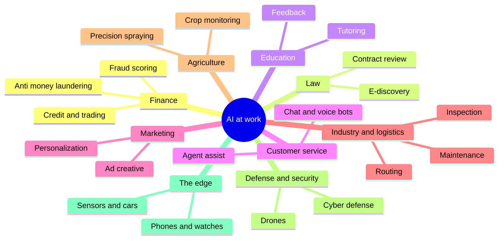

*Figure 53.1: The industries in this chapter and the main AI tasks in each. The same few techniques appear again and again under different names.*

> **Try it:** Ask your chatbot: "I work as a [your job]. List my 15 most repetitive tasks. For each, say which kind of AI could help (vision, speech, text, forecasting, optimization or robotics), what data it would need, and what would happen if it made a mistake." Save the answer. Exercise 10 turns it into a proper opportunity map.

## Finance: decisions in milliseconds

**Tasks.** Banks and payment companies were among the first big users of machine learning, decades before chatbots. Their main jobs for AI are scoring every card payment for fraud, monitoring accounts for money laundering, scoring loan applicants, trading, reading documents (statements, invoices, identity papers) and running robo-advisors that build and rebalance portfolios automatically. Language models added a newer layer on top: analysts summarizing company filings, compliance teams drafting reports, and service chatbots.

> **Definition — Fraud detection:** Spotting transactions or accounts that are likely to be criminal, usually by scoring each one with a model trained on past confirmed fraud. Card fraud scoring happens on every payment, in milliseconds.

> **Definition — Anti-money laundering (AML):** The rules and systems banks use to detect money from crime being moved and disguised. AI flags unusual patterns of transfers for human investigators, who decide whether to report them to authorities.

> **Definition — Know your customer (KYC):** Legal checks that a bank's customer is who they claim to be and is not, for example, on a sanctions list. AI now reads ID documents and compares selfies to ID photos.

> **Definition — Credit scoring:** Predicting how likely a borrower is to repay a loan. Because it decides who gets money and at what price, it is heavily regulated to prevent discrimination.

> **Definition — Algorithmic trading:** Buying and selling securities automatically by computer program. High-frequency trading is the extreme version, where programs trade in tiny fractions of a second, sometimes thousands of times per second.

**Data.** Finance has two data advantages that most industries envy. First, volume: billions of card payments a year, each with an amount, merchant, time, location and device. Second, fast labels. When you see a charge you did not make and dispute it, you have just labeled that payment as fraud, usually within weeks. Fast, plentiful, mostly correct labels are exactly what supervised learning needs (Chapter 8). Credit models also use credit-bureau files and account histories, and trading systems use market prices that change many times a second.

### How a fraud check works

When you tap your card at a café, the payment travels from the café's terminal to the café's bank, through the card network (such as Visa or Mastercard) to the bank that issued your card, and back. Somewhere in that chain, usually at the network and again at your bank, a model scores the payment. It looks at features such as: is this amount normal for you, is this merchant type normal for you, were you in another country an hour ago, is this a new device? The score must be ready in milliseconds, because the whole approval should take a second or two.

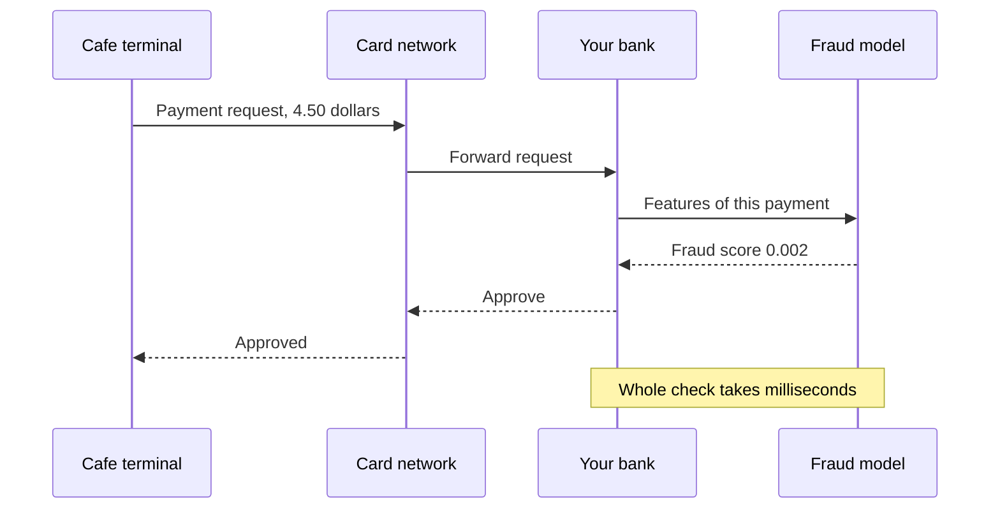

*Figure 53.2: A card payment and its fraud check. The model only produces a score; the bank's rules turn the score into approve, decline or "send a code to the customer's phone."*

### Worked example: why most fraud alerts are innocent

Suppose, for illustration, that 1 in 1,000 card payments is fraud. A bank's model catches 95% of fraud (its recall, Chapter 9) and wrongly flags only 1% of honest payments. That sounds excellent. Now run it on 1,000,000 payments:

- Fraud: 1,000 payments. The model catches 950 and misses 50.
- Honest: 999,000 payments. The model wrongly flags 1% of them, which is 9,990.
- Total flagged: 950 + 9,990 = 10,940. Of those, only 950 are fraud.
- Precision = 950 ÷ 10,940 ≈ 8.7%.

More than 9 of every 10 alerts are honest customers. This is the base-rate trap from Chapter 6, and it explains a lot about how banks behave. They rarely decline a payment outright on a moderate score. Instead they "step up": send you a one-time code or a push notification, which costs you five seconds and catches the criminal who does not have your phone.

The decision also depends on money at stake. Say the model gives a $400 payment a 2% chance of being fraud. The expected loss if the bank approves it is 0.02 × $400 = $8. If a wrong decline costs the bank more than $8 (a lost fee, an annoyed customer who moves their spending to another card), approving is the rational choice. The same 2% on a $4,000 payment means an expected loss of $80, and a step-up check becomes worth it.

> **Key idea:** In finance a model only produces a probability. The business turns it into an action by comparing expected losses: chance of fraud × amount at risk versus the cost of annoying an honest customer.

### The risks

- **False declines.** Declining a good customer loses money and trust. A fraud system tuned only to catch fraud would be easy to build: decline everything.
- **Adversaries who adapt.** Unlike weather, fraudsters fight back. They probe which patterns get blocked and change tactics, so models drift out of date in weeks. Criminals now use AI too, including cloned voices and synthetic identities (Chapter 58).
- **Fairness and the law.** In the United States, the Equal Credit Opportunity Act (1974) bans lending discrimination by race, sex, religion and other traits, and requires lenders to tell a rejected applicant the specific reasons. Regulators have said that a complex algorithm is no excuse for vague reasons. A model that never sees race can still discriminate through proxies such as postcode (Chapter 11).
- **Runaway code.** On May 6, 2010, the "Flash Crash" briefly wiped nearly 1,000 points off the Dow Jones index within minutes before prices largely recovered, a reminder that automated traders reacting to each other can spiral.

> **Definition — Explainability:** How well people can understand why a model produced a particular output. In regulated decisions such as credit, some explainability is a legal requirement, not a nice extra.

**A real example: Knight Capital, August 1, 2012.** Knight Capital was one of the largest trading firms on US stock exchanges. A software deployment went wrong: old, unused code was accidentally reactivated on one of its servers, and it began firing off orders it was never meant to send. In about 45 minutes the firm lost roughly $440 million and needed a rescue. No machine learning was involved; it was plain automation with no working off switch. That is the lesson. Every automated decision system needs limits, kill switches and people watching who are empowered to pull the plug.

**Opportunities.** Real-time fraud detection that resists deepfaked voices and synthetic identities; automation of the paperwork side of AML (gathering account history and drafting case narratives for investigators); credit models that are both accurate and explainable; and model validation, a steady, well-paid career that combines statistics with regulation (US banks must have every model they rely on independently tested, under Federal Reserve guidance known as SR 11-7). Open problems include fraudsters armed with AI and proving fairness to regulators.

> **At the frontier (2026):** The newest pattern in large banks is moving from scores to agents. Instead of handing an investigator a number, an LLM-based agent gathers the account history, checks related accounts, drafts the case write-up and hands a person a ready-to-review file. The person still makes and signs the decision, because the bank, not the software, is legally accountable.

## Law: reading at superhuman volume

**Tasks.** Lawyers read. A large lawsuit can involve millions of emails and documents that one side must hand over to the other, and someone has to decide which are relevant and which are privileged. AI's legal jobs are document review in discovery, contract review (finding unusual clauses across thousands of agreements during a merger), legal research (finding relevant cases and statutes), drafting (first drafts of letters, motions and contracts) and, for the public, "access to justice" tools that help people with tenant disputes or small claims who cannot afford a lawyer.

> **Definition — E-discovery:** The process in a lawsuit of collecting, reviewing and exchanging electronic documents such as emails, chats and files. Large cases involve millions of documents, which is why it was one of law's first uses of machine learning.

> **Definition — Technology-assisted review (TAR):** Using a machine-learning classifier, trained on lawyers' decisions about a sample of documents, to rank or sort the rest by likely relevance. US courts first approved it in a 2012 case, Da Silva Moore v. Publicis Groupe.

**Data.** Case law and statutes are public in principle, but much of the organized, searchable version sits in paid databases. The most valuable data, a firm's own past contracts, briefs and client emails, is confidential. Lawyers owe their clients secrecy, and sharing a client's documents with the wrong service can waive legal protections. This is why law firms use AI tools with strict contractual promises not to train on or retain their data (Chapter 31).

**Risks.** The famous one is invented citations. A language model writes the most plausible next words (Chapter 18), and a plausible case name with a plausible citation number is exactly what a legal brief looks like. Retrieval (Chapter 27) helps a lot but does not remove the problem: a 2024 Stanford study found that commercial legal-research tools built on retrieval still gave incorrect or poorly supported answers to a substantial share of test questions, roughly one in six or worse. Other risks are confidentiality, rules against practicing law without a license (which limit how far a tool may advise the public directly), over-reliance by junior lawyers who stop learning to check sources, and bias when AI is used for decisions such as bail (Chapter 58 covers risk scores in criminal justice).

**A real example: Mata v. Avianca (2023).** Lawyers suing the airline Avianca in a federal court in New York filed a brief citing court decisions that did not exist. ChatGPT had invented them and, when one lawyer asked it whether the cases were real, it said yes. The judge fined the lawyers and their firm $5,000 and ordered them to write to the real judges who had been falsely named as authors of the fake opinions. Since then, courts have seen a steady stream of similar cases, and some judges now require lawyers to certify that they checked any AI-assisted filing.

> **Watch out:** "The AI gave me the citation, so it exists" is the exact mistake in Mata v. Avianca. Asking the same model whether its citation is real proves nothing; it will often say yes. Check every citation in an official source before you rely on it, whether you are a lawyer or writing a school essay.

The contrast is instructive. Technology-assisted review has been accepted by courts since 2012 because it has a measurable error rate, it is checked by sampling, and a human lawyer signs off. The failures came when a fluent tool was treated as an authority instead of a draft.

**Opportunities.** Contract analysis and e-discovery, tools that check every citation in a brief automatically, legal-operations roles that set up and govern AI inside firms, and access-to-justice products for people priced out of lawyers. Vertical legal AI companies (Harvey is the best known) were among the fastest-growing application startups of 2025–26 (Chapter 61). Open problems: hallucinated citations, confidentiality and the rules on unauthorized practice.

## Education: tutor or answer machine?

**Tasks.** Tutoring that guides a student step by step, feedback on essays and problem sets, lesson planning and grading help for teachers, accessibility (reading text aloud, live captions, simplified versions of hard texts, translation for families), and language practice partners that never get tired.

> **Definition — Intelligent tutoring system:** Software that guides a learner through problems one step at a time, giving hints and feedback matched to their mistakes rather than just the answer. Older systems used hand-written rules; newer ones use language models.

> **Definition — Effect size:** How big a difference an intervention makes, usually measured in standard deviations. An effect size of 0.3 moves an average student from the 50th percentile to about the 62nd.

### Why tutoring is the prize

In 1984 the educational psychologist Benjamin Bloom reported that students taught one-to-one by a tutor performed about two standard deviations better than students in a normal classroom. On a bell curve (Chapter 6), two standard deviations moves the average student from the 50th percentile to about the 98th. Bloom called it the "2 sigma problem": we know tutoring works wonders, but we cannot afford a human tutor for every child. Later studies found smaller effects than Bloom's, but tutoring remains one of the most reliably effective interventions in education. An AI tutor for every student is the obvious dream.

Here is the worked meaning of those numbers. Suppose a class's test scores average 60 with a standard deviation of 10.

- An effect size of 0.3 raises the average student to 60 + 0.3 × 10 = 63, which beats about 62% of the original class.
- An effect size of 2.0 raises them to 60 + 2 × 10 = 80, which beats about 98% of the original class.

**Data.** Student work and interaction logs, which are sensitive. In the US, the Family Educational Rights and Privacy Act (FERPA, 1974) protects student education records, and the Children's Online Privacy Protection Act limits data collection from children under 13. Most tutoring data so far is in English, so tools work better for some students than others.

**Risks.** The biggest is that AI can do the learning for the student. Learning requires effort; an assistant that hands over answers removes the effort. The second risk is cheating, and the tempting fix, AI-text detectors, does not work well. A 2023 Stanford study found popular detectors flagged more than half of essays written by non-native English speakers as AI-written, and OpenAI withdrew its own detector in 2023, citing low accuracy. Other risks: confident wrong answers in math and science, privacy, and a widening gap between students who learn to use AI well and those who use it to skip work.

> **Definition — AI-text detector:** A tool that claims to tell whether text was written by AI. Current detectors are unreliable, with high false-positive rates for some groups of writers, so they should never be the sole basis for accusing a student.

**A real example: the Turkish high-school experiment.** In a field experiment published in 2024–25, researchers gave nearly 1,000 high-school math students in Turkey access to GPT-4 during practice sessions. One group got a plain chat assistant; another got a "tutor" version prompted to give hints and not answers. With the plain assistant, students solved more practice problems, but on a later exam without AI they did worse than students who never had it. The tutor version largely avoided that harm. The lesson is in the design, not the model: the same model can help or hurt learning depending on whether it does the thinking for you.

> **Analogy:** An AI that gives answers is a forklift at the gym. The weights go up, but you do not get stronger. A good AI tutor is a spotter: it lets you struggle and only steps in to stop you getting stuck.

Use is already near universal. The Stanford AI Index 2026 reports that more than 80% of US high-school and college students use AI for schoolwork. Schools are responding by redesigning assessment: more in-class writing, oral exams, graded drafts and process, and assignments that require students to critique AI output instead of pretending it does not exist.

> **Try it:** Paste this into your chatbot: "Act as a patient math tutor. Never give me the final answer. Ask me one guiding question at a time, and if I am wrong, give me a hint, not the solution. Problem: a shirt costs $40 after a 20% discount; what was the original price?" Then try the same problem with no instructions. Notice how different it feels to learn from each.

**Opportunities.** Tutoring products designed for learning rather than answer delivery, teacher-planning and feedback tools (teachers' time is the scarcest resource in school), assessment redesign consulting, accessibility tools, and tutors for low-resource languages. The open problem is proving learning gains in rigorous trials rather than measuring time-on-app.

## Customer service: the Klarna story, both sides

**Tasks.** Chat and voice bots that answer questions and take simple actions such as a refund or an address change; agent assist, where AI listens to a human agent's call, suggests answers and fills in the notes; routing each contact to the right place; translation; and quality assurance that scores every conversation instead of a small sample.

> **Definition — Containment rate:** The share of customer contacts an automated system resolves without handing over to a human, also called deflection rate. A high containment rate saves money only if customers are actually helped.

> **Definition — Agent assist:** AI that supports a human service agent during a conversation, by suggesting replies, surfacing policies and writing the summary afterward, rather than replacing the agent.

**Data.** Past tickets and call transcripts, the help center, the company's policies, and live access to order and account systems through tools (Chapter 28). The knowledge base matters more than the model: a bot reading an out-of-date refund policy will confidently quote the wrong one.

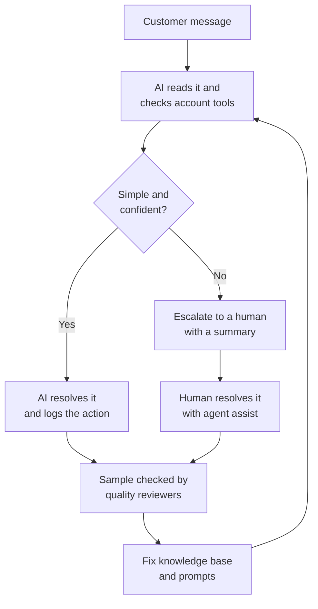

*Figure 53.3: A hybrid service desk. The design questions are where to set the "confident" threshold, how easy escalation is, and whether mistakes flow back into improvements.*

### The evidence on agents

The best-known study of AI in a contact center followed more than 5,000 support agents at a software company as an AI assistant was rolled out (Brynjolfsson, Li and Raymond). Productivity, measured as issues resolved per hour, rose 14% on average, and 34% for the least experienced agents, while the most skilled agents gained little. The AI had effectively bottled the know-how of the best agents and handed it to the newest ones. This "novices gain most" pattern recurs across many studies (Chapter 60).

**A real example: Klarna.** In February 2024 the payments company Klarna announced that its AI assistant had handled 2.3 million customer conversations in its first month, which it said was the work of about 700 full-time agents. It became the most quoted example of AI replacing service jobs. In 2025 Klarna's chief executive said the company would again invest in human customer service, acknowledging that the push for lower cost had hurt quality. Both halves of the story are true: AI can handle a large volume of routine contacts, and customers still need a reachable human for the messy, emotional or unusual ones.

**Risks.** A wrong answer can bind the company. In a 2024 Canadian case, Moffatt v. Air Canada, the airline's website chatbot told a grieving passenger he could claim a bereavement discount after travel, which contradicted the airline's real policy. The tribunal rejected Air Canada's argument that the chatbot was responsible for its own words and ordered the airline to pay. Other risks: "doom loops" where customers cannot reach a person, prompt injection through customer messages (Chapter 31), and effects on a large entry-level workforce (Chapter 60).

> **Definition — Outcome-based pricing:** Charging for AI by results, such as per resolved customer issue, instead of per user seat or per token. Some customer-service AI vendors, such as Sierra, price this way.

### Worked example: what does an AI service desk really cost?

Use made-up but realistic-shaped numbers. A company handles 100,000 contacts a month, and a human-handled contact costs $6.

- All human: 100,000 × $6 = $600,000 a month.
- With AI: the AI resolves 60,000 contacts at $1 each = $60,000. Humans handle the other 40,000 at $6 = $240,000. Total $300,000. Half the cost.
- Now the hidden part. Suppose 10% of the AI's "resolutions" were not really resolved, and those 6,000 customers come back angrier, needing a longer human contact at $9 each: 6,000 × $9 = $54,000. The total is now $354,000, and you have 6,000 unhappier customers.

The containment rate looked like 60%. The real resolution rate was 54%. Measuring the second number, not the first, is most of the job.

**Opportunities.** Hybrid human and AI service desks, multilingual support, voice receptionists for clinics, restaurants and trades (Chapter 46), conversation designers who write the flows and guardrails, quality analysts, and outcome-priced service agents.

## Marketing: personalization, creative at scale and GEO

**Tasks.** Personalizing emails, offers and product suggestions (the recommender machinery of Chapter 51); automated ad campaigns, where you give a platform a budget and a goal and its models choose audiences and placements; generating ad creative (copy, images, short videos) in many variations; testing which variations work; social listening, where sentiment analysis reads what people say about a brand (Chapter 54); and, newest, making sure AI assistants mention your brand when people ask them for recommendations.

> **Definition — First-party data:** Data a company collects directly from its own customers, such as purchases, site visits and email clicks. It became more valuable after privacy changes limited tracking across other companies' apps and sites.

> **Definition — Creative testing:** Running many versions of an ad or message to see which performs best. Generative AI made it cheap to produce hundreds of variants instead of three.

> **Definition — Generative engine optimization (GEO):** Shaping content so that AI answer engines and chatbots find, trust and cite it, the successor to search engine optimization. Chapter 51 explains how answer engines choose sources.

**Data.** First-party data, the platforms' own data about their users, brand guidelines and past campaign results. The data landscape shifted when Apple introduced its App Tracking Transparency prompt in 2021, which asks iPhone users whether apps may track them across other companies' apps. Many said no, which pushed advertisers toward the platforms' own automated tools, since those platforms still see what happens on their own services.

**A real example: automated campaigns.** Meta's Advantage+ and Google's Performance Max let an advertiser supply a budget, a goal (such as purchases), and a set of images, videos and text. The platform's models then decide who sees which ad, where and when, and increasingly generate or adapt the creative themselves. Small businesses get targeting that once needed an agency. The cost is control and visibility: the advertiser often cannot see exactly why the system made its choices.

**Risks.** Off-brand or false claims produced at scale (advertising law applies to AI-written ads exactly as to human ones), fake reviews (the US Federal Trade Commission adopted a rule in 2024 banning fake reviews, including AI-generated ones), privacy, and sameness when every competitor uses the same tools on the same prompts.

**Opportunities.** Creative testing and production for small brands, AI-search visibility consulting, brand-safety review of AI content, and retail media networks (stores selling ads on their own sites and apps). The open problem is measurement: knowing whether an ad caused a sale (Chapter 54 explains why that is hard).

## Manufacturing and logistics: eyes, ears and routes

**Tasks.** Visual inspection of products on the line; predictive maintenance of machines; digital twins of factories and supply chains; warehouse robots for moving and picking; route optimization for delivery fleets; demand forecasting and scheduling.

> **Definition — Machine vision inspection:** Cameras plus models that check products for defects (scratches, missing parts, misaligned labels) at line speed, replacing or assisting human inspectors.

> **Definition — Predictive maintenance:** Using sensor data such as vibration, temperature and current to predict when a machine will fail, so it can be fixed in a planned stop instead of breaking down unexpectedly.

> **Definition — Digital twin:** A live virtual replica of a physical system, such as a factory line, an engine or a power grid, kept in sync with sensor data and used to monitor it and test changes safely.

> **Definition — Operations research:** The mathematics of making the best decisions under constraints, such as scheduling, routing and inventory. Much of what is sold as "AI" in logistics is operations research.

> **Definition — Vehicle routing problem:** The puzzle of choosing routes for a fleet of vehicles to serve many stops at the lowest cost, respecting time windows and capacities. The number of possible routes explodes so fast that exact answers are impossible at scale, so companies use clever approximations.

**Data.** Sensor time series (thousands of readings per second from a vibration sensor), camera images, maintenance logs and orders. Manufacturing has an unusual data problem: good factories rarely make defects, so there are few examples of what "bad" looks like. Engineers work around it with anomaly detection trained only on normal parts (anything unusual gets flagged, Chapter 10) and with synthetic images of defects (Chapter 47).

### Worked example: is predictive maintenance worth it?

A plant runs 100 identical pumps. Each fails on average once every two years, so about 50 fail per year. An unplanned failure costs $50,000 in lost production and emergency repair; a planned repair costs $8,000. All figures here are illustrative.

- Without AI: 50 failures × $50,000 = $2,500,000 a year.
- With a vibration model that warns of 80% of failures at least a week ahead: 40 planned repairs × $8,000 = $320,000; 10 missed failures × $50,000 = $500,000.
- False alarms: say 200 a year across the plant, each costing a $1,000 inspection = $200,000.
- Total with AI: $320,000 + $500,000 + $200,000 = $1,020,000. Savings: about $1.48 million a year, before the cost of sensors and software.

Notice what would kill the business case: a model that raised 2,000 false alarms a year ($2 million) or one that warned only a day ahead, too late to order parts.

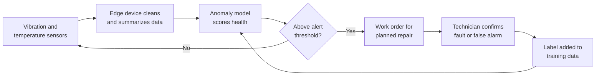

*Figure 53.4: A predictive maintenance loop. The technician's confirmation is the label that makes next year's model better.*

**Risks.** Alarm fatigue (people stop responding to a system that cries wolf), security of factory networks once machines are connected to the internet, safety around robots, models that drift when a machine is rebuilt or a product changes, and lock-in to one vendor's platform.

> **Definition — Operational technology (OT):** The computers and networks that control physical equipment such as factory lines, pipelines and power plants. Connecting OT to the internet for AI brings new cybersecurity risks, because a hacked controller can cause physical damage.

**A real example: UPS's routing system.** Since the 2010s UPS has used a route-optimization system called ORION to plan the order of stops for its US delivery drivers. UPS has said it saves on the order of 100 million miles of driving a year (a company figure). It is mostly operations research, not deep learning, which is the point: in logistics, "AI" often means very good optimization. On the robotics side, Agility Robotics says its Digit humanoid had moved 100,000 totes at a GXO warehouse by November 2025 (a company claim; Chapter 49 covers humanoids honestly).

**Opportunities.** Visual inspection for small manufacturers (now cheap, because general vision models need only a few labeled examples), predictive-maintenance retrofits with bolt-on wireless sensors, scheduling and logistics optimization for mid-sized firms, robots-as-a-service, and integration work: connecting old machines to new software is where many projects actually stall.

## Agriculture: one plant at a time

**Tasks.** Spraying individual weeds instead of whole fields, predicting yields, monitoring crops from drones and satellites, watching livestock with cameras and sensors for signs of illness or lameness, scheduling irrigation, and robotic harvesting (still hard for delicate crops).

> **Definition — Precision agriculture:** Using sensors, cameras, GPS and AI to treat each plant or patch of a field according to its needs, instead of treating the whole field the same way.

> **Definition — NDVI (Normalized Difference Vegetation Index):** A simple number computed from how much red and near-infrared light a patch of ground reflects. Healthy leaves reflect lots of near-infrared and absorb red, so high NDVI means vigorous plants.

### Worked example: reading plant health from light

NDVI = (NIR − Red) ÷ (NIR + Red), where NIR is the share of near-infrared light reflected and Red is the share of red light reflected.

- A healthy patch reflects 50% of near-infrared and 8% of red: (0.50 − 0.08) ÷ (0.50 + 0.08) = 0.42 ÷ 0.58 ≈ 0.72.
- A stressed patch reflects 30% of near-infrared and 15% of red: (0.30 − 0.15) ÷ (0.30 + 0.15) = 0.15 ÷ 0.45 ≈ 0.33.

A satellite or drone computes this for every pixel. A map where one corner of a field drops from 0.7 to 0.3 tells a farmer exactly where to walk to look for pests, disease or a broken irrigation line. Machine learning goes further, combining NDVI over time with weather and soil data to forecast yield.

**Data.** Images from cameras on tractors and sprayers, drones and satellites; soil sensors; weather; and yield maps recorded by combines at harvest. Ownership is a live issue: is data from a farmer's field the farmer's, or the equipment maker's?

**A real example: John Deere's See & Spray.** Deere bought the startup Blue River Technology in 2017. Its See & Spray machines carry cameras along the spray boom; a model tells crop from weed in each frame, and individual nozzles fire only at weeds, while the machine drives across the field. Deere reports large reductions in herbicide use (company-reported figures). The arithmetic shows why: if weeds cover 10% of a field, spraying only them plus a safety margin could in principle cut herbicide by most of what a blanket spray uses, though real savings depend on how weedy the field is.

**Risks.** Weak rural connectivity (one reason the model runs on the machine, as the edge-AI section explains), high equipment cost for small farms, missed weeds that cost yield, lock-in and right-to-repair disputes, and data ownership.

**Opportunities.** Precision spraying and its services, livestock health monitoring, drone and satellite analytics for insurers and lenders as well as farmers, robotic harvesting (a hard open problem), and phone-based advice for smallholders in low-income countries, where most of the world's farmers work.

## Military and defense: the hardest questions

**Tasks.** Analyzing satellite and drone imagery, translating and sorting intercepted communications, predicting maintenance for vehicles and aircraft, defending networks, simulation and training, counter-drone defense, and the controversial ones: targeting-support systems that suggest targets to humans, and drones that navigate or attack with increasing autonomy.

> **Definition — Lethal autonomous weapon system (LAWS):** A weapon that can select and engage targets without further human intervention once activated. How to define, limit or ban such systems has been debated at the United Nations for a decade.

> **Definition — Human in the loop:** A design where a person must approve each decision before the system acts. "Human on the loop" means the system acts by itself while a person supervises and can intervene; "human out of the loop" means no person is involved once it is activated.

> **Definition — Terminal guidance:** The control of a weapon in the final stage of its flight, as it closes on its target. Autonomous terminal guidance means the weapon steers itself onto the target for that last stretch.

> **Definition — Automation bias:** The human tendency to over-trust a machine's suggestions, accepting them without real scrutiny, especially under time pressure. It can turn "human in the loop" into a rubber stamp.

> **Definition — Meaningful human control:** The principle, used in diplomatic debates, that people should keep enough understanding, time and authority over weapons to be morally and legally responsible for their effects.

> **Definition — Dual-use:** Technology that can serve both civilian and military purposes, or both beneficial and harmful ones. Vision models, drones and code-writing AI are all dual-use.

**Data.** Imagery, signals and sensor feeds, much of it classified; very few labeled examples of rare, high-stakes events; and adversaries who actively deceive with camouflage, decoys and electronic jamming. A war is the ultimate case of a world that changes faster than training data.

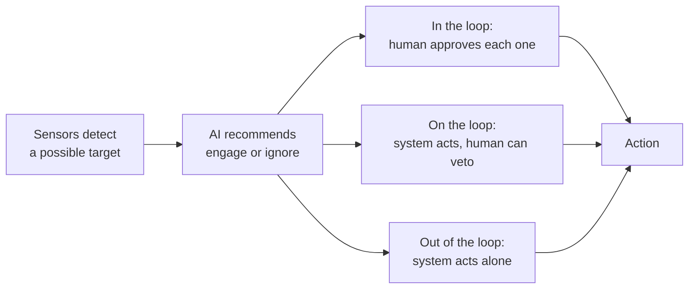

*Figure 53.5: Three ways to place a human relative to an automated decision. The debate is about which is acceptable for which kinds of weapon and target.*

**A real example: drones in Ukraine.** In the war in Ukraine, cheap drones flown by remote pilots became central weapons, and both sides jam the radio links that pilots depend on. One response has been onboard vision that lets a drone lock onto a target the pilot selected and steer itself for the final approach even if the link is cut: autonomous terminal guidance. A human still chooses the target; the machine finishes the job. That small step, driven by jamming rather than by policy, shows how battlefield pressure pushes toward autonomy. Separately, investigative reports in 2024 described militaries using AI decision-support systems to generate targets at high speed, raising the question of how meaningful human review is when an officer has seconds per decision; the militaries involved disputed parts of that reporting.

### Worked example: the speed argument

Imagine 40 incoming drones, each flying at 150 km/h, which is 2.5 km per minute. If a human must authorize each interception and takes 3 seconds per decision, approving all 40 takes 120 seconds, two minutes. In that time each drone covers 5 km. This arithmetic is why defensive systems against fast-moving swarms are drifting from "in the loop" to "on the loop", and why some navies have run automatic close-in defense systems such as Phalanx against incoming missiles since the 1980s.

### The debate, stated fairly

**The strongest case for strict limits or a ban.** Machines cannot exercise the judgment the laws of war require: telling a combatant from a civilian, or weighing whether expected civilian harm is proportionate. When an autonomous system kills the wrong people, responsibility dissolves between the programmer, the commander and the manufacturer. Cheap autonomous weapons lower the cost of starting wars and will spread to terrorists and criminals. Machine-speed conflict can escalate faster than diplomats can act. And automation bias means a nominal human in the loop may not be meaningful at all.

**The strongest case against a ban (and for regulation instead).** Adversaries who ignore a ban would gain an advantage. Some autonomy is defensive and already decades old. Against drone swarms, human reaction time is simply too slow. A well-designed system might be more discriminating than an exhausted, frightened soldier. And "autonomy" is a spectrum without a clear line, so a ban is hard to define or verify; rules on testing, accountability and human judgment may protect more people.

**Where policy stands.** US Department of Defense Directive 3000.09 (2012, updated in 2023) requires that autonomous weapon systems allow "appropriate levels of human judgment over the use of force." States have discussed lethal autonomous weapons under the UN Convention on Certain Conventional Weapons since 2014. In December 2023 the UN General Assembly passed its first resolution on autonomous weapons, and the UN Secretary-General and the International Committee of the Red Cross jointly called for a binding treaty by 2026. As of late 2026, negotiations were still under way and no binding treaty was in force; check the current status. AI labs' own rules about military use also became contested, from Google employees' 2018 protests over Project Maven to public disputes between labs and governments in 2026 over limits on autonomous weapons and surveillance (Chapter 60).

**Opportunities.** Counter-drone systems, testing and evaluation of autonomous systems, AI red-teaming, and policy and diplomacy roles that need people who understand both the technology and the law of armed conflict. Open problems: making human control meaningful in practice, preventing accidental escalation, and verifiable international norms.

## Cybersecurity: AI on both sides of the wall

**Tasks.** Defenders use AI to spot unusual logins and network traffic, classify malware, filter phishing email, triage the flood of alerts in a security operations center, find vulnerabilities in code before attackers do, and increasingly write the patches. Attackers use the same tools to write convincing phishing in any language, clone voices for fraud, scan for weaknesses and automate the steps of an intrusion.

> **Definition — Vulnerability:** A flaw in software or a system that an attacker could use to do something they should not be able to, such as read private data or take control.

> **Definition — Exploit:** A piece of code or technique that takes advantage of a vulnerability to actually carry out an attack.

> **Definition — Zero-day:** A vulnerability that the software's maker does not yet know about, so there is no fix. Its name comes from the defenders having had zero days to prepare.

> **Definition — Fuzzing:** Automatically feeding a program huge numbers of random or mutated inputs to see whether any make it crash or misbehave, a classic way to discover vulnerabilities.

> **Definition — Phishing:** Tricking people into revealing passwords, paying money or installing malware with messages that pretend to come from someone trusted. AI makes phishing more fluent and more personalized.

> **Definition — Security operations center (SOC):** The team, often working around the clock, that monitors an organization's systems for attacks and responds to alerts.

**Data.** Logs of every login, connection and file access (billions of events a day in a large company), malware samples, code, and threat intelligence shared between companies.

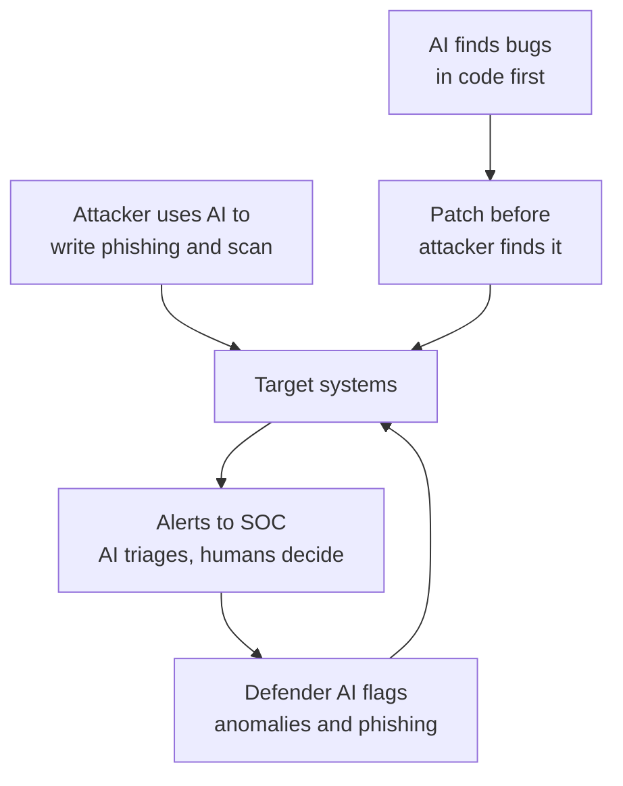

*Figure 53.6: AI on both sides. The defender's advantage comes from finding and fixing flaws first; the attacker's comes from scale and speed.*

### Worked example: alert triage

A security team receives 10,000 alerts a day, of which 50 (0.5%) are real attacks. Analysts can properly investigate about 1,000 a day. An AI triage system auto-closes the 9,000 alerts it is most confident are harmless and sends 1,000 to humans. Suppose 48 of the 50 real attacks are among those 1,000 and 2 slip into the auto-closed pile. The team now reviews every alert it is sent, instead of skimming 10,000, and catches 48 of 50 attacks, 96%. Whether missing 2 a day is acceptable depends on what those 2 could do, which is why teams sample-check the auto-closed pile and tune the threshold over time.

**A real example: Big Sleep finds a real bug.** In November 2024, Google announced that Big Sleep, an AI agent built by its Project Zero security team and Google DeepMind, had found an exploitable memory-safety flaw in SQLite, the database engine embedded in billions of phones, browsers and devices. The flaw was fixed before it reached an official release, so no users were affected. In August 2025, the finals of DARPA's AI Cyber Challenge at the DEF CON conference pitted autonomous systems against each other to find and patch vulnerabilities in open-source code. On the attack side, in November 2025 Anthropic reported disrupting a cyber-espionage campaign by a Chinese state-sponsored group that used Claude Code to automate much of its work against about 30 organizations, with AI performing an estimated 80–90% of the tactical steps (the company's estimate).

> **At the frontier (2026):** In April 2026 Anthropic announced Claude Mythos Preview alongside Project Glasswing, a program giving selected defenders access to a model that, according to the company, found thousands of high-severity vulnerabilities across major operating systems and browsers. Because such a model is equally useful to attackers, access was restricted rather than offered publicly. Chapter 58 covers cyber misuse and these restrictions in detail.

**Risks.** Everything is dual-use; detectors produce false alarms that exhaust analysts; attackers craft inputs to evade models; and AI security tools can themselves be attacked through prompt injection hidden in the logs or emails they read (Chapter 31).

**Opportunities.** AI-assisted patching, vulnerability-discovery services, phishing and voice-fraud defense packaged for small businesses and families, AI incident response, and red-teaming of AI systems. Security is one of the clearest growth careers in this book: the attackers got better tools too.

## Other industries, briefly

The same template works everywhere. Here are seven more industries in one table, each with a real example or lesson. Several of the most instructive examples are failures, because failures teach where the risks hide.

| Industry | Typical AI tasks | A real example or lesson |
|---|---|---|
| Energy and grids | Forecasting electricity demand and wind and solar output, balancing the grid, drone inspection of power lines | In 2019 Google and DeepMind reported that machine-learning forecasts of wind-farm output 36 hours ahead raised the value of that wind energy by roughly 20% (their estimate). Part VII covers AI's own power demand. |
| Insurance | Underwriting, triaging claims from photos, spotting fraud, pricing car insurance from driving data | Pricing with outside data can quietly discriminate. Colorado passed a law in 2021 requiring insurers to show that their algorithms and external data do not unfairly discriminate. |
| Real estate | Automated home valuations, listing descriptions, virtual staging | Zillow shut down its home-buying business, Zillow Offers, in November 2021 after its pricing models overpaid for homes in a fast-moving market, losing hundreds of millions of dollars and laying off about a quarter of its staff. |
| Hiring and HR | Résumé screening, interview scheduling, candidate chatbots, internal mobility | Amazon scrapped an experimental résumé-ranking tool after it learned to downgrade résumés containing the word "women's" (reported in 2018). New York City now requires bias audits of automated hiring tools (enforced since 2023). Chapter 58 goes deeper. |
| Government | Processing benefits and tax, detecting fraud, translation, answering citizens' questions | Australia's "Robodebt" scheme sent automated debt notices to welfare recipients based on flawed income averaging; it was found unlawful and a royal commission condemned it in 2023. In the Netherlands, a childcare-benefits fraud crackdown that used risk profiling wrongly accused thousands of families, and the government resigned over it in 2021. |
| Journalism | Transcription, translation, data analysis, automated short reports, research help | The Associated Press has generated routine company-earnings stories automatically since 2014. In 2023 the tech site CNET had to correct many AI-written finance explainers after readers found errors. |
| Sports | Player tracking with cameras, performance and injury-risk analytics, officiating, broadcast highlights | Semi-automated offside technology, which tracks players' limbs with stadium cameras, was used at the 2022 FIFA World Cup to help referees make offside calls. |

> **Definition — Automated valuation model (AVM):** A model that estimates a property's market value from data such as location, size, features and recent sales. It works well in stable markets and badly when prices turn quickly.

> **Definition — Bias audit:** An independent check of whether an automated system's outcomes differ unfairly across groups such as sex or race. Some laws, such as New York City's rule on hiring tools, require one.

> **Watch out:** "The computer said so" has never been a legal defense. In Robodebt, the Dutch benefits scandal, Mata v. Avianca and the Air Canada chatbot case, an organization used automation to save effort and was still held fully responsible for its outputs. Accountability does not transfer to software.

## What the industries teach us

Step back from the tour and six patterns stand out.

1. **Base rates and error costs rule.** Rare events (fraud, attacks, defects) guarantee floods of false alarms, so the design question is always what happens after an alert. The money question is the cost of each kind of mistake.
2. **Accountability stays with people.** Every failure above landed on the organization, not the vendor and not the model.
3. **Fast, cheap labels are a superpower.** Finance gets labels within weeks from disputes. Defense, defects and rare diseases barely get labels at all. Industries with fast feedback adopt AI first.
4. **Old AI still does most of the work.** Gradient-boosted trees (Chapter 10) score most fraud and credit; operations research routes the trucks. Language models arrived on top, as the reading-and-writing layer.
5. **Novices gain most.** In service, consulting and coding studies, AI narrows the gap between new and experienced workers (Chapter 60).
6. **Regulated industries move slower, for good reasons.** Credit, insurance, hiring, health and weapons all carry legal duties that a demo does not have to meet.

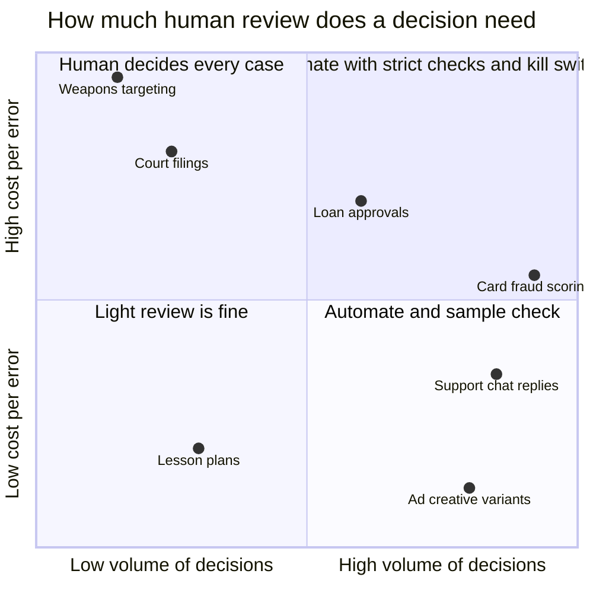

*Figure 53.7: Volume and cost of error together suggest how much automation is appropriate. Card fraud is high-volume with moderate stakes per case, so it is automated with careful thresholds; targeting decisions are rare and catastrophic if wrong.*

> **Key idea:** The useful question is never "Can AI do this task?" but "What happens, and who pays, when it gets this task wrong, and how often will that be?"

## AI at the edge: when the model comes to you

Put your phone in airplane mode and unlock it with your face. It still works. Search your photos for "dog" with no signal; it still finds the dogs. Say "Hey Siri" or "Hey Google" with the radio off; the phone still wakes up. All of that AI ran on the phone itself. Most of what your chatbot does happens in a data center hundreds or thousands of kilometers away (Chapter 44), but a surprising amount of everyday AI never leaves your pocket.

> **Definition — Edge AI:** Running AI models directly on local devices, such as phones, cars, cameras, watches and factory sensors, instead of in a remote data center. The "edge" is the edge of the network, where it meets the physical world.

> **Definition — Internet of Things (IoT):** Everyday physical objects, such as thermostats, meters, cameras, doorbells and machines, that are connected to the internet and exchange data. Many now carry small AI models.

### Why run AI on the device? Five reasons and one big cost

| Factor | Edge wins when... | Cloud wins when... |
|---|---|---|
| Latency | A decision is needed in milliseconds (braking, face unlock, wake words) | A few seconds of waiting is fine |
| Privacy | The data is sensitive (your face, voice, health, home video) | The data is not sensitive or the user consents to upload |
| Cost | Billions of small requests would add up on servers | Requests are rare or need a big model |
| Connectivity | There is no reliable signal (farms, mines, ships, planes, war zones) | The device is always online |
| Capability | A small model is good enough | The task needs a frontier model's knowledge and reasoning |
| Battery and heat | The model is tiny or runs rarely | Heavy computing would drain the battery or overheat the device |

> **Definition — Latency:** The delay between a request and its response. For a cloud model it includes the network round trip, waiting in a queue and the model's own processing time.

**Latency, worked.** A car at 100 km/h travels 100,000 m ÷ 3,600 s ≈ 27.8 m every second. If spotting a pedestrian required a round trip to a data center taking 200 milliseconds, the car would travel 27.8 × 0.2 ≈ 5.6 m before getting an answer, and that assumes the connection does not drop in a tunnel. This is why self-driving cars run their perception models on board (Chapter 50).

**Privacy.** On an iPhone, the face data used for Face ID is processed and stored on the device. A doorbell camera that recognizes "person" versus "cat" on the device can upload only the 10-second clip of a person rather than streaming your front yard to a server all day.

**Cost.** For the company providing a feature, on-device AI costs nothing per use: your battery and your chip pay. When a feature runs billions of times a day, such as keyboard prediction, that matters enormously.

**The big cost: capability.** A phone has a few gigabytes of memory and a battery holding roughly 15 to 20 watt-hours. A data-center GPU has tens to hundreds of gigabytes of very fast memory and draws around a kilowatt. Edge AI is the art of getting useful results inside those limits.

> **Analogy:** Edge versus cloud AI is a pocket calculator versus calling an expert on the phone. The calculator is instant, private and free to use but knows only arithmetic. The expert knows far more, but you need a signal, you wait for an answer, and each call costs something.

> **Watch out:** "My phone runs ChatGPT." Almost always, it does not. The ChatGPT, Claude and Gemini apps send your message to data-center GPUs. Only small models, a few billion parameters and quantized, run fully on a phone, and they power narrower features such as summarizing notifications or suggesting replies.

### The hardware: NPUs and the TOPS trap

Chapter 32 introduced the neural processing unit. Here is a quick recap and the trap in its headline number.

> **Definition — NPU (Neural Processing Unit):** A small, power-efficient AI accelerator inside a phone, laptop or other device, such as Apple's Neural Engine or Qualcomm's Hexagon. It runs neural networks using far less energy than the main processor would.

> **Definition — TOPS (Tera Operations Per Second):** Trillions of operations per second, the usual speed rating for NPUs. It is normally quoted for low-precision integer math, sometimes assuming tricks like sparsity, so it is not comparable to a data-center GPU's FLOPS and is often more marketing than measurement.

> **Definition — System on a chip (SoC):** A single chip that combines the main processor, graphics processor, NPU, memory controllers and other parts, as in every modern phone. All the parts share the same memory.

Apple has put a Neural Engine in its phone chips since the A11 in 2017. In 2024 Microsoft defined "Copilot+ PCs" as Windows laptops with an NPU of at least 40 TOPS, from Qualcomm, Intel and AMD. Apple's M5 chip (October 2025) added a "Neural Accelerator" inside each GPU core. Google's Pixel phones run its small Gemini Nano model on the phone's own Tensor chip.

**Worked example: why TOPS is not the bottleneck.** Take a 3-billion-parameter language model on a laptop NPU rated at 40 TOPS. Chapter 5's rule says a model needs about 2 × N operations per token, here 2 × 3 billion = 6 billion.

- Compute limit: 40 trillion ÷ 6 billion ≈ 6,700 tokens per second.
- Memory limit: at 4 bits per weight the model is 3 billion × 0.5 bytes = 1.5 GB, and every token requires streaming all of it from memory (Chapter 33). With about 100 GB/s of memory bandwidth, that is 100 ÷ 1.5 ≈ 67 tokens per second at best.

The memory limit is about 100 times tighter than the compute limit. A bigger TOPS number would not make this model talk any faster; faster memory would.

> **Definition — Memory bandwidth:** How many bytes per second a chip can read from its memory. For language models generating text on a device, it usually sets the speed, because every new token requires reading every weight.

> **Definition — Unified memory:** A design in which the CPU, GPU and NPU share one pool of memory instead of each having its own. Apple's M-series chips use it, which lets a laptop with lots of memory run surprisingly large models.

### Memory is the real wall

A phone's memory is shared with the operating system and every open app. Use the rule from Chapter 30: memory ≈ parameters × bytes per parameter, plus some overhead.

| Model size | At 16 bits | At 4 bits | Runs on |
|---|---|---|---|
| 1 billion | 2 GB | 0.5 GB | Almost any recent phone |
| 3 billion | 6 GB | 1.5 GB | Flagship phones, laptops |
| 8 billion | 16 GB | 4 GB, about 4–5 GB with overhead | Laptops, high-end phones with care |
| 70 billion | 140 GB | 35 GB | Desktops or laptops with 64 GB or more of unified memory |

Apple's on-device model for its Apple Intelligence features has about 3 billion parameters, according to Apple's own technical reports, and requests too hard for it go to Apple's servers. That size is not an accident; it is about what fits comfortably alongside everything else a phone must hold in memory.

> **Definition — Small language model (SLM):** A language model with roughly a few hundred million to a few billion parameters, small enough to run on a phone or laptop. Good small models are trained on huge amounts of data, often with help from bigger models.

### Making models small: four tools

**1. Quantization: fewer bits per number.** Chapter 30 introduced it; here it is by hand. Take eight weights from a model, stored in 16 bits each:

`0.82, -0.41, 0.07, -1.20, 0.55, 0.33, -0.96, 1.10`

To store them in 4 bits, we allow whole numbers from −7 to +7 and one shared scale. The largest magnitude is 1.20, so scale = 1.20 ÷ 7 ≈ 0.171. Divide each weight by the scale and round:

```
weight   ÷0.171   rounded   stored as   back to   error
 0.82     4.78       5         5        0.857    0.037
-0.41    -2.39      -2        -2       -0.343    0.067
 0.07     0.41       0         0        0.000    0.070
-1.20    -7.00      -7        -7       -1.200    0.000
 0.55     3.21       3         3        0.514    0.036
 0.33     1.93       2         2        0.343    0.013
-0.96    -5.61      -6        -6       -1.029    0.069
 1.10     6.43       6         6        1.029    0.071

-1.2                   0                   1.2
  |--|--|--|--|--|--|--|--|--|--|--|--|--|--|  15 allowed values (whole numbers -7 to 7),
 -7    -5    -3    -1     1     3     5     7     spaced 0.171 apart
```

*Figure 53.8: Four-bit quantization of eight weights. Each weight snaps to the nearest of 15 allowed values; no error exceeds half a step (about 0.086).*

Storage before: 8 × 16 bits = 128 bits. After: 8 × 4 bits plus one 16-bit scale = 48 bits, about 2.7 times smaller. Real systems use a shared scale for each block of 16 to 64 weights, and with careful methods the quality loss at 4 bits is often small.

> **Definition — Quantization:** Storing a model's numbers with fewer bits, for example 4 instead of 16, so it takes less memory and runs faster, at a small cost in accuracy.

> **Analogy:** Quantization is like saving a high-resolution photo as a smaller JPEG. Zoom in and you can find the lost detail, but at normal viewing size it looks almost the same, and it loads far faster.

**2. Pruning: remove what matters least.** Many weights are close to zero and contribute little. Pruning removes them. In our eight weights, cutting the four smallest by magnitude (0.07, 0.33, −0.41, 0.55) leaves 0.82, −1.20, −0.96 and 1.10: half the weights gone. In practice the pruned model is briefly retrained to recover accuracy, and the savings are real only if the chip can skip the zeros efficiently.

> **Definition — Pruning:** Removing the least important weights, neurons or layers from a trained network to make it smaller and faster, usually followed by a little retraining to recover accuracy.

**3. Distillation: a small student copies a big teacher.** A large model generates answers or probabilities, and a small model is trained to imitate them (Chapter 30). Most good small models of 2025–26 were trained this way.

> **Definition — Distillation:** Training a smaller "student" model to imitate a larger "teacher" model's outputs, so the student gets much of the teacher's quality at a fraction of the size and cost.

**4. Efficient design and compiling.** Architectures built for devices, plus compilers that convert a model into the exact instructions a particular NPU runs fastest. In practice a developer exports the trained model to an on-device runtime: Core ML on Apple devices, Google's LiteRT (formerly TensorFlow Lite) on Android and microcontrollers, ExecuTorch for PyTorch models, or ONNX Runtime, which reads the vendor-neutral ONNX model format and runs on many kinds of hardware, including inside a web browser. The runtime, guided by the developer's settings, decides which parts of the model run on the CPU, the GPU or the NPU.

> **Definition — On-device runtime:** The software library inside an app that loads a compressed model and runs it on the device's own chips (CPU, GPU or NPU), such as Core ML, LiteRT or ONNX Runtime.

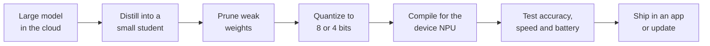

*Figure 53.9: A typical pipeline for shrinking a model to run on a device. Each step trades a little accuracy for a lot of size, speed or energy.*

### TinyML: AI on a microcontroller

At the far end of the edge are microcontrollers: chips that cost a few dollars and run on tiny amounts of power.

> **Definition — Microcontroller:** A tiny, cheap, low-power computer on a single chip, found in appliances, toys, sensors and cars. Typical ones have kilobytes to a few megabytes of memory, thousands of times less than a phone.

> **Definition — TinyML:** Machine learning that runs on microcontrollers, using models of kilobytes rather than gigabytes, often powered by a coin battery or energy harvesting for months.

**Worked example: fitting a model on a sensor.** A typical microcontroller board might have 256 KB of working memory and 1 MB of storage. A keyword-spotting or vibration-anomaly model with 50,000 parameters stored at 8 bits needs 50,000 bytes, about 50 KB: it fits easily. A 3-billion-parameter language model would need 1.5 GB even at 4 bits, about 1,500 times the board's total storage.

Energy is the other budget. A CR2032 coin cell stores about 225 milliamp-hours at 3 volts, roughly 0.225 × 3 ≈ 0.68 watt-hours. A sensor averaging 1 milliwatt would run 0.68 ÷ 0.001 = 680 hours, about four weeks. Cut the average to 0.1 milliwatt, by sleeping most of the time and waking only to run the model, and it runs about 280 days. TinyML is mostly the craft of doing nothing most of the time.

Uses include a motor sensor that recognizes an abnormal vibration and only then transmits, a collar that detects a cow's unusual movement, and audio monitors in forests that listen for chainsaws or particular bird calls.

### Wake words: a cascade from tiny to huge

Your smart speaker listens all the time, but it does not stream everything to the cloud. A tiny always-on model, running on a low-power chip, listens only for its wake phrase. Apple described in 2017 how "Hey Siri" uses two stages: a very small detector running constantly on a low-power processor and, if that fires, a larger checker on the main processor. Only after both agree does the assistant start listening properly and, if needed, reach the cloud.

> **Definition — Wake word:** A trigger phrase, such as "Hey Siri" or "Alexa", detected by a tiny always-on model on the device. Its detector trades false wakes against missed wakes, like any classifier.

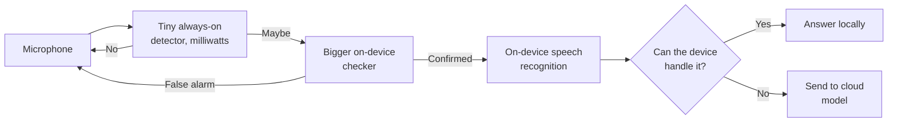

*Figure 53.10: The wake-word cascade. Each stage is bigger and hungrier than the last, and runs only when the previous one says so.*

### Federated learning: learning without collecting

Chapter 11 introduced federated learning: instead of sending your data to the model, it sends the model to your data. Google has used it since 2017 to improve its Gboard keyboard's predictions from what people type, without uploading what they type.

> **Definition — Federated learning:** Training a shared model across many devices by sending the model to the devices and collecting only the resulting updates, so raw personal data never leaves its owner.

> **Definition — Secure aggregation:** A cryptographic technique that lets a server add up many devices' model updates while being unable to see any single device's update. It is often combined with federated learning.

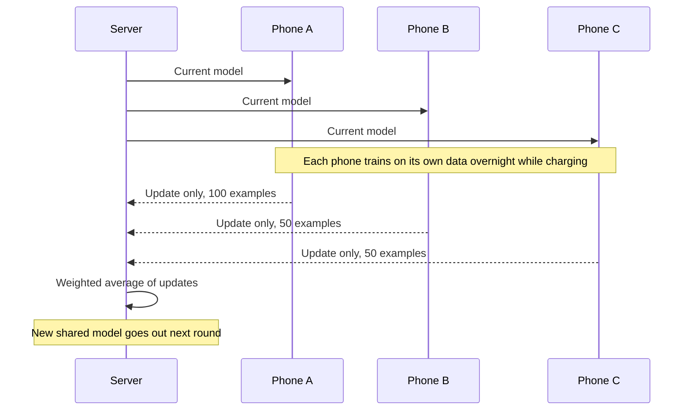

*Figure 53.11: One round of federated learning. Typed text, photos and voice stay on the phones; only model updates travel.*

**Worked example: averaging updates.** Three phones suggest changes to one weight: Phone A +0.03 (trained on 100 examples), Phone B −0.01 (50 examples), Phone C +0.02 (50 examples). The server weights each by its number of examples: (0.03 × 100 + (−0.01) × 50 + 0.02 × 50) ÷ 200 = (3 − 0.5 + 1) ÷ 200 = 0.0175. The shared weight moves by 0.0175. Real systems do this for millions of weights and thousands of phones per round.

Federated learning is not perfect privacy: updates can leak information about the data that produced them, which is why it is combined with secure aggregation and differential privacy (Chapter 11).

### Everyday edge and IoT examples

- **Smart cameras** detect people, vehicles and packages on the device and upload only relevant clips.
- **Industrial sensors** run anomaly models on the machine and send alerts, not raw data streams (Figure 53.4).
- **Wearables.** Apple Watch introduced fall detection in 2018, and in the same year the US FDA cleared its ECG app and irregular-rhythm notification for spotting signs of atrial fibrillation. Both rely on models running on the watch and phone.
- **Smart speakers** run wake-word detection locally.
- **Cars** run perception and driver-assistance models on board (Chapter 50).
- **Robots** increasingly run their control models on board. Google DeepMind released Gemini Robotics On-Device in June 2025 and On-Device 2 in July 2026, versions of its robot models designed to run on the robot itself (Chapter 49).

> **Definition — Over-the-air (OTA) update:** Sending new software, including new AI models, to devices wirelessly. It lets fielded devices improve, but a compromised update channel can push a malicious model to millions of devices at once.

Edge AI has its own security problems. A device in someone's hands can be taken apart and its model copied. Billions of cheap IoT gadgets rarely get security updates. And every model update pushed over the air must be signed and checked, or it becomes an attack route.

### Hybrid: device and cloud as a team

The real answer in 2026 is usually "both". In 2024 Apple announced Private Cloud Compute: when its on-device model cannot handle a request, the request goes to Apple servers designed so that data is used only for that request and not stored. Google pairs Gemini Nano on the phone with full Gemini in the cloud. Copilot+ PCs run some features locally and send others to Microsoft's cloud. A router, which may itself be a small model, decides where each request goes.

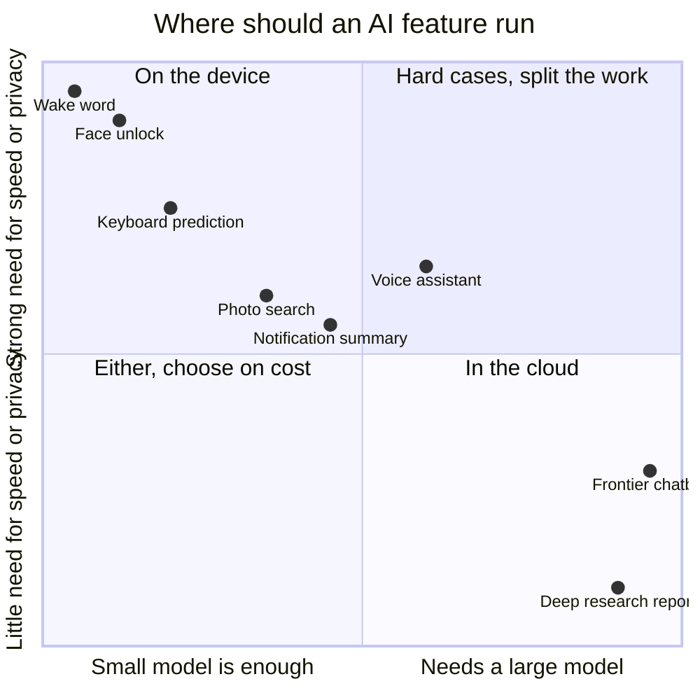

*Figure 53.12: Placing AI features by model size needed and by the need for speed and privacy. Features near the top left run on the device; those at the right go to the cloud.*

> **At the frontier (2026):** Three edge trends stand out. Robot makers are putting vision-language-action models on board so robots keep working without a connection (Chapter 49). Laptop chips now include neural accelerators inside their graphics cores, aimed at running local language models. And desktop "AI supercomputers" such as NVIDIA's DGX Spark, reportedly with 128 GB of unified memory, bring models that needed a server a few years ago onto a desk.

> **Key idea:** Edge AI is not just weaker cloud AI. It is chosen for speed, privacy, cost and offline use, and some features, such as face unlock and wake words, only make sense on the device. Its hard limit is memory, not TOPS.

## In plain English

AI in industry is not a hundred different inventions. It is a handful of tools (spotting the unusual, forecasting, reading images, hearing speech, reading and writing text, optimizing plans, moving robots) applied to different problems. What really differs between industries is the data available, how much a mistake costs, who is held responsible, and what the law requires.

Banks score every card payment for fraud in milliseconds, but because fraud is rare, most alerts are innocent customers, so banks send a code to your phone rather than block you. Lawyers use AI to sort millions of documents, and some have been fined for filing cases the AI invented. AI tutors can help students learn or help them avoid learning, depending on whether they give hints or answers. Customer-service bots can handle huge volumes, but Klarna learned that customers still need humans, and Air Canada learned that a company is responsible for what its chatbot says. Factories predict machine failures, farms spray only the weeds, delivery companies optimize routes, militaries debate how much autonomy to give weapons, and security teams use AI against attackers who use AI too.

Some AI runs on your own device instead of in a data center: face unlock, wake words, keyboard prediction, crash and fall detection. It is fast, private, free per use and works offline. The catch is memory and battery, so engineers shrink models with quantization, pruning and distillation, and even run tiny models on coin-battery sensors. Federated learning lets phones improve a shared model without uploading your data. Increasingly, device and cloud work as a team.

## Key terms

Use case, Decision support, Automation, Fraud detection, Anti-money laundering (AML), Know your customer (KYC), Credit scoring, Algorithmic trading, Explainability, E-discovery, Technology-assisted review (TAR), Intelligent tutoring system, Effect size, AI-text detector, Containment rate, Agent assist, Outcome-based pricing, First-party data, Creative testing, Generative engine optimization (GEO), Machine vision inspection, Predictive maintenance, Digital twin, Operations research, Vehicle routing problem, Operational technology (OT), Precision agriculture, NDVI (Normalized Difference Vegetation Index), Lethal autonomous weapon system (LAWS), Human in the loop, Terminal guidance, Automation bias, Meaningful human control, Dual-use, Vulnerability, Exploit, Zero-day, Fuzzing, Phishing, Security operations center (SOC), Automated valuation model (AVM), Bias audit, Edge AI, Internet of Things (IoT), Latency, NPU (Neural Processing Unit), TOPS (Tera Operations Per Second), System on a chip (SoC), Memory bandwidth, Unified memory, Small language model (SLM), Quantization, Pruning, Distillation, On-device runtime, Microcontroller, TinyML, Wake word, Federated learning, Secure aggregation, Over-the-air (OTA) update

## Exercises

1. **[Easy] Fraud alerts by hand.** On paper or in a spreadsheet:
   1. Assume 2 in 1,000 payments are fraud, out of 500,000 payments.
   2. Your model catches 90% of fraud and wrongly flags 0.5% of honest payments. Work out how many frauds are caught, how many honest payments are flagged, and the precision (caught frauds ÷ all flagged).
   3. Now halve the false-flag rate to 0.25%. How much does precision improve? Then instead raise recall to 99% while the false-flag rate rises to 2%. Which version would you rather run, and what would you do with the flagged payments?
   **What you'll learn:** why rare events produce floods of false alarms, and why the action taken after an alert matters as much as the model.

2. **[Easy] Expected-loss decisions.** Make a small table of five payments: $20, $150, $400, $1,500 and $5,000. Give each a fraud probability of 1%, 3% and 10% (fifteen cells). Compute expected loss = probability × amount. Decide on a rule: approve below $X expected loss, send a phone code between $X and $Y, decline above $Y. Explain your choice of X and Y in two sentences.
   **What you'll learn:** how a model's probability becomes a business action, and why the same score leads to different actions at different amounts.

3. **[Medium] Check the citations.** Ask a chatbot: "Give me three real US court cases about a company being held liable for false statements made by its own automated system, with full citations." Then verify each one using a free source such as Google Scholar's case law search or courtlistener.com. Record which cases exist, which details (year, court, holding) are right, and which are wrong. Repeat with web search turned on, if your chatbot has it, and compare.
   **What you'll learn:** how often fluent citations are wrong, how retrieval changes that, and the verification habit that would have saved the lawyers in Mata v. Avianca.

4. **[Medium] Tutor versus answer machine.** Pick a topic you do not know well (for example, how compound interest works). Session A: ask a chatbot to explain it and solve three problems. Session B: give it the tutor instructions from this chapter's Try-it callout and work through three similar problems yourself. A day later, without any AI, solve two new problems on paper. Note which session you remember better and why.
   **What you'll learn:** the difference between getting answers and learning, the core design question in AI for education.

5. **[Medium] Model an AI service desk.** In a spreadsheet, build the worked example from this chapter: monthly contacts, AI resolution share, cost per AI resolution, cost per human contact, share of AI "resolutions" that come back, and cost of a repeat contact. Find the break-even point: at what repeat rate does the AI desk stop saving money? Then change the human cost to $3 (a lower-wage market) and see what changes.
   **What you'll learn:** why containment rate is a misleading metric and how hidden repeat contacts can erase savings.

6. **[Medium] Read a field from space.** In a spreadsheet, make a 5 × 5 grid of "pixels". Fill each with a near-infrared value and a red value (healthy cells around NIR 0.5, red 0.08; a stressed corner around NIR 0.3, red 0.15). Compute NDVI for every cell with the formula from this chapter and color the cells with conditional formatting. Optionally, explore real NDVI imagery of your region in a free satellite viewer such as NASA Worldview.
   **What you'll learn:** how a simple formula on two colors of light turns a satellite image into a crop-health map, the starting point for agricultural AI.

7. **[Easy] Prove it runs on your device.** On your phone, turn on airplane mode. Try face unlock, photo search for "food" or "dog", voice typing, and live text selection from a photo. Note which features still work. Turn airplane mode off and try your chatbot app's voice mode; note the difference. List each feature as edge or cloud.
   **What you'll learn:** how much everyday AI already runs on the device, and how to tell edge features from cloud features.

8. **[Medium] Quantize and prune by hand.** Take these eight weights: 0.64, −0.12, 0.95, −0.33, 0.48, −0.81, 0.05, 0.27. (1) Quantize them to 4 bits as in Figure 53.8: find the scale (largest magnitude ÷ 7), divide, round, multiply back, and compute each error. (2) Repeat with 3 bits (whole numbers from −3 to +3). How much bigger is the largest error? (3) Prune the four smallest weights by magnitude. Which weights survive?
   **What you'll learn:** exactly what quantization and pruning do to a model's numbers, and why fewer bits mean more rounding error.

9. **[Medium] Predict and measure local model speed.** If you completed Chapter 30's exercises, you have a small model in LM Studio or Ollama. Look up your computer's memory bandwidth (search your model of laptop plus "memory bandwidth"). Predict maximum tokens per second as bandwidth ÷ model file size. Run the model, note the actual speed, and compare. Then answer: would a laptop with twice the TOPS but the same memory be faster?
   **What you'll learn:** that memory bandwidth, not TOPS, sets the speed of a language model on a device.

10. **[Challenge] Your industry opportunity map.** Using the list from this chapter's first Try-it callout, build a table with one row per task and columns for: AI branch, data needed, who owns the data, cost if wrong, human role (in, on or out of the loop), relevant laws or rules, and edge or cloud. Score each task from 1 to 5 on value and on risk. Pick the best high-value, lower-risk task and run a one-week pilot with an off-the-shelf tool, keeping a log of errors.
   **What you'll learn:** how to apply the five-part template to your own work and find a safe, valuable first AI project.

## Areas of opportunity

- **Fraud and identity defense.** Banks, payment firms and online marketplaces pay for real-time fraud detection that resists cloned voices, deepfaked video calls and synthetic identities, because their losses and liabilities are direct and measurable.
- **Compliance automation.** AML investigation support, contract analysis and regulatory reporting are expensive, document-heavy and staffed by scarce experts. Tools that draft case files for human sign-off sell to banks, insurers and law firms.
- **Verification and citation checking.** Any profession that files documents (law, medicine, finance, academia) needs software and people that check every citation, figure and quote AI produces before it goes out.
- **Learning-first education tools.** Schools and parents will pay for tutors that demonstrably improve learning rather than doing homework, and for assessment redesign help. Rigorous evidence of learning gains is the moat.
- **Hybrid service desks and voice receptionists.** Small clinics, restaurants and trades lose business to missed calls. Voice agents that book, answer and escalate well are a concrete small-business product; conversation design and quality analysis are growing careers.
- **Industrial retrofits.** Bolt-on sensors with on-device anomaly detection and simple vision inspection let small and mid-sized manufacturers get predictive maintenance and quality control without replacing machines.
- **Agricultural analytics.** Insurers, lenders, cooperatives and farmers pay for crop-health maps, yield forecasts and livestock monitoring, especially services that work on a phone in areas with weak connectivity.
- **Defense and security roles.** Counter-drone systems, testing and evaluation of autonomy, AI red-teaming, vulnerability discovery and small-business cyber defense all need people who combine domain knowledge with AI literacy.
- **Embedded ML and model compression.** Engineers who can quantize, prune, distill and compile models for NPUs and microcontrollers are scarce; consumer electronics, car, medical-device and robotics companies hire them.
- **Private on-device products.** Assistants, cameras and health wearables that never upload sensitive data appeal to privacy-conscious customers and to regulated industries such as health care and law.
- **Open problems worth working on.** Proving fairness in credit and hiring models, meaningful human control over autonomous systems, secure model updates for billions of devices, and fitting capable models into tight memory and battery budgets.

## Check your understanding

1. Why does a fraud model that catches 95% of fraud and flags only 1% of honest payments still produce mostly false alarms?
2. In the five-part template, which parts usually differ most between industries, and which part differs least?
3. What do Mata v. Avianca and Moffatt v. Air Canada have in common?
4. What did the Turkish high-school experiment suggest about how AI tutors should be designed?
5. Why did Klarna's 2024 announcement and its 2025 change of course both contain a real lesson?
6. Explain the difference between a human "in the loop" and "on the loop", and give one argument for and one against banning lethal autonomous weapons.
7. Give three reasons to run a model on a device instead of in the cloud, and the main limit that stops phones running frontier models.
8. A laptop NPU is rated at 40 TOPS and a 3-billion-parameter model is stored at 4 bits. Why is its speed set by memory bandwidth rather than TOPS?

<details><summary>Answers</summary>

1. Fraud is rare. At 1 in 1,000, a million payments contain only 1,000 frauds, so the model catches 950, but 1% of the 999,000 honest payments is 9,990 false alarms. Only about 8.7% of alerts are fraud. This is the base-rate effect.
2. The data, the cost of errors, accountability and the law differ most. The model itself, often the same classifier, forecaster or language model, differs least.
3. In both, an organization relied on an AI system's output (invented citations; a chatbot's wrong policy) and was held fully responsible for it. Accountability does not transfer to software.
4. Students with a plain answer-giving assistant did better in practice but worse on a later exam without AI, while a version that gave hints instead of answers largely avoided that harm. Tutors should make students do the thinking.
5. The 2024 claim showed AI can handle a very large volume of routine contacts. The 2025 shift showed that cost-cutting can hurt quality and that customers still need reachable humans for complex cases. Both are true at once.
6. In the loop: a person approves each action before it happens. On the loop: the system acts by itself while a person supervises and can intervene. For a ban: machines cannot make the legal and moral judgments of distinction and proportionality, and responsibility becomes unclear. Against: adversaries will not comply, and human reaction time is too slow against fast threats such as drone swarms, so regulation may protect more people.
7. Low latency, privacy, no per-use server cost, and working offline. The main limit is memory (capacity and bandwidth), along with battery and heat.
8. Generating each token requires reading all 1.5 GB of weights from memory. At about 100 GB/s that caps speed near 67 tokens per second, while 40 TOPS could in principle compute about 6,700 tokens per second. The memory limit is about 100 times tighter.

</details>

## Going deeper

- **Agrawal, Gans and Goldfarb, *Prediction Machines* (2018, updated 2022) and *Power and Prediction* (2022).** Economists explain AI as cheap prediction and show how it changes decisions and industries.
- **Narayanan and Kapoor, *AI Snake Oil* (2024).** A sharp guide to which industry uses of AI work and which predictive systems (in hiring, policing and welfare) do not.
- **Cathy O'Neil, *Weapons of Math Destruction* (2016).** Case studies of algorithms in finance, hiring, education and justice going wrong at scale.
- **Brynjolfsson, Li and Raymond, "Generative AI at Work" (NBER working paper, 2023).** The customer-service study behind this chapter's "novices gain most" finding, readable by non-economists.
- **Paul Scharre, *Army of None* (2018).** The clearest book on autonomous weapons, written by a former US Army Ranger and Pentagon policy official, fair to both sides.
- **Pete Warden and Daniel Situnayake, *TinyML* (O'Reilly, 2019), and the HarvardX TinyML courses on edX.** The standard introduction to machine learning on microcontrollers.
- **Stanford AI Index (aiindex.stanford.edu), published annually.** Data on AI adoption by industry, investment and education, updated every spring.
- **Google's federated learning explainer at federated.withgoogle.com.** A short illustrated introduction to training on phones without collecting data.
