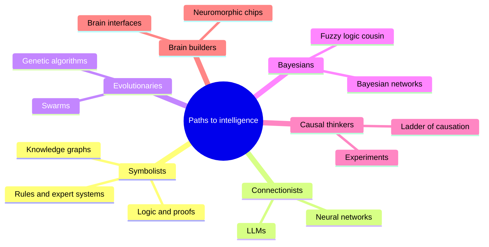
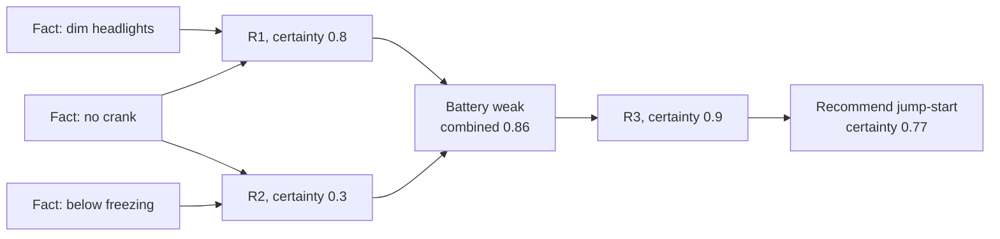
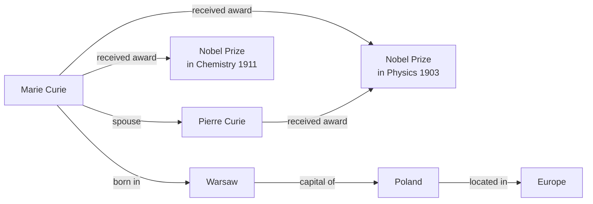
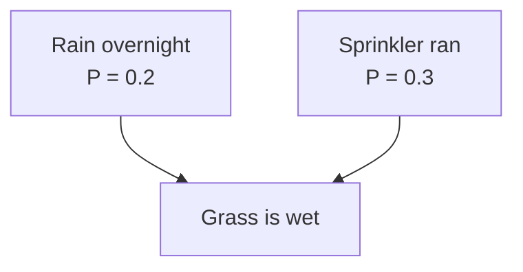
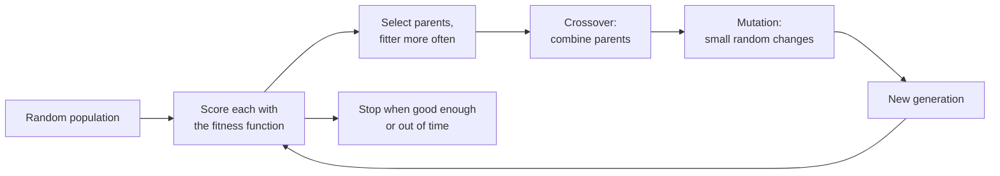
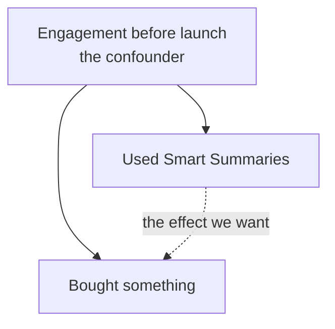
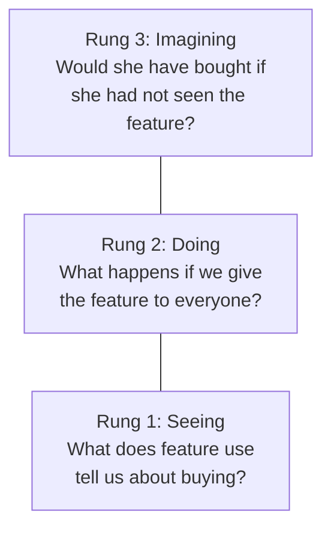
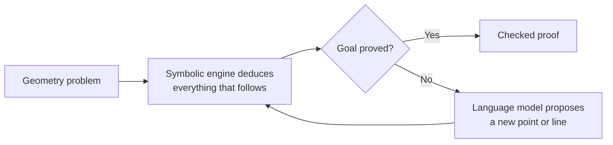
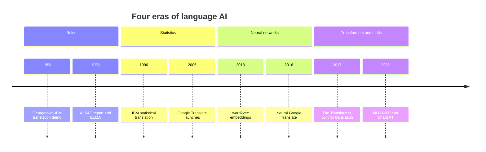
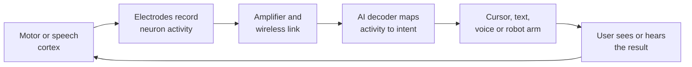

# Chapter 54: Other Paths to Intelligence: Symbolic AI, Language Before LLMs, Evolution, Bayes, Causality and Brains

*Neural networks won the 2020s, but they were never the only road; this chapter works through the other roads by hand (rules, knowledge graphs, probability, evolution, causality, older language technology and the brain itself) and shows why several of them are now merging back into the frontier.*

## What you'll learn

- How a rule-based expert system reasons, by running a small rule chain by hand with certainty factors, and why such systems were brittle.
- What formal logic adds to rules (propositional and first-order logic, resolution, Prolog and the SAT solvers that verify chips), and where it runs out.
- How knowledge graphs store facts as triples, how Wikidata and search engines use them, and the older puzzles of defaults and the frame problem.
- How a Bayesian network reasons under uncertainty, worked with real numbers including the surprising effect called "explaining away"; how filters track a hidden state over time, from a worked umbrella example to Kalman and particle filters; and what fuzzy logic is good for.
- How a genetic algorithm evolves solutions, through one complete generation on paper.
- Why correlations mislead, with a worked confounder that reverses a conclusion, and how A/B tests and Pearl's ladder of causation fix it.
- What neuro-symbolic AI is, from AlphaGeometry to AlphaProof, and the live debate over whether the future needs symbols at all.
- The four eras of language AI, the classic language-processing tasks including grammar and parsing, and the long history of machine translation.
- How real neurons differ from artificial ones, and what neuromorphic chips, brain-computer interfaces and brain scanners can and cannot do.

## Before you start

Chapter 7 (A History of AI) tells the story of expert systems, the AI winters and the rise of neural networks; this chapter opens up the machinery that history only names. Chapter 6 (The Math of AI, Part 2) introduces Bayes' rule with natural frequencies and the confounder behind ice cream and drownings, and we build directly on both. Chapter 12 (Neural Networks From Scratch) explains the artificial neuron that we compare with real ones. Chapters 14 and 15 cover the neural era of language in depth, so here we only place it in the longer story. Search and planning, the other great symbolic tradition, have their own home in Chapter 48, and AI for mathematics gets more detail in Chapter 52.

## Five tribes, one field

In his 2015 book *The Master Algorithm*, the computer scientist Pedro Domingos sorted AI researchers into five "tribes", each with its own idea of how a machine could learn:

- **Symbolists** believe intelligence is manipulating symbols with logic and rules.
- **Connectionists** build networks of simple neuron-like units and adjust their connections. Your chatbot is their triumph.
- **Evolutionaries** breed solutions the way nature breeds organisms.
- **Bayesians** treat all knowledge as probabilities, updated as evidence arrives.
- **Analogizers** reason by similarity: this case resembles that one, so treat it the same way (the nearest-neighbor methods of Chapter 10, and case-based reasoning systems that solve a new problem by adapting the solution to the most similar past case).

> **Definition — Case-based reasoning:** Solving a new problem by retrieving the most similar past case and adapting its solution, the way lawyers reason from precedent and help-desk staff reuse fixes that worked before.

The connectionists won the last decade so decisively that it is easy to think the other tribes vanished. They did not. Rule engines calculate your taxes. A knowledge graph answers when you search "How tall is the Eiffel Tower?" Probabilistic models filter spam and diagnose faults. Evolutionary search has designed antennas that flew in space. Randomized experiments decide which features ship in every app on your phone. And at the 2026 frontier, labs are borrowing from all of them: proof checkers to verify a model's mathematics, evolutionary loops wrapped around language models, and causal reasoning to test whether an AI's findings are real.



*Figure 54.1: The other paths to intelligence covered in this chapter, grouped roughly by tribe. Causal inference and brain research are added because they cut across all of them.*

> **Definition — Symbolic AI (GOFAI):** "Good old-fashioned AI": systems that represent knowledge as explicit symbols, such as words or labels standing for things in the world, and manipulate them with rules and logic. It dominated AI from the 1950s to the 1980s.

> **Key idea:** Your chatbot is the product of one tribe, the connectionists. The other tribes still run large parts of the world's software, and the frontier increasingly combines their strengths with neural networks.

## Rules and expert systems: knowledge written by hand

### Thinking in IF-THEN

The symbolists' bet was simple. Experts know things. If we could write that knowledge down as explicit rules, a computer could apply the rules faster and more consistently than any person. A doctor knows "if the patient has a stiff neck and a fever and a headache, consider meningitis." Write that as a rule, collect a few hundred such rules, add a program that applies them, and you have a machine doctor.

> **Definition — Production rule:** An IF-THEN statement, such as "IF the engine does not crank AND the headlights are dim THEN the battery is weak," that a rule-based system uses to draw conclusions from facts.

> **Definition — Expert system:** A program that encodes a human expert's knowledge as many IF-THEN rules in order to give advice in one narrow area. Expert systems were the commercial face of AI in the 1970s and 1980s.

> **Definition — Knowledge base:** The collection of facts and rules an expert system knows, kept separate from the program that reasons with them.

> **Definition — Inference engine:** The part of an expert system that applies rules to facts to reach conclusions. It is the same program whatever the domain, which is why one engine could run a medical system or a car-repair system.

Chapter 7 tells the history: MYCIN at Stanford in the 1970s used several hundred rules to recommend antibiotics for blood infections and matched specialists in tests, and XCON at Digital Equipment Corporation, a leading computer maker of the time, grew to thousands of rules for configuring computer orders. Here we run one.

> **Definition — MYCIN:** An expert system built at Stanford University in the 1970s that used several hundred IF-THEN rules, each with a certainty factor, to identify the bacteria behind serious blood infections and recommend antibiotics. In tests it performed about as well as specialists but was never used routinely in hospitals.

> **Definition — XCON:** An expert system built in 1980 for Digital Equipment Corporation that checked and completed customers' computer orders, choosing every cable and component. It grew to thousands of rules and reportedly saved the company tens of millions of dollars a year, making it the best-known commercial success of the expert-system era.

### A tiny expert system, worked by hand

Our domain is "Why won't my car start?" The knowledge base has six rules. Each rule carries a certainty factor between 0 and 1, the expert's confidence that the conclusion follows. MYCIN used exactly this idea.

> **Definition — Certainty factor:** A number, used in MYCIN-style expert systems, expressing how strongly a rule's conclusion is believed, from 0 (no support) to 1 (certain). It was a practical stand-in for probability, not a true probability.

The rules:

- **R1.** IF the engine does not crank AND the headlights are dim THEN the battery is weak (certainty 0.8).
- **R2.** IF the temperature is below freezing AND the engine does not crank THEN the battery is weak (certainty 0.3). Cold weakens batteries.
- **R3.** IF the battery is weak THEN recommend a jump-start (certainty 0.9).
- **R4.** IF the engine does not crank AND the headlights are bright THEN the starter motor is faulty (certainty 0.7).
- **R5.** IF the starter motor is faulty THEN recommend calling a mechanic (certainty 0.9).
- **R6.** IF the engine cranks AND the fuel gauge reads empty THEN recommend adding fuel (certainty 0.95).

You tell the system three facts: the engine does not crank, the headlights are dim, and it is below freezing.

**Cycle 1.** The inference engine scans the rules for any whose IF part is satisfied by known facts.

- R1 matches (no crank, dim lights). It concludes "battery is weak" with certainty 0.8.
- R2 matches (freezing, no crank). It also concludes "battery is weak", with certainty 0.3.
- R4 does not match (lights are dim, not bright). R6 does not match (the engine does not crank).

Two rules support the same conclusion, so their certainties are combined. MYCIN's formula for two positive certainties a and b is a + b × (1 − a). Here 0.8 + 0.3 × (1 − 0.8) = 0.8 + 0.06 = 0.86. The second rule nudges belief upward, but cannot push it past 1.

**Cycle 2.** "Battery is weak" is now a fact (certainty 0.86), so R3 matches. Its conclusion's certainty is the evidence's certainty times the rule's: 0.86 × 0.9 ≈ 0.77. The system recommends a jump-start with certainty 0.77.

**Cycle 3.** No new rules match. The system stops and, crucially, can explain itself: "I recommend a jump-start because R3 says a weak battery calls for one; I believe the battery is weak because of R1 (no crank, dim lights) and R2 (freezing weather)." That explanation trace was one of expert systems' great selling points, and it is something neural networks still struggle to provide.



*Figure 54.2: Forward chaining through the car-repair rules. Facts trigger rules, rules add new facts, and new facts trigger further rules until nothing more fires.*

> **Definition — Forward chaining:** Reasoning from known facts toward conclusions: fire every rule whose conditions are met, add its conclusion as a new fact, and repeat until nothing new appears.

That was forward chaining. MYCIN mostly worked the other way. It started from a goal ("Is the organism E. coli?", a common bacterium) and worked backward, asking the doctor questions only when a needed fact was missing. In our system, backward chaining toward "call a mechanic" would look for a rule concluding that (R5), see it needs "starter faulty", find R4, see that R4 needs "headlights bright", and ask you: "Are the headlights bright?" When you say "dim", that line of reasoning closes.

> **Definition — Backward chaining:** Reasoning from a goal back to the facts needed to prove it, asking for missing facts along the way. It makes an expert system feel like a consultant asking targeted questions.

### Now break it

Add one more fact: the car has just been pulled out of a flood. Run the rules again. Nothing changes. The system confidently recommends a jump-start, which on a flooded car could short the electrics or worse. Any human mechanic would stop you. The rule base contains no rule about floods, and, more importantly, it has no way to notice that the situation lies outside the world its rules describe. It does not know what it does not know.

You could add a rule about floods. Then you will need one about cars that are on fire, cars with the battery removed, electric cars, cars from 1925, and a thousand more. Every new rule can interact with the old ones in ways nobody predicted. This is the deep problem with hand-written knowledge.

> **Definition — Brittleness:** The tendency of a rule-based system to fail badly, without warning, as soon as a situation falls slightly outside what its rules anticipated, because it has no general common sense to fall back on.

> **Definition — Knowledge acquisition bottleneck:** The difficulty of getting expert knowledge out of experts' heads and into explicit rules. Experts often cannot say why they decide as they do, and interviewing them is slow and expensive.

### Why the expert-system boom ended

Three problems ended the boom of the 1980s (Chapter 7 covers the business side):

1. **Knowledge acquisition was slow and expensive.** "Knowledge engineers" spent months interviewing experts, and experts' best judgments were often intuitive and hard to put into words.
2. **Brittleness and common sense.** In 1984 Doug Lenat began Cyc, a project to hand-encode enough common sense ("water makes things wet", "people cannot be in two places at once") to fix brittleness. Decades and millions of hand-entered assertions later, it had not produced general common sense. Machine learning later absorbed vast amounts of common sense from text automatically, which is one reason your chatbot knows a flooded car is a bad candidate for a jump-start.
3. **Uncertainty was handled with patches.** Certainty factors were not real probabilities, and combining them could give inconsistent answers. Fixing that properly led to Bayesian networks, later in this chapter.

### Where rules still rule

> **Watch out:** "Symbolic AI is dead." Rules, logic and search run tax software, insurance eligibility checks, airline crew scheduling, product configurators (XCON's descendants), the clinical alerts in hospital record systems, compilers and chip-design tools. Rules also wrap modern AI: when a company says its support bot "can never issue a refund over $500", that guarantee comes from a hand-written rule in the surrounding code, not from the neural network (Chapter 31).

Rules survive wherever exactness, auditability and guarantees matter more than flexibility. A tax rule must give the legally correct answer every time and show its working to an auditor. A neural network cannot promise that; a rule can.

> **Key idea:** Rules are exact, transparent and auditable, but they do not learn and they break outside the world they describe. Neural networks learn and generalize, but are opaque and imprecise. Much of this chapter is about attempts to get the best of both.

### Logic: the mathematics underneath the rules

Behind IF-THEN rules sits an older and more rigorous tradition: formal logic, the mathematics of valid reasoning, which goes back to Aristotle and was made precise by mathematicians in the 19th and early 20th centuries. The founders of AI hoped it could be the language of thought for machines, and the Logic Theorist of 1956 (Chapter 7) proved theorems in it.

The simplest version, propositional logic, works with whole statements that are either true or false, joined by AND, OR, NOT and IF-THEN. Its central question is what must follow from what you already know.

> **Definition — Propositional logic:** Logic over whole statements that are either true or false, such as "the alarm is on", combined with AND, OR, NOT and IF-THEN. It can check mechanically whether a conclusion necessarily follows from some facts.

> **Definition — Entailment:** A conclusion is entailed by some facts when it is true in every possible situation in which the facts are true. Logical reasoning is the search for what is entailed.

**Worked example.** Facts: (1) IF the alarm is on THEN the door is locked. (2) The alarm is on OR the guard is present. (3) The guard is NOT present. Is the door locked? A computer can check by brute force: three true-or-false statements give 2 × 2 × 2 = 8 possible situations, and in the only one where all three facts hold (guard absent, alarm on, door locked), the door is locked. So "the door is locked" is entailed. Brute force doubles with every new statement, so real reasoners use inference rules instead. The most famous, resolution (1965), rewrites every fact as an OR statement and cancels opposites: from "alarm OR guard" and "NOT guard" it derives "alarm" in one step, and from "NOT alarm OR locked" (which is what fact 1 means: either the alarm is off, or the door is locked) and "alarm" it derives "locked".

> **Definition — Resolution:** A single inference rule that combines two OR statements containing a fact and its opposite, cancelling the pair to produce a new statement. Applied systematically it can establish anything that logically follows from a set of facts, which made it the basis of automated theorem proving.

Propositional logic needs a separate statement for every person, car and policy. First-order logic adds objects, relationships and the words "every" and "some": "Every person who owns a car needs insurance. Maria owns a car. Therefore Maria needs insurance." One rule now covers millions of people.

> **Definition — First-order logic:** Logic that talks about objects and their relationships and can say "for all" and "there exists", as in "every human is mortal", so one statement covers endlessly many cases. It is the standard language of mathematics and of classic knowledge representation.

Two practical descendants matter today. Prolog, created in 1972 by Alain Colmerauer and colleagues, is a programming language in which a program is a set of logical facts and rules, and running it means asking a question that the computer answers by backward chaining. It was the flagship of Japan's Fifth Generation computer project in the 1980s. And SAT solvers, programs that decide whether a huge true-or-false formula can be satisfied, improved so dramatically from the 1990s on that formulas with millions of variables became routine. Chip makers use them to verify that a processor design does what its specification says, software tools use them to hunt bugs and to work out which versions of software packages fit together, and schedulers use them alongside the constraint solvers of Chapter 48.

> **Definition — Logic programming (Prolog):** Programming by writing facts and rules in logic and letting the computer answer questions by proving them. Prolog, created in 1972, is the best-known logic programming language.

> **Definition — SAT solver:** A program that decides whether a logical formula made of true-or-false variables can be made true by some choice of values, and finds that choice if so. Modern solvers handle millions of variables and are used to verify chips and software and to solve scheduling problems.

Pure logic has the limits you saw with the flooded car. It is only as good as the facts and rules you give it; it has no notion of "probably", because every statement is simply true or false; and working out everything that follows from a large knowledge base can take astronomically long. Much of the rest of this chapter, from Bayesian networks to neuro-symbolic systems, answers one of those three problems, and the proof assistants of the neuro-symbolic section are logic's great modern success.

## Knowledge graphs: facts as a web of triples

### Subject, relation, object

Ask a search engine "What is the capital of France?" and you get "Paris" in a box at the top, often with a photo and population, before any list of links. That answer did not come from reading web pages at the moment you asked. It came from a knowledge graph, a giant database of facts stored in a very simple shape.

> **Definition — Knowledge graph:** A database that stores facts as a network: entities (people, places, things, ideas) are the points, and named relationships connect them. Computers can follow the connections to answer questions.

> **Definition — Triple:** The basic unit of a knowledge graph: one fact written as subject, relation, object, such as "Paris — is capital of — France" or "Marie Curie — received award — Nobel Prize in Physics."

Every fact becomes a triple, and triples link up because they share entities:

- Marie Curie — occupation — physicist
- Marie Curie — occupation — chemist
- Marie Curie — received award — Nobel Prize in Physics (1903)
- Marie Curie — received award — Nobel Prize in Chemistry (1911)
- Marie Curie — spouse — Pierre Curie
- Pierre Curie — received award — Nobel Prize in Physics (1903)
- Marie Curie — born in — Warsaw
- Warsaw — capital of — Poland



*Figure 54.3: A small piece of a knowledge graph. Each arrow is one triple, and questions are answered by following arrows.*

Now questions become walks along arrows. "Was Marie Curie born in a capital city?" Follow "born in" to Warsaw, then check whether Warsaw has a "capital of" arrow: yes. "Did she share a prize with her husband?" Follow "spouse" to Pierre, collect both people's awards, and compare: both have the 1903 Physics prize. No language model is needed, and the answer is exact, traceable and instantly updatable: if a fact changes, you edit one triple.

> **Definition — Ontology:** A formal vocabulary for a domain that defines the types of things that exist and the relationships allowed between them, for example that a "drug" can "treat" a "disease" but a "city" cannot.

### Ancestors, defaults and the frame problem

Knowledge graphs have older ancestors. In the 1960s researchers drew semantic networks: concepts linked by labeled arrows such as "a canary IS-A bird" and "a bird HAS wings". In 1974 Marvin Minsky proposed frames, structured records for stereotyped things and situations; a "restaurant visit" frame has slots for the menu, the waiter and the bill, each with a default. Both rely on inheritance: a canary inherits "has wings" from "bird" without anyone writing it down. Formal versions of these ideas, called description logics, underlie OWL, the Web Ontology Language, used for large medical and scientific vocabularies. OWL is part of the Semantic Web standards of the World Wide Web Consortium (W3C), alongside RDF (Resource Description Framework), a format for publishing facts as subject, relation, object triples (the same shape as the triples above), so that programs can read and link facts across websites rather than only people reading pages.

> **Definition — Semantic network:** An early way of representing knowledge as a web of concepts linked by labeled relationships, such as "canary IS-A bird", from which properties can be inherited. Knowledge graphs are its modern descendant.

> **Definition — Frame (knowledge representation):** Marvin Minsky's 1974 idea of a structured record for a stereotyped object or situation, with slots and default values, such as a "restaurant visit" frame with slots for the menu, the waiter and the bill.

> **Definition — Semantic Web:** The set of W3C standards, including RDF triples and the OWL ontology language, for publishing facts on the web in a form that programs can read, combine and reason over, not just people.

Inheritance raises a famous problem. "Birds fly" is a sensible default, but penguins do not. A reasoner should conclude that Tweety flies, then withdraw that conclusion on learning that Tweety is a penguin. Ordinary logic cannot do that: in it, adding facts never removes a conclusion. Default reasoning was invented to handle exceptions, and everyday knowledge is mostly exceptions. A related puzzle, the frame problem, asks how a reasoner can know what does not change when something happens. If you paint the kitchen, your address, your cat's name and millions of other facts stay the same, and writing all of that down by hand is hopeless. Puzzles like these, more than a shortage of computing power, are why hand-built common sense never scaled. Language models absorb defaults and exceptions from vast amounts of text and handle everyday common sense far better, though without any guarantees.

> **Definition — Default reasoning (non-monotonic reasoning):** Drawing conclusions that hold normally but can be withdrawn when new information arrives, such as concluding that a bird can fly until you learn it is a penguin.

> **Definition — Frame problem:** The difficulty, for logic-based AI, of representing everything that does not change when an action happens, without writing down an impossibly large number of "this stays the same" facts.

### Wikidata and Google's Knowledge Graph

In 2012 Google introduced its Knowledge Graph with the slogan "things, not strings": search should understand that "Paris" is a city (or a person, or a mythological prince) rather than matching a string of letters. The same year the Wikimedia Foundation, the nonprofit that runs Wikipedia, launched Wikidata, a free knowledge graph anyone can edit, which now holds more than 100 million items and feeds Wikipedia's infoboxes (the fact boxes beside many articles), voice assistants and countless apps.

Wikidata gives every entity and relation an ID so that facts are unambiguous in any language. France is Q142, Paris is Q90, and the relation "capital" is P36. The triple "France — capital — Paris" is stored as Q142, P36, Q90. You can query it in a language called SPARQL (pronounced "sparkle"), the standard query language for RDF triples, at query.wikidata.org. Words starting with `?` are blanks for the computer to fill in, and everything after `#` on a line is a comment for human readers:

```sparql
SELECT ?capitalLabel WHERE {
  wd:Q142 wdt:P36 ?capital .   # France (Q142) has capital (P36) ?capital
  SERVICE wikibase:label { bd:serviceParam wikibase:language "en". }
}
```

The query says: find any ?capital such that the triple "Q142, P36, ?capital" exists, then show its English name. The answer is Paris. Change Q142 to Q183 and you get Berlin, the capital of Germany.

> **Try it:** Go to wikidata.org and search for a person you admire. Scroll through the statements: each line is one triple. Then ask your chatbot the same five facts and compare. Where they disagree, which do you trust, and why?

### Knowledge graphs and language models

Knowledge graphs and LLMs store knowledge in opposite ways. A graph stores each fact explicitly, so it can be cited, corrected in seconds and queried exactly, but it only knows what someone entered, and it cannot read a messy paragraph. An LLM stores knowledge spread across billions of parameters (Chapter 18). It knows a vast, fuzzy range of things, handles any phrasing, but can be confidently wrong and cannot easily be corrected one fact at a time.

The two are now combined in practice. Language models read documents and extract triples to build graphs (information extraction, later in this chapter). Systems like GraphRAG (Chapter 27) retrieve connected facts from a graph to ground a model's answer. Drug companies, banks and intelligence agencies use knowledge graphs to connect entities across millions of documents, and then let an LLM explain what the graph found.

## Reasoning under uncertainty: Bayesian networks and fuzzy logic

### Bayes' rule, briefly

Chapter 6 introduced Bayes' rule with a medical test: a disease affects 1 in 100 people, a test catches 90% of sick people and wrongly flags 9% of healthy ones, and only about 9% of people who test positive are actually sick. The lesson was that evidence must be weighed against how common something was to begin with.

> **Definition — Bayes' rule:** A formula for updating a belief when new evidence arrives: P(A given B) = P(B given A) × P(A) ÷ P(B). It combines how well the evidence fits A with how likely A was beforehand.

In the formula, P( ) is shorthand for "the probability of", and "A given B" means "A, once you know B". A is the thing you are unsure about (having the disease) and B is the evidence (a positive test). This chapter writes probabilities the same way from here on.

Real problems involve many uncertain things that influence each other. A doctor juggles dozens of symptoms, test results and risk factors. Writing down the probability of every combination quickly becomes impossible: with 30 yes-or-no variables there are 2^30, about 1.07 billion, combinations. In the 1980s Judea Pearl showed how to tame this with a picture, and in 2011 he received the Turing Award, computing's highest honor, partly for that work.

### A Bayesian network, worked by hand

> **Definition — Bayesian network:** A diagram of uncertain variables connected by arrows, where each arrow means "directly influences", together with a small probability table for each variable given its direct causes. It lets a computer reason about many uncertain things at once.

> **Definition — Conditional probability table:** In a Bayesian network, the table attached to each variable that gives its probabilities for every combination of its parents' values, for example the chance the grass is wet given rain and sprinkler.

You wake up and the grass is wet. Did it rain? Two things can wet the grass: rain overnight, or the automatic sprinkler. Here is the network:



*Figure 54.4: A three-variable Bayesian network. Rain and the sprinkler each influence whether the grass is wet; in this simple version they are independent of each other.*

The tables: rain on 20% of nights, sprinkler on 30% of nights, independently. The chance the grass is wet:

| Rain? | Sprinkler? | P(wet) |
|---|---|---|
| Yes | Yes | 0.99 |
| Yes | No | 0.90 |
| No | Yes | 0.80 |
| No | No | 0.05 |

Now use natural frequencies, as in Chapter 6. Imagine 1,000 mornings.

- Rain and sprinkler: 1,000 × 0.2 × 0.3 = 60 mornings, of which 99% are wet: about 59.4.
- Rain only: 1,000 × 0.2 × 0.7 = 140 mornings, 90% wet: 126.
- Sprinkler only: 1,000 × 0.8 × 0.3 = 240 mornings, 80% wet: 192.
- Neither: 1,000 × 0.8 × 0.7 = 560 mornings, 5% wet: 28.

Wet mornings total 59.4 + 126 + 192 + 28 = 405.4.

**Question 1: The grass is wet. Did it rain?** Rainy wet mornings are 59.4 + 126 = 185.4, so P(rain given wet) = 185.4 ÷ 405.4 ≈ 0.46. Seeing wet grass raised the chance of rain from 20% to 46%.

**Question 2: The grass is wet, and you check the sprinkler log: it ran.** Now only the mornings where the sprinkler ran count: 59.4 (with rain) + 192 (without) = 251.4. P(rain given wet and sprinkler) = 59.4 ÷ 251.4 ≈ 0.24. The chance of rain fell back to almost its starting 20%.

**Question 3: The grass is wet, and the sprinkler did not run.** Then 126 ÷ (126 + 28) = 126 ÷ 154 ≈ 0.82. Rain becomes very likely.

> **Definition — Explaining away:** The pattern where confirming one possible cause of an observation makes other possible causes less likely. Learning that the sprinkler ran "explains away" the wet grass, so rain becomes less likely again.

Explaining away is natural for people (if you know your friend is late because her train broke down, you stop wondering whether she overslept) but impossible in a simple chain of IF-THEN rules, which only ever add support. Bayesian networks handle it automatically, because they keep the whole probability picture consistent.

**The compression.** Our network needed 1 number for rain, 1 for the sprinkler and 4 for wet grass: 6 numbers. Writing out every combination of three yes-or-no variables directly needs 2^3 − 1 = 7 (there are 2 × 2 × 2 = 8 combinations, but their probabilities must add up to 1, so the last one follows from the other seven). A tiny saving here, but enormous at scale: 30 variables with at most three parents each need at most 30 × 2^3 = 240 numbers instead of about a billion. Most things in the world directly depend on only a few others, and Bayesian networks exploit that.

Two named ideas hide in that paragraph. The giant table of every combination is called the full joint distribution, and it grows exponentially. A Bayesian network avoids it by assuming conditional independence: once you know a variable's direct causes, nothing further upstream tells you anything more about it.

> **Definition — Full joint distribution:** A table giving the probability of every possible combination of values of all the variables in a problem. It can answer any question about them but grows exponentially: 30 yes-or-no variables need about a billion entries.

> **Definition — Conditional independence:** Two things are conditionally independent given a third when, once you know the third, learning one tells you nothing more about the other. Whether each of two neighbors phones you about your house alarm depends on whether the alarm is ringing, but once you know it is ringing, one neighbor's call tells you nothing new about the other's.

For big networks, even clever exact methods can be too slow, and probably no exact method ever will be fast in general: in 1990 it was proved that exact inference in a general Bayesian network is NP-hard, at least as hard as the NP-complete problems of Chapter 48, so in the worst case the work grows exponentially with the number of variables. Software therefore estimates answers by simulation, in the spirit of our 1,000 imagined mornings: generate many random mornings from the network's tables, keep only the ones where the grass is wet, and count how often it rained. With 100,000 simulated mornings, the estimate usually lands within about half a percentage point of the exact 46%. A more refined version of this idea, Markov chain Monte Carlo (MCMC), is the workhorse of modern Bayesian statistics.

> **Definition — Monte Carlo inference (sampling):** Estimating probabilities by generating many random examples from a model and counting, instead of computing the answer exactly. Markov chain Monte Carlo (MCMC) is an advanced version, standard in Bayesian statistics, that wanders through the likely possibilities.

The other big shortcut gives up on the exact answer in a different way. Variational inference picks a simpler family of distributions that are easy to compute with and finds the member closest to the true one, turning a hopeless counting problem into an optimization problem that gradient descent can handle. It is the "variational" in the variational autoencoder (Chapter 16).

> **Definition — Variational inference:** Approximating a complicated probability distribution with the closest member of a simpler, easy-to-compute family, which turns a hard counting problem into an optimization problem.

Bayesian networks belong to a larger family called probabilistic graphical models: diagrams whose dots are uncertain variables and whose lines say which variables directly depend on which. In a Bayesian network the lines are arrows, from causes to effects. In a Markov random field they have no direction and mean "these influence each other," like neighboring pixels in a photo, which tend to share a color. The hidden Markov models of the next section are graphical models laid out along time.

> **Definition — Probabilistic graphical model:** A way of describing many uncertain variables with a diagram whose lines show which variables directly depend on which, plus the probabilities attached. Bayesian networks, Markov random fields and hidden Markov models are all examples.

> **Definition — Markov random field:** A probabilistic graphical model whose links have no direction, used when variables influence each other symmetrically, such as neighboring pixels in an image.

> **Analogy:** A Bayesian network is a detective's corkboard. Each card is a possibility, each string says what can cause what, and every new clue (the sprinkler log, the alibi) shifts suspicion across the whole board at once, sometimes away from suspects you were never directly asking about.

**Where they are used.** In the late 1980s a Bayesian network called Pathfinder helped pathologists diagnose lymph-node diseases. Microsoft research on Bayesian user modeling in the 1990s fed into the Office Assistant ("Clippy") and into Windows troubleshooting wizards. The naive Bayes spam filter of Chapter 10 is the simplest Bayesian network of all. Today their descendants, probabilistic programming tools, model risk in insurance, epidemics in public health, faults in jet engines and uncertainty in scientific measurements. Pearl's later work, on causal diagrams, comes up again in the causality section.

> **Definition — Probabilistic programming:** Writing a probability model as an ordinary-looking computer program, with random choices and observed data, and letting general-purpose software work out the probabilities. Tools such as Stan and PyMC are widely used in science and industry.

### Reasoning over time: hidden states and filters

Many uncertain things change over time, and we see only clues. A doctor sees today's symptoms, not the infection itself; a self-driving car sees noisy radar returns, not the cyclist's true position; a speech recognizer hears sounds, not words. The tool for this is a Bayesian network repeated once per time step: a hidden state that evolves (the weather, the cyclist's position) and, at each step, an observation that the state produces.

> **Definition — Markov chain:** A model of something that changes step by step at random, where the probability of the next state depends only on the current state, such as tomorrow's weather depending only on today's.

> **Definition — Hidden Markov model (HMM):** A Markov chain whose states cannot be seen directly; each hidden state produces observable clues. Speech recognition used HMMs for decades (Chapter 46).

**Worked example: the umbrella detective.** You work in a windowless office and want to know whether it is raining outside. Your only clue is whether your colleague arrives carrying an umbrella. From experience: if it rained yesterday, it rains today 70% of the time; if it was dry, 30%. When it rains she carries an umbrella 90% of the time, and when it is dry, 20% of the time (she is cautious).

Day 1. You start at 50/50, and she arrives with an umbrella.

- **Predict.** With no clue yet, today is still 50/50: 0.5 × 0.7 + 0.5 × 0.3 = 0.5.
- **Correct.** Imagine 100 such days: 50 rainy, of which 90% bring an umbrella, 45 days; 50 dry, of which 20% bring one, 10 days. P(rain) = 45 ÷ 55 ≈ 0.82.

Day 2. She brings the umbrella again.

- **Predict.** Rain tends to continue: 0.82 × 0.7 + 0.18 × 0.3 = 0.574 + 0.054 ≈ 0.63.
- **Correct.** Rainy with umbrella: 0.63 × 0.9 ≈ 0.567. Dry with umbrella: 0.37 × 0.2 = 0.074. P(rain) = 0.567 ÷ (0.567 + 0.074) ≈ 0.88.

Every day repeats the same two moves: predict how the hidden state has probably changed, then correct the prediction with the new clue. That loop is called filtering, and it runs everywhere: in your phone's navigation, in every self-driving car (Chapter 50), in robot vacuums working out where they are (Chapter 49), and in aircraft tracking.

> **Definition — Filtering (state estimation):** Keeping an up-to-date probability estimate of a hidden, changing state by alternating two steps: predict how the state has moved, then correct that prediction with each new observation.

Two famous filters do this for different kinds of state. When the state is a quantity such as position and speed and the noise is bell-shaped, the Kalman filter (1960) does the predict-and-correct arithmetic exactly; it helped navigate the Apollo spacecraft to the Moon and runs inside navigation systems to this day. When the situation is messier, such as a robot that could be in any of several rooms that look alike, a particle filter represents the belief as thousands of guesses ("particles"), moves them all according to how the robot moved, then keeps more copies of the guesses that best match what the sensors now see.

> **Definition — Kalman filter:** A filtering method for continuous quantities such as position and speed that optimally blends a motion prediction with noisy measurements when the noise is bell-shaped. It is used in GPS navigation, aircraft, spacecraft and vehicle tracking.

> **Definition — Particle filter:** A filtering method that represents a belief as a large cloud of random guesses (particles), moves them according to a motion model, and keeps more copies of those that best match each new sensor reading. Robots use it to work out where they are.

The same machinery answers other questions. Smoothing looks back and revises estimates of past states in light of later evidence (was it really raining on Monday?), and the Viterbi algorithm finds the single most likely sequence of hidden states, which is how HMM speech recognizers chose the most likely words.

### Fuzzy logic: degrees of truth

Probability handles uncertainty about crisp facts: either it rained or it did not; we just do not know which. Fuzzy logic, introduced by Lotfi Zadeh in 1965, handles something different: vague concepts. Is 26°C "warm"? Somewhat. Is it "hot"? A little. Fuzzy logic lets a statement be partly true.

> **Definition — Fuzzy logic:** Logic in which statements can be partly true, with a degree of truth between 0 and 1, such as "26°C is warm to degree 0.4." It is used for smooth control of machines and appliances.

> **Definition — Membership function:** In fuzzy logic, a curve that says how strongly a value belongs to a vague category, for example how "hot" each temperature is, from 0 (not at all) to 1 (fully).

**Worked example: a fuzzy fan.** We define two categories with simple straight-line ramps:

- **Warm:** 0 at 18°C, rising to 1 at 23°C, falling back to 0 at 28°C.
- **Hot:** 0 at 24°C, rising to 1 at 30°C and staying at 1 above that.

```
temp    warm (# = 0.1)     degree    hot (# = 0.1)      degree
18 C    .                  0.0       .                  0.0
20 C    ####               0.4       .                  0.0
22 C    ########           0.8       .                  0.0
23 C    ##########         1.0       .                  0.0
24 C    ########           0.8       .                  0.0
26 C    ####               0.4       ###                0.33
27 C    ##                 0.2       #####              0.5
28 C    .                  0.0       #######            0.67
30 C    .                  0.0       ##########         1.0
```

*Figure 54.5: Membership in "warm" and "hot" at different temperatures. Between 24°C and 28°C a temperature is partly warm and partly hot at the same time.*

At 26°C: warm = (28 − 26) ÷ (28 − 23) = 2 ÷ 5 = 0.4, and hot = (26 − 24) ÷ (30 − 24) = 2 ÷ 6 ≈ 0.33.

Two rules: IF warm THEN fan at 40%; IF hot THEN fan at 100%. Both fire partly, and the controller blends them with a weighted average:

fan = (0.4 × 40 + 0.33 × 100) ÷ (0.4 + 0.33) = (16 + 33.3) ÷ 0.73 ≈ 67%.

At 27°C, warm = 0.2 and hot = 0.5, giving (8 + 50) ÷ 0.7 ≈ 83%. The fan speeds up smoothly as the room warms, instead of slamming between off and full as a simple thermostat does. Turning the fuzzy result back into one crisp number like this is called defuzzification.

Fuzzy control had a boom in Japan in the late 1980s and 1990s. The Sendai subway's Namboku Line, opened in 1987, used fuzzy logic to control acceleration and braking for a smoother ride, and fuzzy controllers appeared in washing machines that adjust to the load, rice cookers, camera autofocus and air conditioners. Many are still running.

> **Watch out:** Fuzzy degrees are not probabilities. "70% chance of rain" means uncertainty about whether a definite event happens. "The room is 0.7 warm" means the room definitely is a certain temperature and "warm" applies to it to that degree. Mixing the two up is a common mistake.

## Evolution as an algorithm

### Breeding solutions

Nature designs eyes, wings and immune systems without understanding anything. It makes many variations, keeps the ones that survive and reproduce, and repeats for millions of generations. In the 1960s and 1970s researchers, notably John Holland, turned this into a general-purpose search method.

> **Definition — Evolutionary algorithm:** An optimization method inspired by natural selection: create a population of candidate solutions, score them, let the better ones reproduce with variation, and repeat for many generations.

> **Definition — Genetic algorithm:** A kind of evolutionary algorithm that encodes each candidate solution as a string, like DNA (often a string of 0s and 1s), and creates new candidates by crossover and mutation.

> **Definition — Fitness function:** The score that tells an evolutionary algorithm how good a candidate solution is. Evolution maximizes it, so it must capture what you really want, or evolution will exploit its loopholes.

> **Definition — Crossover:** Making a new candidate by combining parts of two parents, for example the first half of one string and the second half of another, like a child inheriting genes from both parents.

> **Definition — Mutation:** Randomly changing a small part of a candidate, such as flipping one bit, to introduce variety that neither parent had.

### One generation, worked by hand

**The problem.** You are packing a 10 kg backpack for a hike. Five items, each with a weight and a value (how much you want it):

| Item | Weight | Value |
|---|---|---|
| A: tent | 5 kg | 10 |
| B: stove | 4 kg | 7 |
| C: camera | 2 kg | 4 |
| D: book | 1 kg | 1 |
| E: water filter | 3 kg | 8 |

**The encoding.** A packing list is a five-bit string in the order A B C D E, where 1 means "pack it". So 11000 means tent and stove.

**The fitness function.** Total value if the total weight is 10 kg or less; 0 if the bag is overweight.

**Generation 0: four random packing lists.**

| Name | Genome | Items | Weight | Fitness |
|---|---|---|---|---|
| P1 | 11000 | tent, stove | 9 kg | 17 |
| P2 | 01011 | stove, book, filter | 8 kg | 16 |
| P3 | 10110 | tent, camera, book | 8 kg | 15 |
| P4 | 11101 | tent, stove, camera, filter | 14 kg | 0 (overweight) |

Total fitness 48, average 12, best 17.

**Step 1: Selection.** Parents are picked with probability proportional to fitness, like a roulette wheel where fitter candidates get bigger slices: P1 17 ÷ 48 ≈ 35%, P2 16 ÷ 48 ≈ 33%, P3 15 ÷ 48 ≈ 31%, P4 0%. We spin four times and draw P2, P3, P1, P3. P3 happens to be picked twice and P4 never: the overweight bag leaves no descendants.

**Step 2: Crossover.** Pair the parents and cut their strings.

- P2 (01011) with P3 (10110), cut after the second bit: children 01|110 = **01110** and 10|011 = **10011**.
- P1 (11000) with P3 (10110), cut after the third bit: children 110|10 = **11010** and 101|00 = **10100**.

**Step 3: Mutation.** Each bit has a small chance of flipping. Suppose one flip happens: the last bit of 10100 becomes 1, giving **10101**.

**Generation 1.**

| Genome | Items | Weight | Fitness |
|---|---|---|---|
| 01110 | stove, camera, book | 7 kg | 12 |
| 10011 | tent, book, filter | 9 kg | 19 |
| 11010 | tent, stove, book | 10 kg | 18 |
| 10101 | tent, camera, filter | 10 kg | 22 |

Total fitness rose from 48 to 71, the average from 12 to 17.75, and the best from 17 to 22. In fact 10101 (tent, camera, water filter, exactly 10 kg, value 22) is the best possible packing for this problem, and the mutation found it. Real runs use populations of hundreds and many generations, and progress is noisier, but the mechanism is exactly this.



*Figure 54.6: The genetic-algorithm loop. Nothing in it understands the problem; all the intelligence is in the fitness function and the pressure of selection.*

> **Analogy:** A genetic algorithm is dog breeding for solutions. Keep the best, cross them, let random variation add surprises, and repeat for many generations. The breeder does not need to understand genetics, only to recognize a good dog.

### What evolution is good at, and its traps

**A real success.** For NASA's Space Technology 5 mission, which launched in 2006, engineers used an evolutionary algorithm to design a small antenna. The winning design was a strange bent-wire shape that no human engineer would have drawn, it met the mission's demanding requirements, and it flew in space.

Evolutionary methods shine when you can score a solution but cannot calculate a gradient (Chapter 6): designs tested in a simulator, schedules, circuit layouts, game strategies. They are easy to run in parallel. Their weaknesses are cost (thousands or millions of evaluations), and getting stuck on a "good enough" design when a better one needs several coordinated changes at once.

The deepest trap is the fitness function. In 1994 Karl Sims evolved virtual creatures to swim, walk and jump in a physics simulation, and some evolved to exploit bugs in the simulated physics rather than move as intended. Evolution optimizes what you measure, not what you meant: the same "specification gaming" problem that Chapter 55 discusses for modern AI.

### Swarms

> **Definition — Swarm intelligence:** Problem-solving that emerges from many simple agents following local rules, like ants finding the shortest path to food by leaving and following scent trails, with no leader planning the whole.

Ant colony optimization (Marco Dorigo, early 1990s) sends virtual ants over a network; shorter paths collect more virtual scent and attract more ants, and the colony converges on good routes. Particle swarm optimization (1995) moves a flock of candidate solutions through a search space, each pulled toward its own best find and the flock's best. Craig Reynolds's "boids" (1987) showed that realistic bird flocking emerges from three simple rules per bird, and the idea is used in film animation and games.

> **At the frontier (2026):** Evolution has merged with language models. Google DeepMind's AlphaEvolve (May 2025) uses an LLM to propose changes to code, automatic evaluators to score them, and an evolutionary loop to keep and recombine the best. It found a way to multiply 4 × 4 complex-valued matrices with 48 multiplications, the first improvement in that setting over the approach descended from Strassen's 1969 algorithm, and slightly improved bounds on several open math problems. An August 2026 preprint reported using it to nudge the best known bound on the exponent of matrix multiplication to about 2.371177. The LLM supplies clever variations; evolution supplies relentless selection.

## Causality: from "goes with" to "causes"

### Correlation is not causation, again

Chapter 6 introduced the classic example: ice-cream sales and drownings rise and fall together, but ice cream does not cause drowning. Hot weather drives both. Everyone nods at that example, and then makes the same mistake with their own data the next day. Machine learning makes the mistake easy, because a model trained to predict finds whatever goes with the outcome, causal or not, and reports it with impressive accuracy.

> **Definition — Causal inference:** The methods for working out whether, and how much, one thing actually causes another, rather than merely occurring alongside it.

> **Definition — Confounder:** A third factor that influences both a supposed cause and its supposed effect, making them look causally linked when they are not, or hiding a real link. Hot weather confounds ice cream and drownings.

### A worked confounder: the AI feature that "boosted" sales

You work at a shopping app that has launched "Smart Summaries", an AI feature that condenses product reviews. The dashboard is thrilling: among 250 customers who used the feature, 24% made a purchase that week; among 250 who did not, only 14% did. The feature seems to boost purchases by 10 points. Should you roll it out to everyone and announce the win?

Split the same customers by how engaged they were before the launch:

| Group | Used feature | Bought | Rate | Did not use | Bought | Rate |
|---|---|---|---|---|---|---|
| Heavy users | 200 | 56 | 28% | 50 | 15 | 30% |
| Light users | 50 | 4 | 8% | 200 | 20 | 10% |
| Everyone | 250 | 60 | 24% | 250 | 35 | 14% |

Read it row by row. Among heavy users, feature users bought slightly *less* (28% versus 30%). Among light users, feature users also bought slightly less (8% versus 10%). Yet overall, feature users bought far more (24% versus 14%). The overall comparison points the opposite way from every subgroup.

The explanation is engagement. Heavy users try every new feature and buy a lot anyway. Light users rarely try new features and rarely buy. So the "used the feature" column is packed with heavy users who were always going to buy. Engagement is a confounder: it causes both feature use and purchasing.

> **Definition — Simpson's paradox:** When a trend that appears in every subgroup of the data disappears or reverses once the subgroups are combined, usually because a confounder is distributed unevenly between the groups being compared.



*Figure 54.7: A causal diagram of the example. Engagement drives both feature use and buying, opening a misleading path between them; the dotted arrow is the true effect we are trying to measure.*

> **Definition — Causal diagram:** A drawing of variables connected by arrows that mean "directly causes", used to reason about which comparisons reveal real effects and which are confounded. Technically it is a directed acyclic graph (DAG): arrows have directions and never loop back.

**Adjusting for the confounder.** If engagement is the only confounder, you can compare like with like and then average. Heavy and light users are each half of all 500 customers, so:

- With the feature: 0.5 × 28% + 0.5 × 8% = 18%.
- Without the feature: 0.5 × 30% + 0.5 × 10% = 20%.

The adjusted effect is −2 points: the feature may slightly hurt sales, perhaps because summaries make customers more aware of the negatives. The catch is the "if": adjustment works only if you have measured every important confounder, and you can never be sure you have.

### The gold standard: randomize

The cleanest fix is to take the choice away from the customers. Flip a coin for each one: heads, they get the feature; tails, they do not. Now engagement cannot influence who gets the feature, because a coin decides. With 500 customers including 250 heavy users, each group gets about 125 heavy users, give or take a few by chance. Any remaining difference in purchases is caused by the feature or by luck.

> **Definition — Randomized controlled trial (RCT):** An experiment that randomly assigns subjects to receive a treatment or not, so that confounders are balanced between the groups on average and any difference in outcomes can be attributed to the treatment.

> **Definition — A/B test:** A randomized experiment in a product: users are randomly shown version A or version B, and the difference in their behavior measures the causal effect of the change. It is the workhorse of causal evidence in tech.

Luck matters more than people expect. If about 20% of customers buy, then with 250 per group random noise alone moves the difference between groups by around 3 to 4 percentage points, so a true effect of 2 points would be invisible. It takes roughly 6,500 customers per group before a true 2-point effect reliably stands out from the noise. This is why large tech companies run thousands of controlled experiments a year on huge user bases, and why small companies often cannot measure small effects at all. When your chatbot occasionally shows you two answers and asks which you prefer, you are taking part in a close cousin of this: a controlled comparison.

### Pearl's ladder of causation

In *The Book of Why* (2018), Judea Pearl and Dana Mackenzie describe three rungs of causal reasoning.



*Figure 54.8: Pearl's ladder of causation. Each rung asks a harder kind of question and needs more than data from the rung below.*

1. **Seeing (association).** "Customers who used the feature bought more." Pure observation. Most machine learning, including next-word prediction, lives here.
2. **Doing (intervention).** "If we turn the feature on for everyone, will sales rise?" This needs experiments, or causal assumptions strong enough to stand in for them. Pearl writes it as P(buy given do(feature)), with a special "do" to mark that we set the feature rather than observe it.
3. **Imagining (counterfactuals).** "This customer saw the feature and bought. Would she have bought anyway?" Questions about what would have happened in a world that did not occur. Courts ask them ("Would the patient have lived if the doctor had acted?"), and so does anyone deciding who deserves credit or blame.

> **Definition — Intervention:** Deliberately setting a variable to a value, rather than passively observing it, to see what it causes. Pearl's "do" notation, P(Y given do(X)), marks the difference from ordinary observation, P(Y given X).

> **Definition — Counterfactual:** A "what would have happened if..." question about a specific case, such as whether a particular patient would have recovered without a treatment. It is the top rung of the ladder of causation.

> **Definition — Ladder of causation:** Judea Pearl's three levels of causal reasoning: seeing (association), doing (intervention) and imagining (counterfactuals). Each level answers questions the level below cannot.

**Where do LLMs stand?** This is debated. Pearl has argued that a system trained only on observational data cannot climb past the first rung by itself. Language models are trained to predict text, which is rung-one data. But text is full of rung-two and rung-three knowledge: descriptions of experiments, scientific findings and human causal explanations. So chatbots answer textbook causal questions well, and studies find they are much shakier on genuinely new causal problems where memorized knowledge does not help. The other side of the debate notes that agents can now run experiments themselves (execute code, run A/B tests, drive lab robots), which gives them access to the second rung directly.

### Why prediction models break when you act on them

> **Definition — Distribution shift:** A change between the conditions a model was trained on and the conditions where it is used, such as new customer behavior or a new policy. Models that learned correlations rather than causes are especially fragile to it.

Two famous stories show the danger.

**The asthma paradox.** In a well-known dataset of pneumonia patients from the 1990s, revisited by Rich Caruana and colleagues in 2015, a model learned that patients with asthma were *less* likely to die of pneumonia. The pattern was real in the data, because hospitals sent asthmatic pneumonia patients straight to intensive care, and the extra care saved them. A model used to decide who could safely be sent home would have sent asthmatics home, removing the very treatment that created the pattern. The prediction was accurate; acting on it would have been deadly.

**Google Flu Trends.** Launched in 2008, it estimated flu levels from what people searched for. It worked well for a few years, then in the 2012–13 season badly overestimated flu, at one point roughly double the official estimate, partly because heavy news coverage made healthy people search for flu symptoms. The correlation between searches and sickness had shifted. Google shut the service down in 2015.

> **Try it:** Ask your chatbot: "Countries that eat more chocolate per person win more Nobel Prizes per person. Does chocolate make people smarter? Name three possible confounders and describe an experiment that could settle it." Then push back: "Could the arrow run the other way?" Notice whether it reasons about causes or just recites the famous example.

> **Key idea:** Prediction asks "What usually comes with X?" Decisions ask "What happens if I do X?" They are different questions, and the second needs experiments or careful causal reasoning, not just more data.

## Neuro-symbolic AI: a live debate

### Intuition plus rigor

The psychologist Daniel Kahneman described human thinking as two systems: fast, intuitive "System 1" (recognizing a face, finishing a sentence) and slow, deliberate "System 2" (checking a proof, doing long division). Neural networks look a lot like System 1: superb pattern recognition, prone to confident errors. Symbolic systems look like System 2: slow and rigid, but exact. Neuro-symbolic AI tries to combine them.

> **Definition — Neuro-symbolic AI:** Systems that combine neural networks (pattern recognition, intuition, flexibility) with symbolic components (logic, rules, search, proof checkers) to get both flexibility and rigor.

> **Definition — Formal proof:** A proof written in a precise computer language, such as Lean, so that software can check every step mechanically with no room for error. Lean is the most widely used such language for mathematics.

> **Definition — Verifier:** Any program that can check whether an answer is correct, such as a proof checker, a unit test or a calculator. Verifiers let a neural system's guesses be trusted, and they provide the rewards for reinforcement learning (Chapter 21).

### AlphaGeometry: guess, then deduce

Olympiad geometry problems are notoriously hard because the key step is often adding something to the diagram, a new point or line, that makes the proof possible. In January 2024 Google DeepMind published AlphaGeometry. It pairs two parts. A language model, trained on 100 million synthetic geometry proofs, proposes creative constructions ("add the midpoint of this side"). A symbolic deduction engine then derives every fact that logically follows, with complete rigor. If the goal is not yet reached, the language model proposes another construction, and the loop continues.

> **Definition — Symbolic deduction engine:** A program that mechanically derives all facts that follow from given facts by the rules of logic or geometry. It never makes a mistake, but it cannot come up with creative new ideas by itself.



*Figure 54.9: The AlphaGeometry loop. The neural part supplies creative guesses; the symbolic part supplies exact deduction.*

On a test set of 30 olympiad geometry problems, AlphaGeometry solved 25, close to the average of human gold medalists, and every proof it produced could be checked. In 2024, AlphaProof, which uses reinforcement learning to search for proofs written in Lean, together with an improved AlphaGeometry 2, reached the silver-medal standard at the International Mathematical Olympiad, scoring 28 of 42, although some problems took days of computation. Because Lean checks every step, a found proof is a correct proof.

### The counterpunch

Then the pure neural side answered. At the 2025 Olympiad, an advanced version of Google's Gemini with Deep Think scored 35 of 42, the gold-medal standard, solving five of six problems in natural language within the official 4.5-hour limit, and was graded by the Olympiad's own coordinators. OpenAI reported that an experimental model also scored 35 of 42, graded by former medalists. No formal proof language, no symbolic engine: a language model that reasons at length (Chapter 21). Chapter 52 covers these results in more detail.

Meanwhile neuro-symbolic ideas spread quietly into every chatbot. When Claude runs Python to do arithmetic, queries a database, or a lab trains a model with rewards from unit tests and proof checkers (Chapter 21), a neural network is being paired with a symbolic tool. AlphaEvolve, described above, wraps a language model in an evolutionary loop with automatic evaluators. The question is no longer whether neural and symbolic parts get combined. It is where the symbols should live: built into the architecture, learned inside the network, or used as external tools.

### The debate, stated fairly

**The strongest case that AI needs symbols.** Researchers such as Gary Marcus have argued for years that pure neural networks will keep making errors no amount of scale removes. Their evidence: models hallucinate; they often fail on slightly altered versions of problems they solve in standard form; they need vastly more data than a child to learn a concept. Symbolic systems offer what networks lack: guarantees (a proof checker is never fooled by a fluent wrong proof), data efficiency (one rule covers infinitely many cases), compositional generalization, and inspectable reasoning. The most reliable mathematical results, formal proofs, came from systems with symbolic checkers. In safety-critical uses (aircraft software, medical devices, legal compliance), "usually right" is not good enough, and verifiers are the only path to "provably right."

> **Definition — Compositional generalization:** The ability to understand new combinations of known parts, as when someone who knows "jump" and "twice" immediately understands "jump twice". Rules do it automatically; neural networks do it unevenly.

**The strongest case that scale and learning are enough.** Richard Sutton's 2019 essay "The Bitter Lesson" observed that across 70 years, methods built on human-designed knowledge were repeatedly overtaken by general methods that scale with computation, in chess, Go, speech and vision. Hand-built symbolic components are exactly the kind of human knowledge that keeps losing. Networks appear to learn their own internal structure, features and circuits that behave much like symbols (Chapter 57). The 2025 natural-language gold medal shows that the formal machinery may not be needed even for olympiad mathematics. And using a calculator or a proof checker as a tool does not make the system "symbolic" any more than a mathematician becomes symbolic by using paper.

**The middle ground, which most labs act on.** Let the neural network propose and let verifiers check, wherever checking is possible. Use tools for exact work. Train with verifiable rewards. Keep the debate open about whether deeper symbolic structure must be built in. What would settle it? If pure neural systems become reliable over long, novel tasks without external checkers, the scaling side wins. If the most trusted systems in mathematics, software verification and science keep depending on symbolic checking, the neuro-symbolic side does.

> **At the frontier (2026):** Formal verification has become a training ground. Proof checkers like Lean and automated test suites give unlimited, perfectly reliable rewards, which is why mathematics and coding improved fastest in the reasoning-model era (Chapter 21). The open question is how to bring that rigor to messy domains such as medicine or law, where no program can check the answer.

## Language before LLMs

### The four eras

Your chatbot is the latest chapter in a 70-year effort to get computers to handle human language. The field is called natural language processing, and machine translation runs through all four of its eras.

> **Definition — Natural language processing (NLP):** The branch of AI that deals with human language: reading, writing, translating, classifying and extracting meaning from text and speech.



*Figure 54.10: The four eras of language AI, with translation as the thread that runs through all of them.*

**Era 1: rules (1950s–1980s).** Linguists wrote grammars and dictionaries by hand. On January 7, 1954, IBM and Georgetown University demonstrated a system that translated more than 60 Russian sentences into English using a vocabulary of about 250 words and six grammar rules. The organizers predicted that machine translation would be largely solved within three to five years. It was not. In 1966 the report of ALPAC, a US government advisory committee, concluded that machine translation was slower, less accurate and more expensive than human translation, and US funding collapsed. The same year, Joseph Weizenbaum's ELIZA imitated a therapist by matching keywords and reflecting statements back as questions ("I feel sad." "Why do you feel sad?"). People confided in it anyway, a reaction Chapter 7 calls the ELIZA effect. Around 1970, Terry Winograd's SHRDLU could follow typed instructions about a small world of toy blocks, impressively, but only inside that world. Rule-based translation did survive in niches: the SYSTRAN system, for example, served governments for decades.

> **Definition — IBM (International Business Machines):** The American computer company that dominated business computing for much of the 20th century and ran some of AI's best-known projects, from the 1954 translation demo and the Deep Blue chess computer to the Watson question-answering system.

> **Definition — ALPAC (Automatic Language Processing Advisory Committee):** A committee set up by the US government whose 1966 report judged machine translation slower, less accurate and more expensive than human translation. It led to deep cuts in US funding for the field.

**Era 2: statistics (1990s–2000s).** In 1990 a team at IBM showed that translation could be learned from data. They took Canadian parliamentary records, published in both English and French, and computed which words and phrases tended to correspond. No grammar rules, just counting and probability. The same statistical revolution gave speech recognition its hidden Markov models and gave every language task its n-gram models (Chapter 6). Google Translate launched in 2006 on statistical methods.

> **Definition — Statistical machine translation:** Translation using probabilities learned from huge collections of human-translated sentence pairs. It was the dominant approach from the 1990s until about 2016.

> **Definition — Parallel corpus:** A collection of texts paired with their translations, sentence by sentence, such as parliamentary records published in two languages. It is the training data for machine translation.

**Era 3: neural networks (2010s).** Word embeddings such as word2vec (2013) turned words into points in a meaning space; sequence-to-sequence networks (2014) read a whole sentence and wrote its translation; attention (2014) let the translator look back at the relevant source words (Chapter 14). In 2016 Google switched Translate to a neural system, Google Neural Machine Translation (GNMT), and quality jumped.

> **Definition — Neural machine translation:** Translation done end to end by a neural network that reads the source sentence and writes the target sentence, the standard approach since about 2016.

**Era 4: Transformers and LLMs (2017–now).** The Transformer (Chapter 15) was invented in 2017 *for translation*, and then turned out to work for nearly everything. Meta's NLLB-200 (2022; the letters stand for No Language Left Behind) translates between 200 languages, and phones and earbuds now offer live speech-to-speech translation. Of the world's roughly 7,000 languages, most still have very little digital text, so "low-resource" languages remain the field's hardest open problem.

> **Watch out:** You may have heard that an early system translated "The spirit is willing but the flesh is weak" into Russian and back as "The vodka is good but the meat is rotten." It is a great story, but almost certainly a legend. The real failures of rule-based translation were more mundane: stilted, word-by-word output that broke on idioms and ambiguity.

### Measuring translation: BLEU

> **Definition — BLEU score:** An automatic measure of translation quality, introduced in 2002, that counts how many short word sequences (one to four words long) in a machine translation also appear in human reference translations. Higher is better, but it misses meaning that is phrased differently.

**Worked example.** Reference: "the cat sat on the mat". Machine output: "the cat sat on a mat".

- Single words: the output's six words are the, cat, sat, on, a, mat. Five appear in the reference ("a" does not). Unigram precision = 5 ÷ 6 ≈ 0.83.
- Word pairs: the cat, cat sat, sat on, on a, a mat. Three appear in the reference. Bigram precision = 3 ÷ 5 = 0.60.
- Combining just these two with a geometric mean (multiply the two numbers, then take the square root, written √): √(0.83 × 0.60) = √0.50 ≈ 0.71.

Real BLEU uses up to four-word sequences and penalizes outputs that are too short. Its weakness is visible even here: "the feline rested upon the rug" means nearly the same thing and would score close to zero. Modern evaluation increasingly uses learned metrics, human judgment and LLM judges (Chapter 31).

### The classic NLP tasks

Before chatbots, NLP was a toolbox of separate tasks, each turning text into something structured. Take one customer review: *"Bought the Aurora X2 headphones in Berlin on 3 May. Battery life is amazing, but the case cracked within a week."*

| Task | Text in | Structured thing out |
|---|---|---|
| Text classification | The review | Topic: electronics; type: product review |
| Sentiment analysis | The review | Mixed: battery positive, durability negative |
| Named entity recognition | The review | Aurora X2 = product; Berlin = place; 3 May = date |
| Information extraction | The review | product: Aurora X2; city: Berlin; date: 3 May; praised: battery; problem: case cracked |
| Summarization | The review | "Great battery, fragile case." |
| Question answering | "Where were they bought?" | "Berlin" |
| Coreference resolution | The review plus a follow-up: "I returned them." | "them" = the Aurora X2 headphones |
| Natural language inference | The review plus the claim "The buyer had no complaints" | Contradiction |

> **Definition — Coreference resolution:** Working out which words and phrases refer to the same thing, such as linking "them" to "the headphones" or "she" to "Dr. Patel" earlier in a text.

> **Definition — Natural language inference (NLI):** Deciding whether a statement follows from a passage (entailment), contradicts it, or neither. It was a standard test of language understanding before LLMs.

> **Definition — Sentiment analysis:** Detecting the emotional tone of text, such as positive, negative or mixed, often per aspect (battery versus durability). Companies run it over millions of reviews and social posts.

> **Definition — Named entity recognition (NER):** Finding and labeling the names in text: people, organizations, places, products, dates and amounts.

> **Definition — Information extraction:** Pulling structured facts, such as fields, tables and relationships, out of unstructured text like contracts, medical notes or reviews.

A single LLM prompt now does all eight tasks at once. So why do specialized small models still process billions of documents a day? Cost, speed and consistency. Suppose a company classifies 10 million incoming emails a day, about 500 tokens each.

- With a cheap LLM at about $0.10 per million input tokens (roughly the cheapest tier of a major lab in late 2026): 10 million × 500 = 5 billion tokens = $500 a day, plus a little for output: around $190,000 a year.
- A small fine-tuned classifier on a few ordinary servers might cost a small fraction of that (illustrative), answer in milliseconds rather than hundreds of milliseconds, and give exactly the same answer every time.

A common 2026 pattern combines both: use a large model to label a few thousand examples, then train a small model on those labels (distillation, Chapter 30) to do the volume work.

### Grammar, parsing and ambiguity

Two classic tasks sat underneath all the others. Part-of-speech tagging labels each word as a noun, verb, adjective and so on. Parsing works out a sentence's grammatical structure: which words group into phrases, and what modifies what. Following the linguist Noam Chomsky's work in the 1950s, researchers described that structure with formal grammars, sets of rules such as "a sentence is a noun phrase followed by a verb phrase".

> **Definition — Part-of-speech tagging:** Labeling each word in a sentence with its grammatical role, such as noun, verb or adjective. "Book" is a noun in "read the book" and a verb in "book a flight".

> **Definition — Formal grammar:** A set of rules describing how words combine into phrases and sentences, such as "a sentence is a noun phrase plus a verb phrase". The context-free grammar is the kind most used in classic language processing.

> **Definition — Parsing:** Working out the grammatical structure of a sentence, usually drawn as a tree that shows which words form phrases and which phrases attach to which.

Parsing exposes ambiguity that people barely notice. "I saw the man with the telescope" has two correct parse trees:

```
Reading 1: I used the telescope      Reading 2: the man had it
S                                    S
+- NP: I                             +- NP: I
+- VP                                +- VP
   +- V: saw                            +- V: saw
   +- NP: the man                       +- NP
   +- PP: with the telescope               +- NP: the man
                                           +- PP: with the telescope
```

*Figure 54.11: Two parse trees for one sentence (S is the sentence, NP a noun phrase, VP a verb phrase, V a verb, PP a prepositional phrase). In the first, "with the telescope" attaches to the verb and says how I saw; in the second it attaches to "the man" and says which man.*

> **Definition — Ambiguity (language):** A word or sentence having more than one possible meaning or structure, such as "bank" (river or money) or "I saw the man with the telescope". Resolving it takes context and knowledge of the world.

Grammar alone cannot choose between the readings; knowledge of the world must. Long sentences can have hundreds or even thousands of grammatically possible parses. Statistical parsers of the 1990s and 2000s attached probabilities to grammar rules, learned them from hand-parsed collections of sentences called treebanks (the Penn Treebank of Wall Street Journal text was the famous one), and picked the most probable tree. Later dependency parsers drew an arrow from each word to the word it modifies instead of building phrases. Language models never build such trees explicitly, yet researchers using probes (Chapter 57) have found that much of this grammatical structure is encoded inside them.

Two more layers completed the classic pipeline, one below the word and one above the sentence. Morphology is the structure inside words: "unbelievable" is un + believe + able, and "ran", "runs" and "running" are forms of "run". Classic systems reduced words to a base form so that a search for "run" also found "running", either by chopping endings off (stemming) or by looking up the dictionary form (lemmatization); for languages such as Finnish or Turkish, where one word can carry what English says in a whole phrase, this mattered even more. Semantic role labeling, at the other end, works out who did what to whom: in "Maria sold the car to Tom for $5,000" and "Tom bought the car from Maria for $5,000", the seller is Maria, the buyer Tom, the thing sold the car and the price $5,000, even though the grammar of the two sentences differs.

> **Definition — Morphology:** The structure of words from smaller meaningful parts, such as "un", "believe" and "able" in "unbelievable", and the rules for forms like "run", "ran" and "running". Stemming and lemmatization reduce words to a shared base form.

> **Definition — Semantic role labeling:** Identifying, for each action in a sentence, who did it, to whom, with what and for what, so that "Maria sold Tom the car" and "Tom bought the car from Maria" yield the same seller, buyer and item.

## Brains and machines

### Real neurons and artificial ones

The artificial neuron of Chapter 12 was inspired by biology: Warren McCulloch and Walter Pitts described a simple logical neuron in 1943, and Frank Rosenblatt built the perceptron in 1958. But the resemblance is a cartoon.

```
BIOLOGICAL NEURON                    ARTIFICIAL NEURON
inputs arrive on dendrites           inputs x1, x2, x3 ...
  from thousands of synapses           each times a weight w1, w2, w3
cell body accumulates charge         sum = w1*x1 + w2*x2 + w3*x3 + b
fires a spike if charge passes       output = activation(sum),
  a threshold (all or nothing)         e.g. max(0, sum)
spike travels down the axon          number passes to the next layer
timing of spikes carries meaning     one number per step, no timing
learns by local chemical changes     learns by backpropagation
```

*Figure 54.12: A biological neuron and an artificial neuron side by side. The artificial version keeps the idea of weighted inputs and a threshold and drops almost everything else.*

> **Definition — Synapse:** The junction where one neuron passes a signal to another. Its strength can change with experience, which is how brains learn. Weights in an artificial network are a loose analogy.

> **Definition — Action potential (spike):** The brief, all-or-nothing electrical pulse a neuron fires when its input charge passes a threshold. Neurons communicate with patterns and timing of spikes.

Some numbers. A human brain has about 86 billion neurons, each connected to thousands of others, for something on the order of 100 trillion synapses. It runs on about 20 watts, the power of a dim light bulb. A single data-center GPU draws around 700 to 1,000 watts, and frontier models are trained on tens of thousands of them. Frontier models have hundreds of billions to trillions of parameters, but comparing parameters with synapses is misleading: a real synapse is a complex chemical machine, not one number, and a neuron does computation inside its branches. How the brain learns is still an open question; most neuroscientists doubt it uses backpropagation in the form networks do.

So how much computing would it take to match a brain? Nobody knows. The research group AI Impacts, collecting published estimates, found answers ranging from about 10^12 to 10^28 operations per second, a spread of sixteen powers of ten. A single H100 does roughly 10^15 operations per second at 16-bit precision (Chapter 2). So one GPU already exceeds the lowest estimate a thousand times over, and falls short of the highest by a factor of ten trillion. The spread says more about how little we understand the brain than about chips.

### Ideas that flowed from brains to AI

- **Vision.** In the late 1950s and early 1960s David Hubel and Torsten Wiesel found neurons in the cat's visual cortex that respond to edges at particular angles, arranged in layers that build up more complex features; they shared a Nobel Prize in 1981. Kunihiko Fukushima's Neocognitron (1980) copied that layered design, and it led to the convolutional networks of Chapter 14.
- **Reward.** In the 1990s Wolfram Schultz recorded dopamine neurons (brain cells that release dopamine, a chemical messenger linked to reward) in monkeys, and in 1997 he, Peter Dayan and Read Montague showed that their firing matched the "temporal-difference error" of reinforcement learning (Chapter 48).

> **Definition — Reward prediction error:** The difference between the reward an animal or agent expected and the reward it got. Dopamine neurons appear to signal it, and reinforcement-learning algorithms learn from the same quantity.

**Worked example: the dopamine signal.** A monkey hears a tone, and a second later gets juice. Prediction error = reward received − reward expected.

- Before learning: the tone means nothing, so the juice is unexpected: error = 1 − 0 = +1 when the juice arrives. Dopamine neurons burst.
- After learning: the tone predicts juice. The tone itself arrives unexpectedly and raises the expected reward from 0 to 1, so the burst moves to the tone (+1). When juice arrives as predicted, error = 1 − 1 = 0, and there is no burst.
- If the juice is then withheld: error = 0 − 1 = −1 at the moment the juice should have come. Dopamine firing dips below its normal level.

That is the pattern Schultz recorded, and the same arithmetic drives the learning algorithms behind AlphaGo and, in more elaborate forms, the reinforcement learning that shapes your chatbot.

### Spiking networks and neuromorphic chips

> **Definition — Spiking neural network:** A neural network whose units communicate with discrete spikes over time, like biological neurons, instead of passing continuous numbers at every step. They can be very energy-efficient but are hard to train.

> **Definition — Neuromorphic chip:** A processor designed to run spiking neural networks efficiently, with memory and computation interleaved like neurons and synapses, and activity only when spikes occur.

The brain's 20 watts inspired chips that compute only when something happens. IBM's TrueNorth (2014) packed one million artificial spiking neurons onto a chip. Intel's Loihi (2017) and Loihi 2 (2021) are research chips that let spiking networks learn on the chip, and the University of Manchester's SpiNNaker machine simulates large spiking networks. They have shown impressive energy savings on some sensing and control tasks. But as of 2026 none is competitive with GPUs for training or running frontier models: spiking networks are hard to train, the software tools are immature, and the whole AI ecosystem is built around dense matrix math (Chapters 32 and 35).

### Brain-computer interfaces

> **Definition — Brain-computer interface (BCI):** A system that records brain activity and translates it, with AI decoders, into commands for a computer, a robotic arm or synthesized speech.

> **Definition — EEG (electroencephalography):** Recording the brain's electrical activity through sensors on the scalp. It needs no surgery but gives a blurry signal, like listening to a stadium from outside.

> **Definition — Neuroprosthesis:** A device connected to the nervous system that restores a lost function, such as movement, communication or hearing.



*Figure 54.13: A brain-computer interface is a closed loop: the user sees the result and adjusts, while the decoder is calibrated to that user's brain.*

| Approach | How electrodes get there | Signal quality | Examples |
|---|---|---|---|
| Non-invasive | Cap on the scalp | Blurry | EEG headsets |
| Minimally invasive | Threaded through a blood vessel | Medium | Synchron's stent-based electrode (a stent is a small mesh tube placed inside a blood vessel) |
| Invasive | Implanted in brain tissue by surgery | Sharpest | Utah arrays (grids of tiny needle electrodes, used by the BrainGate research team), Neuralink, Paradromics |

**The decoder is ordinary machine learning.** Suppose two recorded neurons tend to fire faster when a person intends to move a cursor right (neuron A) or left (neuron B). A simple linear decoder might compute horizontal speed = 0.05 × (rate of A) − 0.05 × (rate of B), in centimeters per second.

- A fires at 30 spikes per second, B at 10: speed = 0.05 × 30 − 0.05 × 10 = 1.5 − 0.5 = +1.0. The cursor moves right.
- A at 10, B at 30: speed = −1.0. The cursor moves left.

The weights are learned by asking the person to imagine moving toward targets on a screen: supervised learning (Chapter 8) with intent as the label. Real systems use hundreds of channels and neural networks, and they need recalibration as signals drift.

**What has been achieved.** In 2006 the BrainGate team reported that a man with paralysis could move a computer cursor using an implanted array. In 2023 two studies, at Stanford and at the University of California, San Francisco (UCSF) with UC Berkeley, decoded attempted speech from people who could no longer speak clearly, at roughly 60 to 80 words per minute; the UCSF team also drove a talking digital avatar. In 2024 a UC Davis team reported in the *New England Journal of Medicine* that a man with ALS (amyotrophic lateral sclerosis, a disease that gradually paralyzes the muscles, including those used for speech) could communicate through a speech neuroprosthesis with about 97% word accuracy. Neuralink implanted its first human participant in January 2024 and said in January 2026 that 21 participants were enrolled in its trials worldwide (as reported), and as of mid-2026 reports its vision implant, Blindsight, was still awaiting a first human implant. Synchron's electrode reaches the brain through a blood vessel, avoiding open-brain surgery.

> **Definition — UC (University of California):** California's public research university system, whose campuses include Berkeley, Davis, Los Angeles (UCLA), San Diego and San Francisco (UCSF). Its labs appear throughout AI research, from computer vision to brain-computer interfaces.

> **At the frontier (2026):** Speech neuroprostheses are the most striking progress: people who lost the ability to speak are communicating at conversational speeds, sometimes in a synthesized version of their own former voice. The open problems are implant longevity, wireless bandwidth, frequent recalibration, and making devices that work at home without a research team.

### Reading the brain from outside

> **Definition — fMRI (functional magnetic resonance imaging):** A brain scanner that measures changes in blood flow, which follow neural activity, across the whole brain. It is non-invasive but slow, lagging a few seconds behind thought.

In 2023 researchers at the University of Texas at Austin published a "semantic decoder" that used an fMRI scanner and a language model to reconstruct the gist of stories a person was listening to or imagining. It paraphrased rather than transcribed, needed about 16 hours of scanner recordings to train for each person, did not work on people it had not been trained on, and could be thwarted by a cooperative subject who deliberately thought about something else. It is a remarkable result and a long way from mind reading.

> **Watch out:** "Brain implants and scanners can read your thoughts." Today's systems decode specific, trained signals, such as intended movement or attempted speech, from cooperating users. They cannot pull arbitrary private thoughts from an unwilling person. That is exactly why now is the time to set rules, before the technology improves.

> **Definition — Neural data:** Information measured from a person's nervous system, by implants, scanners or consumer headbands. Because it may reveal mental states, some jurisdictions now protect it specially.

**Neural privacy.** Chile amended its constitution in 2021 to protect mental integrity and brain data, the first country to do so. In 2024 Colorado became the first US state to include neural data in its privacy law, and California soon followed. Consumer EEG headbands for meditation and focus already collect brain signals, so these questions are not hypothetical.

## In plain English

Neural networks won the last decade, but there have always been other ideas about how to make machines intelligent, and many are still at work. Expert systems wrote expert knowledge as IF-THEN rules. They could explain their reasoning, but they broke as soon as a situation fell outside their rules, and writing rules by hand never scaled. Rules still run tax software and the guardrails around chatbots. Knowledge graphs store facts as simple triples, like "Paris is the capital of France", which is how search engines answer factual questions instantly and exactly.

Bayesian networks reason with probabilities: if the grass is wet, rain becomes more likely, unless you learn the sprinkler ran, which "explains away" the wetness. Fuzzy logic handles vague ideas like "somewhat warm" and runs appliances and trains smoothly. Genetic algorithms breed solutions, keeping the fittest and adding random changes; they designed a NASA antenna and now work alongside language models to discover algorithms.

Causal inference is the science of telling "goes together" from "causes". Confounders can make a useless feature look brilliant, which is why companies run randomized A/B tests, and why predictions can fail badly once you act on them.

Neuro-symbolic AI combines neural intuition with symbolic rigor, as in AlphaGeometry, and whether future AI needs symbols built in is a genuine open debate. Language AI went through rules, statistics, neural networks and Transformers, with translation the thread throughout. Finally, real neurons are far richer than artificial ones; brain-inspired chips remain niche, but brain-computer interfaces are restoring speech to people who lost it, raising new questions about the privacy of our minds.

## Key terms

Case-based reasoning, Symbolic AI (GOFAI), Production rule, Expert system, Knowledge base, Inference engine, Certainty factor, Forward chaining, Backward chaining, Brittleness, Knowledge acquisition bottleneck, Propositional logic, Entailment, Resolution, First-order logic, Logic programming (Prolog), SAT solver, Knowledge graph, Triple, Ontology, Semantic network, Frame (knowledge representation), Semantic Web, Default reasoning (non-monotonic reasoning), Frame problem, Bayes' rule, Bayesian network, Conditional probability table, Explaining away, Full joint distribution, Conditional independence, Monte Carlo inference (sampling), Variational inference, Probabilistic graphical model, Markov random field, Probabilistic programming, Markov chain, Hidden Markov model (HMM), Filtering (state estimation), Kalman filter, Particle filter, Fuzzy logic, Membership function, Evolutionary algorithm, Genetic algorithm, Fitness function, Crossover, Mutation, Swarm intelligence, Causal inference, Confounder, Simpson's paradox, Causal diagram, Randomized controlled trial (RCT), A/B test, Intervention, Counterfactual, Ladder of causation, Distribution shift, Neuro-symbolic AI, Formal proof, Verifier, Symbolic deduction engine, Compositional generalization, Natural language processing (NLP), Statistical machine translation, Parallel corpus, Neural machine translation, BLEU score, Sentiment analysis, Named entity recognition (NER), Information extraction, Coreference resolution, Natural language inference (NLI), Part-of-speech tagging, Formal grammar, Parsing, Ambiguity (language), Morphology, Semantic role labeling, Synapse, Action potential (spike), Reward prediction error, Spiking neural network, Neuromorphic chip, Brain-computer interface (BCI), EEG (electroencephalography), Neuroprosthesis, fMRI (functional magnetic resonance imaging), Neural data

## Exercises

1. **[Easy] Run and break the car expert system.**
   1. Copy the six rules from this chapter onto paper.
   2. Run forward chaining for these facts: the engine cranks, the fuel gauge reads empty, it is below freezing. Which rules fire, and what is recommended?
   3. Now use: the engine does not crank, the headlights are bright. Compute the certainty of the final recommendation.
   4. Invent a situation where the system gives dangerous or silly advice. Write two new rules to fix it, then find a situation that breaks your new rules.
   **What you'll learn:** how forward chaining and certainty factors work, and why hand-written rule bases are brittle and keep growing.

2. **[Easy] Walk a knowledge graph.**
   1. Go to wikidata.org and search for "Marie Curie". Find at least five statements (occupation, award received, spouse, place of birth) and write each as a triple.
   2. Go to query.wikidata.org, paste the capital-of-France query from this chapter and click run. Change Q142 to Q183, then to Q17 (Japan), and run again.
   3. Ask your chatbot the same questions and compare.
   **What you'll learn:** knowledge as triples, how exact queries work, and how a knowledge graph differs from a language model's fuzzy memory.

3. **[Medium] A Bayesian network in a spreadsheet.**
   1. Make four rows for the four combinations of rain and sprinkler. Columns: P(combination), P(wet given combination), and P(combination and wet) = the product.
   2. Compute P(rain given wet), P(rain given wet and sprinkler on) and P(rain given wet and sprinkler off), and check them against this chapter (0.46, 0.24, 0.82). Each one is a share of the last column: for P(rain given wet), add the "combination and wet" values of the two rainy rows and divide by the sum of all four rows; for "sprinkler on", use only the two rows where the sprinkler ran, and divide the rainy one by the sum of both.
   3. Change P(sprinkler) to 0.6 and recompute. Does explaining away get stronger or weaker? Why?
   **What you'll learn:** how a Bayesian network turns small probability tables into answers to many questions, and how explaining away works.

4. **[Medium] Build a fuzzy fan controller.** In a spreadsheet, list temperatures from 16°C to 32°C. Add columns computing warm and hot membership with the ramp rules from this chapter (use MAX and MIN formulas), then the fan speed = (warm × 40 + hot × 100) ÷ (warm + hot), or 0 if both are zero. Chart fan speed against temperature next to a simple thermostat that switches from 0% to 100% at 25°C.
   **What you'll learn:** how fuzzy rules produce smooth control, and the difference between degrees of truth and probabilities.

5. **[Medium] One more generation, by hand.** Start from Generation 1 of the backpack example (01110, 10011, 11010, 10101).
   1. Compute each one's share of total fitness for roulette selection.
   2. Use a die or random numbers to pick four parents.
   3. Pair them, pick cut points with a die, and make four children.
   4. Flip a coin five times for each child; on three heads in a row, flip one bit of your choice.
   5. Score the new generation. Did the best survive? (This is why many algorithms keep the best candidate unchanged, a trick called elitism.)
   **What you'll learn:** selection, crossover and mutation, and why randomness both helps and hurts.

6. **[Challenge] Evolve a backpack in Google Colab.** Open colab.research.google.com, create a new notebook, paste the code below into a cell and press the play button. It packs a 12 kg backpack from ten items.

   ```python
   import random  # Python's built-in tools for random numbers

   # The items: (name, weight in kg, value in points)
   items = [("tent", 5, 10), ("stove", 4, 7), ("camera", 2, 4), ("book", 1, 1),
            ("water filter", 3, 8), ("rope", 2, 3), ("first aid kit", 1, 5),
            ("chair", 4, 2), ("lantern", 2, 4), ("snacks", 1, 3)]
   CAPACITY = 12         # the backpack holds at most 12 kg
   POP_SIZE = 20         # how many packing lists live in each generation
   GENERATIONS = 30      # how many rounds of evolution to run
   MUTATION_RATE = 0.05  # chance that any single bit flips

   def fitness(genome):
       # A genome is a list of 0s and 1s, one per item (1 = pack it).
       weight = sum(item[1] for bit, item in zip(genome, items) if bit)
       value = sum(item[2] for bit, item in zip(genome, items) if bit)
       return value if weight <= CAPACITY else 0  # overweight bags score zero

   def random_genome():
       return [random.randint(0, 1) for _ in items]

   def select(population):
       # Roulette wheel: fitter genomes are more likely to become parents.
       weights = [fitness(g) + 1 for g in population]  # +1 gives zero scorers a tiny chance
       return random.choices(population, weights=weights, k=1)[0]

   def crossover(mum, dad):
       cut = random.randint(1, len(items) - 1)  # choose a cut point
       return mum[:cut] + dad[cut:]             # child = front of mum + back of dad

   def mutate(genome):
       return [1 - bit if random.random() < MUTATION_RATE else bit for bit in genome]

   population = [random_genome() for _ in range(POP_SIZE)]
   for gen in range(GENERATIONS):
       best = max(population, key=fitness)
       average = sum(fitness(g) for g in population) / POP_SIZE
       print(f"Generation {gen:2d}: best {fitness(best)}, average {average:.1f}")
       # Keep the best genome unchanged (elitism), breed the rest.
       children = [mutate(crossover(select(population), select(population)))
                   for _ in range(POP_SIZE - 1)]
       population = [best] + children

   best = max(population, key=fitness)
   print("Best packing list:", [item[0] for bit, item in zip(best, items) if bit])
   print("Value:", fitness(best))
   ```

   In plain words: `items` lists what you could pack; `fitness` adds up value and gives zero to overweight bags; `select` spins a roulette wheel weighted by fitness; `crossover` glues the front of one parent to the back of another; `mutate` occasionally flips a choice; the loop runs 30 generations, always keeping the best bag found so far. The best possible value for this problem is 30. Run it five times: how often does it find 30? Then try MUTATION_RATE = 0.0, 0.2 and 0.5, and POP_SIZE = 5 and 100. Write down what happens.
   **What you'll learn:** how a real genetic algorithm behaves, why it sometimes stalls below the best answer, and how mutation rate and population size trade exploration against stability.

7. **[Medium] Be a Simpson's paradox detective.**
   1. Put the Smart Summaries table into a spreadsheet and confirm the overall rates (24% versus 14%) and the adjusted rates (18% versus 20%).
   2. Change the numbers so that the feature genuinely helps in both groups by 3 points, while the overall comparison still exaggerates the effect.
   3. Open Gapminder at gapminder.org/tools, plot two variables that move together across countries (for example income per person and life expectancy) and write down three possible confounders.
   **What you'll learn:** how confounders create misleading comparisons, how adjustment works, and why randomized experiments are the gold standard.

8. **[Easy] ELIZA versus your chatbot.** Ask your chatbot: "For the next five messages, behave exactly like the 1966 ELIZA program: use only simple keyword rules to turn my statements into questions, with no real understanding." Tell it about a small problem in your day. Then say "Stop being ELIZA" and repeat the conversation. Compare the two. Where did the keyword rules fail, and why did people in 1966 still find ELIZA compelling?
   **What you'll learn:** the difference between rule-based pattern matching and learned language understanding, and the ELIZA effect.

9. **[Medium] Translation round trip and a hand-made BLEU.** Take three sentences you wrote, including one idiom ("it's raining cats and dogs"). Translate them into a language you do not speak and back into English using two different tools (for example Google Translate and your chatbot). For each result, compute unigram and bigram precision against your original, as in this chapter's BLEU example. Then rate the meaning yourself from 1 to 5. Where do the numbers and your judgment disagree?
   **What you'll learn:** how translation quality is measured, and why word-overlap scores miss meaning.

10. **[Challenge] Prove 2 + 2 = 4 the way AlphaProof does.** Go to adam.math.hhu.de, choose the Natural Number Game, and complete the first world (the tutorial levels). Notice that Lean accepts nothing that is not fully justified.
    **What you'll learn:** what a formal proof is, why a computer can check it perfectly, and why proof checkers became ideal teachers and referees for AI.

## Areas of opportunity

- **Knowledge graph engineering.** Pharmaceutical companies, banks, intelligence agencies and large retailers pay ontologists and knowledge-graph engineers to connect entities across millions of documents, increasingly combined with LLMs (GraphRAG) for question answering.
- **Rules plus LLMs for regulated decisions.** Insurers, lenders, tax and benefits agencies need systems where a language model reads messy inputs but hard-coded, auditable rules make the final determination. People who can design that split are in demand.
- **Experimentation and causal analytics.** Every app, retailer and marketer needs A/B testing and causal measurement, and many get it wrong. Experimentation analysts and causal-inference specialists are valued in tech, marketing and health care, where "real-world evidence" studies support medical decisions.
- **Formal verification and proof engineering.** Writing machine-checked proofs, for mathematics (the Lean community) and for critical software such as cryptography, chips and aerospace code, is a growing niche, and AI labs hire for it because verifiers make reliable training rewards.
- **Probabilistic modeling for risk.** Insurers, epidemiologists, reliability engineers and climate-risk firms use Bayesian models to put honest uncertainty on decisions. Probabilistic programming skills pair well with domain expertise.
- **Optimization and evolutionary design.** Engineering firms use evolutionary and other search methods for antennas, structures, chips, schedules and logistics. LLM-guided evolutionary search, the AlphaEvolve pattern, is opening a new market for automated algorithm and heuristic discovery.
- **Cost-cutting with small NLP models.** Companies running LLMs on huge volumes of classification and extraction can save large sums by distilling into small specialized models; consultants and engineers who do this can prove their value in dollars.
- **Low-resource languages.** Collecting data and building translation, speech and text tools for languages with little digital text serves billions of speakers, with funding from governments, foundations and companies entering new markets.
- **Brain-computer interfaces and neuroethics.** Neural engineers, clinical-trial coordinators, rehabilitation specialists and neuroethicists are needed as speech and motor neuroprostheses move toward real products, along with lawyers and policy experts for neural-data privacy.
- **Open problems.** Reliable compositional reasoning in neural networks, causal reasoning by AI agents, efficient training for spiking networks, implant longevity, and bringing verifiable rigor to domains where no program can check the answer.

## Check your understanding

1. In the car expert system, why did the certainty that the battery was weak come out at 0.86, and why could the system not handle the flooded car?
2. What is a triple, and why can a knowledge graph be corrected more easily than a language model?
3. In the wet-grass network, why did learning that the sprinkler ran make rain less likely, even though the sprinkler and rain are independent?
4. How does "26°C is warm to degree 0.4" differ from "there is a 40% chance it is warm"?
5. In a genetic algorithm, what does each of selection, crossover and mutation contribute, and what goes wrong if the fitness function is badly designed?
6. In the Smart Summaries example, why did the feature look helpful overall but slightly harmful within each group, and how would an A/B test settle the question?
7. Give the strongest argument on each side of the debate over whether AI needs symbolic components.
8. Why do specialized small NLP models still run at large scale, even though one LLM prompt can do every classic NLP task?

<details><summary>Answers</summary>

1. Two rules supported "battery weak": R1 at 0.8 and R2 at 0.3. MYCIN's combination formula gives 0.8 + 0.3 × (1 − 0.8) = 0.86. The flooded car broke it because no rule mentioned floods, and the system has no common sense to notice that a situation lies outside its rules: it is brittle.
2. A triple is one fact written as subject, relation, object, such as "France, capital, Paris". Each fact is stored explicitly in one place, so changing it means editing one triple; in a language model, knowledge is spread across billions of parameters with no single place to edit.
3. Wet grass needs some cause. Once the sprinkler is known to have run, it already explains the wetness, so the wet grass no longer counts as evidence for rain, and the probability of rain drops back toward its 20% starting point (to about 24%). This is explaining away; the causes are independent beforehand but become linked once you observe their shared effect.
4. The fuzzy statement says the temperature is known exactly and "warm" applies to it partly. The probability statement says it is uncertain whether a crisp event ("warm") is true. Fuzziness is about vagueness; probability is about uncertainty.
5. Selection makes fitter candidates more likely to reproduce, crossover combines good parts of different parents, and mutation adds new variety. A badly designed fitness function gets exploited: evolution optimizes the score, not your intention, as Karl Sims's creatures exploiting physics bugs showed.
6. Heavy users were both more likely to use the feature and more likely to buy anyway, so the overall comparison mixed the feature's effect with engagement, a confounder. An A/B test randomly assigns the feature, so heavy and light users end up roughly balanced in both groups, and with enough users the difference measures the feature's real effect.
7. For symbols: neural networks still hallucinate and fail on altered problems, while symbolic checkers give guarantees, data efficiency and compositional generalization, and the most reliable formal mathematical results used them. For scale: across 70 years, general learning methods that scale with compute kept beating hand-built knowledge (the Bitter Lesson), networks learn symbol-like internal structure, and a language model reached gold-medal olympiad level in natural language without a formal checker.
8. Cost, speed and consistency. At millions of documents a day, even a cheap LLM costs hundreds of thousands of dollars a year and takes hundreds of milliseconds per call, while a small fine-tuned model is far cheaper, answers in milliseconds and always gives the same output. LLMs are often used to label the training data for those small models.

</details>

## Going deeper

- **Stuart Russell and Peter Norvig, *Artificial Intelligence: A Modern Approach* (4th edition, 2020).** The standard textbook; its chapters on logic, knowledge representation, probabilistic reasoning and evolutionary search cover this chapter's first half in depth.
- **Pedro Domingos, *The Master Algorithm* (2015).** A readable tour of the five tribes of machine learning and what each believes.
- **Judea Pearl and Dana Mackenzie, *The Book of Why* (2018).** Causal diagrams, the ladder of causation and why data alone cannot answer "why", for general readers.
- **Ron Kohavi, Diane Tang and Ya Xu, *Trustworthy Online Controlled Experiments* (2020).** The practical guide to A/B testing from people who ran experimentation at Microsoft, Google and LinkedIn.
- **Melanie Mitchell, *An Introduction to Genetic Algorithms* (1996) and *Artificial Intelligence: A Guide for Thinking Humans* (2019).** A clear introduction to evolutionary computation, and a thoughtful book on the limits of today's AI.
- **Gary Marcus and Ernest Davis, *Rebooting AI* (2019), read with Richard Sutton's essay "The Bitter Lesson" (2019, at incompleteideas.net).** The strongest short statements of the two sides of the neuro-symbolic debate.
- **Dan Jurafsky and James H. Martin, *Speech and Language Processing* (3rd edition draft, free at web.stanford.edu/~jurafsky/slp3).** The standard NLP textbook, from n-grams and classic tasks to Transformers.
- **Grace Lindsay, *Models of the Mind* (2021).** How mathematical models have shaped neuroscience, and how neuroscience and AI have influenced each other.
- **The Lean community site (leanprover-community.github.io) and the Natural Number Game.** The place to start with formal proofs and the mathematics library that AI provers train on.
