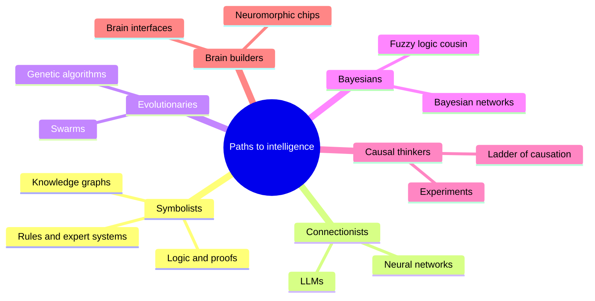
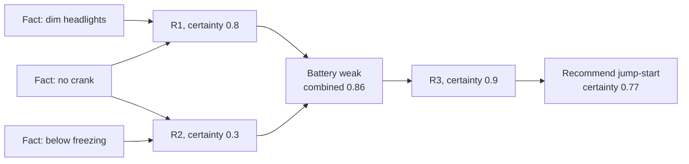
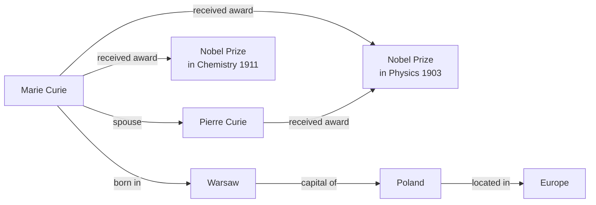
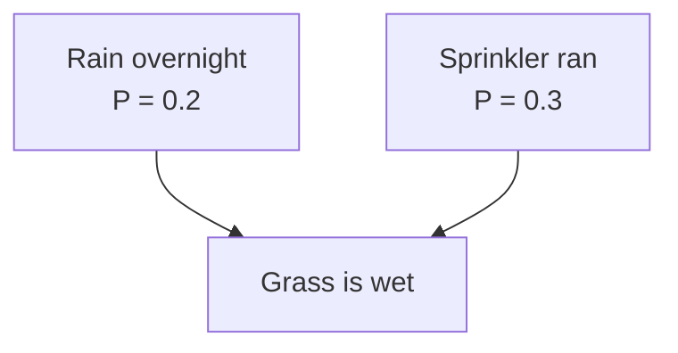
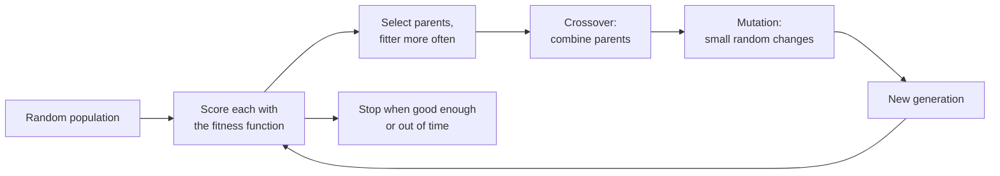

# Chapter 54: Other Paths to Intelligence: Symbolic AI, Language Before LLMs, Evolution, Bayes, Causality and Brains

*Neural networks won the 2020s, but they were never the only road; this chapter works through the other roads by hand (rules, knowledge graphs, probability, evolution, causality, older language technology and the brain itself) and shows why several of them are now merging back into the frontier.*

## What you'll learn

- How a rule-based expert system reasons, by running a small rule chain by hand with certainty factors, and why such systems were brittle.
- How knowledge graphs store facts as triples, and how Wikidata and search engines use them.
- How a Bayesian network reasons under uncertainty, worked with real numbers including the surprising effect called "explaining away", and what fuzzy logic is good for.
- How a genetic algorithm evolves solutions, through one complete generation on paper.
- Why correlations mislead, with a worked confounder that reverses a conclusion, and how A/B tests and Pearl's ladder of causation fix it.
- What neuro-symbolic AI is, from AlphaGeometry to AlphaProof, and the live debate over whether the future needs symbols at all.
- The four eras of language AI, the classic language-processing tasks, and the long history of machine translation.
- How real neurons differ from artificial ones, and what neuromorphic chips, brain-computer interfaces and brain scanners can and cannot do.

## Before you start

Chapter 7 (A History of AI) tells the story of expert systems, the AI winters and the rise of neural networks; this chapter opens up the machinery that history only names. Chapter 6 (The Math of AI, Part 2) introduces Bayes' rule with natural frequencies and the confounder behind ice cream and drownings, and we build directly on both. Chapter 12 (Neural Networks From Scratch) explains the artificial neuron that we compare with real ones. Chapters 14 and 15 cover the neural era of language in depth, so here we only place it in the longer story. Search and planning, the other great symbolic tradition, have their own home in Chapter 48, and AI for mathematics gets more detail in Chapter 52.

## Five tribes, one field

In his 2015 book *The Master Algorithm*, the computer scientist Pedro Domingos sorted AI researchers into five "tribes", each with its own idea of how a machine could learn:

- **Symbolists** believe intelligence is manipulating symbols with logic and rules.
- **Connectionists** build networks of simple neuron-like units and adjust their connections. Your chatbot is their triumph.
- **Evolutionaries** breed solutions the way nature breeds organisms.
- **Bayesians** treat all knowledge as probabilities, updated as evidence arrives.
- **Analogizers** reason by similarity: this case resembles that one, so treat it the same way (the nearest-neighbor methods of Chapter 10).

The connectionists won the last decade so decisively that it is easy to think the other tribes vanished. They did not. Rule engines calculate your taxes. A knowledge graph answers when you search "How tall is the Eiffel Tower?" Probabilistic models filter spam and diagnose faults. Evolutionary search has designed antennas that flew in space. Randomized experiments decide which features ship in every app on your phone. And at the 2026 frontier, labs are borrowing from all of them: proof checkers to verify a model's mathematics, evolutionary loops wrapped around language models, and causal reasoning to test whether an AI's findings are real.



*Figure 54.1: The other paths to intelligence covered in this chapter, grouped roughly by tribe. Causal inference and brain research are added because they cut across all of them.*

> **Definition — Symbolic AI (GOFAI):** "Good old-fashioned AI": systems that represent knowledge as explicit symbols, such as words or labels standing for things in the world, and manipulate them with rules and logic. It dominated AI from the 1950s to the 1980s.

> **Key idea:** Your chatbot is the product of one tribe, the connectionists. The other tribes still run large parts of the world's software, and the frontier increasingly combines their strengths with neural networks.

## Rules and expert systems: knowledge written by hand

### Thinking in IF-THEN

The symbolists' bet was simple. Experts know things. If we could write that knowledge down as explicit rules, a computer could apply the rules faster and more consistently than any person. A doctor knows "if the patient has a stiff neck and a fever and a headache, consider meningitis." Write that as a rule, collect a few hundred such rules, add a program that applies them, and you have a machine doctor.

> **Definition — Production rule:** An IF-THEN statement, such as "IF the engine does not crank AND the headlights are dim THEN the battery is weak," that a rule-based system uses to draw conclusions from facts.

> **Definition — Expert system:** A program that encodes a human expert's knowledge as many IF-THEN rules in order to give advice in one narrow area. Expert systems were the commercial face of AI in the 1970s and 1980s.

> **Definition — Knowledge base:** The collection of facts and rules an expert system knows, kept separate from the program that reasons with them.

> **Definition — Inference engine:** The part of an expert system that applies rules to facts to reach conclusions. It is the same program whatever the domain, which is why one engine could run a medical system or a car-repair system.

Chapter 7 tells the history: MYCIN at Stanford in the 1970s used several hundred rules to recommend antibiotics for blood infections and matched specialists in tests, and XCON at Digital Equipment Corporation grew to thousands of rules for configuring computer orders. Here we run one.

### A tiny expert system, worked by hand

Our domain is "Why won't my car start?" The knowledge base has six rules. Each rule carries a certainty factor between 0 and 1, the expert's confidence that the conclusion follows. MYCIN used exactly this idea.

> **Definition — Certainty factor:** A number, used in MYCIN-style expert systems, expressing how strongly a rule's conclusion is believed, from 0 (no support) to 1 (certain). It was a practical stand-in for probability, not a true probability.

The rules:

- **R1.** IF the engine does not crank AND the headlights are dim THEN the battery is weak (certainty 0.8).
- **R2.** IF the temperature is below freezing AND the engine does not crank THEN the battery is weak (certainty 0.3). Cold weakens batteries.
- **R3.** IF the battery is weak THEN recommend a jump-start (certainty 0.9).
- **R4.** IF the engine does not crank AND the headlights are bright THEN the starter motor is faulty (certainty 0.7).
- **R5.** IF the starter motor is faulty THEN recommend calling a mechanic (certainty 0.9).
- **R6.** IF the engine cranks AND the fuel gauge reads empty THEN recommend adding fuel (certainty 0.95).

You tell the system three facts: the engine does not crank, the headlights are dim, and it is below freezing.

**Cycle 1.** The inference engine scans the rules for any whose IF part is satisfied by known facts.

- R1 matches (no crank, dim lights). It concludes "battery is weak" with certainty 0.8.
- R2 matches (freezing, no crank). It also concludes "battery is weak", with certainty 0.3.
- R4 does not match (lights are dim, not bright). R6 does not match (the engine does not crank).

Two rules support the same conclusion, so their certainties are combined. MYCIN's formula for two positive certainties a and b is a + b × (1 − a). Here 0.8 + 0.3 × (1 − 0.8) = 0.8 + 0.06 = 0.86. The second rule nudges belief upward, but cannot push it past 1.

**Cycle 2.** "Battery is weak" is now a fact (certainty 0.86), so R3 matches. Its conclusion's certainty is the evidence's certainty times the rule's: 0.86 × 0.9 ≈ 0.77. The system recommends a jump-start with certainty 0.77.

**Cycle 3.** No new rules match. The system stops and, crucially, can explain itself: "I recommend a jump-start because R3 says a weak battery calls for one; I believe the battery is weak because of R1 (no crank, dim lights) and R2 (freezing weather)." That explanation trace was one of expert systems' great selling points, and it is something neural networks still struggle to provide.



*Figure 54.2: Forward chaining through the car-repair rules. Facts trigger rules, rules add new facts, and new facts trigger further rules until nothing more fires.*

> **Definition — Forward chaining:** Reasoning from known facts toward conclusions: fire every rule whose conditions are met, add its conclusion as a new fact, and repeat until nothing new appears.

That was forward chaining. MYCIN mostly worked the other way. It started from a goal ("Is the organism E. coli?") and worked backward, asking the doctor questions only when a needed fact was missing. In our system, backward chaining toward "call a mechanic" would look for a rule concluding that (R5), see it needs "starter faulty", find R4, see that R4 needs "headlights bright", and ask you: "Are the headlights bright?" When you say "dim", that line of reasoning closes.

> **Definition — Backward chaining:** Reasoning from a goal back to the facts needed to prove it, asking for missing facts along the way. It makes an expert system feel like a consultant asking targeted questions.

### Now break it

Add one more fact: the car has just been pulled out of a flood. Run the rules again. Nothing changes. The system confidently recommends a jump-start, which on a flooded car could short the electrics or worse. Any human mechanic would stop you. The rule base contains no rule about floods, and, more importantly, it has no way to notice that the situation lies outside the world its rules describe. It does not know what it does not know.

You could add a rule about floods. Then you will need one about cars that are on fire, cars with the battery removed, electric cars, cars from 1925, and a thousand more. Every new rule can interact with the old ones in ways nobody predicted. This is the deep problem with hand-written knowledge.

> **Definition — Brittleness:** The tendency of a rule-based system to fail badly, without warning, as soon as a situation falls slightly outside what its rules anticipated, because it has no general common sense to fall back on.

> **Definition — Knowledge acquisition bottleneck:** The difficulty of getting expert knowledge out of experts' heads and into explicit rules. Experts often cannot say why they decide as they do, and interviewing them is slow and expensive.

### Why the expert-system boom ended

Three problems ended the boom of the 1980s (Chapter 7 covers the business side):

1. **Knowledge acquisition was slow and expensive.** "Knowledge engineers" spent months interviewing experts, and experts' best judgments were often intuitive and hard to put into words.
2. **Brittleness and common sense.** In 1984 Doug Lenat began Cyc, a project to hand-encode enough common sense ("water makes things wet", "people cannot be in two places at once") to fix brittleness. Decades and millions of hand-entered assertions later, it had not produced general common sense. Machine learning later absorbed vast amounts of common sense from text automatically, which is one reason your chatbot knows a flooded car is a bad candidate for a jump-start.
3. **Uncertainty was handled with patches.** Certainty factors were not real probabilities, and combining them could give inconsistent answers. Fixing that properly led to Bayesian networks, later in this chapter.

### Where rules still rule

> **Watch out:** "Symbolic AI is dead." Rules, logic and search run tax software, insurance eligibility checks, airline crew scheduling, product configurators (XCON's descendants), the clinical alerts in hospital record systems, compilers and chip-design tools. Rules also wrap modern AI: when a company says its support bot "can never issue a refund over $500", that guarantee comes from a hand-written rule in the surrounding code, not from the neural network (Chapter 31).

Rules survive wherever exactness, auditability and guarantees matter more than flexibility. A tax rule must give the legally correct answer every time and show its working to an auditor. A neural network cannot promise that; a rule can.

> **Key idea:** Rules are exact, transparent and auditable, but they do not learn and they break outside the world they describe. Neural networks learn and generalize, but are opaque and imprecise. Much of this chapter is about attempts to get the best of both.

## Knowledge graphs: facts as a web of triples

### Subject, relation, object

Ask a search engine "What is the capital of France?" and you get "Paris" in a box at the top, often with a photo and population, before any list of links. That answer did not come from reading web pages at the moment you asked. It came from a knowledge graph, a giant database of facts stored in a very simple shape.

> **Definition — Knowledge graph:** A database that stores facts as a network: entities (people, places, things, ideas) are the points, and named relationships connect them. Computers can follow the connections to answer questions.

> **Definition — Triple:** The basic unit of a knowledge graph: one fact written as subject, relation, object, such as "Paris — is capital of — France" or "Marie Curie — received award — Nobel Prize in Physics."

Every fact becomes a triple, and triples link up because they share entities:

- Marie Curie — occupation — physicist
- Marie Curie — occupation — chemist
- Marie Curie — received award — Nobel Prize in Physics (1903)
- Marie Curie — received award — Nobel Prize in Chemistry (1911)
- Marie Curie — spouse — Pierre Curie
- Pierre Curie — received award — Nobel Prize in Physics (1903)
- Marie Curie — born in — Warsaw
- Warsaw — capital of — Poland



*Figure 54.3: A small piece of a knowledge graph. Each arrow is one triple, and questions are answered by following arrows.*

Now questions become walks along arrows. "Was Marie Curie born in a capital city?" Follow "born in" to Warsaw, then check whether Warsaw has a "capital of" arrow: yes. "Did she share a prize with her husband?" Follow "spouse" to Pierre, collect both people's awards, and compare: both have the 1903 Physics prize. No language model is needed, and the answer is exact, traceable and instantly updatable: if a fact changes, you edit one triple.

> **Definition — Ontology:** A formal vocabulary for a domain that defines the types of things that exist and the relationships allowed between them, for example that a "drug" can "treat" a "disease" but a "city" cannot.

### Wikidata and Google's Knowledge Graph

In 2012 Google introduced its Knowledge Graph with the slogan "things, not strings": search should understand that "Paris" is a city (or a person, or a mythological prince) rather than matching a string of letters. The same year the Wikimedia Foundation launched Wikidata, a free knowledge graph anyone can edit, which now holds more than 100 million items and feeds Wikipedia's infoboxes, voice assistants and countless apps.

Wikidata gives every entity and relation an ID so that facts are unambiguous in any language. France is Q142, Paris is Q90, and the relation "capital" is P36. The triple "France — capital — Paris" is stored as Q142, P36, Q90. You can query it in a language called SPARQL at query.wikidata.org:

```sparql
# Ask Wikidata: what is the capital of France?
SELECT ?capitalLabel WHERE {
  wd:Q142 wdt:P36 ?capital .   # France (Q142) has capital (P36) ?capital
  SERVICE wikibase:label { bd:serviceParam wikibase:language "en". }
}
```

The query says: find any ?capital such that the triple "Q142, P36, ?capital" exists, then show its English name. The answer is Paris. Change Q142 to Q183 and you get Berlin, the capital of Germany.

> **Try it:** Go to wikidata.org and search for a person you admire. Scroll through the statements: each line is one triple. Then ask your chatbot the same five facts and compare. Where they disagree, which do you trust, and why?

### Knowledge graphs and language models

Knowledge graphs and LLMs store knowledge in opposite ways. A graph stores each fact explicitly, so it can be cited, corrected in seconds and queried exactly, but it only knows what someone entered, and it cannot read a messy paragraph. An LLM stores knowledge spread across billions of parameters (Chapter 18). It knows a vast, fuzzy range of things, handles any phrasing, but can be confidently wrong and cannot easily be corrected one fact at a time.

The two are now combined in practice. Language models read documents and extract triples to build graphs (information extraction, later in this chapter). Systems like GraphRAG (Chapter 27) retrieve connected facts from a graph to ground a model's answer. Drug companies, banks and intelligence agencies use knowledge graphs to connect entities across millions of documents, and then let an LLM explain what the graph found.

## Reasoning under uncertainty: Bayesian networks and fuzzy logic

### Bayes' rule, briefly

Chapter 6 introduced Bayes' rule with a medical test: a disease affects 1 in 100 people, a test catches 90% of sick people and wrongly flags 9% of healthy ones, and only about 9% of people who test positive are actually sick. The lesson was that evidence must be weighed against how common something was to begin with.

> **Definition — Bayes' rule:** A formula for updating a belief when new evidence arrives: P(A given B) = P(B given A) × P(A) ÷ P(B). It combines how well the evidence fits A with how likely A was beforehand.

Real problems involve many uncertain things that influence each other. A doctor juggles dozens of symptoms, test results and risk factors. Writing down the probability of every combination quickly becomes impossible: with 30 yes-or-no variables there are 2^30, about 1.07 billion, combinations. In the 1980s Judea Pearl showed how to tame this with a picture, and in 2011 he received the Turing Award, computing's highest honor, partly for that work.

### A Bayesian network, worked by hand

> **Definition — Bayesian network:** A diagram of uncertain variables connected by arrows, where each arrow means "directly influences", together with a small probability table for each variable given its direct causes. It lets a computer reason about many uncertain things at once.

> **Definition — Conditional probability table:** In a Bayesian network, the table attached to each variable that gives its probabilities for every combination of its parents' values, for example the chance the grass is wet given rain and sprinkler.

You wake up and the grass is wet. Did it rain? Two things can wet the grass: rain overnight, or the automatic sprinkler. Here is the network:



*Figure 54.4: A three-variable Bayesian network. Rain and the sprinkler each influence whether the grass is wet; in this simple version they are independent of each other.*

The tables: rain on 20% of nights, sprinkler on 30% of nights, independently. The chance the grass is wet:

| Rain? | Sprinkler? | P(wet) |
|---|---|---|
| Yes | Yes | 0.99 |
| Yes | No | 0.90 |
| No | Yes | 0.80 |
| No | No | 0.05 |

Now use natural frequencies, as in Chapter 6. Imagine 1,000 mornings.

- Rain and sprinkler: 1,000 × 0.2 × 0.3 = 60 mornings, of which 99% are wet: about 59.4.
- Rain only: 1,000 × 0.2 × 0.7 = 140 mornings, 90% wet: 126.
- Sprinkler only: 1,000 × 0.8 × 0.3 = 240 mornings, 80% wet: 192.
- Neither: 1,000 × 0.8 × 0.7 = 560 mornings, 5% wet: 28.

Wet mornings total 59.4 + 126 + 192 + 28 = 405.4.

**Question 1: The grass is wet. Did it rain?** Rainy wet mornings are 59.4 + 126 = 185.4, so P(rain given wet) = 185.4 ÷ 405.4 ≈ 0.46. Seeing wet grass raised the chance of rain from 20% to 46%.

**Question 2: The grass is wet, and you check the sprinkler log: it ran.** Now only the mornings where the sprinkler ran count: 59.4 (with rain) + 192 (without) = 251.4. P(rain given wet and sprinkler) = 59.4 ÷ 251.4 ≈ 0.24. The chance of rain fell back to almost its starting 20%.

**Question 3: The grass is wet, and the sprinkler did not run.** Then 126 ÷ (126 + 28) = 126 ÷ 154 ≈ 0.82. Rain becomes very likely.

> **Definition — Explaining away:** The pattern where confirming one possible cause of an observation makes other possible causes less likely. Learning that the sprinkler ran "explains away" the wet grass, so rain becomes less likely again.

Explaining away is natural for people (if you know your friend is late because her train broke down, you stop wondering whether she overslept) but impossible in a simple chain of IF-THEN rules, which only ever add support. Bayesian networks handle it automatically, because they keep the whole probability picture consistent.

**The compression.** Our network needed 1 number for rain, 1 for the sprinkler and 4 for wet grass: 6 numbers. Writing out every combination of three yes-or-no variables directly needs 2^3 − 1 = 7. A tiny saving here, but enormous at scale: 30 variables with at most three parents each need at most 30 × 2^3 = 240 numbers instead of about a billion. Most things in the world directly depend on only a few others, and Bayesian networks exploit that.

> **Analogy:** A Bayesian network is a detective's corkboard. Each card is a possibility, each string says what can cause what, and every new clue (the sprinkler log, the alibi) shifts suspicion across the whole board at once, sometimes away from suspects you were never directly asking about.

**Where they are used.** In the late 1980s a Bayesian network called Pathfinder helped pathologists diagnose lymph-node diseases. Microsoft research on Bayesian user modeling in the 1990s fed into the Office Assistant ("Clippy") and into Windows troubleshooting wizards. The naive Bayes spam filter of Chapter 10 is the simplest Bayesian network of all. Today their descendants, probabilistic programming tools, model risk in insurance, epidemics in public health, faults in jet engines and uncertainty in scientific measurements. Pearl's later work, on causal diagrams, comes up again in the causality section.

### Fuzzy logic: degrees of truth

Probability handles uncertainty about crisp facts: either it rained or it did not; we just do not know which. Fuzzy logic, introduced by Lotfi Zadeh in 1965, handles something different: vague concepts. Is 26°C "warm"? Somewhat. Is it "hot"? A little. Fuzzy logic lets a statement be partly true.

> **Definition — Fuzzy logic:** Logic in which statements can be partly true, with a degree of truth between 0 and 1, such as "26°C is warm to degree 0.4." It is used for smooth control of machines and appliances.

> **Definition — Membership function:** In fuzzy logic, a curve that says how strongly a value belongs to a vague category, for example how "hot" each temperature is, from 0 (not at all) to 1 (fully).

**Worked example: a fuzzy fan.** We define two categories with simple straight-line ramps:

- **Warm:** 0 at 18°C, rising to 1 at 23°C, falling back to 0 at 28°C.
- **Hot:** 0 at 24°C, rising to 1 at 30°C and staying at 1 above that.

```
temp    warm (# = 0.1)     degree    hot (# = 0.1)      degree
18 C    .                  0.0       .                  0.0
20 C    ####               0.4       .                  0.0
22 C    ########           0.8       .                  0.0
23 C    ##########         1.0       .                  0.0
24 C    ########           0.8       .                  0.0
26 C    ####               0.4       ###                0.33
27 C    ##                 0.2       #####              0.5
28 C    .                  0.0       #######            0.67
30 C    .                  0.0       ##########         1.0
```

*Figure 54.5: Membership in "warm" and "hot" at different temperatures. Between 24°C and 28°C a temperature is partly warm and partly hot at the same time.*

At 26°C: warm = (28 − 26) ÷ (28 − 23) = 2 ÷ 5 = 0.4, and hot = (26 − 24) ÷ (30 − 24) = 2 ÷ 6 ≈ 0.33.

Two rules: IF warm THEN fan at 40%; IF hot THEN fan at 100%. Both fire partly, and the controller blends them with a weighted average:

fan = (0.4 × 40 + 0.33 × 100) ÷ (0.4 + 0.33) = (16 + 33.3) ÷ 0.73 ≈ 67%.

At 27°C, warm = 0.2 and hot = 0.5, giving (8 + 50) ÷ 0.7 ≈ 83%. The fan speeds up smoothly as the room warms, instead of slamming between off and full as a simple thermostat does. Turning the fuzzy result back into one crisp number like this is called defuzzification.

Fuzzy control had a boom in Japan in the late 1980s and 1990s. The Sendai subway's Namboku Line, opened in 1987, used fuzzy logic to control acceleration and braking for a smoother ride, and fuzzy controllers appeared in washing machines that adjust to the load, rice cookers, camera autofocus and air conditioners. Many are still running.

> **Watch out:** Fuzzy degrees are not probabilities. "70% chance of rain" means uncertainty about whether a definite event happens. "The room is 0.7 warm" means the room definitely is a certain temperature and "warm" applies to it to that degree. Mixing the two up is a common mistake.

## Evolution as an algorithm

### Breeding solutions

Nature designs eyes, wings and immune systems without understanding anything. It makes many variations, keeps the ones that survive and reproduce, and repeats for millions of generations. In the 1960s and 1970s researchers, notably John Holland, turned this into a general-purpose search method.

> **Definition — Evolutionary algorithm:** An optimization method inspired by natural selection: create a population of candidate solutions, score them, let the better ones reproduce with variation, and repeat for many generations.

> **Definition — Genetic algorithm:** A kind of evolutionary algorithm that encodes each candidate solution as a string, like DNA (often a string of 0s and 1s), and creates new candidates by crossover and mutation.

> **Definition — Fitness function:** The score that tells an evolutionary algorithm how good a candidate solution is. Evolution maximizes it, so it must capture what you really want, or evolution will exploit its loopholes.

> **Definition — Crossover:** Making a new candidate by combining parts of two parents, for example the first half of one string and the second half of another, like a child inheriting genes from both parents.

> **Definition — Mutation:** Randomly changing a small part of a candidate, such as flipping one bit, to introduce variety that neither parent had.

### One generation, worked by hand

**The problem.** You are packing a 10 kg backpack for a hike. Five items, each with a weight and a value (how much you want it):

| Item | Weight | Value |
|---|---|---|
| A: tent | 5 kg | 10 |
| B: stove | 4 kg | 7 |
| C: camera | 2 kg | 4 |
| D: book | 1 kg | 1 |
| E: water filter | 3 kg | 8 |

**The encoding.** A packing list is a five-bit string in the order A B C D E, where 1 means "pack it". So 11000 means tent and stove.

**The fitness function.** Total value if the total weight is 10 kg or less; 0 if the bag is overweight.

**Generation 0: four random packing lists.**

| Name | Genome | Items | Weight | Fitness |
|---|---|---|---|---|
| P1 | 11000 | tent, stove | 9 kg | 17 |
| P2 | 01011 | stove, book, filter | 8 kg | 16 |
| P3 | 10110 | tent, camera, book | 8 kg | 15 |
| P4 | 11101 | tent, stove, camera, filter | 14 kg | 0 (overweight) |

Total fitness 48, average 12, best 17.

**Step 1: Selection.** Parents are picked with probability proportional to fitness, like a roulette wheel where fitter candidates get bigger slices: P1 17 ÷ 48 ≈ 35%, P2 16 ÷ 48 ≈ 33%, P3 15 ÷ 48 ≈ 31%, P4 0%. We spin four times and draw P2, P3, P1, P3. P3 happens to be picked twice and P4 never: the overweight bag leaves no descendants.

**Step 2: Crossover.** Pair the parents and cut their strings.

- P2 (01011) with P3 (10110), cut after the second bit: children 01|110 = **01110** and 10|011 = **10011**.
- P1 (11000) with P3 (10110), cut after the third bit: children 110|10 = **11010** and 101|00 = **10100**.

**Step 3: Mutation.** Each bit has a small chance of flipping. Suppose one flip happens: the last bit of 10100 becomes 1, giving **10101**.

**Generation 1.**

| Genome | Items | Weight | Fitness |
|---|---|---|---|
| 01110 | stove, camera, book | 7 kg | 12 |
| 10011 | tent, book, filter | 9 kg | 19 |
| 11010 | tent, stove, book | 10 kg | 18 |
| 10101 | tent, camera, filter | 10 kg | 22 |

Total fitness rose from 48 to 71, the average from 12 to 17.75, and the best from 17 to 22. In fact 10101 (tent, camera, water filter, exactly 10 kg, value 22) is the best possible packing for this problem, and the mutation found it. Real runs use populations of hundreds and many generations, and progress is noisier, but the mechanism is exactly this.



*Figure 54.6: The genetic-algorithm loop. Nothing in it understands the problem; all the intelligence is in the fitness function and the pressure of selection.*

> **Analogy:** A genetic algorithm is dog breeding for solutions. Keep the best, cross them, let random variation add surprises, and repeat for many generations. The breeder does not need to understand genetics, only to recognize a good dog.

### What evolution is good at, and its traps

**A real success.** For NASA's Space Technology 5 mission, which launched in 2006, engineers used an evolutionary algorithm to design a small antenna. The winning design was a strange bent-wire shape that no human engineer would have drawn, it met the mission's demanding requirements, and it flew in space.

Evolutionary methods shine when you can score a solution but cannot calculate a gradient (Chapter 6): designs tested in a simulator, schedules, circuit layouts, game strategies. They are easy to run in parallel. Their weaknesses are cost (thousands or millions of evaluations), and getting stuck on a "good enough" design when a better one needs several coordinated changes at once.

The deepest trap is the fitness function. In 1994 Karl Sims evolved virtual creatures to swim, walk and jump in a physics simulation, and some evolved to exploit bugs in the simulated physics rather than move as intended. Evolution optimizes what you measure, not what you meant: the same "specification gaming" problem that Chapter 55 discusses for modern AI.

### Swarms

> **Definition — Swarm intelligence:** Problem-solving that emerges from many simple agents following local rules, like ants finding the shortest path to food by leaving and following scent trails, with no leader planning the whole.

Ant colony optimization (Marco Dorigo, early 1990s) sends virtual ants over a network; shorter paths collect more virtual scent and attract more ants, and the colony converges on good routes. Particle swarm optimization (1995) moves a flock of candidate solutions through a search space, each pulled toward its own best find and the flock's best. Craig Reynolds's "boids" (1987) showed that realistic bird flocking emerges from three simple rules per bird, and the idea is used in film animation and games.

> **At the frontier (2026):** Evolution has merged with language models. Google DeepMind's AlphaEvolve (May 2025) uses an LLM to propose changes to code, automatic evaluators to score them, and an evolutionary loop to keep and recombine the best. It found a way to multiply 4 × 4 complex-valued matrices with 48 multiplications, the first improvement in that setting over the approach descended from Strassen's 1969 algorithm, and slightly improved bounds on several open math problems. An August 2026 preprint reported using it to nudge the best known bound on the exponent of matrix multiplication to about 2.371177. The LLM supplies clever variations; evolution supplies relentless selection.

