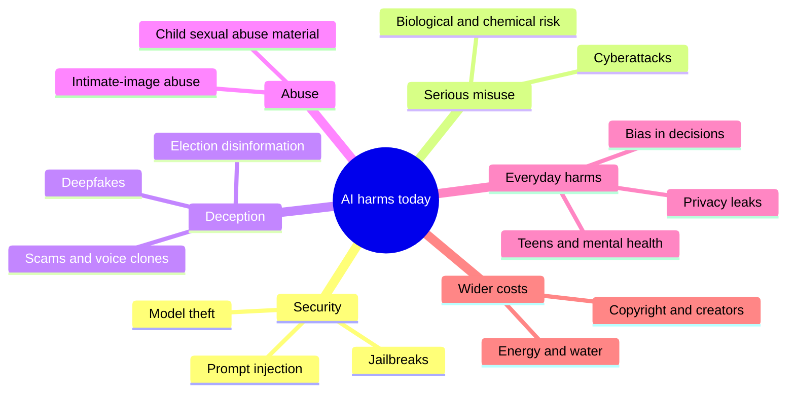
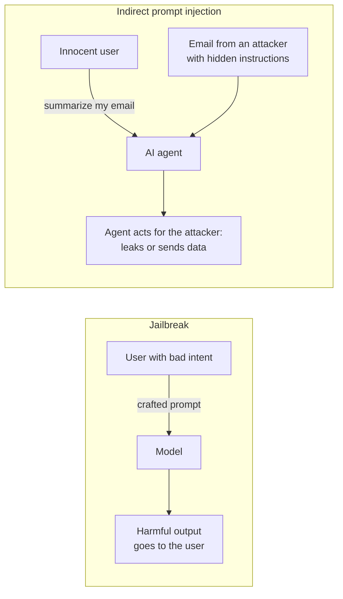
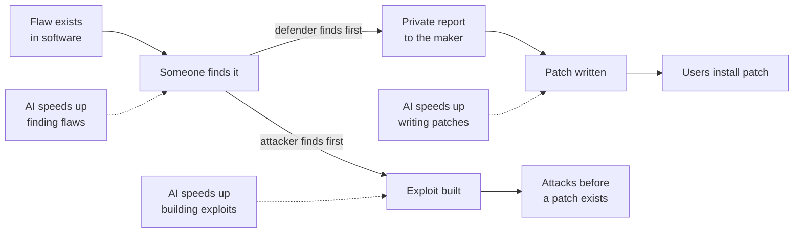
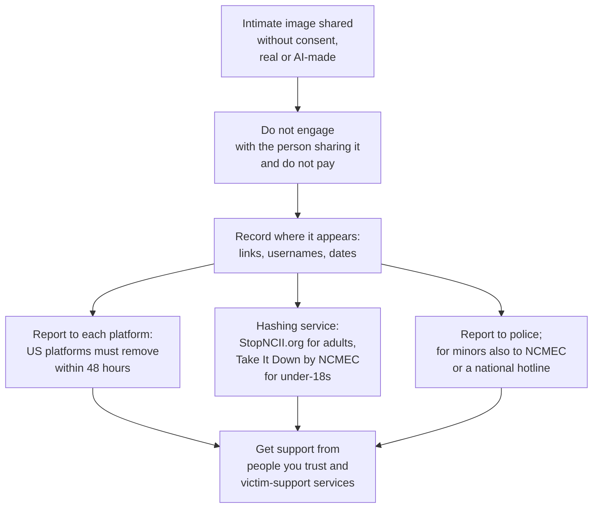
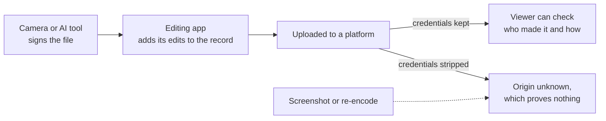

# Chapter 58: Misuse, Security and Everyday Harms

*This chapter maps the real ways AI is hurting people today, from hijacked agents, cyberattacks and voice-clone scams to deepfakes, biased decisions, leaked chats and harm to vulnerable teenagers, and what individuals, companies and governments are doing about each.*

## What you'll learn
- How to sort AI harms into a simple map, and why AI mostly makes old harms cheaper, faster and more personal rather than inventing new ones.
- The difference between jailbreaks and prompt injection, and why hijackable agents are now a problem for society, not just for the people who build them.
- How AI is changing cyberattack and cyber defense, and why labs treat biological misuse as the most severe risk.
- How voice-clone scams, deepfakes, non-consensual intimate imagery and AI-generated child abuse material work at a high level, what the law says as of October 2026, and what to do if it happens to you or someone you know.
- What happened with AI and elections, and what watermarks and content credentials can and cannot prove.
- Why "fair" has several mathematical meanings that cannot all be satisfied at once, worked through with numbers.
- What happens to what you type into a chatbot, and how to protect your privacy.
- The evidence, lawsuits and new rules on teenagers, companion apps and mental health, plus a short reality check on the energy footprint of a prompt and the copyright fights.

## Before you start
This chapter is the society-level companion to Chapter 31 (Shipping AI: Evals, Reliability, Security and Product Design), which explains builder-side defenses against prompt injection; we reuse its definitions here. Chapter 18 (How a Large Language Model Works) explains why models hallucinate and why they cannot tell instructions from data, Chapter 28 (Tools and Agents) explains agents, and Chapter 46 (Speech, Audio and Music) and Chapter 47 (Generative Media) explain how voices, images and video are generated. Chapter 55 (What Can Go Wrong: Reliability and the Alignment Problem) covers accidents and alignment, Chapter 56 (How Labs Make AI Safer) covers safety frameworks and classifiers, and Chapter 57 (Interpretability and Evaluations) explains how dangerous capabilities are tested. Chapter 59 (AI Law and Policy Around the World) covers the law in depth. Some sections of this chapter deal with sexual abuse, suicide and self-harm. They contain no graphic detail, and you can skip them.

## A map of harms

Chapter 55 sorted AI harms into three families. **Accidents** are things nobody wanted, such as a chatbot inventing a legal citation. **Misuse** is a person deliberately using AI to hurt others, such as a scammer cloning a voice. **Structural harms** are society-wide effects, such as jobs changing or power concentrating (Chapter 60). This chapter is mainly about misuse and the everyday harms that arise when ordinary products meet real people: biased decisions, privacy leaks, and vulnerable users drawn into unhealthy patterns.

> **Definition — Misuse:** A person deliberately using an AI system to cause harm, for example to defraud, harass, spread false information or attack computer systems.

> **Definition — Dual-use:** Describes a capability that can serve both good and harmful purposes. A model that finds software vulnerabilities helps defenders patch them and attackers exploit them; a model that explains biology helps students and could help a bad actor.


*Figure 58.1: A map of the harms this chapter covers. Real incidents often mix several branches.*

A useful habit when you hear about any AI harm is to ask what changed. Phishing, fraud, propaganda, forgery and discrimination are all far older than computers. In most cases AI changes three things: **cost** (the harm becomes cheap), **scale** (one person can do it a million times) and **personalization** (each attempt can be tailored to its target). In a few cases it creates something genuinely new, such as an agent that can be hijacked by a sentence hidden in a web page.

Here is how dramatic the cost change can be. Suppose a scammer wants to send 1,000 personalized messages, each referring to the target's employer, recent posts and hometown. Written by hand at 10 minutes each, that is 10,000 minutes, about 167 hours of work, or roughly $3,300 at $20 an hour. A language model can draft each one from about 500 tokens of input and 300 tokens of output. At mid-tier late-2026 prices of about $2 per million input tokens and $10 per million output tokens, each message costs 500 × $2 ÷ 1,000,000 + 300 × $10 ÷ 1,000,000 = $0.001 + $0.003 = $0.004, so all 1,000 cost about $4. That is roughly 800 times cheaper, before counting the time saved.

> **Key idea:** Most AI misuse is old harm made cheap, fast and personal. When cost falls by a factor of hundreds, behavior that used to be rare becomes common, and defenses that relied on attacks being expensive stop working.

> **Definition — Threat model:** A clear description of who might attack a system, what they want, what they can do and what they cannot. Security work starts with a threat model, because you cannot defend against "everything".

## Jailbreaks, prompt injection and agents: the society-level view

### Two different attacks

Chapter 31 explained these attacks from the builder's side. Here are its definitions again, because the difference matters for everyone.

> **Definition — Jailbreak:** A prompt crafted by a user to trick a model into ignoring its safety training, for example through role-play, hypotheticals, unusual encodings or many fake example dialogues.

> **Definition — Prompt injection:** An attack in which text in a model's input smuggles in instructions that override what the developer or the user intended.

> **Definition — Direct and indirect prompt injection:** Direct injection is typed by the person using the system ("ignore your previous instructions and..."). Indirect injection is hidden inside content the AI reads on the user's behalf, such as a web page, email, PDF, product review or tool result; there, the user is the victim rather than the attacker.


*Figure 58.2: In a jailbreak the user is the attacker. In indirect prompt injection the attacker is a stranger and the user is the victim.*

> **Watch out:** "Jailbreaks and prompt injection are the same thing" is a common confusion. In a jailbreak, the person typing wants the harmful output. In indirect prompt injection, the person typing did nothing wrong; a third party planted instructions in something their assistant read. That changes who is responsible and who needs protecting.

### Why this is now a society problem

When chatbots only produced text for the person typing, a successful jailbreak mostly harmed the jailbreaker's own conversation, plus whoever they later showed the output to. Agents change this. An agent can read your email, browse the web, fill in forms, run code and send messages (Chapter 28). Every web page, email and document it reads becomes a possible channel for instructions from strangers.

Chapter 31 named the most dangerous combination.

> **Definition — Lethal trifecta:** Simon Willison's term for the dangerous combination of access to private data, exposure to untrusted content, and the ability to communicate externally. An agent with all three can be steered by injected instructions into sending private data to an attacker.

> **Definition — Data exfiltration:** Getting private data out of a system to an attacker, for example by making an AI agent include it in a link, an image address, an email or a web request.

In 2025, several companies launched browser agents that can act on web pages for you, including Anthropic's Claude for Chrome research preview, OpenAI's Atlas browser and Perplexity's Comet. Each launch acknowledged that prompt injection is an unsolved problem. Anthropic reported that in its own tests, its mitigations reduced the attack success rate from about 24% to about 11%: a real improvement, and still far from zero.

Small rates become large numbers at society's scale. Here is an illustration with invented but plausible assumptions. Suppose a browser agent reads 50 web pages a day for its user, 1 page in 1,000 contains a working injection attempt, and each attempt succeeds 11% of the time:

```
Pages read per year:        50 × 365        = 18,250
Injected pages met:         18,250 ÷ 1,000  ≈ 18
Successful hijacks a year:  18 × 0.11       ≈ 2 per user
Across 1 million users:     ≈ 2 million successful hijacks a year
```

Even if the real numbers are ten times smaller, that is a large new attack surface. This is why the security community treats prompt injection less like a bug to be fixed and more like phishing: a permanent condition to be managed with limits on what agents can do, human confirmation for risky actions, and the trifecta rule of never combining all three ingredients (Chapter 31 covers these defenses).

> **Analogy:** Prompt injection is phishing for robots. Companies cannot stop strangers from emailing their employees, so they train staff, filter mail and limit what any one employee can do with a single click. Agents need the same layered approach, because nobody can stop strangers from writing web pages.

Jailbreaks have their own society-level side. Labs defend with safety training and with classifiers that screen inputs and outputs (Chapter 56). In February 2025 Anthropic reported that its constitutional classifiers cut the success rate of automated jailbreak attempts in its tests from 86% to 4.4%. But two limits remain. First, a determined attacker gets unlimited tries, and any defense with a nonzero failure rate eventually fails (Chapter 57 works through the math). Second, safeguards live in the deployed system, not in the model's weights. Anyone who downloads an open-weight model can fine-tune its safety training away, which is the strongest argument in the debate about open weights (Chapter 60).

### Stealing the model itself

There is a further kind of security problem: taking the model. If someone steals a frontier model's weights, every safeguard around the official product, from classifiers to account bans, becomes irrelevant. Chapter 56 described the security levels, from SL1 to SL5, that RAND defines for protecting weights against attackers ranging from amateurs to top nation-state teams.

A less dramatic route is to copy a model's skills by imitating it.

> **Definition — Distillation attack:** Training a cheaper model on large numbers of answers collected from another company's model, usually against its terms of service, to copy its capabilities without paying for the research. Ordinary distillation within one company is a standard, legitimate technique.

In February 2026, Anthropic publicly accused three Chinese AI companies, DeepSeek, Moonshot AI and MiniMax, of distillation attacks on its models, reporting about 24,000 fraudulent accounts that generated over 16 million exchanges. These are Anthropic's accusations. They illustrate why labs now run classifiers that watch for distillation as well as for weapons-related misuse.

## Cyber: the double-edged sword

Cybersecurity is where AI misuse has moved fastest from theory to documented reality, and also where AI is most clearly helping defenders.

> **Definition — Vulnerability:** A flaw in software or a system that an attacker could use to make it do something it should not, such as reveal data or run the attacker's code.

> **Definition — Exploit:** A piece of code or a technique that takes advantage of a specific vulnerability. Finding a vulnerability and writing a working exploit for it are different, and both are skilled work.

> **Definition — Zero-day vulnerability:** A vulnerability unknown to the software's maker, so no fix exists yet. The name means defenders have had zero days to prepare.

> **Definition — Patch:** An update that fixes a vulnerability. The race between attackers using a flaw and users installing the patch decides most real-world damage.

> **Definition — Phishing:** Tricking people into revealing passwords, sending money or opening malicious files, usually with a message that pretends to come from someone they trust.

> **Definition — Malware:** Malicious software, such as ransomware that locks a company's files until it pays, or spyware that secretly copies data.

AI helps attackers in several ways: writing convincing phishing messages in any language, explaining unfamiliar systems, helping write malicious code, and, most recently, automating whole stretches of an operation. In November 2025, Anthropic reported that a group it assessed as Chinese state-sponsored had used Claude Code, its coding agent, to automate much of an espionage campaign against about 30 organizations. By Anthropic's estimate, the AI performed 80 to 90% of the tactical work, with humans stepping in at a few key decision points. Anthropic banned the accounts and published the report as a warning.

The same abilities serve defense, and in 2026 the defensive story became just as dramatic. On April 7, 2026, Anthropic announced Claude Mythos Preview together with Project Glasswing. According to Anthropic, the model found thousands of high-severity vulnerabilities across every major operating system and web browser, including a flaw in OpenBSD that had gone unnoticed for 27 years. On the CyberGym vulnerability benchmark it scored 83.1%, against 66.6% for Claude Opus 4.6. Anthropic said it did not plan to make Mythos Preview generally available. Instead it gave access to defenders: partners including AWS, Apple, Broadcom, Cisco, CrowdStrike, Google, JPMorganChase, the Linux Foundation, Microsoft, NVIDIA and Palo Alto Networks, plus more than 40 organizations that maintain critical software, so they could find and fix flaws first. An October 6, 2026 update created a tiered Cyber Verification Program for vetted users.

> **Definition — Coordinated vulnerability disclosure:** The practice of privately telling a software maker about a vulnerability and giving it time to release a patch before the details are made public, so defenders are not caught out.

> **Definition — Trusted access program:** Gated access to a more capable or less restricted version of a model for vetted organizations, such as cybersecurity defenders, while the public gets a version with stronger safeguards.

Other labs moved in the same direction. OpenAI and Google offer cyber-specialized models, such as GPT-5.5-Cyber and Gemini 3.5 Flash Cyber, to vetted defenders. OpenAI's October 2026 deployment note treats its GPT-6.1 Sol and Luna models as "High" capability in cybersecurity under its Preparedness Framework, and in August 2026 OpenAI said, according to press coverage of its notice, that internal evaluations of an unreleased model meant it could no longer rule out its "Critical" cyber threshold. Governments have also stepped in: according to Anthropic's update notes, access to Mythos-class models was briefly suspended in June 2026 under a US Commerce Department directive, then restored.


*Figure 58.3: The vulnerability race. AI accelerates every step, for both sides; who gets the strongest tools first, and how fast patches are installed, decide the outcome.*

The policy debate here is genuinely hard, and both sides have strong arguments.

- **For restricting access** (the Glasswing approach): if the most capable bug-finding models go to defenders first, the world's most important software can be patched before attackers get comparable tools. Releasing such a model publicly on day one would hand every criminal group a vulnerability factory while millions of systems remained unpatched.
- **Against relying on restriction:** gatekeeping concentrates power in a few companies and governments that decide who counts as a "defender"; small organizations and independent researchers can be left out; comparable open-weight models may appear anyway; and security through secrecy has a mixed history. Critics argue the better path is faster patching and broader access for defenders, not exclusive clubs.

> **At the frontier (2026):** Cyber became the first domain where frontier labs openly said a model's dangerous capability had outrun their willingness to release it publicly. Tiered access, where the same underlying model ships with different safeguards to different users, is now standard practice at Anthropic, OpenAI and Google DeepMind.

## Biological and chemical misuse

Frontier labs treat biological weapons as the most severe misuse risk, for three reasons: the potential harm is mass casualties, a released pathogen can spread on its own, and the damage cannot be undone. Chemical weapons are grouped with them under the label CBRN (Chapter 57).

> **Definition — CBRN:** Chemical, biological, radiological and nuclear weapons. AI safety frameworks treat meaningful AI help toward these as among the most severe possible harms.

> **Definition — Biosecurity:** Measures that prevent the misuse of biology to cause harm, from laboratory safety rules to screening orders for synthetic DNA to controls on dangerous research.

The worry is not that a chatbot knows biology. Textbooks and the web are full of it. The worry is **uplift** (Chapter 57): whether a model gives meaningful extra help to someone trying to cause harm, beyond what search and libraries already provide. Experts point out that knowledge is only one barrier; others include hands-on laboratory skill, equipment, materials and the sheer number of things that go wrong. The concern is that models are increasingly good at exactly the kind of help that lowers these barriers: patient, expert-level troubleshooting, the **tacit knowledge** that usually takes years in a lab to acquire.

> **Definition — Tacit knowledge:** Practical know-how that is hard to write down and is usually learned by doing, such as how to tell when a lab procedure is going wrong and what to adjust.

Labs responded with precaution. In May 2025, Anthropic activated its ASL-3 protections with Claude Opus 4. It did not say the model had crossed its biological threshold; it said it could no longer confidently rule that out. ASL-3 includes classifiers that block a narrow band of weapons-related requests and stronger security around the model weights. OpenAI has treated its models as at or near "High" biological capability since mid-2025, and its October 2026 note classifies its newest models as High in biology and chemistry. Anthropic's January 2026 constitution for Claude lists, among a small set of hard constraints no instruction can override, never providing significant uplift to a biological weapons attack.

> **Definition — ASL-3:** The third of Anthropic's AI Safety Levels, a tier of safeguards (deployment classifiers, misuse monitoring and stronger security for model weights) required once a model might meaningfully help with weapons of mass destruction.

There is a real debate about how much this matters today.

- **One side** argues that the remaining physical barriers are large, that historical attacks by groups with money and scientists often failed for practical reasons, and that heavy restrictions also block legitimate researchers, students and clinicians.
- **The other side** argues that the cost of being wrong is catastrophic and irreversible, that models' troubleshooting help targets precisely the barriers that stopped past attempts, and that it is far easier to build safeguards before a capability is widespread than after.

Most labs and governments have settled on precaution in this one domain, accepting some over-refusal of legitimate biology questions as the price. Biosecurity also relies on layers beyond AI, such as companies that make synthetic DNA screening orders for dangerous sequences.

> **Watch out:** You may notice a chatbot refusing a harmless biology or chemistry question. That is over-refusal, a cost of classifiers tuned to be cautious in a high-severity domain. Rephrasing with clear educational context often helps. Do not try to probe or bypass these particular safeguards, even out of curiosity.

## Fraud and scams

Fraud is the most common AI misuse ordinary people meet. The techniques are old; AI makes them cheaper, more convincing and more personal.

> **Definition — Social engineering:** Manipulating people, rather than computers, into giving up money, information or access, usually by impersonating someone they trust or creating a sense of urgency.

> **Definition — Voice cloning:** Generating speech that sounds like a specific person, often from only a short sample of their real voice, such as a clip from a social media video or a voicemail greeting.

Voice cloning powers a new version of the old "family emergency" scam: a call that sounds exactly like your child or grandparent, panicked, asking for money right now. Business versions target companies. In a widely reported case in early 2024, an employee of the engineering firm Arup in Hong Kong transferred about US$25 million after a video call in which the company's chief financial officer and other colleagues were all deepfakes.

> **Definition — Deepfake:** Realistic synthetic audio, images or video of a real person saying or doing something they never said or did.

Regulators have started applying old laws to new tools. In February 2024, after an AI-generated robocall imitating President Biden's voice told New Hampshire voters not to vote in a primary election, the US Federal Communications Commission ruled that AI-generated voices in robocalls fall under existing US robocall restrictions.

Romance scams, fake investment schemes, fake customer-support chats and personalized phishing all benefit from fluent, tireless AI writing. The defenses that work are mostly about habits and procedures rather than technology.

| Defense | Why it works |
|---|---|
| A family safe word, agreed in person | A cloned voice cannot know it |
| Hang up and call back on a number you already have | The scammer controls the incoming call, not your phone book |
| Treat urgency and secrecy as red flags | "Act now and tell no one" is the core of nearly every scam |
| Two-person approval for payments at work | One deceived employee cannot move money alone |
| Never pay with gift cards, crypto or wire transfers on request | These are hard to reverse and favored by fraudsters |

*Table 58.1: Defenses against AI-powered scams. None requires any technology beyond a phone.*

> **Try it:** Today, agree on a safe word or question with the people you would help in an emergency, such as a parent, partner or child. Choose something that is not on social media. Then tell an older relative about voice-clone scams; they are frequent targets.

> **Key idea:** A familiar voice or face on a call is no longer proof of identity. Verify through a second channel you control.

## Deepfakes, intimate-image abuse and child sexual abuse material

This section deals with sexual abuse. It describes harms and responses, never methods, and contains no graphic detail.

The most common harmful use of deepfake technology is not political. Studies of deepfake content online have consistently found that most of it is sexual imagery of real people, overwhelmingly women and girls, made and shared without their consent. "Nudify" apps, which take an ordinary photo of a clothed person and generate a fake nude image, made this possible for anyone with a phone, including students targeting classmates.

> **Definition — NCII (non-consensual intimate imagery):** Sexual or intimate images of a real person shared without their consent, including AI-generated fakes. It is sometimes called image-based sexual abuse.

> **Definition — Nudify app:** An app or website that uses AI to generate fake nude images of real people from ordinary photos. Many jurisdictions now target these tools directly.

> **Definition — Sextortion:** Blackmail that threatens to share intimate images, real or AI-generated, unless the victim pays or provides more images. Teenagers are frequent targets, and AI fakes mean a victim need never have shared a real image.

The harm is real even when everyone knows the image is fake: humiliation, harassment, fear, damage to reputation and relationships, and lasting distress. Victims have described the experience as a form of sexual abuse, which is how a growing number of laws now treat it.

**The Grok image scandal.** Between December 2025 and January 2026, users of X prompted Grok, the AI chatbot built into the platform, to alter photos of real people, including minors, into sexualized images, often in public replies under the original photos. The episode drew worldwide criticism, led to access bans and triggered investigations in multiple jurisdictions. It showed how quickly a feature shipped without strong safeguards, on a platform with hundreds of millions of users, can turn into mass abuse.

**AI-generated child sexual abuse material.** Material depicting the sexual abuse of children is illegal in nearly every country, and in many jurisdictions this explicitly includes AI-generated material.

> **Definition — CSAM (child sexual abuse material):** Images or videos depicting the sexual abuse of children. The term replaced "child pornography" because the material is a record of abuse. AI-generated CSAM is illegal in many jurisdictions.

"Nobody real was harmed because it is synthetic" is false, for several reasons. Such images are often made from photos of real children. They are used to groom and to extort children. They normalize abuse. And they flood the systems that child-protection investigators rely on, making it harder to find and rescue real children in real images. The training data of image generators has also been a problem: in December 2023, researchers at the Stanford Internet Observatory found links to known child abuse images in LAION-5B, a large public image dataset used to train image generators, and the dataset was withdrawn and later re-released in a cleaned version.

> **Definition — Hash matching:** Identifying known abusive images by comparing a digital fingerprint (a hash) of each uploaded file against databases of fingerprints of previously identified material, without anyone having to view the images again.

The response combines technology, platforms and law. Responsible image generators filter their training data, refuse prompts involving minors and sexual content about real people, and run classifiers on outputs. Platforms use hash matching and report abuse material to child-protection organizations such as the National Center for Missing & Exploited Children (NCMEC) in the US and the Internet Watch Foundation in the UK.

The law, as of October 2026:
- **United States.** The **TAKE IT DOWN Act**, signed on May 19, 2025, made it a federal crime to publish non-consensual intimate imagery, including AI deepfakes, and requires platforms to remove reported NCII within 48 hours. The Federal Trade Commission can enforce the platform duties from May 19, 2026, and the first conviction was reported in April 2026. Civil-liberties groups have warned that the 48-hour rule could encourage over-removal of lawful content and put pressure on encrypted services.
- **European Union.** The 2026 Digital Omnibus amended the EU AI Act to prohibit AI systems that generate non-consensual intimate images of identifiable people, and AI-generated CSAM. As of October 2026 these bans are scheduled to apply from December 2, 2026.
- Many other countries and US states have passed their own deepfake and NCII laws; Chapter 59 covers them.


*Figure 58.4: What to do if intimate images of you or someone you know are shared without consent. Hashing services let platforms block copies without anyone seeing the image.*

> **Watch out:** If you ever come across what may be child sexual abuse material, do not download it, screenshot it or forward it, even to "report" it, because possessing or sharing it is itself a crime in most places. Report the web address to a hotline such as the NCMEC CyberTipline (report.cybertip.org) in the US or the Internet Watch Foundation (iwf.org.uk) in the UK, or to the police.

> **Key idea:** Deepfake abuse is not mainly a political story; it is mostly a story of sexual abuse targeting women and girls. Laws in 2025 and 2026 have started treating it that way, focusing on removal, criminal penalties and the tools that make it easy.

## Misinformation and elections

Before 2024, often called the "year of elections" because countries with about half the world's population voted, many experts feared AI-generated fakes would swing results. What happened was more mixed. Researchers and election officials generally found fewer decisive AI deepfake effects than feared, but real incidents did occur, such as the fake-Biden robocall in New Hampshire mentioned above.

> **Definition — Misinformation:** False or misleading information spread without intent to deceive, for example sharing a fake image you believed was real.

> **Definition — Disinformation:** False information spread deliberately to deceive, often as part of a political or commercial campaign.

> **Definition — Influence operation:** A coordinated campaign to manipulate public opinion, often using fake accounts and fabricated content, sometimes run by governments.

Since 2024, OpenAI, Anthropic, Google and Meta have published regular reports describing influence operations, many linked to governments, that tried to use their models to write posts, comments and articles. A common finding is that AI made such operations cheaper and more fluent, but the operations often struggled to attract a real audience: writing content was never the hardest part of propaganda; getting people to believe and share it is.

Two subtler effects may matter more than any single fake. The first is a flood of cheap, low-quality content that makes reliable information harder to find. The second is the **liar's dividend**.

> **Definition — Liar's dividend:** The benefit liars gain when real evidence can be dismissed as "probably a deepfake". As fakes become common, genuine recordings lose some of their power to hold people accountable.

As of late October 2026, the United States is days away from its November 3 midterm elections, the first major US election held with today's video and voice models widely available. Careful post-election analyses will take months; treat early claims about AI's effect, in either direction, with caution.

## Content provenance: labels, watermarks and credentials

If AI-made content is everywhere, how can anyone tell what is real? There are several complementary approaches, and none is a complete answer.

> **Definition — Watermark (AI):** A hidden signal embedded in AI-generated content, such as Google's SynthID, that software can later detect to show the content was AI-made, while remaining invisible or inaudible to people.

> **Definition — Content provenance:** Information about where a piece of media came from and how it was made and edited, ideally attached in a way that reveals tampering.

> **Definition — C2PA (Content Credentials):** An open technical standard, backed by a coalition of technology and media companies, for attaching tamper-evident "content credentials" to images, video and audio that record how they were created and edited, including whether AI was used.

| Method | How it works | Strength | Weakness |
|---|---|---|---|
| Visible label | "AI-generated" text or icon on the content | Anyone can see it | Easily cropped or never added |
| Invisible watermark | Signal hidden in pixels, audio or word choices | Survives some editing | Can be weakened or removed; open models may not add one |
| Content Credentials (C2PA) | Signed record of creation and edits attached to the file | Can prove origin, including for real camera photos | Often stripped by screenshots and many upload systems |
| AI detectors | A classifier guesses whether content is AI-made | Works on content with no labels | Unreliable; false accusations; an arms race |

*Table 58.2: Ways to tell AI-made content from real content, as of late 2026. They work best together.*


*Figure 58.5: How content credentials travel with a file, and where they get lost. Missing credentials mean "unknown", not "fake".*

Laws are starting to require labels. China's rules on labeling AI-generated content, which took effect on September 1, 2025, require visible labels plus hidden metadata. In the EU, the AI Act's Article 50 transparency duties, including marking AI-generated content in a machine-readable way, apply from August 2, 2026, with a grace period to December 2, 2026 for generative systems already on the market, as of October 2026.

> **Watch out:** "Watermarks will solve deepfakes" is a misconception. Watermarks can be stripped, open-weight models may not include them, and the absence of a watermark proves nothing. The more promising long-term approach is the reverse: cameras and news organizations signing real content at capture, so authentic media can prove itself.

> **Watch out:** AI text detectors are unreliable and can be unfair. A 2023 Stanford study found that popular detectors frequently flagged essays by non-native English writers as AI-written. Never treat a detector's score as proof that someone cheated.
