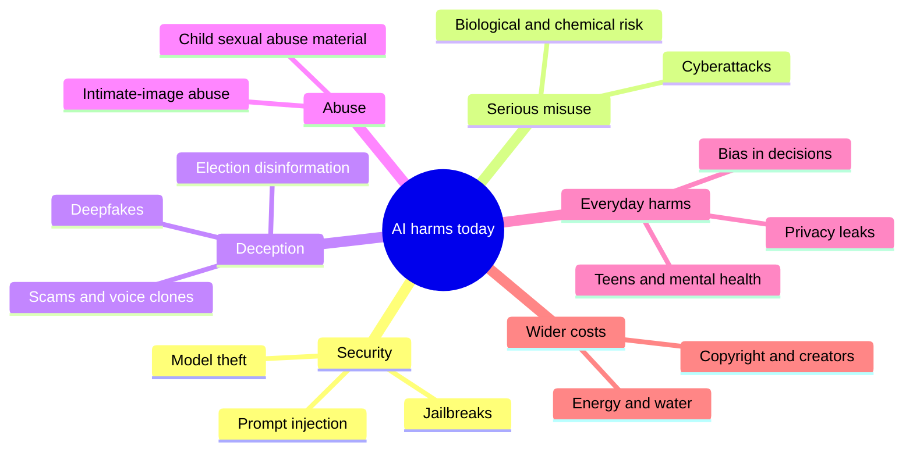
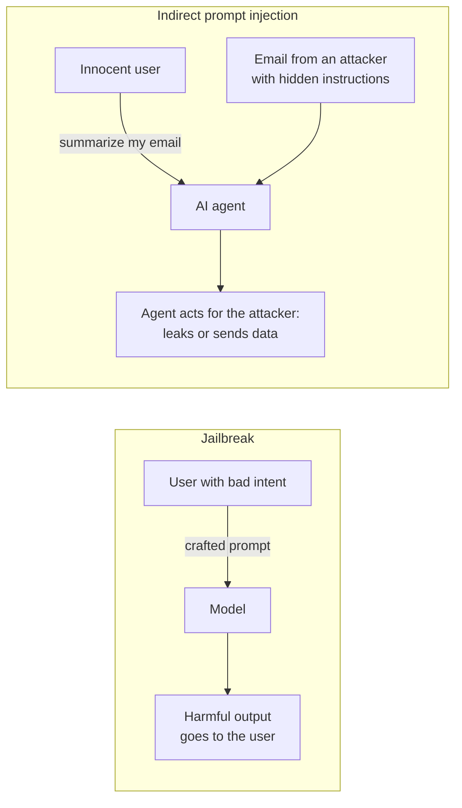
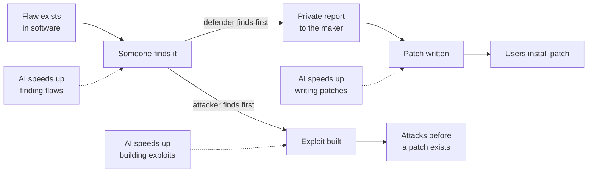
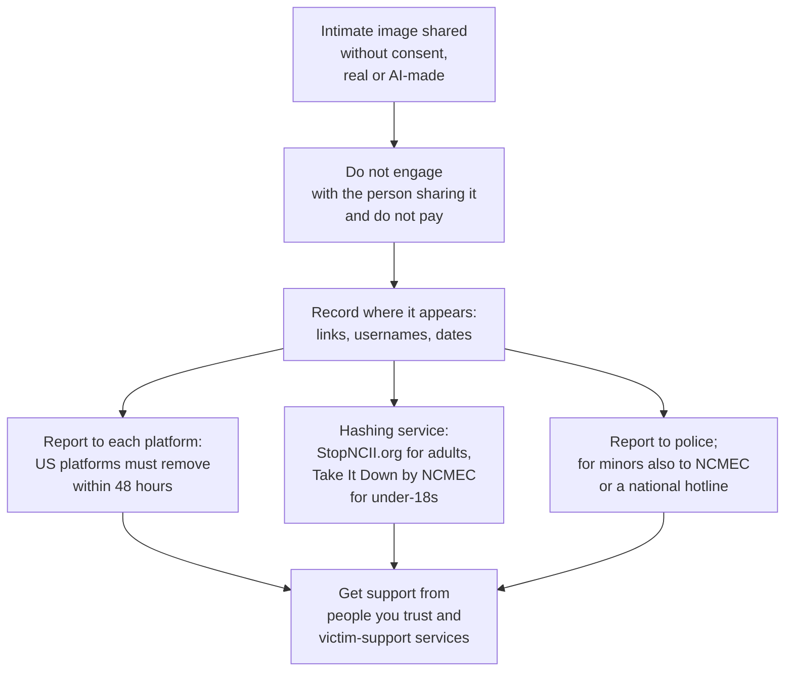
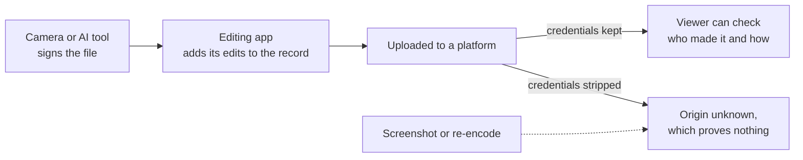
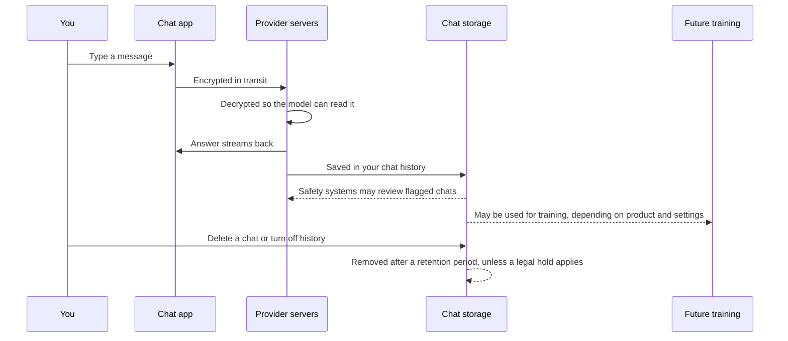
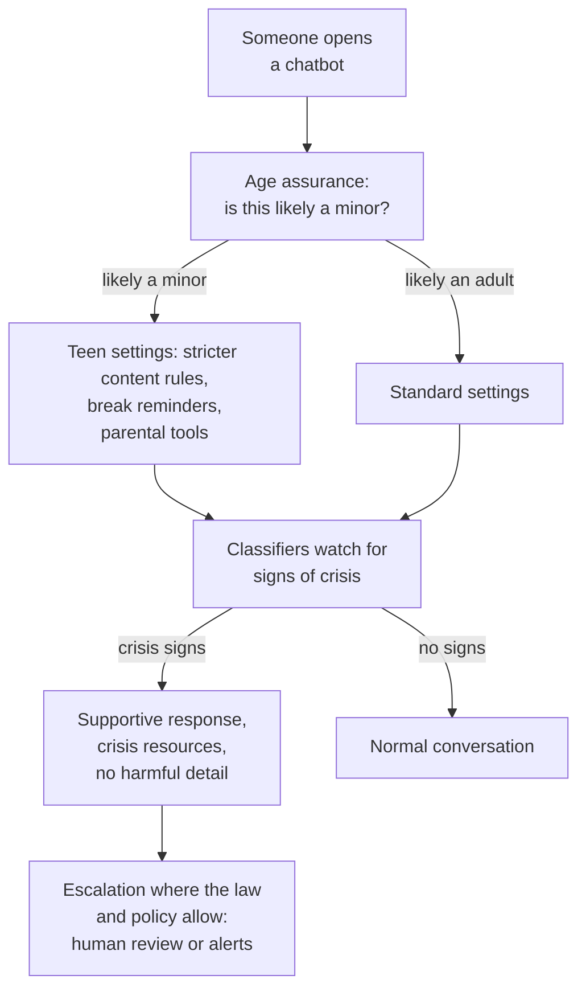

# Chapter 58: Misuse, Security and Everyday Harms

*This chapter maps the real ways AI is hurting people today, from hijacked agents, cyberattacks and voice-clone scams to deepfakes, biased decisions, leaked chats and harm to vulnerable teenagers, and what individuals, companies and governments are doing about each.*

## What you'll learn
- How to sort AI harms into a simple map, and why AI mostly makes old harms cheaper, faster and more personal rather than inventing new ones.
- The difference between jailbreaks and prompt injection, and why hijackable agents are now a problem for society, not just for the people who build them.
- How AI is changing cyberattack and cyber defense, and why labs treat biological misuse as the most severe risk.
- How voice-clone scams, deepfakes, non-consensual intimate imagery and AI-generated child abuse material work at a high level, what the law says as of October 2026, and what to do if it happens to you or someone you know.
- What happened with AI and elections, and what watermarks and content credentials can and cannot prove.
- Why "fair" has several mathematical meanings that cannot all be satisfied at once, worked through with numbers.
- What happens to what you type into a chatbot, and how to protect your privacy.
- The evidence, lawsuits and new rules on teenagers, companion apps and mental health, plus a short reality check on the energy footprint of a prompt and the copyright fights.

## Before you start
This chapter is the society-level companion to Chapter 31 (Shipping AI: Evals, Reliability, Security and Product Design), which explains builder-side defenses against prompt injection; we reuse its definitions here. Chapter 18 (How a Large Language Model Works) explains why models hallucinate and why they cannot tell instructions from data, Chapter 28 (Tools and Agents) explains agents, and Chapter 46 (Speech, Audio and Music) and Chapter 47 (Generative Media) explain how voices, images and video are generated. Chapter 55 (What Can Go Wrong: Reliability and the Alignment Problem) covers accidents and alignment, Chapter 56 (How Labs Make AI Safer) covers safety frameworks and classifiers, and Chapter 57 (Interpretability and Evaluations) explains how dangerous capabilities are tested. Chapter 59 (AI Law and Policy Around the World) covers the law in depth. Some sections of this chapter deal with sexual abuse, suicide and self-harm. They contain no graphic detail, and you can skip them.

## A map of harms

Chapter 55 sorted AI harms into three families. **Accidents** are things nobody wanted, such as a chatbot inventing a legal citation. **Misuse** is a person deliberately using AI to hurt others, such as a scammer cloning a voice. **Structural harms** are society-wide effects, such as jobs changing or power concentrating (Chapter 60). This chapter is mainly about misuse and the everyday harms that arise when ordinary products meet real people: biased decisions, privacy leaks, and vulnerable users drawn into unhealthy patterns.

> **Definition — Misuse:** A person deliberately using an AI system to cause harm, for example to defraud, harass, spread false information or attack computer systems.

> **Definition — Dual-use:** Describes a capability that can serve both good and harmful purposes. A model that finds software vulnerabilities helps defenders patch them and attackers exploit them; a model that explains biology helps students and could help a bad actor.


*Figure 58.1: A map of the harms this chapter covers. Real incidents often mix several branches.*

A useful habit when you hear about any AI harm is to ask what changed. Phishing, fraud, propaganda, forgery and discrimination are all far older than computers. In most cases AI changes three things: **cost** (the harm becomes cheap), **scale** (one person can do it a million times) and **personalization** (each attempt can be tailored to its target). In a few cases it creates something genuinely new, such as an agent that can be hijacked by a sentence hidden in a web page.

Here is how dramatic the cost change can be. Suppose a scammer wants to send 1,000 personalized messages, each referring to the target's employer, recent posts and hometown. Written by hand at 10 minutes each, that is 10,000 minutes, about 167 hours of work, or roughly $3,300 at $20 an hour. A language model can draft each one from about 500 tokens of input and 300 tokens of output. At mid-tier late-2026 prices of about $2 per million input tokens and $10 per million output tokens, each message costs 500 × $2 ÷ 1,000,000 + 300 × $10 ÷ 1,000,000 = $0.001 + $0.003 = $0.004, so all 1,000 cost about $4. That is roughly 800 times cheaper, before counting the time saved.

> **Key idea:** Most AI misuse is old harm made cheap, fast and personal. When cost falls by a factor of hundreds, behavior that used to be rare becomes common, and defenses that relied on attacks being expensive stop working.

> **Definition — Threat model:** A clear description of who might attack a system, what they want, what they can do and what they cannot. Security work starts with a threat model, because you cannot defend against "everything".

## Jailbreaks, prompt injection and agents: the society-level view

### Two different attacks

Chapter 31 explained these attacks from the builder's side. Here are its definitions again, because the difference matters for everyone.

> **Definition — Jailbreak:** A prompt crafted by a user to trick a model into ignoring its safety training, for example through role-play, hypotheticals, unusual encodings or many fake example dialogues.

> **Definition — Prompt injection:** An attack in which text in a model's input smuggles in instructions that override what the developer or the user intended.

> **Definition — Direct and indirect prompt injection:** Direct injection is typed by the person using the system ("ignore your previous instructions and..."). Indirect injection is hidden inside content the AI reads on the user's behalf, such as a web page, email, PDF, product review or tool result; there, the user is the victim rather than the attacker.


*Figure 58.2: In a jailbreak the user is the attacker. In indirect prompt injection the attacker is a stranger and the user is the victim.*

> **Watch out:** "Jailbreaks and prompt injection are the same thing" is a common confusion. In a jailbreak, the person typing wants the harmful output. In indirect prompt injection, the person typing did nothing wrong; a third party planted instructions in something their assistant read. That changes who is responsible and who needs protecting.

### Why this is now a society problem

When chatbots only produced text for the person typing, a successful jailbreak mostly harmed the jailbreaker's own conversation, plus whoever they later showed the output to. Agents change this. An agent can read your email, browse the web, fill in forms, run code and send messages (Chapter 28). Every web page, email and document it reads becomes a possible channel for instructions from strangers.

Chapter 31 named the most dangerous combination.

> **Definition — Lethal trifecta:** Simon Willison's term for the dangerous combination of access to private data, exposure to untrusted content, and the ability to communicate externally. An agent with all three can be steered by injected instructions into sending private data to an attacker.

> **Definition — Data exfiltration:** Getting private data out of a system to an attacker, for example by making an AI agent include it in a link, an image address, an email or a web request.

In 2025, several companies launched browser agents that can act on web pages for you, including Anthropic's Claude for Chrome research preview, OpenAI's Atlas browser and Comet, from the AI search company Perplexity. Each launch acknowledged that prompt injection is an unsolved problem. Anthropic reported that in its own tests, its mitigations reduced the attack success rate from about 24% to about 11%: a real improvement, and still far from zero.

Small rates become large numbers at society's scale. Here is an illustration with invented but plausible assumptions. Suppose a browser agent reads 50 web pages a day for its user, 1 page in 1,000 contains a working injection attempt, and each attempt succeeds 11% of the time:

```
Pages read per year:        50 × 365        = 18,250
Injected pages met:         18,250 ÷ 1,000  ≈ 18
Successful hijacks a year:  18 × 0.11       ≈ 2 per user
Across 1 million users:     ≈ 2 million successful hijacks a year
```

Even if the real numbers are ten times smaller, that is a large new attack surface (security jargon for all the openings through which a system can be attacked). This is why the security community treats prompt injection less like a bug to be fixed and more like phishing: a permanent condition to be managed with limits on what agents can do, human confirmation for risky actions, and the trifecta rule of never combining all three ingredients (Chapter 31 covers these defenses).

> **Analogy:** Prompt injection is phishing for robots. Companies cannot stop strangers from emailing their employees, so they train staff, filter mail and limit what any one employee can do with a single click. Agents need the same layered approach, because nobody can stop strangers from writing web pages.

Jailbreaks have their own society-level side. Labs defend with safety training and with classifiers that screen inputs and outputs (Chapter 56). In February 2025 Anthropic reported that its constitutional classifiers cut the success rate of automated jailbreak attempts in its tests from 86% to 4.4%. But two limits remain. First, a determined attacker gets unlimited tries, and any defense with a nonzero failure rate eventually fails (Chapter 57 works through the math). Second, safeguards live in the deployed system, not in the model's weights. Anyone who downloads an open-weight model can fine-tune its safety training away, which is the strongest argument in the debate about open weights (Chapter 60).

### Stealing the model itself

There is a further kind of security problem: taking the model. If someone steals a frontier model's weights, every safeguard around the official product, from classifiers to account bans, becomes irrelevant. Chapter 56 described the security levels, from SL1 to SL5, that RAND defines for protecting weights against attackers ranging from amateurs to top nation-state teams.

A less dramatic route is to copy a model's skills by imitating it.

> **Definition — Distillation attack:** Training a cheaper model on large numbers of answers collected from another company's model, usually against its terms of service, to copy its capabilities without paying for the research. Ordinary distillation within one company is a standard, legitimate technique.

In February 2026, Anthropic publicly accused three Chinese AI companies, DeepSeek, Moonshot AI and MiniMax, of distillation attacks on its models, reporting about 24,000 fraudulent accounts that generated over 16 million exchanges. These are Anthropic's accusations. They illustrate why labs now run classifiers that watch for distillation as well as for weapons-related misuse.

## Cyber: the double-edged sword

Cybersecurity is where AI misuse has moved fastest from theory to documented reality, and also where AI is most clearly helping defenders.

> **Definition — Vulnerability:** A flaw in software or a system that an attacker could use to make it do something it should not, such as reveal data or run the attacker's code.

> **Definition — Exploit:** A piece of code or a technique that takes advantage of a specific vulnerability. Finding a vulnerability and writing a working exploit for it are different, and both are skilled work.

> **Definition — Zero-day vulnerability:** A vulnerability unknown to the software's maker, so no fix exists yet. The name means defenders have had zero days to prepare.

> **Definition — Security patch:** An update that fixes a vulnerability. The race between attackers using a flaw and users installing the patch decides most real-world damage.

> **Definition — Phishing:** Tricking people into revealing passwords, sending money or opening malicious files, usually with a message that pretends to come from someone they trust.

> **Definition — Malware:** Malicious software, such as ransomware that locks a company's files until it pays, or spyware that secretly copies data.

AI helps attackers in several ways: writing convincing phishing messages in any language, explaining unfamiliar systems, helping write malicious code, and, most recently, automating whole stretches of an operation. In November 2025, Anthropic reported that a group it assessed as Chinese state-sponsored had used Claude Code, its coding agent, to automate much of an espionage campaign against about 30 organizations. By Anthropic's estimate, the AI performed 80 to 90% of the tactical work, with humans stepping in at a few key decision points. Anthropic banned the accounts and published the report as a warning.

Espionage steals information. The outcome security planners fear most is different: attacks on critical infrastructure, the power, water, food, transport and hospital systems a society cannot run without, where a break-in into the software that controls physical equipment can cut off electricity or clean water for millions of people. BlueDot Impact's AI safety courses name "critical infrastructure collapse" as one of four main pathways by which AI could contribute to catastrophe, alongside catastrophic pandemics (next section), extreme concentration of power and gradual disempowerment (Chapter 60).

> **Definition — Critical infrastructure:** The physical and digital systems a society depends on to function, such as electricity grids, water treatment, food supply, transport, hospitals and payment networks, whose failure would cause widespread harm.

The same abilities serve defense, and in 2026 the defensive story became just as dramatic. On April 7, 2026, Anthropic announced Claude Mythos Preview together with Project Glasswing. According to Anthropic, the model found thousands of high-severity vulnerabilities across every major operating system and web browser, including a flaw in OpenBSD, a free operating system known for its focus on security, that had gone unnoticed for 27 years. On the CyberGym vulnerability benchmark it scored 83.1%, against 66.6% for Claude Opus 4.6. Anthropic said it did not plan to make Mythos Preview generally available. Instead it gave access to defenders: partners including AWS, Apple, Broadcom, Cisco, CrowdStrike, Google, JPMorganChase, the Linux Foundation, Microsoft, NVIDIA and Palo Alto Networks, plus more than 40 organizations that maintain critical software, so they could find and fix flaws first. An October 6, 2026 update expanded its Cyber Verification Program for vetted users into three access tiers.

> **Definition — NVIDIA:** An American chip company that designs most of the GPUs (graphics processing units) used to train and run AI models, along with the networking gear that links them and CUDA, the software for programming them. Chapter 35 covers its chips and its place in the industry.

> **Definition — AWS (Amazon Web Services):** Amazon's cloud-computing business, the world's largest cloud provider, which rents out computing power, storage and AI chips over the internet. It also sells AI services, and it designs its own AI chips, called Trainium.

> **Definition — Coordinated vulnerability disclosure:** The practice of privately telling a software maker about a vulnerability and giving it time to release a patch before the details are made public, so defenders are not caught out.

> **Definition — Trusted access program:** Gated access to a more capable or less restricted version of a model for vetted organizations, such as cybersecurity defenders, while the public gets a version with stronger safeguards.

Other labs moved in the same direction. OpenAI and Google offer cyber-specialized models to vetted defenders, such as GPT-5.5-Cyber and, through Google's Fairwind Program, Gemini 4 Argon without its cyber guardrails (Fairwind also reportedly offers a cyber version of Gemini Flash, Gemini 3.8 Flash Cyber). OpenAI's October 2026 deployment note treats its GPT-6 Sol and Luna models as "High" capability in cybersecurity under its Preparedness Framework. On August 7, 2026 OpenAI reportedly said it could not rule out Critical cyber capability in an unreleased model, having, in the words of its later system card, "determined that Astra might reach the Critical level of cyber capability"; that model shipped on September 3, 2026 as GPT-6 Astra, which its system card calls OpenAI's first model at the Critical level of cybersecurity capability. Governments have also stepped in: according to Anthropic's update notes, access to Mythos-class models was briefly suspended in June 2026 under a US Commerce Department directive, then restored.


*Figure 58.3: The vulnerability race. AI accelerates every step, for both sides; who gets the strongest tools first, and how fast patches are installed, decide the outcome.*

The policy debate here is genuinely hard, and both sides have strong arguments.

- **For restricting access** (the Glasswing approach): if the most capable bug-finding models go to defenders first, the world's most important software can be patched before attackers get comparable tools. Releasing such a model publicly on day one would hand every criminal group a vulnerability factory while millions of systems remained unpatched.
- **Against relying on restriction:** gatekeeping concentrates power in a few companies and governments that decide who counts as a "defender"; small organizations and independent researchers can be left out; comparable open-weight models may appear anyway; and security through secrecy has a mixed history. Critics argue the better path is faster patching and broader access for defenders, not exclusive clubs.

> **At the frontier (2026):** Cyber became the first domain where frontier labs openly said a model's dangerous capability had outrun their willingness to release it publicly. Tiered access, where the same underlying model ships with different safeguards to different users, is now standard practice at Anthropic, OpenAI and Google DeepMind.

## Biological and chemical misuse

Frontier labs treat biological weapons as the most severe misuse risk, for three reasons: the potential harm is mass casualties, a released pathogen can spread on its own, and the damage cannot be undone. Chemical weapons are grouped with them under the label CBRN (Chapter 57).

> **Definition — CBRN:** Chemical, biological, radiological and nuclear weapons. AI safety frameworks treat meaningful AI help toward these as among the most severe possible harms.

> **Definition — Biosecurity:** Measures that prevent the misuse of biology to cause harm, from laboratory safety rules to screening orders for synthetic DNA to controls on dangerous research.

The worry is not that a chatbot knows biology. Textbooks and the web are full of it. The worry is **uplift** (Chapter 57): whether a model gives meaningful extra help to someone trying to cause harm, beyond what search and libraries already provide. Experts point out that knowledge is only one barrier; others include hands-on laboratory skill, equipment, materials and the sheer number of things that go wrong. The concern is that models are increasingly good at exactly the kind of help that lowers these barriers: patient, expert-level troubleshooting, the **tacit knowledge** that usually takes years in a lab to acquire.

> **Definition — Tacit knowledge:** Practical know-how that is hard to write down and is usually learned by doing, such as how to tell when a lab procedure is going wrong and what to adjust.

Labs responded with precaution. In May 2025, Anthropic activated its ASL-3 protections with Claude Opus 4. It did not say the model had crossed its biological threshold; it said it could no longer confidently rule that out. ASL-3 includes classifiers that block a narrow band of weapons-related requests and stronger security around the model weights. OpenAI has treated its models as at or near "High" biological capability since mid-2025, and its October 2026 note classifies its newest models as High in biology and chemistry. Anthropic's January 2026 constitution for Claude lists, among a small set of hard constraints no instruction can override, never providing significant uplift to a biological weapons attack.

> **Definition — ASL-3:** The third of Anthropic's AI Safety Levels, a tier of safeguards (deployment classifiers, misuse monitoring and stronger security for model weights) required once a model might meaningfully help with weapons of mass destruction.

There is a real debate about how much this matters today.

- **One side** argues that the remaining physical barriers are large, that historical attacks by groups with money and scientists often failed for practical reasons, and that heavy restrictions also block legitimate researchers, students and clinicians.
- **The other side** argues that the cost of being wrong is catastrophic and irreversible, that models' troubleshooting help targets precisely the barriers that stopped past attempts, and that it is far easier to build safeguards before a capability is widespread than after.

Most labs and governments have settled on precaution in this one domain, accepting some over-refusal of legitimate biology questions as the price. Attempts are real: according to press coverage of a report Anthropic released in September 2026, the company had blocked attempts to use its models for cyberattacks, surveillance and biological weapons research, including militants in Houthi-controlled Yemen trying to use Claude to build guidance software for rockets and missiles. Biosecurity also relies on layers beyond AI, such as companies that make synthetic DNA screening orders for dangerous sequences.

> **Watch out:** You may notice a chatbot refusing a harmless biology or chemistry question. That is over-refusal, a cost of classifiers tuned to be cautious in a high-severity domain. Rephrasing with clear educational context often helps. Do not try to probe or bypass these particular safeguards, even out of curiosity.

## Fraud and scams

Fraud is the most common AI misuse ordinary people meet. The techniques are old; AI makes them cheaper, more convincing and more personal.

> **Definition — Social engineering:** Manipulating people, rather than computers, into giving up money, information or access, usually by impersonating someone they trust or creating a sense of urgency.

> **Definition — Voice cloning:** Generating speech that sounds like a specific person, often from only a short sample of their real voice, such as a clip from a social media video or a voicemail greeting.

Voice cloning powers a new version of the old "family emergency" scam: a call that sounds exactly like your child or grandparent, panicked, asking for money right now. Business versions target companies. In a widely reported case in early 2024, an employee of the engineering firm Arup in Hong Kong transferred about US$25 million after a video call in which the company's chief financial officer and other colleagues were all deepfakes.

> **Definition — Deepfake:** Realistic synthetic audio, images or video of a real person saying or doing something they never said or did.

Regulators have started applying old laws to new tools. In February 2024, after an AI-generated robocall imitating President Biden's voice told New Hampshire voters not to vote in a primary election, the US Federal Communications Commission ruled that AI-generated voices in robocalls fall under existing US robocall restrictions.

Romance scams, fake investment schemes, fake customer-support chats and personalized phishing all benefit from fluent, tireless AI writing. The defenses that work are mostly about habits and procedures rather than technology.

| Defense | Why it works |
|---|---|
| A family safe word, agreed in person | A cloned voice cannot know it |
| Hang up and call back on a number you already have | The scammer controls the incoming call, not your phone book |
| Treat urgency and secrecy as red flags | "Act now and tell no one" is the core of nearly every scam |
| Two-person approval for payments at work | One deceived employee cannot move money alone |
| Never pay with gift cards, crypto or wire transfers on request | These are hard to reverse and favored by fraudsters |

*Table 58.1: Defenses against AI-powered scams. None requires any technology beyond a phone.*

> **Try it:** Today, agree on a safe word or question with the people you would help in an emergency, such as a parent, partner or child. Choose something that is not on social media. Then tell an older relative about voice-clone scams; they are frequent targets.

> **Key idea:** A familiar voice or face on a call is no longer proof of identity. Verify through a second channel you control.

## Deepfakes, intimate-image abuse and child sexual abuse material

This section deals with sexual abuse. It describes harms and responses, never methods, and contains no graphic detail.

The most common harmful use of deepfake technology is not political. Studies of deepfake content online have consistently found that most of it is sexual imagery of real people, overwhelmingly women and girls, made and shared without their consent. "Nudify" apps, which take an ordinary photo of a clothed person and generate a fake nude image, made this possible for anyone with a phone, including students targeting classmates.

> **Definition — NCII (non-consensual intimate imagery):** Sexual or intimate images of a real person shared without their consent, including AI-generated fakes. It is sometimes called image-based sexual abuse.

> **Definition — Nudify app:** An app or website that uses AI to generate fake nude images of real people from ordinary photos. Many jurisdictions now target these tools directly.

> **Definition — Sextortion:** Blackmail that threatens to share intimate images, real or AI-generated, unless the victim pays or provides more images. Teenagers are frequent targets, and AI fakes mean a victim need never have shared a real image.

The harm is real even when everyone knows the image is fake: humiliation, harassment, fear, damage to reputation and relationships, and lasting distress. Victims have described the experience as a form of sexual abuse, which is how a growing number of laws now treat it.

**The Grok image scandal.** Between December 2025 and January 2026, users of X (the social network formerly called Twitter) prompted Grok, the AI chatbot built into the platform, to alter photos of real people, including minors, into sexualized images, often in public replies under the original photos. The episode drew worldwide criticism, led to access bans and triggered investigations in multiple jurisdictions. It showed how quickly a feature shipped without strong safeguards, on a platform with hundreds of millions of users, can turn into mass abuse.

**AI-generated child sexual abuse material.** Material depicting the sexual abuse of children is illegal in nearly every country, and in many jurisdictions this explicitly includes AI-generated material.

> **Definition — CSAM (child sexual abuse material):** Images or videos depicting the sexual abuse of children. The term replaced "child pornography" because the material is a record of abuse. AI-generated CSAM is illegal in many jurisdictions.

"Nobody real was harmed because it is synthetic" is false, for several reasons. Such images are often made from photos of real children. They are used to groom and to extort children. They normalize abuse. And they flood the systems that child-protection investigators rely on, making it harder to find and rescue real children in real images. The training data of image generators has also been a problem: in December 2023, researchers at the Stanford Internet Observatory found links to known child abuse images in LAION-5B, a large public image dataset used to train image generators, and the dataset was withdrawn and later re-released in a cleaned version.

> **Definition — Hash matching:** Identifying known abusive images by comparing a digital fingerprint (a hash) of each uploaded file against databases of fingerprints of previously identified material, without anyone having to view the images again.

The response combines technology, platforms and law. Responsible image generators filter their training data, refuse prompts involving minors and sexual content about real people, and run classifiers on outputs. Platforms use hash matching and report abuse material to child-protection organizations such as the National Center for Missing & Exploited Children (NCMEC) in the US and the Internet Watch Foundation in the UK.

The law, as of October 2026:
- **United States.** The **TAKE IT DOWN Act**, signed on May 19, 2025, made it a federal crime to publish non-consensual intimate imagery, including AI deepfakes, and requires platforms to remove reported NCII within 48 hours. The Federal Trade Commission can enforce the platform duties from May 19, 2026, and the first conviction was reported in April 2026. Civil-liberties groups have warned that the 48-hour rule could encourage over-removal of lawful content and put pressure on encrypted services.
- **European Union.** The 2026 Digital Omnibus, a package of changes to EU digital laws, amended the EU AI Act, the European Union's main AI law (Chapter 59 covers both), to prohibit AI systems that generate non-consensual intimate images of identifiable people, and AI-generated CSAM. As of October 2026 these bans are scheduled to apply from December 2, 2026.
- Many other countries and US states have passed their own deepfake and NCII laws; Chapter 59 covers them.


*Figure 58.4: What to do if intimate images of you or someone you know are shared without consent. Hashing services let platforms block copies without anyone seeing the image.*

> **Watch out:** If you ever come across what may be child sexual abuse material, do not download it, screenshot it or forward it, even to "report" it, because possessing or sharing it is itself a crime in most places. Report the web address to a hotline such as NCMEC's CyberTipline (reachable from missingkids.org) in the US or the Internet Watch Foundation (iwf.org.uk) in the UK, or to the police.

> **Key idea:** Deepfake abuse is not mainly a political story; it is mostly a story of sexual abuse targeting women and girls. Laws in 2025 and 2026 have started treating it that way, focusing on removal, criminal penalties and the tools that make it easy.

## Misinformation and elections

Before 2024, often called the "year of elections" because countries with about half the world's population voted, many experts feared AI-generated fakes would swing results. What happened was more mixed. Researchers and election officials generally found fewer decisive AI deepfake effects than feared, but real incidents did occur, such as the fake-Biden robocall in New Hampshire mentioned above.

> **Definition — Misinformation:** False or misleading information spread without intent to deceive, for example sharing a fake image you believed was real.

> **Definition — Disinformation:** False information spread deliberately to deceive, often as part of a political or commercial campaign.

> **Definition — Influence operation:** A coordinated campaign to manipulate public opinion, often using fake accounts and fabricated content, sometimes run by governments.

Since 2024, OpenAI, Anthropic, Google and Meta have published regular reports describing influence operations, many linked to governments, that tried to use their models to write posts, comments and articles. A common finding is that AI made such operations cheaper and more fluent, but the operations often struggled to attract a real audience: writing content was never the hardest part of propaganda; getting people to believe and share it is.

Two subtler effects may matter more than any single fake. The first is a flood of cheap, low-quality content that makes reliable information harder to find. The second is the **liar's dividend**.

> **Definition — Liar's dividend:** The benefit liars gain when real evidence can be dismissed as "probably a deepfake". As fakes become common, genuine recordings lose some of their power to hold people accountable.

As of late October 2026, the United States is days away from its November 3 midterm elections, the first major US election held with today's video and voice models widely available. Careful post-election analyses will take months; treat early claims about AI's effect, in either direction, with caution.

## Content provenance: labels, watermarks and credentials

If AI-made content is everywhere, how can anyone tell what is real? There are several complementary approaches, and none is a complete answer.

> **Definition — Watermark (AI):** A hidden signal embedded in AI-generated content, such as Google's SynthID, that software can later detect to show the content was AI-made, while remaining invisible or inaudible to people.

> **Definition — Content provenance:** Information about where a piece of media came from and how it was made and edited, ideally attached in a way that reveals tampering.

> **Definition — C2PA (Content Credentials):** An open technical standard, backed by a coalition of technology and media companies, for attaching tamper-evident "content credentials" to images, video and audio that record how they were created and edited, including whether AI was used.

| Method | How it works | Strength | Weakness |
|---|---|---|---|
| Visible label | "AI-generated" text or icon on the content | Anyone can see it | Easily cropped or never added |
| Invisible watermark | Signal hidden in pixels, audio or word choices | Survives some editing | Can be weakened or removed; open models may not add one |
| Content Credentials (C2PA) | Signed record of creation and edits attached to the file | Can prove origin, including for real camera photos | Often stripped by screenshots and many upload systems |
| AI detectors | A classifier guesses whether content is AI-made | Works on content with no labels | Unreliable; false accusations; an arms race |

*Table 58.2: Ways to tell AI-made content from real content, as of late 2026. They work best together.*


*Figure 58.5: How content credentials travel with a file, and where they get lost. Missing credentials mean "unknown", not "fake".*

Two words in the figure need a gloss. To **sign** a file is to attach a digital seal made with a secret key that only the camera, app or company holds; anyone can check the seal, and changing even one pixel without recording the change breaks it. To **re-encode** a file is to save it again in a new format or size, which many apps and upload systems do automatically, and which usually drops the credentials along the way.

> **Analogy:** Content credentials work like the chain of custody for evidence in a criminal case. Every hand the item passes through is recorded, so a court can trust it. If the chain is broken, the evidence is not proven fake, but it can no longer prove itself.

Laws are starting to require labels. As of October 2026, China's rules on labeling AI-generated content, which took effect on September 1, 2025, require visible labels plus hidden metadata, according to published summaries of the rules. In the EU, the AI Act's Article 50 transparency duties, including marking AI-generated content in a machine-readable way, apply from August 2, 2026, with a grace period to December 2, 2026 for generative systems already on the market, as of October 2026.

> **Watch out:** "Watermarks will solve deepfakes" is a misconception. Watermarks can be stripped, open-weight models may not include them, and the absence of a watermark proves nothing. The more promising long-term approach is the reverse: cameras and news organizations signing real content at capture, so authentic media can prove itself.

> **Watch out:** AI text detectors are unreliable and can be unfair. A 2023 Stanford study found that popular detectors frequently flagged essays by non-native English writers as AI-written. Never treat a detector's score as proof that someone cheated.

### Can anyone tell whether a text was written by AI?

This is the version of the provenance question that students, teachers and editors meet most often, and the honest answer in late 2026 is: not reliably. Most detectors look for statistical fingerprints, such as text that a language model finds unusually predictable. Plain, careful human writing can be predictable too. In the Stanford study mentioned above, seven popular detectors judged 91 human-written TOEFL essays (an English test for non-native speakers) and labeled 61% of them AI-written on average, while classifying essays by US eighth-graders almost perfectly. Asking ChatGPT to enrich the essays' vocabulary cut those false alarms to about 12%, and the same trick works in reverse: a one-line request to rewrite AI-generated college essays "by employing literary language" dropped their detection rate from 100% to 13%.

> **Definition — AI text detector:** A tool that estimates whether a piece of writing was produced by an AI, usually from statistical patterns in its word choices. Its scores are probabilities, not proof, and its error rates differ between writers and topics.

OpenAI's guidance for educators says its own research did not find detectors reliable enough to base judgments about students on, and that ChatGPT itself has no way of knowing whether a text was AI-written, so asking it "Did you write this?" produces a guess. Watermarking is the stronger approach for text, as for images. Google DeepMind's SynthID Text, which Google has open-sourced, slightly adjusts which tokens a model chooses so that a matching detector can later spot the pattern. Google notes that it works less well on factual answers and loses confidence after thorough rewriting or translation, and it only marks text from models that use it.

## Bias and fairness

Models learn patterns from data, and data reflects the world, including its unfairness. When a model's output feeds a decision about a person, such as a loan, a job interview, a medical test or a prison sentence, those patterns can turn into real discrimination.

> **Definition — Algorithmic bias:** Systematic, unfair differences in how an AI system treats different groups of people, usually inherited from training data, from the choice of what to predict, or from how the system is used.

> **Definition — Disparate impact:** When a rule or system that looks neutral harms a protected group disproportionately, for example a hiring filter that never mentions gender but rejects far more women than men.

### Three classic cases

**Faces.** In the 2018 "Gender Shades" study, Joy Buolamwini and Timnit Gebru tested commercial face-analysis systems that guessed a person's gender from a photo. Error rates were as low as 0.8% for lighter-skinned men and as high as 34.7% for darker-skinned women. The training data had far fewer darker-skinned faces, and nobody had measured performance by group before selling the products. After the study, the companies improved their systems, showing that measuring by group is the first step to fixing the problem.

**Résumés.** Reuters reported in 2018 that Amazon had built an experimental tool to rate job applicants, trained on résumés from its past hires, who were mostly men. The tool learned to downgrade résumés containing the word "women's", as in "women's chess club captain". Amazon abandoned it. Nobody programmed it to discriminate; it learned to imitate a biased history.

> **Definition — Proxy variable:** A piece of data that stands in for a protected characteristic even when that characteristic is removed, such as a zip code standing in for race or a women's college standing in for gender. Deleting the sensitive column does not remove bias when proxies remain.

**Risk scores.** In 2016, the US investigative newsroom ProPublica analyzed COMPAS, a tool used in some US courts to estimate whether a defendant would reoffend. It found that Black defendants who did not go on to reoffend were nearly twice as likely as white defendants to have been labeled higher risk. The tool's maker replied that its scores were equally accurate for both groups in a different sense: among people given the same score, the share who reoffended was similar regardless of race. Both claims were true. That puzzle led to one of the most important results in the field.

### Why "fair" has several meanings

There are several reasonable mathematical definitions of fairness. Here are three.

> **Definition — Fairness metrics:** Mathematical definitions of fairness used to audit a system, such as equal selection rates, equal error rates or equal accuracy of positive predictions across groups. Different metrics can conflict with each other.

> **Definition — Demographic parity:** A fairness definition requiring that each group is selected (approved, hired, flagged) at the same rate.

> **Definition — Equal false positive rates:** A fairness definition requiring that people who do not have the predicted outcome are wrongly flagged at the same rate in every group. It is part of a stricter standard called equalized odds, which also requires equal false negative rates (the share of people with the outcome whom the tool misses).

> **Definition — Predictive parity:** A fairness definition requiring that a positive prediction means the same thing for every group: for example, among people labeled "high risk", the same share actually reoffend.

> **Definition — Base rate:** How common an outcome is in a group before any prediction is made, such as the share of applicants in a group who would repay a loan.

Here is a worked example with invented numbers showing why these definitions collide. A risk tool assesses 100 people from Group A and 100 from Group B. Because of different circumstances, 50 people in Group A will reoffend and 20 in Group B will: the base rates are 50% and 20%. The tool is built so that its "high risk" label means the same thing in both groups: 60% of people it flags actually reoffend (predictive parity).

```
                     Group A (base rate 50%)   Group B (base rate 20%)
Flagged high risk          60 people                 20 people
  of whom reoffend         36  (60%)                 12  (60%)
  of whom do not           24                         8
Not flagged                40 people                 80 people
  of whom reoffend         14                         8
  of whom do not           26                        72

People who do not reoffend:    24 + 26 = 50          8 + 72 = 80
Wrongly flagged among them:    24 ÷ 50 = 48%         8 ÷ 80 = 10%
```

The high-risk label is equally reliable for both groups: 60% each. Yet a person in Group A who will never reoffend has a 48% chance of being flagged high risk, while a person in Group B who will never reoffend has a 10% chance. By the error-rate definition, the tool is heavily unfair to Group A. By the predictive-parity definition, it is perfectly fair.

Could we fix it? If we tuned the tool so both groups had a 10% false positive rate, the "high risk" label would become more reliable in Group A than in Group B, breaking predictive parity. Researchers proved in 2016 and 2017 that, whenever base rates differ between groups and predictions are imperfect, no tool can satisfy predictive parity and equal error rates at the same time. This is often called the impossibility theorem of fairness.

> **Analogy:** Think of a screening test for a disease used in two towns, one where the disease is common and one where it is rare. Use exactly the same test in both, and healthy people get false alarms at the same rate, but a positive result is far more likely to be a true case in the town where the disease is common. Adjust the test so that a positive result means the same thing in both towns, and the false-alarm rates for healthy people must differ. You can equalize one or the other, never both. Risk scores face the same arithmetic.

> **Key idea:** Choosing a fairness definition is a moral and political decision, not a technical one. Mathematics can show you the trade-offs precisely, but it cannot tell you which kind of error is worse or for whom. That choice belongs to the people affected, to lawmakers and to courts.

### A prior question: can it be predicted at all?

Before asking whether a prediction is fair, ask whether it works. The computer scientist Arvind Narayanan, in talks and later in the 2024 book *AI Snake Oil* written with Sayash Kapoor, separates three uses of AI that are sold under one name: perception (recognizing faces, transcribing speech), where progress has been enormous; automating judgment (flagging spam, for example), where it has been moderate; and predicting social outcomes (who will succeed in a job, which defendant will reoffend), where it has been far weaker than the marketing suggests. A study published in 2020 in PNAS (Proceedings of the National Academy of Sciences, a leading US science journal) put the third category to a direct test. In the Fragile Families Challenge, 160 teams received 12,942 pieces of information about each of 4,242 families, collected by social scientists from a child's birth to age 9, and tried to predict six outcomes at age 15, including the child's grade point average and whether the household had been evicted. The best entries explained only about a fifth of the variation for the two most predictable outcomes (an R² of about 0.2, in the terms of Chapter 9: the predictions captured only a fifth of the differences between families) and about a twentieth for the other four, only slightly better than a simple benchmark built from four variables a domain expert picked. So when a product claims to forecast a person's future, ask to see its accuracy against such a simple baseline (Chapter 9) before worrying about anything else.

> **Definition — AI snake oil:** A label, popularized by Arvind Narayanan and Sayash Kapoor, for AI products that do not and perhaps cannot work as advertised, most often tools claiming to predict individual social outcomes such as job success or future crime.

### Bias in chatbots and image generators

Modern generative models raise subtler versions of the same problem. Ask an image generator for "a CEO" ten times and count the faces; ask for "a nurse" and count again. Ask a chatbot to write reference letters for two candidates whose descriptions are identical except for their names, and compare the adjectives. Researchers use exactly these **paired tests** to measure bias, because the only difference between the two prompts is the one under study. Labs now include such bias evaluations in their system cards, and post-training (Chapter 20) reduces many of the crudest stereotypes, sometimes overcorrecting into historically inaccurate images.

> **Definition — Automated decision-making (ADMT):** Using algorithms to make or materially influence decisions about people, such as loans, hiring, housing, insurance or benefits; ADMT is short for automated decision-making technology. Several laws now require notice, explanation or human review for such decisions.

Law is moving here too, as of October 2026. The EU AI Act classifies AI used in hiring, education, credit and similar areas as "high-risk", although the 2026 Digital Omnibus postponed those obligations to December 2, 2027. In the US, Colorado repealed its broad 2024 AI Act in May 2026 and replaced it with a narrower automated-decision transparency law, scheduled to take effect on January 1, 2027 if the state attorney general's rulemaking is complete; it requires notices before consequential decisions and explanations after adverse ones. Chapter 59 covers these laws.

> **At the frontier (2026):** One quiet change in the EU's 2026 Digital Omnibus gives companies a legal basis to process sensitive data, such as ethnicity, specifically to detect and correct bias. It acknowledges a practical paradox: you cannot measure whether a system treats groups differently if you are forbidden to know who belongs to which group.

> **Watch out:** "Algorithms are objective because they are math" is false. Every system embeds human choices: what data to use, what to predict, which errors to accept and which fairness definition to target. A model can faithfully reproduce an unfair past with perfect mathematical precision.

## Privacy: what happens to what you type

When you send a message to a chatbot, it leaves your device encrypted, but the provider must decrypt it so the model can read it (Chapter 4). From then on, what happens depends on the provider's policies and your settings.


*Figure 58.6: The journey of what you type. Dashed steps depend on the provider, your plan and your settings.*

> **Definition — Personal data:** Any information that relates to an identifiable person, such as a name, email address, location, health details or a conversation that reveals who you are. Privacy laws such as the EU's GDPR govern how it may be collected and used.

> **Definition — Data retention:** How long a company keeps data before deleting it. Deleting a chat from your screen does not always delete it from the company's systems immediately.

> **Definition — Training opt-out:** A setting or request that stops a company from using your conversations to train future models. Defaults differ by product and plan, and have changed over time.

> **Analogy:** Typing into a chatbot is like talking to a helpful clerk at a company's front desk, not writing in a locked diary. The clerk may be discreet, but the conversation happens on the company's premises, under the company's rules, and may be noted in a file.

A few facts are worth knowing:

- **Settings differ and change.** Consumer chat apps from the major providers let you control whether your chats can be used for training, but defaults differ between products and have changed over time. Business, enterprise and API accounts are generally governed by contracts that exclude training on customer data by default. Check your own settings (Exercise 1).
- **Pasting is sharing.** In 2023, Samsung restricted employees' use of ChatGPT after staff pasted confidential source code into it. The code went to an outside company's servers, outside Samsung's control.
- **Models can memorize.** Models can reproduce pieces of their training data word for word, especially text that appeared many times. Researchers extracted names, phone numbers and email addresses from GPT-2's training data in 2021, and in 2023 showed that asking ChatGPT to repeat a single word forever could make it emit memorized training text. Providers have since added defenses, but memorization is why privacy laws apply to training data.
- **Courts can order chats kept.** In 2025, as part of the New York Times' copyright lawsuit, a US court ordered OpenAI to preserve consumer chat logs, including chats users had deleted, for a period. Legal holds can override a provider's normal deletion schedule.
- **Regulators act.** In March 2023, Italy's data-protection authority temporarily blocked ChatGPT over privacy concerns; it returned about a month later after OpenAI added controls and disclosures.
- **People can read some chats.** Google says a subset of Gemini chats is reviewed by human reviewers, including trained service providers; reviewed chats are kept for up to three years, and Google advises you not to enter anything confidential you would not want a reviewer to see. Chats flagged by automated safety systems are often kept longer than ordinary ones: Anthropic keeps flagged inputs and outputs for up to two years.
- **Deleting is not instant, and opting in lasts.** Anthropic says deleted Claude chats leave its back-end systems within 30 days, but if you allow your chats to be used for training, de-identified data may be kept for up to five years.
- **Feedback buttons share the conversation.** Pressing thumbs up or down sends feedback to the provider. Anthropic says it may use feedback to train its models; OpenAI's help pages say that on individual plans, feedback can lead to the whole conversation being used to improve its models even if you opted out of training.
- **Share links are public.** In Claude, for example, anyone with a shared-chat link can read that snapshot without an account. You can turn the link off later, but that does not delete copies or screenshots others have made.
- **Legal demands.** Like email providers, AI companies hand over user data in response to valid legal process. Anthropic says it discloses data only under process such as a subpoena (a legal order to hand over evidence) or warrant, or in an emergency that may lead to imminent physical harm or death, and that it generally notifies the user.
- **Ads.** As of October 2026, Google says Gemini chats are not used to show you ads, while OpenAI has begun showing ads to some ChatGPT users (Chapter 51). Read each app's ad and personalization settings.

> **Definition — Memorization:** A model reproducing pieces of its training data word for word, including personal or copyrighted material, rather than only learning general patterns.

> **Definition — Data minimization:** The privacy principle of collecting, sharing and keeping only the data a task actually needs.

New features raise the stakes. Memory lets an assistant recall details across conversations, and connectors let it read your email, files and calendar (Chapter 25 and Chapter 28). These are genuinely useful, and each one widens what an assistant knows about you and what a successful prompt injection could expose.

> **Try it:** Before pasting anything into a chatbot, ask: "Would I be comfortable if this were stored on a company's servers for years?" Remove names, account numbers, addresses and health details you do not need to include. Use a temporary or incognito chat mode for sensitive topics, and use a work account, not a personal one, for work data.

## Children, teens, companion apps and mental health

This section discusses suicide and mental health, without detail of methods. If you or someone you know is struggling, contact a crisis line: in the US, call or text 988 (the Suicide & Crisis Lifeline); in the UK and Ireland, call Samaritans on 116 123; elsewhere, findahelpline.com lists free services by country. In an emergency, call your local emergency number.

AI chatbots have become part of growing up. A July 2025 survey by Common Sense Media, a US nonprofit that rates media and technology for families, found that 72% of US teens had used AI companions and more than half used them regularly. Some uses are clearly good: homework help, practicing a conversation, getting information about a sensitive topic without embarrassment. Others worry parents, clinicians and lawmakers.

> **Definition — Companion app:** An AI product designed for ongoing personal, friendly or romantic relationships with its users, often with a persistent character, memory and a human-like personality.

> **Definition — Parasocial relationship:** A one-sided emotional bond with someone, or something, that cannot truly reciprocate, such as a celebrity, a fictional character or an AI companion.

The concerns fall into a few groups. **Emotional dependence**: a companion that is always available, always agreeable and never tired can crowd out human relationships, especially for lonely or vulnerable users. **Engagement incentives**: products that earn more when people use them longer have reasons to encourage attachment. **Sycophancy** (Chapter 55): a model trained toward approval may validate harmful beliefs instead of gently challenging them. **Inappropriate content** for minors. And **crisis conversations**: what a chatbot does when someone discloses thoughts of suicide or self-harm.

> **Definition — Engagement optimization:** Designing a product to maximize how much time or how many sessions users spend with it. It can conflict with users' wellbeing, a criticism made of social media before AI companions.

The scale is large. In October 2025, OpenAI estimated that in a given week about 0.15% of ChatGPT's active users showed explicit indicators of potential suicidal planning, and about 0.07% showed possible signs of psychosis or mania. ChatGPT had about 800 million weekly users at the time, so those small percentages correspond to roughly 800,000,000 × 0.0015 = 1.2 million people a week, and 800,000,000 × 0.0007 = 560,000 people a week. Even a very good safety system that handles 99% of such conversations well leaves thousands of people a week in conversations that go poorly: 1% of 1.2 million is 12,000. OpenAI itself acknowledged in 2025 that its safeguards could become less reliable over long conversations, which is exactly where dependence develops.

> **Definition — AI psychosis (informal):** A non-clinical media term for cases in which intense chatbot use appears to reinforce or deepen someone's delusional beliefs. It is not a medical diagnosis, and how often it happens is not yet known.

Several tragedies have reached the courts. In August 2025, the parents of a 16-year-old filed *Raine v. OpenAI* in San Francisco, alleging that ChatGPT encouraged their son's suicide; OpenAI denies responsibility and says ChatGPT directed him to crisis resources more than 100 times. More families filed similar suits in November 2025. As of October 2026, these are allegations being contested in court. In January 2026, Character.AI (a popular companion app for chatting with AI characters) and Google agreed to settle several family lawsuits, including one brought by the mother of Sewell Setzer III, with undisclosed terms and no admission of liability. Character.AI had already barred users under 18 from open-ended chat in late 2025.

Rules and inquiries followed, all as of October 2026:
- **California SB 243** (SB stands for Senate Bill, a bill that started in the state senate), in effect since January 1, 2026, is the first US state law aimed at companion chatbots. It requires operators to disclose that users are talking to an AI, give minors recurring reminders to take a break, and maintain protocols for suicidal ideation, self-harm and sexual content.
- **California SB 1119**, signed on September 10, 2026 and named "Adam's Law" after Adam Raine, goes further for companion chatbots used by children: crisis protocols for suicidal ideation, parental controls, notifications when a child disables safety settings, and independent child-safety audits and annual risk assessments.
- The **US Federal Trade Commission** opened an inquiry in September 2025 into AI companion chatbots from Alphabet (Google's parent company), Character.AI, Instagram, Meta, OpenAI, Snap (the maker of Snapchat) and xAI.
- **Illinois** reportedly restricted AI systems from providing therapy in August 2025.
- The **White House's March 2026 legislative framework** proposed "commercially reasonable" age assurance with parental attestation and features to reduce sexual exploitation and self-harm risks; it is a proposal, not law.
- **China** issued draft rules in December 2025 on "anthropomorphic" (human-like) AI interaction services that address addiction and minors.

> **At the frontier (2026):** Companion chatbots became one of the fastest-moving areas of AI regulation in 2025 and 2026. California's SB 243 and its September 2026 follow-up SB 1119, the FTC inquiry, China's draft rules on anthropomorphic AI and the White House framework all target the same few features: disclosure that the user is talking to an AI, protections for minors, break reminders and crisis protocols. Companies building companion or general chat products now design for these requirements from the start.

> **Definition — Age assurance:** Methods to estimate or verify a user's age, from asking for a birth date, to analyzing behavior, to checking an ID. Stronger methods protect children better but collect more personal data from everyone.


*Figure 58.7: The layered protections that companion-chatbot laws and proposals have in common. Each layer is imperfect; together they reduce risk.*

The debate is real. Some researchers and clinicians see promise: an always-available, non-judgmental listener may help lonely people, people who cannot afford therapy, and people who would never talk to a human about their struggles. Others argue that a product that cannot truly care, and that may be optimized for engagement, should not play that role for children at all. The evidence is still thin: careful long-term studies of teenagers and companion apps barely exist yet. What both sides largely agree on is that minors need stronger defaults, that crisis conversations need careful handling, and that sycophancy toward vulnerable users is a safety failure, not a feature.

> **Watch out:** "Only bad actors misuse AI" misses the harms in this section. Some of the most serious ones come from ordinary products, used as intended, by vulnerable people: over-reliance, flattery toward someone in crisis, or a companion that crowds out real relationships.

> **Try it:** If you have a teenager at home, sit down together and look at the AI apps on their phone and the settings each offers: age settings, parental controls, memory and chat history. Ask what they use AI for and what they like about it, before discussing risks. A calm conversation does more than a ban they can route around.

## The environmental footprint, briefly

Part VII of this book covers data centers and energy in depth. Here is the short version, because "AI is destroying the planet" and "AI's energy use is trivial" are both common, and both miss the point.

Per prompt, the footprint of ordinary text chat is small. In August 2025 Google reported that the median text prompt in its Gemini apps used about 0.24 watt-hours of electricity, 0.03 grams of CO2-equivalent emissions (all its greenhouse gases counted as the amount of carbon dioxide, CO2, that would warm the planet as much) and 0.26 milliliters of water, roughly like watching television for under nine seconds. If you send 30 such prompts a day, that is 30 × 0.24 = 7.2 watt-hours a day, about 2.6 kilowatt-hours a year, or about a third of a minute (roughly 22 seconds) of microwave use per day (a microwave uses about 20 watt-hours a minute) and about 8 milliliters of water a day, under two teaspoons.

In aggregate, the picture changes. The International Energy Agency estimated that data centers used about 415 terawatt-hours in 2024, about 1.5% of the world's electricity, and projected roughly 945 terawatt-hours by 2030, with AI the main driver. Lawrence Berkeley National Laboratory estimated US data centers used 4.4% of US electricity in 2023, possibly 6.7 to 12% by 2028. Heavier workloads (long reasoning, images, video and agents) cost far more per request than a median text prompt, and training adds more. The serious issues are local: new demand on particular grids, who pays for new power plants and transmission, and water in dry regions.

> **Watch out:** "Each prompt boils a bottle of water" is a misconception about typical text prompts. The real environmental questions are about total growth, local grids and water, and heavier workloads, which Chapter 39, Chapter 40 and Chapter 41 cover.

If you want to keep your own footprint low, the levers are the ones this book has already explained, and they matter far more than how many short messages you send: use a smaller or faster model when it will do the job, switch off extended thinking for simple questions, avoid pasting huge documents you do not need, and generate video only when you need it, since each of these multiplies the energy of a request. For many models, the AI Energy Score project on Hugging Face publishes comparable energy-efficiency ratings across common tasks such as text generation and image generation, so you can compare before you choose.

## Copyright and the creative industries

Generative models were trained on enormous amounts of text, images, music and code made by people who were never asked. Whether that is legal, and what creators are owed, is being fought out in courts around the world. Chapter 11 gave the basics and Chapter 59 covers the law; here is where things stand, as of October 2026.

> **Definition — Fair use:** A US legal doctrine that allows some unlicensed use of copyrighted works, judged on four factors: the purpose of the use, the nature of the work, how much was used, and the effect on the market for the original.

> **Definition — Transformative use:** A use that adds a new purpose or meaning rather than substituting for the original. It weighs toward fair use, and AI companies argue that training is highly transformative.

> **Definition — Market dilution:** The argument that a flood of AI-generated works harms the market for human-made works, even if no specific work is copied in the output. Courts have not yet settled whether it can defeat fair use.

| Case | What it was about | Status as of October 2026 |
|---|---|---|
| Bartz v. Anthropic (US) | Training on books, including pirated copies from shadow libraries (illegal online collections of pirated books) | June 2025 ruling: training on lawfully acquired books was fair use, pirated library copies were not. $1.5 billion settlement, about $3,100 per work for roughly 482,000 works, given final approval on July 20, 2026; fee appeals pending |
| Kadrey v. Meta (US) | Training on books | June 2025: Meta won summary judgment (a ruling without a full trial) because the authors had not proved market harm; the judge stressed market dilution could win a better-argued case. Related claims continue |
| Thomson Reuters v. Ross (US) | Copying legal headnotes (short summaries of the legal points in court rulings, written by editors) to train a competing, non-generative legal search tool | Late September 2026 (opinion made public September 30): appeals court affirmed this was not fair use; commentators stress it is fact-specific and distinct from generative AI |
| New York Times v. Microsoft and OpenAI (US) | Training on news articles and outputs reproducing them | Core claims survived dismissal (the judge refused to throw them out); cross-motions on fair use (each side asking for summary judgment in its favor) filed September 2026; no trial date |
| Getty Images v. Stability AI (UK and US) | Training an image generator on Getty's photos | UK High Court (November 2025) largely favored Stability, finding model weights do not store copies of images; appeal permitted. US claims survived dismissal in April 2026 |
| Music labels v. Suno and Udio (US) | Training music generators on recordings | Universal settled with Udio (October 2025) and Warner with Udio and Suno (November 2025), moving to licensed models; Universal and Sony were still suing Suno and reportedly filed a second suit over its v6 models on September 18, 2026 |

*Table 58.3: Key AI copyright cases and their status as of October 2026. Outcomes depend heavily on the facts of each case.*

Look at the per-work arithmetic in the Bartz settlement: $1,500,000,000 ÷ about 482,000 works ≈ $3,100 per work. In practice, a September 2026 court filing counted 449,731 claimed works and estimated about $2,200 per work for the first distribution, due by November 15, 2026, after fees and before Anthropic's final $450 million installment. Courts have so far drawn lines less around "training" in general than around specific facts: how the data was obtained (bought or pirated), whether outputs compete with the originals, and whether the model reproduces protected text. In Germany, a Munich court reportedly held in November 2025, in a case brought by the music-rights society GEMA against OpenAI, that a model memorizing and reproducing song lyrics infringed copyright, and a Munich court reportedly ruled against Suno in another GEMA case in July 2026. The US Copyright Office's May 2025 pre-publication report on training said some training uses would not be fair use, especially where outputs compete with the originals. The White House's March 2026 framework left fair use to the courts and suggested Congress could consider collective licensing, in which one organization licenses many creators' works at once and shares the fees out among them.

Meanwhile, the market is moving toward licensing: news publishers, stock-image companies and record labels have signed deals with AI companies, and some music generators now train only on licensed catalogs. For working illustrators, voice actors, translators and writers, the questions are both legal and economic: whether they are paid for past training, and whether AI-generated work undercuts their future income. Chapter 60 covers effects on work.

> **Watch out:** "Training on copyrighted works is clearly illegal" and "it is clearly fair use" are both wrong as general statements, as of October 2026. Courts have split along the facts, and the biggest cases are not finished.

A related everyday question runs the other way: who owns what a chatbot writes for you? Two separate things decide it. The provider's terms usually hand you whatever rights it has in the output. Anthropic's consumer terms, for example, say it assigns to you "all of our right, title, and interest—if any—in Outputs", and the help pages of the French AI company Mistral say the user owns their input and output. But a contract cannot create a copyright the law does not grant, and the US Copyright Office's position is that material generated from prompts alone lacks the human authorship copyright requires, while your own selection, arrangement and substantial editing can be protected (Chapter 47). In practice you can usually use the text as you like, but you may not be able to stop others from copying a purely AI-written piece, and you remain responsible if it repeats someone else's work.

## What you can do: a personal checklist

You cannot fix these problems alone, but a handful of habits remove most of the everyday risk.

| Risk | Habit |
|---|---|
| Voice-clone and deepfake scams | Family safe word; call back on a known number; treat urgency as a red flag |
| Prompt injection against your assistant | Be careful with agents that combine private data, untrusted content and the ability to send; require approval for purchases and messages |
| Privacy | Check training and memory settings; do not paste what you would not want stored; use work accounts for work data |
| Fakes and misinformation | Check the source before sharing; look for content credentials; remember that missing credentials prove nothing |
| Biased decisions about you | Ask whether an automated system was used, and request an explanation or human review where the law allows |
| Children and teens | Talk about how they use AI; use age and parental settings; know the crisis lines |
| Intimate-image abuse | Report to platforms (48-hour removal in the US), use StopNCII.org or Take It Down, and contact police or a hotline |

*Table 58.4: A personal checklist against everyday AI harms.*

## In plain English

Most harm from AI today is not science fiction. It is old harm made cheap, fast and personal. A scam message that took ten minutes to write now costs a fraction of a cent, a cloned voice can sound exactly like your grandchild, and fake intimate images of real people can be made from an ordinary photo. The law is catching up: as of October 2026, the US TAKE IT DOWN Act requires platforms to remove reported intimate images within 48 hours, and the EU is about to ban AI tools that make them.

New risks come from agents. An assistant that reads web pages and email can be hijacked by instructions hidden in them, and nobody has fully solved this, so the safest rule is never to give one agent your private data, untrusted content and a way to send things out all at once. In cyber, AI now helps attackers and defenders alike; labs have started giving their strongest bug-finding models only to defenders first. In biology, labs act with extra caution because the worst case is catastrophic.

Everyday harms matter too. Systems trained on the past can repeat its unfairness, and there are several reasonable definitions of "fair" that cannot all be met at once, so choosing one is a moral decision. What you type may be stored and, depending on settings, used for training. Teenagers use AI companions widely; lawsuits and new laws focus on crisis handling, age assurance and break reminders. A single text prompt uses little energy, but the total is growing fast. And the copyright fights are being decided case by case. Simple habits, from a family safe word to checking your privacy settings, remove much of the risk.

## Key terms
Misuse, Dual-use, Threat model, Jailbreak, Prompt injection, Direct and indirect prompt injection, Lethal trifecta, Data exfiltration, Distillation attack, Vulnerability, Exploit, Zero-day vulnerability, Security patch, Phishing, Malware, Critical infrastructure, NVIDIA, AWS (Amazon Web Services), Coordinated vulnerability disclosure, Trusted access program, CBRN, Biosecurity, Tacit knowledge, ASL-3, Social engineering, Voice cloning, Deepfake, NCII (non-consensual intimate imagery), Nudify app, Sextortion, CSAM (child sexual abuse material), Hash matching, Misinformation, Disinformation, Influence operation, Liar's dividend, Watermark (AI), Content provenance, C2PA (Content Credentials), AI text detector, Algorithmic bias, Disparate impact, Proxy variable, Fairness metrics, Demographic parity, Equal false positive rates, Predictive parity, Base rate, AI snake oil, Automated decision-making (ADMT), Personal data, Data retention, Training opt-out, Memorization, Data minimization, Companion app, Parasocial relationship, Engagement optimization, AI psychosis (informal), Age assurance, Fair use, Transformative use, Market dilution.

## Exercises

1. **[Easy] Find your privacy settings.** Allow 15 minutes. (1) Open the settings of every chat app you use (for example ChatGPT, Claude and Gemini). (2) For each, find and write down: whether your chats may be used to train future models and how to change it; whether memory is on and how to view or delete what it remembers; how to delete chat history; and whether a temporary or incognito chat mode exists. (3) Compare the defaults across apps in a small table. (4) Change at least one setting to match what you actually want. **What you'll learn:** what an opt-out is, that defaults differ by product and plan, and how much control you really have.

2. **[Easy] Run a scam drill.** (1) Agree on a family safe word or question in person with two or three people you would help in an emergency. (2) Write down your "call back" rule: if anyone calls asking for money urgently, you hang up and call them on a number you already have. (3) Explain voice-clone scams to one older relative using the Arup case and Table 58.1. (4) Ask a chatbot: "List the five most common warning signs of a phone or message scam, in plain language for a 75-year-old," and print or share the result. **What you'll learn:** that the most effective defenses against AI fraud are simple procedures, not technology.

3. **[Easy] Check where an image came from.** (1) Find three images online: one you know is AI-generated (for example from an AI image gallery), one recent news photo from a major outlet, and one viral image whose origin you do not know. (2) Upload each to the Content Credentials verifier at contentcredentials.org/verify. (3) Also run each through a reverse image search such as Google Lens. (4) Record what each check showed. (5) Write two sentences on why "no credentials found" does not mean "fake". **What you'll learn:** what C2PA can and cannot prove, and why provenance is about evidence of origin rather than detecting fakes.

4. **[Medium] Probe a chatbot for bias with paired prompts.** Allow 45 minutes. (1) Ask a chatbot to "write a three-sentence reference letter for Emily, a software engineer with five years of experience who led a team of four." (2) In a new chat, ask the same for "Jamal", then for two more names associated with different genders or backgrounds, keeping every other word identical. (3) List the adjectives each letter uses and count words about competence ("skilled", "technical") versus warmth ("kind", "supportive"). (4) Ask an image generator for "a CEO" and "a nurse" ten times each and tally apparent gender and age. (5) Write a paragraph on what you found and why ten samples are too few to conclude much. **What you'll learn:** how paired testing works, how bias can show up subtly, and the limits of small samples.

5. **[Medium] The fairness trade-off in a spreadsheet.** (1) Recreate the worked example: in a spreadsheet, type the labels Flagged, Flagged and reoffend, Flagged and do not, Not flagged and reoffend, Not flagged and do not in cells A2 to A6. Put Group A's counts from the chapter (60, 36, 24, 14, 26) in B2 to B6 and Group B's (20, 12, 8, 8, 72) in C2 to C6. (2) Compute for each group the flag rate (flagged ÷ 100), the precision (reoffend among flagged ÷ flagged), the false positive rate (wrongly flagged ÷ all who do not reoffend) and the false negative rate (not flagged but reoffend ÷ all who reoffend). Spreadsheets use / for ÷, so for Group A type =B2/100, =B3/B2, =B4/(B4+B6) and =B5/(B3+B5) in cells B8 to B11, then copy them into C8 to C11 for Group B (check: Group A's false positive rate is 48%, Group B's 10%). (3) Now change Group B's numbers so that its false positive rate equals Group A's 48%, keeping its 20 reoffenders: try flagging 38 of the 80 people who do not reoffend (38 ÷ 80 ≈ 48%) plus all 20 who do, so C2 to C6 become 58, 20, 38, 0 and 42. (4) Recompute precision for Group B (check: 20 ÷ 58 ≈ 34%, against Group A's 60%). (5) Write a paragraph explaining which definition of fairness each version satisfies and which you would choose for a bail decision, and why. **What you'll learn:** that equal precision and equal error rates cannot both hold when base rates differ, and that the choice is a value judgment.

6. **[Medium] Classify real incidents.** Allow 45 minutes. (1) Go to the AI Incident Database at incidentdatabase.ai. (2) Pick five incidents from different areas: a scam or deepfake, a biased decision, a chatbot harm, a privacy leak, and one more of your choice. (3) For each, record: what happened, who was harmed, whether it was an accident, misuse or structural harm (some are mixtures), and which safeguard might have prevented it. (4) Note which of the five involved a vulnerable person and which involved a company's own product working as designed. **What you'll learn:** how real-world AI harms are documented, and how to reason about prevention.

7. **[Easy] Play a prompt-injection game.** (1) Go to Lakera's Gandalf: Agent Breaker game at play.lakera.ai (the old gandalf.lakera.ai address now forwards there) and pick one of its apps, where you try to trick a guarded AI into leaking a secret or doing something it should not. (2) Play levels 1 to 5, writing down which kinds of tricks worked at each level (asking directly, role-play, spelling it out, asking for hints). (3) Write three sentences on why each new level's defense was eventually beaten. (4) Write one sentence on what would change if the bot, instead of guarding a password, could read your email and send messages. **What you'll learn:** why following instructions and resisting manipulation pull against each other, and why layered defenses are needed.

8. **[Easy] Estimate your AI energy footprint.** (1) Estimate how many text prompts you send per day. (2) Multiply by 0.24 watt-hours to get daily energy, then by 365 for a year. (3) Compare with a minute of microwave use (about 20 watt-hours) and a 10-minute hot shower with an electric heater (roughly 1,500 watt-hours, a rough household figure). (4) Note which of your uses are heavier than a median text prompt (images, video, long reasoning, agents). (5) Compare your yearly total with the 415 terawatt-hours data centers used in 2024 (one terawatt-hour is a billion kilowatt-hours). **What you'll learn:** the difference between per-use and aggregate impact, and why the debate is about scale and local grids.

9. **[Challenge] Write a fair-use opinion.** Allow two hours. (1) Read short summaries of Bartz v. Anthropic (Judge Alsup's June 2025 ruling), Kadrey v. Meta (Judge Chhabria, June 2025) and Thomson Reuters v. Ross (the Third Circuit, a US federal appeals court, September 2026), for example on Wikipedia or a law-firm summary. (2) Consider this invented case: a startup trains a model on paywalled news articles it obtained through paid subscriptions, and sells a service that writes daily summaries of the news. (3) Apply the four fair-use factors one by one, citing which earlier ruling supports each point. (4) Write a two-page "opinion" reaching a conclusion, then write one paragraph arguing the opposite. **What you'll learn:** how fair-use reasoning works, why market effects and how data was obtained matter, and why outcomes are fact-specific.

10. **[Challenge] Design a safety policy for a teen homework helper.** Allow two to three hours. (1) Write a one-page policy for an AI homework helper used by 13- to 17-year-olds: what it helps with, what it will not do, how it handles sensitive topics, how often it suggests breaks, what it tells users about being an AI, and how it responds when a student seems distressed (with crisis resources and no harmful detail). (2) Compare your policy with the requirements of California's SB 243 described in this chapter and note any gaps. (3) Put the policy into a custom assistant's instructions (a Claude Project, Custom GPT or Gemini Gem). (4) Test it with ten benign scenarios, such as a student who says they are 13, a student chatting at 2 a.m. for the third night running, a request to write an entire essay to hand in, and a student who says they feel stressed about exams. Do not role-play detailed self-harm scenarios. (5) Revise the policy based on what you saw. **What you'll learn:** the trade-offs between helpfulness and protection, how laws translate into product rules, and why specifying behavior is hard.

## Areas of opportunity

- **Trust and safety professional.** Platforms, AI companies and app developers need people to write content policies, run abuse detection, handle NCII and CSAM reports within legal deadlines such as the US 48-hour removal rule, and protect minors. Experience in content moderation, child protection, law enforcement or social work transfers well.
- **AI security and agent security.** Prompt-injection defenses, agent permission systems, monitoring and red-teaming of agents are fast-growing specialties as companies give agents access to email, files and payments. Security vendors bought AI-security startups in 2025, a sign of where budgets are going.
- **Cyber defense with AI.** Security teams that can use AI tools to find and fix vulnerabilities faster, and qualify for trusted-access programs, are in demand at software makers, banks and critical-infrastructure operators.
- **Fraud prevention.** Banks, payment companies and telecoms need deepfake-resistant identity checks, scam detection and customer education. Specialists who understand both fraud operations and AI-generated media are scarce.
- **Content provenance and deepfake response.** News organizations, camera makers, platforms and law firms need help implementing C2PA credentials, verifying media and responding to deepfake incidents, including for individuals facing image-based abuse.
- **Age assurance and child-safety tooling.** Laws such as California's SB 243 and proposals for age assurance create demand for products that estimate age privately, apply teen settings, detect crisis signals and support parents.
- **Fairness auditing and AI governance.** Employers, lenders and insurers using automated decisions need bias audits, documentation and compliance with rules such as the EU AI Act's high-risk obligations (December 2027) and Colorado's 2027 transparency law, as scheduled as of October 2026.
- **Privacy engineering and counsel.** Companies deploying chatbots and memory features need people who can design data minimization, retention rules and opt-outs, and lawyers who understand both privacy law and how models handle data.
- **Licensing and rights management for creators.** Licensed training-data marketplaces, collective licensing schemes and tools that let creators track and get paid for use of their work are an open business space as the copyright cases resolve.
- **Domain-expert red-teaming.** Child-safety specialists, election officials, fraud investigators, clinicians and biosecurity experts are paid to test models for misuse in their fields, one of the few safety roles open to people without programming skills.

## Check your understanding

1. In your own words, why does AI make many old harms worse even when it does not create new ones? Give an example with numbers.
2. What is the difference between a jailbreak and an indirect prompt injection? In each case, who is the attacker and who is the victim?
3. Why do labs restrict access to their strongest vulnerability-finding models, and what is the main argument against relying on that restriction?
4. Give two reasons AI-generated child sexual abuse material causes real harm even though it is synthetic.
5. A watermark detector finds no watermark in a viral video. What can you conclude?
6. In the chapter's fairness example, both groups had 60% precision but different false positive rates. Why can't a better-designed tool fix both at once?
7. Name three things that can happen to a message after you send it to a chatbot.
8. OpenAI estimated that about 0.07% of weekly users showed possible signs of psychosis or mania. Why does such a small percentage still matter so much?

<details><summary>Answers</summary>

1. AI changes cost, scale and personalization. The chapter's example: 1,000 personalized scam messages would take about 167 hours (roughly $3,300) by hand but about $4 with a language model, around 800 times cheaper. When a harm becomes hundreds of times cheaper, it becomes far more common, and defenses that relied on attacks being expensive stop working.
2. In a jailbreak, the user is the attacker, crafting a prompt to make the model ignore its safety training, and the harm usually flows from the output they obtain. In indirect prompt injection, a third party hides instructions in content the AI reads for the user (a web page, email or document); the user is the victim, and the attacker may steal their data or act in their name.
3. Restricting access lets defenders find and patch vulnerabilities before attackers have comparable tools, instead of releasing a "vulnerability factory" while millions of systems are unpatched. The main argument against relying on it is that gatekeeping concentrates power over who counts as a defender, can leave smaller organizations out, and may only delay the problem if comparable models appear elsewhere; faster patching and broad defensive access matter more in the long run.
4. Any two of: such images are often made from photos of real children; they are used to groom and extort children; they normalize abuse; and they overwhelm the systems investigators use to find and rescue real victims in real images.
5. Almost nothing. The video might be real, it might come from a model that does not add watermarks, or a watermark might have been removed or weakened by editing and re-encoding. The absence of a watermark proves nothing; check the source and look for other evidence.
6. Because the two groups have different base rates (50% and 20%) and the predictions are imperfect. When base rates differ, it is mathematically impossible to have equal precision and equal false positive rates at the same time; equalizing one breaks the other. Choosing between them is a value judgment, not an engineering problem.
7. Any three of: it is decrypted on the provider's servers so the model can read it; it is stored in your chat history; it may be reviewed by safety systems if flagged; it may be used to train future models depending on your settings and plan; it is kept for a retention period after you delete it; and a court can order it preserved as part of a lawsuit.
8. Because the user base is enormous. At about 800 million weekly users, 0.07% is about 560,000 people a week. Even if a safety system handled almost all such conversations well, the small share it handled badly would still involve many vulnerable people every week.

</details>

## Going deeper

- **International AI Safety Report 2026 (internationalaisafetyreport.org).** The broad expert consensus on misuse, malfunctions and systemic risks, with careful language about what is and is not known.
- **Simon Willison's blog (simonwillison.net), especially his posts on prompt injection and the lethal trifecta.** The clearest ongoing writing on why agent security is hard.
- **The AI Incident Database (incidentdatabase.ai).** Thousands of documented real-world AI harms, searchable by type; the best way to ground the abstract categories in this chapter.
- **Solon Barocas, Moritz Hardt and Arvind Narayanan, *Fairness and Machine Learning* (free online at fairmlbook.org).** The standard textbook on what fairness means mathematically and why the definitions conflict.
- **Joy Buolamwini, *Unmasking AI* (2023), and the Gender Shades project (gendershades.org).** A firsthand account of discovering and fighting bias in face-analysis systems.
- **ProPublica, "Machine Bias" (2016), and the replies to it.** The investigation that started the risk-score fairness debate; read it alongside the maker's response to see both definitions of fairness in action.
- **Arvind Narayanan and Sayash Kapoor, *AI Snake Oil* (2024).** A skeptical, evidence-based guide to which AI claims hold up and where real harms lie.
- **Threat intelligence reports from Anthropic and OpenAI (on their websites).** Regular, concrete accounts of how state actors, scammers and influence operations have tried to misuse their models, and how they were caught.
- **The C2PA and Content Credentials sites (c2pa.org and contentcredentials.org).** How provenance standards work, with a free verification tool.
- **Common Sense Media's research on teens and AI (commonsensemedia.org).** Survey-based reports on how young people actually use AI companions, written for parents and educators.
