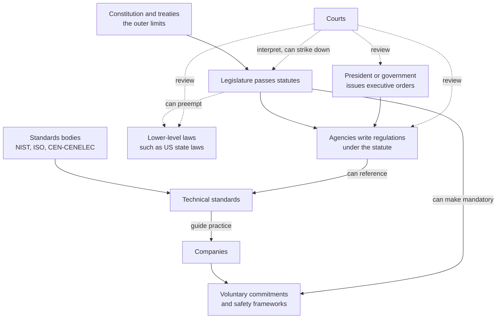
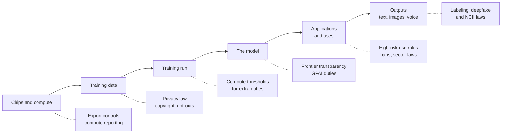
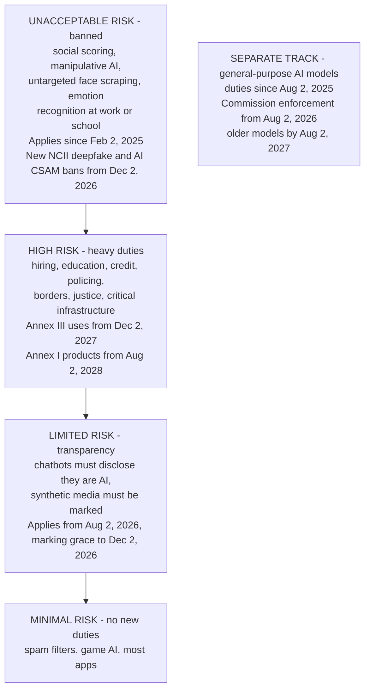
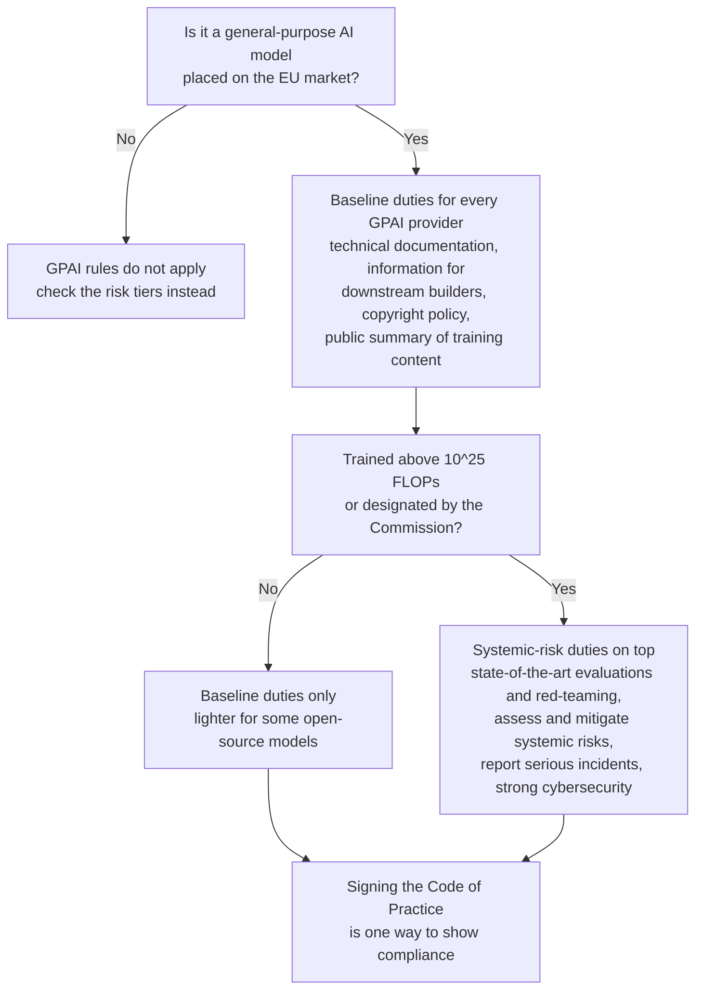
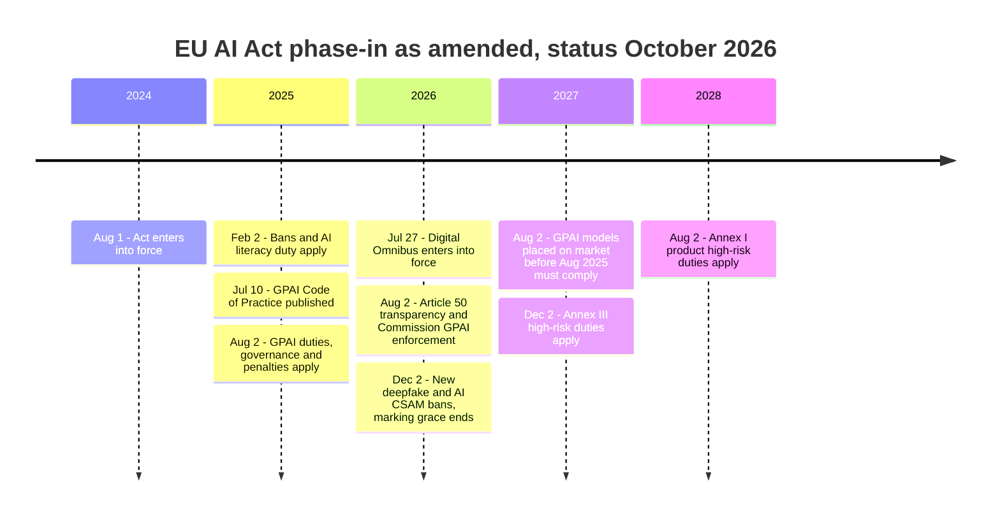
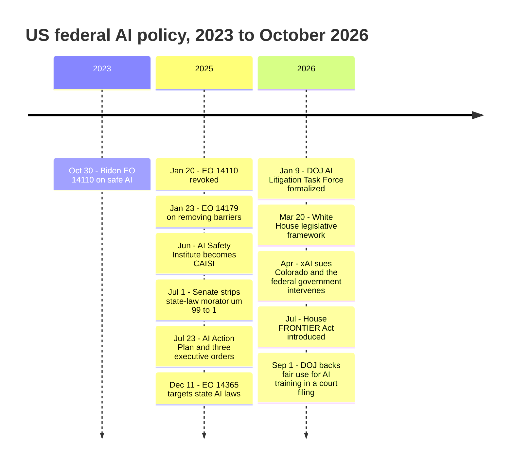
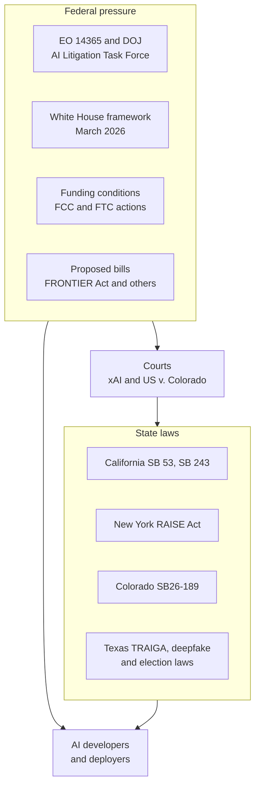

# Chapter 59: AI Law and Policy Around the World

*This chapter gives you a working map of who makes the rules for AI, what those rules said as of October 2026, and a method for reading the next policy headline without getting lost.*

## What you'll learn
- The six instruments of governance (statutes, regulations, executive orders, court rulings, standards and voluntary commitments), how they fit together, and what preemption means.
- Where rules can grip the AI stack (chips, data, models, uses and outputs) and why laws use compute thresholds such as 10^25 and 10^26 FLOPs, with worked examples.
- The EU AI Act in depth: its four risk tiers, the separate rules for general-purpose models, the Code of Practice, fines, and the full timeline after the 2026 Digital Omnibus delays.
- US federal policy from the 2023 executive order to the 2026 preemption fight, and the state laws that actually bind companies today (California, New York, Colorado, Texas and others).
- How the UK, China, South Korea, Japan and international bodies approach AI, and what the summit series from Bletchley to New Delhi achieved.
- Export controls and technical standards as policy tools, and how courts make AI policy one case at a time.
- A five-question checklist for reading any AI policy headline.

## Before you start
This chapter is the policy layer on top of the rest of Part IX. Chapter 55 (What Can Go Wrong: Reliability and the Alignment Problem) and Chapter 58 (Misuse, Security and Everyday Harms) describe the problems these laws respond to. Chapter 56 (How Labs Make AI Safer: Alignment Techniques, Safety Frameworks and Control) explains the company safety frameworks that new laws now require, and Chapter 57 (Interpretability and Evaluations: Looking Inside and Testing) explains the evaluations regulators lean on. Chapter 19 (Pretraining: Data, Scale and Scaling Laws) and Chapter 37 (Training and Serving at Scale: The Math of Compute) explain the training compute that legal thresholds count. Chapter 36 (How Chips Are Made: Fabs, Lithography, Packaging and Geopolitics) covers export controls from the chip side. You need no legal background.

## Your chatbot already lives under many rulebooks

Open your usual chatbot and type a question. It feels like a private conversation between you and a piece of software. In fact, by October 2026 a surprising number of rules touch that one exchange. They were set by different governments, through different tools, at different points in the system.

- If the company that trained the model is one of the largest, it has had to publish a document explaining how it tests for catastrophic risks, because a California law that took effect on January 1, 2026 requires exactly that.
- If you are in the European Union, a rule that started applying in August 2026 says a chatbot must make clear you are talking to a machine, and AI-generated images and audio must carry a machine-readable marker.
- If you use a "companion" app in California, the app must remind you that it is an AI and must prompt minors to take breaks.
- The chips that trained the model were sold under US export rules that decide which countries may buy them.
- The books in the training data were the subject of court rulings and a $1.5 billion settlement that changed how labs acquire text.
- If someone uses an AI tool to post a fake intimate image of you, a US federal law signed in 2025 requires platforms to remove it within 48 hours of a valid report.

None of these came from one "AI law." They came from legislatures, agencies, presidents, judges, standards committees and the companies themselves. This chapter untangles them. We start with the toolbox of governance, then tour the major jurisdictions (the EU, the US federal government, the US states, the UK, China and others), then look at the cross-cutting tools: international summits, export controls, standards, courts and voluntary commitments. We finish with a method for reading AI policy news.

> **Definition — AI governance:** The whole set of rules, institutions and processes that shape how AI is built and used, including laws, government agencies, courts, technical standards and companies' own policies.

> **Definition — AI policy:** The choices governments make about AI, whether written into law or expressed as strategies, funding, purchasing rules or diplomatic positions.

> **Watch out:** AI law changed month by month in 2025 and 2026. Every "current status" in this chapter is as of October 2026, and items the research could not confirm against primary documents are marked as reported. Before you rely on any status for a real decision, check the official text or a current tracker. Exercise 5 shows you how.

## Why governing AI is hard

Governments regulate cars, medicines and banks. Why is AI harder? Four reasons come up again and again.

**It moves faster than lawmaking.** A major law can take two to four years from proposal to application. In that time, AI went from chatbots that fumbled arithmetic to agents that work on tasks for hours (Chapter 28). Rules written for one generation of technology can miss the next.

> **Definition — Pacing problem:** The gap that opens when a technology changes faster than laws and regulators can adapt to it.

A related idea is older. In 1980 the scholar David Collingridge pointed out that when a technology is new, it is easy to shape but nobody knows what its effects will be. By the time the effects are clear, the technology is entrenched and hard to change.

> **Definition — Collingridge dilemma:** The trade-off that early in a technology's life it is easy to regulate but its harms are uncertain, while later its harms are clear but it is hard to change.

**It is general-purpose.** A car is a car. A large language model writes birthday poems, drafts contracts, tutors children and, if misused, helps write malware. The same model can be harmless in one use and high-stakes in another. Lawmakers must decide whether to regulate the model itself, each use of it, or both.

> **Definition — Dual-use:** Describes a technology that can be used for both beneficial and harmful purposes, such as a model that finds software vulnerabilities, which defenders can patch and attackers can exploit.

**It is borderless.** A model can be trained in Oregon on chips designed in California and made in Taiwan, using text scraped from websites worldwide, and served from a data center in Ireland to a user in Brazil. Which country's rules apply? Often several at once.

> **Definition — Jurisdiction:** The territory or subject area over which a government or court has legal authority. An AI company operating globally falls under many jurisdictions at the same time.

**Experts disagree about the risks.** Some researchers think the biggest dangers are today's bias and fraud. Others worry most about future systems escaping human control. Others think both worries are overblown (Chapter 60 lays out these debates). A law requires a judgment about which risks matter most, and there is no consensus to lean on.

> **Key idea:** Every AI rule answers three questions. What is regulated (chips, data, models, uses or outputs)? Who must comply (developers, businesses that deploy AI, platforms, users)? How binding is it (a criminal law, a fine, a voluntary pledge)? Ask those three questions and any AI policy becomes readable.

## The governance toolbox

### Six instruments, from hardest to softest

Rules about AI come from six main places.

1. **Statutes.** Laws passed by a legislature: Congress, a state legislature, the European Parliament together with the Council of the EU, the UK Parliament. They are the strongest domestic rules and the hardest to change.
2. **Regulations.** Detailed rules written by government agencies under authority a statute gives them. A statute might say "protect consumers from deceptive AI"; a regulation spells out which notices a company must give and when.
3. **Executive orders.** Directives from a president (or a similar head of government) to the government's own agencies. They can be issued in a day and reversed in a day.
4. **Court rulings.** Judges decide disputes and interpret laws. Their decisions become precedents that guide later cases, which is how much of AI copyright law is being made right now.
5. **Standards.** Technical documents written by standards bodies (NIST in the US, ISO internationally, CEN-CENELEC in Europe) that define how to do something well, such as how to manage AI risk or how to label content. They are voluntary unless a law or contract points to them.
6. **Voluntary commitments.** Promises companies make on their own or at a government's request, such as publishing safety frameworks.

> **Definition — Statute:** A law passed by a legislature, such as an act of Congress or a state law signed by a governor.

> **Definition — Bill:** A proposed law under consideration by a legislature. A bill has no legal force until it passes and is signed or otherwise enacted.

> **Definition — Regulation (agency rule):** A detailed, legally binding rule issued by a government agency under powers granted by a statute. In the EU, "regulation" also names a type of EU-wide law that applies directly in every member state.

> **Definition — Executive order:** A directive from a president to the executive branch. It can direct federal agencies but cannot by itself override a statute or cancel state laws.

> **Definition — Court ruling:** A judge's decision in a specific case. Rulings from higher courts become precedent that lower courts must follow.

> **Definition — Precedent:** A past court decision that guides or binds how later courts decide similar cases.

> **Definition — Standard (technical):** A published document, usually from a standards body, describing an agreed way to do or measure something. Standards are voluntary unless a law or contract requires them.

> **Definition — Voluntary commitment:** A promise a company makes without being legally required to, such as pledging to test models before release or to publish a safety framework.

Lawyers group these instruments into two families.

> **Definition — Hard law:** Rules that are legally binding and enforceable, such as statutes, regulations and court orders.

> **Definition — Soft law:** Non-binding guidance, principles, codes of conduct and voluntary commitments. Soft law still shapes behavior through reputation, contracts and the expectation that it may later become hard law.

Table 59.1 compares the six instruments.

| Instrument | Who makes it | Binding? | How fast to create | How easy to undo | AI example (as of Oct 2026) |
|---|---|---|---|---|---|
| Statute | Legislature | Yes | Slow: months to years | Hard: needs a new statute | EU AI Act; California SB 53; US TAKE IT DOWN Act |
| Regulation | Agency, under a statute | Yes | Medium: months | Medium | Rules under the EU AI Act; Colorado's planned attorney-general rules |
| Executive order | President | On federal agencies only | Fast: days | Easy: the next president can revoke it | US EO 14110 (2023, revoked 2025); EO 14365 (December 2025) |
| Court ruling | Judges | Yes, for the case and as precedent | Slow: years of litigation | Hard: needs an appeal or a new law | Bartz v. Anthropic; Thomson Reuters v. Ross |
| Standard | Standards bodies | Only if a law or contract adopts it | Slow: years | Revised periodically | NIST AI RMF; ISO/IEC 42001; C2PA |
| Voluntary commitment | Companies | No, unless a law converts it | Fast | Easy: the company can revise it | Seoul Frontier AI Safety Commitments; company safety frameworks |

*Table 59.1: The six governance instruments compared.*

> **Analogy:** Think of building a house. The statute is the building code passed by the city council. Regulations are the inspector's detailed checklists. An executive order is the mayor telling city departments what to prioritize this year. A court ruling settles a fight between a homeowner and a builder and tells everyone how the code will be read from now on. Standards are the electrical and plumbing guidelines written by professional engineers, which the code may point to. A voluntary commitment is the builder's promise to exceed code, which nobody can force them to keep unless the city later writes it into the code.

### How the instruments connect

These instruments are not separate boxes. They feed and check each other, as Figure 59.1 shows.

*Figure 59.1: How governance instruments relate. Solid arrows show one instrument creating or relying on another; dotted arrows show checks. Statutes sit at the center: they empower agencies, can override lower-level laws and can turn voluntary promises into legal duties, while courts review everything.*

Three connections matter most for AI.

- **Statutes can absorb soft law.** California's SB 53 and New York's RAISE Act took something labs did voluntarily, publishing safety frameworks (Chapter 56), and made it a legal duty to publish one and follow it.
- **Regulations can borrow standards.** The EU AI Act lets companies show compliance by following "harmonised standards." If such a standard exists and you follow it, you are presumed to comply with the matching requirement.
- **Courts can check everything.** In 2026 a lawsuit led Colorado to pause its AI law, and a federal judge reportedly blocked a government action against an AI company. Contested policy often ends up in a courtroom.

### Preemption, federalism and the EU's two kinds of law

When two levels of government both make rules, which one wins? In the US, the Constitution makes valid federal law supreme over conflicting state law. When Congress passes a law that displaces state laws on a topic, that is preemption. It is the single biggest fight in US AI policy right now.

> **Definition — Preemption:** When a higher level of government's law overrides or blocks a lower level's laws on the same subject, such as a federal law displacing state AI laws.

> **Definition — Federalism:** A system in which power is shared between a national government and regional governments (states or provinces), each able to make its own laws.

> **Definition — Moratorium:** A temporary ban or freeze. In AI policy it usually means a proposed pause on states enforcing their own AI laws.

Preemption can set a **floor** (states may add stricter rules on top of the federal minimum) or a **ceiling** (states may not go beyond the federal rule). The difference is enormous, and it is often buried in a bill's fine print.

The EU has its own layering. An EU **regulation** applies directly and identically in all 27 member states. An EU **directive** sets goals that each country must write into its own national law, so the details differ by country. The AI Act was made a regulation precisely so that a company faces one set of AI rules across the EU rather than 27.

> **Definition — EU directive:** An EU law that sets goals each member state must achieve by passing its own national legislation, so details can differ between countries. An EU regulation, by contrast, applies directly everywhere.

### Who enforces, and what happens if you break the rules

A rule is only as strong as its enforcement. AI laws use several routes.

> **Definition — Enforcement:** The actions authorities take to make sure a rule is followed, such as investigations, fines, orders to stop, or lawsuits.

> **Definition — Attorney general (AG):** The chief legal officer of a US state or of the federal government, who can sue companies to enforce laws. Many state AI laws are enforced only by the state AG.

> **Definition — Private right of action:** The ability of ordinary people, not just the government, to sue a company directly for breaking a law. Whether an AI law includes one changes how much litigation it produces.

> **Definition — Liability:** Legal responsibility for harm, which can mean paying damages to the people who were hurt. Who is liable when an AI system causes harm (the developer, the business using it or the user) is one of the biggest open questions in AI law.

Penalties range from fixed fines per violation to fines calculated as a share of a company's worldwide revenue. The second design, borrowed from EU privacy law, keeps fines meaningful even for the largest firms.

## What and whom to regulate: the grip points

### Developers, deployers and users

Most AI laws separate the company that builds an AI system from the company that uses it.

> **Definition — Provider (developer):** The organization that builds an AI model or system and places it on the market under its own name. OpenAI is the provider of GPT models; Anthropic is the provider of Claude.

> **Definition — Deployer:** An organization that uses an AI system in its own operations, such as a bank that uses a model to help screen loan applications. The deployer did not build the model but decides how it is used on people.

Here is why the distinction matters. Imagine a hiring platform that uses a large language model to rank résumés. The model's provider made a general tool; the hiring platform turned it into a decision about people's jobs. Most laws put the heaviest duties on whoever makes the high-stakes use, here the hiring platform. Laws aimed at frontier risks, however, put duties on the provider of the underlying model, because only the provider can test what the model can do before anyone builds on it.

### Six places to grip the AI stack

Chapter 1 described the AI stack, from sand and chips up to the app on your screen. Governments can apply pressure at almost every layer, as Figure 59.2 shows.

*Figure 59.2: Where rules can grip the AI stack. The earlier a rule grips, the fewer companies it touches and the more it shapes capability itself; the later it grips, the closer it sits to actual harm to people.*

Each grip point has trade-offs. Controlling chips (Chapter 36) affects which countries can build frontier models at all, but does nothing about how a model is used once it exists. Regulating uses such as hiring or credit targets real harms to people but cannot reach risks that arise inside a model before anyone deploys it. Regulating outputs, for example requiring deepfake labels, sits closest to the harm but is the easiest to evade.

### Compute thresholds: drawing a line with FLOPs

How does a law decide which models are "frontier" enough to deserve extra rules? The most common answer is training compute: the total number of arithmetic operations used to train the model (Chapter 5 and Chapter 37).

> **Definition — FLOP (floating-point operation):** One arithmetic operation, such as a multiplication, on decimal numbers. Training compute is the total count of these operations, written in powers of ten like 10^25.

> **Definition — Compute threshold:** A line in a law, measured in total training FLOPs, above which a model faces extra obligations. The EU uses 10^25 FLOPs; California and New York use 10^26.

> **Definition — Frontier model:** One of the most capable AI models at a given time, usually trained with the most compute. Laws often define it by a compute threshold.

You can estimate training compute yourself with the rule of thumb from Chapter 19: training FLOPs ≈ 6 × N × D, where N is the number of parameters (for mixture-of-experts models, the active parameters) and D is the number of training tokens.

**Worked example 1: GPT-3 (2020).** N = 175 billion = 1.75 × 10^11 parameters. D = 300 billion = 3 × 10^11 tokens. Compute = 6 × 1.75 × 10^11 × 3 × 10^11 = 31.5 × 10^22 ≈ 3.2 × 10^23 FLOPs. That is about 30 times below the EU line.

**Worked example 2: Llama 3.1 405B (2024).** N = 4.05 × 10^11. D = 15.6 trillion = 1.56 × 10^13 tokens. Compute = 6 × 4.05 × 10^11 × 1.56 × 10^13 ≈ 37.9 × 10^24 ≈ 3.8 × 10^25 FLOPs. That is above the EU's 10^25 line, so under the EU AI Act a model trained this way is presumed to carry "systemic risk." It is still below the 10^26 line that California and New York use.

**Worked example 3: what does 10^26 FLOPs cost?** Suppose an accelerator peaks at about 10^15 FLOP per second (roughly an H100 at 16-bit precision) and you keep it 40% busy with useful work, so 4 × 10^14 useful FLOP per second. Then 10^26 ÷ (4 × 10^14) = 2.5 × 10^11 chip-seconds. Divide by 3,600 seconds per hour: about 69 million chip-hours. At an illustrative rental price of $2 per chip-hour, that is roughly $140 million of compute. So the California and New York thresholds catch only training runs that cost on the order of a hundred million dollars or more, which in 2026 means a handful of companies.

| Threshold | Where used (as of Oct 2026) | What it triggers |
|---|---|---|
| 10^25 FLOPs | EU AI Act | Presumption that a general-purpose model has "systemic risk," adding evaluation, risk-mitigation, incident-reporting and cybersecurity duties |
| 10^26 FLOPs plus over $500M annual revenue | California SB 53 ("large frontier developer") | Publish a frontier AI framework and transparency reports; report critical incidents |
| Frontier model plus over $500M revenue | New York RAISE Act (effective Jan 1, 2027) | Safety framework, transparency reports, 72-hour incident reporting |
| 10^26 operations | US Executive Order 14110 (2023) | Report very large training runs to the government; revoked January 2025 |

*Table 59.2: Compute thresholds in AI law.*

> **Watch out:** Compute thresholds age badly. Algorithms get more efficient every year (Chapter 19), so a model trained with less compute next year may match one that crossed the line this year. Distillation (Chapter 20) can also pack a large model's skills into a small one. Lawmakers know this, which is why the EU lets the Commission adjust its threshold and designate models by other criteria. Treat any FLOP number as a moving stand-in for "most capable," not a law of nature.

> **Try it:** Ask your chatbot: "Using the rule 6 × parameters × tokens, estimate the training compute of a model with 70 billion parameters trained on 15 trillion tokens, and tell me whether it crosses 10^25 FLOPs." Then check its arithmetic by hand. (The answer is 6 × 7 × 10^10 × 1.5 × 10^13 = 6.3 × 10^24, just under the EU line.)

## The European Union AI Act

### The big idea: regulate the use, scaled to the risk

The EU AI Act, formally Regulation (EU) 2024/1689, is the world's most comprehensive AI law. It entered into force on August 1, 2024 and phases in over several years. Its central idea is simple: the more harm an AI use could do, the stricter the rules. A spam filter and a system that decides who gets a mortgage are both "AI," but they should not face the same paperwork.

> **Definition — EU AI Act:** The European Union's comprehensive AI law, Regulation (EU) 2024/1689, which sorts AI systems into risk tiers with matching obligations and adds separate rules for general-purpose AI models.

> **Definition — Risk-based approach:** Designing rules so that obligations scale with how much harm a use could cause, from outright bans for the most dangerous uses to no new duties for harmless ones.

The Act is built like EU product-safety law, the same family of rules that governs toys and medical devices. That has a practical consequence: it applies to anyone who places an AI system on the EU market, or whose system's output is used in the EU, wherever the company is based. A US startup selling a résumé-screening tool to a German employer is covered.

> **Definition — Extraterritorial reach:** When a law applies to companies outside the country or bloc that passed it, because they sell to or affect people inside it. The EU AI Act and EU privacy law both reach non-EU companies this way.

### The four risk tiers

Figure 59.3 shows the tiers with their dates after the 2026 amendments.

*Figure 59.3: The EU AI Act's risk tiers, from banned at the top to unregulated at the bottom, with application dates as amended by the 2026 Digital Omnibus. General-purpose models such as those behind ChatGPT, Claude and Gemini sit on a separate track. Status as of October 2026.*

> **Definition — Risk tiers (EU):** The AI Act's four categories of AI systems: unacceptable risk (banned), high risk (heavy obligations), limited risk (transparency duties) and minimal risk (no new duties).

### Unacceptable risk: the banned list

Since February 2, 2025, certain AI practices have been prohibited outright in the EU. The banned list, in Article 5, includes:

- **Social scoring:** rating people on their social behavior or personal traits in ways that lead to unjustified or disproportionate treatment.
- **Manipulative or deceptive techniques** that distort people's behavior and cause significant harm, including exploiting vulnerabilities due to age, disability or economic situation.
- **Untargeted scraping** of facial images from the internet or CCTV footage to build face-recognition databases.
- **Emotion recognition in workplaces and schools,** except for medical or safety reasons.
- Certain **biometric categorization** to infer sensitive traits, **predicting crime** based solely on profiling, and **real-time remote biometric identification** in public spaces by police, which is allowed only in narrow listed situations.

The 2026 Digital Omnibus added two new bans that apply from December 2, 2026: AI systems that generate non-consensual intimate images of identifiable people, and AI-generated child sexual abuse material. They followed the Grok image scandal of December 2025 to January 2026 (Chapter 58).

> **Definition — Prohibited practice (EU):** An AI use the EU AI Act bans outright because its risk to people's rights is judged unacceptable, such as social scoring or emotion recognition in schools.

### High-risk systems: the heavy middle

High-risk AI is where most of the Act's detail lives. A system becomes high-risk in one of two ways.

- **Annex III** lists sensitive areas of use: biometrics, critical infrastructure, education (grading exams, deciding admissions), employment (screening applications, deciding promotions or dismissals), access to essential services (credit scoring, some insurance pricing, public benefits), law enforcement, migration and border control, and the administration of justice and elections.
- **Annex I** covers AI that is a safety component of products already regulated by EU product laws, such as medical devices, machinery, toys and vehicles.

> **Definition — High-risk AI system (EU):** An AI system used in a sensitive area listed in the AI Act (such as hiring, education or credit) or built into a regulated product (such as a medical device). It must meet strict requirements before and after it is sold.

> **Definition — Annex III:** The list in the EU AI Act of use areas (biometrics, critical infrastructure, education, employment, essential services, law enforcement, migration, justice and democratic processes) where AI systems count as high-risk.

Providers of high-risk systems must, among other things:

1. Run a **risk-management system** for the whole life of the product.
2. Use training data that meets **data-governance** requirements, including checks for bias.
3. Write **technical documentation** and keep **automatic logs** so decisions can be traced.
4. Give deployers clear **instructions for use**.
5. Design the system for effective **human oversight**.
6. Meet requirements for **accuracy, robustness and cybersecurity**.
7. Pass a **conformity assessment** before sale, then apply the CE mark and register the system in an EU database.
8. Monitor the system after release and **report serious incidents**.

Deployers have duties too: use the system as instructed, assign trained people to oversee it, keep the logs, and in some cases (public bodies, and certain credit and insurance uses) carry out a fundamental rights impact assessment before use.

> **Definition — Conformity assessment:** The process of checking that a product meets legal requirements before it is sold, done either by the provider itself or by an independent "notified body." It is central to EU high-risk AI rules.

> **Definition — CE marking:** The "CE" logo a product carries in the EU to show it meets EU safety, health and environmental requirements. High-risk AI systems must carry it.

> **Definition — Fundamental rights impact assessment (FRIA):** An assessment some deployers of high-risk AI must complete before use, describing who could be affected, what could go wrong for their rights, and how the risks will be overseen.

> **Definition — Harmonised standard:** A European standard written at the European Commission's request. Following it gives a legal presumption that you meet the matching requirements of the law.

### Limited risk: the transparency duties of Article 50

Some AI is not dangerous in itself but could fool people. For these systems the Act requires honesty. From August 2, 2026, under Article 50:

- **Chatbots and other AI that interacts with people** must make clear that the person is dealing with an AI, unless that is obvious.
- **Generative AI systems** must mark their synthetic audio, images, video and text in a machine-readable way, so the content can be detected as AI-generated. Generative systems already on the market before August 2026 have a grace period to December 2, 2026 for this marking.
- **Deployers of deepfakes** must disclose that the content is artificially generated or manipulated, with lighter rules for obviously artistic, satirical or fictional work.
- **Emotion recognition and biometric categorization**, where they are allowed at all, must be disclosed to the people exposed to them.

> **Definition — Transparency obligation (Article 50):** The EU AI Act's duty to tell people when they are interacting with AI, to mark AI-generated content in a machine-readable way, and to disclose deepfakes.

This is where the AI Act touches your daily chatbot most directly, and where technical tools such as watermarks and C2PA content credentials (Chapter 47 and Chapter 58) become legal compliance tools.

### Minimal risk: everything else

Most AI, from spam filters to video-game opponents to photo enhancers, falls into the minimal-risk tier and faces no new obligations under the Act. Companies are encouraged to adopt voluntary codes of conduct.

> **Key idea:** The AI Act regulates mostly by use, not by technology. The same face-analysis model could be banned (emotion recognition in a classroom), high-risk (identifying people at a border), limited-risk (a disclosed app that labels a selfie's mood) or minimal-risk (sorting your own photos), depending only on what it is used for.

### General-purpose AI models: a separate track

The European Commission proposed the Act in 2021, before ChatGPT existed. When general-purpose chatbots arrived in late 2022, lawmakers added a separate chapter for the models underneath them.

> **Definition — General-purpose AI model (GPAI):** In the EU AI Act, a model trained on broad data that can perform a wide range of tasks and be built into many different systems, such as the models behind ChatGPT, Claude and Gemini.

> **Definition — Systemic risk (EU GPAI):** The EU's label for the most capable general-purpose models, whose failure or misuse could have large-scale effects. A model is presumed to carry systemic risk if trained with more than 10^25 FLOPs, and the Commission can also designate models by other criteria.

Figure 59.4 shows how the obligations stack.

*Figure 59.4: How the EU AI Act's general-purpose model rules stack. Every GPAI provider owes documentation and a copyright policy; models presumed to carry systemic risk owe safety work on top.*

The copyright duty deserves attention. GPAI providers must have a policy to respect EU copyright law, including rights holders' ability to opt out of text and data mining (Chapter 11), and must publish a sufficiently detailed summary of the content used for training, following a template from the Commission.

> **Definition — Text and data mining (TDM) exception:** A rule in EU (and some other) copyright law that allows automated analysis of lawfully accessed content, including for AI training, unless the rights holder has opted out in a machine-readable way.

### The Code of Practice

How does a company prove it meets vague duties such as "assess and mitigate systemic risks"? The EU's answer was a code of practice, drafted by independent experts with input from industry, academics and civil society, and published on July 10, 2025. It has three chapters: transparency, copyright, and safety and security (the last applying only to systemic-risk models).

> **Definition — Code of practice (GPAI):** A voluntary EU document that general-purpose model providers can sign to demonstrate compliance with the AI Act's GPAI rules. Non-signers must prove compliance some other way.

Signatories included Amazon, Anthropic, Google, IBM, Microsoft, Mistral and OpenAI, among others. xAI signed only the safety-and-security chapter. Meta declined to sign. The code is a good example of a hybrid instrument: voluntary to sign, but backed by a binding law.

### Who enforces it, and how big the fines are

Enforcement is split. Each member state names national market surveillance authorities to police AI systems on its market. The European Commission's AI Office enforces the rules for general-purpose models directly, with enforcement powers that apply from August 2, 2026 and that the Omnibus expanded.

> **Definition — AI Office:** The body inside the European Commission that supervises and enforces the AI Act's rules for general-purpose AI models and coordinates how the Act is applied.

> **Definition — Market surveillance authority:** A national regulator that checks whether products on its country's market comply with the law, and can order changes, withdrawals or fines.

Fines are tied to global turnover, so they bite large companies:

- Prohibited practices: up to €35 million or 7% of worldwide annual turnover, whichever is higher.
- Most other violations: up to €15 million or 3%.
- Supplying incorrect information to authorities: lower amounts again.
- For small and medium-sized firms, the lower of the two figures applies instead of the higher.

> **Definition — Global turnover:** A company's total worldwide annual revenue. EU laws express maximum fines as a percentage of it so that penalties scale with company size.

**Worked example: the size of a maximum fine.** A large tech company with €200 billion in worldwide turnover breaks a prohibition. 7% of €200 billion is €14 billion, which is higher than €35 million, so the cap is €14 billion. A startup with €10 million turnover breaking the same rule is capped at the lower figure: 7% of €10 million is €700,000, which is less than €35 million. These are maximums. Actual fines depend on severity, duration and cooperation, and regulators rarely start at the cap.

### The timeline, and the 2026 Digital Omnibus

In 2025 and 2026 it became clear that the technical standards companies needed for high-risk compliance were behind schedule, and European businesses lobbied hard for relief. The EU responded with the Digital Omnibus on AI, Regulation (EU) 2026/1744, which entered into force on July 27, 2026.

> **Definition — Digital Omnibus (on AI):** A 2026 EU law that amended the AI Act, delaying the high-risk deadlines, adding new bans on intimate deepfakes and AI-generated child abuse material, and simplifying some duties for smaller companies.

The Omnibus:

- Delayed Annex III high-risk obligations from August 2, 2026 to **December 2, 2027**.
- Delayed Annex I (product-embedded) high-risk obligations to **August 2, 2028**.
- Added bans on non-consensual intimate deepfakes and AI-generated CSAM from **December 2, 2026**.
- Softened the AI-literacy duty, which had required organizations to ensure their staff had sufficient AI literacy, into a duty to take measures toward it.
- Simplified documentation for small and medium-sized enterprises and for a new category of "small mid-caps."
- Created a legal basis to process sensitive personal data where needed to detect and correct bias.
- Gave the AI Office expanded investigation and fining powers.

> **Definition — AI literacy:** The knowledge and skills people need to use AI systems sensibly, including understanding their limits and risks. The EU AI Act asks organizations to promote it among staff who use AI.

*Figure 59.5: The EU AI Act timeline after the 2026 Digital Omnibus. Bans and general-purpose model duties already apply; the heavy high-risk duties now arrive in December 2027 and August 2028.*

### Worked example: classifying five products

Let's apply the tiers to five realistic products. Exercise 3 asks you to repeat this with the EU's own compliance checker.

| Product | Tier | Why | Key date (as of Oct 2026) |
|---|---|---|---|
| A tool that ranks job applicants' résumés | High risk (Annex III, employment) | It shapes decisions about people's jobs | Dec 2, 2027 |
| A customer-service chatbot for an airline | Limited risk | It talks to people, so it must disclose that it is AI | Aug 2, 2026 |
| An exam-proctoring tool that reads students' emotions from webcam video | Prohibited | Emotion recognition in education is banned | Banned since Feb 2, 2025 |
| A bank's credit-scoring model | High risk (Annex III, essential services) | It decides access to credit | Dec 2, 2027 |
| An app filter that turns your selfie into a painting | Minimal risk, plus a marking duty for generated images | Low stakes, but generative output must be machine-marked | Aug 2, 2026 (grace to Dec 2, 2026 if already on the market) |

*Table 59.3: Five products sorted into EU AI Act tiers.*

The proctoring tool and the selfie filter might run the same face-analysis model underneath. The use decides the tier, not the technology.

### The debate over the Act

Supporters and critics both make serious arguments.

**The strongest case for the Act.** Without rules, people hurt by a biased hiring or credit model rarely learn why they were rejected and have no way to challenge it. One EU-wide law gives companies one rulebook instead of 27, gives citizens enforceable rights, and builds the trust that lets AI spread. Companies that sell globally often adopt the strictest major market's rules everywhere, as happened with privacy law, so the Act may raise standards worldwide. And banning a few practices, such as social scoring, draws bright lines before those practices become normal.

**The strongest case against.** The obligations are heavy, vague in places and dependent on standards that were not ready on time; the EU's own decision to delay the high-risk rules suggests the design overreached. Compliance costs fall hardest on small European firms while the largest US and Chinese labs can afford large legal teams, which may entrench incumbents. Europe already trails the US and China in frontier AI, and critics argue heavy regulation widens the gap. Finally, a law designed in 2021 around "AI systems" with fixed purposes fits awkwardly with general-purpose agents that take on new tasks every day.

> **Definition — Brussels effect:** The tendency of EU rules to become global standards because multinational companies find it simpler to follow the strictest major market's rules everywhere. The term comes from legal scholar Anu Bradford.

> **At the frontier (2026):** The EU's attention has shifted from writing the Act to enforcing it. The AI Office's enforcement powers over general-purpose models began in August 2026, the harmonised standards from CEN-CENELEC's AI committee are still being finished, and companies that signed the Code of Practice are producing the documentation and safety reports it requires. Whether, and how strictly, the AI Office uses its fining powers against a major lab is the thing to watch in 2027.

### Other EU laws that touch AI

The AI Act is not the only European law that matters for AI. The General Data Protection Regulation governs personal data used in training and gives people rights around significant decisions made by purely automated means. The Digital Services Act requires large platforms to manage illegal content and systemic risks, including AI-generated content on social networks. And a 2019 copyright directive created the text-and-data-mining opt-out that the AI Act's copyright duty builds on.

> **Definition — GDPR (General Data Protection Regulation):** The EU's 2018 privacy law, which governs how personal data is collected and used, including for AI training, and limits significant decisions made about people by purely automated means.

## The United States: federal policy

### No single AI law, but plenty of law

As of October 2026 the US has no comprehensive federal AI statute. That does not mean AI is unregulated. Older laws apply to AI just as they apply to any other product or practice.

- The **Federal Trade Commission Act** bans unfair and deceptive practices, so false claims about what an AI product can do, or harmful data practices, can draw FTC action. In September 2025 the FTC opened a formal inquiry into AI companion chatbots from Alphabet, Character.AI, Instagram, Meta, OpenAI, Snap and xAI.
- **Civil-rights laws** on employment, housing and credit apply whether a human or an algorithm makes the decision.
- **Product-liability and negligence law** lets injured people sue. Several lawsuits over chatbots and teen suicides are testing how these old doctrines apply to AI (Chapter 58).
- The **TAKE IT DOWN Act**, signed May 19, 2025, is a narrow federal statute aimed squarely at an AI-era harm. It criminalizes publishing non-consensual intimate imagery, including AI deepfakes, and requires platforms to remove reported images within 48 hours. The FTC can enforce the platform duties from May 19, 2026.
- After a fake robocall imitating President Biden's voice in January 2024, the **Federal Communications Commission** ruled that AI-voice robocalls fall under existing robocall law. That is an agency applying an old statute to new technology, one of the most common moves in AI policy.

> **Definition — FTC (Federal Trade Commission):** The US agency that enforces laws against unfair and deceptive business practices and anticompetitive conduct. It is a major de facto regulator of consumer AI products.

> **Definition — TAKE IT DOWN Act:** A 2025 US federal law that criminalizes publishing non-consensual intimate images, including AI-generated deepfakes, and requires platforms to remove reported images within 48 hours.

### From the 2023 executive order to the 2025 Action Plan

Federal AI policy has swung with the White House, mostly through executive orders, which are quick to issue and quick to reverse.

- **October 30, 2023.** President Biden signed Executive Order 14110 on "safe, secure, and trustworthy" AI. Among many directions to agencies, it required developers of very large models (trained with more than 10^26 operations) to report their training runs and safety-test results to the government, and it led to the US AI Safety Institute at NIST.
- **January 20, 2025.** On his first day back in office, President Trump revoked EO 14110.
- **January 23, 2025.** EO 14179, "Removing Barriers to American Leadership in Artificial Intelligence," set a new direction centered on competitiveness.
- **June 2025.** The US AI Safety Institute was renamed the Center for AI Standards and Innovation (CAISI), focused on standards, voluntary testing with companies, and national-security risks.
- **July 1, 2025.** The Senate voted 99 to 1 to strip a proposed 10-year moratorium on state AI laws from a budget bill.
- **July 23, 2025.** The White House released "America's AI Action Plan": roughly 90 actions under three pillars (accelerate innovation, build American AI infrastructure, lead in international diplomacy and security). It came with executive orders on "Preventing Woke AI in the Federal Government," on speeding up data-center permitting, and on promoting AI exports. The plan explicitly encourages open-weight models.

> **Definition — NIST (National Institute of Standards and Technology):** A US federal agency that develops measurement science and voluntary standards, including the AI Risk Management Framework. It houses CAISI.

> **Definition — CAISI (Center for AI Standards and Innovation):** The US government's AI testing and standards center at NIST, renamed from the US AI Safety Institute in June 2025. It runs voluntary testing with companies and evaluates national-security risks.

*Figure 59.6: Major US federal AI policy moves. Most are executive actions rather than statutes, which is why the direction could reverse so quickly between administrations.*

### The December 2025 order and the push against state laws

With Congress unable to pass a preemption law, the administration turned to executive power. On December 11, 2025, President Trump signed Executive Order 14365, "Ensuring a National Policy Framework for Artificial Intelligence." It:

- Created a Department of Justice **AI Litigation Task Force** (formalized January 9, 2026) to challenge state AI laws in court.
- Directed the Commerce Department to list "onerous" state AI laws.
- Attached conditions to certain federal funds, notably broadband (BEAD) money, for states with such laws.
- Asked the FCC and FTC to consider actions that could cut against state rules.
- Carved out state laws on child safety, on compute and data-center infrastructure, and on the state's own purchasing of AI.

Crucially, the order itself does not preempt any state law. Only Congress can do that by statute, or a court can strike a state law down. The order is a plan to apply pressure through lawsuits and funding.

> **Watch out:** Some headlines in December 2025 suggested the order "overrides" state AI laws. It did not and could not. An executive order directs the federal government's own agencies. Displacing state law takes a statute from Congress or a court ruling that a state law is invalid, for example because it conflicts with federal law or the Constitution.

On March 20, 2026, the White House released a four-page legislative framework asking Congress for a national standard. It urged broad preemption of state rules on AI development, no new federal AI regulator, regulatory sandboxes, child protection through "commercially reasonable" age assurance with parental attestation, protections against deepfakes, and protection of household electricity customers from data-center-driven price increases. On copyright it left fair use to the courts and suggested Congress could consider collective licensing.

> **Definition — Regulatory sandbox:** A program that lets companies test new products under a regulator's supervision, with some rules relaxed or waived for a limited time.

> **Definition — Age assurance:** Methods for estimating or verifying a user's age, from self-declaration to ID checks to AI age estimation, used to apply protections for minors.

The first real collision came in April 2026. xAI sued Colorado over its AI Act, and the federal government intervened on xAI's side, the first federal intervention against a state AI law. Colorado agreed to pause enforcement, and then rewrote the law (see below).

> **Definition — Intervention (in a lawsuit):** When a party not originally in a case, such as the federal government, formally joins it to argue one side.

### What Congress is doing

As of October 2026, Congress has passed neither an AI preemption statute nor a comprehensive AI law. Several proposals are live:

- The bipartisan House **FRONTIER Act** (Representatives Jay Obernolte and Lori Trahan, introduced in late July 2026) would preempt new state obligations on frontier developers in three areas (catastrophic-risk transparency, third-party auditing and incident reporting) while preserving state child-safety laws, rules for deployers and general laws.
- Senator Marsha Blackburn circulated a draft that includes a duty of care for AI developers.
- Senator Ted Cruz's **SANDBOX Act** proposes waivers from federal rules for AI experiments.

> **Definition — Duty of care:** A legal obligation to take reasonable steps to avoid causing foreseeable harm to others. A statutory duty of care for AI developers would make them liable if they failed to take such steps.

The federal government also shapes policy through court filings. On September 1, 2026, the Department of Justice filed a statement of interest supporting fair use for AI training in the consolidated copyright litigation against OpenAI.

> **Definition — Statement of interest:** A filing in which the US government tells a court its view on a legal question in a case it is not a party to.

> **At the frontier (2026):** The federal approach as of October 2026 combines three moves: promote AI and its infrastructure (the Action Plan, faster permitting), avoid creating a new regulator, and push toward a single national rulebook by challenging state laws. Whether Congress passes a preemption law, and whether it sets a floor or a ceiling, is the biggest open question in US AI policy. AI also became an issue in the campaigns for the November 3, 2026 midterm elections.

## The United States: the states step in

With Congress gridlocked, states became the main source of binding AI law in the US, and their legislatures saw a flood of AI bills in 2025 and 2026. A few of the ones that passed matter most.

### California: SB 53 and SB 243

California hosts most of the frontier labs, so its laws have national reach. In 2024 Governor Gavin Newsom vetoed SB 1047, a bill by Senator Scott Wiener that would have imposed safety duties and liability on developers of very large models. Wiener returned the next year with a narrower bill focused on transparency.

**SB 53, the Transparency in Frontier Artificial Intelligence Act** (signed September 29, 2025; effective January 1, 2026). Its heaviest duties fall on "large frontier developers": those training models above 10^26 FLOPs with more than $500 million in annual revenue. Covered developers must:

- Publish a **frontier AI framework** describing how they assess and manage catastrophic risks.
- Publish a **transparency report** when they release a new frontier model.
- Report **critical safety incidents** to the state's Office of Emergency Services within 15 days, or within 24 hours if there is an imminent danger to life.
- Not retaliate against **whistleblowers** who report safety concerns.
- Face civil penalties of up to $1 million per violation.

The law also created CalCompute, a consortium to plan a public cloud computing resource for researchers and startups.

> **Definition — Frontier AI framework:** Under California's SB 53, a public document in which a large frontier developer explains how it identifies, assesses and mitigates catastrophic risks from its models. It turns company safety policies (Chapter 56) into a legal duty.

> **Definition — Transparency report:** A document a developer publishes when releasing a model, describing what the model is, its intended uses and how it was assessed for risk.

> **Definition — Critical safety incident:** Under California and New York frontier AI laws, a serious event such as theft of model weights, harm caused by a model, or loss of control over a model, which must be reported to the state within a set deadline.

> **Definition — Whistleblower protection:** Legal protection against firing or other retaliation for employees who report safety or legal concerns to the authorities.

**SB 243, the first state companion-chatbot law** (effective January 1, 2026). Operators of AI companion chatbots must disclose that users are talking to an AI, give minors recurring reminders to take a break, and keep protocols for responding to suicidal ideation, self-harm and sexual content.

> **Definition — Companion chatbot:** An AI product designed to sustain an ongoing personal, social or romantic relationship with a user, as opposed to a task assistant.

### New York: the RAISE Act

New York's **Responsible AI Safety and Education (RAISE) Act**, sponsored by Assemblymember Alex Bores, was signed by Governor Kathy Hochul on December 19, 2025, with agreed amendments. It covers developers with over $500 million in revenue that train frontier models. They must publish safety frameworks and transparency reports, report incidents within 72 hours, and face penalties of up to $1 million for a first violation and $3 million for later ones. The law creates a new oversight office in the state's Department of Financial Services and takes effect on January 1, 2027.

**Worked example: incident clocks.** Suppose a large frontier developer discovers on a Monday at 9:00 a.m. that its model weights have been stolen. Under New York's law, once in effect, 72 hours means the report is due by Thursday at 9:00 a.m. Under California's law the standard deadline is 15 days, which is Tuesday two weeks later; but if the theft creates an imminent risk of death or serious injury, the deadline is 24 hours, Tuesday at 9:00 a.m. A company covered by both laws must build its incident process around the tightest clock that could apply.

### Colorado: from a broad duty to narrow transparency

In 2024 Colorado passed the first broad US law on algorithmic discrimination. It would have imposed a duty of reasonable care on developers and deployers of high-risk AI used in consequential decisions such as hiring, lending and housing. After industry objections the state delayed it to June 30, 2026. Then came xAI's lawsuit and the federal intervention in April 2026. On May 14, 2026, Colorado **repealed and replaced** the law with SB26-189, a much narrower transparency law for automated decision-making technology (ADMT). It takes effect on January 1, 2027, if the attorney general's rulemaking is complete, and requires:

- A notice before AI is used in a consequential decision about a person.
- An explanation within 30 days after an adverse outcome.
- The ability to access and correct the personal data used.
- Human review where commercially reasonable.

Only the attorney general can enforce it; there is no private right of action.

> **Definition — Algorithmic discrimination:** Unfair different treatment of people based on protected characteristics such as race or sex, produced by an automated system, even when nobody intended it.

> **Definition — ADMT (automated decision-making technology):** Software that makes, or substantially shapes, decisions about people, such as who gets a loan, a job interview or an apartment.

> **Definition — Consequential decision:** A decision with significant effects on a person's life, such as access to employment, credit, housing, education, insurance or health care.

### Texas, Illinois and the overall pattern

Texas's Responsible Artificial Intelligence Governance Act (TRAIGA), in effect since January 1, 2026, reportedly deals mostly with government use of AI, plus prohibitions on certain intentionally harmful uses. Illinois reportedly restricted AI from providing therapy in August 2025. Many states also passed laws on election deepfakes and intimate deepfakes.

| State law | Status (as of Oct 2026) | Who it covers | Core duties |
|---|---|---|---|
| California SB 53 | In effect since Jan 1, 2026 | Frontier developers (heaviest duties above 10^26 FLOPs and $500M revenue) | Frameworks, transparency reports, incident reporting, whistleblower protection |
| California SB 243 | In effect since Jan 1, 2026 | Companion chatbot operators | AI disclosure, break reminders for minors, self-harm protocols |
| New York RAISE Act | Signed Dec 19, 2025; effective Jan 1, 2027 | Frontier developers over $500M revenue | Safety frameworks, transparency, 72-hour incident reporting, new DFS office |
| Colorado SB26-189 | Signed May 14, 2026; effective Jan 1, 2027 if rules are done | Businesses using ADMT in consequential decisions | Notice, explanation, data correction, human review where reasonable |
| Texas TRAIGA | Reported in effect since Jan 1, 2026 | Mainly government agencies | Government-use rules; bans on certain intentional harms |
| Illinois therapy-bot limit | Reported, Aug 2025 | AI therapy services | Restricts AI from providing therapy |

*Table 59.4: Key US state AI laws, as of October 2026.*

> **Key idea:** In 2025 and 2026, US states moved away from broad "algorithmic discrimination" laws like Colorado's original act toward narrower ones: frontier-developer transparency, chatbot and child safety, deepfakes, and notice-and-explanation rules. Narrow laws are easier to pass and harder to challenge in court, but they leave many harms unaddressed.

### The preemption fight

Figure 59.7 shows the tug-of-war.

*Figure 59.7: The US federal-state tug-of-war over AI rules, as of October 2026. State statutes bind companies now; federal pressure works through lawsuits, funding conditions and proposed legislation, and courts referee. Only a statute from Congress could preempt state laws outright.*

The arguments on each side are strong.

**The strongest case for federal preemption.** AI models are built once and served nationwide. Fifty different rulebooks would mean fifty compliance regimes, with costs falling hardest on startups and smaller labs that cannot afford large legal teams. Commerce between states is exactly what the Constitution gives Congress power to regulate. One state that happens to host most frontier labs could in effect set national policy that people in other states never voted for. And because AI capability is tied to national security and competition with China, a single coherent national approach makes strategic sense.

**The strongest case against preemption, or for a floor rather than a ceiling.** Congress has not passed substantive AI rules, so preemption without them would create a vacuum, not a national standard. States are "laboratories of democracy": they can try ideas, such as SB 53's transparency duties, and the ones that work can spread. The Senate's 99-to-1 vote against a moratorium shows broad bipartisan resistance to wiping out state protections, especially for children. And states have long regulated insurance, employment and consumer protection, exactly the areas where AI decisions touch people's lives.

> **Analogy:** Think of traffic rules. Interstate highways follow federal standards so a truck can cross the country under one set of rules. City streets have local speed limits because a school zone in one town is not a rural road in another. The preemption debate is about whether AI is more like the interstate or the city street, and the honest answer is that different parts of it resemble each.

