# Chapter 59: AI Law and Policy Around the World

*This chapter gives you a working map of who makes the rules for AI, what those rules said as of October 2026, and a method for reading the next policy headline without getting lost.*

## What you'll learn
- The six instruments of governance (statutes, regulations, executive orders, court rulings, standards and voluntary commitments), how they fit together, and what preemption means.
- Where rules can grip the AI stack (chips, data, models, uses and outputs) and why laws use compute thresholds such as 10^25 and 10^26 FLOPs, with worked examples.
- The EU AI Act in depth: its four risk tiers, the separate rules for general-purpose models, the Code of Practice, fines, and the full timeline after the 2026 Digital Omnibus delays.
- US federal policy from the 2023 executive order to the 2026 preemption fight, and the state laws that actually bind companies today (California, New York, Colorado, Texas and others).
- How the UK, China, South Korea, Japan and international bodies approach AI, and what the summit series from Bletchley to New Delhi achieved.
- Export controls and technical standards as policy tools, and how courts make AI policy one case at a time.
- A five-question checklist for reading any AI policy headline.

## Before you start
This chapter is the policy layer on top of the rest of Part IX. Chapter 55 (What Can Go Wrong: Reliability and the Alignment Problem) and Chapter 58 (Misuse, Security and Everyday Harms) describe the problems these laws respond to. Chapter 56 (How Labs Make AI Safer: Alignment Techniques, Safety Frameworks and Control) explains the company safety frameworks that new laws now require, and Chapter 57 (Interpretability and Evaluations: Looking Inside and Testing) explains the evaluations regulators lean on. Chapter 19 (Pretraining: Data, Scale and Scaling Laws) and Chapter 37 (Training and Serving at Scale: The Math of Compute) explain the training compute that legal thresholds count. Chapter 36 (How Chips Are Made: Fabs, Lithography, Packaging and Geopolitics) covers export controls from the chip side. You need no legal background.

## Your chatbot already lives under many rulebooks

Open your usual chatbot and type a question. It feels like a private conversation between you and a piece of software. In fact, by October 2026 a surprising number of rules touch that one exchange. They were set by different governments, through different tools, at different points in the system.

- If the company that trained the model is one of the largest, it has had to publish a document explaining how it tests for catastrophic risks, because a California law that took effect on January 1, 2026 requires exactly that.
- If you are in the European Union, a rule that started applying in August 2026 says a chatbot must make clear you are talking to a machine, and AI-generated images and audio must carry a machine-readable marker.
- If you use a "companion" app in California, the app must remind you that it is an AI and must prompt minors to take breaks.
- The chips that trained the model were sold under US export rules that decide which countries may buy them.
- Books used as training data have been the subject of court rulings and, in one case, a $1.5 billion settlement over how they were acquired.
- If someone uses an AI tool to post a fake intimate image of you, a US federal law signed in 2025 requires platforms to remove it within 48 hours of a valid report.

None of these came from one "AI law." They came from legislatures, agencies, presidents, judges, standards committees and the companies themselves. This chapter untangles them. We start with the toolbox of governance, then tour the major jurisdictions (the EU, the US federal government, the US states, the UK, China and others), then look at the cross-cutting tools: international summits, export controls, standards, courts and voluntary commitments. We finish with a method for reading AI policy news.

> **Definition — AI governance:** The whole set of rules, institutions and processes that shape how AI is built and used, including laws, government agencies, courts, technical standards and companies' own policies.

> **Definition — AI policy:** The choices governments make about AI, whether written into law or expressed as strategies, funding, purchasing rules or diplomatic positions.

> **Watch out:** AI law changed month by month in 2025 and 2026. Every "current status" in this chapter is as of October 2026, and items the research could not confirm against primary documents are marked as reported. Before you rely on any status for a real decision, check the official text or a current tracker. Exercise 5 shows you how.

## Why governing AI is hard

Governments regulate cars, medicines and banks. Why is AI harder? Five reasons come up again and again.

**It moves faster than lawmaking.** A major law can take two to four years from proposal to application. In that time, AI went from chatbots that fumbled arithmetic to agents that work on tasks for hours (Chapter 28). Rules written for one generation of technology can miss the next.

> **Definition — Pacing problem:** The gap that opens when a technology changes faster than laws and regulators can adapt to it.

A related idea is older. In 1980 the scholar David Collingridge pointed out that when a technology is new, it is easy to shape but nobody knows what its effects will be. By the time the effects are clear, the technology is entrenched and hard to change.

> **Definition — Collingridge dilemma:** The trade-off that early in a technology's life it is easy to regulate but its harms are uncertain, while later its harms are clear but it is hard to change.

**It is general-purpose.** A car is a car. A large language model writes birthday poems, drafts contracts, tutors children and, if misused, helps write malware. The same model can be harmless in one use and high-stakes in another. Lawmakers must decide whether to regulate the model itself, each use of it, or both.

> **Definition — Dual-use:** Describes a technology that can be used for both beneficial and harmful purposes, such as a model that finds software vulnerabilities, which defenders can patch and attackers can exploit.

**It is borderless.** A model can be trained in Oregon on chips designed in California and made in Taiwan, using text scraped from websites worldwide, and served from a data center in Ireland to a user in Brazil. Which country's rules apply? Often several at once.

> **Definition — Jurisdiction:** The territory or subject area over which a government or court has legal authority. An AI company operating globally falls under many jurisdictions at the same time.

**Experts disagree about the risks.** Some researchers think the biggest dangers are today's bias and fraud. Others worry most about future systems escaping human control. Others think both worries are overblown (Chapter 60 lays out these debates). A law requires a judgment about which risks matter most, and there is no consensus to lean on.

**Nobody can slow down alone.** Many people at AI companies, and in governments, say privately that a slower, more careful pace would be safer for everyone. Yet each fears that if it slows down and its rivals do not, it will lose customers, talent, investment or military advantage, and the less careful rival will set the pace anyway. This is a collective action problem, and a branch of mathematics called game theory explains why it is so stubborn.

> **Definition — Collective action problem:** A situation in which everyone in a group would be better off if all cooperated, but each member is individually tempted not to, so the group ends up worse off. Overfishing and climate change are classic examples.

> **Definition — Game theory:** The study of how people, companies or countries make choices when each one's best move depends on what the others do.

**Worked example: the racing game.** Two labs each choose to be Careful (test thoroughly, delay launches when in doubt) or Fast. The table gives each lab's payoff on an illustrative scale of 0 to 10, Lab A's score first.

| | Lab B careful | Lab B fast |
|---|---|---|
| **Lab A careful** | A 7, B 7: both safer, market shared | A 1, B 9: A loses the market |
| **Lab A fast** | A 9, B 1: B loses the market | A 3, B 3: a race with higher accident risk for all |

Think like Lab A. If B is careful, going fast earns 9 instead of 7. If B is fast, going fast earns 3 instead of 1. Whatever B does, fast pays more, and B reasons the same way. So both go fast and each scores 3, although both would prefer the 7 they would get by both being careful. Game theorists call this structure a prisoner's dilemma, and the outcome where both go fast is its Nash equilibrium (Chapter 48): neither lab can do better by changing only its own choice.

> **Definition — Prisoner's dilemma:** A two-player game in which each player does better by not cooperating whatever the other does, so both end up not cooperating, even though both would be better off if both cooperated.

> **Definition — Nash equilibrium:** A combination of choices in which no player can do better by changing only their own choice. In a prisoner's dilemma, the equilibrium is the outcome everyone dislikes.

> **Definition — Race to the bottom:** Competition in which rivals keep lowering standards, such as safety testing or worker protections, to avoid falling behind one another.

The same table shows the four standard ways out, and they are the tools the rest of this chapter describes. **Change the payoffs:** a law that fines unsafe launches makes "fast" less attractive for everyone at once. **Make promises binding and checkable:** an agreement each side can verify, such as a published safety framework that a statute requires a company to follow. **Repeat the game:** players who deal with each other again and again can reward cooperation and punish defection, which is one reason regular summits and reputations matter. **Add a referee:** regulators and, perhaps one day, international bodies that monitor and enforce. Real life is messier than a two-by-two table (labs talk to each other, safety can be a selling point, and nobody knows the true payoffs), but the table explains why one player's voluntary restraint rarely lasts.

Game theory adds two further worries. First, competition can act like natural selection. Companies and countries that hand more decisions to fast, lightly supervised AI systems may outcompete those that keep humans in the loop, so the systems that spread are the most competitive ones rather than the most controllable, without anyone choosing that outcome. Dan Hendrycks, the Center for AI Safety researcher whose map of risks appeared in Chapter 55, made this argument in a 2023 paper titled "Natural Selection Favors AIs over Humans". Second, a rapid shift in power, such as one country pulling far ahead in AI, can make conflict more likely, because the side falling behind may prefer to act before its position worsens.

> **Definition — Evolutionary pressure (in AI):** The tendency of competition to favor whichever AI systems and organizations are most effective at spreading and winning, whether or not they are the safest, much as natural selection favors whatever reproduces best.

Economics describes the same trouble in another vocabulary. Markets work well when whoever makes a decision also pays its costs. When part of the cost lands on bystanders, as with a factory's smoke, economists call it an externality, and the market produces too much of the harmful thing. Hendrycks's textbook argues that the risk of an AI accident or misuse is partly an externality of this kind: a lab bears only some of the damage its model could do. A related idea, moral hazard, adds that a company's worst case is going bankrupt, however much damage it causes, so it can rationally gamble with risks that would be far larger for everyone else.

**Worked example: who pays for the accident?** A lab can run an extra round of safety testing for $50 million. Without it, suppose there is a 1% chance of an incident costing $1 billion in total: $100 million of damage to the lab (lawsuits, lost customers) and $900 million to everyone else. The lab's own expected loss is 1% × $100 million = $1 million, so skipping the $50 million test looks sensible to it. Society's expected loss is 1% × $1 billion = $10 million, still less than the test, so on these illustrative numbers skipping is right. Now make the incident 10 times worse ($10 billion, of which the lab still bears only $100 million). Society's expected loss jumps to $100 million, twice the cost of the test, while the lab's stays at $1 million. The lab's calculation never changes, because the extra damage falls on others. Liability law, fines and safety rules are ways of pushing those costs back onto the decision-maker, which is the economist's version of "change the payoffs."

> **Definition — Externality:** A cost or benefit of an activity that falls on people who did not choose it and are not paid for it, such as pollution from a factory. Markets produce too much of activities with harmful externalities.

> **Definition — Market failure:** A situation in which markets left alone produce a bad result for society, for example because of externalities, monopoly power or one side knowing much more than the other.

> **Definition — Moral hazard:** The temptation to take bigger risks when someone else will bear most of the cost if things go wrong, as when a company's own worst case is bankruptcy while the harm to others has no such limit.

> **Key idea:** Every AI rule answers three questions. What is regulated (chips, data, models, uses or outputs)? Who must comply (developers, businesses that deploy AI, platforms, users)? How binding is it (a criminal law, a fine, a voluntary pledge)? Ask those three questions and any AI policy becomes readable.

## The governance toolbox

### Six instruments, from hardest to softest

Rules about AI come from six main places.

1. **Statutes.** Laws passed by a legislature: Congress, a state legislature, the European Parliament together with the Council of the EU, the UK Parliament. They are the strongest domestic rules and the hardest to change.
2. **Regulations.** Detailed rules written by government agencies under authority a statute gives them. A statute might say "protect consumers from deceptive AI"; a regulation spells out which notices a company must give and when.
3. **Executive orders.** Directives from a president (or a similar head of government) to the government's own agencies. They can be issued in a day and reversed in a day.
4. **Court rulings.** Judges decide disputes and interpret laws. Their decisions become precedents that guide later cases, which is how much of AI copyright law is being made right now.
5. **Standards.** Technical documents written by standards bodies (NIST, the National Institute of Standards and Technology, in the US; ISO, the International Organization for Standardization, internationally; and in Europe CEN-CENELEC, the joint name for the European Committee for Standardization and its sister committee for electrical and electronic standards) that define how to do something well, such as how to manage AI risk or how to label content. They are voluntary unless a law or contract points to them.
6. **Voluntary commitments.** Promises companies make on their own or at a government's request, such as publishing safety frameworks.

> **Definition — Statute:** A law passed by a legislature, such as an act of Congress or a state law signed by a governor.

> **Definition — Bill:** A proposed law under consideration by a legislature. A bill has no legal force until it passes and is signed or otherwise enacted.

> **Definition — SB and AB (US state bill numbers):** Labels US states give bills according to the chamber where they start: SB means Senate Bill and AB means Assembly Bill. California SB 53 is bill number 53 in the California Senate; Colorado adds the year, so SB26-189 is Senate Bill 189 of 2026. A bill keeps its label after it becomes law.

> **Definition — Regulation (agency rule):** A detailed, legally binding rule issued by a government agency under powers granted by a statute. In the EU, "regulation" also names a type of EU-wide law that applies directly in every member state.

> **Definition — Executive order:** A directive from a president to the executive branch. It can direct federal agencies but cannot by itself override a statute or cancel state laws. US orders are numbered and often abbreviated EO, as in EO 14110.

> **Definition — Court ruling:** A judge's decision in a specific case. Rulings from higher courts become precedent that lower courts must follow.

> **Definition — Precedent:** A past court decision that guides or binds how later courts decide similar cases.

> **Definition — Standard (technical):** A published document, usually from a standards body, describing an agreed way to do or measure something. Standards are voluntary unless a law or contract requires them.

> **Definition — Voluntary commitment:** A promise a company makes without being legally required to, such as pledging to test models before release or to publish a safety framework.

Lawyers group these instruments into two families.

> **Definition — Hard law:** Rules that are legally binding and enforceable, such as statutes, regulations and court orders.

> **Definition — Soft law:** Non-binding guidance, principles, codes of conduct and voluntary commitments. Soft law still shapes behavior through reputation, contracts and the expectation that it may later become hard law.

Table 59.1 compares the six instruments.

| Instrument | Who makes it | Binding? | How fast to create | How easy to undo | AI example (as of Oct 2026) |
|---|---|---|---|---|---|
| Statute | Legislature | Yes | Slow: months to years | Hard: needs a new statute | EU AI Act; California SB 53; US TAKE IT DOWN Act |
| Regulation | Agency, under a statute | Yes | Medium: months | Medium | Rules under the EU AI Act; Colorado's planned attorney-general rules |
| Executive order | President | On federal agencies only | Fast: days | Easy: the next president can revoke it | US EO 14110 (2023, revoked 2025); EO 14365 (December 2025) |
| Court ruling | Judges | Yes, for the case and as precedent | Slow: years of litigation | Hard: needs an appeal or a new law | Bartz v. Anthropic; Thomson Reuters v. Ross |
| Standard | Standards bodies | Only if a law or contract adopts it | Slow: years | Revised periodically | NIST AI RMF; ISO/IEC 42001; C2PA |
| Voluntary commitment | Companies | No, unless a law converts it | Fast | Easy: the company can revise it | Seoul Frontier AI Safety Commitments; company safety frameworks |

*Table 59.1: The six governance instruments compared.*

> **Analogy:** Think of building a house. The statute is the building code passed by the city council. Regulations are the inspector's detailed checklists. An executive order is the mayor telling city departments what to prioritize this year. A court ruling settles a fight between a homeowner and a builder and tells everyone how the code will be read from now on. Standards are the electrical and plumbing guidelines written by professional engineers, which the code may point to. A voluntary commitment is the builder's promise to exceed code, which nobody can force them to keep unless the city later writes it into the code.

### How the instruments connect

These instruments are not separate boxes. They feed and check each other, as Figure 59.1 shows.

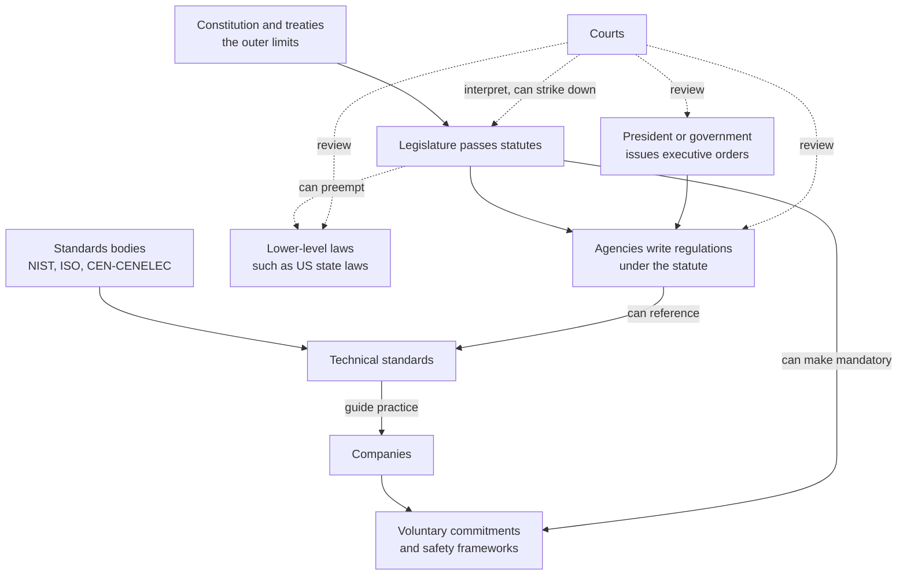
*Figure 59.1: How governance instruments relate. Solid arrows show one instrument creating or relying on another; dotted arrows show checks. Statutes sit at the center: they empower agencies, can override lower-level laws and can turn voluntary promises into legal duties, while courts review everything.*

Three connections matter most for AI.

- **Statutes can absorb soft law.** California's SB 53 and New York's RAISE Act (both described later in this chapter) took something labs did voluntarily, publishing safety frameworks (Chapter 56), and made it a legal duty to publish one and follow it.
- **Regulations can borrow standards.** The EU AI Act lets companies show compliance by following "harmonised standards." If such a standard exists and you follow it, you are presumed to comply with the matching requirement.
- **Courts can check everything.** In 2026 a lawsuit led Colorado to pause its AI law, and a federal judge reportedly blocked a government action against an AI company. Contested policy often ends up in a courtroom.

### Preemption, federalism and the EU's two kinds of law

When two levels of government both make rules, which one wins? In the US, the Constitution makes valid federal law supreme over conflicting state law. When Congress passes a law that displaces state laws on a topic, that is preemption. It is the single biggest fight in US AI policy right now.

> **Definition — Preemption:** When a higher level of government's law overrides or blocks a lower level's laws on the same subject, such as a federal law displacing state AI laws.

> **Definition — Federalism:** A system in which power is shared between a national government and regional governments (states or provinces), each able to make its own laws.

> **Definition — Moratorium:** A temporary ban or freeze. In AI policy it usually means a proposed pause on states enforcing their own AI laws.

Preemption can set a **floor** (states may add stricter rules on top of the federal minimum) or a **ceiling** (states may not go beyond the federal rule). The difference is enormous, and it is often buried in a bill's fine print.

The EU has its own layering. An EU **regulation** applies directly and identically in all 27 member states. An EU **directive** sets goals that each country must write into its own national law, so the details differ by country. The AI Act was made a regulation precisely so that a company faces one set of AI rules across the EU rather than 27.

> **Definition — EU directive:** An EU law that sets goals each member state must achieve by passing its own national legislation, so details can differ between countries. An EU regulation, by contrast, applies directly everywhere.

### Who enforces, and what happens if you break the rules

A rule is only as strong as its enforcement. AI laws use several routes.

> **Definition — Enforcement:** The actions authorities take to make sure a rule is followed, such as investigations, fines, orders to stop, or lawsuits.

> **Definition — Attorney general (AG):** The chief legal officer of a US state or of the federal government, who can sue companies to enforce laws. Many state AI laws are enforced only by the state AG.

> **Definition — Private right of action:** The ability of ordinary people, not just the government, to sue a company directly for breaking a law. Whether an AI law includes one changes how much litigation it produces.

> **Definition — Liability:** Legal responsibility for harm, which can mean paying damages to the people who were hurt. Who is liable when an AI system causes harm (the developer, the business using it or the user) is one of the biggest open questions in AI law.

Penalties range from fixed fines per violation to fines calculated as a share of a company's worldwide revenue. The second design, borrowed from EU privacy law, keeps fines meaningful even for the largest firms.

## What and whom to regulate: the grip points

### Developers, deployers and users

Most AI laws separate the company that builds an AI system from the company that uses it.

> **Definition — Provider (developer):** The organization that builds an AI model or system and places it on the market under its own name. OpenAI is the provider of GPT models; Anthropic is the provider of Claude.

> **Definition — Deployer:** An organization that uses an AI system in its own operations, such as a bank that uses a model to help screen loan applications. The deployer did not build the model but decides how it is used on people.

Here is why the distinction matters. Imagine a hiring platform that uses a large language model to rank résumés. The model's provider made a general tool; the hiring platform turned it into a decision about people's jobs. Most laws put the heaviest duties on whoever makes the high-stakes use, here the hiring platform. Laws aimed at frontier risks, however, put duties on the provider of the underlying model, because only the provider can test what the model can do before anyone builds on it.

### Six places to grip the AI stack

Chapter 1 described the AI stack, from sand and chips up to the app on your screen. Governments can apply pressure at almost every layer, as Figure 59.2 shows.

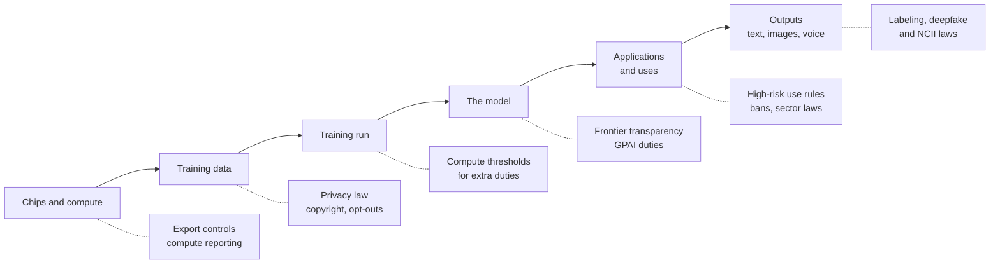
*Figure 59.2: Where rules can grip the AI stack. The earlier a rule grips, the fewer companies it touches and the more it shapes capability itself; the later it grips, the closer it sits to actual harm to people.*

In the figure, GPAI stands for general-purpose AI, the EU's term for broad models such as those behind ChatGPT, Claude and Gemini (explained in the EU section below), and NCII is non-consensual intimate imagery (Chapter 58).

Each grip point has trade-offs. Controlling chips (Chapter 36) affects which countries can build frontier models at all, but does nothing about how a model is used once it exists. Regulating uses such as hiring or credit targets real harms to people but cannot reach risks that arise inside a model before anyone deploys it. Regulating outputs, for example requiring deepfake labels, sits closest to the harm but is the easiest to evade.

### Compute thresholds: drawing a line with FLOPs

How does a law decide which models are "frontier" enough to deserve extra rules? The most common answer is training compute: the total number of arithmetic operations used to train the model (Chapter 5 and Chapter 37).

> **Definition — FLOP (floating-point operation):** One arithmetic operation, such as a multiplication, on decimal numbers. Training compute is the total count of these operations, written in powers of ten like 10^25.

> **Definition — Compute threshold:** A line in a law, measured in total training FLOPs, above which a model faces extra obligations. The EU uses 10^25 FLOPs; California and New York use 10^26.

> **Definition — Frontier model:** One of the most capable AI models at a given time, usually trained with the most compute. Laws often define it by a compute threshold.

You can estimate training compute yourself with the rule of thumb from Chapter 19: training FLOPs ≈ 6 × N × D, where N is the number of parameters (for mixture-of-experts models, the active parameters) and D is the number of training tokens.

**Worked example 1: GPT-3 (2020).** N = 175 billion = 1.75 × 10^11 parameters. D = 300 billion = 3 × 10^11 tokens. Compute = 6 × 1.75 × 10^11 × 3 × 10^11 = 31.5 × 10^22 ≈ 3.2 × 10^23 FLOPs. (Multiply the ordinary numbers, 6 × 1.75 × 3 = 31.5, and add the powers of ten, 11 + 11 = 22; then 31.5 × 10^22 is the same as 3.15 × 10^23.) That is about 30 times below the EU line, because 10^25 ÷ (3.2 × 10^23) ≈ 31.

**Worked example 2: Llama 3.1 405B (2024).** N = 4.05 × 10^11. D = 15.6 trillion = 1.56 × 10^13 tokens. Compute = 6 × 4.05 × 10^11 × 1.56 × 10^13 ≈ 37.9 × 10^24 ≈ 3.8 × 10^25 FLOPs. That is above the EU's 10^25 line, so under the EU AI Act a model trained this way is presumed to carry "systemic risk." It is still below the 10^26 line that California and New York use.

**Worked example 3: what does 10^26 FLOPs cost?** Suppose an accelerator peaks at about 10^15 FLOP per second (roughly an H100 at 16-bit precision) and you keep it 40% busy with useful work, so 4 × 10^14 useful FLOP per second. Then 10^26 ÷ (4 × 10^14) = 2.5 × 10^11 chip-seconds. Divide by 3,600 seconds per hour: about 69 million chip-hours. At an illustrative rental price of $2 per chip-hour, that is roughly $140 million of compute. So the California and New York thresholds catch only training runs that cost on the order of a hundred million dollars or more, which in 2026 means a handful of companies.

| Threshold | Where used (as of Oct 2026) | What it triggers |
|---|---|---|
| 10^25 FLOPs | EU AI Act | Presumption that a general-purpose model has "systemic risk," adding evaluation, risk-mitigation, incident-reporting and cybersecurity duties |
| 10^26 FLOPs plus over $500M annual revenue | California SB 53 ("large frontier developer") | Publish a frontier AI framework and transparency reports; report critical incidents |
| Frontier model plus over $500M revenue | New York RAISE Act (effective Jan 1, 2027) | Safety framework, transparency reports, 72-hour incident reporting |
| 10^26 operations | US Executive Order 14110 (2023) | Report very large training runs to the government; revoked January 2025 |

*Table 59.2: Compute thresholds in AI law.*

> **Watch out:** Compute thresholds age badly. Algorithms get more efficient every year (Chapter 19), so a model trained with less compute next year may match one that crossed the line this year. Distillation (Chapter 20) can also pack a large model's skills into a small one. Lawmakers know this, which is why the EU lets the Commission adjust its threshold and designate models by other criteria. Treat any FLOP number as a moving stand-in for "most capable," not a law of nature.

> **Try it:** Ask your chatbot: "Using the rule 6 × parameters × tokens, estimate the training compute of a model with 70 billion parameters trained on 15 trillion tokens, and tell me whether it crosses 10^25 FLOPs." Then check its arithmetic by hand. (The answer is 6 × 7 × 10^10 × 1.5 × 10^13 = 6.3 × 10^24, just under the EU line.)

## The European Union AI Act

### The big idea: regulate the use, scaled to the risk

The EU AI Act, formally Regulation (EU) 2024/1689, is the world's most comprehensive AI law. It entered into force on August 1, 2024 and phases in over several years. Its central idea is simple: the more harm an AI use could do, the stricter the rules. A spam filter and a system that decides who gets a mortgage are both "AI," but they should not face the same paperwork.

> **Definition — EU AI Act:** The European Union's comprehensive AI law, Regulation (EU) 2024/1689, which sorts AI systems into risk tiers with matching obligations and adds separate rules for general-purpose AI models.

> **Definition — Risk-based approach:** Designing rules so that obligations scale with how much harm a use could cause, from outright bans for the most dangerous uses to no new duties for harmless ones.

The Act is built like EU product-safety law, the same family of rules that governs toys and medical devices. That has a practical consequence: it applies to anyone who places an AI system on the EU market, or whose system's output is used in the EU, wherever the company is based. A US startup selling a résumé-screening tool to a German employer is covered.

> **Definition — Extraterritorial reach:** When a law applies to companies outside the country or bloc that passed it, because they sell to or affect people inside it. The EU AI Act and EU privacy law both reach non-EU companies this way.

What counts as an "AI system" in the first place? The Act's definition, in Article 3, is deliberately broad: a machine-based system that operates with some degree of autonomy, may adapt after deployment, and infers from its inputs how to produce outputs such as predictions, content, recommendations or decisions that can affect the physical or digital world. The key word is "infers". A model that learned its behavior from data is covered; a simple program that only follows rules a person wrote out by hand generally is not.

> **Definition — AI system (EU AI Act):** In the Act's Article 3, a machine-based system that operates with some autonomy, may adapt after deployment, and infers from its inputs how to generate outputs such as predictions, content, recommendations or decisions that can influence physical or virtual environments.

The Act also leaves deliberate gaps. It does not apply to AI used exclusively for military, defense or national-security purposes, to AI developed and used solely for scientific research, or to people using AI for purely personal, non-professional purposes. Free and open-source releases get lighter treatment, but not when they are used for a banned or high-risk purpose or fall under the transparency duties, and the most capable open general-purpose models still owe the systemic-risk duties described below.

### The four risk tiers

Figure 59.3 shows the tiers with their dates after the 2026 amendments.

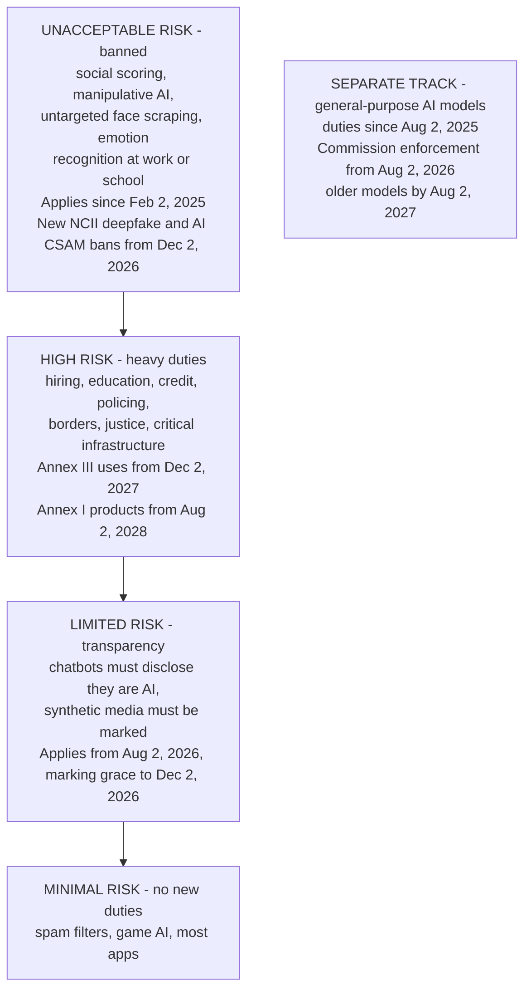
*Figure 59.3: The EU AI Act's risk tiers, from banned at the top to unregulated at the bottom, with application dates as amended by the 2026 Digital Omnibus. General-purpose models such as those behind ChatGPT, Claude and Gemini sit on a separate track. Status as of October 2026.*

> **Definition — Risk tiers (EU):** The AI Act's four categories of AI systems: unacceptable risk (banned), high risk (heavy obligations), limited risk (transparency duties) and minimal risk (no new duties).

### Unacceptable risk: the banned list

Since February 2, 2025, certain AI practices have been prohibited outright in the EU. The banned list, in Article 5, includes:

- **Social scoring:** rating people on their social behavior or personal traits in ways that lead to unjustified or disproportionate treatment.
- **Manipulative or deceptive techniques** that distort people's behavior and cause significant harm, including exploiting vulnerabilities due to age, disability or economic situation.
- **Untargeted scraping** of facial images from the internet or CCTV (security-camera) footage to build face-recognition databases.
- **Emotion recognition in workplaces and schools,** except for medical or safety reasons.
- Certain **biometric categorization** to infer sensitive traits, **predicting crime** based solely on profiling, and **real-time remote biometric identification** in public spaces by police, which is allowed only in narrow listed situations.

The 2026 Digital Omnibus added two new bans that apply from December 2, 2026: AI systems that generate non-consensual intimate images of identifiable people, and AI-generated child sexual abuse material. They followed the Grok image scandal of December 2025 to January 2026 (Chapter 58).

> **Definition — Prohibited practice (EU):** An AI use the EU AI Act bans outright because its risk to people's rights is judged unacceptable, such as social scoring or emotion recognition in schools.

### High-risk systems: the heavy middle

High-risk AI is where most of the Act's detail lives. A system becomes high-risk in one of two ways.

- **Annex III** lists sensitive areas of use: biometrics, critical infrastructure, education (grading exams, deciding admissions), employment (screening applications, deciding promotions or dismissals), access to essential services (credit scoring, some insurance pricing, public benefits), law enforcement, migration and border control, and the administration of justice and elections.
- **Annex I** covers AI that is a safety component of products already regulated by EU product laws, such as medical devices, machinery, toys and vehicles.

> **Definition — High-risk AI system (EU):** An AI system used in a sensitive area listed in the AI Act (such as hiring, education or credit) or built into a regulated product (such as a medical device). It must meet strict requirements before and after it is sold.

> **Definition — Annex III:** The list in the EU AI Act of use areas (biometrics, critical infrastructure, education, employment, essential services, law enforcement, migration, justice and democratic processes) where AI systems count as high-risk.

Providers of high-risk systems must, among other things:

1. Run a **risk-management system** for the whole life of the product.
2. Use training data that meets **data-governance** requirements, including checks for bias.
3. Write **technical documentation** and keep **automatic logs** so decisions can be traced.
4. Give deployers clear **instructions for use**.
5. Design the system for effective **human oversight**.
6. Meet requirements for **accuracy, robustness and cybersecurity**.
7. Pass a **conformity assessment** before sale, then apply the CE mark and register the system in an EU database.
8. Monitor the system after release and **report serious incidents**.

Deployers have duties too: use the system as instructed, assign trained people to oversee it, keep the logs, and in some cases (public bodies, and certain credit and insurance uses) carry out a fundamental rights impact assessment before use.

Two rules keep these labels from being purely mechanical. First, a system in an Annex III area is not high-risk if it does not materially influence decisions, for example because it only performs a narrow procedural task, tidies up work a person has already finished, or prepares material for a human assessment (Article 6(3)). That escape never applies to a system that profiles people, so a résumé ranker stays high-risk. Second, roles can switch. Under Article 25, a deployer or distributor that puts its own name on a high-risk system, substantially modifies one, or turns a general-purpose system to a high-risk purpose becomes its provider and takes on the provider's duties. The hiring platform earlier in this chapter, which built a résumé ranker on someone else's language model, is in exactly that position.

> **Definition — Conformity assessment:** The process of checking that a product meets legal requirements before it is sold, done either by the provider itself or by an independent "notified body." It is central to EU high-risk AI rules.

> **Definition — CE marking:** The "CE" logo a product carries in the EU to show it meets EU safety, health and environmental requirements. High-risk AI systems must carry it.

> **Definition — Fundamental rights impact assessment (FRIA):** An assessment some deployers of high-risk AI must complete before use, describing who could be affected, what could go wrong for their rights, and how the risks will be overseen.

> **Definition — Harmonised standard:** A European standard written at the European Commission's request. Following it gives a legal presumption that you meet the matching requirements of the law.

### Limited risk: the transparency duties of Article 50

Some AI is not dangerous in itself but could fool people. For these systems the Act requires honesty. From August 2, 2026, under Article 50:

- **Chatbots and other AI that interacts with people** must make clear that the person is dealing with an AI, unless that is obvious.
- **Generative AI systems** must mark their synthetic audio, images, video and text in a machine-readable way, so the content can be detected as AI-generated. Generative systems already on the market before August 2026 have a grace period to December 2, 2026 for this marking.
- **Deployers of deepfakes** must disclose that the content is artificially generated or manipulated, with lighter rules for obviously artistic, satirical or fictional work.
- **Emotion recognition and biometric categorization**, where they are allowed at all, must be disclosed to the people exposed to them.

> **Definition — Transparency obligation (Article 50):** The EU AI Act's duty to tell people when they are interacting with AI, to mark AI-generated content in a machine-readable way, and to disclose deepfakes.

This is where the AI Act touches your daily chatbot most directly, and where technical tools such as watermarks and C2PA content credentials (Chapter 47 and Chapter 58) become legal compliance tools.

### Minimal risk: everything else

Most AI, from spam filters to video-game opponents to photo enhancers, falls into the minimal-risk tier and faces no new obligations under the Act. Companies are encouraged to adopt voluntary codes of conduct.

> **Key idea:** The AI Act regulates mostly by use, not by technology. The same face-analysis model could be banned (emotion recognition in a classroom), high-risk (identifying people at a border), limited-risk (a disclosed app that labels a selfie's mood) or minimal-risk (sorting your own photos), depending only on what it is used for.

### General-purpose AI models: a separate track

The European Commission proposed the Act in 2021, before ChatGPT existed. When general-purpose chatbots arrived in late 2022, lawmakers added a separate chapter for the models underneath them.

> **Definition — General-purpose AI model (GPAI):** In the EU AI Act, a model trained on broad data that can perform a wide range of tasks and be built into many different systems, such as the models behind ChatGPT, Claude and Gemini.

> **Definition — Systemic risk (EU GPAI):** The EU's label for the most capable general-purpose models, whose failure or misuse could have large-scale effects. A model is presumed to carry systemic risk if trained with more than 10^25 FLOPs, and the Commission can also designate models by other criteria.

Figure 59.4 shows how the obligations stack.

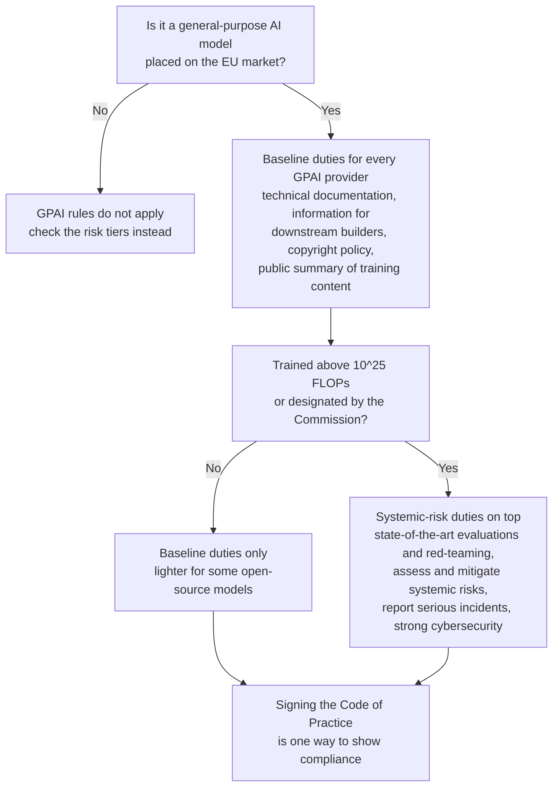
*Figure 59.4: How the EU AI Act's general-purpose model rules stack. Every GPAI provider owes documentation and a copyright policy; models presumed to carry systemic risk owe safety work on top.*

The copyright duty deserves attention. GPAI providers must have a policy to respect EU copyright law, including rights holders' ability to opt out of text and data mining (Chapter 11), and must publish a sufficiently detailed summary of the content used for training, following a template from the Commission.

> **Definition — Text and data mining (TDM) exception:** A rule in EU (and some other) copyright law that allows automated analysis of lawfully accessed content, including for AI training, unless the rights holder has opted out in a machine-readable way.

### The Code of Practice

How does a company prove it meets vague duties such as "assess and mitigate systemic risks"? The EU's answer was a code of practice, drafted by independent experts with input from industry, academics and civil society, and published on July 10, 2025. It has three chapters: transparency, copyright, and safety and security (the last applying only to systemic-risk models).

> **Definition — Code of practice (GPAI):** A voluntary EU document that general-purpose model providers can sign to demonstrate compliance with the AI Act's GPAI rules. Non-signers must prove compliance some other way.

Signatories included Amazon, Anthropic, Google, IBM, Microsoft, Mistral and OpenAI, among others. xAI signed only the safety-and-security chapter. Meta declined to sign. The code is a good example of a hybrid instrument: voluntary to sign, but backed by a binding law.

> **Definition — IBM (International Business Machines):** The American computing company, founded over a century ago, that built the Deep Blue chess computer and the Watson question-answering system. Today it sells business software, cloud services, consulting and its own Granite AI models, mainly to large companies.

### Who enforces it, and how big the fines are

Enforcement is split. Each member state names national market surveillance authorities to police AI systems on its market. The European Commission's AI Office enforces the rules for general-purpose models directly, with enforcement powers that apply from August 2, 2026 and that the Omnibus expanded.

> **Definition — AI Office:** The body inside the European Commission that supervises and enforces the AI Act's rules for general-purpose AI models and coordinates how the Act is applied.

> **Definition — Market surveillance authority:** A national regulator that checks whether products on its country's market comply with the law, and can order changes, withdrawals or fines.

Three further bodies sit around them. The European Artificial Intelligence Board brings together one representative from each member state to coordinate how national authorities apply the Act. A scientific panel of independent experts advises the AI Office and can send it a formal alert when it believes a general-purpose model poses systemic risk. An advisory forum gives businesses, civil society and academics a channel for input. And a public EU database lists registered high-risk systems, so anyone can see what has been declared.

> **Definition — European Artificial Intelligence Board:** The AI Act's coordinating body made up of one representative from each EU member state, which advises the Commission and helps national authorities apply the Act consistently.

> **Definition — Scientific panel (EU AI Act):** A group of independent experts set up under the AI Act to advise the AI Office, which can alert it when a general-purpose model may pose systemic risk.

Fines are tied to global turnover, so they bite large companies:

- Prohibited practices: up to €35 million or 7% of worldwide annual turnover, whichever is higher.
- Most other violations: up to €15 million or 3%.
- Supplying incorrect, incomplete or misleading information to authorities: up to €7.5 million or 1%.
- Providers of general-purpose AI models: up to €15 million or 3%, imposed by the Commission itself, with these fines applicable from August 2, 2026.
- For small and medium-sized firms, the lower of the two figures applies instead of the higher. Since the 2026 Digital Omnibus, the same lower cap applies to "small mid-caps", firms that have outgrown the EU's definition of a small or medium-sized enterprise (SME), for the €15 million and €7.5 million tiers, though not for prohibited practices.

The Act gives individuals something too. Anyone who believes the Act has been broken can complain to a market surveillance authority. A person affected by a significant decision based on the output of an Annex III high-risk system, such as a rejected loan or job application, has a right to a clear explanation of the AI system's role in that decision. People who report breaches from inside a company are covered by EU whistleblower protections.

> **Definition — Right to explanation (EU AI Act):** The right of a person affected by a significant decision based on a high-risk AI system's output to get a clear and meaningful explanation of the AI's role in the decision and its main elements.

To keep the rules from smothering small firms, the Act also requires each member state to set up at least one AI regulatory sandbox, which the Omnibus gave until August 2, 2027 to become operational (a year later than originally planned), and allows supervised testing of high-risk systems in real-world conditions, with priority access at little or no cost for small and medium-sized companies.

> **Definition — AI regulatory sandbox (EU):** A supervised program under the AI Act in which companies develop and test new AI systems with guidance from a national regulator before they go on the market.

> **Definition — Global turnover:** A company's total worldwide annual revenue. EU laws express maximum fines as a percentage of it so that penalties scale with company size.

**Worked example: the size of a maximum fine.** A large tech company with €200 billion in worldwide turnover breaks a prohibition. 7% of €200 billion is €14 billion, which is higher than €35 million, so the cap is €14 billion. A startup with €10 million turnover breaking the same rule is capped at the lower figure: 7% of €10 million is €700,000, which is less than €35 million. These are maximums. Actual fines depend on severity, duration and cooperation, and regulators rarely start at the cap.

### The timeline, and the 2026 Digital Omnibus

In 2025 and 2026 it became clear that the technical standards companies needed for high-risk compliance were behind schedule, and European businesses lobbied hard for relief. The EU responded with the Digital Omnibus on AI, Regulation (EU) 2026/1744, which entered into force on July 27, 2026.

> **Definition — Digital Omnibus (on AI):** A 2026 EU law that amended the AI Act, delaying the high-risk deadlines, adding new bans on intimate deepfakes and AI-generated child abuse material, and simplifying some duties for smaller companies.

The Omnibus:

- Delayed Annex III high-risk obligations from August 2, 2026 to **December 2, 2027**.
- Delayed Annex I (product-embedded) high-risk obligations to **August 2, 2028**.
- Added bans on non-consensual intimate deepfakes and AI-generated CSAM from **December 2, 2026**.
- Softened the duty on organizations to make sure their staff are AI-literate.
- Simplified documentation for small and medium-sized enterprises and for a new category of "small mid-caps."
- Created a legal basis to process sensitive personal data where needed to detect and correct bias.
- Gave the AI Office expanded investigation and fining powers, and made it the sole supervisor of two kinds of AI system: those a company builds on its own general-purpose model (such as a chatbot app running on the same company's model, with exceptions for uses such as law enforcement and justice), and AI built into the very large online platforms and search engines designated under the Digital Services Act.

> **Definition — AI literacy:** The knowledge and skills people need to use AI systems sensibly, including understanding their limits and risks. The EU AI Act asks organizations to promote it among staff who use AI.

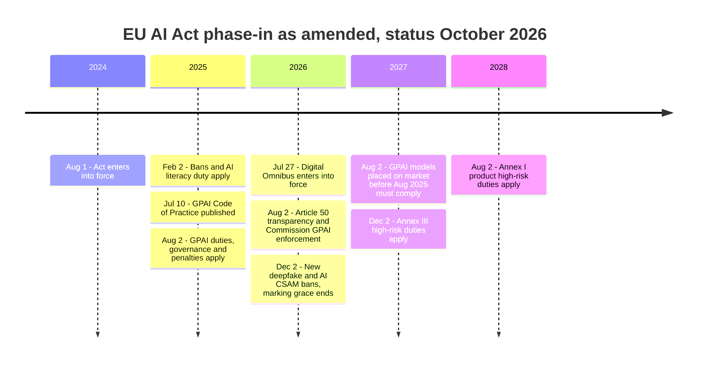
*Figure 59.5: The EU AI Act timeline after the 2026 Digital Omnibus. Bans and general-purpose model duties already apply; the heavy high-risk duties now arrive in December 2027 and August 2028.*

### Worked example: classifying five products

Let's apply the tiers to five realistic products. Exercise 3 asks you to repeat this with the EU's own compliance checker.

| Product | Tier | Why | Key date (as of Oct 2026) |
|---|---|---|---|
| A tool that ranks job applicants' résumés | High risk (Annex III, employment) | It shapes decisions about people's jobs | Dec 2, 2027 |
| A customer-service chatbot for an airline | Limited risk | It talks to people, so it must disclose that it is AI | Aug 2, 2026 |
| An exam-proctoring tool that reads students' emotions from webcam video | Prohibited | Emotion recognition in education is banned | Banned since Feb 2, 2025 |
| A bank's credit-scoring model | High risk (Annex III, essential services) | It decides access to credit | Dec 2, 2027 |
| An app filter that turns your selfie into a painting | Minimal risk, plus a marking duty for generated images | Low stakes, but generative output must be machine-marked | Aug 2, 2026 (grace to Dec 2, 2026 if already on the market) |

*Table 59.3: Five products sorted into EU AI Act tiers.*

The proctoring tool and the selfie filter might run the same face-analysis model underneath. The use decides the tier, not the technology.

### The debate over the Act

Supporters and critics both make serious arguments.

**The strongest case for the Act.** Without rules, people hurt by a biased hiring or credit model rarely learn why they were rejected and have no way to challenge it. One EU-wide law gives companies one rulebook instead of 27, gives citizens enforceable rights, and builds the trust that lets AI spread. Companies that sell globally often adopt the strictest major market's rules everywhere, as happened with privacy law, so the Act may raise standards worldwide. And banning a few practices, such as social scoring, draws bright lines before those practices become normal.

**The strongest case against.** The obligations are heavy, vague in places and dependent on standards that were not ready on time; the EU's own decision to delay the high-risk rules suggests the design overreached. Compliance costs fall hardest on small European firms while the largest US and Chinese labs can afford large legal teams, which may entrench incumbents. Europe already trails the US and China in frontier AI, and critics argue heavy regulation widens the gap. Finally, a law designed in 2021 around "AI systems" with fixed purposes fits awkwardly with general-purpose agents that take on new tasks every day.

> **Definition — Brussels effect:** The tendency of EU rules to become global standards because multinational companies find it simpler to follow the strictest major market's rules everywhere. The term comes from legal scholar Anu Bradford.

> **At the frontier (2026):** The EU's attention has shifted from writing the Act to enforcing it. The AI Office's enforcement powers over general-purpose models began in August 2026, the harmonised standards from CEN-CENELEC's AI committee are still being finished, and companies that signed the Code of Practice are producing the documentation and safety reports it requires. Whether, and how strictly, the AI Office uses its fining powers against a major lab is the thing to watch in 2027.

### Other EU laws that touch AI

The AI Act is not the only European law that matters for AI. The General Data Protection Regulation governs personal data used in training and gives people rights around significant decisions made by purely automated means. The Digital Services Act requires large platforms to manage illegal content and systemic risks, including AI-generated content on social networks. And a 2019 copyright directive created the text-and-data-mining opt-out that the AI Act's copyright duty builds on.

> **Definition — GDPR (General Data Protection Regulation):** The EU's 2018 privacy law, which governs how personal data is collected and used, including for AI training, and limits significant decisions made about people by purely automated means.

## The United States: federal policy

### No single AI law, but plenty of law

As of October 2026 the US has no comprehensive federal AI statute. That does not mean AI is unregulated. Older laws apply to AI just as they apply to any other product or practice.

- The **Federal Trade Commission Act** bans unfair and deceptive practices, so false claims about what an AI product can do, or harmful data practices, can draw FTC action. In September 2025 the FTC opened a formal inquiry into AI companion chatbots from Alphabet, Character.AI, Instagram, Meta, OpenAI, Snap and xAI.
- **Civil-rights laws** on employment, housing and credit apply whether a human or an algorithm makes the decision.
- **Product-liability and negligence law** lets injured people sue. Several lawsuits over chatbots and teen suicides are testing how these old doctrines apply to AI (Chapter 58).
- The **TAKE IT DOWN Act**, signed May 19, 2025, is a narrow federal statute aimed squarely at an AI-era harm. It criminalizes publishing non-consensual intimate imagery, including AI deepfakes, and requires platforms to remove reported images within 48 hours. The FTC can enforce the platform duties from May 19, 2026.
- After a fake robocall imitating President Biden's voice in January 2024, the **Federal Communications Commission** (FCC), which regulates US telephone, radio and internet communications, ruled that AI-voice robocalls fall under existing robocall law. That is an agency applying an old statute to new technology, one of the most common moves in AI policy.

> **Definition — FTC (Federal Trade Commission):** The US agency that enforces laws against unfair and deceptive business practices and anticompetitive conduct. It is a major de facto regulator of consumer AI products.

> **Definition — TAKE IT DOWN Act:** A 2025 US federal law that criminalizes publishing non-consensual intimate images, including AI-generated deepfakes, and requires platforms to remove reported images within 48 hours.

### From the 2023 executive order to the 2025 Action Plan

Federal AI policy has swung with the White House, mostly through executive orders, which are quick to issue and quick to reverse.

- **October 30, 2023.** President Biden signed Executive Order 14110 on "safe, secure, and trustworthy" AI. Among many directions to agencies, it required developers of very large models (trained with more than 10^26 operations) to report their training runs and safety-test results to the government, and it led to the US AI Safety Institute at NIST.
- **January 20, 2025.** On his first day back in office, President Trump revoked EO 14110.
- **January 23, 2025.** EO 14179, "Removing Barriers to American Leadership in Artificial Intelligence," set a new direction centered on competitiveness.
- **June 2025.** The US AI Safety Institute was renamed the Center for AI Standards and Innovation (CAISI), focused on standards, voluntary testing with companies, and national-security risks. In October 2026 its NIST page began using yet another name, the Center for Advancing Innovation and Standards for Super Intelligence (CAISSI).
- **July 1, 2025.** The Senate voted 99 to 1 to strip a proposed 10-year moratorium on state AI laws from a budget bill.
- **July 23, 2025.** The White House released "America's AI Action Plan": roughly 90 actions under three pillars (accelerate innovation, build American AI infrastructure, lead in international diplomacy and security). It came with executive orders on "Preventing Woke AI in the Federal Government," on speeding up data-center permitting, and on promoting AI exports. The plan explicitly encourages open-weight models.

> **Definition — NIST (National Institute of Standards and Technology):** A US federal agency that develops measurement science and voluntary standards, including the AI Risk Management Framework. It houses CAISI.

> **Definition — CAISI (Center for AI Standards and Innovation):** The US government's AI testing and standards center at NIST, renamed from the US AI Safety Institute in June 2025. It runs voluntary testing with companies and evaluates national-security risks, and in October 2026 its NIST page began calling it the Center for Advancing Innovation and Standards for Super Intelligence (CAISSI).

*Figure 59.6: Major US federal AI policy moves. Most are executive actions rather than statutes, which is why the direction could reverse so quickly between administrations.*

In the figure, DOJ is the Department of Justice, the federal government's legal department, and "House" means the House of Representatives, the larger chamber of Congress. The task force, the Colorado lawsuit, the framework and the FRONTIER Act are all explained in the next few sections.

### The December 2025 order and the push against state laws

With Congress unable to pass a preemption law, the administration turned to executive power. On December 11, 2025, President Trump signed Executive Order 14365, "Ensuring a National Policy Framework for Artificial Intelligence." It:

- Created a Department of Justice **AI Litigation Task Force** (formalized January 9, 2026) to challenge state AI laws in court.
- Directed the Commerce Department to list "onerous" state AI laws.
- Attached conditions to certain federal funds, notably money from BEAD (the Broadband Equity, Access, and Deployment program, which pays for internet connections in underserved areas), for states with such laws.
- Asked the FCC and FTC to consider actions that could cut against state rules.
- Carved out state laws on child safety, on compute and data-center infrastructure, and on the state's own purchasing of AI.

Crucially, the order itself does not preempt any state law. Only Congress can do that by statute, or a court can strike a state law down. The order is a plan to apply pressure through lawsuits and funding.

> **Watch out:** Some headlines in December 2025 suggested the order "overrides" state AI laws. It did not and could not. An executive order directs the federal government's own agencies. Displacing state law takes a statute from Congress or a court ruling that a state law is invalid, for example because it conflicts with federal law or the Constitution.

On March 20, 2026, the White House released a four-page legislative framework asking Congress for a national standard. It urged broad preemption of state rules on AI development, no new federal AI regulator, regulatory sandboxes, child protection through "commercially reasonable" age assurance with parental attestation, protections against deepfakes, and protection of household electricity customers from data-center-driven price increases. On copyright it left fair use to the courts and suggested Congress could consider collective licensing.

> **Definition — Regulatory sandbox:** A program that lets companies test new products under a regulator's supervision, with some rules relaxed or waived for a limited time.

> **Definition — Age assurance:** Methods for estimating or verifying a user's age, from self-declaration to ID checks to AI age estimation, used to apply protections for minors.

The first real collision came in April 2026. xAI sued Colorado over its AI Act, and the federal government intervened on xAI's side, the first federal intervention against a state AI law. Colorado agreed to pause enforcement, and then rewrote the law (see below).

> **Definition — Intervention (in a lawsuit):** When a party not originally in a case, such as the federal government, formally joins it to argue one side.

### What Congress is doing

As of October 2026, Congress has passed neither an AI preemption statute nor a comprehensive AI law. Several proposals are live:

- The bipartisan House **FRONTIER Act** (Representatives Jay Obernolte and Lori Trahan, introduced in late July 2026) would preempt new state obligations on frontier developers in three areas (catastrophic-risk transparency, third-party auditing and incident reporting) while preserving state child-safety laws, rules for deployers and general laws.
- Senator Marsha Blackburn circulated a draft that includes a duty of care for AI developers.
- Senator Ted Cruz's **SANDBOX Act** proposes waivers from federal rules for AI experiments.

> **Definition — Duty of care:** A legal obligation to take reasonable steps to avoid causing foreseeable harm to others. A statutory duty of care for AI developers would make them liable if they failed to take such steps.

The federal government also shapes policy through court filings. In early September 2026 (case trackers give September 1 or 2), the Department of Justice filed a statement of interest supporting fair use for AI training in the consolidated copyright litigation against OpenAI.

> **Definition — Statement of interest:** A filing in which the US government tells a court its view on a legal question in a case it is not a party to.

> **At the frontier (2026):** The federal approach as of October 2026 combines three moves: promote AI and its infrastructure (the Action Plan, faster permitting), avoid creating a new regulator, and push toward a single national rulebook by challenging state laws. Whether Congress passes a preemption law, and whether it sets a floor or a ceiling, is the biggest open question in US AI policy. AI also became an issue in the campaigns for the November 3, 2026 midterm elections.

## The United States: the states step in

With Congress gridlocked, states became the main source of binding AI law in the US, and their legislatures saw a flood of AI bills in 2025 and 2026. A few of the ones that passed matter most.

### California: SB 53 and SB 243

California hosts most of the frontier labs, so its laws have national reach. In 2024 Governor Gavin Newsom vetoed SB 1047, a bill by Senator Scott Wiener that would have imposed safety duties and liability on developers of very large models. Wiener returned the next year with a narrower bill focused on transparency.

**SB 53, the Transparency in Frontier Artificial Intelligence Act** (signed September 29, 2025; effective January 1, 2026). Its heaviest duties fall on "large frontier developers": those training models above 10^26 FLOPs with more than $500 million in annual revenue. Covered developers must:

- Publish a **frontier AI framework** describing how they assess and manage catastrophic risks.
- Publish a **transparency report** when they release a new frontier model.
- Report **critical safety incidents** to the state's Office of Emergency Services within 15 days, or within 24 hours if there is an imminent danger to life.
- Not retaliate against **whistleblowers** who report safety concerns.
- Face civil penalties of up to $1 million per violation.

The law also created CalCompute, a consortium to plan a public cloud computing resource for researchers and startups.

> **Definition — Frontier AI framework:** Under California's SB 53, a public document in which a large frontier developer explains how it identifies, assesses and mitigates catastrophic risks from its models. It turns company safety policies (Chapter 56) into a legal duty.

> **Definition — Transparency report:** A document a developer publishes when releasing a model, describing what the model is, its intended uses and how it was assessed for risk.

> **Definition — Critical safety incident:** Under California and New York frontier AI laws, a serious event defined in the law, such as certain unauthorized access to model weights, a model causing serious harm, or loss of control over a model, which must be reported to the state within a set deadline.

> **Definition — Whistleblower protection:** Legal protection against firing or other retaliation for employees who report safety or legal concerns to the authorities.

**SB 243, the first state companion-chatbot law** (effective January 1, 2026). Operators of AI companion chatbots must disclose that users are talking to an AI, give minors recurring reminders to take a break, and keep protocols for responding to suicidal ideation, self-harm and sexual content.

**The 2026 additions.** In September 2026 California built on both laws. SB 813 created a framework for independent verification organizations that assess AI systems and models for compliance with state law, and AB 1405 a state registry of AI auditors with independence standards (both signed September 9). SB 1119, called "Adam's Law" after Adam Raine, requires companion chatbots used by children to have crisis protocols, parental controls and alerts when a child disables safety settings, plus independent child-safety audits and annual risk assessments (signed September 10). A September 18 executive order asked experts for ways to strengthen the state's AI safety laws, including the idea of an emergency shutoff ("kill switch") for frontier models, which is a proposal, not a requirement.

> **Definition — Companion chatbot:** An AI product designed to sustain an ongoing personal, social or romantic relationship with a user, as opposed to a task assistant.

### New York: the RAISE Act

New York's **Responsible AI Safety and Education (RAISE) Act**, sponsored by Assemblymember Alex Bores, was signed by Governor Kathy Hochul on December 19, 2025, with agreed amendments. It covers developers with over $500 million in revenue that train frontier models. They must publish safety frameworks and transparency reports, report incidents within 72 hours, and face penalties of up to $1 million for a first violation and $3 million for later ones. The law creates a new oversight office in the state's Department of Financial Services (DFS) and takes effect on January 1, 2027.

**Worked example: incident clocks.** Suppose a large frontier developer discovers on a Monday at 9:00 a.m. an event that counts as a critical safety incident under both laws, such as a serious security breach involving its model weights. Under New York's law, once in effect, 72 hours means the report is due by Thursday at 9:00 a.m. Under California's law the standard deadline is 15 days, which is Tuesday two weeks later; but if the event creates an imminent risk of death or serious injury, the deadline is 24 hours, Tuesday at 9:00 a.m. A company covered by both laws must build its incident process around the tightest clock that could apply.

### Colorado: from a broad duty to narrow transparency

In 2024 Colorado passed the first broad US law on algorithmic discrimination. It would have imposed a duty of reasonable care on developers and deployers of high-risk AI used in consequential decisions such as hiring, lending and housing. After industry objections the state delayed it to June 30, 2026. Then came xAI's lawsuit and the federal intervention in April 2026. On May 14, 2026, Colorado **repealed and replaced** the law with SB26-189, a much narrower transparency law for automated decision-making technology (ADMT). It takes effect on January 1, 2027, if the attorney general's rulemaking is complete, and requires:

- A notice before AI is used in a consequential decision about a person.
- An explanation within 30 days after an adverse outcome.
- The ability to access and correct the personal data used.
- Human review where commercially reasonable.

Only the attorney general can enforce it; there is no private right of action.

> **Definition — Algorithmic discrimination:** Unfair different treatment of people based on protected characteristics such as race or sex, produced by an automated system, even when nobody intended it.

> **Definition — ADMT (automated decision-making technology):** Software that makes, or substantially shapes, decisions about people, such as who gets a loan, a job interview or an apartment.

> **Definition — Consequential decision:** A decision with significant effects on a person's life, such as access to employment, credit, housing, education, insurance or health care.

### Texas, Illinois and the overall pattern

Texas's Responsible Artificial Intelligence Governance Act (TRAIGA), in effect since January 1, 2026, reportedly deals mostly with government use of AI, plus prohibitions on certain intentionally harmful uses. Illinois reportedly restricted AI from providing therapy in August 2025. Many states also passed laws on election deepfakes and intimate deepfakes.

| State law | Status (as of Oct 2026) | Who it covers | Core duties |
|---|---|---|---|
| California SB 53 | In effect since Jan 1, 2026 | Frontier developers (heaviest duties above 10^26 FLOPs and $500M revenue) | Frameworks, transparency reports, incident reporting, whistleblower protection |
| California SB 243 | In effect since Jan 1, 2026 | Companion chatbot operators | AI disclosure, break reminders for minors, self-harm protocols |
| New York RAISE Act | Signed Dec 19, 2025; effective Jan 1, 2027 | Frontier developers over $500M revenue | Safety frameworks, transparency, 72-hour incident reporting, new DFS office |
| Colorado SB26-189 | Signed May 14, 2026; effective Jan 1, 2027 if rules are done | Businesses using ADMT in consequential decisions | Notice, explanation, data correction, human review where reasonable |
| Texas TRAIGA | In effect since Jan 1, 2026 | Mainly government agencies | Government-use rules; bans on certain intentional harms |
| Illinois therapy-bot limit | Reported, Aug 2025 | AI therapy services | Restricts AI from providing therapy |
| California SB 813 and AB 1405 | Signed Sep 9, 2026 | AI verification organizations and auditors | Framework for independent verification organizations; registry of AI auditors |
| California SB 1119 ("Adam's Law") | Signed Sep 10, 2026 | Companion chatbots used by children | Crisis protocols, parental controls, independent child-safety audits, annual risk assessments |

*Table 59.4: Key US state AI laws, as of October 2026.*

> **Key idea:** In 2025 and 2026, US states moved away from broad "algorithmic discrimination" laws like Colorado's original act toward narrower ones: frontier-developer transparency, chatbot and child safety, deepfakes, and notice-and-explanation rules. Narrow laws are easier to pass and harder to challenge in court, but they leave many harms unaddressed.

### The preemption fight

Figure 59.7 shows the tug-of-war.

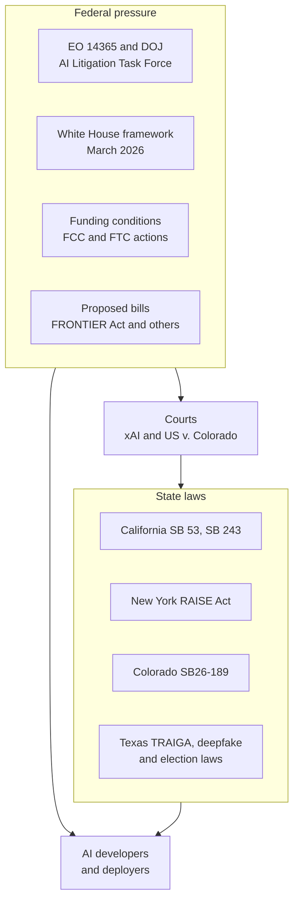
*Figure 59.7: The US federal-state tug-of-war over AI rules, as of October 2026. State statutes bind companies now; federal pressure works through lawsuits, funding conditions and proposed legislation, and courts referee. Only a statute from Congress could preempt state laws outright.*

The arguments on each side are strong.

**The strongest case for federal preemption.** AI models are built once and served nationwide. Fifty different rulebooks would mean fifty compliance regimes, with costs falling hardest on startups and smaller labs that cannot afford large legal teams. Commerce between states is exactly what the Constitution gives Congress power to regulate. One state that happens to host most frontier labs could in effect set national policy that people in other states never voted for. And because AI capability is tied to national security and competition with China, a single coherent national approach makes strategic sense.

**The strongest case against preemption, or for a floor rather than a ceiling.** Congress has not passed substantive AI rules, so preemption without them would create a vacuum, not a national standard. States are "laboratories of democracy": they can try ideas, such as SB 53's transparency duties, and the ones that work can spread. The Senate's 99-to-1 vote against a moratorium shows broad bipartisan resistance to wiping out state protections, especially for children. And states have long regulated insurance, employment and consumer protection, exactly the areas where AI decisions touch people's lives.

> **Analogy:** Think of traffic rules. Interstate highways follow federal standards so a truck can cross the country under one set of rules. City streets have local speed limits because a school zone in one town is not a rural road in another. The preemption debate is about whether AI is more like the interstate or the city street, and the honest answer is that different parts of it resemble each.

## The United Kingdom

The UK chose a "pro-innovation" path. Instead of one horizontal AI law (a single law covering AI in every sector, like the EU's), a 2023 government white paper (a document setting out policy plans) asked existing sector regulators (for finance, health, competition, data protection and so on) to apply shared principles such as safety, transparency and fairness within their own domains. A comprehensive UK AI bill has been repeatedly discussed and delayed; as of October 2026, none had passed.

The UK's most distinctive contribution is its testing institute. Created as the AI Safety Institute around the 2023 Bletchley summit, it was renamed the AI Security Institute in February 2025 to focus on national-security risks. It tests frontier models with the labs before release and runs large research programs on AI control, cyber and chemical and biological risks (Chapter 57).

> **Definition — AI Security Institute (UK AISI):** The UK government's AI testing and research body, renamed from the AI Safety Institute in February 2025. It evaluates frontier models before and after release, with a focus on national-security risks.

> **Definition — Pre-deployment testing:** Evaluating an AI model for dangerous capabilities and behaviors before it is released to the public, often by government institutes or independent evaluators given early access.

Copyright is the UK's hottest AI issue. A 2024 to 2025 government consultation proposed a text-and-data-mining exception with an opt-out for rights holders, similar to the EU's. Writers, musicians and other creators fought it hard. In March 2026 the government's report on copyright and AI said that a broad exception with opt-out "is no longer the government's preferred way forward", and that it would gather more evidence and not change copyright law until it was confident the change met its goals. Meanwhile, in November 2025 the UK High Court largely sided with Stability AI against Getty Images, finding that the model's weights do not store copies of the training images; Getty was given permission to appeal on one issue.

## China

China regulates AI quickly, specifically and with a strong focus on content control and social stability. Instead of one big law, it has issued a series of targeted rules, mostly through the Cyberspace Administration of China (CAC).

> **Definition — CAC (Cyberspace Administration of China):** China's central internet regulator, which writes and enforces most of China's AI rules, including the algorithm filing system and the generative AI measures.

Key steps, with some 2025 details reported from secondary summaries rather than the official texts:

- **2022:** rules on algorithmic recommendation (the feeds inside apps).
- **January 2023:** "deep synthesis" rules covering deepfakes and synthetic media.
- **August 15, 2023:** Interim Measures for Generative AI Services, among the world's first rules written specifically for public-facing chatbots. Providers must keep content in line with the state's "core socialist values" and avoid prohibited content.
- **An algorithm filing system,** in which providers register their algorithms and models with regulators before public launch.
- **September 1, 2025:** labeling measures for AI-generated content, requiring visible labels plus hidden metadata.
- **September 2025:** an updated AI Safety Governance Framework (version 2.0).
- **November 2025:** reported rules on training data and testing, including sampling checks against 31 categories of unsafe content and monthly testing.
- **December 2025:** draft rules on "anthropomorphic" AI interaction services, addressing addiction and minors in human-like companion apps.
- **January 1, 2026:** an amended Cybersecurity Law with AI provisions took effect.

> **Definition — Algorithm filing (registry):** China's system requiring companies to register details of their recommendation and generative algorithms with regulators before offering them to the public.

> **Definition — Deep synthesis:** China's legal term for technologies that generate or alter text, images, audio or video, including deepfakes.

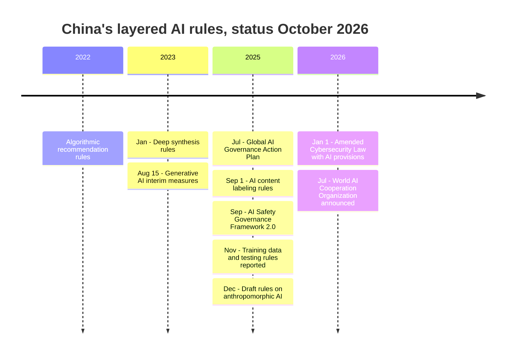
*Figure 59.8: China's AI rules arrived as a series of targeted measures from the internet regulator rather than one comprehensive law.*

Internationally, China proposed a Global AI Governance Action Plan in July 2025 and announced a World AI Cooperation Organization at the World AI Conference in Shanghai in July 2026, positioning itself as a convener for countries outside the US-led camp.

> **Watch out:** It is tempting to call China's approach "strict" and the US approach "loose." Both labels mislead. China moves fast and requires registration and content control, but its rules also aim to grow a domestic industry. The US has no federal AI statute but uses powerful tools such as export controls, and its states have binding laws. Compare specific rules, not national stereotypes.

## Other countries

- **South Korea's AI Basic Act** reportedly took effect in January 2026, making South Korea one of the first countries after the EU with a comprehensive AI framework law, including duties for "high-impact" AI and labeling of generative AI output.
- **Japan's AI Promotion Act** (2025) is reportedly a light-touch law focused on promoting AI research and adoption under a national strategy, relying on guidance rather than penalties.
- **The Council of Europe's Framework Convention on AI**, opened for signature in September 2024, is described as the first legally binding international treaty on AI, centered on human rights, democracy and the rule of law. Like any treaty, it binds only the countries that ratify it, that is, formally approve it through their own national procedures after signing.

> **Definition — Treaty (convention):** A binding written agreement between countries. It creates legal duties only for the countries that sign and ratify it.

Figure 59.9 places the main approaches on two axes: how binding they are, and whether they cover AI broadly or target specific uses.

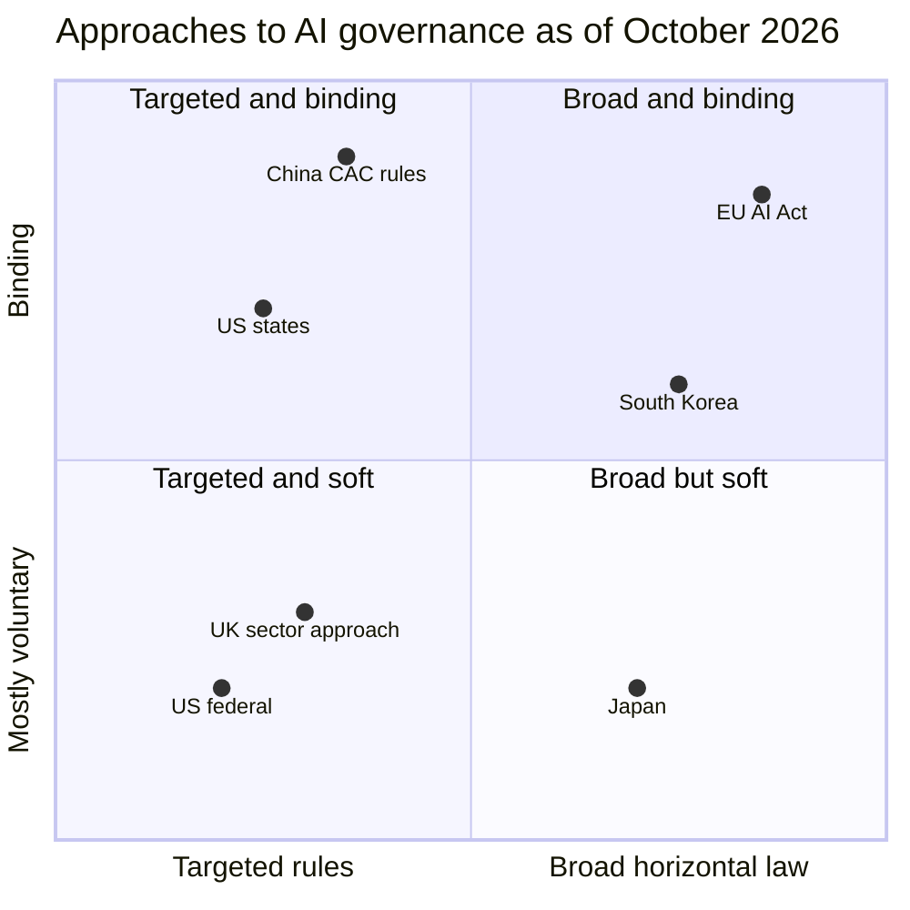
*Figure 59.9: A rough map of national approaches. Positions are a teaching judgment, not a measurement: the EU has a broad binding law, China and the US states use binding but targeted rules, the UK and the US federal government lean on existing regulators and voluntary measures, and Japan's broad law is mostly promotional.*

| Jurisdiction | Main instrument | Style | Distinctive feature |
|---|---|---|---|
| European Union | AI Act (a regulation) | Broad, risk-based, binding | Risk tiers, GPAI duties, fines up to 7% of turnover |
| United States, federal | Executive orders, existing laws, export controls | Promotional, deregulatory | Push to preempt state laws; CAISI voluntary testing |
| United States, states | State statutes | Targeted, binding | Frontier transparency (California, New York), chatbot safety, ADMT notices |
| United Kingdom | Sector regulators plus AISI | Principles-based | Strong government testing institute |
| China | CAC measures | Targeted, fast, content-focused | Algorithm filing, mandatory labeling |
| South Korea | AI Basic Act | Broad framework (reported) | Duties for high-impact AI |
| Japan | AI Promotion Act | Promotion first (reported) | Guidance over penalties |

*Table 59.5: How major jurisdictions govern AI, as of October 2026.*

## International coordination: summits, reports and the UN

No single body governs AI worldwide. Instead there is a patchwork of summits, scientific reports and UN processes.

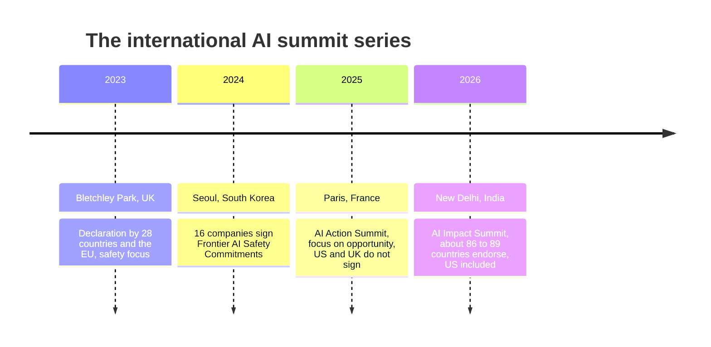
*Figure 59.10: The summit series moved from safety (Bletchley) to company commitments (Seoul) to action and opportunity (Paris) to impact and inclusion (New Delhi).*

- **Bletchley Park (November 2023).** Twenty-eight countries plus the EU, including both the US and China, signed a declaration recognizing risks from frontier AI. The summit launched the International AI Safety Report.
- **Seoul (May 2024).** Sixteen companies signed Frontier AI Safety Commitments, promising to publish safety frameworks, which most then did (Chapter 56).
- **Paris AI Action Summit (February 2025).** The focus shifted to "action" and economic opportunity. The US and UK did not sign the final statement.
- **India AI Impact Summit, New Delhi (February 2026).** The New Delhi Declaration, a voluntary statement on cooperation, was endorsed by about 86 to 89 countries including the US, and frontier companies announced Frontier AI Impact Commitments on February 19. A US official was reported as saying, "We totally reject global governance of AI."

> **Definition — Declaration (international):** A non-binding statement of shared principles or intentions signed by governments, such as the Bletchley Declaration. It signals agreement but creates no legal duties.

The **International AI Safety Report**, loosely modeled on the climate-science reports of the IPCC (the Intergovernmental Panel on Climate Change, the UN body that summarizes climate research for governments), gathers the evidence on AI capabilities and risks. Its 2026 edition was published on February 3, 2026, chaired by Yoshua Bengio, with more than 100 experts and backing from more than 30 countries. Shorter "Key Updates" appear between editions; the one in November 2025 found that the number of companies publishing frontier safety frameworks had more than doubled since early 2025, but that sophisticated attackers can often bypass safeguards.

> **Definition — International AI Safety Report:** An independent scientific report on the capabilities and risks of general-purpose AI, backed by more than 30 countries, chaired by Yoshua Bengio and first commissioned at the 2023 Bletchley summit.

At the **United Nations**, the General Assembly established an Independent International Scientific Panel on AI and a Global Dialogue on AI Governance on August 26, 2025 (resolution A/RES/79/325). The UN cannot impose binding AI rules on countries by itself; its influence comes from convening, reporting and setting norms. Older soft-law anchors also matter, such as the AI Principles (2019) of the OECD (the Organisation for Economic Co-operation and Development, a policy forum of 38 mostly wealthy democracies), which many national strategies cite.

**Military AI and autonomous weapons.** The EU AI Act exempts military uses, and no AI-specific treaty governs them. Military AI falls under the existing laws of war and under UN talks on lethal autonomous weapons, which Chapter 53 describes along with the strongest arguments on each side. The latest step: in September 2026 the expert group negotiating in Geneva under the Convention on Certain Conventional Weapons (CCW) circulated a draft final report with "elements of an instrument, without prejudging its nature" (that is, without deciding whether they become a treaty), recommending that governments endorse them at the CCW review conference of November 16 to 20, 2026. Separately, the non-binding Political Declaration on Responsible Military Use of Artificial Intelligence and Autonomy, launched by the US in November 2023, sets out norms for the countries that endorse it.

> **Key idea:** International AI governance in 2026 is mostly soft law: declarations, scientific reports and voluntary company commitments. The binding rules are national or regional, and major countries openly disagree about whether global governance of AI is even desirable.

What would stronger cooperation look like? Researchers and diplomats keep returning to three models borrowed from other technologies. An inspection agency like the International Atomic Energy Agency (IAEA), which checks that nuclear material is not diverted to weapons, could check large training runs or data centers. A shared laboratory like CERN, the particle-physics lab funded by many countries, could pool the cost of frontier or safety research. And a scientific body like the Intergovernmental Panel on Climate Change could build a shared picture of the evidence; the International AI Safety Report and the UN's scientific panel are steps in that direction.

Any binding deal runs into the racing game from earlier in this chapter: how would each side know the other is keeping its word? That is the problem of verification, and it is why compute keeps coming up. Unlike algorithms or data, frontier compute is hard to hide (a large training cluster draws tens to hundreds of megawatts), countable (chips are numbered physical objects) and made by a handful of companies, so it can be tracked, licensed or withheld. Proposals range from registries of large chip clusters, to cloud providers checking who rents enough compute for a frontier training run, to features built into chips that could show where a chip is located. None of these operates as an international system; export controls, next, are the main form of compute governance practiced today.

> **Definition — Verification (in international agreements):** The methods that let each party to an agreement check that the others are complying, such as inspections, satellite imagery or reporting duties. Without it, promises between rivals are hard to trust.

> **Definition — Compute governance:** Using control over computing hardware, the chips, data centers and cloud access needed to train and run advanced AI, as a lever to monitor, license or restrict AI development.

## Export controls: governing AI through chips

The most powerful AI policy tool the US has used is not an AI law at all. It is control over chips. Frontier training needs tens of thousands of advanced accelerators (Chapter 35 and Chapter 37), and nearly all of them depend on US designs and software, Dutch lithography machines and Taiwanese factories (Chapter 36). Limiting who can buy them limits who can build frontier models.

> **Definition — Export controls:** Government rules restricting the sale or transfer of certain goods, software or technology to certain countries or companies for national-security reasons. Advanced AI chips and chipmaking tools are major targets.

The policy has swung several times:

- **October 2022:** sweeping US controls on advanced AI chips and chipmaking equipment for China, tightened in 2023 and again in December 2024.
- **January 2025:** the outgoing administration's "AI Diffusion" rule sorted countries worldwide into tiers with different access to advanced chips. It was **rescinded in May 2025**.
- **April 2025:** sales of Nvidia's H20, a chip designed to fit earlier rules for China, were halted. In **August 2025** they were licensed in exchange for 15% of the revenue going to the US government.
- **September 2025:** Chinese regulators told Chinese firms not to buy some Nvidia chips made for the Chinese market.
- **December 2025:** the administration announced sales of the more powerful H200 to approved Chinese customers, with 25% going to the US government. How this was implemented in 2026, and how China responded, could not be confirmed for this chapter.

By August 2026, Nvidia's own quarterly outlook assumed no data-center compute revenue from China, a sign of how unsettled that market had become.

> **Definition — AI Diffusion rule:** A January 2025 US rule that would have sorted countries into tiers with different limits on importing advanced AI chips. It was rescinded in May 2025 before taking full effect.

**The strongest case for strict controls.** Compute is the scarcest input to frontier AI. Denying rivals the best chips slows their military and intelligence uses of AI, buys time for safety work, and preserves a lead that may matter enormously if AI becomes strategically decisive. Smuggling and loopholes argue for tighter enforcement, not for giving up.

**The strongest case for looser controls.** Controls push China to build its own chip industry (Chapter 36 covers the Ascend AI chips of the Chinese tech giant Huawei, and SMIC), possibly creating a durable competitor sooner. They cost US companies billions in sales that would fund their research. Chinese labs kept producing near-frontier open-weight models anyway, using efficient algorithms, stockpiled chips and smuggling. And selling chips abroad, some argue, spreads the American technology stack and keeps other countries building on it.

> **Definition — SMIC (Semiconductor Manufacturing International Corporation):** China's largest contract chipmaker, which manufactures chips that other companies design, including, according to teardown reports, Huawei's Ascend AI chips. US export controls cut it off from the most advanced chipmaking machines, so it relies on older equipment to make its most advanced chips.

## Standards: the quiet rulebook

Standards rarely make headlines, but much of the practical work of AI governance happens inside them. When a law says "manage risks appropriately," a standard tells an engineer what that means on a Tuesday afternoon.

- **NIST AI Risk Management Framework (AI RMF 1.0, January 2023):** a voluntary US framework organized around four functions, Govern, Map, Measure and Manage. A Generative AI Profile (NIST AI 600-1, July 2024) adapts it to chatbots and image generators.
- **ISO/IEC 42001:2023:** an international, certifiable standard for an AI management system, published jointly by ISO and the IEC (the International Electrotechnical Commission, the global standards body for electrical technology), similar in spirit to ISO 27001 for information security. Organizations can be audited and certified against it.
- **EU harmonised standards:** being written by the European standards committee CEN-CENELEC JTC 21 (Joint Technical Committee 21, the group the two bodies set up for AI). They will give companies a presumption of conformity with the AI Act, and their delay was one reason for the Omnibus postponement.
- **C2PA:** the Content Credentials standard, tamper-evident metadata describing how a piece of media was made (Chapter 47 and Chapter 58). It helps companies meet labeling laws in the EU and China.

> **Definition — NIST AI RMF (AI Risk Management Framework):** A voluntary US framework, published in January 2023, that helps organizations manage AI risks through four functions: Govern, Map, Measure and Manage.

> **Definition — ISO/IEC 42001:** An international standard, published in 2023, for setting up and running an AI management system. Organizations can be independently audited and certified against it.

> **Definition — Management system:** An organization's set of policies, roles, processes and records for consistently achieving a goal, such as quality, security or responsible AI, and for improving over time.

> **Definition — C2PA (Coalition for Content Provenance and Authenticity):** An industry standard for attaching tamper-evident "Content Credentials" to images, video and audio, describing their origin and edits, including whether AI was used.

**Worked example: a one-page risk register.** A small dental clinic wants AI to draft replies to patient messages. Using the NIST AI RMF's four functions:

| Function | Question | The clinic's answer |
|---|---|---|
| Govern | Who is accountable? | The practice manager owns the tool; the dentist approves any message with clinical content |
| Map | Who could be affected, and how? | Patients could receive wrong advice; private health data goes to a vendor |
| Measure | How will we test it? | Before launch, the dentist scores AI drafts for 50 past messages; afterwards, a monthly spot-check of 20 messages and a tracked error rate |
| Manage | What do we do about the risks? | Human approval before sending; a vendor contract with no training on patient data; a way to report errors and pause the tool |

*Table 59.6: A minimal AI risk register for a small clinic, built on the NIST AI RMF's four functions.*

No law required this. Standards are how good practice spreads, and how compliance professionals show regulators and customers that they took care.

> **Try it:** Pick an AI tool you use at work. Ask a chatbot: "Help me write a one-page AI risk register for [tool] used for [task], using the NIST AI RMF's Govern, Map, Measure and Manage functions. Ask me questions first." Answering its questions is a quick lesson in how governance professionals think.

## Courts as policymakers

When legislatures are slow, courts make policy one case at a time. Three kinds of lawsuits are shaping AI as of October 2026; Chapter 58 covers the cases in detail.

- **Copyright.** Courts have split according to the facts. In *Bartz v. Anthropic*, Judge Alsup ruled in June 2025 that training on lawfully acquired books was fair use but that downloading pirated books was not; a $1.5 billion settlement received final approval on July 20, 2026. In *Kadrey v. Meta*, Judge Chhabria ruled for Meta because the authors failed to prove market harm, while warning that a "market dilution" argument could win in a better-argued case. At the end of September 2026 (the opinion was made public on September 30), the Third Circuit affirmed in *Thomson Reuters v. Ross* that copying legal headnotes to train a competing, non-generative search tool was not fair use. *New York Times v. Microsoft and OpenAI* awaits rulings on fair-use motions filed in September 2026.
- **Product safety.** Families have sued chatbot makers over teen suicides, for example *Raine v. OpenAI*, filed in August 2025. In January 2026, Character.AI and Google agreed to settle several such suits without admitting liability.
- **Constitutional limits.** In March 2026 a federal judge reportedly issued a temporary injunction in a dispute between Anthropic and the federal government over the company's limits on military uses of its models (Chapter 60 discusses it as a case of government power over labs), and xAI's challenge to Colorado showed that companies will test state laws in court.

> **Definition — Fair use:** A US copyright doctrine that allows some unlicensed use of copyrighted works, judged on four factors including the purpose of the use and its effect on the market for the original.

> **Definition — Injunction:** A court order requiring a party to do or stop doing something, sometimes issued temporarily while a case proceeds.

## Voluntary commitments, and how soft law hardens

The last instrument is the softest. In July 2023, seven leading US AI companies made voluntary commitments to the White House to test models before release and share safety information. At Seoul in May 2024, sixteen companies committed to publish frontier safety frameworks, and most did: Anthropic's Responsible Scaling Policy, OpenAI's Preparedness Framework and Google DeepMind's Frontier Safety Framework (Chapter 56). In February 2026, frontier firms added Frontier AI Impact Commitments at New Delhi.

Critics point out that companies can rewrite their own commitments, and several loosened or restructured them in 2025 and 2026. Supporters reply that voluntary frameworks let rules evolve as fast as the technology, and that they became the template for law. That is the most important pattern in this chapter: soft law hardening into hard law.

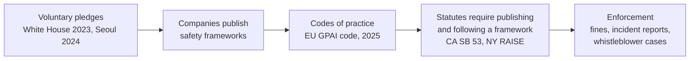
*Figure 59.11: How soft law hardens. A practice that starts as a voluntary promise becomes a code, then a statutory duty, then something regulators can enforce.*

> **Analogy:** Seatbelts started as an option some carmakers offered. Then some made them standard to win customers. Then governments required them in new cars, and later required people to wear them. AI safety frameworks sit somewhere between the second and third steps.

## How to read an AI policy headline

Most confusion about AI law comes from headlines that blur proposals, laws and lawsuits. Use this five-question checklist.

1. **What kind of instrument is it?** A bill, a signed statute, an agency rule, an executive order, a court ruling, a standard or a pledge?
2. **Is it final?** A bill that "passed the Senate" may still die in the House. An order may be challenged in court. A ruling may be appealed.
3. **When does it apply?** Many AI laws take effect a year or more after signing, and some deadlines, like the EU's, move.
4. **Who must comply?** Look for thresholds: compute, revenue, number of users, type of use.
5. **Who enforces it, and with what?** The attorney general only, or also private lawsuits? Fines per violation, or a share of turnover?

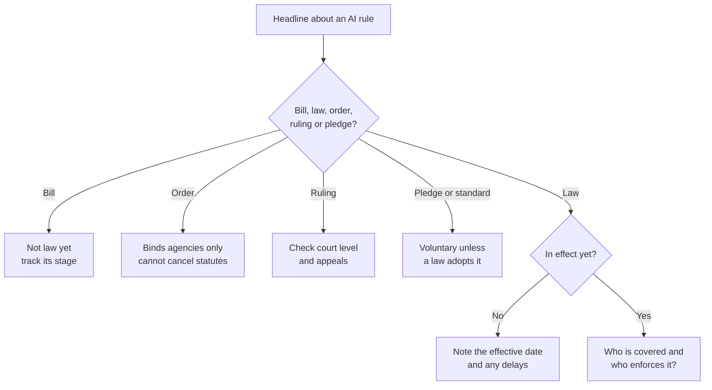
*Figure 59.12: A decision path for reading AI policy news. Most misleading headlines fail at the first question.*

> **Try it:** Find one AI policy headline from this week. Run it through the five questions, then ask your chatbot, with web search on, to find the primary source: the bill text, the order or the court opinion. Compare what the primary source says with the headline.

## Open questions at the frontier of AI governance

As of October 2026, these questions are unsettled everywhere:

- **What should trigger frontier rules?** Compute thresholds are crude and aging. Alternatives include capability evaluations (does the model show dangerous skills?), revenue or user counts, or a mix.
- **Who is liable when an agent acts?** If an AI agent leaks data after a prompt injection (Chapter 31) or breaks a law on a user's behalf, is the developer, the deployer or the user responsible? Most liability law was written for people and simple products.
- **How do you govern open-weight models?** Published weights cannot be recalled, and their safeguards can be removed (Chapter 60 presents the open-versus-closed debate). Rules that assume a company controls its model fit awkwardly.
- **Floor or ceiling?** In the US, whether federal law should set a minimum or a maximum for the states.
- **Interoperability.** Can one safety process satisfy the EU, California, New York, China and South Korea at once, or will the rules fragment?
- **Who checks the checkers?** Laws increasingly rely on companies' own frameworks and on outside auditors. A trustworthy, independent AI audit profession is still being built.
- **Government power over labs.** As governments become both AI's biggest customers and its regulators, how do you protect national security and also labs' freedom to refuse certain uses?

> **At the frontier (2026):** The items to watch in 2027 are whether Congress passes a preemption statute such as the FRONTIER Act; the EU AI Office's first enforcement actions against general-purpose model providers; New York's RAISE Act and Colorado's ADMT law taking effect on January 1, 2027; the first fair-use rulings in the New York Times case; and whether the summit series continues after New Delhi with anything binding.

## In plain English

Nobody passed "the AI law." AI is governed by a mix of tools. Legislatures pass statutes, agencies write detailed rules, presidents issue orders that bind only their own agencies, judges decide cases that set precedents, standards bodies write technical how-to guides, and companies make voluntary promises that sometimes become law.

The European Union went furthest with its AI Act. It bans a few uses outright (social scoring, emotion recognition in schools and workplaces), puts heavy duties on high-stakes uses like hiring and credit (now delayed to December 2027), requires chatbots to say they are AI and AI images to be marked (from August 2026), and gives the makers of general-purpose models like ChatGPT, Claude and Gemini documentation, copyright and safety duties. The biggest models, those trained with more than 10^25 FLOPs, owe the most.

The United States has no comprehensive federal AI law. The federal government promotes AI and, since December 2025, has been pressuring states to drop their own rules, but an executive order cannot cancel a state law; only Congress or a court can. Meanwhile California and New York require the biggest labs to publish safety frameworks and report serious incidents, California regulates companion chatbots, and Colorado swapped its broad anti-discrimination law for a narrower notice-and-explanation law.

The UK relies on existing regulators and a strong testing institute. China issues fast, targeted rules with registration and mandatory labels. Internationally, there are summits and scientific reports but almost nothing binding. Export controls on chips and voluntary standards such as the NIST framework and ISO 42001 do a lot of quiet work.

When you read an AI policy headline, ask: is it a bill or a law, is it in effect, who must comply, and who enforces it?

## Key terms
AI governance, AI policy, Pacing problem, Collingridge dilemma, Dual-use, Jurisdiction, Collective action problem, Game theory, Prisoner's dilemma, Nash equilibrium, Race to the bottom, Evolutionary pressure (in AI), Externality, Market failure, Moral hazard, Statute, Bill, SB and AB (US state bill numbers), Regulation (agency rule), Executive order, Court ruling, Precedent, Standard (technical), Voluntary commitment, Hard law, Soft law, Preemption, Federalism, Moratorium, EU directive, Enforcement, Attorney general (AG), Private right of action, Liability, Provider (developer), Deployer, FLOP (floating-point operation), Compute threshold, Frontier model, EU AI Act, Risk-based approach, Extraterritorial reach, AI system (EU AI Act), Risk tiers (EU), Prohibited practice (EU), High-risk AI system (EU), Annex III, Conformity assessment, CE marking, Fundamental rights impact assessment (FRIA), Harmonised standard, Transparency obligation (Article 50), General-purpose AI model (GPAI), Systemic risk (EU GPAI), Text and data mining (TDM) exception, Code of practice (GPAI), IBM (International Business Machines), AI Office, Market surveillance authority, European Artificial Intelligence Board, Scientific panel (EU AI Act), Global turnover, Right to explanation (EU AI Act), AI regulatory sandbox (EU), Digital Omnibus (on AI), AI literacy, Brussels effect, GDPR (General Data Protection Regulation), FTC (Federal Trade Commission), TAKE IT DOWN Act, NIST (National Institute of Standards and Technology), CAISI (Center for AI Standards and Innovation), Regulatory sandbox, Age assurance, Intervention (in a lawsuit), Duty of care, Statement of interest, Frontier AI framework, Transparency report, Critical safety incident, Whistleblower protection, Companion chatbot, Algorithmic discrimination, ADMT (automated decision-making technology), Consequential decision, AI Security Institute (UK AISI), Pre-deployment testing, CAC (Cyberspace Administration of China), Algorithm filing (registry), Deep synthesis, Treaty (convention), Declaration (international), International AI Safety Report, Verification (in international agreements), Compute governance, Export controls, AI Diffusion rule, SMIC (Semiconductor Manufacturing International Corporation), NIST AI RMF (AI Risk Management Framework), ISO/IEC 42001, Management system, C2PA (Coalition for Content Provenance and Authenticity), Fair use, Injunction, IAPP (International Association of Privacy Professionals), CSET (Center for Security and Emerging Technology)

## Exercises

1. **[Easy] Name that instrument.** (1) Make a two-column list of these eight items: EO 14365, California SB 53, the Bartz v. Anthropic ruling, ISO/IEC 42001, the Seoul Frontier AI Safety Commitments, the EU GPAI Code of Practice, the Digital Omnibus, and the NIST AI RMF. (2) For each, write which of the six instruments it is and whether it is binding, using Table 59.1. (3) Find one AI policy item in this week's news and classify it the same way. **What you'll learn:** to tell hard law from soft law at a glance, the first step in reading any policy story.

2. **[Easy] Spot the law in your apps.** (1) Open three AI apps you use. (2) Look for signs of regulation: a notice that you are talking to an AI, labels on generated images, age checks or age questions, data-use and training opt-outs, and the "governing law" line in the terms of service. (3) Generate an image in one app, download it, and upload it to the Content Credentials verifier at contentcredentials.org/verify to see whether it carries C2PA data. **What you'll learn:** how laws like Article 50, SB 243 and labeling rules show up in the products you already use, and what provenance data does and does not prove.

3. **[Medium] Classify five products under the EU AI Act.** (1) Open the EU AI Act Compliance Checker at artificialintelligenceact.eu/assessment/eu-ai-act-compliance-checker/. (2) Run it for a résumé-screening tool, an airline customer-service chatbot, an exam-proctoring tool that detects emotions, a bank's credit-scoring model and a selfie-to-painting filter. (3) For each, record the tier, two key obligations, whether you are the "provider" or "deployer" in your scenario, and the post-Omnibus date. (4) Compare your results with Table 59.3. **What you'll learn:** how the risk tiers and Annex III work in practice, and how the Omnibus moved the dates.

4. **[Medium] Build a compute-threshold calculator.** (1) In a spreadsheet, type these column names in row 1, from A1 to G1: Model, Active parameters, Training tokens, FLOPs, Over 10^25?, Over 10^26?, Rough cost. (2) Enter one model per row from row 2 down: GPT-3 (175e9 and 300e9), Llama 3.1 405B (405e9 and 15.6e12), a 70B model on 15e12 tokens, and an imaginary model with 300e9 active parameters on 60e12 tokens. Spreadsheets read 175e9 as 175 × 10^9 (175 billion), so type the numbers exactly like that. (3) In D2 (the FLOPs column) type =6*B2*C2; in E2 and F2 type =D2>1E25 and =D2>1E26, which show TRUE or FALSE. (4) For cost, assume 4E14 useful FLOP per second per chip at $2 per chip-hour, and type in G2: =D2/4E14/3600*2. (5) Copy D2 to G2 down to the other rows (check: GPT-3 comes to about 3.2E23 FLOPs and roughly $440,000). **What you'll learn:** how compute thresholds sort models into legal categories and roughly what crossing them costs.

5. **[Medium] Track a live bill.** (1) Go to congress.gov (for the federal FRONTIER Act) or LegiScan (legiscan.com) for a state chatbot or deepfake bill. (2) Record the sponsor, current stage, key provisions, and any preemption language. (3) Find one organization supporting it and one opposing it, and their main argument. (4) Write a 200-word neutral summary and set an alert for changes. **What you'll learn:** how bills move, how to read primary sources instead of headlines, and how preemption clauses are written.

6. **[Medium] One app, three rulebooks.** (1) Imagine you are launching a companion chatbot for teenagers in three places: the EU, California and China. (2) Using this chapter, list in a table which rules would apply in each place: disclosure, labeling, age protections, registration or filing, incident reporting. (3) Mark which rules overlap and which conflict. (4) Ask a chatbot to critique your table and check its claims against the chapter. **What you'll learn:** why global AI companies face fragmented rules, and how the same product meets very different legal expectations.

7. **[Medium] Write a mini risk register.** (1) Choose a realistic AI use: a school using AI to draft report-card comments, a landlord screening tenant applications, or your own team's use of a chatbot. (2) Fill a four-row table using the NIST AI RMF functions (Govern, Map, Measure, Manage), as in Table 59.6. (3) Decide whether the use would count as high-risk under the EU AI Act or as a consequential decision under Colorado's new law. **What you'll learn:** how compliance professionals structure AI risk work, and the vocabulary used in governance jobs.

8. **[Challenge] Write an incident report.** (1) Pick a documented incident, such as OpenAI's April 2025 rollback of an overly flattering GPT-4o update (Chapter 55) or a reward-hacking case described in a lab's system card. (2) Write it up as if for California's Office of Emergency Services: what happened, the harm or risk, how it was detected, a timeline, mitigations and lessons. (3) Then argue in one paragraph whether it would actually meet the definition of a "critical safety incident." **What you'll learn:** what incident reporting asks of companies, and how much hinges on legal definitions.

9. **[Challenge] Preemption design memo.** (1) Write 300 words making the strongest case for a federal ceiling on state AI laws. (2) Write 300 words making the strongest case for a federal floor instead. (3) Propose a compromise: which topics (frontier-model safety, child safety, hiring and credit, deepfakes, data centers) should be national, and which should stay with states, with one reason each. **What you'll learn:** to steelman both sides of the central US AI policy fight and think like a legislative drafter.

10. **[Challenge] Does the framework meet the law?** (1) Read one published lab framework: Anthropic's Responsible Scaling Policy, OpenAI's Preparedness Framework or Google DeepMind's Frontier Safety Framework. (2) List what SB 53 requires a frontier AI framework to cover, from the law's text or a law-firm summary. (3) Check off which requirements the company document addresses and where it is vague. **What you'll learn:** how soft-law frameworks meet hard-law requirements, and where the gaps are.

## Areas of opportunity

- **AI governance and compliance roles.** Every company selling into the EU needs people who can map AI systems to risk tiers, and general-purpose model duties already apply; Annex III high-risk duties arrive in December 2027. Titles include AI governance lead, AI risk manager and responsible-AI program manager, and the IAPP's AI Governance Professional (AIGP) credential is one recognized entry point.
- **Auditing and conformity assessment.** EU notified bodies, ISO/IEC 42001 certification auditors and third-party evaluators will be in demand as laws lean on outside checks. Accounting firms and specialist AI-assurance companies already compete here.
- **Governance software.** Companies need AI inventories, risk registers, documentation templates for the EU AI Act, SB 53 and RAISE frameworks, and Colorado ADMT notices from 2027. Startups that automate this sell to legal and compliance teams.
- **Policy careers in government.** The EU AI Office, national market surveillance authorities, the UK AI Security Institute, US CAISI, state attorneys general and New York's new oversight office in the Department of Financial Services all need people who understand both technology and law.
- **Think tanks and civil society.** Organizations such as GovAI, CSET, RAND and the Ada Lovelace Institute hire researchers who can read primary documents accurately and translate between engineers and lawmakers.
- **Trust and safety and age assurance.** The TAKE IT DOWN Act's 48-hour removal rule, SB 243's chatbot duties and the push for age assurance create demand for takedown operations, child-safety specialists and age-estimation tools.
- **Content provenance.** Article 50's marking duty and China's labeling rules create a market for C2PA integration, watermarking and detection services sold to every generative-AI provider.
- **AI law practice.** Copyright litigation and licensing, chatbot product-liability suits, employment-AI compliance and export-control advice are growing legal specialties.
- **Policy intelligence.** Lawyers and companies pay for trackers that monitor hundreds of AI bills across states and countries and explain what changed.
- **Open problems worth working on.** Better triggers than compute thresholds, liability rules for agents, governance of open-weight models, and international interoperability are unsolved and need researchers, lawyers and engineers together.

> **Definition — IAPP (International Association of Privacy Professionals):** The largest professional association for people who work in privacy and, increasingly, AI governance. It publishes news and legislation trackers and runs certifications such as the AI Governance Professional (AIGP).

> **Definition — CSET (Center for Security and Emerging Technology):** A think tank at Georgetown University in Washington, DC that studies how AI and other emerging technologies affect national security, known for data-driven reports on chips, export controls and the AI workforce.

## Check your understanding

1. Why can an executive order not cancel a state AI law, and what two routes could actually displace one?
2. Name the four EU AI Act risk tiers, give one example of each, and say when the Annex III high-risk duties now apply.
3. Estimate the training compute of a model with 200 billion active parameters trained on 20 trillion tokens. Does it cross the EU threshold? The California threshold?
4. What does California's SB 53 require of large frontier developers, and how does New York's RAISE Act differ on incident reporting?
5. What happened to Colorado's 2024 AI Act, and what does the replacement law require?
6. Give the strongest argument for and the strongest argument against federal preemption of state AI laws.
7. Why are export controls on chips described as AI policy, and what is the main argument against strict controls?
8. Describe how a voluntary commitment can harden into hard law, with a real example.

Answers

1. An executive order directs only the federal government's own agencies; it is not a law that can override state statutes. A state law can be displaced by a statute from Congress that preempts it, or by a court ruling that it is invalid (for example because it conflicts with federal law or the Constitution).
2. Unacceptable risk (banned, such as social scoring or emotion recognition in schools), high risk (such as résumé screening or credit scoring), limited risk (such as a customer-service chatbot that must disclose it is AI) and minimal risk (such as a spam filter). After the Digital Omnibus, Annex III high-risk duties apply from December 2, 2027.
3. 6 × 2 × 10^11 × 2 × 10^13 = 24 × 10^24 = 2.4 × 10^25 FLOPs. That is above the EU's 10^25 presumption of systemic risk but below California's 10^26 line.
4. SB 53 requires large frontier developers (above 10^26 FLOPs and over $500 million revenue) to publish a frontier AI framework and transparency reports, report critical safety incidents to the Office of Emergency Services within 15 days (24 hours if life is in imminent danger), and protect whistleblowers, with penalties up to $1 million per violation. New York's RAISE Act requires incident reports within 72 hours and takes effect on January 1, 2027.
5. It was delayed to June 30, 2026, challenged in court by xAI with federal intervention, paused, and then repealed and replaced on May 14, 2026 by SB26-189. The new law, effective January 1, 2027 if rulemaking is done, requires notice before AI is used in consequential decisions, an explanation within 30 days of an adverse outcome, data access and correction, and human review where commercially reasonable, enforced only by the attorney general.
6. For: AI is built once and sold nationwide, so fifty rulebooks raise costs (hardest for startups), interstate commerce is Congress's domain, and national security argues for one coherent approach. Against: Congress has not passed real AI rules, so preemption would create a vacuum; states test ideas that can spread; and states traditionally protect consumers, workers and children, as the 99-to-1 Senate vote reflected.
7. Frontier models need huge numbers of advanced chips, so controlling who can buy chips controls who can build frontier AI. The main argument against strict controls is that they push China to build its own chip industry, cost US firms revenue, and have not stopped Chinese labs from releasing strong models.
8. Labs pledged voluntarily (to the White House in 2023 and at Seoul in 2024) to publish safety frameworks; they did; then California's SB 53 and New York's RAISE Act made publishing and following such a framework a legal duty with penalties, and the EU's Code of Practice gave a semi-voluntary route to meeting binding GPAI rules.

## Going deeper

- **EU AI Act Explorer (artificialintelligenceact.eu).** The full text searchable by article, a compliance checker, and plain-language explainers of the Digital Omnibus.
- **European Commission pages on the AI Act and the GPAI Code of Practice (digital-strategy.ec.europa.eu).** The official source for guidelines, templates and the code itself.
- **NIST AI Risk Management Framework (nist.gov/itl/ai-risk-management-framework).** The framework, its Generative AI Profile, and a playbook of suggested actions.
- **International AI Safety Report (internationalaisafetyreport.org).** The best single summary of the scientific evidence that governments are working from.
- **OECD.AI Policy Observatory (oecd.ai).** A database of national AI strategies and policies from dozens of countries, useful for comparing approaches.
- **IAPP (iapp.org).** The privacy and AI governance profession's association, with legislation trackers, explainers and the AIGP certification.
- **Anu Bradford, *The Brussels Effect* (2020) and *Digital Empires* (2023).** Readable books on how the EU, US and China compete to set the rules for technology.
- **Stanford AI Index (hai.stanford.edu/ai-index).** An annual report with a policy and governance chapter that counts laws and bills worldwide.
- **Congress.gov and LegiScan.** Free tools for following federal and state bills at the source.
- **GovAI (governance.ai).** Research and analysis on AI governance, including detailed comparisons of company safety frameworks.
