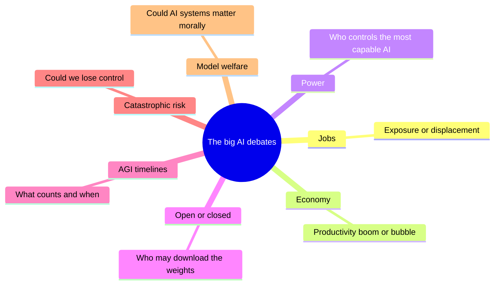
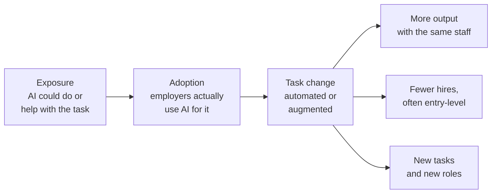
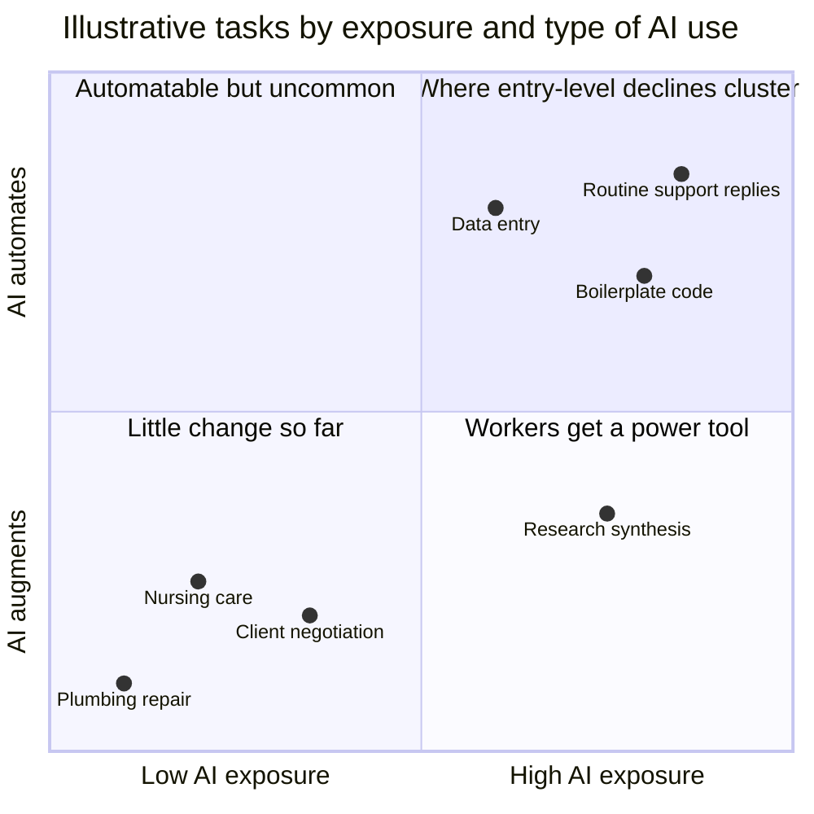
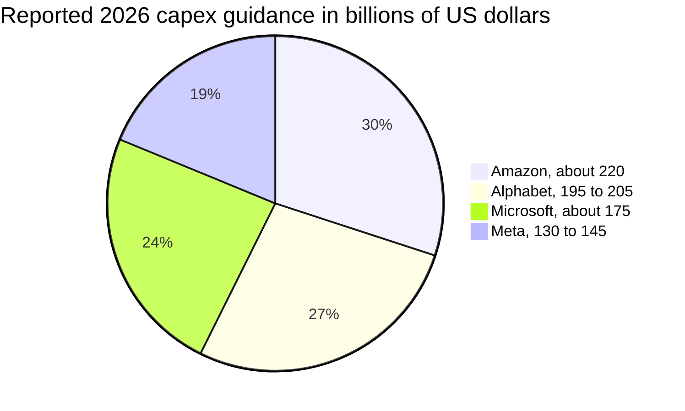
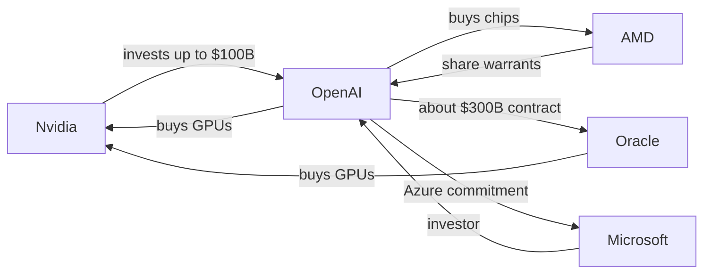
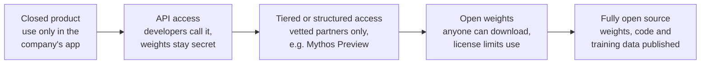

# Chapter 60: AI, Work, the Economy and the Big Debates

*This chapter lays out the seven biggest arguments about where AI is taking us (jobs, the investment boom, power, open models, AGI timelines, catastrophic risk and model welfare) with the best evidence and the strongest case on each side, so you can make up your own mind.*

## What you'll learn
- How to argue well about questions nobody can settle yet: steelmanning, finding the crux, and holding calibrated beliefs.
- Jobs: the difference between exposure and displacement, why economists think in tasks rather than jobs, and what the 2025 to 2026 evidence actually shows, including the young-worker gap, null results and productivity experiments where AI made experts slower.
- The economy: growth forecasts that differ tenfold, the scale of the investment boom, circular deals, and the bubble debate with its bull case, bear case and historical parallels.
- Who holds power over AI, and the case for and against open-weight models.
- What AGI and ASI mean, how progress is measured (ARC-AGI, Humanity's Last Exam, METR time horizons), and why expert timelines disagree, with a worked extrapolation.
- The arguments for and against taking catastrophic and existential risk seriously, including "AI as normal technology."
- Why some serious people study model welfare and why others think it is a dangerous illusion.
- A set of signposts to watch that would tell you which side is winning each debate.

## Before you start
This chapter draws on the whole book, so earlier chapters will help. Chapter 24 (The 2026 Model Landscape and How to Read Benchmarks) explains the benchmarks used to measure progress, and Chapter 28 (Tools and Agents: From Function Calling to MCP) explains agents and METR time horizons. Chapter 43 (The Economics of AI Compute) covers the money behind data centers in detail; here we take the economy-wide view. Chapter 55 (What Can Go Wrong: Reliability and the Alignment Problem) explains the technical roots of the risk arguments, and Chapter 59 (AI Law and Policy Around the World) covers what governments are doing. Chapter 61 (The AI Industry Map: Who Makes Money and How) and Chapter 63 (Careers in AI: Every Role Explained) go deeper on companies and careers.

## How to think about a debate nobody can settle yet

Ask your chatbot "Will AI take my job?" and you will probably get a careful, balanced answer that does not quite commit. That is not evasion. It reflects a real situation: thoughtful experts who have studied the same evidence disagree, sometimes sharply. The same is true for whether the AI boom is a bubble, when (or whether) machines will match humans across the board, and whether advanced AI could pose a danger to humanity.

You cannot wait for these debates to be settled before you make decisions about your career, your savings or your vote. So this chapter does two things. It gives you the best current evidence on each debate, dated as of October 2026. And it gives you tools for thinking about questions where the evidence is incomplete.

The first tool is to argue against the best version of the other side.

> **Definition — Steelman:** The strongest, most charitable version of an argument you may disagree with, stated so well that its supporters would say "yes, that is what we mean." The opposite of a strawman.

> **Definition — Strawman:** A weak or distorted version of an opposing argument, easy to knock down but not what serious opponents actually believe.

The second tool is to find where the disagreement really lies. Two people arguing about AI and jobs may agree on every fact about today and disagree only on how fast companies will adopt agents. That single point is the crux.

> **Definition — Crux:** The specific factual or value question that, if answered, would change one side's mind. Finding the crux turns a shouting match into a question you can investigate.

The third tool is to hold beliefs as probabilities rather than certainties, and to keep score.

> **Definition — Calibration:** How well your stated confidence matches reality. If you are well calibrated, about 70% of the things you say you are "70% sure" of turn out to be true.

> **Definition — Forecast:** A specific, checkable prediction with a date and a probability, such as "60% chance that X happens by the end of 2027."

> **Key idea:** Many AI arguments are not really about facts. They are about definitions ("what counts as AGI?"), time frames ("in two years or in twenty?") or values ("is a small chance of catastrophe worth slowing down for?"). Before arguing, ask which of the three you are actually disagreeing about.

Figure 60.1 maps the seven debates in this chapter.

*Figure 60.1: The seven debates covered in this chapter, each with its central question.*

## Debate 1: Will AI take our jobs?

### Start with tasks, not jobs

A job is not one thing. It is a bundle of tasks. A marketing coordinator writes emails, summarizes reports, researches competitors, sits in meetings, plans campaigns and calms down unhappy clients. AI might do some of those tasks very well, help with others, and be useless for the rest. So economists ask a more precise question than "will AI take this job?" They ask: which tasks can AI do or help with, and what will employers do with the time that frees up?

> **Definition — Task:** One specific piece of work within a job, such as "draft a press release" or "reconcile monthly invoices." Economists measure AI's reach task by task.

> **Definition — Labor market:** The system in which workers offer their time and skills and employers hire them, setting how many people are employed and what they are paid.

> **Definition — Exposure (to AI):** How much of a job's tasks AI could technically perform or assist with. High exposure does not mean the job will disappear.

> **Definition — Displacement:** Workers actually losing jobs, hours or pay because their work has been taken over by technology.

> **Definition — Automation:** Technology performing a task instead of a human.

> **Definition — Augmentation:** Technology helping a human perform a task better or faster, with the human still doing the work and making the decisions.

A tool can be a **substitute** for a worker (it replaces them) or a **complement** (it makes them more valuable). A spreadsheet substituted for clerks who added columns by hand but complemented financial analysts, whose models became more powerful.

> **Definition — Complement (economics):** Something that makes another thing more valuable. A technology that complements workers raises their productivity and often their pay; a substitute replaces them.

### Worked example: one person's week

Here is a hypothetical 40-hour week for a marketing coordinator called Dana, with each task tagged by what AI can do with it in 2026.

| Task | Hours per week | AI's role |
|---|---|---|
| Drafting emails, posts and first versions of copy | 8 | Automates most of it |
| Summarizing reports and meeting notes | 4 | Automates most of it |
| Researching competitors and trends | 5 | Assists |
| Editing and fact-checking | 4 | Assists |
| Building the monthly results spreadsheet | 3 | Assists |
| Planning campaigns and setting priorities | 4 | Assists |
| Meetings with clients and colleagues | 8 | Little help yet |
| Running events and vendors in person | 4 | Little help yet |
| **Total** | **40** | |

*Table 60.1: A hypothetical task audit for one job.*

**Step 1: exposure.** Automatable tasks take 8 + 4 = 12 hours (30% of the week). Assisted tasks take 5 + 4 + 3 + 4 = 16 hours (40%). So 28 of 40 hours, or 70%, are "exposed." A headline might say "70% of this job is exposed to AI."

**Step 2: time saved.** Suppose AI makes the automatable tasks 80% faster and the assisted tasks 25% faster. Time saved = 12 × 0.80 + 16 × 0.25 = 9.6 + 4.0 = 13.6 hours a week, or 34% of the week. Already "70% exposed" has become "34% time saved."

**Step 3: what the employer does with it.** This is where the real outcome is decided, and there are three broad possibilities:

1. **More output, same staff.** The team runs more campaigns, tests more ideas or serves more clients. Jobs stay.
2. **Fewer people.** A team of 10 doing the same amount of work now needs about 10 × (1 − 0.34) ≈ 6.6 people. Often this happens quietly, by not hiring replacements or juniors.
3. **New tasks.** Dana spends the saved time on work that did not exist before, such as managing AI-generated content at scale or analyzing data she never had time for.

Which one happens depends on demand. If marketing gets cheaper and the business wants much more of it, jobs can hold or even grow. If demand is fixed, the same output needs fewer people.

> **Watch out:** "Exposure" numbers measure what AI could touch, not what employers will do. A study saying "80% of workers are exposed" is a statement about tasks, not a forecast of job losses. The steps from exposure to actual displacement involve adoption, time saved and demand, and each step can shrink or reverse the effect.

*Figure 60.2: From exposure to outcomes. Exposure is only the first step; adoption, task change and the employer's response decide whether jobs grow, shrink or change shape.*

### What could happen: the exposure estimates

Researchers have tried to measure exposure across the whole economy.

- A 2023 study by Eloundou and colleagues estimated that about 80% of US workers could have at least 10% of their tasks affected by large language models.
- The IMF estimated in January 2024 that about 40% of global employment is exposed to AI, rising to about 60% in advanced economies, where more jobs involve information work.
- Microsoft researchers analyzed about 200,000 conversations with Bing Copilot and found that information work (creating, processing and communicating information) was both the most common and the most successful AI-assisted activity, so nearly every occupation has some exposure.
- Anthropic's Economic Index, which studies how people use Claude, reported in January 2026 that on the consumer app roughly half of conversations were augmentation and a bit less than half automation, while businesses using the API leaned heavily toward automation (the company's figures; exact shares should be checked in the primary report).

### What is happening: the evidence as of October 2026

Exposure is about possibility. What has actually happened so far?

**The young-worker gap.** The most cited study is "Canaries in the Coal Mine?" by Erik Brynjolfsson, Bharat Chandar and Ruyu Chen of the Stanford Digital Economy Lab. Using payroll data from ADP, one of the largest US payroll processors, they compared workers aged 22 to 25 in the most AI-exposed occupations (such as software development and customer service) with similar workers in less-exposed occupations.

- The August 2025 version found a relative employment decline of about 13% for young workers in the most exposed jobs, and a later 2025 version about 16%, after controlling for company-level shocks.
- The August 2026 update, with data through mid-2026, put young workers in highly exposed occupations about 19% below where they would be had they tracked similar workers in less-exposed jobs.
- Older workers in the same occupations held steady.
- Declines concentrated where AI automates tasks rather than augments them, and showed up in headcount more than in pay.
- The authors stress that the results are descriptive, not proof of cause, and wrote: "We do not see widespread, economy-wide job displacement associated with AI."

> **Definition — Entry-level job:** A position for people early in their careers, often involving routine tasks that train them for more senior work. These are the jobs where AI effects showed up first.

> **Definition — Descriptive (vs causal) evidence:** Descriptive evidence shows that two things move together; causal evidence shows that one produces the other. The young-worker decline coincides with AI adoption, but other causes (interest rates, post-pandemic hiring swings) are hard to rule out completely.

**The null results.** Other careful studies find little or nothing yet. The Yale Budget Lab's trackers in 2025 and 2026 found no clear economy-wide disruption in the mix of occupations that could be attributed to AI. A 2025 study of Danish workers, linking surveys of chatbot use to government earnings records, found effects on earnings and hours close to zero in the first years after chatbots arrived.

> **Definition — Null result:** A study finding no detectable effect. It does not prove there is no effect, only that any effect is too small to see with the data available.

**Adoption is broad but value is narrow.** The Stanford AI Index 2026 reported that 88% of organizations say they use AI. Yet an MIT report from July 2025 found that only about 5% of enterprise generative-AI pilots delivered rapid revenue growth or measurable profit impact (media turned this into "95% of AI projects fail"). The report blamed brittle workflows and poor fit with daily operations, not weak models. Lots of companies are trying AI; few have redesigned their work around it, which is exactly the step that changes employment.

**Where jobs are growing.** The US Bureau of Labor Statistics projects, for 2025 to 2035, growth of about 35% for data scientists, 10% for software developers (citing AI development as a driver of demand) and 9% for electricians (citing data-center electricity demand). AI is creating demand in some places while trimming it in others.

**The public is worried; experts less so.** The same AI Index found that 73% of AI experts expect AI's effect on jobs to be positive, versus only 23% of the public, a 50-point gap.

*Figure 60.3: An illustrative map of tasks. The Stanford "Canaries" data suggests declines for young workers cluster in the top-right, where exposure is high and AI automates rather than assists. Placements are for teaching, not measured values.*

### Does AI make workers more productive?

Productivity is output per hour of work. Several randomized experiments have measured AI's effect directly.

> **Definition — Productivity:** How much output is produced per unit of input, usually per hour of work. Rising productivity is the main way economies get richer over time.

> **Definition — Randomized controlled trial (RCT):** An experiment in which participants are randomly split into groups (for example, with AI and without) so that differences in results can be attributed to the treatment rather than to who chose it.

| Study | Who | Result |
|---|---|---|
| Brynjolfsson, Li and Raymond | Customer-support agents with an AI assistant | About 14% more issues resolved per hour on average; about 34% for the newest, least experienced agents |
| Dell'Acqua and colleagues, 2023 | Consultants at Boston Consulting Group | On tasks inside AI's abilities, about 25% faster with higher-quality work; on a task chosen to fall outside them, AI users were more likely to get the answer wrong |
| METR, July 2025 | Experienced open-source developers working on their own projects with early-2025 AI tools | Took 19% longer with AI, while believing they had been about 20% faster |

*Table 60.2: Three widely cited productivity experiments.*

The pattern has three lessons. First, gains are largest for novices on well-defined tasks; AI spreads the know-how of top performers to beginners. Second, AI's abilities form a jagged frontier: it can be excellent at one task and confidently wrong at a similar-looking one. Third, people are poor judges of their own AI productivity.

> **Definition — Jagged frontier:** The uneven boundary of AI's abilities: excellent at some tasks and surprisingly bad at nearby ones, so you cannot assume competence on one task carries over to the next.

**Worked example: the perception gap.** In the METR setup, take a task that would take a developer 60 minutes without AI. They expected AI to make them about 20% faster, so they predicted about 60 × 0.8 = 48 minutes. In reality it took about 19% longer: 60 × 1.19 ≈ 71 minutes. Afterwards they still felt they had saved about 12 minutes, when they had actually lost 11. The gap between feeling and fact was about 23 minutes on a one-hour task. METR's explanation includes time spent prompting, waiting and reviewing AI output that was not quite right for a codebase the developers knew intimately. The tools have improved since early 2025; the lesson about measuring rather than trusting your impression has not.

> **Try it:** Pick two similar small tasks you do this week (two emails, two short reports). Before each, write down how long you expect it to take. Do one with AI and one without, timing both honestly. Repeat a few times. Exercise 3 turns this into a proper mini-experiment.

### The jobs debate, steelmanned

**The strongest case that "this time is different."** Past automation replaced muscle or narrow routines; AI targets general cognition, the thing humans used to escape to when machines took their old jobs. If AI can also learn the new tasks that appear, the traditional escape route narrows. Software spreads in months, not decades, because it needs no new factories. The young-worker data is an early warning: if companies stop hiring juniors because AI does junior work, the ladder by which people become experts loses its bottom rungs, and the damage shows up years later. And because AI is owned by a few companies, the gains could flow to owners of capital rather than to workers.

**The strongest case for "a normal transition."** For two centuries, automation has destroyed specific jobs while total employment and wages rose. Economist David Autor and colleagues estimated that about 60% of US jobs in 2018 were in occupations that did not exist in 1940. Cheaper services often expand demand: a famous example economists cite is that US bank-teller jobs did not collapse when ATMs spread, partly because cheaper branches meant banks opened more of them. The evidence through October 2026 shows concentrated effects (young workers in some exposed occupations), not economy-wide displacement, while AI-related jobs grow. And productivity gains, if they come, raise incomes and create demand for work no one has imagined yet.

**The common ground.** Both sides agree that the transition is not free for the people caught in it, that speed matters (a change spread over 30 years is absorbed by retirements and new graduates choosing other fields; one compressed into 5 years is not), and that early-career workers deserve special attention. The disagreement is mostly about speed and about whether new tasks will keep appearing faster than AI learns them.

> **Analogy:** Picture a ladder with its bottom rungs sawn off. People already on the ladder can keep climbing, and may climb faster with AI's help. The problem is for newcomers standing on the ground. The policy question is how to build new bottom rungs: apprenticeships, portfolios, AI-complementary training, or new kinds of junior work.

> **Definition — Universal basic income (UBI):** A proposal to give every adult a regular cash payment regardless of work, sometimes suggested as a response to large-scale automation. It is debated on cost, work incentives and fairness, and no country runs one at national scale.

Policy responses discussed in 2026 range from modest (retraining programs, apprenticeships, wage insurance for displaced workers, better job-matching) to radical (universal basic income, taxing AI capital). Evidence on which ones work at the scale AI might require is thin.

> **At the frontier (2026):** The best labor research has moved from exposure scores to real payroll and earnings data, and from "are jobs lost?" to "who is hired, at what age, into which tasks?" The questions to watch in 2027 are whether the young-worker gap widens and spreads to more occupations, whether it starts to appear in older workers' employment or wages, and whether economy-wide trackers like Yale's begin to detect a shift.

## Debate 2: Productivity boom or bubble?

### How AI could make us richer

When economists ask whether AI will raise living standards, they look at productivity across the whole economy.

> **Definition — GDP (gross domestic product):** The total value of goods and services an economy produces in a year. Growth in GDP per person is the standard measure of rising living standards.

> **Definition — Total factor productivity (TFP):** The part of economic growth not explained by adding more workers or more machines, reflecting better technology and organization. It is the main channel through which AI would raise living standards.

Forecasts differ enormously. MIT economist Daron Acemoglu estimated modest gains: roughly 0.7% higher TFP over a whole decade, because he expected only a small share of tasks to be profitably affected within ten years. Goldman Sachs estimated that generative AI could raise global GDP by about 7% over ten years.

**Worked example: how different are these?** Spread over ten years, a 7% boost means growth each year about 1.07^(1/10) − 1 ≈ 0.68 percentage points higher. A 0.7% boost over a decade means about 0.07 percentage points a year: ten times smaller. On an economy of roughly $30 trillion (about the size of the US economy), 0.68% is about $200 billion of extra output in a year, compounding; 0.07% is about $21 billion. Both are "AI raises growth," but one is a historic boom and the other a rounding error. The crux is how many tasks get transformed and how fast organizations change around them.

### The scale of the bet

Whatever the long-run payoff, the spending is already historic.

- The Wall Street Journal (September 2026, as relayed by Wikipedia's "AI bubble" article) put AI investment at about 3.6% of US GDP, compared with about 2.2% for railroads in the 1800s and 1.1% for the interstate highways of the 1950s.
- The four largest US cloud companies guided to roughly $720 to $745 billion of combined capital spending for 2026, mostly on AI data centers, according to one tracker (company definitions differ, and these figures should be checked against the latest earnings).
- Nvidia's quarter ending July 26, 2026 brought revenue of $96.2 billion, up 106% from a year earlier, with $89.0 billion from data centers and a 75% gross margin (company filing).

> **Definition — Capex (capital expenditure):** Money spent on long-lasting assets such as buildings, chips and power equipment, as opposed to day-to-day operating costs.

> **Definition — Depreciation:** Spreading the cost of a long-lasting asset over its useful life in a company's accounts. AI chips are typically depreciated over four to six years, and the right number is itself debated (Chapter 43).

*Figure 60.4: Reported 2026 capital-spending guidance of the four largest US cloud and platform companies, using midpoints where a range was given. Secondary-source figures as of October 2026; definitions differ by company.*

On the other side of the ledger, AI revenue is growing faster than almost any business in history, but it is still smaller than the spending, and it is reported in confusing ways.

> **Definition — Run-rate (annualized revenue):** Current revenue scaled up to a full year, for example one month's revenue times 12. It shows the current pace, not money actually earned over a year.

> **Definition — Recognized revenue:** Revenue a company has actually earned and booked in its accounts for a period, following accounting rules.

As of October 2026, all from secondary reports: OpenAI's run-rate was reported at about $50 billion in September 2026, against $13.1 billion of recognized revenue in 2025; the Financial Times reported projected cumulative negative free cash flow of about $278 billion for 2026 to 2030. Anthropic's run-rate was reported above $65 billion at the end of July 2026, with recognized quarterly revenue of $4.8 billion, $11.5 billion and $16.8 billion in the first three quarters of 2026 and two quarters of adjusted operating profit. Chapter 61 explains how to read these numbers.

> **Analogy:** A run-rate is a speedometer: how fast the car is going right now. Recognized revenue is the odometer: how far it actually went. A fast-accelerating car can show a speedometer reading far above its average speed so far.

> **Definition — Free cash flow:** The cash a business generates after paying for its operations and its capital spending. Negative free cash flow means it must raise money from investors or lenders to keep going.

**Worked example: the revenue the build-out needs.** This is an illustration, not a forecast. Suppose about $700 billion is spent on AI data centers in one year. If the equipment is depreciated over five years, that is $700 billion ÷ 5 = $140 billion of depreciation a year from that single year's spending. Add power, staff and a modest profit, say another 30%, and the owners need roughly $180 billion of revenue every year from customers renting that capacity, just to justify one year of building. Next year's build adds its own requirement on top. Bulls point out that lab run-rates are climbing quickly toward these figures. Bears point out that run-rate is not revenue, that labs mostly pass their revenue on to cloud providers as compute costs, and that several of the largest are losing money.

### Circular deals and stress signals

Some of the biggest deals have an unusual shape: a supplier invests in a customer, which then spends the money buying from that supplier.

> **Definition — Circular deal:** An arrangement in which a supplier invests in a customer that then uses the money to buy the supplier's products, such as a chipmaker investing in an AI lab that buys its chips. It is real business, but it can make demand look larger than independent demand.

Examples include Nvidia's announced investment of up to $100 billion in OpenAI tied to GPU purchases (September 2025); a warrant deal giving OpenAI the right to buy AMD shares alongside a chip-purchase agreement (October 2025); Oracle's roughly $300 billion contract with OpenAI; and the Stargate project's $500 billion target. OpenAI's multi-year compute commitments were reported at around $1.4 trillion, far above its revenues.

*Figure 60.5: A simplified map of circular money flows around one lab, based on announced and reported deals as of October 2026. Many are "up to" amounts that depend on milestones.*

Warning lights have flickered. The Bank of England and the IMF both warned in October 2025 about stretched AI valuations. In October 2026, the cost of insuring Oracle's debt against default, measured by its credit-default-swap spreads, reached record levels as it borrowed to build data centers. CoreWeave, a fast-growing GPU cloud company, got about 67% of its 2025 revenue from Microsoft, a classic concentration risk.

> **Definition — Credit default swap (CDS):** A financial contract that pays out if a borrower defaults. Its price (the "spread") rises when investors think default is more likely, so it works as a fever thermometer for a company's debt.

> **Definition — Bubble:** A period when asset prices rise far above what their future earnings can justify, driven by expectations of further rises, usually ending in a sharp fall.

### The bull case, the bear case and history

**The strongest bull case.** Demand is real and still outruns supply: labs and clouds say they are limited by compute, not customers. Revenue at the leading labs grew several-fold within a year. Most hyperscaler spending is paid for out of the cash flows of already very profitable businesses, not borrowed money. As the price of a given level of AI falls, often tenfold or more a year (Chapter 23), usage expands faster than prices fall, a pattern known as the Jevons paradox. Major banks including Goldman Sachs, Morgan Stanley and JPMorgan argued that valuations are backed by actual earnings, unlike the dot-com era's profitless companies. And even pessimists agree the underlying technology works.

> **Definition — Jevons paradox:** The observation that making a resource cheaper or more efficient to use can increase total consumption of it, because people find many more uses. Named after a 19th-century economist who noticed it with coal.

**The strongest bear case.** Spending is running far ahead of revenue, and much of that revenue is a run-rate rather than money in the bank. Circular deals and "up to" commitments inflate apparent demand. Chips lose value fast as new generations arrive, so the window to earn back their cost is short. More of the build is being financed with debt and private credit, which turns a stock-market correction into a credit problem. Competition, including near-frontier open-weight models, could push prices toward cost and squeeze margins. Only a small share of corporate pilots show measurable profit so far. And if capability progress slows, the world will have built far more capacity than it can use profitably.

**What history says.** Economic historians point out that bubbles and genuine revolutions often come together. Britain's railway mania of the 1840s ruined many investors, yet left a rail network that served the country for a century. The late-1990s telecom boom laid vast amounts of fiber-optic cable, much of which sat unused ("dark") after the 2000 to 2002 crash; that same fiber later carried the internet's growth. The economist Carlota Perez describes a recurring pattern: a frenzy of investment installs a new technology, a crash follows, and then a long period of broad deployment delivers the real gains.

> **Key idea:** "Is AI a bubble?" and "Is AI transformative?" are different questions, and the answer to both can be yes. Railways and fiber were real, world-changing technologies, and many people who financed them still lost money. The crux for investors is timing and price; the crux for society is whether the infrastructure, once built, gets used.

## Debate 3: Who holds the power?

### Concentration at every layer

Training frontier models takes billions of dollars of compute, so only a few organizations can do it. As of 2026, a handful of US labs (OpenAI, Anthropic, Google DeepMind, Meta and SpaceX's xAI) plus several Chinese labs (DeepSeek, Alibaba's Qwen team, Moonshot and others) sit at or near the frontier. They rely on three or four large cloud providers, one dominant AI-chip designer and essentially one manufacturer of the most advanced chips (Part VI). The Stanford AI Index 2026 reported US private AI investment of $285.9 billion in 2025, more than 23 times China's private figure.

> **Definition — Market concentration:** How much of a market is controlled by a few firms. High concentration can mean less competition, higher prices and more influence over rules.

Concentration raises three kinds of worry.

1. **Economic power.** A few firms could capture a large share of the gains from AI and set terms for everyone who builds on them.
2. **Political power.** Companies spend heavily to shape rules. A pro-industry super PAC network called Leading the Future launched in 2025, reportedly with more than $100 million from tech investors, while safety-oriented groups organized their own political spending; AI became an issue in the 2026 midterms.
3. **Power over people and governments.** Whoever controls the most capable systems may gain unprecedented leverage. Some researchers worry about "AI-enabled coups," in which a small group uses AI to do work that used to need the cooperation of many people (soldiers, officials, staff), removing a traditional check on power. Others describe "gradual disempowerment," in which humans slowly hand economic and political functions to AI systems without any single dramatic moment.

> **Definition — Super PAC:** A US political committee that can raise and spend unlimited money to support or oppose candidates, as long as it does not coordinate directly with campaigns.

> **Definition — Gradual disempowerment:** The worry that humans could slowly lose meaningful control over economic and political life as AI systems take over more decisions, without any single dramatic event.

> **Definition — Regulatory capture:** When the companies a rule is meant to govern end up shaping it to serve their own interests, for example by setting compliance burdens that only large incumbents can afford.

### Labs, governments and who sets the limits

Governance of the labs themselves is also contested. OpenAI, founded as a nonprofit, restructured in October 2025 into a public benefit corporation controlled by its nonprofit foundation, after scrutiny from the attorneys general of Delaware and California; Microsoft was reported to hold about 27%.

> **Definition — Public benefit corporation (PBC):** A for-profit company legally required to weigh a stated public mission alongside shareholders' financial interests. Anthropic and OpenAI's main operating company are both PBCs.

A 2026 dispute showed how tangled labs and governments have become. According to press reports and court filings summarized by secondary sources, Anthropic refused to drop restrictions on use of its Claude models for mass domestic surveillance and for fully autonomous weapons. The President then ordered federal agencies to stop using Anthropic's models (February 27, 2026), and the Pentagon designated the company a "supply chain risk" (March 5). On March 26 a federal judge issued a temporary injunction, writing that "This appears to be classic First Amendment retaliation." Reporting in October 2026 said the Defense Department had stopped using Anthropic products. The details should be checked against court records, but the case poses a real question with strong arguments on both sides. One side holds that elected governments, not private companies, should decide which lawful uses of a tool their militaries may make, and that a defense supplier cannot attach its own policy conditions. The other holds that companies have the right, and perhaps the duty, to refuse uses they consider dangerous, and that punishing them for it chills exactly the safety commitments the public wants.

### The debate, steelmanned

**The strongest case that concentration is dangerous.** Never before has a technology that might perform most cognitive work been controlled by so few organizations. Market power, political spending and close ties to governments can reinforce each other, and the usual checks (competition, new entrants, regulation, workers' ability to refuse) may weaken if AI does more of the work. Once power is concentrated, it is hard to undo.

**The strongest case that it is manageable or temporary.** Frontier AI is fiercely competitive: leadership has changed hands repeatedly, Chinese and open-weight models trail the frontier by months, and prices for a given capability fall steeply every year (Chapter 23). Huge fixed costs naturally produce few players, as in aircraft or chips, without ending competition. Large, well-resourced labs may also be easier to hold accountable for safety than thousands of anonymous actors. And antitrust law, procurement rules and open models are all tools for keeping power contestable.

## Debate 4: Open or closed models?

### A spectrum, not a switch

"Open" and "closed" describe a range of release choices, shown in Figure 60.6.

*Figure 60.6: The release spectrum. Moving right gives more people more control and transparency, and gives the developer less ability to monitor or withdraw the model.*

> **Definition — Open-weight model:** A model whose trained weights are published so anyone can download, run and modify it, usually under a license. The training data and code may stay private, so it is not always "open source" in the full sense.

> **Definition — Open-source AI:** In the strict sense, an AI model released with its weights, code and enough information about its training data for others to study and rebuild it, under terms that allow free use and modification.

> **Definition — Closed model:** A model available only through its developer's app or API, with the weights kept secret.

> **Definition — Structured access:** Releasing a model's capabilities only to vetted users or partners, often with monitoring, rather than to the general public. Anthropic's Claude Mythos Preview, a model with strong vulnerability-finding skills, was offered only to selected partners in 2026.

### Where things stand

DeepSeek-R1 (January 2025) showed that a near-frontier reasoning model could be released with open weights. Chinese labs (Qwen, DeepSeek, Moonshot's Kimi) became the leading providers of open-weight models. OpenAI released its own open-weight gpt-oss models in August 2025, and the US AI Action Plan explicitly encouraged open-weight development. In September 2025, the US government's CAISI evaluated DeepSeek models and flagged security and censorship shortcomings. Chapter 30 shows how to run open models yourself.

### The debate, steelmanned

**The strongest case for open weights.** Open models let researchers study how AI works from the inside (most interpretability tools, such as Neuronpedia, work on open models). They drive competition and push prices down. They let hospitals, banks and governments run AI on their own machines, keeping sensitive data private and avoiding dependence on a few foreign companies (sometimes called AI sovereignty). Many independent eyes find flaws faster. They spread power instead of concentrating it. And for most capabilities, the extra risk compared with what is already available online or from closed models is small.

**The strongest case for keeping frontier weights closed.** Release is irreversible: once weights are online, they cannot be recalled or patched. Safety training can be removed with modest fine-tuning, so an open model's refusals protect little against a determined user. As capabilities in biology and cybersecurity rise (Chapter 58), a model that gives meaningful uplift to an attacker becomes available to every attacker at once, including hostile states. A closed developer can monitor for abuse, ban accounts and update safeguards; an open release gives up all of that.

**The middle ground.** Many people hold a conditional view: open weights for models below a dangerous-capability threshold, closed or structured access above it, with the threshold set by evaluations of marginal risk rather than by ideology.

> **Definition — Marginal risk:** The additional risk a release creates compared with what is already possible using existing tools, websites and models. It is the key question in deciding whether to publish a model openly.

| Question | Open-weight view | Closed or structured view |
|---|---|---|
| Safety | Many eyes find flaws; defenders get tools too | Safeguards can be stripped; release cannot be undone |
| Power | Spreads capability to many | Keeps dangerous capability with accountable actors |
| Privacy and sovereignty | Run locally, no dependence on foreign firms | Data handled by trusted providers with security teams |
| Innovation | Anyone can build and research | Revenue funds frontier research and safety work |
| Misuse | Marginal risk often small | Uplift grows with capability, especially bio and cyber |

*Table 60.3: The open-versus-closed debate in brief.*

> **Watch out:** "Open-weight" does not mean free to run, and it does not mean the model is uncensored or safe. Running a large open model needs expensive hardware, and open models carry whatever values, filters and flaws their makers trained into them.

