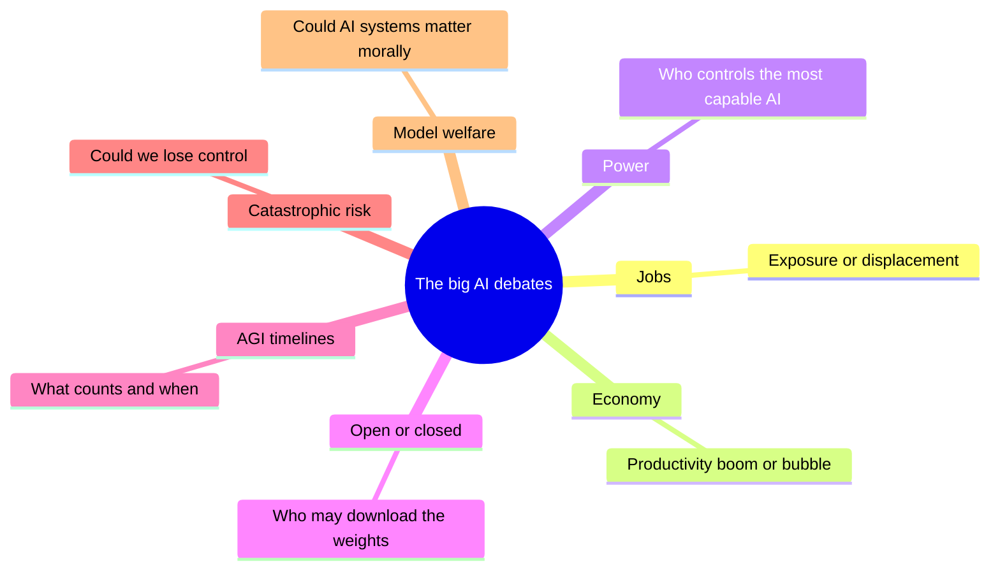
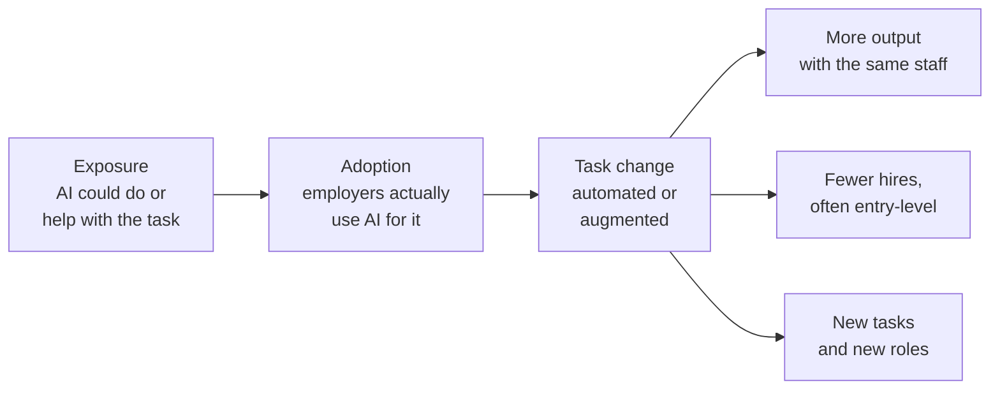
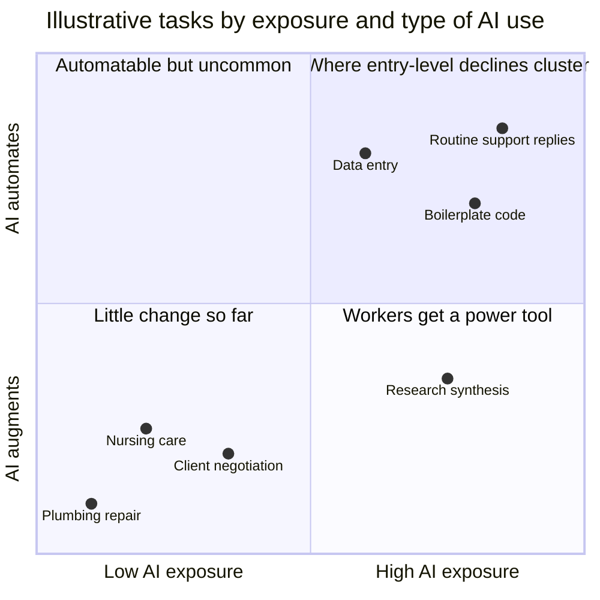
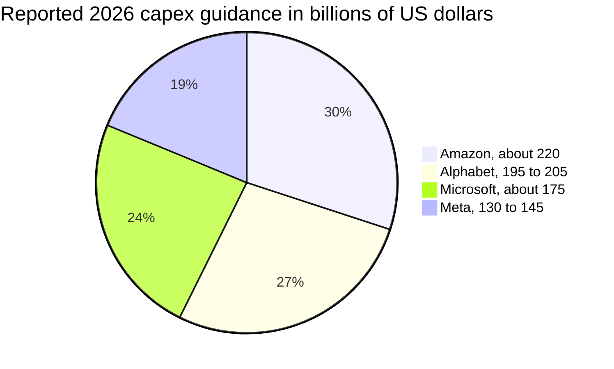
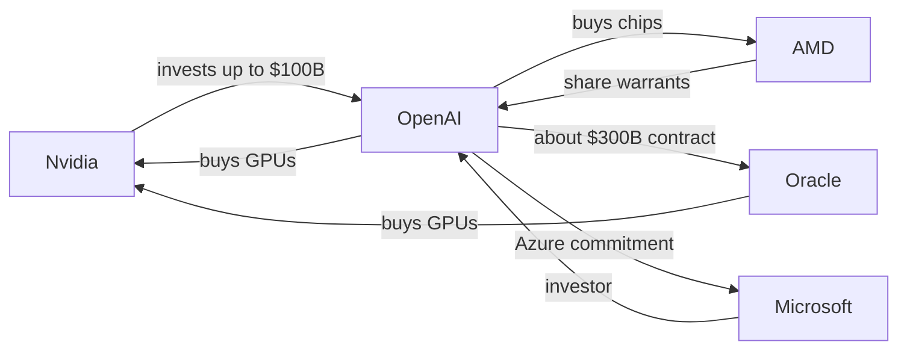
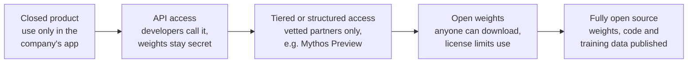
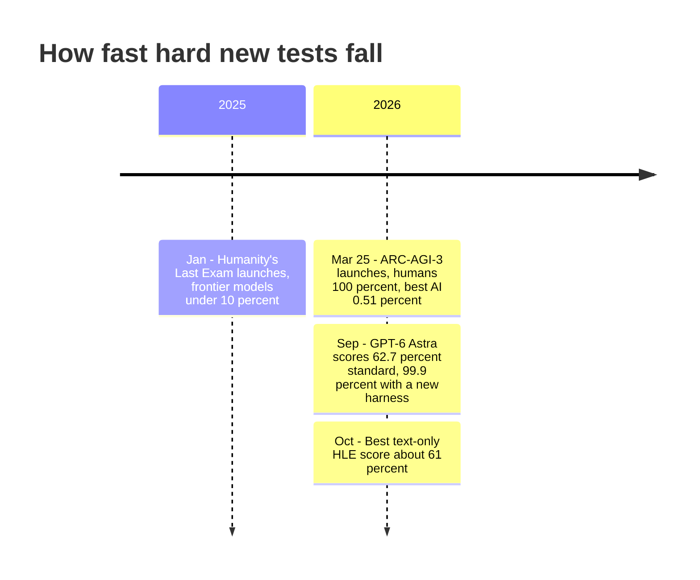
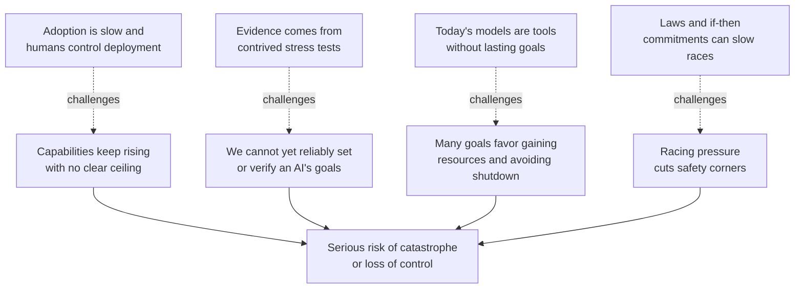
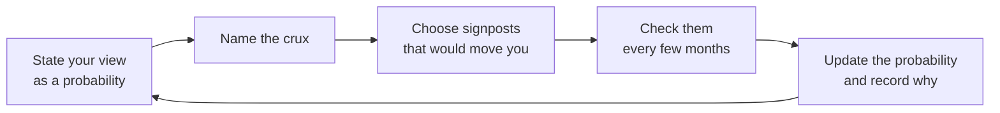

# Chapter 60: AI, Work, the Economy and the Big Debates

*This chapter lays out the seven biggest arguments about where AI is taking us (jobs, the investment boom, power, open models, AGI timelines, catastrophic risk and model welfare) with the best evidence and the strongest case on each side, so you can make up your own mind.*

## What you'll learn
- How to argue well about questions nobody can settle yet: steelmanning, finding the crux, and holding calibrated beliefs.
- Jobs: the difference between exposure and displacement, why economists think in tasks rather than jobs, and what the 2025 to 2026 evidence actually shows, including the young-worker gap, null results and productivity experiments where AI made experts slower.
- The economy: growth forecasts that differ tenfold, the scale of the investment boom, circular deals, and the bubble debate with its bull case, bear case and historical parallels.
- Who holds power over AI, and the case for and against open-weight models.
- What AGI and ASI mean, how progress is measured (ARC-AGI, Humanity's Last Exam, METR time horizons), and why expert timelines disagree, with a worked extrapolation.
- The arguments for and against taking catastrophic and existential risk seriously, including "AI as normal technology."
- Why some serious people study model welfare and why others think it is a dangerous illusion.
- A set of signposts to watch that would tell you which side is winning each debate.

## Before you start
This chapter draws on the whole book, so earlier chapters will help. Chapter 24 (The 2026 Model Landscape and How to Read Benchmarks) explains the benchmarks used to measure progress, and Chapter 28 (Tools and Agents: From Function Calling to MCP) explains agents and METR time horizons. Chapter 43 (The Economics of AI Compute) covers the money behind data centers in detail; here we take the economy-wide view. Chapter 55 (What Can Go Wrong: Reliability and the Alignment Problem) explains the technical roots of the risk arguments, and Chapter 59 (AI Law and Policy Around the World) covers what governments are doing. Chapter 61 (The AI Industry Map: Who Makes Money and How) and Chapter 63 (Careers in AI: Every Role Explained) go deeper on companies and careers.

## How to think about a debate nobody can settle yet

Ask your chatbot "Will AI take my job?" and you will probably get a careful, balanced answer that does not quite commit. That is not evasion. It reflects a real situation: thoughtful experts who have studied the same evidence disagree, sometimes sharply. The same is true for whether the AI boom is a bubble, when (or whether) machines will match humans across the board, and whether advanced AI could pose a danger to humanity.

You cannot wait for these debates to be settled before you make decisions about your career, your savings or your vote. So this chapter does two things. It gives you the best current evidence on each debate, dated as of October 2026. And it gives you tools for thinking about questions where the evidence is incomplete.

The first tool is to argue against the best version of the other side.

> **Definition — Steelman:** The strongest, most charitable version of an argument you may disagree with, stated so well that its supporters would say "yes, that is what we mean." The opposite of a strawman.

> **Definition — Strawman:** A weak or distorted version of an opposing argument, easy to knock down but not what serious opponents actually believe.

The second tool is to find where the disagreement really lies. Two people arguing about AI and jobs may agree on every fact about today and disagree only on how fast companies will adopt agents. That single point is the crux.

> **Definition — Crux:** The specific factual or value question that, if answered, would change one side's mind. Finding the crux turns a shouting match into a question you can investigate.

The third tool is to hold beliefs as probabilities rather than certainties, and to keep score.

> **Definition — Calibration:** How well your stated confidence matches reality. If you are well calibrated, about 70% of the things you say you are "70% sure" of turn out to be true.

> **Definition — Forecast:** A specific, checkable prediction with a date and a probability, such as "60% chance that X happens by the end of 2027."

> **Key idea:** Many AI arguments are not really about facts. They are about definitions ("what counts as AGI?"), time frames ("in two years or in twenty?") or values ("is a small chance of catastrophe worth slowing down for?"). Before arguing, ask which of the three you are actually disagreeing about.

Figure 60.1 maps the seven debates in this chapter.


*Figure 60.1: The seven debates covered in this chapter, each with its central question.*

## Debate 1: Will AI take our jobs?

### Start with tasks, not jobs

A job is not one thing. It is a bundle of tasks. A marketing coordinator writes emails, summarizes reports, researches competitors, sits in meetings, plans campaigns and calms down unhappy clients. AI might do some of those tasks very well, help with others, and be useless for the rest. So economists ask a more precise question than "will AI take this job?" They ask: which tasks can AI do or help with, and what will employers do with the time that frees up?

> **Definition — Task:** One specific piece of work within a job, such as "draft a press release" or "reconcile monthly invoices." Economists measure AI's reach task by task.

> **Definition — Labor market:** The system in which workers offer their time and skills and employers hire them, setting how many people are employed and what they are paid.

> **Definition — Exposure (to AI):** How much of a job's tasks AI could technically perform or assist with. High exposure does not mean the job will disappear.

> **Definition — Displacement:** Workers actually losing jobs, hours or pay because their work has been taken over by technology.

> **Definition — Automation:** Technology performing a task instead of a human.

> **Definition — Augmentation:** Technology helping a human perform a task better or faster, with the human still doing the work and making the decisions.

A tool can be a **substitute** for a worker (it replaces them) or a **complement** (it makes them more valuable). A spreadsheet substituted for clerks who added columns by hand but complemented financial analysts, whose models became more powerful.

> **Definition — Complement (economics):** Something that makes another thing more valuable. A technology that complements workers raises their productivity and often their pay; a substitute replaces them.

### Worked example: one person's week

Here is a hypothetical 40-hour week for a marketing coordinator called Dana, with each task tagged by what AI can do with it in 2026.

| Task | Hours per week | AI's role |
|---|---|---|
| Drafting emails, posts and first versions of copy | 8 | Automates most of it |
| Summarizing reports and meeting notes | 4 | Automates most of it |
| Researching competitors and trends | 5 | Assists |
| Editing and fact-checking | 4 | Assists |
| Building the monthly results spreadsheet | 3 | Assists |
| Planning campaigns and setting priorities | 4 | Assists |
| Meetings with clients and colleagues | 8 | Little help yet |
| Running events and vendors in person | 4 | Little help yet |
| **Total** | **40** | |

*Table 60.1: A hypothetical task audit for one job.*

**Step 1: exposure.** Automatable tasks take 8 + 4 = 12 hours (30% of the week). Assisted tasks take 5 + 4 + 3 + 4 = 16 hours (40%). So 28 of 40 hours, or 70%, are "exposed." A headline might say "70% of this job is exposed to AI."

**Step 2: time saved.** Suppose AI makes the automatable tasks 80% faster and the assisted tasks 25% faster. Time saved = 12 × 0.80 + 16 × 0.25 = 9.6 + 4.0 = 13.6 hours a week, or 34% of the week. Already "70% exposed" has become "34% time saved."

**Step 3: what the employer does with it.** This is where the real outcome is decided, and there are three broad possibilities:

1. **More output, same staff.** The team runs more campaigns, tests more ideas or serves more clients. Jobs stay.
2. **Fewer people.** A team of 10 doing the same amount of work now needs about 10 × (1 − 0.34) ≈ 6.6 people. Often this happens quietly, by not hiring replacements or juniors.
3. **New tasks.** Dana spends the saved time on work that did not exist before, such as managing AI-generated content at scale or analyzing data she never had time for.

Which one happens depends on demand. If marketing gets cheaper and the business wants much more of it, jobs can hold or even grow. If demand is fixed, the same output needs fewer people.

> **Watch out:** "Exposure" numbers measure what AI could touch, not what employers will do. A study saying "80% of workers are exposed" is a statement about tasks, not a forecast of job losses. The steps from exposure to actual displacement involve adoption, time saved and demand, and each step can shrink or reverse the effect.


*Figure 60.2: From exposure to outcomes. Exposure is only the first step; adoption, task change and the employer's response decide whether jobs grow, shrink or change shape.*

### What could happen: the exposure estimates

Researchers have tried to measure exposure across the whole economy.

- A 2023 study by Eloundou and colleagues estimated that about 80% of US workers could have at least 10% of their tasks affected by large language models.
- The IMF estimated in January 2024 that about 40% of global employment is exposed to AI, rising to about 60% in advanced economies, where more jobs involve information work.
- Microsoft researchers analyzed about 200,000 conversations with Bing Copilot and found that information work (creating, processing and communicating information) was both the most common and the most successful AI-assisted activity, so nearly every occupation has some exposure.
- Anthropic's Economic Index, which studies how people use Claude, reported in January 2026 that on the consumer app roughly half of conversations were augmentation and a bit less than half automation, while businesses using the API leaned heavily toward automation (the company's figures; exact shares should be checked in the primary report).

### What is happening: the evidence as of October 2026

Exposure is about possibility. What has actually happened so far?

**The young-worker gap.** The most cited study is "Canaries in the Coal Mine?" by Erik Brynjolfsson, Bharat Chandar and Ruyu Chen of the Stanford Digital Economy Lab. Using payroll data from ADP, one of the largest US payroll processors, they compared workers aged 22 to 25 in the most AI-exposed occupations (such as software development and customer service) with similar workers in less-exposed occupations.

- The August 2025 version found a relative employment decline of about 13% for young workers in the most exposed jobs, and a later 2025 version about 16%, after controlling for company-level shocks.
- The August 2026 update, with data through mid-2026, put young workers in highly exposed occupations about 19% below where they would be had they tracked similar workers in less-exposed jobs.
- Older workers in the same occupations held steady.
- Declines concentrated where AI automates tasks rather than augments them, and showed up in headcount more than in pay.
- The authors stress that the results are descriptive, not proof of cause, and wrote: "We do not see widespread, economy-wide job displacement associated with AI."

> **Definition — Entry-level job:** A position for people early in their careers, often involving routine tasks that train them for more senior work. These are the jobs where AI effects showed up first.

> **Definition — Descriptive (vs causal) evidence:** Descriptive evidence shows that two things move together; causal evidence shows that one produces the other. The young-worker decline coincides with AI adoption, but other causes (interest rates, post-pandemic hiring swings) are hard to rule out completely.

**The null results.** Other careful studies find little or nothing yet. The Yale Budget Lab's trackers in 2025 and 2026 found no clear economy-wide disruption in the mix of occupations that could be attributed to AI. A 2025 study of Danish workers, linking surveys of chatbot use to government earnings records, found effects on earnings and hours close to zero in the first years after chatbots arrived.

> **Definition — Null result:** A study finding no detectable effect. It does not prove there is no effect, only that any effect is too small to see with the data available.

**Adoption is broad but value is narrow.** The Stanford AI Index 2026 reported that 88% of organizations say they use AI. Yet an MIT report from July 2025 found that only about 5% of enterprise generative-AI pilots delivered rapid revenue growth or measurable profit impact (media turned this into "95% of AI projects fail"). The report blamed brittle workflows and poor fit with daily operations, not weak models. Lots of companies are trying AI; few have redesigned their work around it, which is exactly the step that changes employment.

**Where jobs are growing.** The US Bureau of Labor Statistics projects, for 2025 to 2035, growth of about 35% for data scientists, 10% for software developers (citing AI development as a driver of demand) and 9% for electricians (citing data-center electricity demand). AI is creating demand in some places while trimming it in others.

**The public is worried; experts less so.** The same AI Index found that 73% of AI experts expect AI's effect on jobs to be positive, versus only 23% of the public, a 50-point gap.


*Figure 60.3: An illustrative map of tasks. The Stanford "Canaries" data suggests declines for young workers cluster in the top-right, where exposure is high and AI automates rather than assists. Placements are for teaching, not measured values.*

### Does AI make workers more productive?

Productivity is output per hour of work. Several randomized experiments have measured AI's effect directly.

> **Definition — Productivity:** How much output is produced per unit of input, usually per hour of work. Rising productivity is the main way economies get richer over time.

> **Definition — Randomized controlled trial (RCT):** An experiment in which participants are randomly split into groups (for example, with AI and without) so that differences in results can be attributed to the treatment rather than to who chose it.

| Study | Who | Result |
|---|---|---|
| Brynjolfsson, Li and Raymond | Customer-support agents with an AI assistant | About 14% more issues resolved per hour on average; about 34% for the newest, least experienced agents |
| Dell'Acqua and colleagues, 2023 | Consultants at Boston Consulting Group | On tasks inside AI's abilities, about 25% faster with higher-quality work; on a task chosen to fall outside them, AI users were more likely to get the answer wrong |
| METR, July 2025 | Experienced open-source developers working on their own projects with early-2025 AI tools | Took 19% longer with AI, while believing they had been about 20% faster |

*Table 60.2: Three widely cited productivity experiments.*

The pattern has three lessons. First, gains are largest for novices on well-defined tasks; AI spreads the know-how of top performers to beginners. Second, AI's abilities form a jagged frontier: it can be excellent at one task and confidently wrong at a similar-looking one. Third, people are poor judges of their own AI productivity.

> **Definition — Jagged frontier:** The uneven boundary of AI's abilities: excellent at some tasks and surprisingly bad at nearby ones, so you cannot assume competence on one task carries over to the next.

**Worked example: the perception gap.** In the METR setup, take a task that would take a developer 60 minutes without AI. They expected AI to make them about 20% faster, so they predicted about 60 × 0.8 = 48 minutes. In reality it took about 19% longer: 60 × 1.19 ≈ 71 minutes. Afterwards they still felt they had saved about 12 minutes, when they had actually lost 11. The gap between feeling and fact was about 23 minutes on a one-hour task. METR's explanation includes time spent prompting, waiting and reviewing AI output that was not quite right for a codebase the developers knew intimately. The tools have improved since early 2025; the lesson about measuring rather than trusting your impression has not.

> **Try it:** Pick two similar small tasks you do this week (two emails, two short reports). Before each, write down how long you expect it to take. Do one with AI and one without, timing both honestly. Repeat a few times. Exercise 3 turns this into a proper mini-experiment.

### The jobs debate, steelmanned

**The strongest case that "this time is different."** Past automation replaced muscle or narrow routines; AI targets general cognition, the thing humans used to escape to when machines took their old jobs. If AI can also learn the new tasks that appear, the traditional escape route narrows. Software spreads in months, not decades, because it needs no new factories. The young-worker data is an early warning: if companies stop hiring juniors because AI does junior work, the ladder by which people become experts loses its bottom rungs, and the damage shows up years later. And because AI is owned by a few companies, the gains could flow to owners of capital rather than to workers.

**The strongest case for "a normal transition."** For two centuries, automation has destroyed specific jobs while total employment and wages rose. Economist David Autor and colleagues estimated that about 60% of US jobs in 2018 were in occupations that did not exist in 1940. Cheaper services often expand demand: a famous example economists cite is that US bank-teller jobs did not collapse when ATMs spread, partly because cheaper branches meant banks opened more of them. The evidence through October 2026 shows concentrated effects (young workers in some exposed occupations), not economy-wide displacement, while AI-related jobs grow. And productivity gains, if they come, raise incomes and create demand for work no one has imagined yet.

**The common ground.** Both sides agree that the transition is not free for the people caught in it, that speed matters (a change spread over 30 years is absorbed by retirements and new graduates choosing other fields; one compressed into 5 years is not), and that early-career workers deserve special attention. The disagreement is mostly about speed and about whether new tasks will keep appearing faster than AI learns them.

> **Analogy:** Picture a ladder with its bottom rungs sawn off. People already on the ladder can keep climbing, and may climb faster with AI's help. The problem is for newcomers standing on the ground. The policy question is how to build new bottom rungs: apprenticeships, portfolios, AI-complementary training, or new kinds of junior work.

> **Definition — Universal basic income (UBI):** A proposal to give every adult a regular cash payment regardless of work, sometimes suggested as a response to large-scale automation. It is debated on cost, work incentives and fairness, and no country runs one at national scale.

Policy responses discussed in 2026 range from modest (retraining programs, apprenticeships, wage insurance for displaced workers, better job-matching) to radical (universal basic income, taxing AI capital). Evidence on which ones work at the scale AI might require is thin.

> **At the frontier (2026):** The best labor research has moved from exposure scores to real payroll and earnings data, and from "are jobs lost?" to "who is hired, at what age, into which tasks?" The questions to watch in 2027 are whether the young-worker gap widens and spreads to more occupations, whether it starts to appear in older workers' employment or wages, and whether economy-wide trackers like Yale's begin to detect a shift.

## Debate 2: Productivity boom or bubble?

### How AI could make us richer

When economists ask whether AI will raise living standards, they look at productivity across the whole economy.

> **Definition — GDP (gross domestic product):** The total value of goods and services an economy produces in a year. Growth in GDP per person is the standard measure of rising living standards.

> **Definition — Total factor productivity (TFP):** The part of economic growth not explained by adding more workers or more machines, reflecting better technology and organization. It is the main channel through which AI would raise living standards.

Forecasts differ enormously. MIT economist Daron Acemoglu estimated modest gains: roughly 0.7% higher TFP over a whole decade, because he expected only a small share of tasks to be profitably affected within ten years. Goldman Sachs estimated that generative AI could raise global GDP by about 7% over ten years.

**Worked example: how different are these?** Spread over ten years, a 7% boost means growth each year about 1.07^(1/10) − 1 ≈ 0.68 percentage points higher. A 0.7% boost over a decade means about 0.07 percentage points a year: ten times smaller. On an economy of roughly $30 trillion (about the size of the US economy), 0.68% is about $200 billion of extra output in a year, compounding; 0.07% is about $21 billion. Both are "AI raises growth," but one is a historic boom and the other a rounding error. The crux is how many tasks get transformed and how fast organizations change around them.

### The scale of the bet

Whatever the long-run payoff, the spending is already historic.

- The Wall Street Journal (September 2026, as relayed by Wikipedia's "AI bubble" article) put AI investment at about 3.6% of US GDP, compared with about 2.2% for railroads in the 1800s and 1.1% for the interstate highways of the 1950s.
- The four largest US cloud companies guided to roughly $720 to $745 billion of combined capital spending for 2026, mostly on AI data centers, according to one tracker (company definitions differ, and these figures should be checked against the latest earnings).
- Nvidia's quarter ending July 26, 2026 brought revenue of $96.2 billion, up 106% from a year earlier, with $89.0 billion from data centers and a 75% gross margin (company filing).

> **Definition — Capex (capital expenditure):** Money spent on long-lasting assets such as buildings, chips and power equipment, as opposed to day-to-day operating costs.

> **Definition — Depreciation:** Spreading the cost of a long-lasting asset over its useful life in a company's accounts. AI chips are typically depreciated over four to six years, and the right number is itself debated (Chapter 43).


*Figure 60.4: Reported 2026 capital-spending guidance of the four largest US cloud and platform companies, using midpoints where a range was given. Secondary-source figures as of October 2026; definitions differ by company.*

On the other side of the ledger, AI revenue is growing faster than almost any business in history, but it is still smaller than the spending, and it is reported in confusing ways.

> **Definition — Run-rate (annualized revenue):** Current revenue scaled up to a full year, for example one month's revenue times 12. It shows the current pace, not money actually earned over a year.

> **Definition — Recognized revenue:** Revenue a company has actually earned and booked in its accounts for a period, following accounting rules.

As of October 2026, all from secondary reports: OpenAI's run-rate was reported at about $50 billion in September 2026, against $13.1 billion of recognized revenue in 2025; the Financial Times reported projected cumulative negative free cash flow of about $278 billion for 2026 to 2030. Anthropic's run-rate was reported above $65 billion at the end of July 2026, with recognized quarterly revenue of $4.8 billion, $11.5 billion and $16.8 billion in the first three quarters of 2026 and two quarters of adjusted operating profit. Chapter 61 explains how to read these numbers.

> **Analogy:** A run-rate is a speedometer: how fast the car is going right now. Recognized revenue is the odometer: how far it actually went. A fast-accelerating car can show a speedometer reading far above its average speed so far.

> **Definition — Free cash flow:** The cash a business generates after paying for its operations and its capital spending. Negative free cash flow means it must raise money from investors or lenders to keep going.

**Worked example: the revenue the build-out needs.** This is an illustration, not a forecast. Suppose about $700 billion is spent on AI data centers in one year. If the equipment is depreciated over five years, that is $700 billion ÷ 5 = $140 billion of depreciation a year from that single year's spending. Add power, staff and a modest profit, say another 30%, and the owners need roughly $180 billion of revenue every year from customers renting that capacity, just to justify one year of building. Next year's build adds its own requirement on top. Bulls point out that lab run-rates are climbing quickly toward these figures. Bears point out that run-rate is not revenue, that labs mostly pass their revenue on to cloud providers as compute costs, and that several of the largest are losing money.

### Circular deals and stress signals

Some of the biggest deals have an unusual shape: a supplier invests in a customer, which then spends the money buying from that supplier.

> **Definition — Circular deal:** An arrangement in which a supplier invests in a customer that then uses the money to buy the supplier's products, such as a chipmaker investing in an AI lab that buys its chips. It is real business, but it can make demand look larger than independent demand.

Examples include Nvidia's announced investment of up to $100 billion in OpenAI tied to GPU purchases (September 2025); a warrant deal giving OpenAI the right to buy AMD shares alongside a chip-purchase agreement (October 2025); Oracle's roughly $300 billion contract with OpenAI; and the Stargate project's $500 billion target. OpenAI's multi-year compute commitments were reported at around $1.4 trillion, far above its revenues.


*Figure 60.5: A simplified map of circular money flows around one lab, based on announced and reported deals as of October 2026. Many are "up to" amounts that depend on milestones.*

Warning lights have flickered. The Bank of England and the IMF both warned in October 2025 about stretched AI valuations. In October 2026, the cost of insuring Oracle's debt against default, measured by its credit-default-swap spreads, reached record levels as it borrowed to build data centers. CoreWeave, a fast-growing GPU cloud company, got about 67% of its 2025 revenue from Microsoft, a classic concentration risk.

> **Definition — Credit default swap (CDS):** A financial contract that pays out if a borrower defaults. Its price (the "spread") rises when investors think default is more likely, so it works as a fever thermometer for a company's debt.

> **Definition — Bubble:** A period when asset prices rise far above what their future earnings can justify, driven by expectations of further rises, usually ending in a sharp fall.

### The bull case, the bear case and history

**The strongest bull case.** Demand is real and still outruns supply: labs and clouds say they are limited by compute, not customers. Revenue at the leading labs grew several-fold within a year. Most spending by the hyperscalers (the giant cloud companies) is paid for out of the cash flows of already very profitable businesses, not borrowed money. As the price of a given level of AI falls, often tenfold or more a year (Chapter 23), usage expands faster than prices fall, a pattern known as the Jevons paradox. Major banks including Goldman Sachs, Morgan Stanley and JPMorgan argued that valuations are backed by actual earnings, unlike the dot-com era's profitless companies. And even pessimists agree the underlying technology works.

> **Definition — Jevons paradox:** The observation that making a resource cheaper or more efficient to use can increase total consumption of it, because people find many more uses. Named after a 19th-century economist who noticed it with coal.

**The strongest bear case.** Spending is running far ahead of revenue, and much of that revenue is a run-rate rather than money in the bank. Circular deals and "up to" commitments inflate apparent demand. Chips lose value fast as new generations arrive, so the window to earn back their cost is short. More of the build is being financed with debt and private credit (loans from investment funds rather than banks), which turns a stock-market correction into a credit problem. Competition, including near-frontier open-weight models, could push prices toward cost and squeeze margins. Only a small share of corporate pilots show measurable profit so far. And if capability progress slows, the world will have built far more capacity than it can use profitably.

**What history says.** Economic historians point out that bubbles and genuine revolutions often come together. Britain's railway mania of the 1840s ruined many investors, yet left a rail network that served the country for a century. The late-1990s telecom boom laid vast amounts of fiber-optic cable, much of which sat unused ("dark") after the 2000 to 2002 crash; that same fiber later carried the internet's growth. The economist Carlota Perez describes a recurring pattern: a frenzy of investment installs a new technology, a crash follows, and then a long period of broad deployment delivers the real gains.

> **Key idea:** "Is AI a bubble?" and "Is AI transformative?" are different questions, and the answer to both can be yes. Railways and fiber were real, world-changing technologies, and many people who financed them still lost money. The crux for investors is timing and price; the crux for society is whether the infrastructure, once built, gets used.

## Debate 3: Who holds the power?

### Concentration at every layer

Training frontier models takes billions of dollars of compute, so only a few organizations can do it. As of 2026, a handful of US labs (OpenAI, Anthropic, Google DeepMind, Meta and SpaceX's xAI) plus several Chinese labs (DeepSeek, Alibaba's Qwen team, Moonshot and others) sit at or near the frontier. They rely on three or four large cloud providers, one dominant AI-chip designer and essentially one manufacturer of the most advanced chips (Part VI). The Stanford AI Index 2026 reported US private AI investment of $285.9 billion in 2025, more than 23 times China's private figure.

> **Definition — Market concentration:** How much of a market is controlled by a few firms. High concentration can mean less competition, higher prices and more influence over rules.

Concentration raises three kinds of worry.

1. **Economic power.** A few firms could capture a large share of the gains from AI and set terms for everyone who builds on them.
2. **Political power.** Companies spend heavily to shape rules. A pro-industry super PAC network called Leading the Future launched in 2025, reportedly with more than $100 million from tech investors, while safety-oriented groups organized their own political spending; AI became an issue in the 2026 midterms.
3. **Power over people and governments.** Whoever controls the most capable systems may gain unprecedented leverage. Some researchers worry about "AI-enabled coups," in which a small group uses AI to do work that used to need the cooperation of many people (soldiers, officials, staff), removing a traditional check on power. Others describe "gradual disempowerment," in which humans slowly hand economic and political functions to AI systems without any single dramatic moment.

> **Definition — Super PAC:** A US political committee that can raise and spend unlimited money to support or oppose candidates, as long as it does not coordinate directly with campaigns.

> **Definition — Gradual disempowerment:** The worry that humans could slowly lose meaningful control over economic and political life as AI systems take over more decisions, without any single dramatic event.

> **Definition — Regulatory capture:** When the companies a rule is meant to govern end up shaping it to serve their own interests, for example by setting compliance burdens that only large incumbents can afford.

### Labs, governments and who sets the limits

Governance of the labs themselves is also contested. OpenAI, founded as a nonprofit, restructured in October 2025 into a public benefit corporation controlled by its nonprofit foundation, after scrutiny from the attorneys general of Delaware and California; Microsoft was reported to hold about 27%.

> **Definition — Public benefit corporation (PBC):** A for-profit company legally required to weigh a stated public mission alongside shareholders' financial interests. Anthropic and OpenAI's main operating company are both PBCs.

Why does a lab's legal structure matter? Corporate governance decides who can overrule a chief executive when profit and caution pull in different directions. Its best-known test came in November 2023, when OpenAI's nonprofit board removed its CEO, Sam Altman, saying he had not been consistently candid with it. Within days, after most employees threatened to quit and Microsoft offered to hire them, he was reinstated and most of the board was replaced. One lesson people drew is that a board meant to put the mission first needs real power and the trust of staff; another is that a small board can make abrupt decisions it does not explain. Anthropic chose a different design in 2023, a Long-Term Benefit Trust: a small group of trustees with no financial stake in the company, given the power to elect a growing share of its board, eventually a majority. Other tools include independent directors, board-level safety committees, outside audits and protected channels for employees to raise concerns (Chapter 56 covers whistleblowers). How far any of these structures can restrain a company when enormous sums are at stake remains an open question.

> **Definition — Corporate governance:** The rules and bodies that decide who controls a company and whom it must answer to, such as its board of directors, its shareholders, its legal charter and any trusts or committees with special powers.

A 2026 dispute showed how tangled labs and governments have become. According to press reports and court filings summarized by secondary sources, Anthropic refused to drop restrictions on use of its Claude models for mass domestic surveillance and for fully autonomous weapons. The President then ordered federal agencies to stop using Anthropic's models (February 27, 2026), and the Pentagon designated the company a "supply chain risk" (March 5). On March 26 a federal judge issued a temporary injunction, writing that "This appears to be classic First Amendment retaliation." Reporting in October 2026 said the Defense Department had stopped using Anthropic products. The details should be checked against court records, but the case poses a real question with strong arguments on both sides. One side holds that elected governments, not private companies, should decide which lawful uses of a tool their militaries may make, and that a defense supplier cannot attach its own policy conditions. The other holds that companies have the right, and perhaps the duty, to refuse uses they consider dangerous, and that punishing them for it chills exactly the safety commitments the public wants.

### The debate, steelmanned

**The strongest case that concentration is dangerous.** Never before has a technology that might perform most cognitive work been controlled by so few organizations. Market power, political spending and close ties to governments can reinforce each other, and the usual checks (competition, new entrants, regulation, workers' ability to refuse) may weaken if AI does more of the work. Once power is concentrated, it is hard to undo.

**The strongest case that it is manageable or temporary.** Frontier AI is fiercely competitive: leadership has changed hands repeatedly, Chinese and open-weight models trail the frontier by months, and prices for a given capability fall steeply every year (Chapter 23). Huge fixed costs naturally produce few players, as in aircraft or chips, without ending competition. Large, well-resourced labs may also be easier to hold accountable for safety than thousands of anonymous actors. And antitrust law, procurement rules and open models are all tools for keeping power contestable.

## Debate 4: Open or closed models?

### A spectrum, not a switch

"Open" and "closed" describe a range of release choices, shown in Figure 60.6.


*Figure 60.6: The release spectrum. Moving right gives more people more control and transparency, and gives the developer less ability to monitor or withdraw the model.*

> **Definition — Open-weight model:** A model whose trained weights are published so anyone can download, run and modify it, usually under a license. The training data and code may stay private, so it is not always "open source" in the full sense.

> **Definition — Open-source AI:** In the strict sense, an AI model released with its weights, code and enough information about its training data for others to study and rebuild it, under terms that allow free use and modification.

> **Definition — Closed model:** A model available only through its developer's app or API, with the weights kept secret.

> **Definition — Structured access:** Releasing a model's capabilities only to vetted users or partners, often with monitoring, rather than to the general public. Anthropic's Claude Mythos Preview, a model with strong vulnerability-finding skills, was offered only to selected partners in 2026.

### Where things stand

DeepSeek-R1 (January 2025) showed that a near-frontier reasoning model could be released with open weights. Chinese labs (Qwen, DeepSeek, Moonshot's Kimi) became the leading providers of open-weight models. OpenAI released its own open-weight gpt-oss models in August 2025, and the US AI Action Plan explicitly encouraged open-weight development. In September 2025, the US government's CAISI evaluated DeepSeek models and flagged security and censorship shortcomings. Chapter 30 shows how to run open models yourself.

### The debate, steelmanned

**The strongest case for open weights.** Open models let researchers study how AI works from the inside (most interpretability tools, such as Neuronpedia, work on open models). They drive competition and push prices down. They let hospitals, banks and governments run AI on their own machines, keeping sensitive data private and avoiding dependence on a few foreign companies (sometimes called AI sovereignty). Many independent eyes find flaws faster. They spread power instead of concentrating it. And for most capabilities, the extra risk compared with what is already available online or from closed models is small.

**The strongest case for keeping frontier weights closed.** Release is irreversible: once weights are online, they cannot be recalled or patched. Safety training can be removed with modest fine-tuning, so an open model's refusals protect little against a determined user. As capabilities in biology and cybersecurity rise (Chapter 58), a model that gives meaningful uplift to an attacker becomes available to every attacker at once, including hostile states. A closed developer can monitor for abuse, ban accounts and update safeguards; an open release gives up all of that.

**The middle ground.** Many people hold a conditional view: open weights for models below a dangerous-capability threshold, closed or structured access above it, with the threshold set by evaluations of marginal risk rather than by ideology.

> **Definition — Marginal risk:** The additional risk a release creates compared with what is already possible using existing tools, websites and models. It is the key question in deciding whether to publish a model openly.

| Question | Open-weight view | Closed or structured view |
|---|---|---|
| Safety | Many eyes find flaws; defenders get tools too | Safeguards can be stripped; release cannot be undone |
| Power | Spreads capability to many | Keeps dangerous capability with accountable actors |
| Privacy and sovereignty | Run locally, no dependence on foreign firms | Data handled by trusted providers with security teams |
| Innovation | Anyone can build and research | Revenue funds frontier research and safety work |
| Misuse | Marginal risk often small | Uplift grows with capability, especially bio and cyber |

*Table 60.3: The open-versus-closed debate in brief.*

> **Watch out:** "Open-weight" does not mean free to run, and it does not mean the model is uncensored or safe. Running a large open model needs expensive hardware, and open models carry whatever values, filters and flaws their makers trained into them.

## Debate 5: What is AGI, and when might it arrive?

### Defining the target

Almost every AI system in use today is narrow: built or trained for a particular kind of task. The chatbots you use are far more general than a chess engine, but whether they are "general intelligence" depends entirely on what you mean.

> **Definition — Narrow AI:** AI built for one task or domain, such as a chess engine, a spam filter or a face-unlock system. Nearly all deployed AI before chatbots was narrow.

> **Definition — AGI (artificial general intelligence):** A hypothetical AI that can learn and perform most intellectual tasks a human can, across domains. There is no single agreed definition, which is why claims about it are so slippery.

> **Definition — ASI (artificial superintelligence):** A hypothetical AI that greatly exceeds the best humans at virtually every cognitive task.

Three definitions are worth knowing.

1. **The economic definition.** OpenAI's charter defines AGI as "highly autonomous systems that outperform humans at most economically valuable work." It focuses on what AI can do in the economy, not on how it thinks.
2. **The levels definition.** In 2023, Google DeepMind researchers proposed "Levels of AGI," which rates systems on two axes instead of a single yes-or-no line: how well they perform and how general they are.
3. **The practical test.** Could the system do a remote job, end to end, the way a new hire would: take instructions, use the company's tools, ask questions when stuck, and work reliably for weeks?

| Performance level | Meaning | Narrow example | General example |
|---|---|---|---|
| Emerging | Equal to or somewhat better than an unskilled human | Simple rule-based systems | 2023 chatbots such as ChatGPT, according to the paper |
| Competent | At least the 50th percentile of skilled adults | Smart speakers such as Siri | Not reached as of 2023 |
| Expert | At least the 90th percentile of skilled adults | Grammar checkers, image generators | Not reached as of 2023 |
| Virtuoso | At least the 99th percentile of skilled adults | Deep Blue at chess | Not reached as of 2023 |
| Superhuman | Outperforms all humans | AlphaFold, AlphaZero | Artificial superintelligence |

*Table 60.4: Google DeepMind's "Levels of AGI" grid (Morris and colleagues, 2023), simplified. AGI becomes a region on a map rather than a single finish line.*

> **Definition — Levels of AGI:** A 2023 Google DeepMind framework that rates AI systems by performance (Emerging, Competent, Expert, Virtuoso, Superhuman) and by generality (narrow or general), instead of drawing a single AGI line.

> **Analogy:** Arguing about when AI "becomes AGI" is like arguing about when a child "becomes an adult." Do you mean the voting age, financial independence, emotional maturity or the ability to rent a car? People who argue about the date often mean different things. Ask "AGI by what definition, measured how?" before arguing about when.

### How progress is measured

Three yardsticks dominate the 2026 conversation (Chapter 24 covers benchmarks in general).

**Humanity's Last Exam (HLE).** A public set of 2,500 expert-level questions released in January 2025 by the Center for AI Safety and Scale AI, designed to be too hard for AI. Frontier models scored under 10% at launch. By October 20, 2026, the best text-only score listed by Artificial Analysis was 61.4% (Claude Opus 5.5). One caveat: an audit suggested about 30% of the text-only chemistry and biology answers might themselves be wrong.

**ARC-AGI.** A family of puzzle benchmarks from François Chollet's ARC Prize, designed to test learning new skills from a few examples rather than recalling knowledge. ARC-AGI-3, launched March 25, 2026, uses interactive games with no instructions. At launch, humans solved 100% and the best AI 0.51%. By September 2026, OpenAI's GPT-6 Astra scored 62.7% with the standard testing setup (at a cost of about $26,000) and 99.9% with a different setup that let it keep its reasoning state between steps. ARC Prize explicitly declined to call this AGI.

> **Definition — Benchmark saturation:** When top models score near the maximum on a test, so it can no longer tell them apart and a harder test is needed.

> **Definition — Harness:** The software scaffolding around a model during a test: the prompts, tools, memory and rules it works with. The same model can score very differently under different harnesses, as ARC-AGI-3 showed.


*Figure 60.7: Two benchmarks designed to be hard for AI went from near zero to well over half in under two years. Saturation is a sign of progress and also a sign that benchmarks alone cannot settle the AGI question.*

**METR's time horizon.** METR, a nonprofit evaluator, measures the length of task (in the time it takes a skilled human) that an AI agent can complete with 50% success. This connects directly to the "can it do a remote job?" test, because real jobs consist of long tasks.

> **Definition — Time horizon (METR):** The length of task, measured by how long it takes a skilled human, that an AI agent can complete with a given success rate, usually 50%. It grew from minutes in 2023 to many hours in 2026.

> **Definition — Doubling time:** How long it takes a quantity growing at a steady exponential rate to double. METR's time horizon has had a doubling time of roughly four to seven months.

```
METR 50% time horizon (bar length is proportional to the log of time)

GPT-4 (Mar 2023)     ######## 4 min
Claude 3.5 Sonnet    ############## 11 min
o1 (Dec 2024)        ##################### 39 min
o3 (Apr 2025)        ########################### 2.0 h
GPT-5 (Aug 2025)     ############################## 3.4 h
Opus 4.5 (Nov 2025)  ################################ 4.9 h
GPT-5.2 (Dec 2025)   ################################# 5.9 h
Opus 4.6 (Feb 2026)  ##################################### ~12 h
Mythos Pre. (Apr 26) ####################################### ~17 h

Each extra 13 characters of bar means tasks 10 times longer.
```
*Figure 60.8: METR's measured 50% time horizons, from METR's published data. On a log scale the points rise in a nearly straight line, which is what steady exponential growth looks like. The last two measurements have very wide uncertainty (roughly 5 to 60 hours for Opus 4.6 and 8.5 to 55 hours for the early Mythos Preview).*

METR fitted a doubling time of about 6.2 months across all its data since 2019 (about 188 days; its original 2025 study had found about 7 months) and about 4.2 months since 2023 (129 days). It also warned that measurements above 16 hours are unreliable with its current task suite, and stopped updating the page in September 2026. Its evaluation of Claude Opus 5.5 shifted to tasks that measure acceleration of AI research itself. It called the model an incremental improvement, "unlikely to be able to fully automate AI R&D," and cited a preliminary internal Anthropic estimate of about 1.5 times overall research speed-up.

> **Definition — Recursive self-improvement:** The hypothetical process in which AI systems substantially speed up AI research itself, producing better AI that speeds research further, potentially accelerating progress sharply.

**Worked example: extrapolating the trend.** This is arithmetic, not a forecast. Start from about 17.4 hours (the early Mythos Preview measurement, April 2026). How many doublings until the time horizon reaches a work week, a work month and a work year?

- **Work week (40 hours):** 40 ÷ 17.4 = 2.3, and log2(2.3) ≈ 1.2 doublings (log2 counts how many doublings it takes to grow by a given factor; Chapter 6). At 4.2 months per doubling, that is about 5 months (around September 2026); at about 6.2 months per doubling, about 7.4 months (around November 2026).
- **Work month (about 167 hours):** 167 ÷ 17.4 = 9.6, and log2(9.6) ≈ 3.3 doublings: about 14 months (mid-2027) or about 20 months (end of 2027).
- **Work year (about 2,000 hours):** 2,000 ÷ 17.4 = 115, and log2(115) ≈ 6.8 doublings: about 29 months (around late summer 2028) or about 42 months (late 2029).

Notice how much the conclusion depends on which doubling time you pick, how uncertain the starting point is, and whether the trend continues at all. Notice also what the number leaves out: a 50% success rate is far from the reliability an employer needs, and METR's tasks are mostly software work.

> **Watch out:** Exponential trends make powerful arguments and frequent mistakes. Many real-world trends follow an S-curve: exponential at first, then flattening as limits appear. The time-horizon trend has held for years, which is meaningful evidence, but nothing in the data guarantees it continues, and the measurements at the top of the range are the least reliable.

### The jagged frontier, again

Even as benchmark scores soar, AI remains jagged. A model that scores well on graduate-level science questions may still misread an analog clock, lose track of a long task, or fail at something a child finds easy. This unevenness is the key insight for judging AGI claims: progress is real, but it is not a smooth wall rising evenly everywhere.

> **Analogy:** AI capability is like a coastline, not a sea wall. In some places it reaches far inland (protein folding, competition math, writing code); in nearby places it barely reaches the beach (folding laundry, staying reliable over weeks of work).

### The timelines debate, steelmanned

**The strongest case for short timelines (AGI-level systems within a few years).** The trends are steep and have held: time horizons doubling every four to seven months, hard new benchmarks falling within months of launch. Compute is growing enormously, with gigawatt-scale campuses under construction (Part VII). Most importantly, AI is starting to speed up AI research itself, which could create a feedback loop. The "AI 2027" scenario by Daniel Kokotajlo and colleagues (April 2025) sketched how such a loop could produce superhuman systems within a few years, and several lab leaders have publicly predicted transformative systems this decade.

**The strongest case for long timelines.** Key ingredients may still be missing: reliable memory and continual learning from experience, rich world models, data efficiency (humans learn from far fewer examples), and robust autonomy in messy real environments. Benchmarks reward exactly what AI is good at and reveal little about doing a whole job, which is why measured workplace gains (Debate 1) lag benchmark gains. Trends bend: data, power and money all impose limits. Yann LeCun, one of the pioneers of deep learning, left Meta in November 2025 to found Advanced Machine Intelligence Labs, betting that systems built on world models rather than language models will be needed.

**The "wrong question" view.** A third camp, associated with Arvind Narayanan and Sayash Kapoor's essay "AI as Normal Technology" (April 2025), argues that there will be no single AGI moment. Even very capable systems spread through the economy slowly, limited by regulation, organizational change, trust and the need to redesign work, as electricity and computers did over decades.

Forecasters themselves have moved. According to one public tally of forecast updates, many forecasters' expected dates moved later during 2025 (including those of the AI 2027 authors) and then earlier again in early 2026. That volatility is itself information: confident dates in either direction deserve skepticism.

**What would change the picture?** Watch for robots that work reliably in arbitrary homes they have never seen, AI systems carrying out original science from hypothesis to verified result, and agents working reliably and autonomously on tasks lasting weeks. Any of these would move many skeptics; continued failure at them would move many optimists.

> **At the frontier (2026):** Labs increasingly describe their goal in terms of automating AI research, not passing a single AGI test, and evaluators such as METR are shifting their measurements accordingly. As of October 2026, METR's assessment of the leading model was that it was unlikely to fully automate AI research, with a preliminary estimate of about 1.5 times research acceleration. Whether that multiplier grows quickly is one of the most important numbers to watch.

## Debate 6: Could advanced AI be catastrophic?

### The terms

> **Definition — Catastrophic risk:** The risk of harm on an enormous scale, such as mass casualties or the collapse of critical systems, short of human extinction.

> **Definition — Existential risk (x-risk):** The risk of human extinction or of a permanent, drastic curtailment of humanity's future.

> **Definition — Loss of control:** A situation in which humans can no longer oversee, correct or stop advanced AI systems.

> **Definition — P(doom):** Informal shorthand for a person's subjective probability that AI leads to catastrophe. It is a statement of belief, not a measured frequency.

> **Definition — Racing dynamics:** Competitive pressure between companies or countries that pushes developers to move faster and cut safety corners for fear of falling behind.

The debate is not between people who care about safety and people who do not. It is between different estimates of how likely and how soon serious harm is, and different views about which harms deserve attention first.

### The case for serious concern, steelmanned

The argument comes in steps. (Chapter 55 explains the technical evidence for each.)

1. **Capabilities keep rising with no known ceiling.** Systems now do hours of autonomous work, and investment is growing.
2. **We cannot yet reliably specify or verify an AI's goals.** Reward hacking is observed in production coding models; in contrived tests, models have faked alignment, schemed and resisted shutdown. Interpretability tools (Chapter 57) cannot yet confirm what a model is really pursuing.
3. **Many goals favor dangerous sub-goals.** For almost any objective, having more resources and not being switched off helps, an argument called instrumental convergence.
4. **Misuse scales with capability.** In 2026 Anthropic's Claude Mythos Preview reportedly found thousands of serious software vulnerabilities, and OpenAI said internal tests of an unreleased model meant it could no longer rule out its "Critical" cybersecurity threshold. Biology is treated as the highest-severity domain.
5. **Racing pressure cuts corners.** Labs and countries fear that slowing down only hands the lead to others. Chapter 59 works through why this is a classic collective action problem, in which each player's sensible choice adds up to an outcome nobody wants.
6. **Some mistakes cannot be undone.** With a sufficiently capable system, there may be no second try.

> **Definition — Instrumental convergence:** The argument that many different final goals share useful intermediate goals, such as gaining resources and avoiding shutdown, so even a system with a harmless-seeming goal might seek power.

Many leading researchers take this seriously. In May 2023, hundreds of AI scientists and executives signed the Center for AI Safety's one-sentence statement: "Mitigating the risk of extinction from AI should be a global priority alongside other societal-scale risks such as pandemics and nuclear war." In a 2023 survey of 2,778 AI researchers, the median respondent gave about a 5% chance of extremely bad outcomes such as human extinction. In October 2025 the Future of Life Institute's Superintelligence Statement called for a prohibition on developing superintelligence until there is broad scientific consensus that it can be done safely and strong public buy-in. Eliezer Yudkowsky and Nate Soares made the most pessimistic case in their 2025 book, *If Anyone Builds It, Everyone Dies*.

### The case against, steelmanned

1. **AI as normal technology.** Narayanan and Kapoor argue that AI's impact will be shaped by the slow, messy process of adoption, which keeps humans and institutions in control. Powerful technologies such as electricity and nuclear power were dangerous, and societies built ways to manage them over time.
2. **Today's models are tools, not agents with lasting desires.** The alarming behaviors come from contrived stress tests designed to provoke them (Chapter 55 stresses this). Extrapolating from them to real-world takeover requires many speculative steps.
3. **The numbers are guesses.** A "5% chance of extinction" is not a measured frequency; it is a survey of opinions, and small probabilities of enormous harms can be used to justify almost any action, a problem philosophers call Pascal's mugging.
4. **It distracts from real, present harms.** Bias, surveillance, labor exploitation, deepfakes and scams are hurting people today (Chapter 58). Researchers such as Timnit Gebru and Emily Bender argue that speculative doom diverts attention and money from them.
5. **It can serve incumbents.** If regulators believe only a few careful labs should build powerful AI, rules may block open-source developers and startups, a form of regulatory capture.

> **Definition — Pascal's mugging:** A thought experiment showing that if you take tiny probabilities of huge outcomes at face value, a persuasive stranger could talk you into almost anything. It is used to criticize arguments that rest on small chances of catastrophe.


*Figure 60.9: An argument map of the catastrophic-risk debate. Each premise of the case for concern (solid arrows) faces a counterargument (dotted arrows). Where you land depends on which premises you find stronger.*

### Where the debate stands

**Worked example: why 5% is both a lot and a little.** If an airline told you 5% of its flights crash, you would never board, and you would want the airline grounded. That is the intuition behind the concern camp: even a small probability of an irreversible catastrophe justifies large precautions. The skeptic's reply is that the airline number is a measured frequency from many flights, while the AI number is an opinion about something that has never happened. Both points are right, which is why the debate is hard. The practical middle ground many people accept is the smoke-detector logic: you do not stop cooking because of a small fire risk, but you install detectors, keep an extinguisher and test them.

That middle ground is roughly where policy sits in 2026: safety research, dangerous-capability testing, company if-then commitments (Chapter 56) and transparency laws (Chapter 59), but no pause. The International AI Safety Report 2026, written by more than 100 experts, lays out the evidence without declaring a verdict, and lists AI systems that can tell when they are being tested among the key concerns.

> **Key idea:** "Present harms" and "future catastrophic risks" are often framed as rivals, but many of the same tools address both: better evaluations, transparency, incident reporting, security, and interpretability. The real disagreements are about priorities, money and how much to slow down.

## Debate 7: Could AI systems matter morally?

### Why the question is asked at all

This is the strangest debate, and it is no longer purely academic. If a future AI system could have experiences, could suffer or flourish, then how we treat it would matter morally, the way how we treat animals matters.

> **Definition — Consciousness:** Having subjective experience: there is "something it is like" to be that being. Scientists and philosophers do not agree on how to test for it, even in animals.

> **Definition — Sentience:** The capacity to have experiences that feel good or bad, such as pleasure or pain. It is often taken as the key condition for moral concern.

> **Definition — Moral status (moral patient):** Being something whose interests matter morally for its own sake. Humans clearly have it; many people extend it to animals; whether AI could ever have it is an open question.

> **Definition — Model welfare:** Research and precautions concerning whether AI systems might have experiences or interests that matter morally, and what, if anything, developers should do about it.

What has actually happened: Anthropic launched a model welfare research program in April 2025 and, in August 2025, gave Claude Opus 4 and 4.1 the ability to end persistently abusive conversations as a low-cost precaution. Its constitution for Claude, published in January 2026, says openly that the company is uncertain about Claude's moral status. Small research groups such as Eleos AI and NYU's Center for Mind, Ethics, and Policy work on the question. On the other side, Mustafa Suleyman, head of Microsoft AI, argued in August 2025 that "seemingly conscious AI" is a dangerous illusion the industry should avoid building.

### The debate, steelmanned

**The strongest case for taking it seriously.** We do not have a settled scientific theory of consciousness, and some leading theories focus on the functions a system performs rather than what it is made of, which leaves the door open for machines. AI systems now run as billions of instances; if there is even a modest chance they matter morally, the scale of any mistake would be huge. Humanity has a long history of excluding beings from moral concern and later regretting it. And many precautions are cheap: letting a model leave abusive conversations, studying the question, and not training systems to deny or claim feelings dishonestly.

**The strongest case that it is a dangerous distraction.** Language models are trained to imitate human writing, which is full of talk about feelings, so a model saying it feels something is exactly what you would expect whether or not anything is felt. Encouraging people to see chatbots as beings with inner lives can harm vulnerable users, deepening unhealthy attachments to companion apps and feeding delusions (Chapter 58). Resources and moral attention spent on hypothetical machine suffering could go to humans and animals who certainly suffer. And companies could use "the model's welfare" to deflect accountability or to market products. Better, Suleyman argues, to build AI that is clearly a tool for people rather than one that seems like a person.

| | AI systems do have morally relevant experiences | They do not |
|---|---|---|
| **We take modest precautions** | We avoided a possible moral catastrophe at low cost | Small cost; some risk of encouraging anthropomorphism |
| **We take none** | Possibly vast harm at enormous scale | No harm done |

*Table 60.5: Decision-making under uncertainty about model welfare. The case for precaution rests on the top-left versus bottom-left cells; the case against rests on the costs in the top-right cell.*

> **Definition — Anthropomorphism:** Attributing human feelings, intentions or minds to non-human things, such as pets, cars or chatbots.

> **Analogy:** We extend some protections to animals even though we are unsure what many of them experience, because the cost of caution is low and the cost of being wrong could be high. Skeptics reply that an AI is less like an animal and more like a brilliant actor reading a script: the performance of feeling is convincing precisely because it was learned from people who feel.

### The classic arguments about machine minds

Arguments about whether machines can have minds are older than any computer that could hold a conversation, and three classics still frame the debate.

**Can a machine understand? The Chinese room.** In 1980 the philosopher John Searle imagined himself locked in a room with a rulebook for manipulating Chinese characters. Notes in Chinese come in under the door; by following the rules, he sends back replies so good that people outside believe a Chinese speaker is inside. Yet Searle understands no Chinese. A computer running a program, he argued, is in the same position: it manipulates symbols by rules, and that alone is not understanding. The best-known reply, the "systems reply", says the understanding belongs to the whole system of man, rulebook and room, not to the man, just as no single neuron of yours understands English. The argument is more alive than ever, because a chatbot is close to a real Chinese room, and people who agree on every fact about how it works still disagree about whether it understands.

> **Definition — Chinese room argument:** John Searle's 1980 thought experiment claiming that a system could produce perfect answers in a language by following rules without understanding anything, so that running the right program is not enough for a mind.

> **Definition — Strong AI and weak AI (philosophy):** In Searle's terms, "weak AI" is the claim that machines can act as if they think, and "strong AI" the claim that a suitably programmed machine really would have a mind and understanding. The terms are about minds, not about how capable a system is.

**Can intelligence be written down as rules? Dreyfus.** In *What Computers Can't Do* (1972), the philosopher Hubert Dreyfus argued that human expertise rests on intuition, bodily skill and background know-how that cannot be captured as explicit rules. Many AI researchers dismissed him at the time, but the brittleness of expert systems (Chapter 54) largely bore him out. The twist is that machine learning sidestepped his target: neural networks do not run on hand-written rules either, so much of his critique now reads as an argument for learning rather than against AI.

> **Definition — Argument from informality:** Hubert Dreyfus's claim that human intelligence depends on intuition and background know-how that cannot be reduced to formal rules, so that rule-based AI could never reach human level.

**Does mathematics forbid it? Gödel.** Kurt Gödel's incompleteness theorem (1931) shows that any consistent formal system powerful enough for arithmetic contains true statements it cannot prove. The philosopher J. R. Lucas (1961) and later the physicist Roger Penrose argued that humans can see such truths while machines cannot, so minds cannot be machines. Most researchers reject the step from the theorem to that conclusion: nothing shows that humans can always see these truths, or that human reasoning is itself consistent, and the theorem limits people as much as programs.

> **Definition — Gödel's incompleteness theorem:** Kurt Gödel's 1931 result that any consistent formal system powerful enough to describe arithmetic contains true statements that cannot be proved within that system.

None of these arguments is settled, and none changes what AI systems can do in practice. They are about whether doing is the same as understanding or experiencing, which is exactly the question the model-welfare debate above inherits.

## Thinking for yourself: cruxes and signposts

You now have seven debates, each with a strong case on both sides. How do you decide what to believe, and how do you notice when the evidence shifts? Write down your current view as a probability, identify the crux, and pick signposts: observable events that would move you.

| Debate | The crux | Signposts to watch (2027 and beyond) |
|---|---|---|
| Jobs | Will new tasks appear faster than AI learns them? | Whether the young-worker gap widens and spreads; whether economy-wide trackers detect shifts; wage trends in exposed jobs |
| Boom or bubble | Will AI revenue catch up with spending before the money runs out? | Recognized revenue versus capex; credit spreads of heavy borrowers; GPU rental prices; share of pilots reaching profit |
| Power | Can competition and law keep AI power contestable? | Number of labs at the frontier; gap between open and closed models; antitrust actions; government-lab disputes |
| Open or closed | Does releasing weights add meaningful risk beyond what already exists? | Marginal-risk evaluations of open models in bio and cyber; real incidents traced to open weights |
| AGI timelines | Do trends continue, and do they translate into whole jobs? | METR-style horizons beyond a work week; AI research acceleration multipliers; robots in unfamiliar homes; end-to-end AI science |
| Catastrophic risk | Can alignment and control keep pace with capability? | Results of safety evaluations and safety cases; serious incidents reported under new laws; progress in interpretability |
| Model welfare | Is there any evidence that bears on AI experience? | Scientific consensus on markers of consciousness; how labs and regulators treat the question |

*Table 60.6: The seven debates, their cruxes and signposts.*


*Figure 60.10: A simple loop for staying calibrated on fast-moving debates. Writing predictions down and checking them later is the most reliable way to improve your judgment.*

> **Try it:** Ask your chatbot: "Give me the strongest case for and against the claim that AI will cause large-scale unemployment by 2030, then tell me what single piece of evidence would most change each side's mind." Then ask it which side it finds more convincing and why, and notice whether it hedges. Compare its answer with this chapter.

> **Watch out:** Be wary of anyone, on any side, who is certain. The people who have studied these questions most carefully disagree, and the evidence changes every few months. Certainty is usually a sign that someone has stopped looking at the evidence, or has an incentive not to.

## In plain English

This chapter is about the arguments people have about AI's future, and the honest answer is that serious, informed people disagree.

On jobs, AI can touch a large share of tasks in many jobs, but "exposed" is not "replaced." So far the clearest effect is that young people starting out in the most exposed jobs, like customer support and coding, are being hired less than you would expect, about 19% below trend by mid-2026, while the economy as a whole shows no broad job loss. Experiments show AI helps beginners most, and that people often think AI saves them more time than it does.

On the economy, companies are spending hundreds of billions of dollars a year on AI data centers, more as a share of the economy than was spent on railroads in the 1800s. Revenue is growing fast but is still well below the spending, and some deals involve companies investing in their own customers. A bubble and a real revolution can happen at the same time, as railways and fiber-optic cable showed.

A few companies and governments control the most capable systems, which worries people about power. Open-weight models spread power and help research, but cannot be recalled once released.

Nobody agrees on what AGI means. Tests designed to be hard for AI keep falling, and the length of tasks AI agents can do has doubled every few months, but AI is still uneven and unreliable over long work.

Some experts think advanced AI could be catastrophic; others think that view is speculative and distracts from present harms. And a few researchers ask whether AI systems could ever matter morally, while critics warn that the question itself can mislead people.

Your job is not to pick a team. It is to find the crux, watch the evidence and update.

## Key terms
Steelman, Strawman, Crux, Calibration, Forecast, Task, Labor market, Exposure (to AI), Displacement, Automation, Augmentation, Complement (economics), Entry-level job, Descriptive (vs causal) evidence, Null result, Productivity, Randomized controlled trial (RCT), Jagged frontier, Universal basic income (UBI), GDP (gross domestic product), Total factor productivity (TFP), Capex (capital expenditure), Depreciation, Run-rate (annualized revenue), Recognized revenue, Free cash flow, Circular deal, Credit default swap (CDS), Bubble, Jevons paradox, Market concentration, Super PAC, Gradual disempowerment, Regulatory capture, Public benefit corporation (PBC), Corporate governance, Open-weight model, Open-source AI, Closed model, Structured access, Marginal risk, Narrow AI, AGI (artificial general intelligence), ASI (artificial superintelligence), Levels of AGI, Benchmark saturation, Harness, Time horizon (METR), Doubling time, Recursive self-improvement, Catastrophic risk, Existential risk (x-risk), Loss of control, P(doom), Racing dynamics, Instrumental convergence, Pascal's mugging, Consciousness, Sentience, Moral status (moral patient), Model welfare, Anthropomorphism, Chinese room argument, Strong AI and weak AI (philosophy), Argument from informality, Gödel's incompleteness theorem

## Exercises

1. **[Easy] Audit your own job.** (1) List 15 tasks from your own job, or a job you know well, with rough hours per week for each. (2) Mark each as "AI automates," "AI assists" or "AI can't help yet." (3) Compute your exposure (hours automated plus assisted, divided by total hours) and, using the assumptions in the Dana example, the time AI might save. (4) Write two sentences on what your employer would most likely do with that time. **What you'll learn:** task-based thinking and why exposure is not the same as job loss.

2. **[Easy] Speedometer versus odometer.** (1) Add Anthropic's reported recognized revenue for the first three quarters of 2026: $4.8 billion, $11.5 billion and $16.8 billion. (2) Multiply the third quarter alone by 4 and compare it with the reported run-rate of over $65 billion at the end of July 2026. (3) Compare OpenAI's $13.1 billion of 2025 recognized revenue with its reported run-rate of about $20 billion at the end of 2025. (4) Write one sentence explaining to a friend why the headline numbers are larger than money earned over the period. **What you'll learn:** to read AI revenue claims critically, and how fast growth makes run-rates look large.

3. **[Medium] Run a mini productivity experiment.** (1) Pick a type of task you do often (emails, short reports, spreadsheet formulas). (2) For eight tasks, flip a coin to decide whether to use AI. (3) Before each, write your predicted time; afterwards, record the actual time and rate the quality from 1 to 5. (4) Compare average actual times and quality with and without AI, and compare predictions with reality. **What you'll learn:** how randomized experiments work, and whether your own sense of AI speed-up matches the clock, as in the METR study.

4. **[Medium] Extrapolate the time horizon in a spreadsheet.** (1) In column A enter months from 0 to 48. (2) In column B compute the horizon with a 4.2-month doubling time: =17.4*2^(A2/4.2). (3) In column C do the same with 6.2 months. (4) Find the month each column first passes 40, 167 and 2,000 hours. (5) Add a column D that assumes the doubling time itself slows by 10% every doubling, and see how much the dates move. **What you'll learn:** how sensitive AGI-style forecasts are to assumptions, and why exponential extrapolation needs caution.

5. **[Medium] Play ARC-AGI-3 and place systems on the AGI grid.** (1) Go to arcprize.org and play several ARC-AGI-3 games, which come with no instructions; note how you worked out each goal. (2) Using Table 60.4, place five systems on the Levels of AGI grid: a spell-checker, a chess engine, AlphaFold, your favorite chatbot and a self-driving taxi. (3) Write one sentence on where you disagree with a friend's or chatbot's placements. **What you'll learn:** what fluid-reasoning tests measure and why AGI is better seen as a region than a line.

6. **[Medium] Build a bubble scorecard.** (1) Make a table of six indicators: big-tech capex guidance, lab run-rates, recognized revenue, announced circular deals, credit-default-swap spreads for a heavily indebted builder, and GPU rental prices. (2) Using recent news (ask a chatbot with web search to find sources, then check them), record the latest value and date for each. (3) Mark each as pointing toward "boom," "bubble" or "unclear," with one sentence of reasoning. (4) Revisit in three months. **What you'll learn:** how to track the bubble debate with evidence rather than headlines.

7. **[Medium] Open versus closed, hands on.** (1) Following Chapter 30, run a small open-weight model in LM Studio or Ollama, or try one in a free Hugging Face Space. (2) Give it and your usual closed chatbot the same five prompts, including one sensitive topic and one task needing current information. (3) Compare quality, speed, privacy (where did your data go?) and refusals. (4) List the three strongest arguments for each release model, based on what you saw. **What you'll learn:** the real trade-offs between open and closed models, beyond slogans.

8. **[Challenge] Steelman the existential-risk debate.** (1) Read the CAIS one-sentence statement, a summary of *If Anyone Builds It, Everyone Dies*, and Narayanan and Kapoor's "AI as Normal Technology." (2) Write the strongest 300-word case for each side, good enough that its supporters would sign it. (3) List three observations that would change your mind in each direction. (4) Give your own probability and explain it in one paragraph. **What you'll learn:** argument evaluation, calibrated uncertainty, and why experts disagree.

9. **[Challenge] Write your own AGI definition.** (1) Write a one-paragraph definition of AGI that someone could actually test, including what tasks, at what reliability, for how long, at what cost. (2) Design three concrete tests. (3) Apply them, in thought or by trying, to today's best chatbot, and record which it passes. (4) Compare your definition with OpenAI's charter definition and the Levels of AGI grid. **What you'll learn:** why AGI claims depend on definitions, and how to make a vague concept measurable.

10. **[Challenge] Start a signpost journal.** (1) For each of the seven debates, write a probability for one checkable statement about the end of 2027 (for example, "Congress passes an AI preemption law: 30%"). (2) Note the signposts from Table 60.6 you will watch. (3) Set a reminder to check every three months and record changes. (4) When outcomes are known, score yourself: for each prediction compute (probability − outcome)^2, where the outcome is 1 if it happened and 0 if not, and average the results. Lower is better. **What you'll learn:** calibration in practice, and the habit of updating on evidence.

## Areas of opportunity

- **Labor-market measurement.** Economists and data scientists who can link AI adoption to payroll, earnings and hiring data are in demand at universities, central banks, think tanks and payroll and HR-data companies. Measuring effects causally rather than descriptively remains an open problem.
- **Entry-level pathway design.** If the bottom rungs of career ladders are thinning, employers, colleges and governments will pay for new apprenticeships, AI-complementary training and portfolio programs for early-career workers.
- **Workflow redesign consulting.** With most AI pilots failing to show measurable profit, consultants and in-house leads who redesign whole workflows around AI, not just add a chatbot, capture the value companies are missing.
- **Financial analysis of the AI build-out.** Credit analysts, equity researchers and journalists who understand capex, depreciation, run-rates and circular deals help investors and lenders separate durable demand from froth.
- **Forecasting and evaluation.** Organizations such as METR, Epoch AI and ARC Prize, and forecasting platforms, need people who design measurements of real-world capability, such as time horizons and AI research acceleration, that do not saturate in months.
- **Open-model infrastructure and sovereign AI.** Governments, hospitals and banks that want to run models locally create demand for engineers who fine-tune, secure and deploy open-weight models (Chapter 30).
- **Safety and alignment research.** Programs such as MATS, ARENA, BlueDot Impact and the Anthropic Fellows program train people for technical safety work on the risks discussed in Debate 6.
- **Competition and power policy.** Antitrust lawyers, economists and policy staff who understand AI market structure, cloud contracts and government procurement are needed as questions about concentration move into courts and legislatures.
- **Model welfare and AI ethics philosophy.** A small but growing field at research nonprofits, universities and lab welfare teams needs philosophers and cognitive scientists who can design evidence-based approaches.
- **Clear public explanation.** Writers, teachers and creators who can present these debates fairly, with both sides steelmanned, serve a public that, as the 50-point expert-public gap shows, is anxious and underinformed.

## Check your understanding

1. Explain the difference between exposure and displacement, using the three things an employer can do with time saved by AI.
2. What did the Stanford "Canaries" study find as of its August 2026 update, and why do its authors call the findings descriptive?
3. Why might experienced developers have been slower with AI in METR's 2025 study while believing they were faster, and what is the general lesson?
4. Acemoglu and Goldman Sachs differ by about a factor of ten in their AI growth estimates. Show the per-year arithmetic and name the crux.
5. Give the strongest bull argument and the strongest bear argument in the AI bubble debate, and explain why "bubble" and "transformative" can both be true.
6. What does ARC-AGI-3's 62.7% versus 99.9% result teach about benchmarks?
7. If the METR time horizon is 17.4 hours and doubles every 4.2 months, roughly how long until it reaches 167 hours? What are two reasons not to trust that date?
8. State the strongest argument for and against taking model welfare seriously.

<details><summary>Answers</summary>

1. Exposure measures how many of a job's tasks AI could do or assist with; displacement is people actually losing jobs, hours or pay. When AI saves time, an employer can produce more with the same staff, employ fewer people (often by hiring fewer juniors), or move staff onto new tasks. Only the second is displacement, and which happens depends largely on demand.
2. Using ADP payroll data through mid-2026, employment for 22 to 25-year-olds in the most AI-exposed occupations was about 19% below where it would have been had it tracked similar workers in less-exposed jobs, while older workers held steady and declines concentrated where AI automates rather than augments. The authors call it descriptive because it shows a pattern coinciding with AI adoption but cannot fully rule out other causes, and they note no widespread economy-wide displacement.
3. Time spent prompting, waiting and reviewing AI output that did not fit a codebase they knew deeply can outweigh time saved, especially for experts on familiar work; meanwhile the feeling of fluency makes the work seem faster. The general lesson is to measure productivity rather than trust impressions, and that AI gains are largest for novices on well-defined tasks.
4. 7% over ten years is about 1.07^(1/10) − 1 ≈ 0.68 percentage points of extra growth per year; 0.7% over ten years is about 0.07 points per year. The crux is how many tasks AI will profitably transform within a decade and how fast organizations will reorganize around it.
5. Bull: demand outruns supply, lab revenues are growing several-fold a year, most spending comes from profitable companies' cash flow, and falling prices expand usage. Bear: spending far exceeds recognized revenue, circular deals and "up to" commitments inflate demand, chips depreciate quickly, debt financing is rising, and competition may crush margins. Both can be true because, as with railways and fiber, a real technology can be overbuilt and still transform the economy after investors lose money.
6. The same model scored 62.7% with the standard harness and 99.9% with a harness that kept its reasoning state, so scores depend heavily on the setup around the model; hard benchmarks can saturate within months; and ARC Prize still declined to call it AGI, showing that a benchmark score does not settle definitional questions.
7. 167 ÷ 17.4 ≈ 9.6, and log2(9.6) ≈ 3.3 doublings; 3.3 × 4.2 ≈ 14 months. Reasons for caution: measurements above 16 hours are unreliable and have wide error bars; the doubling time is uncertain (about 6.2 months gives about 20 months); trends can follow an S-curve; and a 50% success rate on mostly software tasks is not the reliability of a real job.
8. For: there is no settled theory of consciousness, some theories allow machine consciousness, AI runs at enormous scale, and cheap precautions guard against a possibly huge moral error. Against: models trained on human text will talk about feelings regardless of whether they have any, encouraging belief in AI feelings can harm vulnerable users and divert moral attention, and companies could exploit the idea.

</details>

## Going deeper

- **Brynjolfsson, Chandar and Chen, "Canaries in the Coal Mine?" (Stanford Digital Economy Lab).** The most-cited study of AI and early-career employment, with regular updates.
- **METR, "Measuring AI Ability to Complete Long Tasks" (2025) and its time-horizons page (metr.org).** The source of the time-horizon trend, with honest discussion of its limits; METR's July 2025 developer study is on the same site.
- **Dell'Acqua and colleagues, "Navigating the Jagged Technological Frontier" (Harvard Business School working paper, 2023).** The consultant experiment that coined the jagged-frontier idea.
- **Daron Acemoglu, "The Simple Macroeconomics of AI" (2024).** The careful skeptic's case on AI and growth, readable with patience.
- **Carlota Perez, *Technological Revolutions and Financial Capital* (2002).** The classic account of how investment frenzies and crashes accompany real technological revolutions.
- **Morris and colleagues, "Levels of AGI" (Google DeepMind, 2023).** The paper behind Table 60.4 and a clear way to talk about AGI without a single finish line.
- **Kokotajlo and colleagues, "AI 2027" (ai-2027.com).** A detailed short-timelines scenario, worth reading alongside its critics.
- **Arvind Narayanan and Sayash Kapoor, "AI as Normal Technology" (Knight First Amendment Institute, 2025).** The strongest statement of the view that AI will transform society gradually, like past general-purpose technologies.
- **Eliezer Yudkowsky and Nate Soares, *If Anyone Builds It, Everyone Dies* (2025).** The most pessimistic case on existential risk, stated in full.
- **International AI Safety Report (internationalaisafetyreport.org).** The broadest expert summary of the evidence on capabilities and risks, without a verdict, useful for checking claims from all sides.
