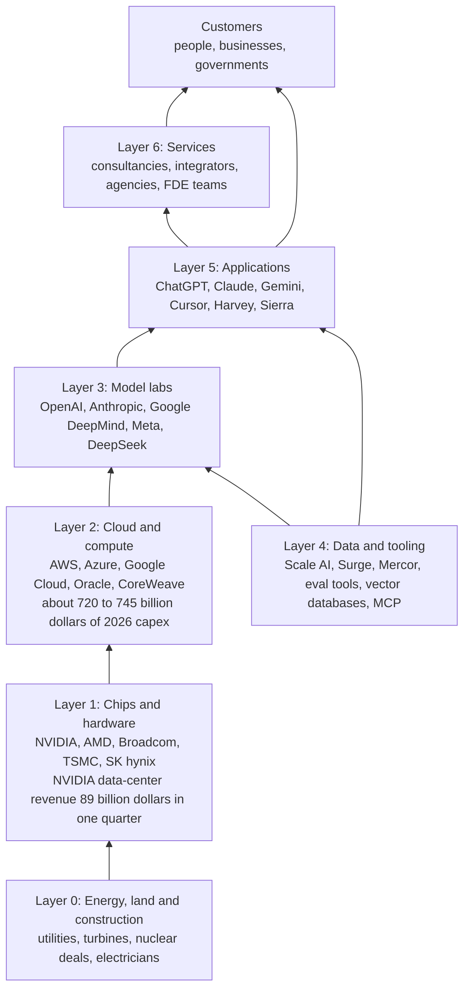
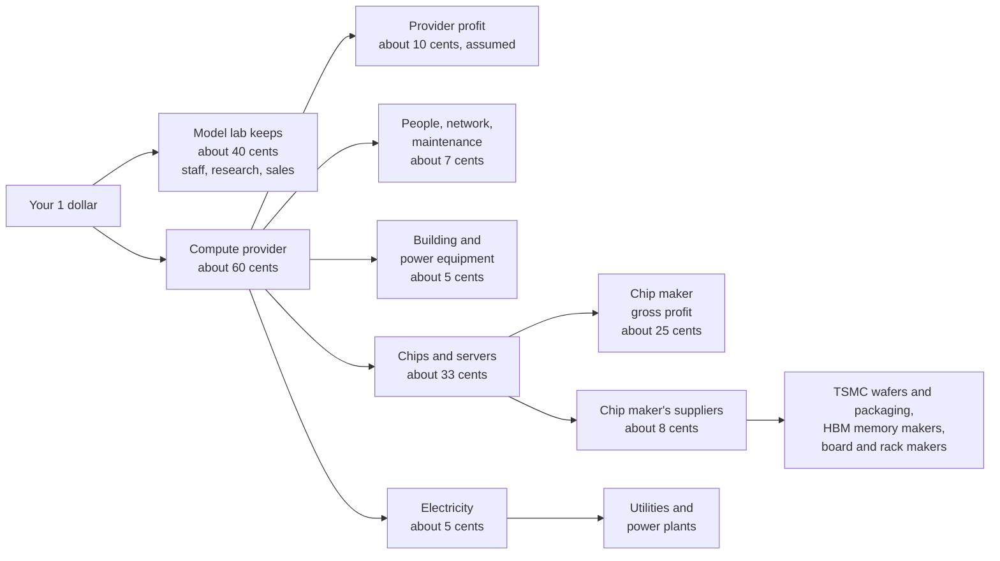
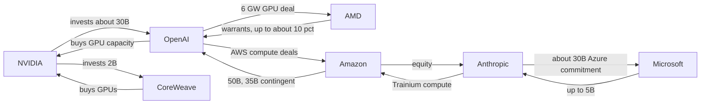
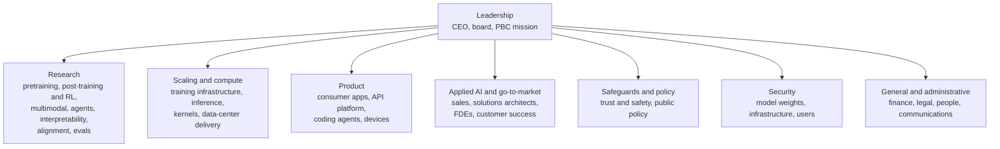
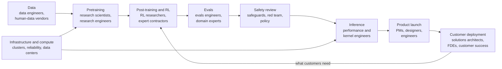
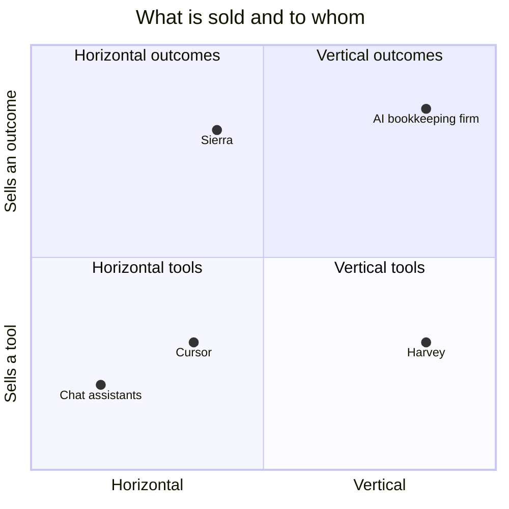
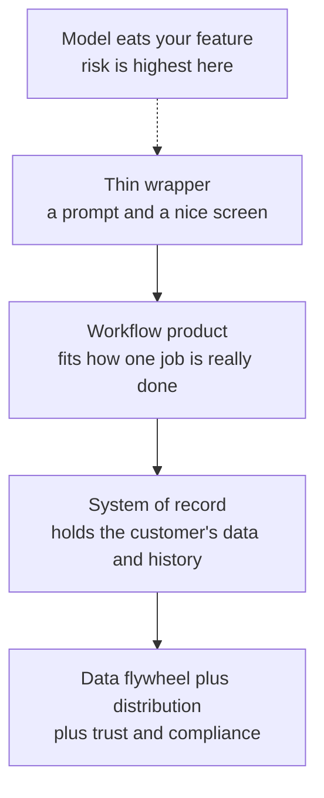

# Chapter 61: The AI Industry Map: Who Makes Money and How

*This chapter gives you a map of the whole AI economy, from power plants to the app on your phone, and the vocabulary to read any AI money headline without being fooled.*

## What you'll learn

- The vocabulary of money: revenue, recognized revenue, ARR, run-rate, backlog, gross margin, capex, valuation and funding rounds, with worked numbers.
- The AI value chain layer by layer, from energy and construction through chips, clouds, model labs, data and tooling, applications and services, with key companies and a dated number for each.
- Where the money flows: one subscription dollar followed down to a chip factory in Taiwan, plus circular deals, "up to" commitments and the gap between spending and revenue.
- How a frontier lab is organized, who ships a model, and why research is only about 5–10% of lab hiring.
- The main AI business models and why AI products have lower gross margins than classic software.
- What protects an AI business, what does not, and what "the model eats your feature" means.
- Lessons from the 2025–2026 stories of Cursor, Harvey, Lovable, Sierra, Mercor, Scale AI, Perplexity and CoreWeave.

## Before you start

This chapter looks at the whole book from the money side. Chapter 4 (The Internet and the Cloud) explains what a cloud is. Chapter 24 (The 2026 Model Landscape and How to Read Benchmarks) introduces the labs and their models. Chapter 31 (Shipping AI: Evals, Reliability, Security and Product Design) works through the unit economics of a single AI product. Chapters 35 (The AI Chip Industry), 42 (The Great Buildout) and 43 (The Economics of AI Compute) cover the chip and data-center layers in depth. You can read this chapter without them: every term is defined here, and every number carries a date.

> **Watch out:** AI money figures go stale within weeks. Figures from company filings and official job boards are stated plainly; figures from news reports and data providers such as Sacra are marked "reported." Learn the method more than the numbers.

## Your $20 and the machine behind it

You pay about $20 a month for a chatbot plan (Claude Pro and ChatGPT Plus both launched at $20 a month, and entry plans at the big labs have generally been priced around that level). You type a question, press Enter, and an answer streams back.

Who got your $20? Not just "the AI company," but a chain of them. Part of your money pays for a chip designed in California, made in Taiwan, fitted with Korean memory, installed in a building in Texas or Indiana, and powered by a gas turbine or a nuclear plant.

That chain is the AI industry. In 2023 it looked like a few research labs and a chip company. By 2026 it had become one of the largest investment programs in history: the four biggest US cloud companies alone guided to roughly $720–745 billion of capital spending for 2026, as reported in mid-2026, most of it for AI data centers.

> **Definition — Value chain:** The sequence of businesses that each add something to a product on its way to the customer, from raw inputs to the final sale. In AI it runs from electricity and chips up to apps and services.

> **Key idea:** Money flows down the value chain and capability flows up it. Your subscription dollar travels from the app down to the power plant; the power plant's electricity travels up, through chips and models, into the answer on your screen.

## The vocabulary of money

AI news is full of numbers that sound alike but mean very different things. A company "at a $65 billion run-rate" has not earned $65 billion. A company "valued at $965 billion" does not have $965 billion. A "$300 billion deal" may never be paid in full. Telling these apart is the most useful skill for reading AI business news.

### Revenue: earned, annualized and promised

> **Definition — Revenue:** The money a company earns from customers in a period, before subtracting any costs.

> **Definition — Recognized revenue (GAAP revenue):** Revenue counted under formal accounting rules (in the US, Generally Accepted Accounting Principles) only once the service has actually been delivered. It is the most conservative and comparable revenue number, and it is what appears in audited financial statements.

> **Definition — ARR (Annual Recurring Revenue):** The yearly value of a company's ongoing subscriptions and contracts at a moment in time. It is a forward-looking speed reading, not money already collected.

> **Definition — Run-rate (annualized revenue):** Recent revenue, often the last month, multiplied up to a full year. One $5 billion month becomes a "$60 billion run-rate." Companies calculate it in different ways, and it flatters fast-growing firms.

The arithmetic is simple. A $5 billion month gives 5 × 12 = $60 billion. A $1.2 billion week gives 1.2 × 52 = $62.4 billion. The same company can quote either, and it gets to pick.

> **Analogy:** Run-rate is a speedometer and recognized revenue is an odometer. The speedometer tells you how fast the car is going this minute; the odometer tells you how far it actually traveled. A car accelerating hard shows a high speedometer reading long before the odometer catches up.

A worked example with reported 2026 figures for Anthropic. Its run-rate was reported at about $9 billion at the end of 2025 and over $65 billion at the end of July 2026 (Bloomberg; Anthropic did not comment). Its recognized revenue for the first three quarters of 2026 was reported as $4.8 billion, $11.5 billion and $16.8 billion.

- Recognized revenue, January to September 2026: 4.8 + 11.5 + 16.8 = **$33.1 billion**.
- Run-rate headline in late July: **over $65 billion**.
- Third-quarter revenue times four: 16.8 × 4 = **$67.2 billion**.

The run-rate was about double what the company had booked in nine months, yet close to its latest quarter times four. Both numbers are honest; they answer different questions.

OpenAI shows the same pattern: a run-rate reported at over $20 billion at the end of 2025 (Reuters, citing OpenAI's finance chief) against reported 2025 revenue of $13.1 billion. Its run-rate was reported at about $50 billion in September 2026 (Financial Times), and Bloomberg reported on October 9 that it expected at least $70 billion by year-end. The FT noted that an earlier "$70 billion" figure had used a different method, which is why you always ask how a run-rate was computed.

> **Definition — FT (Financial Times):** A London-based daily business newspaper, one of the main outlets for reported figures on AI companies' revenue, losses and funding. What it publishes is journalists' reporting, not the companies' own filings.

> **Watch out:** Even recognized revenue is not always comparable. Anthropic reportedly books sales made through cloud resellers "gross," counting the full price the customer pays even when a cloud partner takes a share, while some peers book similar sales "net." That inflates its top line (total revenue, the first line of the accounts) relative to peers. Compare like with like.

> **Definition — Bookings, backlog and RPO (remaining performance obligations):** Contracts that have been signed but not yet delivered or paid for. CoreWeave's reported backlog of about $104 billion (June 30, 2026) is future work it has agreed to do, not money in its bank account.

### Margins, cash and spending

> **Definition — Gross margin:** Revenue minus the direct cost of delivering the product, as a percentage of revenue. Sell something for $100 that costs $25 to deliver, and the gross margin is 75%.

> **Definition — Operating margin:** What is left after all operating costs (salaries, research, sales, offices), not just delivery costs, as a percentage of revenue.

> **Definition — Free cash flow:** The cash a business generates after paying for its operations and its long-lived equipment. When it is negative, the company is "burning" cash and needs outside money to keep going.

> **Definition — Capex (capital expenditure):** Money spent on long-lived physical assets such as data centers, chips and power equipment. Its counterpart, opex (operating expenditure), covers ongoing costs such as salaries, electricity and rent.

> **Definition — Depreciation:** Spreading the cost of a long-lived asset over its useful life in the accounts. A $50,000 server expected to last five years shows up as $10,000 of cost a year, not $50,000 in year one.

Depreciation matters enormously in AI. A building lasts decades, but an AI chip may be economically obsolete within a few years, once newer chips do the same work more cheaply. Hyperscalers depreciate servers over roughly five to six years. Critics argue AI accelerators lose value faster, which would make today's reported profits look better than they are. Chapter 43 works through this debate.

### Valuation and funding

> **Definition — Valuation:** What investors agree a company is worth, in a private funding round or on the stock market. For a private company it is a negotiated price for a small slice, extrapolated to the whole company.

> **Definition — Pre-money and post-money valuation:** The company's value just before new investment arrives (pre-money) and just after adding it (post-money). Post-money = pre-money + new cash.

Worked example. In late May 2026 Anthropic reportedly raised $65 billion at a $965 billion post-money valuation (the law firm Orrick announced the round). Its pre-money valuation was 965 − 65 = **$900 billion**, and the new investors bought 65 ÷ 965 ≈ **6.7%**. On March 31, 2026, OpenAI reportedly closed $122 billion at $852 billion post-money: pre-money 852 − 122 = **$730 billion**, and a share sold of 122 ÷ 852 ≈ **14.3%**.

> **Analogy:** A valuation works like one house sale setting the value of a whole street. If one house sells for $1 million, people say every similar house is "worth" $1 million, though nobody could buy the whole street at that price tomorrow.

> **Definition — Funding round (Seed, Series A, B, C and so on):** A stage at which a private company sells part of its ownership to investors for cash. Later letters usually mean larger, later-stage rounds; Anthropic's 2026 rounds were its Series G and H.

> **Definition — Venture capital (VC):** Investment firms that buy stakes in young, risky companies, hoping a few become large enough to pay for all the failures. A "strategic investor," by contrast, is a company investing for business reasons, as when NVIDIA or Amazon invests in a lab that buys its products.

> **Definition — IPO (initial public offering):** The moment a private company first sells shares on a public stock exchange. Its value on the exchange (share price × number of shares) is its market capitalization.

> **Definition — Revenue multiple:** A company's valuation divided by its revenue or run-rate. It shows how many dollars investors pay for each dollar of sales, which reflects how fast they expect it to grow.

The 2026 IPO wave put these words on front pages. SpaceX, which had absorbed xAI in February, listed on June 12, 2026. Its filings with the SEC (the US stock-market regulator), free to read on the SEC's EDGAR website, show it sold new shares at $135 each, raising $75 billion, or about $86 billion once the underwriters (the banks running the sale) bought the extra shares they had an option on. Its first-day close was reported near a $2.1 trillion value. OpenAI confirmed on June 8 that it had filed confidentially with the SEC and was said to target a listing "by 2027." Anthropic reportedly filed confidentially on June 1 and, in mid-October, was reported to be aiming for a November listing, with marketing to investors as early as the week of November 9, trading planned before the US Thanksgiving holiday (November 26), plans described as fluid, and valuation talk ranging from about $1.5 trillion to $2 trillion.

> **Definition — SEC (Securities and Exchange Commission):** The US government agency that regulates stock and bond markets. Public companies must file financial results with it every quarter (the yearly report's accounts are audited by outside accountants; the three quarterly reports are only reviewed), and a company planning an IPO first files its prospectus (the document describing the business, its finances and the shares for sale) there.

> **Definition — EDGAR:** The SEC's free online database of company filings (sec.gov/edgar), where you can search any US public company's reports, from quarterly results to IPO prospectuses. It is the primary source behind most company figures in the news.

> **Definition — Public benefit corporation (PBC):** A for-profit company legally required to weigh a stated public mission alongside profit. Anthropic is a PBC, and in October 2025 OpenAI's for-profit arm became OpenAI Group PBC, controlled by the nonprofit OpenAI Foundation (reported).

| Kind of number | What it measures | Example (date, status) | The trap |
|---|---|---|---|
| Recognized revenue | Money earned for services delivered | OpenAI $13.1B for 2025 (reported) | Lags fast growth; gross vs net differs |
| Run-rate or ARR | Current pace, annualized | Anthropic over $65B, end of July 2026 (reported) | Method varies; one hot month can inflate it |
| Backlog or RPO | Signed, undelivered contracts | CoreWeave about $104B, June 2026 (reported) | Not cash; can be delayed or cancelled |
| "Up to" commitment | A maximum, often conditional | Stargate, OpenAI's data-center joint venture with partners, "up to $500B" | A ceiling, not a forecast |
| Valuation | Price of a slice, scaled to the whole | Anthropic $965B post-money, May 2026 (reported) | Not cash the company holds |
| Capex | Spending on long-lived assets | Big-four hyperscalers about $720–745B, 2026 (reported) | Spent once, depreciated over years |

*Table 61.1: The six kinds of AI money numbers and how each one misleads when misread.*

> **Try it:** Open any AI business headline from this week. Label each number in it with a row of Table 61.1. Then ask your chatbot: "In this article, which numbers are recognized revenue, run-rate, valuations or conditional commitments?" Check its answer against the article yourself.

## The value chain, layer by layer

The AI industry can be drawn as seven layers stacked on top of each other, with customers at the top.


*Figure 61.1: The AI value chain. Capability flows up the arrows from energy to customers; money flows down in the opposite direction. Numbers are as of mid-2026 (NVIDIA's from its own filing, capex as reported).*

> **Analogy:** Think of electrification a century ago. Chips are the turbines, data centers are the power plants, foundation models are the electricity on the grid, apps are the appliances, and services are the electricians wiring homes. Most of the fortunes from electrification went to people who used electricity in new ways, not only to the generators.

### Layer 0: energy, land and construction

Every AI answer starts as electricity. Data centers worldwide used about 415 terawatt-hours in 2024, roughly 1.5% of global electricity, according to the International Energy Agency, and AI's share is growing fastest. The tracker of Epoch AI, an independent research group that measures AI trends (data as of October 20, 2026), lists 95 large AI data centers with about 14.2 gigawatts of IT power between them.

> **Definition — Gigawatt (GW):** One billion watts, roughly the output of a large power plant. Labs and clouds now describe data-center size in gigawatts.

> **Definition — Powered land:** A site that already has a confirmed connection to enough electricity for a data center. Because new grid connections can take years, powered land became one of the scarcest assets in AI.

This layer includes utilities, turbine and transformer makers, nuclear companies, builders, land developers and the skilled trades. The real-estate firm JLL put the average cost of a data-center shell and core (the building and its core power and cooling systems, before a tenant's own equipment goes in) at about $10.7 million per megawatt in 2025, and said AI tenant fit-out can add up to about $25 million per megawatt on top. Including chips, industry statements put a gigawatt of AI capacity at tens of billions of dollars; NVIDIA's chief executive has cited roughly $50–60 billion.

> **Definition — JLL (Jones Lang LaSalle):** A global commercial real-estate services firm whose regular data-center reports are a widely quoted source for construction costs, vacancy rates and capacity under construction.

Power has become the bottleneck: chips can be ordered in months, but a grid connection or power plant can take years. That is why Meta announced nuclear agreements for up to 6.6 GW by 2035 in January 2026, why some sites burn gas in on-site turbines, and why lab job boards now list data-center electrical engineers, technicians and community-engagement managers. Chapters 39 to 42 cover this layer in depth.

> **Key idea:** In AI, electricity is scarce rather than expensive. As you will see when we follow a subscription dollar, power is only a few cents of each dollar, but without it no amount of money can turn the chips on.

### Layer 1: chips and hardware

The star of this layer is NVIDIA, whose GPUs (graphics processing units, the highly parallel chips that do most AI math; see Chapter 32) fill most AI data centers. In its fiscal quarter ending July 26, 2026 (a fiscal quarter is a quarter of the company's own accounting year, which need not match the calendar), NVIDIA reported revenue of $96.2 billion, up 106% from a year earlier. Data Center revenue was $89.0 billion, about 92% of the total, and gross margin was 75.0%. It guided to about $108 billion for the next quarter, assuming no data-center compute sales to China. These figures come from NVIDIA's own SEC filing.

> **Definition — Foundry:** A company that manufactures chips designed by others. TSMC in Taiwan manufactures most of the world's leading AI chips for "fabless" designers such as NVIDIA, AMD and Broadcom, which design chips but own no factories.

> **Definition — TSMC (Taiwan Semiconductor Manufacturing Company):** The Taiwanese company that is the world's largest contract chipmaker (foundry) and manufactures nearly all advanced AI chips to their designers' blueprints. Because its customers include NVIDIA, AMD, Apple and Google, it is a single point the whole AI industry depends on (see Chapter 36).

> **Definition — Custom silicon (ASIC):** A chip designed for one company's own workloads, such as Google's TPU or Amazon's Trainium, rather than sold to everyone. Clouds build them to cut costs, secure supply and gain bargaining power with NVIDIA.

A 75% gross margin is extraordinary for hardware. Of every dollar a customer pays NVIDIA, only about 25 cents covers the direct cost of making the product: wafers from TSMC, high-bandwidth memory (HBM, see Chapter 33) from SK hynix, Samsung or Micron, packaging and boards. The other 75 cents funds research and profit. The margin exists because there is not yet a full substitute: two decades of CUDA software (NVIDIA's platform for programming its chips) and complete rack-scale systems make NVIDIA hard to replace (see Chapter 35).

> **Definition — SK hynix:** A South Korean memory-chip maker, part of the SK business group, that leads the market for the high-bandwidth memory (HBM) stacked beside AI chips and has been NVIDIA's main HBM supplier since HBM3. Samsung and the US company Micron are the other two HBM makers.

Alternatives are growing: AMD's 6-gigawatt deal with OpenAI (October 2025), Google's TPUs (up to one million promised to Anthropic the same month), Amazon's Trainium, and OpenAI's 10-gigawatt custom-chip plan with Broadcom. Beneath them all sit TSMC's factories, ASML's lithography machines (the only source of extreme-ultraviolet tools) and the three HBM makers.

> **Definition — ASML:** A Dutch company that makes the lithography machines used to print the patterns of chips onto silicon wafers. It is the only maker of the extreme-ultraviolet (EUV) machines needed for the most advanced chips (see Chapter 36).

> **Analogy:** In a gold rush, the sellers of picks and shovels often did better than most miners, because they sold to everyone and never had to strike gold. NVIDIA sells the shovels of the AI rush. Selling to every miner beats betting on one mine, until the rush ends.

### Layer 2: cloud and compute providers

Most labs rent their computing from clouds, often under enormous multi-year contracts.

> **Definition — Hyperscaler:** One of the largest cloud and internet companies building data centers at enormous scale: Amazon (AWS), Microsoft (Azure) and Google, plus Meta and Oracle.

> **Definition — AWS (Amazon Web Services):** Amazon's cloud-computing business, the world's largest cloud provider, which rents out computing power, storage and AI chips over the internet. Its customers include companies and AI labs, and its chips include NVIDIA GPUs and Amazon's own Trainium.

> **Definition — Neocloud:** A newer cloud company that specializes in renting GPUs for AI, such as CoreWeave, Nebius, Lambda or Crusoe.

> **Definition — GPU-hour:** One GPU rented for one hour, the basic unit of AI cloud pricing. In October 2026, on-demand list prices at Lambda were about $3.99–4.29 for an H100 and $6.69–6.99 for a B200; big long-term contracts pay less.

> **Definition — Compute commitment (compute deal):** A multi-year contract to buy or reserve computing capacity, often worth tens or hundreds of billions of dollars. Headlines usually quote the maximum value.

> **Definition — Take-or-pay contract:** A contract in which the customer pays for reserved capacity whether or not it uses it. Banks lend against these contracts when financing new data centers.

| Company | 2026 capex guidance (as reported, late July 2026) |
|---|---|
| Amazon | about $220B (includes non-AI items such as robotics and satellites) |
| Alphabet (Google) | $195–205B |
| Microsoft | about $175B (calendar-year expectation) |
| Meta | $130–145B |
| **Big four combined** | **about $720–745B** |

*Table 61.2: Hyperscaler capital spending plans for 2026, as reported after the July 2026 earnings calls (the quarterly briefings in which public companies present results to investors). The financial-data company FactSet put the total for five companies including Oracle "close to $800bn." Definitions differ, and results due in late October 2026 may change these figures.*

Clouds make money by renting capacity for more than it costs them. The risk is timing: the cloud pays for chips and buildings up front and earns the money back over years. If prices fall faster than expected or customers leave, it is left holding expensive, aging hardware.

CoreWeave shows the opportunity and the risk. It went public on March 28, 2025, reportedly earned about $5.1 billion in 2025, raised its 2026 revenue guidance in August to $12.4–13.2 billion, and reported a backlog of about $104 billion at June 30, 2026. But Microsoft was reportedly about 67% of its 2025 revenue.

> **Definition — Customer concentration:** When a large share of a company's revenue comes from one or a few customers. Losing one relationship can cripple the business.

### Layer 3: the foundation-model labs

> **Definition — Frontier lab:** A company that trains the most capable "foundation models" (large general-purpose models that many products are built on): as of late 2026 mainly OpenAI, Anthropic, Google DeepMind, Meta and SpaceX's AI unit (formerly xAI), plus strong Chinese labs such as DeepSeek, Alibaba's Qwen team and Moonshot.

> **Definition — Open-weight model:** A model whose trained parameters are published so anyone can download, run and modify it. The weights are free, but running them still costs compute and engineering.

Chapter 24 describes the labs' models; here we treat them as businesses. A lab spends on training compute, serving compute (inference) and people. It earns from API usage priced per million tokens (Chapter 26); consumer subscriptions (entry plans around $20 a month, plus premium tiers such as Claude Max, which launched in 2025 at $100 and $200 a month); enterprise contracts (Anthropic reportedly had over 1,000 customers spending more than $1 million a year by April 2026); agents and coding tools (Claude Code was reported at $2.5 billion annualized in February 2026); and advertising (OpenAI's ads were reported at $1 billion annualized in August 2026).

| Lab | Reported run-rate | Latest reported valuation | Selected facts (reported) |
|---|---|---|---|
| OpenAI | about $50B (September 2026); expects at least $70B by end of 2026 | $852B post-money (March 2026) | 2025 recognized revenue $13.1B; over 50M consumer subscribers and 9M paying business users (February 2026); gross margin estimated at 33% (Sacra) |
| Anthropic | over $65B (end of July 2026) | $965B post-money (May 2026) | Recognized revenue $4.8B, $11.5B, $16.8B in Q1–Q3 2026; 11% adjusted operating margin in Q3 |
| SpaceX AI unit (formerly xAI) | not reported separately | Inside SpaceX, about $2.1T at its June 2026 debut | SpaceX agreed to buy Cursor's maker for about $60B in stock (June 2026) and completed the deal in August 2026 |

*Table 61.3: The three most-reported US frontier labs as businesses, as of October 2026. Google DeepMind and Meta's labs sit inside giant companies that do not report them separately.*

Their customers differ. Menlo Ventures, a venture firm invested in the sector, estimated Anthropic held 40% of enterprise language-model API spending in 2025 against OpenAI's 27%; OpenAI leads with consumers, with ChatGPT at about 900 million weekly users in February 2026 and reported in July to be close to a billion.

> **Watch out:** "Open-weight means free" is a myth. Serving a large open model needs GPUs, engineers and maintenance. Open-weight labs earn money through hosting, enterprise support, premium closed models or the strategic value of setting a standard.

### Layer 4: data and tooling

Between labs and apps sits a layer that sells to builders rather than end users.

> **Definition — Human data:** Examples, ratings and expert demonstrations written by people to train and evaluate models. Contractors often do this work through firms such as Scale AI, Surge or Mercor (see Chapter 11).

> **Definition — RL environment:** A simulated task (a codebase, a website, a spreadsheet) with an automatic way to score success, in which models practice by reinforcement learning. Building them became a business in 2025–2026 (see Chapter 21).

This layer includes human-data firms (Scale AI, about $2 billion of revenue estimated for 2025; Mercor, about $2 billion of gross run-rate reported by June 2026), RL-environment builders, evaluation and observability tools (Chapter 31), vector databases such as Pinecone and pgvector (Chapter 27), frameworks such as LangChain and LlamaIndex, and standards such as MCP, the open protocol for connecting assistants to tools (Chapter 28).

These are picks-and-shovels businesses, and their risk is a few powerful customers. When Meta bought 49% of Scale AI for about $14.3 billion in June 2025, Google, OpenAI and other labs reportedly pulled their work, and Scale reportedly ended work with about 500 contractors in July 2025.

### Layer 5: applications

Menlo Ventures estimated that enterprises spent $37 billion on generative AI in 2025, up from $11.5 billion in 2024, with about $19 billion going to the application layer. The main families are horizontal assistants (ChatGPT, Claude, Gemini, Microsoft Copilot), coding tools (Cursor, Claude Code, Codex, GitHub Copilot), vertical apps (Harvey for law), customer-service agents (Sierra, Decagon), app builders (Lovable, Replit) and answer engines (Perplexity).

> **Definition — Horizontal AI:** General-purpose tools used across many industries, such as chat assistants or coding tools.

> **Definition — Vertical AI:** AI products built for one industry (law, healthcare, accounting) with that industry's workflows, data and vocabulary built in.

> **Definition — Wrapper:** A product built on top of someone else's AI model, adding an interface, a workflow or data. A "thin wrapper" adds little and is easy to copy; a "thick wrapper" becomes a deep product.

Applications have the easiest entry and the fiercest competition; the section on moats asks what keeps their customers.

### Layer 6: services

The top layer sells expertise and time rather than software.

> **Definition — Systems integrator (SI or GSI):** A large consulting firm, such as Accenture or Deloitte, that implements technology inside big organizations ("GSI" means global systems integrator). They are a major channel through which AI reaches enterprises.

> **Definition — Forward-deployed engineer (FDE):** An engineer embedded with a customer, often on site for weeks or months, to build and deploy solutions on that customer's systems. The role originated at Palantir, a US data-analytics software company, and became one of the fastest-growing AI jobs of 2025–2026.

> **Definition — Pilot (proof of concept):** A small trial that tests whether AI works for one use case before a full rollout.

Services grow because buying AI is easy and getting value from it is hard. Stanford's 2026 AI Index, published by its Institute for Human-Centered AI (HAI), reported that 88% of organizations say they use AI. But the "GenAI Divide" report (July 2025) from MIT NANDA, a research project at the Massachusetts Institute of Technology (Chapter 28), found that only about 5% of enterprise generative-AI pilots delivered rapid revenue acceleration or measurable impact on profit and loss (P&L). Media turned that into "95% of AI projects fail"; the report itself blamed brittle workflows and poor fit with daily operations, not weak models.

> **Definition — HAI (Stanford Institute for Human-Centered Artificial Intelligence):** A Stanford University institute that studies AI and its effects on society. It publishes the AI Index, a widely cited annual report of data on AI research, investment, adoption and jobs.

```
Pilot-to-impact funnel (shape, not to scale)

 Organizations using AI   |##########################| 88% (Stanford)
 Running pilots           |##################        |
 Deployed in production   |##########                |
 Measurable P&L impact    |#                         | about 5% of
                                                       pilots (MIT)
```
*Figure 61.2: The pilot-to-impact funnel. Only the top and bottom figures come from studies, and they measure different things (organizations versus pilots); the middle bars show the shape the reports describe.*

That gap is the services opportunity: turning a model into a changed workflow. OpenAI had a dedicated Forward Deployed Engineering department with 31 open roles on October 21, 2026, according to its job board.


## Where the money flows

### Follow one subscription dollar

Let us follow one dollar of your subscription down the chain. This is a teaching model, not anyone's accounts. Each step uses a reported figure where one exists and a labeled assumption where it does not.

**Step 1: the lab.** How much of your dollar goes to computing? Two reported figures bracket the answer. Anthropic reportedly generated about $1.70 of revenue per $1 of compute in the third quarter of 2026, so 1 ÷ 1.70 ≈ 59 cents of each revenue dollar went to compute (not a gross margin, since that compute may include training). For OpenAI, Sacra estimated a gross margin of about 33%, so roughly 67 cents of each dollar went to delivering the service, mostly compute. Call it **about 60 cents to compute and 40 cents left at the lab** for researchers, engineers, sales and everything else. That is not enough: the Financial Times reported OpenAI's projected cumulative negative free cash flow at $278 billion over 2026–2030. Investors fill the gap. Anthropic's picture improved during 2026: Bloomberg reported in October that it had told prospective investors it was profitable on an adjusted basis in the third quarter and generating positive free cash flow.

**Step 2: the compute provider.** To see how a provider spends its 60 cents, build the yearly cost of one AI chip in a data center:

- **Hardware:** assume about $50,000 per Blackwell-class GPU, all-in with its share of server and network, depreciated over five years: **$10,000 a year**.
- **Building and power equipment:** about $15 million per megawatt (the middle of the $11–18 million range from JLL and Cushman & Wakefield, another large real-estate firm). Assuming about 450 GPUs per megawatt, each GPU's share is 15,000,000 ÷ 450 ≈ $33,300, depreciated over 20 years: **about $1,700 a year**.
- **Electricity:** assume each GPU accounts for about 2.5 kilowatts including its share of servers, networking and cooling, all year: 2.5 × 8,760 hours = 21,900 kilowatt-hours. At an assumed 7 cents per kilowatt-hour: **about $1,500 a year** (an upper bound, since chips do not run flat out all the time).
- **People, maintenance, network operations, insurance and financing:** assume **about $2,000 a year**.

Total: about **$15,200 a year** per GPU. Hardware is about 66%, building about 11%, electricity about 10% and everything else about 13%. If the provider keeps about 10 of the 60 cents as profit (an assumption; providers do not publish this), the remaining 50 cents splits into roughly 33 cents for chips and servers, 5 for the building, 5 for electricity and 7 for people and operations.

**Step 3: the chip maker.** Most of the 33 cents was paid, years earlier, to hardware vendors, the largest being NVIDIA. At a 75% gross margin, about 25 of those cents are NVIDIA's gross profit and about 8 cover its cost of goods.

**Step 4: the factory floor.** Those 8 cents are shared among TSMC (wafers and advanced packaging), the HBM makers, and the makers of substrates (the base layers that chips are mounted on), boards and racks. Public filings do not break this down, so the honest answer is: **a few cents of your dollar ends up at a chip factory in Taiwan or a memory plant in South Korea.**


*Figure 61.3: Following one subscription dollar down the value chain. An illustrative model built from reported ratios and labeled assumptions, not any company's accounts.*

Four lessons fall out:

1. **The chip maker captures a large share,** about a quarter of your dollar as gross profit, which is why every cloud now designs its own chips.
2. **Electricity is small,** about 5 cents: power is scarce, not costly.
3. **Timing is everything.** The hardware was bought before your dollar arrived. If it is obsolete in three years instead of five, the provider loses money even if every customer pays.
4. **The lab is squeezed.** Its 40 cents must fund the next, more expensive model.

The model also gives a cost per GPU-hour. At 70% utilization a GPU sells 8,760 × 0.7 ≈ 6,130 hours a year, so its cost per sold hour is 15,200 ÷ 6,130 ≈ **$2.48**. The gap to the October 2026 list price of about $6.69–6.99 for a B200 pays for idle hardware, big-customer discounts, risk and profit. Chapter 43 builds this into a full payback model.

> **Try it:** Copy the four cost lines into a spreadsheet. Change one assumption at a time: three-year hardware life instead of five; 12-cent electricity instead of 7; 50% utilization instead of 70%. Watch which change moves the cost per GPU-hour most. (It is the hardware life.)

### Circular deals

Some money in AI loops back on itself.

> **Definition — Circular deal (vendor financing):** An arrangement in which a supplier invests in or lends to a customer, and the customer then spends that money on the supplier's products. It is real business, but it can make demand look larger than independent demand really is.

Reported examples: NVIDIA invested about $30 billion in OpenAI's March 2026 round, $2 billion each in CoreWeave and Nebius in early 2026, and committed up to $10 billion to Anthropic; all of them buy or rent NVIDIA hardware. AMD gave OpenAI warrants (the right to buy shares cheaply) for up to roughly 10% of AMD alongside OpenAI's 6-gigawatt GPU purchase. Microsoft committed up to $5 billion to Anthropic as Anthropic committed about $30 billion to Azure. Amazon and Google invested in Anthropic, which rents their chips, and Amazon agreed to invest $50 billion in OpenAI, which has signed large AWS compute contracts.


*Figure 61.4: A simplified map of circular deals, 2025–2026, as reported. Arrows into a lab or neocloud are investments; arrows out of it are purchases or purchase commitments back to the investor.*

> **Analogy:** A circular deal is like a furniture store lending you money to buy its sofas. The sale is real and you get a sofa. But when the store reports "record sofa demand," part of that demand exists because the store financed it.

Circular deals are not fraud, and they can make sense: a supplier with spare cash backs a customer whose growth helps it. The risks are inflated apparent demand, suppliers tied to a few customers, and loops that unwind in both directions if one link fails.

### "Up to" commitments

> **Definition — "Up to" deal (contingent investment):** A headline maximum that depends on conditions such as milestones, an IPO or future decisions. The final amount can be far lower.

> **Analogy:** An "up to" deal is like a gym membership advertised as "up to 365 visits a year." The headline is the maximum, not what will happen.

Read the fine print and conditions appear. Of Amazon's reported $50 billion commitment to OpenAI, $35 billion was reportedly contingent on an IPO or a technical milestone. NVIDIA's 2025 letter of intent to invest "up to $100 billion" in OpenAI was later reported shelved in favor of the roughly $30 billion stake. Stargate was announced in January 2025 as "up to $500 billion" and 10 gigawatts by 2029; in April 2026 Epoch AI estimated its flagship Abilene site had about 0.3 GW running against a 1.2 GW plan, and expected most new Stargate capacity across all its sites to arrive in 2027–2028. Staging is normal; adding up headline maximums still overstates what has been spent.

### The capex-revenue gap

Hyperscalers are spending about $720–745 billion in 2026 (reported). How much revenue must that earn back? A rough worked example:

- Spread one year's spending over an average life of about six years: 720 ÷ 6 ≈ **$120 billion a year** of depreciation from 2026's spending alone.
- Add electricity, staff and a normal profit, and the customers renting that capacity must pay perhaps $150–200 billion a year for this one year of spending. Each later year adds another layer.
- Compare demand. The two leading US labs had combined reported run-rates of about $50 billion (OpenAI, September) plus over $65 billion (Anthropic, July), roughly $115 billion. Enterprise generative-AI spending was about $37 billion in 2025 (Menlo). Google, Microsoft and Meta also earn AI revenue inside existing products, which is hard to measure.

Two cautions. Not all capex is for AI (Amazon's includes robotics and satellites). And much of the labs' revenue is paid straight back to clouds for compute, so adding cloud and lab revenue double-counts the same dollars.

Bulls point to lab revenue growth (Anthropic's reported run-rate rose about sevenfold in seven months), demand still exceeding supply, and AWS's reported $496 billion backlog. Bears point to projected cash losses, circular financing, Oracle's July 2026 downgrade to BBB- (on the credit-rating scale explained in Chapter 43, the lowest grade still counted as "investment grade", meaning a fairly safe borrower), and to railroads and 1990s fiber (the fiber-optic cable networks overbuilt in the dot-com boom), real technologies that attracted more investment than they could repay in time. Chapter 43 covers financing and Chapter 60 presents both sides of the bubble debate.

> **Key idea:** The AI industry in 2026 is a bet that application revenue will grow into the infrastructure being built for it. The richest companies in the world are making that bet, but it is still a bet, and so far the layer capturing the most profit is the one selling the shovels.

## Inside a frontier lab

From outside, a frontier lab looks like a research group that occasionally releases a model. Inside, it is a large company with sales teams, lawyers, data-center builders and security staff.

> **Analogy:** A frontier lab is like a film studio. Research is the creative team, infrastructure is the soundstages and cameras, product is distribution, Applied AI is marketing and the theater partnerships, and safety is standards and practices. Most studio employees are not directors, and most lab employees are not researchers.


*Figure 61.5: A typical frontier-lab organization in 2026. Real labs name and group these differently, and program managers and data scientists serve all of them.*

> **Definition — Go-to-market (GTM):** Everything involved in selling a product: sales, marketing, partnerships, solutions engineering and customer success (the people who make sure customers get value after they buy).

> **Definition — Applied AI:** The teams at a lab that help customers put models to work: solutions architects who design deployments and run proofs of concept, and forward-deployed engineers who build them.

Research trains the models (Chapters 19 to 21); scaling and compute keeps the accelerators busy and increasingly builds data centers; safeguards and policy sets and enforces usage rules (Chapter 56); security guards the model weights.

### Who labs actually hire

Job boards reveal priorities that press releases do not. On October 21, 2026, Anthropic listed 675 open roles and OpenAI listed 809. Grouping each company's own department labels into the blocks of Figure 61.5 gives this picture:

```
Open roles by group, October 21, 2026 (each # = 10 roles)

Anthropic (675)
Applied AI, sales, marketing ##################### 207
Finance, legal, HR, comms    ##########             95
Infrastructure and compute   ########               79
Product                      ########               75
Research and engineering     #######                68
Safeguards, policy, benefit  ######                 62
Security                     #####                  53
Program mgmt, data science   ####                   36

OpenAI (809)
GTM, Applied AI, FDE, mktg   #################################### 361
Scaling                      ###########                          106
User ops, finance, people    ##########                           101
Smaller groups               ##########                            98
Research                     #####                                 51
Safety systems, data science ####                                  36
Security                     ###                                   29
Consumer devices             ###                                   27
```
*Figure 61.6: Open roles at two frontier labs on October 21, 2026, from their public job boards, grouped by the author. Open roles are not headcount, and each company labels departments differently.*

Research was 68 of 675 open roles at Anthropic (about 10%) and 51 of 809 at OpenAI (about 6%). Anthropic's largest single department was Sales, with 124 open roles; OpenAI's were Go To Market (149), Applied AI (120) and Scaling (106).

> **Key idea:** Research is only about 5–10% of open roles at the two leading US labs. Most hiring is for selling, deploying, scaling, securing and governing AI. The industry's growth in 2026 is a deployment story as much as a research story.

> **Watch out:** "You need a PhD to work at an AI lab" is a myth. Most open roles are outside research, and even lab research postings typically ask for a degree "or an equivalent combination of education, training, and/or experience." Chapter 62 maps the skills and Chapter 63 describes every role with its pay.

### Shipping a model is a team sport

A new model passes along a relay, and each handoff has an owner.


*Figure 61.7: How a model is made and shipped, with the roles that own each handoff (PMs are product managers). What customers need loops back into the next round of post-training.*

> **At the frontier (2026):** Labs are moving down the value chain. Anthropic listed 25 open roles in "Compute" and posted data-center engineering and regional community-engagement roles; OpenAI's 106 "Scaling" roles included technicians for its Stargate sites. Companies that began as research groups now hire people who negotiate power contracts and talk to county commissioners.

## Business models

> **Definition — Seat-based pricing:** Charging a fixed fee per user per month, the classic software model.

> **Definition — Usage-based pricing:** Charging per amount used: per token, per API call or per "credit." Model APIs are usage-based.

> **Definition — Outcome-based pricing:** Charging only when a result is achieved, such as per resolved customer-support ticket.

> **Definition — Services-as-software:** Selling the outcome of a service (the books closed, the tickets resolved) delivered largely by AI agents, instead of selling a tool for humans to use.

| Model | Example (reported, 2026) | Strength | Weakness |
|---|---|---|---|
| Usage-based API | Claude and GPT APIs, priced per million tokens | Grows with use | Price wars; revenue swings |
| Consumer subscription | Entry plans around $20 a month; premium tiers such as Claude Max (launched at $100 and $200) | Predictable | Heavy users can cost more than they pay |
| Per-seat enterprise | Harvey, about $1,200 per lawyer a month, about 20-seat minimum | High value per customer | Shrinks if AI reduces headcount |
| Subscription plus credits | Lovable, $25–50 a month plus usage credits | Protects margins from heavy users | More complex to buy |
| Outcome-based | Sierra, per conversation or per resolution | Price matches value | Outcomes must be measured reliably |
| Advertising | ChatGPT ads, $1B annualized (August 2026) | Earns from free users | Trust and privacy concerns |
| Marketplace | Mercor keeps about 30–40% of gross; contractors get 60–70% | Scales with its network | Few, powerful customers |
| Infrastructure rental | CoreWeave GPU-hours and capacity contracts | Long contracts, big backlogs | Capital-heavy and debt-funded |

*Table 61.4: Business models in the AI industry, with examples and trade-offs.*


*Figure 61.8: The business-model matrix. Moving right means serving one industry deeply; moving up means charging for results instead of access to a tool.*

Why the drift toward outcomes? Seat compression. If software lets a customer do the same work with fewer people, a per-seat price shrinks with the headcount. Charging per resolved ticket or completed task keeps revenue tied to the work, not to the number of humans doing it.

## AI unit economics

> **Definition — Unit economics:** The revenue and costs of one unit of a business, such as one customer, one query or one seat: does serving one more unit make or lose money? (Chapter 31 works a product-level example.)

> **Definition — CAC and LTV (customer acquisition cost and lifetime value):** CAC is what it costs in sales and marketing to win one customer; LTV is the gross profit you expect from that customer over the whole relationship. Healthy businesses have LTV several times CAC.

> **Definition — Net revenue retention (NRR):** This year's revenue from last year's customers divided by last year's revenue from them. Above 100% means existing customers spend more each year even after counting those who leave (churn).

Classic software has a beautiful property: once the code is written, serving one more customer costs almost nothing, so software companies often report gross margins around 80%. AI breaks this. Every query runs on GPUs, and every token costs money.

```
Where one dollar of revenue goes (illustrative)

Classic software (SaaS)
 Delivery cost     |####                | about 20 cents
 Gross profit      |################    | about 80 cents

AI application on a frontier model
 Model and compute |##########          | 30 to 70 cents
 Gross profit      |##########          | what is left

Reported company-level figures
 OpenAI gross margin, Sacra estimate:       about 33%
 Anthropic revenue per $1 of compute, Q3:   about $1.70
 NVIDIA gross margin, July 2026 quarter:    75.0%
```
*Figure 61.9: Why AI gross margins tend to be lower than classic software's. SaaS (software as a service) is software rented by subscription and used over the internet. The application range is illustrative and varies with the model, the task and the pricing.*

### Worked example: a legal-AI seat

Take a product priced like Harvey: about $1,200 per lawyer per month, 20-seat minimum. The minimum contract is 20 × $1,200 × 12 = **$288,000 a year**.

Now the compute cost, with made-up usage: a lawyer runs 40 document reviews a day for 22 days a month (880 reviews), each sending 100,000 tokens in and getting 5,000 out. Prices are quoted per million tokens, so 100,000 tokens counts as 0.1 million and 5,000 as 0.005 million.

- On a mid-tier model at $2 and $10 per million tokens (Claude Sonnet 5.5's list price in late 2026): 0.1 × 2 + 0.005 × 10 = **$0.25 per review**, or 880 × 0.25 = **$220 a month**. Gross margin before other costs: (1,200 − 220) ÷ 1,200 ≈ **82%**.
- On a top-tier model at $10 and $50: 0.1 × 10 + 0.005 × 50 = **$1.25 per review**, or **$1,100 a month**. Gross margin: about **8%**.

Same customer, same price, same work: the model choice moves the margin from 82% to 8%. That is why AI companies route easy tasks to cheap models, cache repeated text (Chapter 23) and cap heavy users.

Add acquisition. If winning a law firm costs (say) $50,000 of sales effort, the contract's gross profit of about $230,400 a year at 80% margin repays that CAC in about 50,000 ÷ 230,400 × 12 ≈ **2.6 months**. Keep the customer five years and LTV dwarfs CAC; lose it in six months and the picture darkens.

Falling token prices help: Epoch AI found in March 2025 that the price of reaching a fixed benchmark score fell 9× to 900× per year. But customers want the newest model, priced at the top, and agents and reasoning models use far more tokens per task (the Jevons paradox of Chapter 37).

> **Key idea:** In AI, gross margin is a design decision. The same product can earn 80% or lose money depending on which model it calls, how much context it sends and how it prices heavy users.

## Moats and "the model eats your feature"

> **Definition — Moat:** A lasting advantage that stops competitors from copying a business and taking its customers, named after the water-filled ditch around a castle.

> **Definition — "The model eats your feature":** The risk that a model provider releases your startup's main feature as a built-in capability, making your product redundant overnight.

> **Definition — Data flywheel:** A loop in which product usage generates data that improves the product, which attracts more usage.

> **Definition — Switching cost:** How painful it is for a customer to move to a competitor: retraining staff, migrating data, rebuilding integrations, re-passing security reviews.

Every application buys its core ingredient, the model, from the same few suppliers as its competitors, and those suppliers sell their own apps. When a lab adds file uploads, web search, memory or a coding agent to its chatbot, every startup whose product was "a chatbot plus that feature" loses its reason to exist.

> **Analogy:** AI wrappers are like restaurants that all buy from the same food wholesaler. Winners differ on recipe (workflow), location (distribution), service (trust) and loyalty (switching costs). If the wholesaler opens its own restaurant next door, that is "the model eats your feature."


*Figure 61.10: The moat ladder, from weakest (top of the figure) to strongest (bottom). Each rung is harder to copy than the one before.*

Six things actually protect an AI business: **proprietary data loops** (data rivals cannot get, which improves with use); **deep workflow integration** (being woven into a team's systems and approvals); **distribution** (an existing route to customers, often a stronger moat than technology); **trust and compliance** (certifications, audit trails and a track record that let regulated buyers say yes); **switching costs**; and **speed**, which is weak on its own but buys time to build the rest.

> **Key idea:** Ask one question of any AI product: when the next model ships, will this product get better or become obsolete? A good AI business is one that the next model makes stronger.

> **Watch out:** "Wrappers are worthless" is also a myth. Cursor was built on other companies' models and became a reported $60 billion acquisition. Thin wrappers are fragile; thick ones, with workflow depth, distribution and data, can become very large businesses.

## Case studies from 2025–2026

All figures below are reported (mostly from Sacra company pages and news coverage) and dated. The last column divides the valuation by a revenue figure near the same date, so treat it as rough.

| Company | What it does | Reported figures | Lesson | Revenue multiple |
|---|---|---|---|---|
| Cursor (Anysphere) | AI code editor on other labs' models | $2.6B to $4B+ annualized (mid-2026); SpaceX deal at about $60B in stock (agreed June, completed August 2026) | A wrapper can win by owning a demanding user's daily workflow; its model suppliers sell rival coding agents | about 15–23× |
| Harvey | Vertical AI for law firms | ARR over $400M (Aug 2026); $15.5B valuation (Sep 2026); about 10% of staff are ex-lawyers | Domain depth and trust justify premium seats in a conservative profession | about 39× |
| Lovable | Builds apps from plain-language descriptions | About $400M run-rate (Mar 2026) to about $600M (Sep 2026); $13.3B (Aug 2026) | AI can create new customers (non-engineers who build); credits protect margins | about 22× |
| Sierra | Customer-service agents for large brands | About $200M ARR and $15.8B valuation (May 2026) | Outcome pricing survives seat compression, and investors pay heavily for it | about 79× |
| Mercor | Marketplace for expert training data | Gross run-rate from about $760M to about $2B in six months (to June 2026); $10B (Oct 2025) | Gross is not net: at a 30–40% take rate, $2B gross is $600–800M net | not computed |
| Scale AI | Data labeling for labs | About $2B revenue (2025 est.); Meta bought 49% for $14.3B (Jun 2025), then customers reportedly left | For a supplier to rival labs, neutrality is itself a moat | not computed |
| Perplexity | AI answer engine | About $750M annualized (Aug 2026 est.); $20B (Sep 2025) | The purest test of distribution against "the model eats your feature" | not computed (dates differ) |
| CoreWeave | Neocloud renting NVIDIA GPUs | About $5.1B revenue (2025); about $104B backlog and about $35.1B debt (June 2026); about 67% of 2025 revenue from Microsoft | Debt-funded infrastructure grows fast but is fragile to concentration | public company |

*Table 61.5: Eight AI businesses, 2025–2026. For comparison, the labs: Anthropic's $965B post-money (May 2026) against an over-$47B run-rate (early May) is about 20×; OpenAI's $852B (March 2026) against $25B (February) is about 34×.*

Read the multiples as a record of expectations. Twenty times revenue says investors expect very fast growth for years; 79× says they expect even more. Few companies sustain that, which is why most venture bets fail and a few pay for the rest.

> **Try it:** Ask your chatbot: "Explain run-rate, recognized revenue, valuation and an 'up to' deal using a lemonade stand." Then paste in this week's biggest AI funding headline and ask it to label every number. Check its labels against Table 61.1, and look for a primary source such as an SEC filing.

## In plain English

The AI industry is a chain. At the bottom are power plants, land and the electricians who build data centers. Above them are the chip makers, led by NVIDIA, whose data-center business took in $89 billion in one 2026 quarter at a 75% gross margin. Next come the clouds, which planned to spend roughly $720–745 billion on buildings and equipment in 2026. Then the model labs, such as OpenAI and Anthropic, with reported revenue run-rates in the tens of billions and valuations near a trillion dollars. Around them sit data and tooling firms; above them, the apps you use and the consultants who help businesses use them.

Money flows down the chain. Of your $20 subscription, roughly 60% goes to computing. Most of that repays chips, a big slice becomes the chip maker's profit, only about a nickel per dollar pays for electricity, and a few cents reach the factories in Taiwan and Korea. Some money loops, as suppliers invest in labs that buy from them, and many headline deals are "up to" maximums.

The numbers need care. Run-rate is a speedometer, recognized revenue is an odometer, and a valuation is the price of a slice, not cash in the bank. AI products cost money every time they are used, so their margins depend on which model they call. Lasting businesses own something the next model cannot copy: data, workflow, distribution or trust.

Inside a lab, most people are not researchers: sales, applied AI, infrastructure, security and policy are most of the hiring.

## Key terms

Value chain, Revenue, Recognized revenue (GAAP revenue), ARR (Annual Recurring Revenue), Run-rate (annualized revenue), FT (Financial Times), Bookings, backlog and RPO (remaining performance obligations), Gross margin, Operating margin, Free cash flow, Capex (capital expenditure), Depreciation, Valuation, Pre-money and post-money valuation, Funding round (Seed, Series A, B, C and so on), Venture capital (VC), IPO (initial public offering), Revenue multiple, SEC (Securities and Exchange Commission), EDGAR, Public benefit corporation (PBC), Gigawatt (GW), Powered land, JLL (Jones Lang LaSalle), Foundry, TSMC (Taiwan Semiconductor Manufacturing Company), Custom silicon (ASIC), SK hynix, ASML, Hyperscaler, AWS (Amazon Web Services), Neocloud, GPU-hour, Compute commitment (compute deal), Take-or-pay contract, Customer concentration, Frontier lab, Open-weight model, Human data, RL environment, Horizontal AI, Vertical AI, Wrapper, Systems integrator (SI or GSI), Forward-deployed engineer (FDE), Pilot (proof of concept), HAI (Stanford Institute for Human-Centered Artificial Intelligence), Circular deal (vendor financing), "Up to" deal (contingent investment), Go-to-market (GTM), Applied AI, Seat-based pricing, Usage-based pricing, Outcome-based pricing, Services-as-software, Unit economics, CAC and LTV (customer acquisition cost and lifetime value), Net revenue retention (NRR), Moat, "The model eats your feature", Data flywheel, Switching cost.

## Exercises

1. **[Easy] Read the money.** (1) Find one AI funding or revenue headline from this week. (2) Copy every number in it into a list. (3) Label each one with a row of Table 61.1: recognized revenue, run-rate, backlog, "up to" commitment, valuation or capex. (4) Find the primary source if one exists (a company blog post, an SEC filing at sec.gov, or an official announcement). (5) Write three sentences on what the headline did and did not say. **What you'll learn:** to separate money earned from money promised and money imagined.

2. **[Easy] Speedometer and odometer in a spreadsheet.** (1) In cells A2 to A13, list twelve months, January to December. (2) In column B, enter a made-up company's monthly revenue that starts at $100 million and grows 15% a month: type 100 in B2 (meaning $100 million), then in B3 type =B2*1.15 and fill down to B13. (3) In C2, compute the run-rate as =B2*12 and fill down to C13. (4) In one empty cell, compute the year's recognized revenue as =SUM(B2:B13). (5) Compare December's run-rate (C13, about 5,580) with the year's total (about 2,900). **What you'll learn:** why fast-growing companies' run-rates far exceed what they actually earned in the year.

3. **[Easy] Place twenty companies on the map.** (1) Draw seven horizontal bands labeled with the layers of Figure 61.1. (2) Place these companies: NVIDIA, TSMC, SK hynix, ASML, CoreWeave, AWS, Oracle, OpenAI, Anthropic, DeepSeek, Mistral, Scale AI, Mercor, LangChain, Cursor, Harvey, Perplexity, Sierra, Accenture and Crusoe. (3) Circle any company that appears in more than one layer (Google, Amazon and Microsoft are good test cases). (4) Ask a chatbot to check your placements and explain any disagreements. **What you'll learn:** how the industry fits together, and that the giants span several layers at once.

4. **[Medium] Follow your own subscription dollar.** (1) Build the per-GPU cost model from "Follow one subscription dollar" in a spreadsheet: hardware cost, hardware life in years, building cost per GPU, building life, kilowatts per GPU, electricity price, other costs and utilization (0.7). (2) Compute the yearly cost (hardware cost ÷ hardware life + building cost ÷ building life + kilowatts × 8,760 × electricity price + other costs; you should get about $15,200), each line's share, and the cost per sold GPU-hour = yearly cost ÷ (8,760 × utilization), about $2.48. (3) Apply the shares to 60 cents of a subscription dollar. (4) Now change one assumption at a time: three-year hardware life, 12-cent electricity, 50% utilization. (5) Write down which assumption changes the answer most. **What you'll learn:** why depreciation, not electricity, dominates AI's cost structure.

5. **[Medium] Price an AI feature.** A company wants to summarize 1,000 support tickets a day, each about 2,000 tokens in and 200 tokens out. (1) Compute the daily and monthly (30-day) cost with Claude Haiku 5.5 ($0.10 in and $0.50 out per million tokens), Sonnet 5.5 ($2 and $10) and Opus 5.5 ($4 and $20), using cost = (input tokens × input price + output tokens × output price) ÷ 1,000,000. (2) If you charge the company $500 a month, compute your gross margin with each model. (3) Decide which model you would use and what you would test first to make sure the cheap one is good enough. **What you'll learn:** how model choice sets the unit economics of an AI product.

6. **[Medium] Read an earnings release.** (1) Go to nvidianews.nvidia.com and open the most recent quarterly results release. (2) Record total revenue, Data Center revenue, gross margin and next-quarter outlook. (3) Compute Data Center revenue as a share of the total. (4) Find one sentence about risks or assumptions (such as China). (5) Compare with the July 2026 quarter in this chapter: what changed? **What you'll learn:** how to get numbers from a primary source instead of a headline.

7. **[Medium] Draw the circular-money map.** (1) Using this chapter and news from the last three months, list every investment between chip makers, clouds and labs you can find. (2) Draw them as arrows like Figure 61.4, with one color for investments and another for purchase commitments. (3) Mark which deals are "up to" or contingent. (4) Write a paragraph on which company is most exposed if one lab's growth slows. **What you'll learn:** to see the dependencies behind headline demand.

8. **[Challenge] Count a company's open roles.** (1) Pick an AI company with a public job board (many use Greenhouse or Ashby; the lab boards in this chapter are job-boards.greenhouse.io/anthropic and jobs.ashbyhq.com/openai). (2) Count open roles by department. (3) Group them into the blocks of Figure 61.5 and draw a bar chart like Figure 61.6. (4) Compare research's share with this chapter's 5–10%. **What you'll learn:** what a company is really investing in, straight from its hiring.

9. **[Challenge] Moat audit.** (1) Pick an AI startup you use or have read about. (2) Score it from 0 to 3 on each of the six moats in this chapter: data loop, workflow integration, distribution, trust and compliance, switching costs, speed. (3) Answer the key question: will the next frontier model make it stronger or obsolete? (4) Ask a chatbot to argue the opposite of your conclusion, then decide who made the better case. **What you'll learn:** to judge defensibility the way investors and founders do.

10. **[Challenge] What would you have to believe?** (1) Take one company from Table 61.5. (2) Assume a mature company of its type might be valued at about 10 times revenue. (3) Compute the revenue it would need for today's valuation to equal 10× revenue. (4) Compute how many years of 50% annual growth that would take from its reported figure, using a spreadsheet column that multiplies by 1.5 each year. (5) Write two sentences on whether that seems plausible and what could go wrong. **What you'll learn:** how valuations encode growth expectations, and how to test them with arithmetic.

## Areas of opportunity

- **AI financial analyst or industry researcher.** Investors, corporate strategy teams and journalists need people who can read filings, separate run-rate from revenue and model compute economics. Equity research, venture firms and data providers pay for this skill, and it starts with the vocabulary in this chapter.
- **Vertical AI founder in an unglamorous industry.** Harvey's pattern (deep workflow, practitioners on staff, premium seats) remains open in insurance claims, freight, construction estimating, compliance, dental billing and government services, where domain experts can build moats that general labs will not prioritize.
- **Outcome-priced agent businesses.** Companies that charge per resolved ticket, completed claim or booked appointment align price with value and avoid seat compression. Buyers who are skeptical of AI hype often prefer paying only for results.
- **Services-as-software firms.** Buying or building a bookkeeping, IT-support or back-office business and running it with AI agents captures margins that software alone cannot, because distribution and trust come with the business.
- **Implementation and FDE-style services for mid-sized companies.** With only about 5% of pilots reaching measurable impact, firms that turn pilots into changed workflows are in demand. Small agencies can serve the mid-market that large integrators ignore.
- **Picks-and-shovels tooling.** Evals, observability, prompt-injection defense, cost monitoring and model routing sell to every AI builder regardless of which lab wins. Cost-routing alone can move a product's margin by tens of points.
- **Physical-buildout supply chain.** Power equipment, cooling, construction, workforce training and "powered land" development are bottlenecks that money cannot instantly fix. Trades, engineers and developers near major sites see strong demand.
- **Human-data and RL-environment work.** Labs pay for expert judgment and training environments. It is a real business and a flexible income for professionals, but customer concentration makes it volatile.
- **Unit-economics consulting for AI products.** Many startups do not know their cost per task or their heaviest users' margins. People who can model token costs, caching and pricing tiers save companies from growing into losses.

## Check your understanding

1. A company says it is "at a $60 billion run-rate." Explain what that means and why it is not the same as earning $60 billion last year.
2. Anthropic raised $65 billion at a $965 billion post-money valuation. What was the pre-money valuation, and roughly what share did the new investors buy?
3. Name the seven layers of the AI value chain in order, with one example company for each.
4. In the subscription-dollar model, why does electricity take only about 5 cents while chips and servers take about 33 cents?
5. What is a circular deal, and why can it make demand look larger than it is?
6. Roughly what share of open roles at Anthropic and OpenAI were in research in October 2026, and which kinds of roles dominated?
7. In the legal-AI worked example, why did the gross margin fall from about 82% to about 8%?
8. Give three things that can protect an AI application from "the model eats your feature."

<details><summary>Answers</summary>

1. Run-rate is recent revenue (often one month) multiplied to a full year: a $5 billion month gives a $60 billion run-rate. It measures current speed, like a speedometer. Recognized revenue is what was actually earned for delivered services over a period, like an odometer. A fast-growing company's run-rate can be far above the revenue it booked last year, and companies compute run-rates in different ways.
2. Pre-money = 965 − 65 = $900 billion. The new investors bought 65 ÷ 965 ≈ 6.7% of the company.
3. Energy, land and construction (a utility or Crusoe); chips and hardware (NVIDIA or TSMC); cloud and compute (AWS or CoreWeave); model labs (OpenAI or Anthropic); data and tooling (Scale AI or Mercor); applications (Cursor or Harvey); services (Accenture or an FDE team).
4. A GPU costs tens of thousands of dollars and is depreciated over about five years, so its yearly cost (about $10,000 in the model) dwarfs the electricity it uses (about $1,500 a year even running flat out at 7 cents per kilowatt-hour). Power is scarce because new grid connections take years, not because it is expensive per hour.
5. A supplier invests in or lends to a customer, and the customer spends the money on the supplier's products, as when a chip maker invests in a lab that buys its chips. The sales are real, but part of the demand exists because the supplier financed it, so it is not fully independent demand.
6. About 10% at Anthropic (68 of 675) and about 6% at OpenAI (51 of 809), so roughly 5–10%. Sales and go-to-market, applied AI and deployment, scaling and infrastructure, security and operations made up most open roles.
7. The price and the workload stayed the same, but the top-tier model cost five times as much per token as the mid-tier model, raising compute cost per lawyer from about $220 to about $1,100 a month against $1,200 of revenue.
8. Any three of: proprietary data loops, deep workflow integration, distribution, trust and compliance, switching costs, and speed of shipping.

</details>

## Going deeper

- **Sacra company pages (sacra.com).** Regularly updated revenue, valuation and business-model estimates for OpenAI, Anthropic, CoreWeave, Scale AI, Mercor, Harvey, Lovable, Sierra and Perplexity; treat them as estimates and check dates.
- **SEC EDGAR (sec.gov/edgar).** The primary source for public companies' quarterly filings and, once public, IPO prospectuses. NVIDIA's earnings releases are a model of clarity.
- **Epoch AI (epoch.ai), especially its data-center hub and trends pages.** Independent data on AI compute, data centers, training costs and price trends.
- **Stanford HAI, AI Index 2026 (hai.stanford.edu/ai-index).** The annual reference on investment, adoption, research and jobs.
- **Menlo Ventures, "The State of Generative AI in the Enterprise."** A widely cited annual estimate of enterprise AI spending by layer; remember the authors invest in the sector.
- **SemiAnalysis (semianalysis.com).** Deep, often paywalled analysis of chips, data centers and compute economics.
- **Stratechery by Ben Thompson (stratechery.com).** Clear thinking on business models, distribution and why some companies win.
- **Chris Miller, *Chip War* (2022).** The history of the semiconductor industry that underpins Layer 1.
- **Acquired podcast, NVIDIA episodes (acquired.fm).** A long-form history of how NVIDIA built its position.
- **Karen Hao, *Empire of AI*, or Parmy Olson, *Supremacy*.** Book-length accounts of how the frontier labs were built and financed.
