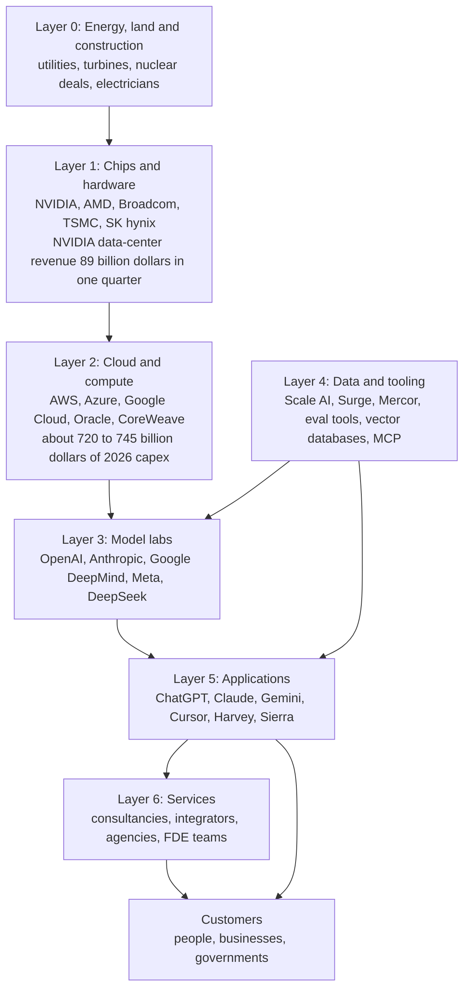
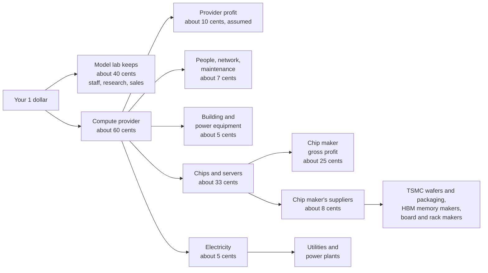
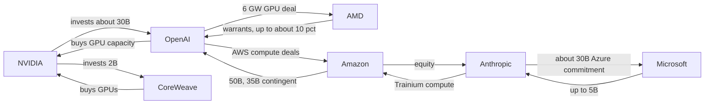

# Chapter 61: The AI Industry Map: Who Makes Money and How

*This chapter gives you a map of the whole AI economy, from power plants to the app on your phone, and the vocabulary to read any AI money headline without being fooled.*

## What you'll learn

- The vocabulary of money: revenue, recognized revenue, ARR, run-rate, backlog, gross margin, capex, valuation and funding rounds, with worked numbers.
- The AI value chain layer by layer, from energy and construction through chips, clouds, model labs, data and tooling, applications and services, with key companies and a dated number for each.
- Where the money flows: one subscription dollar followed down to a chip factory in Taiwan, plus circular deals, "up to" commitments and the gap between spending and revenue.
- How a frontier lab is organized, who ships a model, and why research is only about 5–10% of lab hiring.
- The main AI business models and why AI products have lower gross margins than classic software.
- What protects an AI business, what does not, and what "the model eats your feature" means.
- Lessons from the 2025–2026 stories of Cursor, Harvey, Lovable, Sierra, Mercor, Scale AI, Perplexity and CoreWeave.

## Before you start

This chapter looks at the whole book from the money side. Chapter 4 (The Internet and the Cloud) explains what a cloud is. Chapter 24 (The 2026 Model Landscape and How to Read Benchmarks) introduces the labs and their models. Chapter 31 (Shipping AI: Evals, Reliability, Security and Product Design) works through the unit economics of a single AI product. Chapters 35 (The AI Chip Industry), 42 (The Great Buildout) and 43 (The Economics of AI Compute) cover the chip and data-center layers in depth. You can read this chapter without them: every term is defined here, and every number carries a date.

> **Watch out:** AI money figures go stale within weeks. Every number here is a snapshot dated to a month in 2025 or 2026. Figures from company filings and official job boards are stated plainly; figures from news reports, analysts and data providers such as Sacra are marked "reported." Learn the method more than the numbers.

## Your $20 and the machine behind it

You pay about $20 a month for a chatbot plan (Claude Pro was $20 a month as of late 2026, and other labs have similar entry plans). You type a question, press Enter, and an answer streams back.

Who got your $20? The simple answer is "the AI company." The real answer is a chain of companies. Part of your money pays for a chip designed in California, manufactured in Taiwan, fitted with memory made in South Korea, bolted into a rack by a contract manufacturer, installed in a building in Texas or Indiana, cooled by water and fans, and powered by a gas turbine or a nuclear plant.

That chain is the AI industry. In 2023 it looked like a few research labs and a chip company. By 2026 it had become one of the largest investment programs in history: the four biggest US cloud companies alone guided to roughly $720–745 billion of capital spending for 2026, as reported in mid-2026, most of it for AI data centers.

> **Definition — Value chain:** The sequence of businesses that each add something to a product on its way to the customer, from raw inputs to the final sale. In AI it runs from electricity and chips up to apps and services.

> **Key idea:** Money flows down the value chain and capability flows up it. Your subscription dollar travels from the app down to the power plant; the power plant's electricity travels up, through chips and models, into the answer on your screen.

## The vocabulary of money

AI news is full of numbers that sound alike but mean very different things. A company "at a $65 billion run-rate" has not earned $65 billion. A company "valued at $965 billion" does not have $965 billion. A "$300 billion deal" may never be paid in full. Telling these apart is the most useful skill for reading AI business news.

### Revenue: earned, annualized and promised

> **Definition — Revenue:** The money a company earns from customers in a period, before subtracting any costs.

> **Definition — Recognized revenue (GAAP revenue):** Revenue counted under formal accounting rules (in the US, Generally Accepted Accounting Principles) only once the service has actually been delivered. It is the most conservative and comparable revenue number, and it is what appears in audited financial statements.

> **Definition — ARR (Annual Recurring Revenue):** The yearly value of a company's ongoing subscriptions and contracts at a moment in time. It is a forward-looking speed reading, not money already collected.

> **Definition — Run-rate (annualized revenue):** Recent revenue, often the last month, multiplied up to a full year. One $5 billion month becomes a "$60 billion run-rate." Companies calculate it in different ways, and it flatters fast-growing firms.

The arithmetic is simple. A $5 billion month gives 5 × 12 = $60 billion. A $1.2 billion week gives 1.2 × 52 = $62.4 billion. The same company can quote either, and it gets to pick.

> **Analogy:** Run-rate is a speedometer and recognized revenue is an odometer. The speedometer tells you how fast the car is going this minute; the odometer tells you how far it actually traveled. A car accelerating hard shows a high speedometer reading long before the odometer catches up.

A worked example with reported 2026 figures for Anthropic. Its run-rate was reported at about $9 billion at the end of 2025 and over $65 billion at the end of July 2026 (Bloomberg; Anthropic did not comment). Its recognized revenue for the first three quarters of 2026 was reported as $4.8 billion, $11.5 billion and $16.8 billion.

- Recognized revenue, January to September 2026: 4.8 + 11.5 + 16.8 = **$33.1 billion**.
- Run-rate headline in late July: **over $65 billion**.
- Third-quarter revenue times four: 16.8 × 4 = **$67.2 billion**.

The run-rate was about double what the company had booked in nine months, yet close to its latest quarter times four. Both numbers are honest; they answer different questions.

OpenAI shows the same pattern. Its run-rate was reported at about $20 billion at the end of 2025, while its recognized revenue for 2025 was reported at $13.1 billion. Its 2026 run-rate was reported at $25 billion (February), $40 billion (July) and about $50 billion (September, per the Financial Times), and Bloomberg reported on October 9, 2026 that OpenAI expected at least $70 billion annualized by year-end. The FT noted that an earlier $70 billion figure had come from a different calculation method, which is why you always ask how a run-rate was computed.

> **Watch out:** Even recognized revenue is not always comparable. Anthropic reportedly books sales made through cloud resellers "gross," counting the full price the customer pays even when a cloud partner takes a share, while some peers book similar sales "net." That inflates its top line relative to peers. Compare like with like.

> **Definition — Bookings, backlog and RPO (remaining performance obligations):** Contracts that have been signed but not yet delivered or paid for. CoreWeave's reported $99.4 billion backlog (March 31, 2026) is future work it has agreed to do, not money in its bank account.

### Margins, cash and spending

> **Definition — Gross margin:** Revenue minus the direct cost of delivering the product, as a percentage of revenue. Sell something for $100 that costs $25 to deliver, and the gross margin is 75%.

> **Definition — Operating margin:** What is left after all operating costs (salaries, research, sales, offices), not just delivery costs, as a percentage of revenue.

> **Definition — Free cash flow:** The cash a business generates after paying for its operations and its long-lived equipment. When it is negative, the company is "burning" cash and needs outside money to keep going.

> **Definition — Capex (capital expenditure):** Money spent on long-lived physical assets such as data centers, chips and power equipment. Its counterpart, opex (operating expenditure), covers ongoing costs such as salaries, electricity and rent.

> **Definition — Depreciation:** Spreading the cost of a long-lived asset over its useful life in the accounts. A $50,000 server expected to last five years shows up as $10,000 of cost a year, not $50,000 in year one.

Depreciation matters enormously in AI. A building lasts decades, but an AI chip may be economically obsolete within a few years, once newer chips do the same work more cheaply. Hyperscalers depreciate servers over roughly five to six years. Critics argue AI accelerators lose value faster, which would make today's reported profits look better than they are. Chapter 43 works through this debate.

### Valuation and funding

> **Definition — Valuation:** What investors agree a company is worth, in a private funding round or on the stock market. For a private company it is a negotiated price for a small slice, extrapolated to the whole company.

> **Definition — Pre-money and post-money valuation:** The company's value just before new investment arrives (pre-money) and just after adding it (post-money). Post-money = pre-money + new cash.

Worked example. In late May 2026 Anthropic reportedly raised $65 billion at a $965 billion post-money valuation (the law firm Orrick announced the round). Its pre-money valuation was 965 − 65 = **$900 billion**, and the new investors bought 65 ÷ 965 ≈ **6.7%**. On March 31, 2026, OpenAI reportedly closed $122 billion at $852 billion post-money: pre-money 852 − 122 = **$730 billion**, and a share sold of 122 ÷ 852 ≈ **14.3%**.

> **Analogy:** A valuation works like one house sale setting the value of a whole street. If one house sells for $1 million, people say every similar house is "worth" $1 million, though nobody could buy the whole street at that price tomorrow.

> **Definition — Funding round (Seed, Series A, B, C and so on):** A stage at which a private company sells part of its ownership to investors for cash. Later letters usually mean larger, later-stage rounds; Anthropic's 2026 rounds were its Series G and H.

> **Definition — Venture capital (VC):** Investment firms that buy stakes in young, risky companies, hoping a few become large enough to pay for all the failures. A "strategic investor," by contrast, is a company investing for business reasons, as when NVIDIA or Amazon invests in a lab that buys its products.

> **Definition — IPO (initial public offering):** The moment a private company first sells shares on a public stock exchange. Its value on the exchange (share price × number of shares) is its market capitalization.

> **Definition — Revenue multiple:** A company's valuation divided by its revenue or run-rate. It shows how many dollars investors pay for each dollar of sales, which reflects how fast they expect it to grow.

The 2026 IPO wave put these words on front pages. SpaceX, which absorbed xAI in an all-stock deal that closed in early February 2026, listed on Nasdaq on June 12, 2026, pricing at $135 a share, raising about $75 billion and closing its first day at roughly a $2.1 trillion value (all reported). OpenAI filed IPO paperwork confidentially with the SEC on June 8, 2026, and its finance chief was reported to be targeting a listing "by 2027." Anthropic filed confidentially on June 1, 2026, and as of October 20, 2026 was reported to be targeting a mid-November listing, with valuation talk reported to have moved from about $2 trillion to about $1.5 trillion.

> **Definition — Public benefit corporation (PBC):** A for-profit company legally required to weigh a stated public mission alongside profit. Anthropic is a PBC, and in October 2025 OpenAI's for-profit arm became OpenAI Group PBC, controlled by the nonprofit OpenAI Foundation (reported).

| Kind of number | What it measures | Example (date, status) | The trap |
|---|---|---|---|
| Recognized revenue | Money earned for services delivered | OpenAI $13.1B for 2025 (reported) | Lags fast growth; gross vs net differs |
| Run-rate or ARR | Current pace, annualized | Anthropic over $65B, end of July 2026 (reported) | Method varies; one hot month can inflate it |
| Backlog or RPO | Signed, undelivered contracts | CoreWeave $99.4B, March 2026 (reported) | Not cash; can be delayed or cancelled |
| "Up to" commitment | A maximum, often conditional | Stargate "up to $500B" | A ceiling, not a forecast |
| Valuation | Price of a slice, scaled to the whole | Anthropic $965B post-money, May 2026 (reported) | Not cash the company holds |
| Capex | Spending on long-lived assets | Big-four hyperscalers about $720–745B, 2026 (reported) | Spent once, depreciated over years |

*Table 61.1: The six kinds of AI money numbers and how each one misleads when misread.*

> **Try it:** Open any AI business headline from this week. Label each number in it with a row of Table 61.1. Then ask your chatbot: "In this article, which numbers are recognized revenue, run-rate, valuations or conditional commitments?" Check its answer against the article yourself.

## The value chain, layer by layer

The AI industry can be drawn as seven layers stacked on top of each other, with customers at the top.


*Figure 61.1: The AI value chain. Capability flows up the arrows from energy to customers; money flows down in the opposite direction. Numbers are as of mid-2026 (NVIDIA's from its own filing, capex as reported).*

> **Analogy:** Think of electrification a century ago. Chips are the turbines, data centers are the power plants, foundation models are the electricity on the grid, apps are the appliances, and services are the electricians wiring homes. Most of the fortunes from electrification went to people who used electricity in new ways, not only to the generators.

### Layer 0: energy, land and construction

Every AI answer starts as electricity. Data centers worldwide used about 415 terawatt-hours in 2024, roughly 1.5% of global electricity, according to the International Energy Agency, and AI's share is growing fastest. Epoch AI's tracker (data as of October 20, 2026) lists 95 large AI data centers with about 14.2 gigawatts of IT power between them.

> **Definition — Gigawatt (GW):** One billion watts, roughly the output of a large power plant. Labs and clouds now describe data-center size in gigawatts.

> **Definition — Powered land:** A site that already has a confirmed connection to enough electricity for a data center. Because new grid connections can take years, powered land became one of the scarcest assets in AI.

This layer's businesses are utilities, power-plant developers, makers of turbines and transformers, nuclear companies, construction firms, land developers and the skilled trades who build and run the sites. JLL put the average cost of a data-center shell and core at about $10.7 million per megawatt in 2025, with AI fit-out pushing toward about $25 million per megawatt. Including chips, industry statements put a gigawatt of AI capacity at tens of billions of dollars; NVIDIA's chief executive has cited roughly $50–60 billion.

Power has become the bottleneck: chips can be ordered in months, but a grid connection or power plant can take years. That is why Meta announced nuclear agreements for up to 6.6 GW by 2035 in January 2026, why some sites burn gas in on-site turbines, and why lab job boards now list electricians and community-engagement managers. Chapters 39 to 42 cover this layer in depth.

> **Key idea:** In AI, electricity is scarce rather than expensive. As you will see when we follow a subscription dollar, power is only a few cents of each dollar, but without it no amount of money can turn the chips on.

### Layer 1: chips and hardware

The star of this layer is NVIDIA. In its fiscal quarter ending July 26, 2026, NVIDIA reported revenue of $96.2 billion, up 106% from a year earlier. Data Center revenue was $89.0 billion, about 92% of the total, and gross margin was 75.0%. It guided to about $108 billion for the next quarter, assuming no data-center compute sales to China. These figures come from NVIDIA's own SEC filing.

> **Definition — Foundry:** A company that manufactures chips designed by others. TSMC in Taiwan manufactures most of the world's leading AI chips for "fabless" designers such as NVIDIA, AMD and Broadcom, which design chips but own no factories.

> **Definition — Custom silicon (ASIC):** A chip designed for one company's own workloads, such as Google's TPU or Amazon's Trainium, rather than sold to everyone. Clouds build them to cut costs, secure supply and gain bargaining power with NVIDIA.

A 75% gross margin is extraordinary for hardware. Of every dollar a customer pays NVIDIA, only about 25 cents covers the direct cost of making the product: wafers from TSMC, high-bandwidth memory (HBM, see Chapter 33) from SK hynix, Samsung or Micron, packaging and boards. The other 75 cents funds research and profit. The margin exists because there is not yet a full substitute: two decades of CUDA software and complete rack-scale systems make NVIDIA hard to replace (see Chapter 35).

The alternatives are growing. AMD signed a multi-generation 6-gigawatt agreement with OpenAI in October 2025. Google designs TPUs with Broadcom and agreed that month to give Anthropic access to up to one million of them. Amazon designs Trainium. OpenAI and Broadcom announced custom accelerators for 10 gigawatts from late 2026 through 2029. Beneath them all sit TSMC's factories, ASML's lithography machines (the only source of extreme-ultraviolet tools for leading-edge chips) and the three HBM makers.

> **Analogy:** In a gold rush, the sellers of picks and shovels often did better than most miners, because they sold to everyone and never had to strike gold. NVIDIA sells the shovels of the AI rush. Selling to every miner beats betting on one mine, until the rush ends.

### Layer 2: cloud and compute providers

Most labs rent their computing from clouds, often under enormous multi-year contracts.

> **Definition — Hyperscaler:** One of the largest cloud and internet companies building data centers at enormous scale: Amazon (AWS), Microsoft (Azure) and Google, plus Meta and Oracle.

> **Definition — Neocloud:** A newer cloud company that specializes in renting GPUs for AI, such as CoreWeave, Nebius, Lambda or Crusoe.

> **Definition — GPU-hour:** One GPU rented for one hour, the basic unit of AI cloud pricing. In October 2026, on-demand list prices at Lambda were about $3.99–4.29 for an H100 and $6.69–6.99 for a B200; big long-term contracts pay less.

> **Definition — Compute commitment (compute deal):** A multi-year contract to buy or reserve computing capacity, often worth tens or hundreds of billions of dollars. Headlines usually quote the maximum value.

> **Definition — Take-or-pay contract:** A contract in which the customer pays for reserved capacity whether or not it uses it. Banks lend against these contracts when financing new data centers.

| Company | 2026 capex guidance (as reported, late July 2026) |
|---|---|
| Amazon | about $220B (includes non-AI items such as robotics and satellites) |
| Alphabet (Google) | $195–205B |
| Microsoft | about $175B (calendar-year expectation) |
| Meta | $130–145B |
| **Big four combined** | **about $720–745B** |

*Table 61.2: Hyperscaler capital spending plans for 2026, as reported after the July 2026 earnings calls. FactSet put the total for five companies including Oracle "close to $800bn." Definitions differ, and results due in late October 2026 may change these figures.*

Clouds make money by renting capacity for more than it costs them. The risk is timing: the cloud pays for chips and buildings up front and earns the money back over years. If prices fall faster than expected or customers leave, it is left holding expensive, aging hardware.

CoreWeave shows the opportunity and the risk. It went public on March 28, 2025, reportedly earned about $5.1 billion in 2025, guided to $12–13 billion for 2026, and reported a $99.4 billion backlog. But Microsoft was reportedly about 67% of its 2025 revenue.

> **Definition — Customer concentration:** When a large share of a company's revenue comes from one or a few customers. Losing one relationship can cripple the business.

### Layer 3: the foundation-model labs

> **Definition — Frontier lab:** A company that trains the most capable "foundation models" (large general-purpose models that many products are built on): as of late 2026 mainly OpenAI, Anthropic, Google DeepMind, Meta and SpaceX's AI unit (formerly xAI), plus strong Chinese labs such as DeepSeek, Alibaba's Qwen team and Moonshot.

> **Definition — Open-weight model:** A model whose trained parameters are published so anyone can download, run and modify it. The weights are free, but running them still costs compute and engineering.

Chapter 24 describes the labs' models; here we look at them as businesses. A lab spends on three big things: compute for training, compute for serving users (inference), and people. It earns money in five main ways:

1. **API usage.** Developers pay per million tokens (see Chapter 26).
2. **Consumer subscriptions.** The $20-a-month plans and higher tiers ($100 and $200 a month for Claude's Max plans as of late 2026).
3. **Enterprise seats and contracts.** Anthropic reportedly had over 300,000 business customers in October 2025 and over 1,000 spending more than $1 million a year by April 2026.
4. **Agents and coding tools.** Claude Code was reported at $1 billion annualized in November 2025 and $2.5 billion in February 2026.
5. **Advertising.** OpenAI's ads were reported at $1 billion annualized in August 2026.

| Lab | Reported run-rate | Latest reported valuation | Selected facts (reported) |
|---|---|---|---|
| OpenAI | about $50B (September 2026); expects at least $70B by end of 2026 | $852B post-money (March 2026) | 2025 recognized revenue $13.1B; over 50M consumer subscribers and 9M paying business users (February 2026); gross margin estimated at 33% (Sacra) |
| Anthropic | over $65B (end of July 2026) | $965B post-money (May 2026) | Recognized revenue $4.8B, $11.5B, $16.8B in Q1–Q3 2026; 11% adjusted operating margin in Q3 |
| SpaceX AI unit (formerly xAI) | not reported separately | Inside SpaceX, about $2.1T at its June 2026 debut | SpaceX agreed to buy Cursor's maker for about $60B in stock (June 2026) |

*Table 61.3: The three most-reported US frontier labs as businesses, as of October 2026. Google DeepMind and Meta's labs sit inside giant companies that do not report them separately.*

The labs differ in their customers. Menlo Ventures, a venture firm with investments in the sector, estimated that Anthropic held 40% of enterprise spending on language-model APIs in 2025 against 27% for OpenAI. OpenAI's strength is consumers: ChatGPT is reported to have around a billion weekly users. Google and Meta can spread model costs across products that already reach billions of people.

> **Watch out:** "Open-weight means free" is a myth. Serving a large open model needs GPUs, engineers and maintenance. Open-weight labs earn money through hosting, enterprise support, premium closed models or the strategic value of setting a standard.

### Layer 4: data and tooling

Between labs and apps sits a layer that sells to builders rather than end users.

> **Definition — Human data:** Examples, ratings and expert demonstrations written by people to train and evaluate models. Contractors often do this work through firms such as Scale AI, Surge or Mercor (see Chapter 11).

> **Definition — RL environment:** A simulated task (a codebase, a website, a spreadsheet) with an automatic way to score success, in which models practice by reinforcement learning. Building them became a business in 2025–2026 (see Chapter 21).

This layer includes human-data firms (Scale AI, about $2 billion of revenue estimated for 2025; Mercor, about $2 billion of gross run-rate reported by June 2026), RL-environment builders, evaluation and observability tools (Chapter 31), vector databases such as Pinecone and pgvector (Chapter 27), frameworks such as LangChain and LlamaIndex, and standards such as MCP, the open protocol for connecting assistants to tools (Chapter 28).

These are picks-and-shovels businesses, and their risk is a few powerful customers. When Meta bought 49% of Scale AI for about $14.3 billion in June 2025, Google, OpenAI and other labs reportedly pulled their work, and Scale reportedly ended work with about 500 contractors in July 2025.

### Layer 5: applications

Menlo Ventures estimated that enterprises spent $37 billion on generative AI in 2025, up from $11.5 billion in 2024, with about $19 billion going to the application layer. The main families are horizontal assistants (ChatGPT, Claude, Gemini, Microsoft Copilot), coding tools (Cursor, Claude Code, Codex, GitHub Copilot), vertical apps (Harvey for law), customer-service agents (Sierra, Decagon), app builders (Lovable, Replit) and answer engines (Perplexity).

> **Definition — Horizontal AI:** General-purpose tools used across many industries, such as chat assistants or coding tools.

> **Definition — Vertical AI:** AI products built for one industry (law, healthcare, accounting) with that industry's workflows, data and vocabulary built in.

> **Definition — Wrapper:** A product built on top of someone else's AI model, adding an interface, a workflow or data. A "thin wrapper" adds little and is easy to copy; a "thick wrapper" becomes a deep product.

Applications have the easiest entry and the fiercest competition: anyone can call a model's API this afternoon. What keeps a customer when a rival, or the model's own maker, offers the same thing is the subject of the section on moats.

### Layer 6: services

The top layer sells expertise and time rather than software.

> **Definition — Systems integrator (SI or GSI):** A large consulting firm, such as Accenture or Deloitte, that implements technology inside big organizations ("GSI" means global systems integrator). They are a major channel through which AI reaches enterprises.

> **Definition — Forward-deployed engineer (FDE):** An engineer embedded with a customer, often on site for weeks or months, to build and deploy solutions on that customer's systems. The role originated at Palantir and became one of the fastest-growing AI jobs of 2025–2026.

> **Definition — Pilot (proof of concept):** A small trial that tests whether AI works for one use case before a full rollout.

Why would services grow alongside software that is supposed to replace work? Because buying AI is easy and getting value from it is hard. Stanford's 2026 AI Index reported that 88% of organizations say they use AI. But the MIT NANDA "GenAI Divide" report (July 2025) found that only about 5% of enterprise generative-AI pilots delivered rapid revenue acceleration or measurable impact on profit and loss (P&L). Media turned that into "95% of AI projects fail"; the report itself blamed brittle workflows and poor fit with daily operations, not weak models.

```
Pilot-to-impact funnel (shape, not to scale)

 Organizations using AI   |##########################| 88% (Stanford)
 Running pilots           |##################        |
 Deployed in production   |##########                |
 Measurable P&L impact    |#                         | about 5% of
                                                       pilots (MIT)
```
*Figure 61.2: The pilot-to-impact funnel. Only the top and bottom figures come from studies, and they measure different things (organizations versus pilots); the middle bars show the shape the reports describe.*

That gap is the services opportunity: consultancies, agencies serving small businesses, the labs' own forward-deployed teams and corporate trainers all sell the work of turning a model into a changed workflow. OpenAI had a dedicated Forward Deployed Engineering department with 31 open roles on October 21, 2026, according to its job board.

| Layer | What it sells | Headline number (date) |
|---|---|---|
| 0. Energy and construction | Power, land, buildings, trades | About 14.2 GW of large AI sites tracked (Epoch, Oct 2026) |
| 1. Chips and hardware | Accelerators, memory, manufacturing, racks | NVIDIA data-center revenue $89.0B in one quarter, 75% gross margin (filing, July 2026 quarter) |
| 2. Cloud and compute | Rented compute, capacity contracts | About $720–745B big-four 2026 capex (reported) |
| 3. Model labs | Tokens, subscriptions, enterprise deals | Run-rates of about $50B and over $65B at the top two US labs (reported) |
| 4. Data and tooling | Training data, evals, developer tools | Mercor about $2B gross run-rate (reported, June 2026) |
| 5. Applications | Software for end users | About $19B of 2025 enterprise app spend (Menlo, reported) |
| 6. Services | Implementation, training, consulting | About 5% of pilots reached measurable P&L impact (MIT, 2025) |

*Table 61.4: The value chain at a glance, with one dated number per layer.*

## Where the money flows

### Follow one subscription dollar

Let us follow one dollar of your subscription down the chain. This is a teaching model, not anyone's accounts. Each step uses a reported figure where one exists and a labeled assumption where it does not.

**Step 1: the lab.** How much of your dollar goes to computing? Two reported figures bracket the answer. Anthropic reportedly generated about $1.70 of revenue per $1 of compute in the third quarter of 2026, so 1 ÷ 1.70 ≈ 59 cents of each revenue dollar went to compute (not a gross margin, since that compute may include training). For OpenAI, Sacra estimated a gross margin of about 33%, so roughly 67 cents of each dollar went to delivering the service, mostly compute. Call it **about 60 cents to compute and 40 cents left at the lab** for researchers, engineers, sales and everything else. That is not enough: the Financial Times reported OpenAI's projected cumulative negative free cash flow at $278 billion over 2026–2030. Investors fill the gap.

**Step 2: the compute provider.** To see how a provider spends its 60 cents, build the yearly cost of one AI chip in a data center:

- **Hardware:** assume about $50,000 per Blackwell-class GPU, all-in with its share of server and network, depreciated over five years: **$10,000 a year**.
- **Building and power equipment:** about $15 million per megawatt (the middle of the $11–18 million range from JLL and Cushman & Wakefield). Assuming about 450 GPUs per megawatt, each GPU's share is 15,000,000 ÷ 450 ≈ $33,300, depreciated over 20 years: **about $1,700 a year**.
- **Electricity:** assume each GPU accounts for about 2.5 kilowatts including its share of servers, networking and cooling, all year: 2.5 × 8,760 hours = 21,900 kilowatt-hours. At an assumed 7 cents per kilowatt-hour: **about $1,500 a year** (an upper bound, since chips do not run flat out all the time).
- **People, maintenance, network operations, insurance and financing:** assume **about $2,000 a year**.

Total: about **$15,200 a year** per GPU. Hardware is about 66%, building about 11%, electricity about 10% and everything else about 13%. If the provider keeps about 10 of the 60 cents as profit (an assumption; providers do not publish this), the remaining 50 cents splits into roughly 33 cents for chips and servers, 5 for the building, 5 for electricity and 7 for people and operations.

**Step 3: the chip maker.** Most of the 33 cents was paid, years earlier, to hardware vendors, the largest being NVIDIA. At a 75% gross margin, about 25 of those cents are NVIDIA's gross profit and about 8 cover its cost of goods.

**Step 4: the factory floor.** Those 8 cents are shared among TSMC (wafers and advanced packaging), the HBM makers, and the makers of substrates, boards and racks. Public filings do not break this down, so the honest answer is: **a few cents of your dollar ends up at a chip factory in Taiwan or a memory plant in South Korea.**


*Figure 61.3: Following one subscription dollar down the value chain. An illustrative model built from reported ratios and labeled assumptions, not any company's accounts.*

Four lessons fall out of this model:

1. **The chip maker captures a large share,** roughly a quarter of your dollar as gross profit. That is why NVIDIA became one of the world's most valuable companies, and why every cloud designs its own chips: on Google TPUs or Amazon Trainium, part of that slice stays in-house.
2. **Electricity is small,** about 5 cents. Power is the bottleneck because it is slow to get, not because it is costly per hour.
3. **Timing is everything.** The hardware was bought before your dollar arrived, and your subscription repays it over five years. If the chip is obsolete in three, the provider loses money even if every customer pays.
4. **The lab is squeezed.** Its 40 cents must fund the next, more expensive model.

The model also gives a cost per GPU-hour. At 70% utilization a GPU sells 8,760 × 0.7 ≈ 6,130 hours a year, so its cost per sold hour is 15,200 ÷ 6,130 ≈ **$2.48**. The gap to the October 2026 list price of about $6.69–6.99 for a B200 pays for idle hardware, big-customer discounts, risk and profit. Chapter 43 builds this into a full payback model.

> **Try it:** Copy the four cost lines into a spreadsheet. Change one assumption at a time: three-year hardware life instead of five; 12-cent electricity instead of 7; 50% utilization instead of 70%. Watch which change moves the cost per GPU-hour most. (It is the hardware life.)

### Circular deals

Some money in AI loops back on itself.

> **Definition — Circular deal (vendor financing):** An arrangement in which a supplier invests in or lends to a customer, and the customer then spends that money on the supplier's products. It is real business, but it can make demand look larger than independent demand really is.

Reported examples: NVIDIA invested about $30 billion in OpenAI's March 2026 round, $2 billion each in CoreWeave and Nebius in early 2026, and committed up to $10 billion to Anthropic; all of them buy or rent NVIDIA hardware. AMD gave OpenAI warrants (the right to buy shares cheaply) for up to roughly 10% of AMD alongside OpenAI's 6-gigawatt GPU purchase. Microsoft committed up to $5 billion to Anthropic as Anthropic committed about $30 billion to Azure. Amazon and Google invested in Anthropic, which rents their chips, and Amazon agreed to invest $50 billion in OpenAI, which has signed large AWS compute contracts.


*Figure 61.4: A simplified map of circular deals, 2025–2026, as reported. Arrows into a lab are investments; arrows out of a lab are purchase commitments back to the investor.*

> **Analogy:** A circular deal is like a furniture store lending you money to buy its sofas. The sale is real and you get a sofa. But when the store reports "record sofa demand," part of that demand exists because the store financed it.

Circular deals are not fraud, and they can make sense: a supplier with spare cash backs a customer whose growth helps it. The risks are inflated apparent demand, suppliers tied to a few customers, and loops that unwind in both directions if one link fails.

### "Up to" commitments

> **Definition — "Up to" deal (contingent investment):** A headline maximum that depends on conditions such as milestones, an IPO or future decisions. The final amount can be far lower.

> **Analogy:** An "up to" deal is like a gym membership advertised as "up to 365 visits a year." The headline is the maximum, not what will happen.

Read the fine print and the conditions appear. Of Amazon's reported $50 billion commitment to OpenAI, $35 billion was reportedly contingent on an IPO or a technical milestone. NVIDIA's September 2025 letter of intent to invest "up to $100 billion" in OpenAI was later reported to have been shelved in favor of the roughly $30 billion equity stake. Stargate was announced in January 2025 as "up to $500 billion" and 10 gigawatts by 2029; in April 2026 Epoch AI estimated its flagship Abilene site had about 0.3 GW of facility power running against a 1.2 GW plan (Oracle reportedly said in September 2026 that six of eight buildings had been delivered), with most new Stargate capacity expected in 2027–2028. Large projects are staged for good reasons; the point is that adding up headline maximums overstates what has been committed and spent.

### The capex-revenue gap

Hyperscalers are spending about $720–745 billion in 2026 (reported). How much revenue must that earn back? A rough worked example:

- Spread one year's spending over an average life of about six years: 720 ÷ 6 ≈ **$120 billion a year** of depreciation from 2026's spending alone.
- Add electricity, staff and a normal profit, and the customers renting that capacity must pay perhaps $150–200 billion a year for this one year of spending. Each later year adds another layer.
- Compare demand. The two leading US labs had combined reported run-rates of about $50 billion (OpenAI, September) plus over $65 billion (Anthropic, July), roughly $115 billion. Enterprise generative-AI spending was about $37 billion in 2025 (Menlo). Google, Microsoft and Meta also earn AI revenue inside existing products, which is hard to measure.

Two cautions. Not all capex is for AI (Amazon's includes robotics and satellites). And much of the labs' revenue is paid straight back to clouds for compute, so adding cloud and lab revenue double-counts the same dollars.

Bulls point to how fast lab revenue has grown (Anthropic's reported run-rate rose about sevenfold in seven months), to clouds saying demand still exceeds supply, and to AWS's reported $496 billion backlog. Bears point to projected cash losses, circular financing, Oracle's credit rating being cut to BBB-, the lowest investment grade, in July 2026, and to railroads and 1990s fiber-optic networks, real technologies that attracted more investment than they could repay in time. Chapter 43 covers financing and Chapter 60 presents both sides of the bubble debate.

> **Key idea:** The AI industry in 2026 is a bet that application revenue will grow into the infrastructure being built for it. The richest companies in the world are making that bet, but it is still a bet, and so far the layer capturing the most profit is the one selling the shovels.
