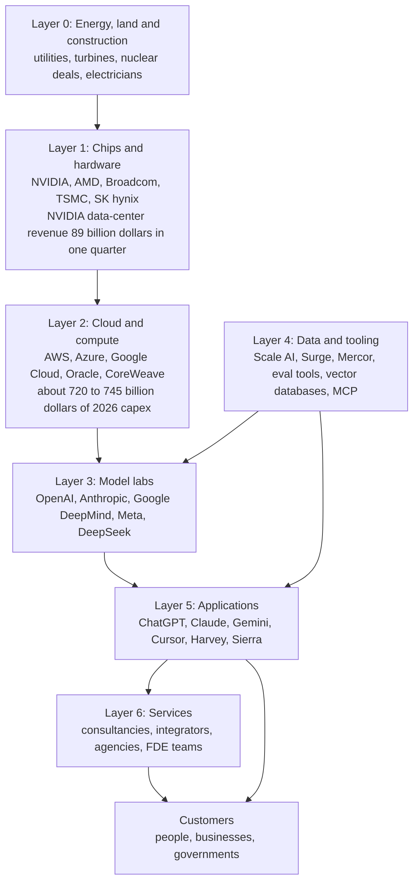
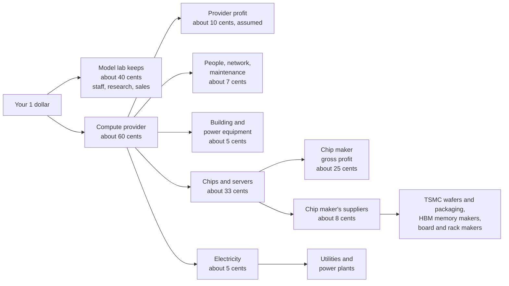
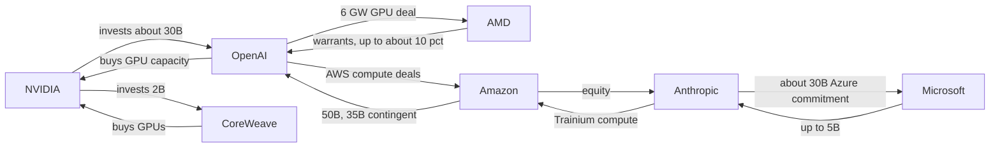

# Chapter 61: The AI Industry Map: Who Makes Money and How

*This chapter gives you a map of the whole AI economy, from power plants to the app on your phone, and the vocabulary to read any AI money headline without being fooled.*

## What you'll learn

- The vocabulary of money: revenue, recognized revenue, ARR, run-rate, backlog, gross margin, capex, valuation and funding rounds, with worked numbers.
- The AI value chain layer by layer, from energy and construction through chips, clouds, model labs, data and tooling, applications and services, with the key companies and a dated headline number for each.
- Where the money flows: one subscription dollar followed all the way down to a chip factory in Taiwan, plus circular deals, "up to" commitments and the gap between spending and revenue.
- How a frontier lab is organized, who ships a model, and why research is only about 5–10% of lab hiring.
- The main AI business models and why AI products have lower gross margins than classic software.
- What protects an AI business (moats), what does not, and what "the model eats your feature" means.
- Lessons from the 2025–2026 startup stories: Cursor, Harvey, Lovable, Sierra, Mercor, Scale AI, Perplexity and CoreWeave.

## Before you start

This chapter pulls the whole book together from the money side, so it helps to have met the physical stack first. Chapter 4 (The Internet and the Cloud) explains what a cloud is. Chapter 24 (The 2026 Model Landscape and How to Read Benchmarks) introduces the labs and their models. Chapter 31 (Shipping AI: Evals, Reliability, Security and Product Design) works through the unit economics of a single AI product. Chapters 35 (The AI Chip Industry), 42 (The Great Buildout) and 43 (The Economics of AI Compute) cover the chip and data-center layers in depth. You can read this chapter without them: every term is defined here, and every number carries a date.

> **Watch out:** AI money figures go stale within weeks. Every number in this chapter is a snapshot dated "as of" a month in 2025 or 2026. Figures from company filings and official job boards are stated plainly. Figures from news reports, analysts and data providers such as Sacra are marked "reported." Learn the method more than the numbers, because by the time you read this, many of them will have moved.

## Your $20 and the machine behind it

Start with something you already do. You pay about $20 a month for a chatbot plan (Claude Pro was $20 a month as of late 2026, and other labs have similar entry plans). You type a question and press Enter. A few seconds later an answer streams back.

Who got your $20? The simple answer is "the AI company." The real answer is a chain of companies, some of which you have never heard of. Part of your money pays for a graphics chip that was designed in California, manufactured in Taiwan, fitted with memory made in South Korea, bolted into a rack built by a contract manufacturer, installed in a building in Texas or Iowa, cooled by water and fans, and powered by a gas turbine or a nuclear plant several states away.

That chain is the AI industry. In 2023 it looked like a handful of research labs and a chip company. By 2026 it had become one of the largest investment programs in history. The four biggest US cloud companies alone guided to roughly $720–745 billion of capital spending for 2026, as reported in mid-2026, most of it for AI data centers.

> **Definition — Value chain:** The sequence of businesses that each add something to a product on its way to the customer, from raw inputs to the final sale. In AI it runs from electricity and chips up to apps and services.

> **Key idea:** Money flows down the value chain and capability flows up it. Your subscription dollar travels from the app down to the power plant; the power plant's electricity travels up, through chips and models, into the answer on your screen.

This chapter has three jobs. First, it gives you the vocabulary to read the numbers. Second, it walks the value chain one layer at a time. Third, it looks at the businesses built on top: how they charge, why their margins look the way they do, and what keeps a competitor from copying them.

## The vocabulary of money

Before touring the industry, you need about twenty words. AI news is full of numbers that sound alike but mean very different things. A company "at a $65 billion run-rate" has not earned $65 billion. A company "valued at $965 billion" does not have $965 billion. A "$300 billion deal" may never be paid in full. Learning to tell these apart is the single most useful skill for reading AI business news.

### Revenue: earned, annualized and promised

> **Definition — Revenue:** The money a company earns from customers in a period, before subtracting any costs.

> **Definition — Recognized revenue (GAAP revenue):** Revenue counted under formal accounting rules, only once the service has actually been delivered. It is the most conservative and most comparable revenue number, and it is what appears in audited financial statements.

> **Definition — GAAP (Generally Accepted Accounting Principles):** The official rulebook US companies follow when preparing financial statements, so that numbers from different companies can be compared.

> **Definition — ARR (Annual Recurring Revenue):** The yearly value of a company's ongoing subscriptions and contracts at a moment in time. It is a forward-looking speed reading, not money already collected.

> **Definition — Run-rate (annualized revenue):** Recent revenue, often the last month, multiplied up to a full year. One $5 billion month becomes a "$60 billion run-rate." Companies calculate it in different ways, and it flatters fast-growing firms.

The run-rate arithmetic is simple. If a company earned $5 billion last month, its run-rate is 5 × 12 = $60 billion. If it earned $1.2 billion last week, its weekly run-rate is 1.2 × 52 = $62.4 billion. Notice that the two methods give different answers for the same company, and the company gets to pick.

> **Analogy:** Run-rate is a speedometer and recognized revenue is an odometer. The speedometer tells you how fast the car is going this minute. The odometer tells you how far it actually traveled. A car accelerating hard shows a high speedometer reading long before the odometer catches up.

Here is a worked example with reported 2026 figures for Anthropic. Its run-rate was reported at about $9 billion at the end of 2025 and over $65 billion at the end of July 2026 (Bloomberg, reported; Anthropic did not comment). Its recognized revenue for the first three quarters of 2026 was reported as $4.8 billion, $11.5 billion and $16.8 billion.

- Recognized revenue, January to September 2026: 4.8 + 11.5 + 16.8 = **$33.1 billion**.
- The run-rate headline in late July: **over $65 billion**.
- Third-quarter recognized revenue times four: 16.8 × 4 = **$67.2 billion**.

So the run-rate was roughly double what the company had actually booked in nine months, yet close to its latest quarter multiplied by four. Both numbers are honest. They answer different questions: "how fast are you going now?" versus "how far did you go?"

OpenAI shows the same pattern. Its run-rate was reported at about $20 billion at the end of 2025, while its recognized revenue for all of 2025 was reported at $13.1 billion. In 2026 its run-rate was reported at $25 billion (end of February), $40 billion (July) and about $50 billion (September, per the Financial Times). Bloomberg reported on October 9, 2026 that OpenAI expected to reach or exceed $70 billion annualized by the end of 2026. The FT noted that a $70 billion figure circulating earlier had come from a different calculation method, which is exactly why you should always ask how a run-rate was computed.

> **Watch out:** Even recognized revenue is not always comparable between companies. Anthropic reportedly books sales made through cloud resellers "gross," counting the full price the customer pays even when a cloud partner takes a share, while some peers book the same kind of sale "net." That inflates Anthropic's top line relative to peers. Compare like with like before declaring a winner.

> **Definition — Bookings, backlog and RPO (remaining performance obligations):** Contracts that have been signed but not yet delivered or paid for. CoreWeave's reported $99.4 billion backlog (March 31, 2026) is future work it has agreed to do, not money in its bank account.

### Margins, cash and spending

> **Definition — Gross margin:** Revenue minus the direct cost of delivering the product, expressed as a percentage of revenue. If you sell something for $100 and it costs $25 to deliver, the gross margin is 75%.

> **Definition — Operating margin:** What is left after all operating costs (salaries, research, sales, offices), not just delivery costs, as a percentage of revenue.

> **Definition — Burn rate:** How fast a company spends cash beyond what it brings in, usually quoted per month or per year.

> **Definition — Free cash flow:** The cash a business generates after paying for its operations and its long-lived equipment. Negative free cash flow means the company needs outside money to keep going.

> **Definition — Capex (capital expenditure):** Money spent on long-lived physical assets such as data centers, chips and power equipment. Big-tech AI capex is the engine of the data-center boom.

> **Definition — Opex (operating expenditure):** Ongoing costs such as salaries, electricity, rent and cloud bills.

> **Definition — Depreciation:** Spreading the cost of a long-lived asset over its useful life in the accounts. A $50,000 server expected to last five years shows up as $10,000 of cost per year, not $50,000 in year one.

Depreciation matters enormously in AI. A data-center building can last decades, but an AI chip may be economically obsolete within a few years, when newer chips do the same work far more cheaply. Hyperscalers depreciate servers over roughly five to six years. Critics argue AI accelerators lose their value faster than that, which would mean today's reported profits are flattering. Chapter 43 works through this debate.

### Valuation and funding

> **Definition — Valuation:** What investors agree a company is worth, either in a private funding round or on the stock market. For a private company it is a negotiated price for a small slice, extrapolated to the whole company.

> **Definition — Pre-money and post-money valuation:** The company's value just before new investment arrives (pre-money) and just after adding it (post-money). Post-money = pre-money + new cash.

Worked example. In late May 2026 Anthropic reportedly raised $65 billion at a $965 billion post-money valuation (the law firm Orrick announced the round).

- Pre-money valuation: 965 − 65 = **$900 billion**.
- Share of the company the new investors bought: 65 ÷ 965 ≈ **6.7%**.

On March 31, 2026, OpenAI reportedly closed $122 billion at an $852 billion post-money valuation.

- Pre-money: 852 − 122 = **$730 billion**.
- Share sold: 122 ÷ 852 ≈ **14.3%**.

> **Analogy:** A valuation works like one house sale setting the value of a whole street. If one house sells for $1 million, people say every similar house on the street is "worth" $1 million, even though nobody could buy the whole street at that price tomorrow.

> **Definition — Funding round (Seed, Series A, B, C and so on):** A stage at which a private company sells part of its ownership to investors for cash. Later letters usually mean larger, later-stage rounds. Anthropic's 2026 rounds were its Series G and Series H.

> **Definition — Venture capital (VC):** Investment firms that buy stakes in young, risky companies, hoping a few become enormous enough to pay for all the failures.

> **Definition — Strategic investor:** A company, rather than a pure financial fund, that invests for business reasons. NVIDIA, Amazon, Google and Microsoft investing in AI labs that buy their products are strategic investors.

> **Definition — Tender offer (secondary sale):** A transaction in which existing shareholders, often employees, sell their shares to new investors. No new money goes to the company itself.

> **Definition — IPO (initial public offering):** The moment a private company first sells shares on a public stock exchange, after which anyone can buy them.

> **Definition — Confidential filing (draft S-1):** Submitting IPO paperwork to the US Securities and Exchange Commission (SEC) privately, before the documents become public. It lets a company prepare to list without revealing its numbers too early.

> **Definition — Market capitalization (market cap):** Share price multiplied by the number of shares: the stock market's valuation of a public company.

> **Definition — Revenue multiple:** A company's valuation divided by its revenue or run-rate. It shows how many dollars investors pay for each dollar of sales, which reflects how fast they expect it to grow.

The IPO wave of 2026 made these words front-page news. SpaceX, which absorbed xAI in an all-stock deal that closed in early February 2026, listed on Nasdaq on June 12, 2026: it priced at $135 a share, raised about $75 billion and closed its first day at roughly a $2.1 trillion value, all as reported. OpenAI filed confidentially on June 8, 2026, and its finance chief was reported to be targeting a listing "by 2027." Anthropic filed confidentially on June 1, 2026, and as of October 20, 2026 was reported to be targeting a mid-November listing, with valuation talk reported to have moved from about $2 trillion to about $1.5 trillion.

> **Definition — Public benefit corporation (PBC):** A for-profit company that is legally required to weigh a stated public mission alongside profit. Anthropic is a PBC, and in October 2025 OpenAI's for-profit arm became OpenAI Group PBC, controlled by the nonprofit OpenAI Foundation (reported).

### A field guide to AI numbers

| Kind of number | What it measures | Example (date, status) | The trap |
|---|---|---|---|
| Recognized revenue | Money earned for services delivered | OpenAI $13.1B for 2025 (reported) | Lags fast growth; gross vs net booking differs |
| Run-rate or ARR | Current pace, annualized | Anthropic over $65B, end of July 2026 (reported) | Method varies; can double-count a hot month |
| Backlog or RPO | Signed, undelivered contracts | CoreWeave $99.4B, March 2026 (reported) | Not cash; may be cancelled or delayed |
| "Up to" commitment | A maximum, often conditional | Stargate "up to $500B" | The headline is a ceiling, not a forecast |
| Valuation | Price of a slice, scaled to the whole | Anthropic $965B post-money, May 2026 (reported) | Not cash; not what the company "has" |
| Capex | Spending on long-lived assets | Big-four hyperscalers about $720–745B, 2026 guidance (reported) | Spent once, depreciated over years |

*Table 61.1: The six kinds of AI money numbers and how each one misleads when misread.*

> **Try it:** Open any AI business headline from this week. For each number in it, write which of the six rows of Table 61.1 it belongs to. Then ask your chatbot: "In this article, which numbers are recognized revenue, which are run-rate, which are valuations and which are conditional commitments?" Check its answer against the article yourself.

## The value chain, layer by layer

Now the tour. The AI industry can be drawn as seven layers stacked on top of each other, plus the customers at the top.


*Figure 61.1: The AI value chain. Capability flows up the arrows from energy to customers; money flows down in the opposite direction. Numbers are as of mid-2026 (NVIDIA's from its own filing, capex as reported).*

> **Analogy:** Think of the electricity industry a century ago. Chips are the turbines, data centers are the power plants, foundation models are the electricity on the grid, apps are the appliances, and services are the electricians wiring homes. Most of the fortunes made from electrification went to people who used electricity in new ways, not only to the generators.

Each layer sells to the one above it, and each has a different kind of business: different margins, different risks and different jobs. Let us climb.

### Layer 0: energy, land and construction

Every AI answer starts as electricity. Data centers worldwide used about 415 terawatt-hours in 2024, roughly 1.5% of global electricity, according to the International Energy Agency. AI's share is growing fastest. Epoch AI's tracker (data as of October 20, 2026) lists 95 large AI data centers with about 14.2 gigawatts of IT power between them.

> **Definition — Gigawatt (GW):** One billion watts of power, roughly the output of a large power plant. Labs and clouds now describe data-center size in gigawatts rather than in square feet or number of servers.

> **Definition — Powered land:** A site that already has a confirmed connection to enough electricity for a data center. Because grid connections can take years, powered land became one of the scarcest assets in AI.

> **Definition — Interconnection queue:** The waiting list for connecting a new power plant or a large new electricity user to the grid. In many regions it is measured in years.

The businesses in this layer are utilities, power-plant developers, gas-turbine and transformer makers, nuclear companies, construction firms, land developers and the skilled trades who build and run the sites. Building costs are large. JLL put the global average cost of a data-center shell and core at about $10.7 million per megawatt in 2025 (forecast $11.3 million for 2026), with AI fit-out pushing toward about $25 million per megawatt. Industry statements put the all-in cost of a gigawatt of AI capacity, including chips, at tens of billions of dollars; NVIDIA's chief executive has cited roughly $50–60 billion per gigawatt.

Power has become the bottleneck. A lab can order chips in months, but a new grid connection or power plant can take years. That is why labs sign nuclear deals (Meta announced agreements for up to 6.6 GW of nuclear power by 2035 in January 2026), why some sites burn natural gas in on-site turbines, and why AI-lab job boards now list electricians, data-center engineers and community-engagement managers. Chapters 39 to 42 cover this layer in depth.

> **Key idea:** In AI, electricity is scarce rather than expensive. As you will see when we follow a subscription dollar, power is only a few cents of each dollar, but without it no amount of money can turn the chips on.

### Layer 1: chips and hardware

The second layer makes the machines. Its star is NVIDIA. In its fiscal second quarter of 2027 (the three months ending July 26, 2026), NVIDIA reported total revenue of $96.2 billion, up 106% from a year earlier. Data Center revenue was $89.0 billion, about 92% of the total, and gross margin was 75.0%. It guided to about $108 billion for the next quarter, assuming no data-center compute sales to China. These figures come from NVIDIA's own filing with the SEC.

> **Definition — GPU (graphics processing unit) and accelerator:** Chips specialized for the massively parallel arithmetic that AI needs. NVIDIA's GPUs dominate; Google's TPUs, Amazon's Trainium and AMD's Instinct chips are the main alternatives (see Chapter 32).

> **Definition — Fabless chip company:** A company that designs chips but pays a foundry to manufacture them. NVIDIA, AMD and Broadcom are fabless.

> **Definition — Foundry:** A company that manufactures chips designed by others. TSMC in Taiwan manufactures most of the world's leading AI chips.

> **Definition — HBM (high-bandwidth memory):** Stacks of memory chips placed right beside an AI processor to feed it data very fast. Only three companies make it at scale: SK hynix, Samsung and Micron (see Chapter 33).

> **Definition — ODM (original design manufacturer):** A contract manufacturer, such as Foxconn, Quanta or Wistron, that builds servers and racks for cloud companies.

A 75% gross margin is extraordinary for hardware. It means that for every dollar a customer pays NVIDIA, only about 25 cents covers the direct cost of making the product, including the silicon wafers from TSMC, the HBM memory, the packaging and the boards. The other 75 cents pays for NVIDIA's research and development and its profit. That margin exists because, for now, there is no full substitute: two decades of CUDA software and developer habit, plus complete rack-scale systems, make NVIDIA hard to replace (see Chapter 35).

The alternatives are growing. AMD sells its Instinct GPUs and signed a multi-generation 6-gigawatt agreement with OpenAI in October 2025. Google designs TPUs, with Broadcom as its design partner, and agreed in October 2025 to give Anthropic access to up to one million of them. Amazon designs Trainium chips. OpenAI and Broadcom announced custom accelerators for 10 gigawatts to be deployed from late 2026 through 2029. NVIDIA itself reportedly paid about $20 billion for a non-exclusive license to the startup Groq's inference technology in December 2025. Below all of them sit the "picks and shovels" of the picks and shovels: TSMC's factories, ASML's lithography machines (the only source of the extreme-ultraviolet tools used for leading-edge chips), and the three HBM makers.

> **Definition — Custom silicon (ASIC):** A chip designed for one company's own workloads, such as Google's TPU or Amazon's Trainium, rather than sold to everyone. Clouds build them to cut costs, secure supply and gain bargaining power with NVIDIA.

> **Analogy:** In a gold rush, the people who sold picks and shovels often did better than most miners, because they sold to everyone and did not have to strike gold themselves. NVIDIA sells the shovels of the AI rush. Selling to every miner beats betting on one mine, until the rush ends.

### Layer 2: cloud and compute providers

Most AI labs do not own their own data centers outright. They rent computing from clouds, often under enormous multi-year contracts.

> **Definition — Hyperscaler:** One of the largest cloud and internet companies, which build data centers at enormous scale: Amazon (AWS), Microsoft (Azure), Google (Google Cloud), plus Meta and Oracle for their own buildouts.

> **Definition — Neocloud:** A newer cloud company that specializes in renting GPUs for AI, such as CoreWeave, Nebius, Lambda or Crusoe.

> **Definition — GPU-hour:** One GPU rented for one hour, the basic unit of AI cloud pricing. In October 2026, on-demand list prices at Lambda were about $3.99–4.29 for an H100 and $6.69–6.99 for a B200; big long-term contracts pay less.

> **Definition — Compute commitment (compute deal):** A multi-year contract to buy or reserve computing capacity, often worth tens or hundreds of billions of dollars. Headlines usually quote the maximum value.

> **Definition — Take-or-pay contract:** A contract in which the customer pays for reserved capacity whether or not it uses it. These contracts are what banks lend against when financing new data centers.

| Company | 2026 capex guidance (as reported, late July 2026) |
|---|---|
| Amazon | about $220B (includes non-AI items such as robotics and satellites) |
| Alphabet (Google) | $195–205B |
| Microsoft | about $175B (calendar-year expectation) |
| Meta | $130–145B |
| **Big four combined** | **about $720–745B** |

*Table 61.2: Hyperscaler capital spending plans for 2026, as reported after the July 2026 earnings calls. FactSet put the total for five companies including Oracle "close to $800bn." Definitions differ between companies, and third-quarter results due in late October 2026 may change these figures.*

Clouds make money by renting out capacity for more than it costs them. The arithmetic is simple in principle: buy a GPU, keep it busy, and charge by the hour until it has paid for itself several times over. The risk is the gap in time. The cloud pays for the chips and the building up front, then earns the money back slowly over years. If prices fall faster than expected, or customers walk away, the cloud is left holding expensive, aging hardware.

Neoclouds show the opportunity and the risk in sharp form. CoreWeave, which went public on March 28, 2025, reportedly earned about $5.1 billion of revenue in 2025 and guided to $12–13 billion for 2026, with a backlog of $99.4 billion as of March 31, 2026. But Microsoft was reportedly about 67% of its 2025 revenue. That is a textbook example of customer concentration: if one customer leaves, two-thirds of the business goes with it.

> **Definition — Customer concentration:** When a large share of a company's revenue comes from one or a few customers. It is a major risk, because losing one relationship can cripple the business.

### Layer 3: the foundation-model labs

> **Definition — Foundation model:** A large, general-purpose AI model trained on broad data that many products can be built on. "Frontier" means among the most capable in existence at the time.

> **Definition — Frontier lab:** A company that trains frontier models: as of late 2026 mainly OpenAI, Anthropic, Google DeepMind, Meta and SpaceX's AI unit (formerly xAI), plus strong Chinese labs such as DeepSeek, Alibaba's Qwen team and Moonshot.

> **Definition — Open-weight model:** A model whose trained parameters are published so anyone can download, run and modify it. The weights are free, but running them still costs compute and engineering.

Chapter 24 describes the labs and their models. Here we look at them as businesses. A lab spends money in three big buckets: compute for training new models, compute for serving users (inference), and people. It earns money in five main ways:

1. **API usage.** Developers pay per million tokens (see Chapter 26). This is how a startup that builds on Claude or GPT pays the lab.
2. **Consumer subscriptions.** The $20-a-month plans and higher tiers ($100 and $200 a month for Claude's Max plans as of late 2026).
3. **Enterprise seats and contracts.** Companies pay per employee or sign large agreements. Anthropic reportedly had over 300,000 business customers in October 2025 and over 1,000 customers spending more than $1 million a year by April 2026.
4. **Agents and coding tools.** Products that do whole tasks. Claude Code was reported at $1 billion of annualized revenue in November 2025 and $2.5 billion in February 2026.
5. **Advertising.** OpenAI's ads were reported to have reached $1 billion annualized in August 2026.

| Lab | Reported run-rate | Latest reported valuation | Selected facts (all reported unless noted) |
|---|---|---|---|
| OpenAI | about $50B (September 2026, FT); expects at least $70B by end of 2026 (Bloomberg) | $852B post-money (March 31, 2026) | Recognized revenue $13.1B in 2025; more than 50M consumer subscribers and 9M paying business users (February 2026); estimated 33% gross margin (Sacra) |
| Anthropic | over $65B (end of July 2026, Bloomberg) | $965B post-money (late May 2026) | Recognized revenue $4.8B, $11.5B, $16.8B in Q1–Q3 2026; 11% adjusted operating margin in Q3, its second adjusted-profitable quarter |
| SpaceX AI unit (formerly xAI) | not reported separately | Part of SpaceX, about $2.1T at its June 2026 debut | SpaceX agreed to buy Cursor's maker for about $60B in stock (June 16, 2026) |

*Table 61.3: The three most-reported US frontier labs as businesses, as of October 2026. Google DeepMind and Meta's labs sit inside giant companies that do not report them separately.*

The labs differ in their customers. Menlo Ventures, a venture firm with investments in the sector, estimated that Anthropic held 40% of enterprise spending on language-model APIs in 2025, against 27% for OpenAI. OpenAI's strength is consumers: ChatGPT is reported to have around a billion weekly users. Google and Meta can spread model costs across products that already reach billions of people, which is a different kind of advantage.

> **Watch out:** "Open-weight means free" is a myth. The weights cost nothing to download, but serving a large open model needs GPUs, engineers and maintenance. Open-weight labs make money through cloud hosting, enterprise support, premium closed models or the strategic value of setting a standard.

### Layer 4: data and tooling

Between the labs and the apps sits a layer of companies that sell to builders rather than to end users.

> **Definition — Human data:** Examples, ratings and expert demonstrations written by people and used to train and evaluate models. Contractors often do this work through firms such as Scale AI, Surge or Mercor (see Chapter 11).

> **Definition — RL environment:** A simulated task (a codebase, a website, a spreadsheet) with an automatic way to score success, in which models practice and learn by reinforcement learning. Building and selling them became a business in 2025–2026 (see Chapter 21).

> **Definition — Evals (evaluations):** Systematic tests of whether an AI system does what you want: the "report cards" of AI products (see Chapter 31).

This layer includes:

- **Human-data and expert-data firms.** Scale AI (about $2 billion of revenue in 2025, as estimated), Surge, Mercor and others, who pay doctors, lawyers, coders and mathematicians to write and grade training data. Mercor reportedly pays experts an average of $85 or more per hour and reached about $2 billion of gross run-rate by June 2026.
- **RL environment builders**, who sell training sandboxes to labs.
- **Evaluation and observability tools**, which test AI systems and record what they do in production.
- **Vector databases** such as Pinecone, Weaviate and pgvector, which store embeddings for search (see Chapter 27).
- **Orchestration frameworks** such as LangChain and LlamaIndex, which help developers wire models, tools and data together.
- **Standards** such as MCP, the open protocol for connecting assistants to tools, now governed by the Agentic AI Foundation (see Chapter 28).

> **Definition — MCP (Model Context Protocol):** An open standard for connecting AI assistants to tools and data sources, often described as a "USB-C port for AI." A service builds one MCP server and every compatible assistant can use it.

These are classic picks-and-shovels businesses. Their risk is that their customers are few and powerful. When Meta bought 49% of Scale AI for about $14.3 billion in June 2025, Google, OpenAI and other labs reportedly pulled their work, and Scale reportedly ended work with about 500 contractors in July 2025. A data vendor whose largest customer becomes a competitor's partner can lose most of its business in weeks.

### Layer 5: applications

Applications are what most people touch. Menlo Ventures estimated that enterprises spent $37 billion on generative AI in 2025, up from $11.5 billion in 2024 (3.2 times), with about $19 billion of it going to the application layer. The main families:

- **Horizontal assistants:** ChatGPT, Claude, Gemini, Microsoft Copilot.
- **Coding tools:** Cursor, Claude Code, OpenAI's Codex, GitHub Copilot.
- **Vertical apps:** Harvey for law, and similar products for medicine, accounting and insurance.
- **Customer-service agents:** Sierra, Decagon.
- **App builders:** Lovable, Replit, Bolt.
- **Answer engines:** Perplexity.

> **Definition — Horizontal AI:** General-purpose tools used across many industries, such as chat assistants or coding tools.

> **Definition — Vertical AI:** AI products built for one industry (law, healthcare, accounting) with that industry's workflows, data and vocabulary built in.

> **Definition — Wrapper:** A product built on top of someone else's AI model, adding an interface, a workflow or data. A "thin wrapper" adds little and is easy to copy; a "thick wrapper" becomes a deep product in its own right.

Applications have the easiest entry and the fiercest competition. Anyone can call a model's API this afternoon. The question, which we return to under moats, is what keeps a customer once a competitor or the model's own maker offers the same thing.

### Layer 6: services

The top layer sells people's time and expertise rather than software.

> **Definition — Systems integrator (SI or GSI):** A large consulting firm, such as Accenture or Deloitte, that implements technology inside big organizations. "GSI" means global systems integrator. They are a major channel through which AI reaches enterprises.

> **Definition — Forward-deployed engineer (FDE):** An engineer embedded with a customer, often on site for weeks or months, to build and deploy solutions on that customer's systems. Half engineer, half consultant, the role originated at Palantir and became one of the fastest-growing AI jobs of 2025–2026.

> **Definition — Pilot (proof of concept, POC):** A small trial deployment that tests whether AI works for one use case before a full rollout.

Why would services grow alongside software that is supposed to replace work? Because buying AI is easy and getting value from it is hard. Stanford's 2026 AI Index reported that 88% of organizations say they use AI. But the MIT NANDA "GenAI Divide" report (July 2025) found that only about 5% of enterprise generative-AI pilots delivered rapid revenue acceleration or measurable impact on profit and loss. Media turned that into "95% of AI projects fail." The report itself blamed brittle workflows and poor fit with daily operations, not weak models.

```
Pilot-to-impact funnel (shape, not to scale)

 Organizations using AI   |##########################| 88% (Stanford)
 Running pilots           |##################        |
 Deployed in production   |##########                |
 Measurable P&L impact    |#                         | about 5% of
                                                       pilots (MIT)
```
*Figure 61.2: The pilot-to-impact funnel. Only the top and bottom figures come from studies (and they measure different things: organizations versus pilots); the middle bars show the shape the reports describe.*

That gap is the services opportunity. Consultancies, AI automation agencies serving small businesses, the labs' own forward-deployed teams and corporate trainers all sell the same thing: turning a model into a changed workflow. OpenAI had a dedicated "Forward Deployed Engineering" department with 31 open roles on October 21, 2026, according to its job board.

| Layer | What it sells | Example companies | Headline number (date) |
|---|---|---|---|
| 0. Energy and construction | Power, land, buildings, trades | Utilities, Crusoe, turbine and nuclear firms | About 14.2 GW of large AI sites tracked (Epoch, Oct 2026) |
| 1. Chips and hardware | Accelerators, memory, chip manufacturing, racks | NVIDIA, AMD, Broadcom, TSMC, SK hynix, ASML | NVIDIA data-center revenue $89.0B in one quarter, 75% gross margin (filing, July 2026 quarter) |
| 2. Cloud and compute | Rented compute, capacity contracts | AWS, Azure, Google Cloud, Oracle, CoreWeave, Nebius | About $720–745B big-four 2026 capex (reported) |
| 3. Model labs | API tokens, subscriptions, enterprise deals | OpenAI, Anthropic, Google DeepMind, Meta, DeepSeek | Run-rates of about $50B and over $65B at the top two US labs (reported) |
| 4. Data and tooling | Training data, evals, developer tools, standards | Scale AI, Surge, Mercor, LangChain, vector databases | Mercor about $2B gross run-rate (reported, June 2026) |
| 5. Applications | Software for end users | ChatGPT, Claude, Cursor, Harvey, Sierra, Lovable | About $19B of 2025 enterprise app-layer spend (Menlo, reported) |
| 6. Services | Implementation, training, consulting | Accenture, Deloitte, agencies, FDE teams | About 5% of pilots reached measurable P&L impact (MIT, 2025) |

*Table 61.4: The value chain at a glance, with one dated number per layer.*

## Where the money flows

Knowing the layers is half the map. The other half is the plumbing: how money moves between them, where it loops back on itself, and where the big bets are still unpaid.

### Follow one subscription dollar

Let us follow one dollar of your subscription all the way down. This is a teaching model, not anyone's actual accounts. Each step uses a reported figure where one exists and a clearly labeled assumption where it does not.

**Step 1: the lab.** Your dollar arrives at the lab. How much goes straight to computing? Two reported figures bracket the answer. Anthropic reportedly generated about $1.70 of revenue for every $1 of compute in the third quarter of 2026, which means 1 ÷ 1.70 ≈ 59 cents of each revenue dollar went to compute. (That is not a gross margin, because the compute figure may include training as well as serving.) For OpenAI, Sacra estimated a gross margin of about 33%, meaning roughly 67 cents of each dollar went to the direct cost of delivering the service, most of it compute. Call it **about 60 cents to compute and 40 cents left at the lab** for researchers, engineers, sales, offices and everything else.

Forty cents does not cover all of that. The Financial Times reported OpenAI's projected cumulative negative free cash flow at $278 billion over 2026–2030. A lab's own customers do not yet pay for its growth; investors fill the gap.

**Step 2: the compute provider.** The 60 cents goes to whoever runs the chips: a hyperscaler, a neocloud, or the lab's own data centers. To see how the provider spends it, build the yearly cost of one AI chip in a data center. Every input below is either a published range or a labeled assumption:

- **Hardware:** assume about $50,000 per Blackwell-class GPU, all-in with its share of the server and network, depreciated over five years: 50,000 ÷ 5 = **$10,000 a year**.
- **Building and power equipment:** about $15 million per megawatt (the middle of the $11–18 million range from JLL and Cushman & Wakefield). Assume about 450 such GPUs per megawatt, so each GPU's share is 15,000,000 ÷ 450 ≈ $33,300, depreciated over 20 years: **about $1,700 a year**.
- **Electricity:** assume each GPU accounts for about 2.5 kilowatts once you add its share of servers, networking and cooling, running all year: 2.5 × 8,760 hours = 21,900 kilowatt-hours. At an assumed industrial price of 7 cents per kilowatt-hour: **about $1,500 a year** (an upper bound, because chips do not run flat out all the time).
- **People, maintenance, network operations, insurance and financing:** assume **about $2,000 a year**.

Total: 10,000 + 1,700 + 1,500 + 2,000 = **about $15,200 a year** per GPU. The shares are hardware about 66%, building about 11%, electricity about 10%, and everything else about 13%.

Now apply those shares to the 60 cents, after assuming the provider keeps about 10 cents as profit (an assumption; providers do not publish this). The remaining 50 cents of cost splits into roughly 33 cents for chips and servers, 5 cents for the building, 5 cents for electricity and 7 cents for people and operations.

**Step 3: the chip maker.** Most of the 33 cents was paid, years earlier, to the companies that sold the hardware, and the largest of those is NVIDIA. With NVIDIA's 75% gross margin, about 25 cents of the 33 is NVIDIA's gross profit, and about 8 cents covers its cost of goods.

**Step 4: the factory floor.** Those 8 cents are shared among NVIDIA's suppliers: TSMC for the silicon wafers and advanced packaging, SK hynix, Samsung or Micron for the HBM memory, and the makers of substrates, boards and racks. Public filings do not break this split down, so the honest answer is: **a few cents of your dollar ends up at a chip factory in Taiwan or a memory plant in South Korea.**


*Figure 61.3: Following one subscription dollar down the value chain. This is an illustrative model built from reported ratios and labeled assumptions, not any company's accounts.*

Four lessons fall out of this little model.

1. **The chip maker captures a large share.** In this model, roughly a quarter of your dollar ends up as NVIDIA's gross profit. That is why NVIDIA became one of the most valuable companies in the world, and why every cloud is designing its own chips. If your lab runs on Google TPUs or Amazon Trainium, the "chip maker" slice is partly kept in-house, which is exactly the point of custom silicon.
2. **Electricity is a small share of the cost.** About 5 cents. Power is the bottleneck because it is slow to get, not because it is expensive per hour.
3. **Timing is everything.** The hardware was bought before your dollar arrived. Your subscription repays it over five years. If the chip becomes obsolete in three, the provider loses money even if every customer pays. That is the depreciation debate in one sentence.
4. **The lab is squeezed.** It keeps the least obvious share and carries the most uncertainty: its 40 cents must fund the next, more expensive model.

The model also gives a cost per GPU-hour. If the provider keeps a GPU busy 70% of the time, it sells 8,760 × 0.7 ≈ 6,130 hours a year. Its cost per sold hour is 15,200 ÷ 6,130 ≈ **$2.48**. Compare that with the October 2026 on-demand list price of about $6.69–6.99 for a B200 at Lambda: the gap is what pays for idle hardware, discounts to big customers, risk and profit. Chapter 43 builds this into a full payback model.

> **Try it:** Copy the four cost lines above into a spreadsheet. Change one assumption at a time: hardware lasts three years instead of five; electricity costs 12 cents instead of 7; utilization is 50% instead of 70%. Watch which change moves the cost per GPU-hour the most. (Spoiler: the hardware life.)

### Circular deals

Some money in AI does not flow in a straight line. It loops.

> **Definition — Circular deal (vendor financing):** An arrangement in which a supplier invests in or lends to a customer, and the customer then spends that money buying the supplier's products. It is real business, but it can make demand look bigger than independent demand really is.

Examples, all as reported: NVIDIA invested about $30 billion in OpenAI's March 2026 round, $2 billion in CoreWeave in January 2026 and $2 billion in Nebius in March 2026, and committed up to $10 billion to Anthropic; all of them buy or rent NVIDIA hardware. AMD gave OpenAI warrants (the right to buy shares cheaply) for up to roughly 10% of AMD alongside OpenAI's 6-gigawatt GPU purchase in October 2025. Microsoft and NVIDIA committed up to $5 billion and $10 billion to Anthropic in November 2025 as Anthropic committed about $30 billion to Microsoft's Azure cloud. Amazon and Google have invested in Anthropic, which rents their Trainium chips and TPUs. Amazon agreed to invest $50 billion in OpenAI, which has signed large compute contracts with AWS.


*Figure 61.4: A simplified map of circular deals, 2025–2026, as reported. Arrows into a lab are investments; arrows out of a lab are purchase commitments back to the investor. Why "up to" and contingent numbers need care.*

> **Analogy:** A circular deal is like a furniture store lending you money to buy its sofas. The sale is real and you get a sofa. But if the store reports "record sofa demand," part of that demand exists because the store financed it.

Circular deals are not fraud, and they can make sense: a supplier with spare cash backs a customer whose growth will help it, and the customer gets money and a reliable supply. The risks are that they inflate apparent demand, that they tie suppliers' fortunes to a few customers, and that if one link fails, the loop unwinds in both directions.

### "Up to" commitments

> **Definition — "Up to" deal (contingent investment):** A headline maximum that depends on conditions, such as milestones, an IPO or future decisions. The final amount can be far lower.

> **Analogy:** An "up to" deal is like a gym membership advertised as "up to 365 visits a year." The headline is the maximum, not what will happen.

Read the fine print of the 2025–2026 mega-deals and the conditions appear. Of Amazon's reported $50 billion commitment to OpenAI, $35 billion was reportedly contingent on an IPO or a technical milestone. NVIDIA's September 2025 letter of intent to invest "up to $100 billion" in OpenAI alongside at least 10 gigawatts of systems was later reported to have been shelved in favor of the roughly $30 billion equity investment. The Stargate project was announced in January 2025 as "up to $500 billion" and 10 gigawatts by 2029; by April 2026, Epoch AI estimated that its flagship Abilene site had about 0.3 GW of facility power running against a 1.2 GW plan, with more capacity expected in 2027–2028.

None of this means the deals are fake. Large projects are staged for good reasons. It means that adding up headline maximums, as many articles do, overstates what has actually been committed and spent.

### The capex-revenue gap

Here is the central question investors argue about. Hyperscalers are spending about $720–745 billion on capex in 2026 (reported). How much revenue does that spending need to earn back?

A rough worked example:

- Spread one year's spending over an average useful life of about six years (servers last five to six, buildings much longer): 720 ÷ 6 ≈ **$120 billion a year** of depreciation from 2026's spending alone.
- Add electricity, staff and maintenance, and a normal profit for the clouds, and the customers renting that capacity must pay well over that, perhaps $150–200 billion a year, for this one year of spending. And 2027's spending will add another layer on top.
- Compare with demand. The two leading US labs had combined reported run-rates of roughly $50 billion (OpenAI, September) plus over $65 billion (Anthropic, July), about $115 billion. Enterprise generative-AI spending was about $37 billion in 2025 (Menlo). Google, Microsoft and Meta also earn AI revenue inside their existing products, which is hard to measure.

Two cautions make this comparison less simple than it looks. Not all capex is for AI (Amazon's includes robotics and satellites). And the numbers overlap: a large share of the labs' revenue is paid straight back to clouds for compute, so adding cloud revenue and lab revenue double-counts the same dollars.

Bulls point to how fast lab revenue has grown (Anthropic's run-rate reportedly rose about sevenfold in seven months), to clouds reporting that demand still exceeds supply, to AWS's reported $496 billion backlog, and to falling costs per token that open new uses. Bears point to the projected cash losses, to circular financing, to Oracle's credit rating being cut to BBB-, the lowest investment grade, in July 2026, and to the history of railroads and 1990s fiber-optic networks, where real technologies attracted more investment than they could repay in time. Chapter 43 covers the financing and Chapter 60 presents both sides of the bubble debate in full.

> **Key idea:** The AI industry in 2026 is a bet that application revenue will grow into the infrastructure being built for it. The bet is being made by the richest companies in the world, but it is still a bet, and the layer that has captured the most profit so far is the one selling the shovels.
