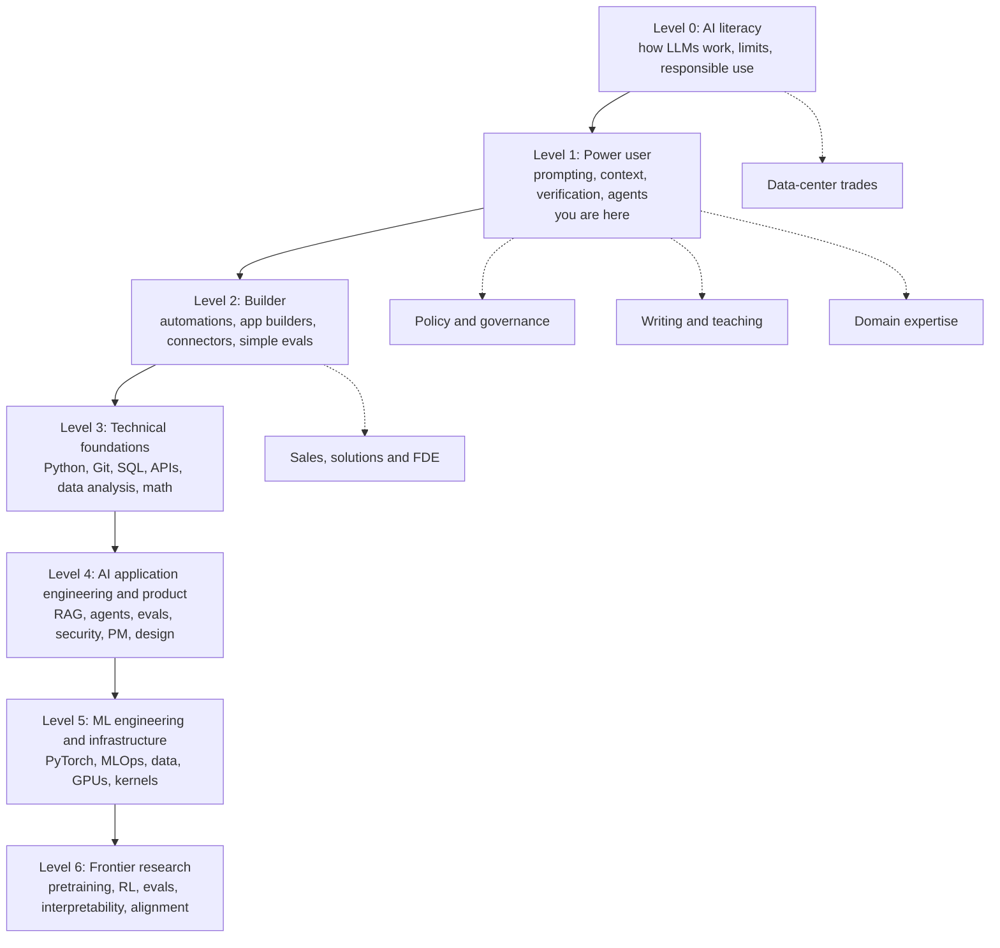
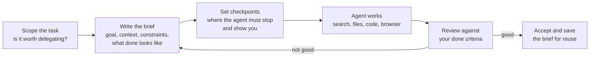
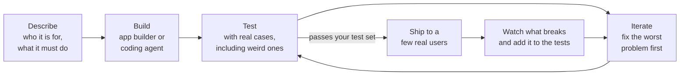
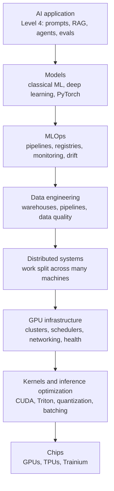
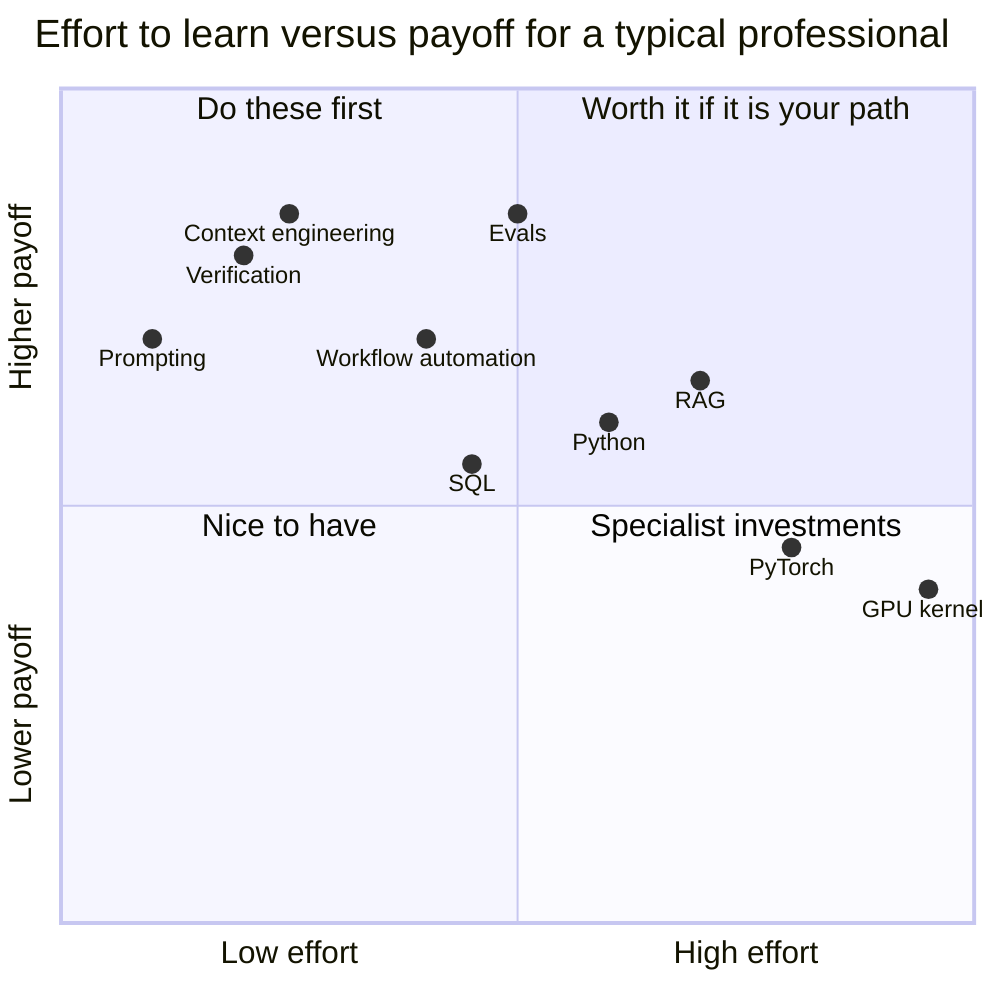

# Chapter 62: The Complete AI Skills Map

*This chapter gives you a complete map of AI skills, from first-day literacy to frontier research, with what each skill is, why it matters, how to learn it, how to prove it, and a checklist to find exactly where you stand.*

## What you'll learn

- The AI skill tree: seven levels plus five cross-cutting branches, and where you already are on it.
- For every skill on the tree: what it is, why it matters, how to learn it and how to prove you have it.
- Power-user skills in depth: prompting grown into context engineering, verification, delegating to agents and building reusable assistants.
- Builder skills that need no programming: automations, app builders, connectors and simple evals.
- The engineering ladder from Python, SQL and APIs up through RAG, agents, evals, MLOps, GPUs, kernels and distributed systems, and why each layer exists.
- Research and safety skills, and the funded programs that let newcomers start.
- The cross-cutting skills that multiply everything else: domain expertise, communication and judgment.
- A self-assessment checklist you can fill in today, and a method for picking your next three skills.

## Before you start

You can read this chapter cold, but it draws on the whole book. Chapter 18 (How a Large Language Model Works) and Chapter 25 (Mastering the Chat Interface: Prompting and Context Engineering) cover the power-user foundations. Chapters 26 to 31 (APIs, retrieval, tools and agents, coding and no-code, fine-tuning, and shipping AI) cover the builder and engineering skills in detail. Chapter 61 (The AI Industry Map) explains where the jobs are; Chapter 63 describes each role and its pay; Chapter 65 turns this map into a staged learning roadmap with resources. This chapter is the map between them: what to learn, in what order, and how to show it.

## How to read a skill map

Most people meet AI skills as a jumble: a viral prompt trick, a course advert, a job posting full of acronyms. A map turns the jumble into a route.

Picture a ladder of involvement. At the bottom is the casual user, who asks a chatbot the occasional question. Above that is the power user, who uses AI expertly in daily work. Then the builder, who connects AI to other tools and makes small apps without writing much code. Then the engineer, who builds AI products with code. Then the researcher, who improves the models themselves. At the top, a comparatively small group of frontier researchers push the state of the art.

Two facts about this ladder matter. First, most economic value and most jobs sit in the middle rungs, not at the top: on October 21, 2026, research was only about 5–10% of open roles at Anthropic and OpenAI, whose biggest hiring categories were sales, go-to-market and applied AI (see Chapter 61). Second, you are not at the bottom. If you have used a chatbot daily for a year, you are already partway up the power-user rung, ahead of most people.

> **Definition — Skill tree:** A map of skills arranged so that basic skills unlock more advanced ones, borrowed from video games. You do not need every branch; you pick a path and level up along it.

> **Analogy:** The AI skill tree works like a video-game tech tree. You do not need to unlock every branch. Pick a path, level up, use what you unlock, and remember that a respec is allowed: switching branches later costs less than you fear, because the lower levels are shared.


*Figure 62.1: The AI skill tree. Solid arrows are the main ladder; dotted arrows show where each cross-cutting branch typically starts. The cross-cutting branches combine with every level above their starting point.*

Every skill in this chapter is described with the same four questions:

1. **What it is.** The skill in one or two sentences.
2. **Why it matters.** What it lets you do that you could not do before.
3. **How to learn it.** The fastest honest route, usually a free course or a project.
4. **How to prove it.** The evidence that convinces an employer, a client or yourself.

The fourth question is the one most learners skip. In AI, what you can show matters more than what you have studied.

> **Definition — Portfolio:** Public evidence of what you can do: projects, write-ups, code repositories, demos, evaluations. In AI it often matters more than certificates or degrees.

| Level | Who it is for | Typical time to reach | Signature proof |
|---|---|---|---|
| 0. AI literacy | Everyone | Weeks | You can explain hallucination and context windows to a friend |
| 1. Power user | Everyone | 1–3 months to fluency | You save hours a week and have written "trust rules" |
| 2. Builder | Non-programmers and up | 2–6 months | A working automation or app that other people use |
| 3. Technical foundations | Future builders and engineers | 3–12 months part-time | A script that calls an API and a SQL analysis on GitHub |
| 4. AI application engineering and product | Engineers, PMs, designers | 6–24 months | A RAG or agent app with a published eval and error analysis |
| 5. ML engineering and infrastructure | Engineers going deep | 1–3+ years | A trained or fine-tuned model in production, or a benchmarked GPU kernel |
| 6. Frontier research | Researchers | 2–5+ years | A replication or original result others can check |

*Table 62.1: The seven levels at a glance. Times are rough ranges for part-time learners and vary widely.*

## Level 0: AI literacy

Level 0 is for everyone, including people who will never build anything. It takes weeks, not months.

**How large language models work, conceptually.** *What:* knowing that a chatbot predicts the next token, that training and using a model are different stages, why models hallucinate, and what context windows and knowledge cutoffs are (Chapter 18). *Why:* people who understand the mechanism predict failures and trust appropriately. *Learn:* Andrej Karpathy's talks "Intro to Large Language Models" and "Deep Dive into LLMs like ChatGPT" on YouTube, 3Blue1Brown's neural-network videos, and Anthropic's free "AI Fluency: Framework & Foundations" course. *Prove:* explain to a friend, without jargon, why a chatbot can state a false fact confidently.

> **Definition — Hallucination:** When an AI model produces fluent, confident content that is false or made up, such as an invented citation. It happens because the model generates plausible text rather than looking facts up (see Chapter 18).

> **Definition — Knowledge cutoff:** The date after which a model's training data stops, so it knows nothing newer unless it is given search results or documents.

**A map of capabilities and limitations.** *What:* knowing which tasks models do brilliantly, which they fail at, and how quickly that changes. *Why:* it prevents both over-trust and under-use. *Learn:* run your own tests in your field (Exercise 4), and read the independent evaluators METR and Epoch AI and the Stanford AI Index. *Prove:* a written list of 15 tests from your own work with the results.

> **Definition — Jagged frontier:** The uneven shape of AI ability: superhuman at some tasks and surprisingly weak at nearby ones. Stanford's 2026 AI Index notes a model that wins gold at the International Mathematical Olympiad yet reads analog clocks correctly only about half the time.

> **Analogy:** The jagged frontier is like a coastline. AI capability is not a straight line. Some bays reach far inland (olympiad mathematics), while nearby headlands stay unreached (reading a clock face). You can only learn the shape by walking it.

**Responsible use.** *What:* knowing what not to paste into a chatbot (customer data, secrets, health records), when to disclose AI use, and your employer's policy, plus copyright and bias basics. *Why:* mistakes here can cost jobs and create legal exposure (Chapter 58). *Learn:* your employer's AI policy, Anthropic's AI Fluency series, OpenAI Academy's "Apply AI at Work" track. *Prove:* a one-page personal policy you actually follow.

## Level 1: The power user

Level 1 gives the most value for the least effort of any level in this book. It needs no programming, and most people can reach fluency in one to three months of deliberate practice.

> **Definition — Power user:** Someone who uses AI tools expertly and safely in their daily work: giving rich context, checking output, delegating multi-step tasks and building reusable assistants.

### Prompting fundamentals

> **Definition — Prompt:** The instructions and content you give an AI model in one request.

> **Definition — Prompt engineering:** The craft of writing instructions that get good results from a model: a clear task, relevant context, examples and a specified output format.

*What:* the basics covered in Chapter 25: say what you want and for whom, give background, show an example, specify the format, break big jobs into steps, and ask the model to ask you questions first. *Why:* it is the biggest single quality lever and costs nothing.

A before-and-after shows the gap. Before: "Write an email about the delay." After: "I manage a small kitchen-renovation company. Write a short, warm email to a client, Mrs. Patel, explaining that her countertops arrive 10 days late because the stone supplier missed a shipment. Offer a 5% discount on the final invoice. Plain English, under 120 words, no exclamation marks. Here is an email I wrote last month whose tone I liked: [paste]." The second prompt takes 60 seconds longer to write and usually saves several rounds of revision.

*Learn:* the Anthropic and OpenAI prompting guides, DeepLearning.AI's "AI Prompting for Everyone" (about 7 hours). *Prove:* a personal prompt library of 10 prompts you reuse, each with a before-and-after example.

> **Watch out:** "Prompt engineering is the hot new career" is out of date. The standalone job title that went viral in 2023 has largely been absorbed into other roles. Prompting is now a baseline skill, and its 2026 form is context engineering plus evals, embedded in engineering, product and solutions jobs.

### Context engineering

> **Definition — Context engineering:** Deliberately assembling everything a model sees for a task (instructions, examples, documents, tool results, memory) so it can do the job well. It is the broader, 2025-era successor to prompt engineering.

*What:* supplying the right documents, constraints, background and examples, using Projects, custom instructions, Skills and connectors. *Why:* in 2025–2026 the quality bottleneck moved from how you word a request to what the model knows about your situation. A perfectly phrased prompt to a model that has never seen your company's style guide still produces generic work.

> **Analogy:** Context engineering is briefing a brilliant new hire who has amnesia. Every morning they remember nothing. What you put in their briefing folder (the goal, the background, examples of good work, the rules) decides how good their work is that day.

*Learn:* Hugging Face's free Context Course, Anthropic's "Claude 101" and "Introduction to agent skills," and practice by building one reusable project for a recurring task. *Prove:* show the same task done with and without your context package, side by side.

### Verification and critical reading

> **Definition — Verification:** Checking AI output before relying on it: confirming citations, cross-checking facts against sources or a second model, testing numbers and spotting confident errors.

*What:* making "check before you trust" a habit. *Why:* AI output is only as valuable as your ability to catch its mistakes, and small error rates compound.

A worked example shows why. Suppose a model gets each factual claim right 95% of the time. A memo with 10 independent claims is entirely correct only if all ten are right, which happens with probability 0.95^10 (0.95 multiplied by itself ten times) ≈ 0.60, so roughly 4 memos in 10 contain at least one error. With 30 claims, the chance of a flawless memo falls to 0.95^30 ≈ 0.21. Verification is not paranoia; it is arithmetic.

*Learn:* make "verify three claims" a habit for anything important, and read Arvind Narayanan and Sayash Kapoor's writing (*AI Snake Oil*, "AI as Normal Technology"). *Prove:* your written trust rules, based on a verification drill (Exercise 3).

> **Key idea:** In the AI era, judgment is the scarce skill. Producing a draft is nearly free; knowing whether the draft is right is not. The more you can verify, the more you can safely delegate.

### Delegating to agents

> **Definition — Agent:** An AI system that takes multiple steps toward a goal, using tools such as search, browsing, code or files, rather than answering once (see Chapter 28).

*What:* handing multi-step tasks to agentic tools (deep research, computer-use and coding agents, desktop agents such as Claude Cowork or ChatGPT agent) with a clear brief, checkpoints and a review. *Why:* agents turn hours of work into minutes, but only for people who can scope a task and review the result.


*Figure 62.2: The delegation loop. Most failures trace back to a vague brief or a missing definition of "done," so the loop returns to the brief, not to the agent.*

*Learn:* give a real task to a deep-research or agent tool, note every intervention, rewrite the brief and run it again. *Prove:* a before-and-after brief and the measured time saved.

### Multimodal use and reusable assistants

**Multimodal use.** *What:* working with images, voice, PDFs, spreadsheets, screenshots, and generating images, slides and charts (Chapter 22). *Why:* much real work is not plain text. *Learn and prove:* turn a messy scanned form or photo into a clean table, then check every cell.

> **Definition — Custom assistant:** A saved configuration of instructions, examples and reference files for a recurring task, such as a Claude Project, a custom GPT or a Gemini Gem. It can be shared with a team.

> **Definition — Agent Skill:** A packaged folder of instructions, scripts and resources that an AI assistant loads when a task needs it, so it can follow a specific procedure reliably (see Chapter 28).

> **Definition — Connector:** A link that lets an assistant read or act on another service, such as your email, calendar, drive or company database.

**Reusable assistants.** *What:* building a custom assistant or Skill for a task you repeat. *Why:* one well-built assistant can lift a whole team. *Learn:* build one for meeting notes or email triage with instructions, two worked examples and reference documents, then refine it over two weeks. *Prove:* a teammate uses it without your help.

### Personal workflow design

*What:* deciding which of your weekly tasks AI should do, which it should assist with, and which it should not touch. *Why:* it compounds. Five hours saved a week, over about 50 working weeks, is 250 hours a year, more than six 40-hour weeks. *Learn:* the week-long automation audit in Exercise 2. *Prove:* a one-page automation map of your job, with hours saved measured, not guessed.

> **Try it:** Open your chatbot and paste a list of everything you did at work yesterday. Ask: "For each task, say whether AI could do it, help with it, or should not touch it, and estimate minutes saved per week. Ask me questions about anything you are unsure of." Then challenge any answer that seems too optimistic.

## Level 2: The builder

Level 2 moves AI from "a chat window" to "something that runs while you sleep." Non-programmers reach it routinely, usually in two to six months.

> **Definition — Workflow automation:** Connecting apps so that an event in one (a trigger, such as a new form submission) automatically causes steps in others (actions, such as adding a spreadsheet row and sending an email). Tools include Zapier, Make, n8n and Power Automate.

**Workflow automation.** *What:* building trigger-and-action flows with an AI step in the middle (summarize, classify, extract, draft). *Why:* it underpins most small-business AI consulting (Chapter 29). *Learn:* each tool's free tier and templates, and build three automations for your own job. *Prove:* an automation that has run unattended for a month, with an error-handling step.

> **Definition — Vibe coding:** Building software by describing what you want in plain language to an AI tool and iterating on the result, without reading most of the code yourself. Fine for prototypes and personal tools; risky for anything handling money, health or private data.

> **Definition — AI app builder:** A tool, such as Lovable, Replit or Bolt, that turns a plain-language description into a working web app you can publish.

**No-code and vibe-coded apps.** *What:* describing an app to Lovable, Replit, Bolt or Claude Code and iterating. *Why:* non-engineers can now ship internal tools and prototypes; Lovable was reported at roughly $400 million of run-rate by March 2026, mostly from such builders. *Learn:* DeepLearning.AI's "Build with Andrew" (about 1 hour, no coding). *Prove:* a published app you use, plus a note on what broke and how you fixed it.


*Figure 62.3: The builder's loop: describe, build, test, iterate. Every bug real users find becomes a new test case.*

**Spreadsheet plus AI analysis.** *What:* formulas, pivot tables, cleaning data and charting, with AI writing formulas and spotting patterns. *Why:* the spreadsheet is still the most universal business data tool. *Learn:* Excel or Google Sheets with Copilot or Gemini. *Prove:* a five-bullet insight memo from a messy public dataset, with every AI-computed number checked.

> **Definition — MCP (Model Context Protocol):** An open standard for connecting AI assistants to tools and data sources. A service builds one MCP server, and any compatible assistant can use it (see Chapter 28).

**Connecting tools to AI.** *What:* plugging your assistant into email, drive, calendar, CRM (customer-relationship management software) or databases through connectors or MCP servers. *Why:* access to context is what makes assistants useful at work. *Learn:* Anthropic's free "Introduction to Model Context Protocol." *Prove:* a task that needs three connected sources, plus a one-paragraph privacy assessment.

> **Definition — Eval set (golden set):** A fixed collection of test inputs with notes on what a good output looks like, re-run after every change to catch regressions (see Chapter 31).

**Basic evaluation for builders.** *What:* keeping 20 test inputs with expected outputs and re-running them after every change. *Why:* this one habit separates hobby projects from reliable tools. *Learn:* Hamel Husain's evals writing (hamel.dev). *Prove:* a spreadsheet showing scores before and after a change.

> **Key idea:** The builder's superpower is not the tool, which changes every few months; it is the loop. Describe, build, test against real cases, iterate. The same loop scales all the way to Level 4.

## Level 3: Technical foundations

Level 3 is where you start writing code. It takes three to twelve months part-time, and AI coding assistants make it far easier than it was a few years ago. Each skill exists for a reason: it is the layer every later skill stands on.

> **Definition — Python:** The programming language most AI work is done in, chosen for its readable syntax and huge collection of AI and data libraries (see Chapter 3).

> **Definition — Notebook (Jupyter, Google Colab):** A document that mixes runnable code, its output and notes, so you can experiment one step at a time in a browser.

**Python basics.** *What:* variables, loops, functions, files, packages and notebooks. *Why:* it is the language of AI. *Learn:* DeepLearning.AI's "AI Python for Beginners" (about 11.5 hours), Harvard's CS50P, Kaggle Learn. *Prove:* a small script on GitHub that does something useful for you.

> **Definition — CS50P:** Harvard University's free online course "CS50's Introduction to Programming with Python," a beginner-friendly offshoot of its well-known CS50 introduction to computer science.

> **Definition — Command line:** A text interface for running programs by typing commands, used for nearly all engineering work and by coding agents themselves.

> **Definition — Git and GitHub:** Git is a tool that records every version of your code so you can undo changes and collaborate; GitHub is a website that hosts Git projects publicly or privately.

**Command line, Git and GitHub.** *Why:* every engineering job and every portfolio depends on them. *Learn:* GitHub Skills and MIT's "The Missing Semester." *Prove:* an active GitHub profile with readable commit messages.

> **Definition — SQL (Structured Query Language):** The standard language for asking questions of databases, such as "total sales by month for customers in Ohio" (see Chapter 11).

**SQL.** *Why:* most business data lives in databases, and SQL remains a top requirement for data jobs. *Learn:* SQLBolt, Mode's SQL tutorial, Kaggle Learn SQL. *Prove:* ten queries you wrote on a public dataset, compared against ten an AI wrote, with any AI errors noted.

**Data analysis.** *What:* cleaning, summarizing and charting data with pandas, plus the statistics behind averages, spread, sampling and A/B tests (Chapter 6). *Why:* you need it to evaluate AI systems and to work as an analyst. *Learn:* Kaggle Learn's Pandas and Data Visualization courses. *Prove:* a notebook analysis with a written conclusion.

> **Definition — API (application programming interface):** A way for one program to talk to another. You send a model's API a request in JSON and receive its answer, paying per token (see Chapter 26).

> **Definition — JSON:** A simple text format for structured data, made of labeled values in curly braces, used by almost every web API.

**APIs and JSON.** *Why:* every LLM application is an API call underneath. *Learn:* Chapter 26's first-call notebook, Anthropic's "Claude Platform 101" and "Building with the Claude API," OpenAI Academy's "Build with AI." *Prove:* a script that sends a document to a model and saves a structured JSON summary, with the API key kept out of the code.

**Math for machine learning.** *What:* vectors and matrices, derivatives and gradients, probability (Chapters 5 and 6). *Why:* needed to understand training; much less needed to build apps. *Learn:* 3Blue1Brown's "Essence of Linear Algebra" and "Essence of Calculus," Khan Academy, DeepLearning.AI's "Mathematics for Machine Learning and Data Science" (about 94 hours). *Prove:* hand-work a small matrix multiplication and a gradient-descent step and explain them.

> **Watch out:** "Learning to code is pointless now that AI writes code" is wrong. AI writes much of the code, but reading, specifying, testing and debugging it is what lets you direct and trust coding agents. The US Bureau of Labor Statistics still projects 10% growth for software developers from 2025 to 2035, citing AI development as a driver.

> **Watch out:** "You must master the math before touching AI" is also wrong. Top-down learning (build first, understand the theory as you need it), the approach of fast.ai and Karpathy's courses, works well. Math becomes essential at Level 5 and above.

## Level 4: AI application engineering and AI product

Level 4 is the job of the "AI engineer," the most-hired technical AI role outside the labs, and of the product managers and designers who work beside them. It takes six to twenty-four months beyond Level 3.

> **Definition — AI engineer (LLM application engineer):** A software engineer who builds products on top of foundation models (prompts, retrieval, tools, agents, evals) rather than training models from scratch.

**LLM application engineering.** *What:* prompt pipelines, structured outputs, tool calling, streaming, cost and latency trade-offs and model choice (Chapters 26 and 31). *Why:* it is the core of the AI engineer's job. *Learn:* Chip Huyen's *AI Engineering* (O'Reilly, 2025), the Anthropic and OpenAI cookbooks, Hugging Face's LLM Course. *Prove:* a deployed app with a written cost-per-task estimate.

> **Definition — Structured output:** Forcing a model to answer in an exact machine-readable format, such as JSON that matches a schema, so code can use the answer reliably.

> **Definition — RAG (retrieval-augmented generation):** Looking up relevant documents and handing them to the model with the question, so answers draw on your data and can cite it (see Chapter 27).

**RAG and search.** *What:* chunking, embeddings, vector databases, hybrid search, reranking, citations. *Why:* it is how companies make AI work on their own documents. *Learn:* the Hugging Face cookbook and the LlamaIndex or LangChain docs. *Prove:* a RAG app over 50–200 documents with a 30-question eval and accuracy reported for two chunking strategies.

> **Definition — Tool calling (function calling):** A model's ability to request that your code run a named tool, such as a search or a database query, and then use the result. The model only asks; your code acts.

**Agents and tool use.** *What:* agent loops, planning, memory, MCP servers, multi-agent patterns and sandboxing (Chapter 28). *Why:* agents were the dominant product pattern of 2025–2026. *Learn:* Hugging Face's Agents Course, DeepLearning.AI's "Agentic AI" (about 10 hours), Anthropic's "Building effective agents" guidance, the Claude Agent SDK and OpenAI Agents SDK docs. *Prove:* an agent with two or three tools and a log of every tool call, plus an analysis of its failures.

> **Definition — Error analysis:** Reading a sample of real outputs, labeling each failure by type, counting the types, and fixing the most common first. It is the core method for improving AI systems.

> **Definition — LLM-as-judge:** Using one AI model to grade another model's outputs against a rubric. Fast and cheap, but it has biases and must itself be checked against human judgments.

> **Definition — Observability (tracing):** Recording every step an AI system takes in production (inputs, retrieved documents, tool calls, outputs, costs) so failures can be found and diagnosed.

**Evals and observability.** *What:* building test sets, error analysis, LLM-as-judge, regression testing, tracing production failures (Chapter 31). *Why:* labs and startups repeatedly name it the most underrated skill, because it separates a demo from a product. *Learn:* Hamel Husain and Shreya Shankar's "AI Evals for Engineers & PMs," DeepLearning.AI's "Evaluating AI Agents." *Prove:* a public error-analysis write-up (Exercise 9), which is exactly what hiring managers for AI-engineer roles want to see.

> **Key idea:** If you learn one Level 4 skill first, learn evals. Everyone can build a demo that works on the cases they tried. Few can prove their system works on the cases they did not try, and that is the skill employers pay for.

> **Definition — Prompt injection:** An attack in which malicious instructions hidden in content the AI reads (a web page, an email, a document) hijack its behavior (see Chapter 31).

**AI security.** *What:* prompt injection, data exfiltration through tools, permissions and handling personal data. *Why:* agents with tool access create new attack surfaces. *Learn:* the OWASP Top 10 for LLM Applications and Simon Willison's writing on prompt injection. *Prove:* a red-team report of 15 injection attempts against your own agent, with the mitigations you added.

> **Definition — Fine-tuning:** Further training an existing model on your own examples to change its behavior or style. Methods such as LoRA train only a small add-on, which makes it cheap (see Chapter 30).

**Fine-tuning basics.** *What:* knowing when to fine-tune versus prompt versus use RAG, plus LoRA and preference tuning. *Why:* occasionally it is the right tool, and knowing when not to fine-tune matters as much. *Learn:* Hugging Face's "a smol course" and the Unsloth and TRL docs. *Prove:* a comparison of a fine-tuned small model against a prompted frontier model on the same eval, including cost.

**AI product management.** *What:* choosing problems AI can actually solve, defining quality with domain experts, designing evals, pricing for compute costs and managing unpredictable outputs. *Why:* many AI products fail at problem selection and quality definition, not at engineering. *Learn:* Lenny's Newsletter and Podcast AI episodes plus the evals course above. *Prove:* a shipped micro-product with real users and a tracked cost per user.

**AI design and UX (user experience).** *What:* designing for uncertainty (showing sources and confidence, offering undo), conversational and agent interfaces, and human review screens. *Why:* good design turns a 90%-accurate model into a trusted tool. *Learn:* study the interfaces of Claude, ChatGPT, Cursor and Perplexity, and Google's "People + AI Guidebook." *Prove:* a prototype that shows its sources and lets users correct it.

## Level 5: ML engineering and infrastructure

Level 5 goes below the API, into training models and running the machines. It takes one to three years or more, and the math now matters. Each layer exists because the one above it cannot work without it.


*Figure 62.4: The engineering stack below an AI application. Each layer exists so that the layer above can run reliably, at scale and at an affordable cost.*

**Classical machine learning.** *What:* regression, decision trees and gradient boosting, train-validation-test splits, overfitting and metrics (Chapters 8 to 10). *Why:* it still powers most production machine learning (fraud detection, ranking, forecasting) and builds intuition. *Learn:* Andrew Ng's Machine Learning Specialization (about 95 hours) and Aurélien Géron's *Hands-On Machine Learning*. *Prove:* a Kaggle notebook with an honest validation setup.

> **Definition — PyTorch:** The most widely used software library for building and training neural networks, with JAX as the main alternative (see Chapter 13).

**Deep learning and PyTorch.** *What:* neural networks, backpropagation, optimizers, CNNs, transformers and training loops (Chapters 12 to 15). *Why:* it is the core of modern AI. *Learn:* fast.ai's "Practical Deep Learning for Coders" (free, nine lessons of about 90 minutes, assumes about a year of coding), Karpathy's "Neural Networks: Zero to Hero" (eight lectures from a tiny autograd engine to GPT), Simon Prince's free *Understanding Deep Learning*. *Prove:* a small model trained from scratch, with a blog post explaining backpropagation to your past self.

> **Definition — MLOps (and LLMOps):** The practices and tools for deploying, monitoring and updating models in production reliably: experiment tracking, model registries, automated testing and drift detection.

**MLOps.** *Why:* models that are not in production create no value. *Learn:* Chip Huyen's *Designing Machine Learning Systems*, the MLOps Community, cloud ML certifications. *Prove:* a model served behind an API with monitoring dashboards.

> **Definition — Data pipeline:** An automated series of steps that collects, cleans, transforms and loads data from where it is produced to where it is used, such as a data warehouse.

**Data engineering.** *What:* pipelines, warehouses (Snowflake, BigQuery, Databricks), orchestration (Airflow, Dagster) and data quality. *Why:* it supplies the data that makes AI work, and it is a large, steady job market. *Learn:* DeepLearning.AI and AWS's "Data Engineering" (about 107 hours), *Fundamentals of Data Engineering* by Reis and Housley. *Prove:* a scheduled pipeline with data-quality checks.

> **Definition — AWS (Amazon Web Services):** Amazon's cloud-computing business, one of the three biggest cloud providers alongside Microsoft Azure and Google Cloud. It rents out computers, storage, databases and AI services (including its own Trainium chips) by the hour, and runs training courses and certifications.

> **Definition — Distributed system:** Software that splits one job across many machines and keeps working when some of them fail. Frontier training runs are distributed systems spanning tens of thousands of chips (see Chapter 37).

**Distributed systems.** *Why:* nothing at frontier scale fits on one machine. *Learn:* Hugging Face's "The Ultra-Scale Playbook," Google DeepMind's "How to Scale Your Model," Martin Kleppmann's *Designing Data-Intensive Applications*. *Prove:* a multi-GPU training run with measured speed-up and a write-up of where time was lost.

> **Definition — Kubernetes and Slurm:** Two widely used systems for scheduling work across a cluster of computers. Kubernetes dominates cloud services; Slurm is common for large training jobs.

**GPU and infrastructure engineering.** *What:* cluster management (Kubernetes, Slurm), GPU health, storage, high-speed networking and scheduling (Chapter 34). *Why:* compute is the scarcest resource in AI, and this work keeps it busy. *Learn:* lab job descriptions as syllabi, cloud provider docs, the GPU MODE community. *Prove:* contributions to open-source infrastructure tools or a documented home-lab cluster.

> **Definition — GPU kernel:** A small program that runs on a GPU to perform one operation, such as a matrix multiplication or attention. Faster kernels make every model on the hardware cheaper to run.

> **Definition — CUDA and Triton:** CUDA is NVIDIA's platform for programming its GPUs directly; Triton is a Python-like language for writing fast GPU kernels with less effort (see Chapter 35).

> **Definition — NVIDIA:** The American chip company whose GPUs, together with the CUDA software for programming them, power most AI training and inference worldwide (see Chapter 35).

**Kernels and inference optimization.** *What:* writing GPU kernels in CUDA or Triton, quantization, batching, managing the KV cache, speculative decoding, and serving engines such as vLLM, SGLang and TensorRT-LLM (Chapters 23 and 33). *Why:* small gains on an enormous fleet are worth millions of dollars, which is why Anthropic's posted base-salary range for performance engineers reached $850,000 in October 2026. *Learn:* *Programming Massively Parallel Processors* (Hwu, Kirk and El Hajj), the GPU MODE lectures, the Triton tutorials, and Stanford CS336's systems assignment (writing FlashAttention-2 in Triton). *Prove:* a kernel benchmarked against PyTorch's built-in version, published with the numbers.

> **Definition — CS336:** Stanford University's course "Language Modeling from Scratch," whose lectures and assignments are free online. Students build and train a small language model themselves, from the tokenizer and GPU code to data, scaling and post-training.

> **Analogy:** A kernel engineer is a Formula 1 mechanic. A 2% gain sounds small, but across a fleet of a hundred thousand chips running all year, it pays for a whole team.

## Level 6: Frontier research

Level 6 is where the models themselves improve. It often takes two to five years or more and frequently, though not always, a PhD. Lab research postings typically ask for a degree "or an equivalent combination of education, training, and/or experience," and strong public work counts.

**Pretraining and scaling science.** *What:* web-scale data curation, architectures, scaling laws and training stability (Chapters 17 and 19). *Why:* it sets the base capability of every model. *Learn:* Stanford CS336 "Language Modeling from Scratch" (Spring 2026, lectures on YouTube, five assignments covering basics, systems, scaling laws, data, and alignment and reasoning RL), Sebastian Raschka's *Build a Large Language Model (From Scratch)*, and Karpathy's nanochat, which trains a GPT-2-class model for about $48 of rented GPU time (about two hours on an 8-GPU H100 machine). *Prove:* a documented nanochat run covering tokenizer, pretraining, fine-tuning, RL and eval.

**Post-training and RL.** *What:* supervised fine-tuning, RLHF (reinforcement learning from human feedback), RL (reinforcement learning, training by trial and reward) from verifiable rewards, reasoning models, RL environments and agent training (Chapters 20 and 21). *Why:* most capability gains of 2024–2026 (reasoning, coding, agents) came from here, and it was the most-posted research specialty on Anthropic's job board in October 2026. *Learn:* Nathan Lambert's RLHF book and Interconnects newsletter, CS336 assignment 5, Hugging Face's TRL. *Prove:* an RL fine-tune that measurably improves a small model on a verifiable task.

**Evaluation research.** *What:* designing benchmarks, measuring dangerous capabilities and long-horizon agent performance (Chapter 57). *Why:* labs cannot improve what they cannot measure, and governments rely on evals for oversight. *Learn:* METR and Epoch AI papers, the UK AI Security Institute's Inspect framework (free software for building and running evals), lab system cards. *Prove:* a new benchmark of 50–200 hard tasks in a domain you know (Exercise 10). This turns domain expertise directly into research credibility.

> **Definition — Interpretability:** Research into what is happening inside a model's neural network: which features it represents and which circuits produce its behavior (see Chapter 57).

> **Definition — Alignment:** The research field of making AI systems reliably pursue the goals and values their designers and users intend (see Chapters 55 and 56).

**Interpretability.** *What:* mechanistic interpretability: finding the features and circuits inside a network and probing what it represents (Chapter 57). *Why:* understanding a model's internals is central to safety and to debugging, because it can reveal problems that testing from the outside misses. *Learn:* the ARENA curriculum, Anthropic's Transformer Circuits thread, Neel Nanda's guides. *Prove:* a small replication of a published interpretability result.

> **Definition — ARENA (Alignment Research Engineer Accelerator):** A London-based program that teaches the engineering side of AI safety research, through in-person bootcamps with costs covered and a free online curriculum of coding exercises on transformers, interpretability, reinforcement learning and evals.

**Alignment and safety research.** *What:* scalable oversight, AI control, adversarial robustness, model welfare and misuse safeguards. *Why:* it is small but growing: the career-advice nonprofit 80,000 Hours estimated only about 300 people (a range of 76 to 536 full-time equivalents) worked on technical AI safety aimed at catastrophic risks as of 2022. *Learn:* BlueDot Impact's free courses, ARENA bootcamps, MATS, the Anthropic Fellows Program, the 80,000 Hours career guide. *Prove:* a small public project in one safety area, such as a replicated AI-control or evaluation experiment written up with code and honest limitations, which doubles as a fellowship application.

> **Definition — MATS (originally ML Alignment & Theory Scholars):** A research fellowship that pairs newcomers with experienced mentors for paid projects of about 12 weeks in AI alignment, interpretability, security and governance. It is one of the main routes into safety research.

> **Definition — Fellowship (research residency):** A paid, time-boxed program in which newcomers do research with mentorship, such as MATS or the Anthropic Fellows Program. Fellowships are the main on-ramp into safety research.

The on-ramps are unusually well funded, as of October 2026. MATS runs 12 weeks with a $1,250 weekly stipend plus $2,000 a week of compute, and reports 631 alumni since 2021, 75% of whom now work in alignment, transparency or security. The Anthropic Fellows Program runs four months with a $3,850 weekly stipend and about $15,000 a month of compute. ARENA runs four-to-five-week in-person bootcamps in London with costs covered.

**Research skills.** *What:* reading papers fast, replicating results, designing experiments and ablations, writing clearly, and research taste.

> **Definition — Ablation:** An experiment that removes or changes one component of a system to measure how much that component matters.

> **Definition — Replication:** Re-running a published experiment independently to check that its result holds. It is the standard way newcomers prove research skill.

> **Definition — Research taste:** The judgment to choose problems that are important, tractable and timely, and to know which result would change your mind. It is the scarcest research asset.

*Why:* taste is what top research compensation mostly buys. *Learn:* replicate a paper end to end (Exercise 11), publish at workshops, join a fellowship. *Prove:* a public replication with code, discrepancies and one extension, which doubles as an application to MATS, ARENA or the Anthropic Fellows Program.

> **At the frontier (2026):** Labs increasingly hire for research engineering rather than pure research science, and the line between them has blurred: many postings read "research engineer or research scientist." The people who stand out combine strong engineering with experiment hygiene and taste, and they show it through public replications, evals and open-source contributions rather than credentials alone.

## Cross-cutting branches

The main ladder is not the only route. Five branches cross it, and each one multiplies whatever level you have reached.

**AI policy and governance.** *What:* laws (the EU AI Act, US state laws, export controls), risk frameworks (NIST AI RMF, ISO/IEC 42001), compute governance and lab safety frameworks (Chapter 59). *Why:* every large organization now needs AI governance, and governments need technical literacy. *Learn:* the AIGP (AI Governance Professional) certification from the IAPP, the main professional body for privacy specialists, BlueDot's governance courses, publications from GovAI, CSET and RAND, and lab policy job descriptions as syllabi. *Prove:* a written AI-use policy or risk assessment for a real organization.

> **Definition — AI governance:** The policies, processes and controls an organization uses to manage AI risk, comply with laws and decide which AI uses are allowed.

> **Definition — IAPP (International Association of Privacy Professionals):** The main professional body for privacy specialists. It runs widely recognized certifications, including the AIGP (AI Governance Professional).

> **Definition — CSET (Center for Security and Emerging Technology):** A research center at Georgetown University in Washington, D.C., that studies AI, chips and national security and publishes data-driven policy reports.

**Sales, solutions and forward-deployed work.** *What:* discovery (finding the customer's real problem), demos, scoping, proofs of concept, change management and return-on-investment (ROI) cases. Forward-deployed engineers (FDEs) are engineers embedded with a customer, often for weeks or months, to build its deployment (Chapter 63). *Why:* sales and applied AI were the largest hiring categories at the frontier labs in October 2026 (Chapter 61). *Learn:* read lab "Applied AI Architect" and FDE postings, and do a free AI implementation for a local business. *Prove:* a case study with the time saved measured after two weeks.

**Technical writing, education and developer relations.** *What:* documentation, tutorials, courses and workshops. *Why:* adoption is bottlenecked by understanding; in October 2026 Anthropic was hiring a Lead Technical Instructor at a posted $270,000–$365,000 base. *Learn:* write public explainers and contribute documentation to open-source projects. *Prove:* a tutorial that strangers have used successfully.

**Domain expertise plus AI.** *What:* deep knowledge of a field (medicine, law, accounting, logistics, teaching, the trades) combined with Level 1–2 AI skills. *Why:* domain experts design the evals, spot the errors and know which problems matter; expert contractors who write and grade training data reportedly average $85 or more an hour through Mercor. *Learn:* apply Levels 1 and 2 to your own field and write about it. *Prove:* an eval or a published guide for your profession.

**Data-center trades and engineering.** *What:* electrical, mechanical and HVAC, controls, fiber and networking, construction management and commissioning (Chapters 38 to 41). *Why:* physical buildout is the binding constraint on AI. *Learn:* registered apprenticeships such as the electrical training run by the electricians' union (IBEW) and the contractors' association (NECA), community-college HVAC and controls programs, and data-center operator training. *Prove:* licenses and certifications, which in the trades are the proof that counts.

> **Definition — HVAC (heating, ventilation and air conditioning):** The systems that heat, cool and move air through a building. In a data center, HVAC and related cooling systems carry away the heat the chips produce (see Chapter 40).

> **Definition — IBEW (International Brotherhood of Electrical Workers):** The main electricians' union in the United States and Canada. With NECA it runs paid, multi-year electrical apprenticeships.

> **Definition — NECA (National Electrical Contractors Association):** The US trade association of companies that employ union electricians. It runs electrical apprenticeship training jointly with the IBEW.

> **Definition — T-shaped skills:** Deep expertise in one area (the vertical bar of the T) plus broad working knowledge across many (the crossbar). A "pi-shaped" person has two deep areas joined by the same broad crossbar.

```
T-shaped: one deep area plus a broad AI crossbar

  prompting  context  automation  evals  governance
 +--------------------------------------------------+
                    |   nursing    |
                    |   domain     |
                    |   depth      |
                    +--------------+

Pi-shaped: two deep areas joined by the same crossbar

  prompting  context  automation  evals  governance
 +--------------------------------------------------+
        |   law    |                  | software |
        |  depth   |                  |  depth   |
        +----------+                  +----------+
```
*Figure 62.5: T-shaped and pi-shaped professionals. The AI crossbar connects deep knowledge to everything else; the deep bars are what AI cannot easily replace.*

> **Key idea:** For most people the winning shape is not "AI expert" but "expert in something, fluent in AI." Judgment, verification and domain context are the parts of a job that AI complements rather than replaces.

The evidence on entry-level work makes this urgent. In the Stanford "Canaries in the Coal Mine?" study, workers aged 22 to 25 in the most AI-exposed occupations saw employment fall 13–16% relative to peers in the 2025 versions, and about 19% below trend in an August 2026 update, while older workers held steady (Chapter 60 covers the debate). Skills that AI complements, such as judgment, client relationships and verification, are the best protection for people early in their careers.

## Proving a skill

Every level has a typical form of proof, and they share one rule: **show, don't claim.**

| Level | Weak proof | Strong proof |
|---|---|---|
| 0–1 | "I use ChatGPT a lot" | A measured automation map and written trust rules |
| 2 | A course certificate | A tool other people use, with an eval spreadsheet |
| 3 | A list of languages on a CV (résumé) | A GitHub profile with working, documented scripts |
| 4 | A demo video | A deployed app with a published eval and error analysis |
| 5 | "Familiar with PyTorch and CUDA" | A benchmarked kernel or a model in production with monitoring |
| 6 | Papers read | A public replication with code and an honest list of discrepancies |
| Cross-cutting | Interest in the area | A policy, case study, tutorial or eval used by real people |

*Table 62.2: Weak versus strong proof at each level.*

Certifications matter most where buyers or HR (human resources) departments filter on them: cloud-centric enterprises, consulting firms, government contracting, and governance and compliance (for example the AWS Certified AI Practitioner, a $100 exam of 65 questions in 90 minutes, or the IAPP's AIGP). They matter little for research, research engineering and startup engineering, where public work dominates. A good rule of thumb: one relevant certification plus three strong portfolio pieces beats five certifications and no portfolio. Chapter 65 covers certifications and portfolio-building in detail.

## Choosing your path through the tree

You do not climb the whole tree. You choose a branch based on where you start and where you want to go.


*Figure 62.6: The author's rough judgment of effort versus payoff for a typical non-technical professional. For someone heading into infrastructure, the bottom-right skills move to the top.*

Three example routes show how the tree adapts to a starting point:

| Starting point | Route through the tree | First proof to build |
|---|---|---|
| Hospital nurse | Levels 0–1 deeply, then Level 2 automations, plus the domain-expertise branch | A clinical-handover assistant with a 20-case eval, reviewed by colleagues |
| Software engineer | Level 1 quickly, then straight to Level 4: evals, RAG and agents | A public error-analysis write-up of an agent they built |
| Electrician | Level 0–1 basics plus the data-center trades branch | Critical-facility credentials, plus AI-assisted documentation and diagnostics |

*Table 62.3: Three routes through the skill tree. Chapter 63 describes the roles each route leads to.*

> **Try it:** Paste Figure 62.1's seven levels and five branches into your chatbot along with a short description of your job and goals. Ask: "Which three skills would give me the most value in the next 90 days, and what would be the proof for each? Challenge me if my goals seem unrealistic." Compare its answer with your own results from the self-assessment below.

## Self-assessment checklist

Use this checklist to find where you stand. Print it, copy it into a spreadsheet, or fill it in with a pencil. Score each statement honestly:

- **0** = I have never done this.
- **1** = I have done it once, with a lot of help.
- **2** = I can do it alone, reliably.
- **3** = I could teach it, and I have evidence someone else could check.

In the Evidence column, write where the proof lives: a file, a link, a colleague who saw it. A score of 3 without evidence counts as 2.

### Level 0: AI literacy

| I can... | Score (0–3) | Evidence |
|---|---|---|
| Explain next-token prediction, training versus use, and context windows to a friend | | |
| Explain why chatbots hallucinate and name two warning signs | | |
| Name three tasks AI does well and three it does badly in my own field | | |
| State what I must never paste into a chatbot at work, and why | | |

### Level 1: Power user

| I can... | Score (0–3) | Evidence |
|---|---|---|
| Write a prompt with task, audience, context, example and format | | |
| Build a context package (documents, examples, rules) for a recurring task | | |
| Verify every citation and number in an AI answer before using it | | |
| Delegate a multi-step task to an agent with a clear brief and checkpoints | | |
| Turn a messy PDF, photo or screenshot into clean structured data | | |
| Build a reusable assistant (Project, GPT, Gem or Skill) a colleague can use | | |
| Show measured hours saved per week from AI | | |

### Level 2: Builder

| I can... | Score (0–3) | Evidence |
|---|---|---|
| Build a trigger-and-action automation with an AI step and error handling | | |
| Build and publish a small app with an AI app builder or coding agent | | |
| Clean, pivot and chart a dataset with AI help, checking every number | | |
| Connect an assistant to email, drive or calendar and assess the privacy risk | | |
| Keep a 20-case test set and re-run it after every change | | |

### Level 3: Technical foundations

| I can... | Score (0–3) | Evidence |
|---|---|---|
| Write and run a Python script that reads a file and does something useful | | |
| Use the command line, Git and GitHub to save and share my work | | |
| Write SQL queries with filters, grouping and joins | | |
| Call a model's API from code, with the key kept out of the code | | |
| Analyze a dataset in a notebook and explain the statistics I used | | |
| Hand-work a matrix multiplication and one gradient-descent step | | |

### Level 4: AI application engineering and product

| I can... | Score (0–3) | Evidence |
|---|---|---|
| Build an app that uses structured outputs and tool calling | | |
| Build a RAG system with citations and measure its accuracy | | |
| Build an agent, log its tool calls and analyze its failures | | |
| Run an error analysis on 100 outputs and fix the top failure type | | |
| Attack my own system with prompt injection and add defenses | | |
| Decide between prompting, RAG and fine-tuning for a use case, with cost estimates | | |
| Define quality for an AI feature with domain experts and design its eval | | |

### Level 5: ML engineering and infrastructure

| I can... | Score (0–3) | Evidence |
|---|---|---|
| Train and validate a classical model without data leakage | | |
| Train a small neural network in PyTorch and explain backpropagation | | |
| Deploy a model with monitoring and a plan for drift | | |
| Run training across several GPUs and explain where time is lost | | |
| Write or optimize a GPU kernel or serving setup and benchmark it | | |

### Level 6: Frontier research

| I can... | Score (0–3) | Evidence |
|---|---|---|
| Read a recent ML paper and summarize its claim, method and weaknesses | | |
| Replicate a published result and report discrepancies honestly | | |
| Design an experiment with ablations that could prove me wrong | | |
| Design a new benchmark or eval with gold answers and a rubric | | |

### Cross-cutting branches

| I can... | Score (0–3) | Evidence |
|---|---|---|
| Write an AI-use policy or risk assessment for an organization | | |
| Run a discovery conversation and scope an AI proof of concept | | |
| Teach an AI skill so that a beginner can do it afterwards | | |
| Name the errors AI makes that only an expert in my field would catch | | |
| Hold the trade credentials needed to work in a data center | | |

### Scoring and next steps

1. **Find your level.** A level is "unlocked" when most of its rows score 2 or more and at least one row scores 3 with evidence. Your current level is the highest unlocked level with all levels below it also unlocked (cross-cutting branches are scored separately).
2. **Pick three skills.** Choose two of the lowest-scoring rows in the first level you have not unlocked, plus one cross-cutting row that fits your goals.
3. **Attach a proof to each.** For each skill, write the project that would produce evidence and a date within 90 days.
4. **Re-score every quarter.** Your scores, like the frontier, will move.

A worked example. Maria is a hospital nurse. She scores Level 0 at 2, 2, 3 and 2 (her hospital's AI training gave her evidence for the third), so Level 0 is unlocked. At Level 1 she scores 2, 1, 2, 1, 1, 0 and 0: not yet unlocked. Her two lowest rows that matter most to her are "reusable assistant" and "measured hours saved," and her cross-cutting pick is "name the errors only an expert would catch." Her 90-day plan: build a shift-handover assistant (proof: three colleagues use it), log hours saved for four weeks (proof: a spreadsheet), and write a one-page guide to the clinical errors she has caught AI making (proof: her manager circulates it). That plan unlocks Level 1 and starts her domain-expertise branch at the same time.

## In plain English

AI skills form a tree, like a video game. Everyone starts with literacy: knowing roughly how chatbots work, where they fail and what not to paste into them. Next comes the power user, the level with the biggest payoff for the least effort: giving rich context instead of clever wording, checking everything that matters, delegating whole tasks to agents with a clear brief, and building assistants you can reuse. Builders then connect AI to other tools and make small apps without much code, using one loop: describe, build, test, iterate.

Above that the tree turns technical. Python, SQL, Git and APIs are the foundations. AI engineers use them to build retrieval systems, agents and, above all, evals, which prove a system works on cases nobody tried. Deeper still are the people who train models and keep tens of thousands of chips busy, and at the top, the researchers who improve the models and study how to make them safe, often through funded fellowships.

Five branches cross the tree: policy, sales and deployment, teaching, domain expertise and the data-center trades. For most people the best shape is a T: deep in one field, fluent in AI across the top.

What counts is proof: a tool people use, an eval you published, a replication others can check. The self-assessment in this chapter tells you where you stand and which three skills to build next.

## Key terms

Skill tree, Portfolio, Hallucination, Knowledge cutoff, Jagged frontier, Power user, Prompt, Prompt engineering, Context engineering, Verification, Agent, Custom assistant, Agent Skill, Connector, Workflow automation, Vibe coding, AI app builder, MCP (Model Context Protocol), Eval set (golden set), Python, Notebook (Jupyter, Google Colab), CS50P, Command line, Git and GitHub, SQL (Structured Query Language), API (application programming interface), JSON, AI engineer (LLM application engineer), Structured output, RAG (retrieval-augmented generation), Tool calling (function calling), Error analysis, LLM-as-judge, Observability (tracing), Prompt injection, Fine-tuning, PyTorch, MLOps (and LLMOps), Data pipeline, AWS (Amazon Web Services), Distributed system, Kubernetes and Slurm, GPU kernel, CUDA and Triton, NVIDIA, CS336, Interpretability, Alignment, ARENA (Alignment Research Engineer Accelerator), MATS (originally ML Alignment & Theory Scholars), Fellowship (research residency), Ablation, Replication, Research taste, AI governance, IAPP (International Association of Privacy Professionals), CSET (Center for Security and Emerging Technology), HVAC (heating, ventilation and air conditioning), IBEW (International Brotherhood of Electrical Workers), NECA (National Electrical Contractors Association), T-shaped skills.

## Exercises

1. **[Easy] Fill in your skill map.** (1) Complete the self-assessment checklist in this chapter, scoring every row 0–3 and writing evidence where you have it. (2) Find your current level using the scoring rules. (3) Pick three skills and write one proof project and a date for each, within 90 days. (4) Put a reminder in your calendar to re-score in three months. **What you'll learn:** exactly where you stand, and a concrete plan instead of a vague intention.

2. **[Easy] Audit your week for AI.** (1) For one working week, log what you do in 30-minute blocks. (2) Tag each task "AI does it," "AI assists" or "human only," and note how often it happens and how long it takes. (3) Rank the top five candidates by hours that could be saved per week. (4) Turn the result into a one-page automation map of your job. **What you'll learn:** personal workflow design, the power-user skill that compounds fastest.

3. **[Easy] Verification drill.** (1) Ask a chatbot for a researched answer with citations on a topic you know well. (2) Check every citation and every number. (3) Count the claims that were correct, misattributed or invented. (4) Write five "trust rules" for yourself, such as "always open the source before quoting a statistic." **What you'll learn:** how often confident output is wrong in your area, and the habits that catch it.

4. **[Medium] Map the jagged frontier in your field.** (1) Write 15 mini-tests from your own work: five easy, five hard, three tricky, and two that need local knowledge only you have. (2) Run them on one or two chatbots and record where each is excellent, adequate or confidently wrong. (3) Save the file and repeat the same tests in three months. **What you'll learn:** the real shape of AI ability where it matters to you, and how fast it changes.

5. **[Medium] Build a reusable assistant with its own eval.** (1) Create a Claude Project, custom GPT or Gem for one recurring task, with instructions, two worked examples and reference documents. (2) Write 20 test inputs with a note on what a good output looks like for each. (3) Score the assistant's outputs 0–2 on each test in a spreadsheet. (4) Improve the instructions, re-run all 20 and compare totals. **What you'll learn:** context engineering and the builder's evaluation habit together.

6. **[Medium] Your first automation.** (1) In Zapier, Make or n8n (all have free tiers), build: new form submission, then an AI step that summarizes and classifies it, then a new spreadsheet row, then an email notification. (2) Submit five test entries, including one that is blank or nonsense. (3) Add a step that handles the bad entry instead of failing silently. **What you'll learn:** trigger-and-action thinking and why error handling separates toys from tools.

7. **[Medium] Vibe-code an internal tool.** (1) With Lovable, Replit or a coding agent, describe a small app you would really use, such as a tracker, calculator or intake form. (2) Build it, test it with real data including odd cases, and fix the worst problem first. (3) Publish it and use it for two weeks. (4) Write down what broke and how you fixed it. **What you'll learn:** the describe, build, test, iterate loop, and where vibe coding stops being safe.

8. **[Medium] A structured API call.** (1) Set up the Google Colab notebook and API key secret from Chapter 26 and run its first call. (2) Change the request so the model reads a short document you paste in and returns a JSON summary with three fields: title, three key points, and one open question. (3) Use Chapter 26's structured-output example as your template, and save the result to a file. (4) Confirm your API key appears nowhere in the notebook's code. **What you'll learn:** the Level 3 bridge from chat to code: APIs, JSON and safe key handling.

9. **[Challenge] Error analysis write-up.** (1) Collect 100 real outputs from a system you built (your assistant from Exercise 5 or an app). (2) Read each one and label failures by type, such as "missed a detail," "wrong format" or "invented a fact." (3) Count the types and fix the most common one. (4) Re-run on the same inputs and measure the change. (5) Publish a one-page write-up. **What you'll learn:** the core method for improving AI systems, and the portfolio piece AI-engineering hiring managers most want to see.

10. **[Challenge] Design a new eval in your domain.** (1) Write 50 hard questions or tasks from your field (tax edge cases, clinical triage vignettes, building-code questions), each with an expert-written gold answer. (2) Write a scoring rubric. (3) Run three frontier models and score them. (4) Publish the results with an honest list of limitations, without publishing the answers if you want the test to stay uncontaminated. **What you'll learn:** how domain expertise turns into AI research credibility.

11. **[Challenge] Replicate a result.** (1) Pick a small, recent interpretability or post-training paper with public code, or work through the first lecture of Karpathy's "Neural Networks: Zero to Hero" typing every line yourself. (2) Reproduce one key figure or result. (3) Write down every discrepancy and one extension you tried. (4) Post the code and write-up publicly. **What you'll learn:** research skills (reading, replicating, reporting honestly) and the evidence that fellowship programs look for.

## Areas of opportunity

- **Your team's AI workflow designer.** Organizations report near-universal AI adoption but few pilots with measurable impact, so the person who redesigns a team's workflow around AI (not just the one who prompts well) is scarce. It often becomes a formal "AI adoption lead" role.
- **Domain expert who writes the evals.** Accountants, nurses, paralegals, teachers and recruiters know which errors matter. Companies deploying AI pay for people who can turn that knowledge into test sets, guidelines and quality checks that engineers cannot write.
- **Expert contractor for AI labs.** Labs pay professionals to write and grade training data (Mercor reportedly averages $85 or more an hour for experts). It is a flexible income and an education in how models fail, though projects can end abruptly.
- **Small-business AI implementer.** Clinics, law offices, trades and restaurants need intake automation, scheduling, follow-ups and document processing. A fixed-price audit followed by implementation and a monthly retainer is a proven model for Level 2 builders.
- **AI engineer with public evals.** The broadest technical demand outside the labs. Differentiate with published error analyses, RAG accuracy measurements and agent reliability work rather than demos.
- **Forward-deployed engineering and solutions work.** Engineers who like customers, ambiguity and travel are in demand at labs and AI startups to turn models into working deployments.
- **Inference and performance engineering.** Every efficiency gain is money at fleet scale, and posted base ranges reached $850,000 at Anthropic in October 2026. Systems, high-performance computing (HPC), game-engine and compiler backgrounds transfer well.
- **Safety, evals and interpretability research.** A small field with funded on-ramps (MATS, ARENA, the Anthropic Fellows Program) where public replications count heavily.
- **AI governance and compliance.** Regulated industries need AI risk policies, vendor reviews and EU AI Act compliance; backgrounds in privacy, legal, audit and risk transfer directly.
- **Niche AI educator.** General AI content is saturated, but "AI for nurses" or "AI for contractors" newsletters, workshops and courses serve audiences that generic content misses.

## Check your understanding

1. Name the seven levels of the AI skill tree and the five cross-cutting branches.
2. What are the four questions this chapter asks about every skill, and which one do learners most often skip?
3. Why did prompt engineering give way to context engineering as the key power-user skill?
4. If a model gets each claim right 95% of the time, what is the chance a 10-claim memo is entirely correct, and what does that imply?
5. Which Level 4 skill does this chapter recommend learning first, and why?
6. Why does each layer of the engineering stack in Figure 62.4 exist? Give two examples.
7. What does "T-shaped" mean, and why is it a good shape for most people in the AI era?
8. In the self-assessment, when is a level "unlocked," and what is a score of 3 without evidence worth?

<details><summary>Answers</summary>

1. Levels: 0 AI literacy, 1 power user, 2 builder, 3 technical foundations, 4 AI application engineering and product, 5 ML engineering and infrastructure, 6 frontier research. Branches: policy and governance; sales, solutions and FDE; writing and teaching; domain expertise; data-center trades.
2. What it is, why it matters, how to learn it, and how to prove it. Learners most often skip the proof, which matters most in AI hiring.
3. By 2025–2026 models understood plain requests well, so the bottleneck moved from how you word a request to what the model knows about your situation: the documents, examples, rules and memory you supply.
4. 0.95^10 ≈ 0.60, so about 4 memos in 10 contain at least one error. Small per-claim error rates compound, so anything important must be verified.
5. Evals, because anyone can build a demo that works on cases they tried, but proving a system works on cases nobody tried is what separates a demo from a product, and employers pay for it.
6. Each layer lets the one above run reliably, at scale and affordably. For example, MLOps exists because a model that is not deployed and monitored creates no value; distributed systems exist because frontier training does not fit on one machine; kernels exist because faster low-level code makes every model on the hardware cheaper.
7. Deep expertise in one area plus broad AI fluency across many. It is a good shape because AI complements judgment, verification and domain context rather than replacing them, so a deep specialist who is fluent in AI is hard to replace.
8. When most of its rows score 2 or more and at least one row scores 3 with evidence. A 3 without evidence counts as a 2.

</details>

## Going deeper

- **Andrej Karpathy, "Intro to Large Language Models," "Deep Dive into LLMs like ChatGPT" and "Neural Networks: Zero to Hero" (karpathy.ai, YouTube).** The best free path from literacy to building GPT from scratch.
- **Anthropic Academy (anthropic.skilljar.com).** Free courses from AI Fluency to Claude Code, the API, MCP and agent skills.
- **DeepLearning.AI short courses and specializations (deeplearning.ai/courses).** Structured routes from "Generative AI for Everyone" to the Machine Learning Specialization, with hours listed for each.
- **Hugging Face Learn (huggingface.co/learn).** Twelve free courses, including LLM, Agents, Context, post-training and robotics.
- **Chip Huyen, *AI Engineering* (O'Reilly, 2025).** The standard book on building products with foundation models.
- **Hamel Husain's writing on evals (hamel.dev).** Practical, widely cited guidance on error analysis and evaluation for builders.
- **fast.ai, "Practical Deep Learning for Coders" (course.fast.ai).** The classic top-down deep-learning course for people who can already code.
- **Stanford CS336, "Language Modeling from Scratch" (cs336.stanford.edu).** University-level training of language models, with lectures online.
- **80,000 Hours AI safety career review (80000hours.org) and BlueDot Impact (bluedot.org).** The clearest starting points for safety and governance careers.
- **Ethan Mollick, *Co-Intelligence*.** A practical, evidence-minded guide to working alongside AI as a power user.
