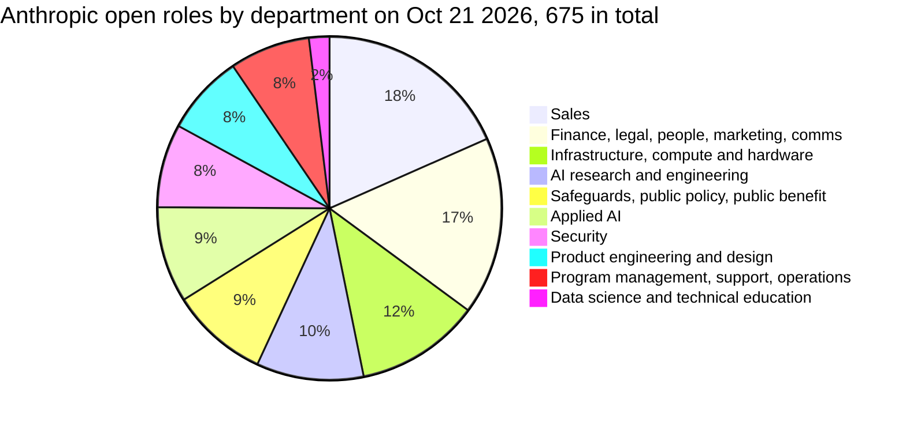
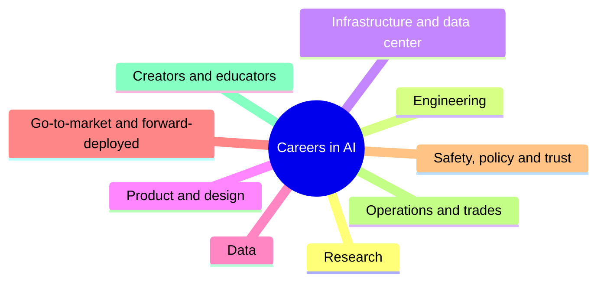
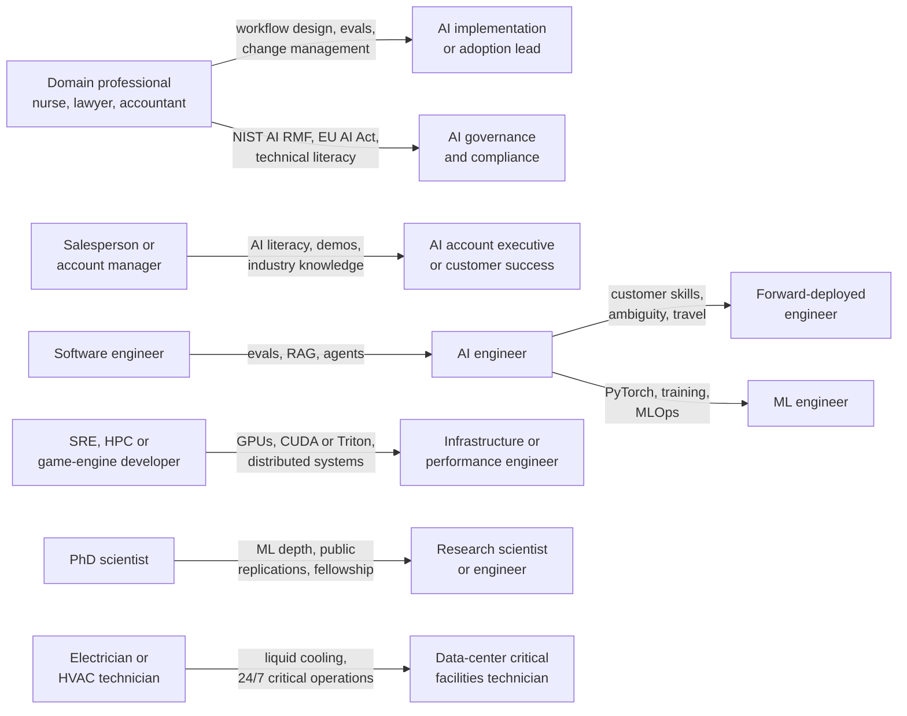
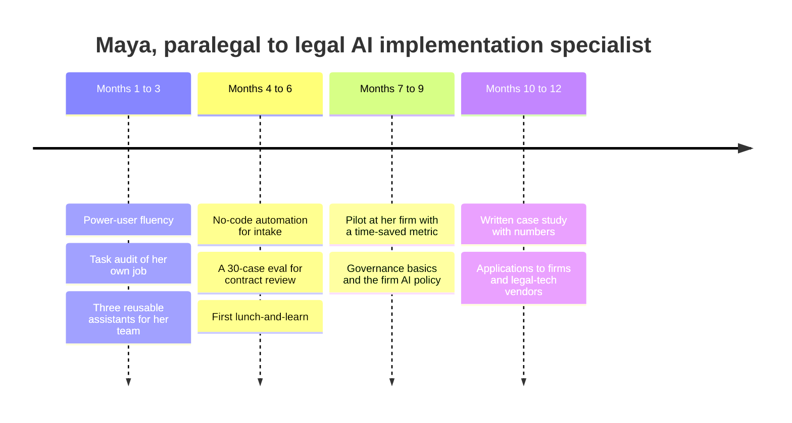
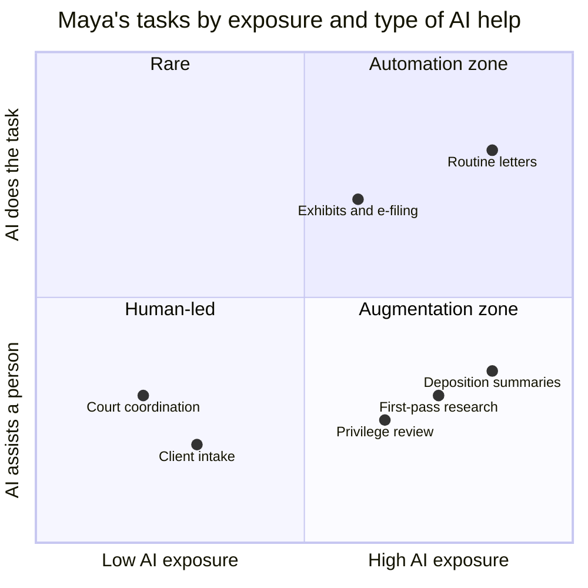
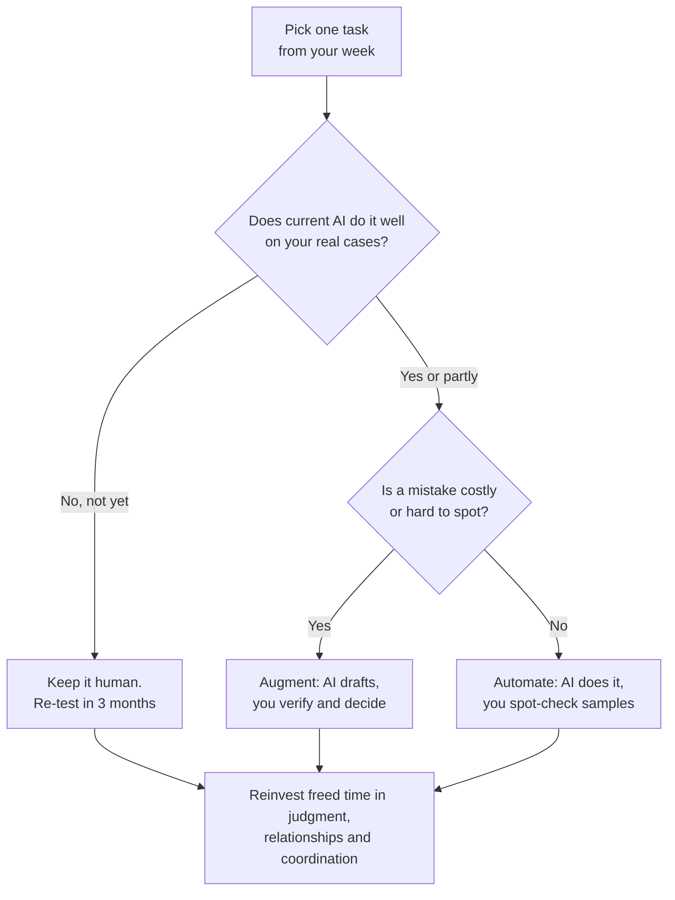

# Chapter 63: Careers in AI: Every Role Explained

*This chapter tours about forty jobs in and around AI: what each one does all day, what it pays according to dated public sources, how people move between them, and how AI is reshaping the job you already have.*

## What you'll learn
- How the AI job market is shaped, and why research is only about one open role in ten even at the frontier labs.
- How to read pay figures honestly: the four tiers of AI pay, and the difference between base salary, bonus, equity and vesting.
- What about forty roles involve day to day, grouped into nine families, with the skills, backgrounds and dated pay data for each.
- Which roles are open to people without a computer-science degree, including sales, policy, trust and safety, teaching and the skilled trades.
- The common career transitions into AI and the one to three skills that bridge each one.
- Why economists measure AI's effect on work task by task, what the "jagged frontier" is, and what the evidence on jobs shows so far.
- A practical playbook for adapting your own career, whatever stage you are at.

## Before you start
Chapter 61 (The AI Industry Map: Who Makes Money and How) explains the companies and layers that employ the people in this chapter, and Chapter 62 (The Complete AI Skills Map) describes the skill levels this chapter calls Level 0 through Level 6. Chapter 60 (AI, Work, the Economy and the Big Debates) goes deeper into the labor-market evidence summarized near the end. Role descriptions mention ideas from earlier parts of the book, such as evals (Chapter 31), agents (Chapter 28), inference (Chapter 23) and data centers (Chapter 38); each gets a one-line refresher when it appears. No technical background is needed.

## The shape of the AI job market

You have used a chatbot nearly every day for more than a year. That already puts you a step above most people, who use AI occasionally or not at all. This chapter is about the steps above yours, and about the many side doors into AI work that have nothing to do with climbing.

### A ladder with a wide middle

One useful way to picture involvement in AI is as six rungs:

1. **Casual user.** Asks a chatbot the occasional question.
2. **Power user.** Uses AI daily for real work, gives it context, checks its output and hands multi-step tasks to agents.
3. **Builder.** Connects AI to other tools with no-code automations and builds custom assistants and small apps without being a professional programmer.
4. **Engineer.** Writes software around models: retrieval, agents, evaluations, deployment.
5. **Researcher.** Trains models and studies how they behave.
6. **Frontier researcher.** Pushes the state of the art at one of a handful of labs.

Headlines focus on the top rung, because that is where the dramatic pay packages and scientific breakthroughs are. But most of the economic value, and most of the jobs, sit in the middle: power users who redesign how their team works, builders who wire AI into a business, and engineers who turn models into reliable products. Chapter 62 maps these rungs to skill Levels 0 through 6. This chapter maps them to job titles.

> **Definition — Role family:** A group of jobs that share a purpose and a core skill set, such as research, engineering or sales. Moving between roles inside one family is usually easier than moving between families.

> **Key idea:** You do not need to reach the top of the ladder to have an AI career. Most AI jobs, and most of the value AI creates, sit on the middle rungs and in roles that sell, deploy, secure, govern, teach, build and power AI.

### Five kinds of employer

AI work happens in five broad places, and the same job title can look quite different in each.

- **Frontier labs.** The companies that train the most capable models: OpenAI, Anthropic, Google DeepMind, Meta and xAI (now part of SpaceX), with Chinese labs such as DeepSeek, Alibaba's Qwen team and Moonshot close behind. They employ relatively few people for their size and pay at the very top of the market.
- **Big tech and chipmakers.** Microsoft, Google, Amazon, Meta, Apple and Nvidia employ large numbers of machine-learning and infrastructure staff, often at pay close to the labs'.
- **AI startups.** Application companies such as Cursor (coding), Harvey (law), Lovable (app building) and Sierra (customer service), plus tooling and data companies. Pay mixes salary with riskier equity.
- **Every other organization.** Banks, hospitals, retailers, law firms, schools, governments and small businesses adopting AI. This is where the largest number of AI-touched jobs are, usually under existing titles with new responsibilities.
- **The physical buildout.** Data-center developers, construction firms, electrical and mechanical contractors and utilities building the gigawatt-scale campuses described in Part VII (Chapters 38 to 43).

> **Definition — Frontier lab:** A company that trains frontier models, the most capable AI models in existence at a given time. In late 2026 the usual list includes OpenAI, Anthropic, Google DeepMind, Meta and xAI, with several Chinese labs close behind.

### What the labs are actually hiring for

The clearest window into the top of the market is the labs' own job boards, which list every open position. On October 21, 2026, Anthropic's public job board listed 675 open roles and OpenAI's listed 809. Figure 63.1 groups Anthropic's by department.


*Figure 63.1: Anthropic's 675 open roles on October 21, 2026, grouped from the departments on its public job board. Research is about one role in ten.*

Work through the arithmetic. The department called AI Research and Engineering had 68 open roles, so research made up 68 ÷ 675 ≈ 10% of openings. Sales alone had 124, or 124 ÷ 675 ≈ 18%. OpenAI showed the same pattern (Table 63.1). Its Research department had 51 of 809 open roles, about 6%, while Go To Market had 149 (about 18%), Applied AI had 120 (about 15%) and Scaling, the group that builds and runs its computers, had 106 (about 13%). Add OpenAI's separate Forward Deployed Engineering department (31 roles) to Applied AI and nearly one opening in five was about helping customers put models to work.

| OpenAI department (job board, Oct 21, 2026) | Open roles | Share of 809 |
|---|---|---|
| Go To Market | 149 | 18% |
| Applied AI | 120 | 15% |
| Scaling (compute and infrastructure) | 106 | 13% |
| Research | 51 | 6% |
| User Operations | 51 | 6% |
| Marketing | 46 | 6% |
| Forward Deployed Engineering | 31 | 4% |
| Finance | 31 | 4% |
| Security | 29 | 4% |
| Consumer Devices | 27 | 3% |
| People, Safety Systems, Data Science, OpenAI for Government | 70 | 9% |
| Smaller groups | 98 | 12% |

*Table 63.1: OpenAI's open roles by department on October 21, 2026. Research is about 6% of openings.*

> **Watch out:** "You need a PhD to work in AI" is the most common myth about this field. Even at the two best-known frontier labs, research was under about 10% of open roles in October 2026, and Anthropic's postings typically ask for "a Bachelor's degree or an equivalent combination of education, training, and/or experience." Most hiring is for people who sell, deploy, scale, secure and govern AI.

> **Try it:** Open the careers page of an AI company whose product you use (Anthropic's and OpenAI's job boards are both public). Spend five minutes counting the open roles in three departments of your choice and divide each by the total. Compare your shares with Figure 63.1 and Table 63.1, and note which departments have grown or shrunk since October 2026.

> **At the frontier (2026):** The labs' biggest hiring categories in late 2026 are selling and deploying, not inventing. OpenAI runs a dedicated Forward Deployed Engineering department, Anthropic's Applied AI department had 61 open roles, and both labs list jobs for data-center technicians, electrical engineers and community-relations managers, work that hardly appeared on AI-lab job boards a few years ago.

## How to read AI pay without being fooled

Few topics produce more misleading headlines than AI salaries. Before the role-by-role tour you need four tools: where pay numbers come from, the four tiers of the market, what a pay package is made of, and why the top of the market pays what it does.

### Where the numbers come from

Most pay figures you will meet come from one of four kinds of source, each with its own bias.

- **Posted ranges.** Several US states and cities, including California, Colorado, New York and Washington, require employers to publish a pay range in job postings. That is why lab job boards show numbers at all. The ranges are real, but they usually cover base salary only.
- **Government statistics.** The US Bureau of Labor Statistics surveys employers across the whole economy and publishes medians by occupation. These are the most representative numbers, but they lag by a year or more and use broad categories.
- **Self-reported data.** Sites such as Levels.fyi collect pay reports from workers. They capture total pay, including stock, but lean toward large, high-paying tech companies.
- **News reports.** Stories about record offers describe a handful of people and often rest on anonymous sources.

> **Definition — Pay-transparency law:** A law requiring employers to publish the expected pay range for a job in its posting. Laws of this kind in several US states and cities are the reason AI-lab job boards show salary ranges.

> **Definition — BLS (Bureau of Labor Statistics):** The US government agency that measures employment, wages and prices. Its Occupational Outlook Handbook gives median pay and ten-year growth projections for hundreds of occupations.

> **Definition — Levels.fyi:** A website where tech workers report their pay, often with proof. It is the standard reference for tech compensation, but it over-represents large, high-paying companies.

This chapter follows one rule: **every pay figure carries its source and date.** "Anthropic job board, Oct 2026" means the US base-salary range posted on Anthropic's public job board and retrieved on October 21, 2026. "OpenAI job board, Oct 2026" means the same for OpenAI's board, whose postings add that equity is offered on top. "BLS, May 2025" means the national median in the Bureau of Labor Statistics' May 2025 data. Figures labeled "self-reported" or "reported" come from secondary sources and deserve more caution. All of them are snapshots; by the time you read this, look them up again.

### The four tiers of AI pay

AI pay spans four tiers that differ by factors of ten or more. Figure 63.2 puts them on a log scale, where each tick is ten times the one before (Chapter 6 explains log scales).

```
 Annual pay, US dollars, log scale: each tick is 10 times the last

 $10K      $100K     $1M       $10M      $100M     $1B
 |---------|---------|---------|---------|---------|
         [==]  Tier 1
        BLS national medians, May 2025
               [==]  Tier 2
        Levels.fyi ML engineer median TC, Oct 2026
              [=====]  Tier 3
        frontier-lab posted base ranges, Oct 2026
                                        [====]  Tier 4
        reported 2025 offers, per year
```
*Figure 63.2: The four tiers of AI pay on a log scale. Headlines describe the far right; most careers live on the left.*

- **Tier 1, national medians (BLS, May 2025).** A median is the middle value, with half of workers earning more and half less, so a few huge salaries cannot drag it upward. Software developers $135,980, with 10% projected growth from 2025 to 2035. Computer and information research scientists $140,300 (22% growth; the typical entry credential is a master's degree). Data scientists $120,230 (35% growth). Electricians $63,190 (9% growth, with data-center electricity demand cited as a driver).
- **Tier 2, big tech (Levels.fyi, self-reported, Oct 2026).** Median total compensation for US machine-learning engineers was about $465K at Meta, $420K at Apple, $333K at Google and $261K at Nvidia.
- **Tier 3, frontier-lab posted ranges (lab job boards, Oct 2026).** Base salary commonly $200K to $500K, with some research and performance roles reaching $850K, plus equity on top.
- **Tier 4, outliers (reported, 2025).** In mid-2025 Meta reportedly offered a small number of top researchers packages worth up to $300 million over four years, and one reported offer was said to reach $1.5 billion over six or more years. Meta's chief technology officer said such sums went to only a few senior leaders and were multi-year stock, not signing bonuses.

> **Key idea:** Headlines describe tier four, which reportedly covers only a small number of people. Posted frontier-lab research ranges run roughly $250K to $850K base, and the national median for research scientists is $140,300 (BLS, May 2025). Calibrate your expectations to the tier you are actually aiming at.

### What a pay package is made of

A tech job offer usually has three or four parts, and the parts carry very different risks.

> **Definition — Base salary:** The fixed yearly cash pay for a job, paid in regular paychecks regardless of performance. Posted ranges on AI-lab job boards are base-salary ranges.

> **Definition — Bonus:** Extra cash paid on top of base salary, usually once a year and often tied to company or personal performance. A "target bonus" of 15% means you can expect about 15% of base if things go as planned.

> **Definition — Equity:** Ownership in the company given as part of pay, in the form of shares or the right to buy shares. Its value rises and falls with the company's value.

> **Definition — RSU (restricted stock unit):** A promise to give you company shares once you have worked there long enough. At a public company each vested RSU can be sold on the stock market at that day's price.

> **Definition — Stock option:** The right to buy company shares later at a fixed price, called the strike price. Options are worth something only if the shares end up worth more than the strike price, which is common at startups and risky.

> **Definition — Vesting:** The schedule by which equity becomes yours over time, typically over four years. Leave before a chunk vests and you give it up.

> **Definition — Cliff:** A waiting period, often one year, before any equity vests at all. Leave after 11 months under a one-year cliff and you keep none of the grant.

> **Definition — Total compensation (TC):** Base salary plus bonus plus the yearly value of equity. Tech pay comparisons, including Levels.fyi figures, use total compensation, so they look higher than posted base ranges.

> **Definition — Liquidity:** How easily you can turn an asset into cash. Shares of a public company are liquid; shares of a private company usually cannot be sold until a tender offer, an acquisition or an IPO (initial public offering, when a company first lists its shares on a stock exchange).

> **Definition — Tender offer:** An event at a private company in which existing shareholders, often employees, are allowed to sell some of their shares to investors. No new money goes to the company; it is how private-company staff turn paper equity into cash.

> **Definition — Dilution:** The shrinking of your percentage ownership when a company issues new shares, for example in a new funding round. Your slice gets smaller even though the number of shares you hold stays the same.

> **Analogy:** Vesting works like a coffee loyalty card that earns one stamp a month. The free coffees (your shares) only become yours as the stamps fill in, and a cliff means the card does not start counting until you have been a regular for a year. Walk away early and the unstamped coffees stay behind the counter.

### Worked example: comparing three offers

Suppose you are an experienced engineer with three offers. The numbers below are illustrative, chosen to sit inside the public ranges, not quotes of any real offer.

| | Offer A: large public tech company | Offer B: private AI lab | Offer C: early-stage startup |
|---|---|---|---|
| Base salary | $200,000 | $350,000 | $170,000 |
| Target bonus | 15% of base = $30,000 | none assumed | none |
| Equity grant | $400,000 of RSUs, 4-year vest, 1-year cliff | $600,000 of shares at the last round's price, 4-year vest | options on 0.25% of the company, last valued at $40M |
| Paper value of equity per year | $400,000 ÷ 4 = $100,000 | $600,000 ÷ 4 = $150,000 | 0.25% × $40M ÷ 4 = $25,000 |
| Paper total compensation per year | $330,000 | $500,000 | $195,000 |
| When can you sell? | After each vest, on the stock market | Only at a tender offer or IPO | Only at an acquisition or IPO |

*Table 63.2: Three illustrative offers. The "paper" totals assume the company's value stays exactly where it is.*

Now stress-test each one.

- **Offer A.** If the company's stock falls 30%, each year's vested RSUs are worth $70,000 instead of $100,000, and total compensation drops to $200,000 + $30,000 + $70,000 = $300,000. If the stock rises 30%, it climbs to $360,000. The cash part ($230,000) is nearly certain.
- **Offer B.** The cash is $350,000. The equity is worth $150,000 a year only if the lab's valuation holds and you can eventually sell. If the valuation doubles by the time a tender offer arrives, your yearly slice is worth $300,000; if it halves, $75,000; if no sale is possible for years, you have $350,000 of cash and a promise.
- **Offer C.** Startups raise more money, which dilutes you. If three future rounds each dilute existing holders by 20%, your 0.25% shrinks to 0.25% × 0.8 × 0.8 × 0.8 = 0.128%. If the company is later sold for $1 billion, that is 0.128% × $1,000,000,000 = $1.28 million before paying the strike price and taxes, about $320,000 per year of a four-year grant. If it is sold for $100 million, it is $128,000 in total. If it fails, as most startups do, it is zero.

Three lessons follow. Compare the cash and the equity separately, because they carry completely different risks. Never compare a lab's posted base range with a Levels.fyi total-compensation figure, because they measure different things. And read the vesting terms: under a one-year cliff, leaving after eleven months turns any equity offer into zero.

> **Watch out:** A posted range such as "$305K to $460K" on a lab job board is base salary, not total pay, and it is the top of the market. Most employers outside the frontier labs and big tech pay far less for jobs with similar titles. Compare like with like: base with base, total compensation with total compensation, and the same city with the same city.

### Why the top of the market pays so much

Why would a company pay an engineer $850,000 in base salary? Because of leverage. A small improvement made by one person can be multiplied across an enormous fleet of computers or an enormous number of users.

Here is a worked example. The research firm Sacra estimates that OpenAI's inference costs, the cost of running its models for users, will be about $14.1 billion in 2026 (a secondary estimate). If a team of performance engineers made serving 1% more efficient, the saving would be about 1% × $14.1 billion = $141 million a year. A 10% improvement would be worth about $1.4 billion a year. Against numbers like that, even very high salaries for the few people who can deliver such gains are a bargain for the employer, which is why posted ranges for performance and inference engineers at Anthropic reach $850K base (Anthropic job board, Oct 2026).

Research works the same way. A better post-training recipe changes the behavior of a model that, in ChatGPT's case, reached about 900 million people a week in February 2026 and was reported above a billion later in the year. Scarcity adds to the effect. 80,000 Hours, a career-advice nonprofit, estimated that only about 300 people (a range of 76 to 536 full-time equivalents) were working on technical AI-safety research in 2022, so the pool of experienced people in some specialties is tiny.

> **Analogy:** A kernel or performance engineer is like a Formula 1 mechanic. Shaving a tenth of a second off a lap sounds trivial, but over a whole season it decides the championship. Shaving a few percent off the cost of running tens of thousands of chips works the same way, and teams pay accordingly.

## The role catalog: nine families

The rest of this section describes about forty roles in nine families (Figure 63.3), plus a short note on founders, investors and the public sector. Each family gets a short introduction and a table with four columns: what the work looks like day to day, the core skills and typical backgrounds, and the pay data with its source and date. Where no reliable public figure exists, the table says so rather than guessing.


*Figure 63.3: The nine role families used in this chapter. Most of them do not require a computer-science degree.*

### Family 1: Research

Research roles create the models themselves and study how they behave. They are the smallest family by headcount and the most competitive to enter. Research work at a frontier lab clusters around the stages of building a model: pretraining, where the model learns general knowledge by predicting the next token across trillions of tokens of text (Chapter 19); post-training, which turns that raw predictor into a helpful, safe assistant (Chapters 20 and 21); evaluation; interpretability, which studies what happens inside the network (Chapter 57); and alignment, the work of making models reliably pursue the goals their developers and users intend (Chapter 55).

> **Definition — Research scientist:** A researcher who sets research direction, forms hypotheses, designs experiments and interprets the results. The role usually expects a strong publication or open-source record, often a PhD.

> **Definition — Research engineer:** An engineer who builds research infrastructure and runs large experiments, such as training runs and evaluations, and debugs them when they go wrong. At frontier labs the line between research engineer and research scientist is blurry, and many postings say "RE/RS".

> **Definition — Evals (evaluations):** Systematic tests of whether an AI system does what you want, from capability benchmarks to checks for dangerous abilities. They are the report cards of AI (Chapters 31 and 57).

| Role | Day to day | Core skills and backgrounds | Pay data (source, date) |
|---|---|---|---|
| Research scientist | Sets research agendas, designs experiments, interprets results, writes papers or internal reports, mentors others | Research taste, deep machine-learning knowledge, math, a track record; usually a PhD in ML, physics, math or neuroscience plus publications or open-source work | Anthropic, Research Scientist, Interpretability: $350K–$850K base (Anthropic job board, Oct 2026). OpenAI: $250K–$445K general; $380K–$850K Foundations and Search; $300K–$600K Researcher, Training; all plus equity (OpenAI job board, Oct 2026). National median for research scientists: $140,300 (BLS, May 2025) |
| Research engineer | Implements and runs large experiments (pretraining runs, reinforcement-learning pipelines, evals), builds research tools, debugs training at scale | Strong software engineering plus ML depth and careful experiment habits; software engineers who moved into ML, MS or PhD holders, self-taught people with strong public work | Anthropic: $315K–$560K Interpretability; $350K–$500K Alignment and Production Post-Training; $500K–$850K RL, Code RL, Computer Use, Post-Training Evals (Anthropic job board, Oct 2026). OpenAI: $250K–$445K plus equity (OpenAI job board, Oct 2026) |
| Alignment, safety or interpretability researcher | Researches oversight, control, robustness, model internals, dangerous-capability tests and model behavior | Research skills plus safety-specific knowledge; often enters through MATS, ARENA, the Anthropic Fellows Program or a PhD | OpenAI: $295K–$500K Researcher, Alignment; $380K–$500K Safety Systems; plus equity (OpenAI job board, Oct 2026). Anthropic: $350K–$500K Alignment RE/RS (Anthropic job board, Oct 2026) |
| Evals researcher or engineer | Builds capability and safety benchmarks, runs evaluations before launch, measures how long and how reliably agents can work | Experimental design, statistics, engineering, domain knowledge; research engineers and domain experts who code | Anthropic, Research Engineer, Post-Training Model Evaluations: $500K–$850K base (Anthropic job board, Oct 2026). Government institutes and nonprofits such as METR and Epoch AI pay less |
| Research economist or social scientist | Measures AI's economic effects from usage data, as in Anthropic's Economic Index | Econometrics, data science, policy writing; usually an economics PhD | Anthropic: $320K–$405K base (Anthropic job board, Oct 2026) |

*Table 63.3: Research roles.*

Because research is so competitive, funded on-ramps matter. MATS, a research-mentorship program, runs for 12 weeks and pays a $1,250 weekly stipend plus $2,000 a week in compute; it reports 631 alumni since 2021, 75% of whom now work in alignment, transparency or security (program website, Oct 2026). The Anthropic Fellows Program lasts four months and pays a $3,850 weekly stipend plus about $15,000 a month in compute (Anthropic, Oct 2026); over roughly 17 weeks the stipend alone comes to about 17 × $3,850 ≈ $65,000. ARENA runs four- to five-week in-person bootcamps in London with costs covered and publishes its curriculum online.

> **Definition — Fellowship (residency):** A time-boxed, paid program in which newcomers do research with mentorship, such as MATS or the Anthropic Fellows Program. Fellowships are among the most reliable routes into safety and research roles for people without a research job yet.

> **Analogy:** A research engineer and a research scientist are like a chef and a recipe inventor in a test kitchen. The inventor imagines a new dish; the chef works out how to cook it for a thousand people without burning anything. At frontier labs most people do some of both.

> **At the frontier (2026):** Post-training and reinforcement learning, the stages that produced most of the 2024 to 2026 gains in reasoning, coding and agents (Chapter 21), were the most-posted research specialty on Anthropic's job board in October 2026, and some of those roles carried the highest posted ranges in the whole market.

### Family 2: Engineering

Engineering roles build the software that turns models into products, keeps them running and makes them cheaper and safer. This family has the largest number of AI jobs outside the labs, and it is where most career-changers with programming experience land. Two background ideas recur in the table: inference, the per-request work of running a trained model for users (Chapter 23), and coding agents, AI systems such as Claude Code, Codex or Cursor's agent that read a codebase, edit files and run tests with little help (Chapter 29).

> **Definition — AI engineer (LLM application engineer):** A software engineer who builds products on top of foundation models, using prompts, retrieval, tools, agents and evals, rather than training models. It is the most-hired technical AI role outside the labs.

> **Definition — ML engineer (MLE):** An engineer who builds, trains, deploys and maintains machine-learning models in production, such as recommendation, fraud-detection or ranking models, and increasingly fine-tuned language models.

> **Definition — MLOps (machine-learning operations):** The practices and tools for deploying, monitoring and updating models in production reliably: pipelines, model registries, scheduling and monitoring. The LLM-era version is often called LLMOps.

> **Definition — Kernel:** A small, highly tuned program that runs one operation, such as a matrix multiplication, on a GPU (graphics processing unit, the parallel chip that does most AI math). Kernels are usually written in CUDA, Nvidia's GPU programming platform, or in Triton, a Python-like alternative, and faster kernels make every training run and every answer cheaper.

| Role | Day to day | Core skills and backgrounds | Pay data (source, date) |
|---|---|---|---|
| Software engineer (AI-assisted) | Builds products, now heavily paired with coding agents; more time goes to specifying, reviewing and testing than to typing code | Programming, system design, code review, using agents well; computer-science degree, bootcamp or self-taught | National median $135,980, 10% projected growth 2025–2035 with AI development cited (BLS, May 2025). Senior roles: $300K–$485K (Anthropic job board, Oct 2026); $230K–$490K (OpenAI job board, Oct 2026) |
| AI engineer (LLM application engineer) | Builds features on model APIs: prompt and context pipelines, retrieval, tool use, agents, evals, monitoring cost and speed | Level 4 skills from Chapter 62 plus solid software engineering; software engineers, data scientists, ambitious builders | Soft data only: third-party salary sites cite US medians from about $150K to $280K depending on how the title is defined (secondary, 2026) |
| ML engineer | Trains and fine-tunes models, builds features, deploys and monitors models in production | Level 5 skills: ML, PyTorch, MLOps, software engineering; computer-science or quantitative degrees, often a master's | Big-tech median total compensation $261K–$465K (Levels.fyi, self-reported, Oct 2026) |
| MLOps or ML platform engineer | Builds internal platforms on which other teams train and serve models: pipelines, registries, GPU scheduling, monitoring | Infrastructure, Kubernetes, cloud, the ML lifecycle; DevOps, site reliability or backend engineers | Varies widely by employer; no strong single public source |
| Performance, kernel or inference engineer | Profiles training and serving, writes CUDA or Triton kernels, optimizes parallelism, memory and serving systems, ports code to new chips | Deep GPU architecture, C++ and CUDA, compilers, numerical methods; HPC, systems, game-engine, compiler and quant-finance backgrounds | Anthropic: $280K–$850K Performance Engineer; $350K–$850K Inference Engine and Systems (Anthropic job board, Oct 2026). OpenAI: $295K–$500K Training Performance; $266K–$445K Kernel Performance; plus equity (OpenAI job board, Oct 2026) |
| Security engineer (AI and infrastructure) | Protects model weights, infrastructure and user data; red-teams systems; detects and responds to attacks | Security engineering, cloud, threat modeling, AI-specific attacks such as prompt injection; security engineers and former government staff | Anthropic: $320K–$405K Security Software Engineer and Red Team Engineer (Anthropic job board, Oct 2026); its Security department had 53 open roles |

*Table 63.4: Engineering roles.*

A note on a job title that faded. The "prompt engineer," which went viral in 2023 as a standalone role, has largely been absorbed into other jobs. Writing good prompts and assembling good context (Chapter 25) is now an expected skill for AI engineers, product managers and solutions architects rather than a title of its own. Labs still hire around prompts, but as engineering: Anthropic posted a "Software Engineer, Tokens and Prompt Structures" role at $320K–$405K base (Anthropic job board, Oct 2026).

> **Definition — Prompt engineering:** Writing instructions that get good results from a model. Once marketed as a career, it is now a baseline skill expected in many roles, extended by context engineering, which is assembling everything the model sees.

> **Watch out:** "Learning to code is pointless now that AI writes code" gets the lesson backwards. Coding agents write much of the code, but reading, specifying, testing and debugging it is what lets you direct and trust them. The BLS still projects 10% growth for software developers from 2025 to 2035 and cites AI development as a driver (BLS, May 2025 data).

### Family 3: Infrastructure and data center

AI runs on physical machines in physical buildings, and the people who design, build and run them form a fast-growing family. Chapter 34 describes the GPU clusters, thousands to hundreds of thousands of chips wired together to act as one machine, and Part VII describes the buildings and the grid connections they need. Some roles here are among the best paid in software; others are open to people from construction, utilities and local government.

> **Definition — Site reliability engineering (SRE):** The discipline of keeping large computer systems running: monitoring, automation, incident response and capacity planning. Many AI-infrastructure engineers come from SRE and high-performance computing (HPC).

> **Definition — Critical facilities:** The power and cooling systems of a data center that must run 24 hours a day, every day, such as switchgear, backup generators, batteries, chillers and coolant loops. People who run them are critical-facilities or mission-critical technicians and engineers.

> **Definition — Powered land:** Land with a confirmed connection to enough electricity for a large data center. Securing it is now a specialty, because grid connections can take years (Chapter 41).

| Role | Day to day | Core skills and backgrounds | Pay data (source, date) |
|---|---|---|---|
| GPU cluster, infrastructure or reliability engineer | Keeps tens of thousands of accelerators healthy: fleet management, hardware health, storage, networking, incident response | Linux, distributed systems, networking, automation; SRE, HPC and systems engineering | OpenAI: $230K–$490K Fleet and GPU Infrastructure engineer; $380K–$500K Collective Communication; plus equity (OpenAI job board, Oct 2026). OpenAI's Scaling department had 106 open roles |
| Data-center engineer (electrical, mechanical, controls, capacity delivery) | Designs power and cooling, sources equipment, manages construction through to operation, plans capacity | Licensed or degreed engineering, critical-facility experience; utilities, construction, hyperscaler facilities teams | Anthropic: $320K–$405K Data Center Electrical, Mechanical and Controls Engineer (Anthropic job board, Oct 2026). OpenAI: $257K–$327K Data Center Design Engineer, Electrical, plus equity (OpenAI job board, Oct 2026) |
| Compute capacity planner, procurement or GPU finance | Forecasts how many chips and megawatts are needed, negotiates cloud and hardware contracts, models leases and depreciation | Spreadsheet modeling, contracts, supply chains, enough technical literacy to read spec sheets; finance, procurement, operations | No reliable public pay figure found |
| Community engagement manager (data centers) | Works with local governments, residents, utilities and workforce programs wherever data centers are built | Local politics, communications, economic development; government affairs, utilities, campaigns | Anthropic: six regional roles at $265K–$295K base (Anthropic job board, Oct 2026) |
| Site development and powered-land specialist | Finds sites, secures power and permits, negotiates land and interconnection | Real estate, permitting, utility regulation; developers, land agents, energy professionals | Roles for "powered land" development appear on OpenAI's job board (Oct 2026); pay not recorded here |

*Table 63.5: Infrastructure and data-center roles.*

The community engagement row deserves a second look. Six regional roles at a frontier lab, each posted at $265K–$295K base, exist because data centers need local permission, power and water, and because communities have pushed back on noise, land use and electricity prices (Chapter 41). The physical buildout is creating well-paid jobs for people whose expertise is town halls and utility commissions, not code.

### Family 4: Product and design

Product and design roles decide what gets built and how people experience it. In AI they carry an unusual extra burden: the product's behavior is probabilistic, so "quality" has to be defined with evals, not just with a design mockup.

> **Definition — Product manager (PM):** The person who decides what a product should do and why, prioritizes the work, coordinates engineering and design, and is accountable for whether it succeeds. AI product managers also define quality through evals and manage the cost of every request.

> **Definition — Conversation designer:** A designer who shapes how a chat or voice assistant talks: its flows, wording, error recovery and hand-offs to humans. The role has expanded to agent interfaces, approval screens and trust signals.

> **Definition — TPM (technical program manager):** A manager who coordinates complex technical projects across many teams, such as a model launch or a data-center buildout, tracking dependencies, risks and schedules.

| Role | Day to day | Core skills and backgrounds | Pay data (source, date) |
|---|---|---|---|
| AI product manager | Decides what to build, defines quality with evals, works with research and engineering on model behavior, launches, watches metrics and costs | Product sense, Level 4 understanding of evals, cost and latency, user research, writing; former PMs, engineers, designers, consultants, domain experts | Anthropic: $305K–$460K base (Anthropic job board, Oct 2026). OpenAI: $293K–$530K plus equity (OpenAI job board, Oct 2026) |
| AI product designer, UX or conversation designer | Designs chat and agent interfaces, review and approval flows, trust signals; prototypes with AI | Interaction design, prototyping (increasingly by coding with AI), understanding model behavior; product and UX designers | Anthropic: $305K–$460K base (Anthropic job board, Oct 2026). OpenAI: $245K–$334K plus equity (OpenAI job board, Oct 2026) |
| Technical program manager | Coordinates launches, compute buildouts, safety programs and research operations across many teams | Program management, technical fluency, risk tracking; engineers, program managers, former military officers | OpenAI: $207K–$445K plus equity (OpenAI job board, Oct 2026). Anthropic's TPM department had 27 open roles |

*Table 63.6: Product and design roles.*

> **Try it:** Ask your chatbot: "I am a [your current job]. Write me a realistic description of one ordinary Tuesday for an AI product manager at a company that sells AI tools to people like me. Include the meetings, the documents, the numbers they look at and one thing that goes wrong." Then ask: "Which three parts of that day could I already do, and which three would I need to learn?"

### Family 5: Data

Every AI system runs on data, and data roles range from analysts who answer business questions to experts who write the examples models learn from. This family includes one of the most accessible on-ramps in the whole field for domain experts.

> **Definition — Data analyst:** Someone who pulls data from databases, builds dashboards and answers business questions with numbers, usually using SQL (the standard language for querying databases) and spreadsheets.

> **Definition — Data scientist:** Someone who uses statistics, experiments and modeling to answer harder questions, such as whether a product change worked. At AI companies they analyze product usage, safety data and sales.

> **Definition — Data engineer:** An engineer who builds the pipelines and warehouses that move, clean and store data so others can use it. At labs this includes the infrastructure for pretraining data.

> **Definition — Human data:** Examples, ratings, rubrics and demonstrations written or judged by people and used to train and evaluate models, such as the preference data behind RLHF (Chapters 11 and 20).

> **Definition — Expert contractor (AI trainer):** A domain expert, such as a doctor, lawyer, coder or mathematician, paid by the hour or project to write ideal answers, grade model outputs or build hard test questions for AI training and evaluation.

> **Definition — RL environment:** A simulated task with an automatic way to score success, in which models practice and learn by reinforcement learning. Building such environments became a business in 2025 and 2026 (Chapter 21).

| Role | Day to day | Core skills and backgrounds | Pay data (source, date) |
|---|---|---|---|
| Data analyst | Pulls data with SQL, builds dashboards, answers business questions, increasingly with AI copilots | SQL, spreadsheets, business-intelligence tools, statistics; business, economics, sciences | The BLS does not separate this title cleanly; data scientists, the next step up, have a $120,230 median (BLS, May 2025) |
| Data scientist | Designs experiments and A/B tests, builds models, designs metrics; at AI firms analyzes product use, safety data and sales | Statistics, Python and SQL, causal inference, communication; quantitative degrees | National median $120,230 with 35% projected growth (BLS, May 2025). Anthropic: $285K–$380K (Anthropic job board, Oct 2026). OpenAI: $230K–$385K plus equity (OpenAI job board, Oct 2026) |
| Data engineer | Builds pipelines, warehouses and data-quality checks; at labs, pretraining-data infrastructure | SQL, Python, Spark, orchestration tools, cloud; software engineers and analysts | Top of the market: Anthropic, Pre-training Data Infrastructure Engineer, $500K–$850K base (Anthropic job board, Oct 2026) |
| Expert contractor (AI trainer) | Writes ideal answers, grades model outputs, builds hard test questions, critiques reasoning in a specialty | Deep domain knowledge, precise writing, consistency; professionals, graduate students, PhDs | Mercor says its experts average $85+ per hour (company figures reported by Sacra, 2026). Generalist annotation pays far less. Work is project-based and can end abruptly |
| Labeling operations or data-quality lead | Writes annotation guidelines, measures how consistently labelers agree, audits vendors | Process design, statistics basics, management; operations and quality-assurance backgrounds | No reliable public pay figure found |
| RL environment builder | Designs tasks, sandboxes and automatic graders that models practice on | Software engineering plus domain knowledge; engineers, and domain experts who write tasks and rubrics | No reliable public pay figure found; an emerging 2025–2026 niche |

*Table 63.7: Data roles.*

Expert contracting deserves a worked example, because it is a realistic first step for many readers. Suppose you are a nurse who takes on 8 hours a week of model-grading work at $85 an hour, roughly the average Mercor reports for its experts (company figures, 2026). Over 40 working weeks that is 8 × 85 × 40 = $27,200 a year of side income, along with an education in exactly how models fail in your field. Now the risk: the work is project-based. When Meta took a 49% stake in Scale AI in June 2025, several big customers reportedly left Scale, and it ended work with about 500 contractors the following month (reported by Sacra). Treat expert contracting as a valuable side income and a learning experience, not as a stable salary.

> **Key idea:** Expert contracting turns domain knowledge into AI experience. You learn where models fail in your own field, which is exactly the knowledge that evals, governance and implementation roles need later.

### Family 6: Go-to-market and forward-deployed

Go-to-market roles sell AI and make sure customers succeed with it. This family is the largest hiring category at both frontier labs, and it includes the fastest-growing technical role of 2025 and 2026, the forward-deployed engineer.

> **Definition — Go-to-market (GTM):** Everything involved in selling a product: sales, marketing, partnerships, solutions engineering and customer success.

> **Definition — Account executive (AE):** A salesperson who owns closing deals with a set of customers: finding prospects, running discovery calls, arranging demos, negotiating contracts and forecasting revenue.

> **Definition — OTE (on-target earnings):** Total sales pay if the salesperson hits their targets: base salary plus expected commission, which is pay earned as a share of the sales they close. An OTE range is not a base-salary range.

> **Definition — Customer success manager (CSM):** The person who makes sure customers adopt a product and get value from it after the sale, which drives renewals and expansion.

> **Definition — Solutions architect (Applied AI architect):** A technical expert on the sales side who designs how a customer will use the product, runs demos and proofs of concept, and guides implementation.

> **Definition — Proof of concept (POC):** A small trial that tests whether a technology works for one customer's use case before they commit to a full rollout. Pilots and POCs are where most enterprise AI projects start, and where many stall.

> **Definition — FDE (forward-deployed engineer):** An engineer embedded with a customer for weeks or months to build and deploy solutions on the customer's own systems, half engineer and half consultant. The role originated at Palantir and became one of the fastest-growing AI roles in 2025 and 2026.

| Role | Day to day | Core skills and backgrounds | Pay data (source, date) |
|---|---|---|---|
| AI account executive | Prospects, runs discovery calls, demos with solutions engineers, negotiates enterprise contracts, forecasts | Enterprise sales, credible AI literacy, industry knowledge; SaaS or industry sales | Anthropic OTE: $222,800–$290,000 for startup and AI-native accounts; $290K–$380K mid-market; $380K–$450K federal enterprise (Anthropic job board, Oct 2026). OpenAI Account Directors: $176K–$350K base plus commission and equity (OpenAI job board, Oct 2026) |
| Customer success manager | Onboards customers, drives usage, runs business reviews, flags churn risk, coordinates with engineering | Relationship management, product expertise, change management; account management, consulting, support | Anthropic: $200K–$265K base for most postings; $265K–$350K national security (Anthropic job board, Oct 2026). OpenAI: $176K–$234K plus commission (OpenAI job board, Oct 2026) |
| Solutions architect, Applied AI architect or Applied AI engineer | Pre- and post-sale technical work: architecture design, demos, proofs of concept, prompt and eval workshops, partner training | Level 4 skills, communication, industry knowledge (finance, healthcare, public sector); sales engineers, consultants, software engineers | Anthropic: $240K–$380K Applied AI Architect; $200K–$320K Applied AI Engineer (Anthropic job board, Oct 2026). OpenAI: $197K–$335K Applied AI Engineer plus equity (OpenAI job board, Oct 2026) |
| Forward-deployed engineer | Embeds with a customer: scopes the problem, builds integrations and agents on their systems, handles messy data and security reviews, reports product gaps back | Full-stack engineering, LLM application engineering, customer communication, tolerance for ambiguity, travel; engineers with consulting or startup experience, ex-Palantir | OpenAI: $185K–$325K Forward Deployed Software Engineer (San Francisco); $302K–$385K FDE managers; plus equity (OpenAI job board, Oct 2026). Anthropic: $320K–$405K FDE managers (Anthropic job board, Oct 2026) |
| AI automation specialist or implementation consultant (small business) | Audits a small firm's workflows, sets up automations for intake, scheduling, follow-ups and documents, configures assistants, trains staff, maintains systems | Level 1 and 2 skills, process mapping, sales, trust-building; operations, office management, marketing, IT support | Freelance and agency prices vary widely; no reliable survey exists, so treat any specific number as anecdotal |

*Table 63.8: Go-to-market and forward-deployed roles.*

A worked example shows how sales pay works. Anthropic's posted OTE for mid-market account executives was $290K–$380K (Anthropic job board, Oct 2026). Suppose an offer at $300,000 OTE is split half and half, a common arrangement in software sales but not a universal one: $150,000 base and $150,000 of commission at 100% of quota. Hit 80% of quota and, under a simple straight-line plan, commission is 0.8 × $150,000 = $120,000, for total pay of $270,000. Hit 120% and commission is $180,000, for $330,000. Real plans add accelerators above quota and floors below it, so read the plan document. The point: an OTE is a target, not a promise.

How fast is forward-deployed engineering growing? Solid public numbers are scarce. The most reliable signal is structural: OpenAI created a separate Forward Deployed Engineering department, which had 31 open roles in October 2026, in addition to 120 roles in Applied AI (OpenAI job board, Oct 2026). Press reports citing job-posting data describe US FDE postings multiplying many times over between 2023 and 2026, but the underlying figures could not be checked for this book, so treat any specific multiple with caution.

> **Analogy:** A forward-deployed engineer is a tailor who comes to your house. The off-the-rack suit (the AI product) almost fits; the tailor adjusts it to your body (your systems, data and rules), and then tells the factory which sizes to add next season.

### Family 7: Safety, policy and trust

Every powerful technology needs people who decide the rules, enforce them and check that they are working. In AI this family spans company policy teams, investigators who catch misuse, auditors, and government bodies that test models. Their reference points include voluntary frameworks such as the US NIST AI Risk Management Framework and laws such as the European Union's risk-based AI Act, whose obligations phase in from 2025 onward (Chapter 59 covers both, including proposed delays). Most roles here value law, policy, investigation and domain expertise more than programming, although technical literacy is increasingly expected.

> **Definition — AI governance:** The policies, processes and controls an organization uses to manage the risks of AI and comply with the law, from an inventory of AI systems to approval rules and audits.

> **Definition — Trust and safety (safeguards):** The teams and systems that detect and prevent misuse of a product, such as fraud, cyberattacks, child-safety violations or weapons-related requests. At AI labs the team is often called Safeguards.

> **Definition — AISI and CAISI:** Government AI-safety bodies: the UK AI Security Institute and the US Center for AI Standards and Innovation. They test frontier models and employ both technical and policy staff (Chapter 59).

> **Definition — AIGP (Artificial Intelligence Governance Professional):** A certification from the IAPP, the main professional body for privacy specialists, covering AI law, risk and governance. It is one of the few certifications that carries weight in AI hiring.

| Role | Day to day | Core skills and backgrounds | Pay data (source, date) |
|---|---|---|---|
| AI policy, governance or compliance professional | Tracks legislation, drafts internal policies and usage rules, runs risk assessments, engages regulators, assesses models against frameworks | Law and policy, technical literacy, writing, stakeholder management; law, public policy, government, compliance, privacy | Anthropic: $245K–$285K Policy Design Manager; $265K–$295K Technical AI Governance; $330K–$395K Head of Policy Design (Anthropic job board, Oct 2026). OpenAI: $207K–$335K Model Policy Manager (OpenAI job board, Oct 2026). Government and think-tank pay is much lower |
| Trust and safety or safeguards analyst | Investigates misuse (fraud, cyber abuse, child safety, weapons-related requests), enforces policies, writes threat intelligence | Investigation, domain expertise in a harm area, data analysis, resilience to disturbing content; social-platform trust and safety, intelligence, law enforcement, cybersecurity | Anthropic: $245K–$330K Safeguards Enforcement Analyst (Anthropic job board, Oct 2026); Anthropic's Safeguards department had 42 open roles |
| AI auditor, assurance or risk manager | Checks AI systems against laws and standards such as the EU AI Act and ISO/IEC 42001, builds risk registers, prepares documentation | Audit and risk methods, regulation, enough technical literacy to question engineers; audit, compliance, privacy, consulting | No reliable public pay figure found; large accounting firms and specialist governance firms hire for this |
| Government or public-sector AI roles | Tests models at AI institutes, runs procurement, deploys AI in agencies, works on standards | Technical evaluation or policy, sometimes a security clearance | Public pay scales, well below lab levels |

*Table 63.9: Safety, policy and trust roles. Technical safety research appears under Research (Table 63.3).*

**Who works on AI safety and governance.** The job titles in Tables 63.3 and 63.9 sit inside a wider ecosystem, and knowing its parts tells you where to look for jobs, fellowships and reading. As of late 2026 it has seven main kinds of member:

- **Lab safety teams.** Alignment, interpretability, evaluation, safeguards and policy teams inside Anthropic, OpenAI, Google DeepMind and other developers. They run most dangerous-capability testing and write the system cards that come with each model (Chapters 56 and 57).
- **Government institutes and regulators.** The UK AI Security Institute and the US Center for AI Standards and Innovation test frontier models; the EU AI Office oversees the AI Act's rules for general-purpose models; China's Cyberspace Administration writes and enforces its AI rules (Chapter 59).
- **Independent evaluators and research nonprofits.** METR, Apollo Research, Redwood Research (where the AI control approach was developed), FAR.AI, Palisade Research, Epoch AI, the Center for AI Safety, the Machine Intelligence Research Institute (MIRI) and Eleos AI, which studies model welfare. Interpretability startups such as Goodfire and Transluce sit close to this group.
- **Academic labs.** University groups working on alignment, interpretability, fairness, the economics of AI and AI law, such as NYU's Center for Mind, Ethics, and Policy.
- **Think tanks.** GovAI, CSET, RAND, IAPS and others write the policy analysis that lawmakers, regulators and labs read.
- **Civil society.** Public-interest groups such as AI Now, the Ada Lovelace Institute, the Center for Democracy and Technology (CDT) and the Electronic Privacy Information Center (EPIC), which focus on rights, privacy, surveillance and accountability.
- **Critics.** Researchers such as Timnit Gebru (DAIR), Joy Buolamwini (Algorithmic Justice League), Emily Bender, Arvind Narayanan and Sayash Kapoor argue that present harms such as bias, surveillance and labor exploitation deserve more attention than speculative catastrophe. Others, including Yann LeCun, Andrew Ng and Marc Andreessen, are skeptical of the catastrophic-risk framing or of heavy regulation.

Industry bodies such as the Frontier Model Forum, the Partnership on AI and MLCommons (whose AILuminate benchmark tests chatbot safety) connect the companies. These groups disagree, sometimes sharply, about priorities (Chapters 55 and 60), and each camp is also a job market: all of them hire researchers, analysts and writers who understand both the technology and the people on the other side of the argument.

> **Definition — Think tank:** An independent research organization that studies policy questions and publishes analysis and recommendations for governments and the public, such as GovAI, CSET or RAND in AI policy.

> **Definition — Civil society:** The organizations that are neither government nor business, such as charities, advocacy groups, unions and community groups. In AI they push for rights, privacy and accountability, and often speak for people affected by AI systems.

> **Watch out:** "Non-technical people have no place in AI" is wrong in both directions. Policy, trust and safety, sales, customer success, community engagement, teaching and the trades were all hiring in 2026, many at high posted pay. But "non-technical" does not mean "AI-illiterate": every one of these roles expects you to understand how models work, fail and get misused well enough to talk credibly with engineers.

### Family 8: Operations and trades

This family covers two very different groups that share one trait: they make AI work in the physical and organizational world. The first group is professionals who run their own organizations with AI. The second is the skilled workforce that builds and runs data centers.

> **Definition — AI adoption lead (AI transformation lead):** The person who runs an organization's internal AI program: choosing use cases, setting governance, selecting vendors, training staff and measuring results.

> **Definition — Change management:** The structured work of helping people adopt a new way of working: explaining why, training, removing obstacles and measuring whether the change sticks. Most failed AI projects fail here rather than in the technology.

> **Definition — Commissioning:** Testing every system in a new building, such as power, cooling, controls and fire protection, under realistic conditions before it goes live. Commissioning agents are in high demand on data-center projects.

> **Definition — Apprenticeship:** A paid training path in which a person learns a skilled trade on the job under supervision, alongside classroom instruction, ending in a recognized credential. In the US, electrical apprenticeships are often run jointly by unions and contractors.

| Role | Day to day | Core skills and backgrounds | Pay data (source, date) |
|---|---|---|---|
| AI-enabled professional (any field) | Your existing job, with AI drafting, researching, analyzing and automating parts of it; you become the person who redesigns your team's workflow | Levels 0 to 2, domain expertise, verification; anyone | Your field's pay. Some surveys report wage premiums for jobs that ask for AI skills; check the latest edition before relying on any figure |
| AI adoption or transformation lead | Picks use cases, sets governance, selects vendors, trains staff, measures return on investment | Change management, Level 1 and 2 fluency, governance basics, metrics; operations, strategy, IT, training, consulting | Varies by company size; no authoritative public source found |
| Electrician and other building trades | Installs and maintains electrical distribution, cabling and equipment on data-center builds | Licensed trade skills, safety, reading electrical drawings; apprenticeship graduates | Electricians: national median $63,190, about 821,000 jobs, 9% projected growth 2025–2035 with data centers cited (BLS, May 2025). Contractor and union pay near large builds is often higher; check locally |
| HVAC technician, pipefitter, controls technician | Installs and services cooling plants, coolant loops and building-automation systems; liquid cooling is largely plumbing | Trade licenses, controls systems, safety; HVAC and mechanical trades | No AI-specific figure found; check local union and contractor rates |
| Data-center or site-operations technician | Racks and cables servers, replaces failed hardware, runs 24/7 critical-facility operations | Fiber and network work, electrical and mechanical basics, safety, shift work; military technicians, trades, IT support | OpenAI: $157K–$302K Datacenter Networking Technician, AI Compute Deployment, Stargate; $157K–$221K Site Operations Technician; both plus equity (OpenAI job board, Oct 2026) |
| Workforce development manager (infrastructure sites) | Builds training pipelines for local workers at data-center sites with colleges and unions | Workforce programs, partnerships, education; economic development, training, unions | OpenAI: $176K–$385K Workforce Development and Education Manager, Infrastructure Sites (OpenAI job board, Oct 2026) |

*Table 63.10: Operations and trades roles.*

Notice the gap between two numbers in that table. The national median for electricians is $63,190 (BLS, May 2025), while a technician role at OpenAI's Stargate sites was posted at $157K–$302K plus equity (OpenAI job board, Oct 2026). The lab posting is the very top of the market, and most data-center trade work happens through contractors rather than labs. Still, the direction is clear: a building with hundreds of megawatts of chips cannot be run without skilled hands, and there are not enough of them. Chapter 64 covers the trade opportunity in more depth.

> **Watch out:** "Data-center jobs are all high-tech" is a misconception. Most of the workforce building AI's data centers are electricians, pipefitters, ironworkers, controls technicians, construction managers and operations staff. A two-year degree or an apprenticeship is the entry ticket, not a PhD.

### Family 9: Creators and educators

AI adoption is held back less by the technology than by understanding. That makes people who can explain AI clearly, in documentation, courses, videos and workshops, unusually valuable. This family also includes creative professionals whose main medium is generative media: images, video, audio and 3D content made with AI models (Chapter 47).

> **Definition — Developer relations (DevRel):** The work of helping software developers adopt a platform through documentation, tutorials, sample code, talks and community support. Developer educators and developer advocates work here.

> **Definition — Technical writer:** A writer who produces documentation, guides and tutorials for technical products. A 2026 specialty is "docs for agents": writing the instruction files, skill descriptions and tool descriptions that AI agents read.

| Role | Day to day | Core skills and backgrounds | Pay data (source, date) |
|---|---|---|---|
| Technical instructor, developer educator, head of training | Writes and teaches courses, runs workshops for customers and partners, builds demo apps | Clear teaching and writing, Level 3 to 4 technical skills; teachers, writers, developer-relations staff, engineers | Anthropic: $270K–$365K Lead Technical Instructor; $290K–$365K Developer Education Lead; $365K–$435K Head of Technical Training (Anthropic job board, Oct 2026). Anthropic's Technical Education department had 4 open roles |
| Technical writer (including docs for agents) | Writes documentation, tutorials, and the instruction files and tool descriptions agents read | Precise writing, reading code and JSON, testing documentation with real users and agents; writers, engineers | No separate reliable public figure found |
| Niche AI educator or creator | Explains AI for one audience (nurses, contractors, teachers) through newsletters, videos and workshops | Domain credibility, teaching, consistency, honest testing of tools | Highly variable; no reliable data |
| Generative media specialist or AI artist | Produces ad variants, product imagery, dubbing, previsualization and game assets with AI pipelines | Visual or audio craft, diffusion and video tools, LoRA training, rights and provenance awareness | No reliable data; demand shifts quickly as tools change |

*Table 63.11: Creators and educators.*

### Adjacent roles: founders, investors and freelancers

Three more paths sit beside the families. **AI founders** do everything at once: customer discovery, building, selling, hiring and fundraising. Domain experts are increasingly common founders of vertical AI companies, those built for one industry. **AI investors and analysts** at venture firms and in equity research evaluate companies, model compute economics and track revenue; the role draws on finance plus technical literacy, and pay is not reliably surveyed. **Freelancers** sell implementation, training, content or expert data directly. Pay in all three is high-variance. Chapter 64 is devoted to these paths.

## Career paths and transitions

Very few people start in an AI job. Most arrive from a neighboring one, carrying skills that transfer and adding one to three new ones. Figure 63.4 shows the most common routes, labeled with the skills that bridge each move.


*Figure 63.4: Common transitions into AI work. Each arrow is labeled with the one to three skills that bridge the move.*

Table 63.12 adds the moves that did not fit in the diagram, with the proof that convinces a hiring manager and the rough time each takes for someone studying part-time. The time ranges follow the skill levels in Chapter 62 (for example, about 2 to 6 months to reach builder level and 6 to 24 months for AI application engineering).

| From | To | Bridging skills | Proof that convinces | Rough time, part-time |
|---|---|---|---|---|
| Any professional | AI-enabled professional, team AI champion | Context engineering, verification, delegation to agents | Hours saved per week, a shared assistant your team uses | 1–3 months |
| Domain professional | Expert contractor or evals specialist | Rubric writing, precise feedback, test design | A 50-question eval in your field with gold answers | 1–3 months |
| Operations or office manager | Small-business automation consultant | Zapier, Make or n8n, process mapping, selling | A written case study of a free implementation with time saved | 2–6 months |
| Teacher or trainer | AI instructor or developer educator | Level 3 to 4 technical skills, public explainers | Published tutorials or a recorded workshop | 6–12 months |
| Support agent | Customer success or trust and safety | Product depth, investigation, data analysis | Analyses of real support or abuse patterns | 3–12 months |
| Data analyst | Data scientist or AI engineer | Python, statistics, APIs, evals | A public error-analysis write-up of a system you built | 6–24 months |
| Software engineer | AI engineer | Evals, retrieval (RAG), agents, cost control | A shipped app with an eval set and an error analysis | 3–12 months |
| AI engineer | ML or research engineer | PyTorch, training loops, distributed systems | A replicated paper or a contribution to an open-source ML project | 1–3 years |
| PhD in a quantitative field | Research scientist | ML depth, research taste in ML, public replications | Fellowship output, workshop papers, replications | 1–3 years |
| Lawyer, privacy or audit professional | AI governance lead | AI law, risk frameworks, technical literacy | An AI policy or risk register you wrote; AIGP certification | 3–12 months |
| Electrician or HVAC technician | Critical-facilities technician | Liquid cooling, controls, 24/7 operations | Trade license plus data-center or mission-critical experience | 6–24 months |
| Military technician | Data-center operations | Fiber, electrical and mechanical basics, shift discipline | Service record plus a data-center operator course | 3–12 months |

*Table 63.12: Career transitions with bridging skills, proof and rough timing. Times are rough guides for part-time study and vary widely.*

### A worked transition: Maya's twelve months

Here is how one such move could look in practice. Maya (an invented example) is a paralegal at a mid-sized law firm who wants to become a legal AI implementation specialist at a firm or a legal-tech vendor. Her advantage is that she knows exactly what good legal work looks like and where mistakes hurt. Her gaps are workflow automation, evaluation and governance. Figure 63.5 lays out a realistic year.


*Figure 63.5: A twelve-month transition plan. Each stage produces visible proof, not just knowledge.*

Two features make this plan work. First, every stage produces something another person can see: assistants colleagues use, an eval with real cases, a pilot with a measured result, a written case study. Second, she never leaves her domain. The legal knowledge is the moat; the AI skills are the bridge.

### Credentials versus portfolios

Do you need a certificate? It depends on who is hiring.

- **Certifications matter most** where buyers or HR departments filter on them: cloud-heavy enterprises (AWS, Google Cloud and Microsoft AI certifications), consulting firms and systems integrators, government contracting, and governance and compliance (the AIGP). The AWS Certified AI Practitioner exam, for example, costs $100, has 65 questions in 90 minutes and needs no prerequisites (AWS, Oct 2026).
- **Certifications matter little** for frontier-lab research, research engineering and startup engineering, where public work dominates: code, papers, evals and write-ups.
- **Course-completion certificates** from free courses are useful as structured learning and as a signal of initiative, not as job qualifications.

A good rule of thumb: one relevant certification plus three strong portfolio pieces beats five certifications and no portfolio. Chapter 65 lays out roadmaps and portfolio projects in detail.

> **Definition — Portfolio:** Public evidence of what you can do: projects, write-ups, code repositories, evals, demos or case studies. In AI hiring it often matters more than credentials.

> **Definition — T-shaped skills:** Deep expertise in one area (the vertical bar of the T) plus broad working knowledge across many (the crossbar). A "pi-shaped" person has two deep areas, such as law and software.

> **Analogy:** Think of your career as the letter T. The tall vertical bar is depth in your own field, such as nursing, accounting or electrical work. AI fluency is the crossbar that connects that depth to everything else. People with only a crossbar are easy to replace; people with only a vertical bar are being left behind; people with both are the ones employers are searching for.

> **Watch out:** "AI jobs are only in San Francisco" is out of date. In October 2026 the frontier labs' postings spanned London, Dublin, Paris, Munich, Tokyo, Seoul, Sydney, Bangalore, Mumbai, Singapore, Washington DC and remote US roles, and implementation work exists wherever businesses are. Data-center jobs, by definition, are wherever the power is.

## How AI is changing the jobs that already exist

Most readers of this book will never hold a job with "AI" in the title. For them the more important question is how AI changes the job they already have. Chapter 60 covers the evidence and the economic debates in depth; this section gives you the working tools.

### Tasks, not jobs

A job is a bundle of tasks. A paralegal summarizes documents, drafts letters, organizes exhibits, talks to clients and coordinates with courts. AI does not take a job all at once; it changes the tasks inside it, some a lot and some not at all. That is why researchers measure AI's reach task by task.

> **Definition — Task:** One distinct activity within a job, such as "summarize a deposition" or "schedule a hearing." Economists and government databases describe each occupation as a list of tasks.

> **Definition — AI exposure:** How much of a job's tasks could be done or assisted by AI. It is measured task by task, and high exposure does not by itself mean job loss.

> **Definition — Automation:** AI doing a task instead of a person, with the person at most checking the result.

> **Definition — Augmentation:** AI helping a person do a task better or faster, with the person still doing and owning the work.

Real usage data supports the task view. Microsoft researchers analyzed about 200,000 conversations with Bing Copilot and found that information work, meaning creating, processing and communicating information, was both the most common and the most successful kind of AI-assisted activity. Since nearly every occupation includes some information work, most occupations have some exposure, but very few are exposed in every task.

> **Try it:** Look up your occupation on O*NET OnLine (onetonline.org), the US Department of Labor's database that lists the tasks of nearly every occupation. Copy its task list into a chat and ask: "For each task, would current AI mostly automate it, mostly assist a person, or barely help? Explain in one line each." Then mark where you disagree from your own experience.

Here is a worked example of a task audit, with invented but realistic numbers. Maya, the paralegal from Figure 63.5, logs a typical 40-hour week and labels each task.

| Task | Hours per week | Exposure | AI's likely role |
|---|---|---|---|
| Summarizing deposition transcripts | 8 | High | Augment: AI drafts, she verifies |
| First-pass legal research | 6 | High | Augment: every citation must be checked |
| Reviewing documents for privilege | 6 | Medium-high | Augment: AI flags, she decides |
| Drafting routine letters | 5 | High | Mostly automate from templates |
| Organizing exhibits and e-filing | 5 | Medium | Mostly automate |
| Client intake calls and interviews | 6 | Low-medium | Human-led |
| Coordinating with courts and opposing counsel | 4 | Low | Human-led |
| **Total** | **40** | | |

*Table 63.13: An illustrative task audit for a paralegal's week.*

Add up the columns. Augment tasks: 8 + 6 + 6 = 20 hours (50% of the week). Mostly-automate tasks: 5 + 5 = 10 hours (25%). Human-led tasks: 6 + 4 = 10 hours (25%). Now make assumptions: AI halves the time on augment tasks and cuts the automate tasks by 70%. Hours saved: 20 × 0.5 + 10 × 0.7 = 10 + 7 = 17. Checking AI's work adds back, say, 3 hours. Net: 14 hours a week freed, 35% of her time.

Does that mean 35% of paralegals lose their jobs? Not necessarily. Those 14 hours could go to more cases, faster turnaround, better client service, or work that used to be skipped. Or the firm could hire fewer paralegals next year. Which happens depends on demand for the firm's services and on management choices, not on the technology alone. This is why "exposure" and "displacement" are different words. Figure 63.6 plots Maya's tasks on the two dimensions that matter.


*Figure 63.6: Maya's tasks plotted by AI exposure and by whether AI does the task or helps her do it. The evidence so far suggests entry-level job losses cluster in the top-right zone.*

### The jagged frontier

If AI's ability were a smooth wall, you could ask "is AI good at law?" and get one answer. It is not. AI is superhuman at some tasks and surprisingly poor at nearby ones, and the boundary between the two is hard to see in advance.

> **Definition — Jagged frontier:** The uneven boundary of what AI can do well: excellent at some tasks and unreliable at neighboring ones that look just as hard or easier. The term comes from a 2023 study of consultants using AI.

The phrase comes from a 2023 experiment by researchers from Harvard Business School and other universities with the Boston Consulting Group. Consultants given GPT-4 on tasks inside the frontier completed about 12% more tasks, finished about 25% faster and produced work rated about 40% higher in quality. But on a task deliberately chosen to fall just outside the frontier, consultants using AI were about 19 percentage points less likely to reach the correct answer than those working without it: the AI's confident but wrong analysis pulled them off course. Three years later, Stanford's 2026 AI Index offered a vivid example of the same jaggedness: a model that wins gold-medal level at the International Mathematical Olympiad yet reads an analog clock correctly only about half the time.

The lesson for your career is practical. You cannot learn where the frontier lies in your field from headlines; you have to test it on your own tasks, and re-test it every few months because it moves.

> **Analogy:** The jagged frontier is a coastline, not a wall. Some bays reach far inland, such as olympiad mathematics, while nearby headlands remain unreached, such as reading a clock face. Walking the coast of your own field, task by task, is the only way to map it.

### What the evidence shows so far

The evidence on AI and jobs sits between the two loudest claims, "AI will take all jobs next year" and "AI is all hype with no effect on work." Here is the short version, as of late 2026; Chapter 60 presents the debate in full.

- **A squeeze at the bottom rung.** Stanford's "Canaries in the Coal Mine" study (Brynjolfsson, Chandar and Chen), using payroll data, found that workers aged 22 to 25 in the most AI-exposed occupations saw employment fall relative to similar workers in less-exposed jobs: about 13% in the first version (August 2025), about 16% in a later version, and about 19% in an August 2026 update using data through mid-2026. Older workers in the same occupations held steady. The declines concentrate where AI automates rather than augments, and show up in headcount more than pay. The authors stress the findings are descriptive, not proof of cause, and that they do not see widespread, economy-wide displacement.
- **Productivity gains that depend on the person and the task.** In a large study of customer-support agents, AI assistance raised issues resolved per hour by about 14% on average and about 34% for novice and lower-skilled workers. In contrast, a 2025 randomized trial by METR found experienced open-source developers took 19% longer with early-2025 AI tools on their own projects, while believing they had been about 20% faster.
- **Adoption is not impact.** Stanford's 2026 AI Index reports that 88% of organizations say they have adopted AI, yet MIT's NANDA initiative (July 2025) found only about 5% of enterprise generative-AI pilots delivered rapid revenue acceleration or measurable profit-and-loss impact. It blamed brittle workflows and poor fit with daily operations, not model quality.
- **Reversals happen.** The payments company Klarna said in February 2024 that its AI assistant handled 2.3 million conversations in its first month, the work of about 700 agents; in 2025 its chief executive said the company would again invest in human service quality.
- **Growth in AI-adjacent occupations.** The BLS projects 2025 to 2035 growth of 35% for data scientists, 22% for computer and information research scientists, 10% for software developers and 9% for electricians.
- **A perception gap.** In the 2026 AI Index, 73% of AI experts but only 23% of the public expected AI's impact on jobs to be positive, a 50-point gap.

> **Key idea:** Exposure is not the same as displacement. So far the clearest damage is concentrated on young workers in highly exposed, automatable tasks, while experienced workers and less-exposed roles have held steady and new roles are growing. The entry-level rung is where you most need a plan.

> **Analogy:** The entry-level squeeze is a ladder with missing bottom rungs. People already partway up can keep climbing, but newcomers need new ways onto the ladder: portfolios, apprenticeships, fellowships, and skills that AI complements rather than replaces.

## A playbook for adapting your career

What should you actually do? The research points to one general strategy: become the person who redesigns the workflow, not the person whose tasks get automated. That means building three things AI does not supply on its own: judgment about what matters, the ability to verify AI's work, and context about your domain, your customers and your organization.

Figure 63.7 turns that strategy into a decision you can apply to each task in your week.


*Figure 63.7: A task-by-task decision for adapting your own job. Re-run it every few months, because the frontier moves.*

The right emphasis depends on where you are in your career.

| Career stage | Main risk | What to build | First move this month |
|---|---|---|---|
| Student or first job in an exposed field | Missing bottom rungs: fewer junior openings in automatable tasks | Skills AI complements (judgment, client contact, coordination), visible proof of work, an AI-fluent portfolio | Pick one portfolio project from Table 63.12 and finish it publicly |
| Mid-career professional | Your routine tasks are automated while you keep doing them by hand | Workflow redesign, verification, evals for your domain, an internal-champion reputation | Run the task audit (Exercise 4) and automate one task for your team |
| Senior or manager | Leading a team through change without understanding the tools | Hands-on fluency, governance, measuring real impact rather than adoption | Personally build one reusable assistant and one eval before approving any AI purchase |
| Skilled trades | Missing the data-center boom, or ignoring AI tools for documentation and diagnostics | Mission-critical experience, liquid cooling, controls; AI for reports and troubleshooting | Find the nearest apprenticeship or data-center operator program and one local large project |
| Career-changer into tech | Learning tools without a target role | One target role, its bridging skills, and proof that matches its job postings | Copy three real postings for the role and list the requirements you can already prove |

*Table 63.14: Adapting by career stage.*

Four habits apply at every stage.

1. **Re-test the frontier on your own work.** Keep a list of 15 tasks from your job and try them with a current model every few months. You will notice what has moved before your colleagues do.
2. **Own the verification.** The person who can tell a good AI output from a confident wrong one becomes the bottleneck everyone needs. Make "check three claims" a reflex.
3. **Make your work visible.** Hours saved, errors caught and tools shared are concrete evidence for a promotion or a new job. Write them down.
4. **Move toward people and accountability.** Client relationships, coordinating across teams, and being the person who signs off are the tasks AI complements most and replaces least.

> **At the frontier (2026):** On software teams that work closely with coding agents, engineers increasingly spend their time specifying work for the agents, testing it and reviewing the results rather than typing code. The skills that matter most in that setting, clear specifications, good tests and careful review, are the same ones that protect careers in every exposed field.

## In plain English

Most AI jobs are not research jobs. Even at OpenAI and Anthropic, research was only about 6 to 10% of open roles in October 2026; most hiring was for selling, deploying, scaling, securing and governing AI. Outside the labs, the largest numbers of jobs are AI engineers who build products on top of models, people who help businesses adopt AI, and the electricians and technicians who build and run data centers.

Pay comes in four very different tiers. National medians for software developers and research scientists are around $136,000 to $140,000. Big tech pays machine-learning engineers several hundred thousand in total compensation. Frontier labs post base ranges commonly from $200,000 to $500,000, reaching $850,000 for some research and performance roles, plus stock. A handful of record offers worth hundreds of millions made headlines, but they describe only a handful of people. Always check whether a number is base pay or total pay, and remember that private-company stock is a promise until you can sell it.

The roles fall into nine families: research, engineering, infrastructure and data center, product and design, data, go-to-market, safety and policy, operations and trades, and creators and educators. Many need no computer-science degree. Most people enter from a neighboring job by adding one to three bridging skills and building public proof.

For the job you already have, think in tasks, not jobs. Test which of your tasks AI does well, because its abilities are jagged. Let it draft where you can verify, automate where mistakes are cheap, and spend the time you get back on judgment, relationships and the decisions only you can own.

## Key terms
Role family, Frontier lab, Pay-transparency law, BLS (Bureau of Labor Statistics), Levels.fyi, Base salary, Bonus, Equity, RSU (restricted stock unit), Stock option, Vesting, Cliff, Total compensation (TC), Liquidity, Tender offer, Dilution, Research scientist, Research engineer, Evals (evaluations), Fellowship (residency), AI engineer (LLM application engineer), ML engineer (MLE), MLOps (machine-learning operations), Kernel, Prompt engineering, Site reliability engineering (SRE), Critical facilities, Powered land, Product manager (PM), Conversation designer, TPM (technical program manager), Data analyst, Data scientist, Data engineer, Human data, Expert contractor (AI trainer), RL environment, Go-to-market (GTM), Account executive (AE), OTE (on-target earnings), Customer success manager (CSM), Solutions architect (Applied AI architect), Proof of concept (POC), FDE (forward-deployed engineer), AI governance, Trust and safety (safeguards), AISI and CAISI, AIGP (Artificial Intelligence Governance Professional), Think tank, Civil society, AI adoption lead (AI transformation lead), Change management, Commissioning, Apprenticeship, Developer relations (DevRel), Technical writer, Portfolio, T-shaped skills, Task, AI exposure, Automation, Augmentation, Jagged frontier.

## Exercises

1. **[Easy] Read a job posting like an insider.** (1) Find one real posting for a role in this chapter on a company's careers page (any company, not only a lab). (2) Copy it into a document and highlight, in three colors, the requirements you already meet, the ones you could prove within three months, and the ones that would take longer. (3) Find the pay information and write down whether it is base salary, OTE or total compensation, and whether equity is mentioned. (4) Ask a chatbot: "Rewrite these requirements as a list of concrete things I could show a hiring manager." Compare its list with your highlights. **What you'll learn:** how to turn a posting into a checklist of provable skills, and how to tell what a posted pay figure actually covers.

2. **[Easy] Count the hiring mix yourself.** (1) Open the public job board of one frontier lab and one AI startup. (2) For each, count the total open roles and the roles in research, engineering, sales or go-to-market, and operations or other. (3) In a spreadsheet, compute each share with a formula such as `=B2/B$6` (where B6 holds the total). (4) Compare your shares with Figure 63.1 and Table 63.1 and write two sentences about what changed and what that suggests. **What you'll learn:** to check claims about the AI job market against primary data, and that research is a small share of hiring.

3. **[Medium] Model three job offers in a spreadsheet.** (1) Set up columns for Offer A, B and C from Table 63.2, with rows for base, bonus, equity grant, vesting years and paper total compensation, where equity per year is `=grant/years` and total is `=base+bonus+equity_per_year`. (2) Add a row "company value change" with values −50%, 0% and +100%, and compute equity per year as `=grant/years*(1+change)`. (3) For Offer C, add a dilution row: ownership after three rounds is `=0.25%*(1-0.2)^3`, and exit value is `=ownership*exit_price` for exits of $100M, $1B and $5B. (4) Add a row for "leave after 11 months" under a one-year cliff (equity = 0). (5) Write which offer you would choose if you needed certain cash for a mortgage, and which if you could tolerate risk. **What you'll learn:** how base, bonus, equity, vesting, cliffs and dilution combine, and why paper total compensation hides risk.

4. **[Medium] Audit your own job by task.** (1) For one ordinary week, list every task you do in 30-minute blocks (or reconstruct the week from your calendar). (2) Group them into 8 to 15 tasks with hours per week, as in Table 63.13. (3) For each, write AI's likely role: automate, augment or human-led. (4) Choose realistic time savings (for example 50% for augment and 70% for automate), compute hours saved, subtract an estimate for checking AI's work, and express the net as a percentage of your week. (5) Pick the single task with the biggest net saving and try it this week with a chatbot. **What you'll learn:** to think about your job in tasks, and to see the difference between exposure and job loss with your own numbers.

5. **[Medium] Map the jagged frontier in your field.** (1) Write 15 short tests from your own work: five easy, five hard, three tricky, and two that need local knowledge only you have. (2) Run all 15 through one or two chatbots and grade each answer as excellent, usable with edits, or confidently wrong. (3) Mark the confidently wrong ones in red; these are the edges of the frontier. (4) Save the file and set a calendar reminder to re-run the same tests in three months. **What you'll learn:** where AI is strong and weak in your own domain, which no benchmark can tell you, and how fast that boundary moves.

6. **[Medium] Draw your own transition map.** (1) Write your current role on the left of a page and two target roles from this chapter on the right. (2) For each target, list the bridging skills (no more than three), the proof that would convince a hiring manager, and a realistic part-time timeline using Table 63.12 as a guide. (3) Ask a chatbot to critique the plan: "Here is my transition plan. What am I underestimating, and what is the fastest credible proof I could produce in 30 days?" (4) Turn the first 30 days into a dated checklist. **What you'll learn:** that career moves into AI are made of a few specific skills plus visible proof, not a full restart.

7. **[Easy] Check pay reality against the median.** (1) Look up your own occupation, or a target occupation, in the BLS Occupational Outlook Handbook (bls.gov/ooh) and note the median pay and projected growth. (2) Find two real postings for similar roles: one at a large tech or AI company and one at an ordinary local employer. (3) Compute the ratio of each posting's midpoint to the BLS median. (4) Write two sentences on which tier from Figure 63.2 each posting belongs to. **What you'll learn:** to calibrate pay expectations against representative data instead of headlines.

8. **[Challenge] Produce a role-specific work sample.** Pick the target role you chose in Exercise 6 and produce one piece of proof in two to four weeks. Examples: for a customer success, solutions or FDE role, find a local small business, interview the owner about one painful workflow, implement an AI-assisted fix with a no-code tool, and measure the time saved after two weeks; for an AI engineer role, build a small retrieval app over 50 documents with a 30-question eval; for a policy role, write a two-page AI usage policy for a real small organization and have someone there review it. Write it up in one page: problem, what you built, numbers before and after, what failed. **What you'll learn:** how to create the kind of evidence that hiring managers weigh more heavily than certificates.

9. **[Challenge] Turn your expertise into an eval.** (1) Write 50 hard questions or tasks from your field (for example tax edge cases, clinical triage vignettes or electrical-code questions), each with an expert-written gold answer and a one-line scoring rule. (2) Run three different chatbots on all 50 and score them in a spreadsheet. (3) Write a one-page report with the scores, the most common failure types, and honest limitations (sample size, your own possible errors). (4) Optionally publish it. **What you'll learn:** how domain expertise becomes AI credibility, the skill behind expert contracting, evals roles and research on-ramps.

## Areas of opportunity

- **Forward-deployed and applied AI roles.** Labs and AI companies need engineers and architects who can make models work inside real customer systems; OpenAI runs a dedicated department for it, and posted ranges ran from about $185K to $405K at the two leading labs in October 2026. Engineers who enjoy customers, ambiguity and travel are scarce.
- **Domain expert plus AI.** Accountants, nurses, paralegals, teachers and recruiters who learn to write evals, guidelines and quality checks for AI in their field are hired by both employers adopting AI and vendors selling into their industry, because engineers cannot judge which errors matter.
- **Expert contracting as an on-ramp.** Labs and data firms pay domain experts by the hour to write and grade training data (Mercor reports an $85+ hourly average for its experts). It is volatile, but it is a paid education in how models fail.
- **AI governance and compliance.** Regulated industries and any company selling into the EU need AI policies, risk registers and documentation; people from privacy, legal, audit and risk can move in with targeted study and a credential such as the AIGP.
- **Sales and customer success for AI products.** The largest hiring category at the frontier labs in October 2026; industry knowledge plus credible AI literacy is the main qualification, and posted on-target earnings reached $450K for federal enterprise sales at Anthropic.
- **Inference and performance engineering.** Every efficiency gain saves real money at fleet scale; systems, HPC, game-engine and compiler backgrounds transfer, and posted ranges reached $850K base at Anthropic in October 2026.
- **Data-center trades and operations.** Electricians, HVAC and controls technicians, fiber technicians and critical-facilities operators are a binding constraint on AI buildout; apprenticeships and two-year programs are the entry route.
- **Safety, evals and interpretability research.** A small field with funded on-ramps (MATS, ARENA, the Anthropic Fellows Program); public replications and well-built evals count heavily in applications.
- **AI education for a specific audience.** Clear teaching is a bottleneck to adoption; niche educators (AI for nurses, AI for contractors) and technical instructors are in demand, and Anthropic posted instructor and training roles from $270K to $435K base in October 2026.
- **Workflow redesign inside your own company.** The gap between 88% adoption and about 5% of pilots showing measurable profit impact is a gap of people who can connect AI to real work, which often becomes a formal adoption-lead role.

## Check your understanding

1. In October 2026, roughly what share of open roles at Anthropic and at OpenAI were in research, and what were the largest hiring categories instead?
2. Why can you not directly compare "$465K median at Meta" from Levels.fyi with "$305K–$460K" posted on a lab's job board?
3. You hold 0.25% of a startup through options. After three funding rounds that each dilute you by 20%, the company is sold for $500 million. Roughly what is your stake worth before strike price and taxes?
4. Name two roles in this chapter that do not require programming, and give a dated pay data point for each.
5. What is the difference between AI exposure and job displacement? Use the idea of tasks in your answer.
6. Describe the jagged frontier and explain why it means you must test AI on your own tasks.
7. What did the "Canaries in the Coal Mine" study find about young workers, and what caution did its authors attach?
8. A software engineer wants to become an AI engineer. Which three skills bridge that move, and what proof would convince a hiring manager?

<details><summary>Answers</summary>

1. Research was about 10% of Anthropic's open roles (68 of 675) and about 6% of OpenAI's (51 of 809). The largest categories were sales or go-to-market (124 at Anthropic, 149 at OpenAI, about 18% at each), followed by applied AI, infrastructure and scaling, security and corporate functions.
2. Levels.fyi reports self-reported total compensation, which includes bonus and stock, and it leans toward large companies. Lab job boards post base-salary ranges only, with equity on top. You would be comparing total pay with base pay, a different quantity, so the comparison is meaningless unless you convert both to the same basis.
3. Ownership after dilution is 0.25% × 0.8 × 0.8 × 0.8 = 0.128%. At a $500 million sale that is 0.00128 × $500,000,000 = $640,000, before paying the strike price and taxes.
4. Examples: an AI account executive (Anthropic posted mid-market OTE of $290K–$380K, Anthropic job board, Oct 2026); a community engagement manager for data centers (Anthropic posted $265K–$295K base, Oct 2026); a policy design manager ($245K–$285K base, Anthropic job board, Oct 2026); a safeguards enforcement analyst ($245K–$330K base, Anthropic job board, Oct 2026); an electrician (BLS median $63,190, May 2025).
5. Exposure measures how many of a job's tasks AI could do or assist with. Displacement means people actually losing work. A job is a bundle of tasks, so AI may free 35% of someone's hours without eliminating the job; whether that time becomes more output or fewer workers depends on demand and management choices.
6. The jagged frontier is the uneven boundary of AI capability: excellent at some tasks and unreliable at nearby ones that seem no harder, like a model that reaches olympiad-gold level in math yet reads analog clocks correctly only about half the time. Because you cannot predict the boundary from general claims, you have to test AI on your actual tasks and re-test as models change.
7. Workers aged 22 to 25 in the most AI-exposed occupations saw employment decline relative to similar workers in less-exposed jobs, by about 13% in the first version, about 16% in a later version and about 19% in an August 2026 update, while older workers held steady and declines concentrated where AI automates rather than augments. The authors call the findings descriptive rather than causal and do not see economy-wide displacement.
8. Evals, retrieval (RAG) and agents, plus attention to cost. Convincing proof is a shipped application with an eval set and a public error analysis showing failure types, a fix, and re-measured results.

</details>

## Going deeper

- **US Bureau of Labor Statistics, Occupational Outlook Handbook (bls.gov/ooh).** The most representative source for median pay and ten-year growth projections for any occupation, including electricians and data scientists.
- **Levels.fyi (levels.fyi).** Self-reported tech compensation by company and level; essential for understanding total compensation, with the caveat that it leans toward high-paying firms.
- **Anthropic and OpenAI job boards (job-boards.greenhouse.io/anthropic and jobs.ashbyhq.com/openai).** Primary sources for what frontier labs hire for and what they post; read a few postings in full as a free syllabus for each role.
- **80,000 Hours career guides (80000hours.org).** Careful, free career advice, including a detailed review of AI-safety research careers and a job board for safety and policy roles.
- **Brynjolfsson, Chandar and Chen, "Canaries in the Coal Mine?" (Stanford Digital Economy Lab).** The most-cited evidence on AI and entry-level employment, with its caveats stated clearly.
- **Stanford HAI, AI Index Report 2026 (hai.stanford.edu/ai-index).** An annual, data-heavy overview of AI adoption, investment, talent flows and public opinion.
- **Chip Huyen, *AI Engineering* (O'Reilly, 2025).** The standard book on the AI engineer role: building, evaluating and running applications on top of foundation models.
- **Ethan Mollick, *Co-Intelligence* (2024), and his newsletter One Useful Thing.** Practical, evidence-minded writing on using AI at work, by a co-author of the jagged-frontier study.
- **MATS (matsprogram.org) and BlueDot Impact (bluedot.org).** Funded and free on-ramps into AI-safety research and governance careers.
