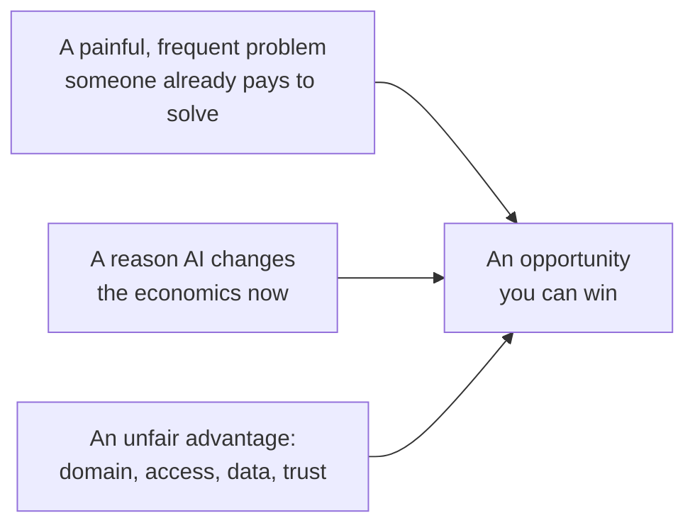
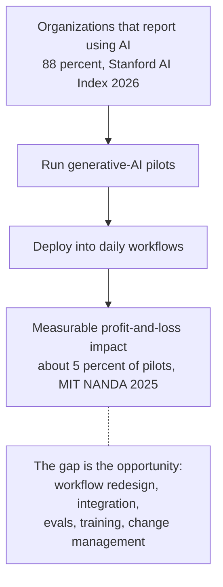
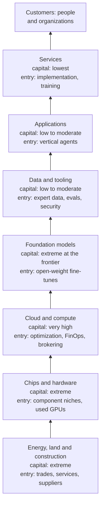
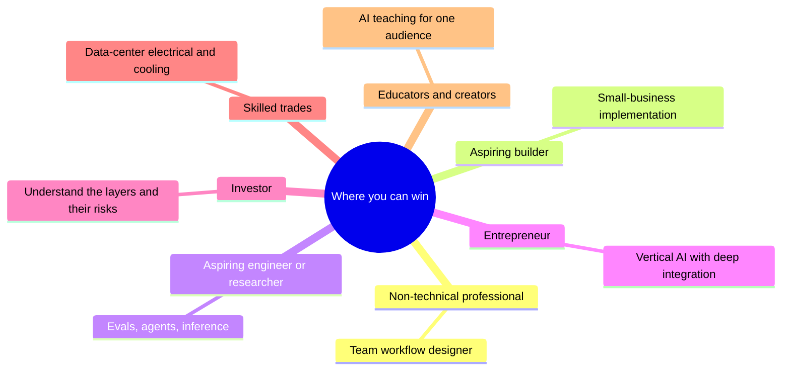
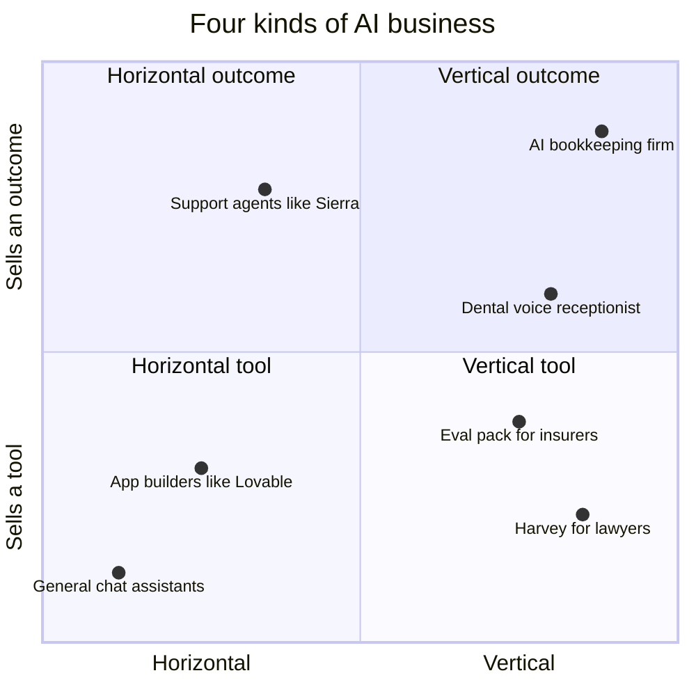
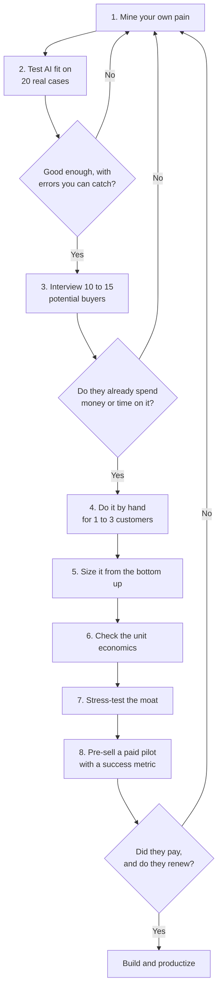
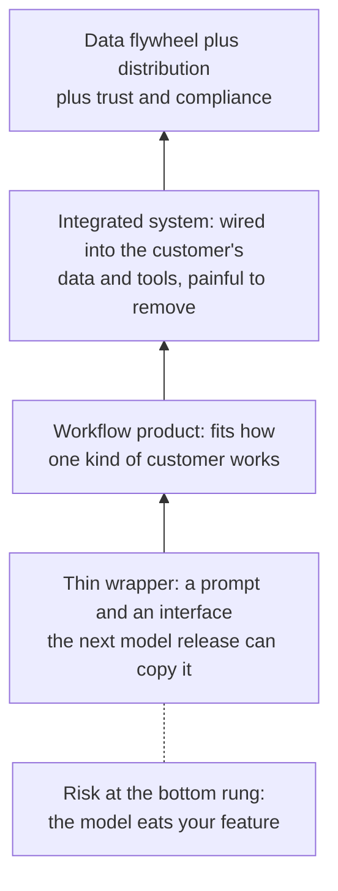

# Chapter 64: Opportunities: Where You Can Win

*This chapter maps where the real openings in AI are, for seven kinds of people and at every layer of the stack, gives you more than twenty concrete business ideas with who pays and why, and hands you a step-by-step method and worksheet for testing an idea before you bet on it.*

## What you'll learn
- What makes something an opportunity rather than a trend: a painful problem, a reason AI changes the economics now, and a reason you in particular can win.
- Why the gap between "almost every company uses AI" and "few get measurable value from it" is the biggest opening of 2026.
- Where the opportunities sit at each layer of the AI stack, from power and construction up to services, and which layers newcomers can realistically enter.
- The best bets for seven audiences: non-technical professionals, aspiring builders, aspiring engineers and researchers, entrepreneurs, investors, skilled trades, and educators and creators.
- Twenty-six concrete business ideas, each with who pays, why they pay, how it is priced and what is hardest.
- An eight-step method and a scoring worksheet for finding and validating an AI opportunity, with worked unit economics.
- The open problems worth working on, and the pitfalls that sink most AI ventures: thin wrappers, platform dependence, broken unit economics and hype.

## Before you start
This chapter builds on the rest of Part X. Chapter 61 (The AI Industry Map: Who Makes Money and How) explains the layers of the industry and its money vocabulary, Chapter 62 (The Complete AI Skills Map) explains the skills mentioned here, and Chapter 63 (Careers in AI: Every Role Explained) covers jobs. Chapter 31 (Shipping AI: Evals, Reliability, Security and Product Design) introduced evals and unit economics, and Chapter 29 (Coding With AI and Building Without Code) introduced no-code automation and app builders. Chapter 43 (The Economics of AI Compute) explains the compute economics behind the infrastructure layers. Nothing here requires programming.

## What an opportunity is, and why 2026 is full of them

Every week brings a new AI product, a new funding round, a new claim that some industry is about to be transformed. Most of that noise is not an opportunity for you. This section gives you a sharper definition, then shows why late 2026 is unusually rich in real openings.

### Three ingredients

An opportunity, in the sense this chapter uses, needs three things at once (Figure 64.1).

1. **A painful, frequent problem that someone already pays to solve.** They spend money, staff time or lost customers on it today.
2. **A reason AI changes the economics now.** Something that was too expensive, too slow or impossible last year has become cheap and good enough.
3. **A reason you can win.** Domain knowledge, access to buyers, data, relationships, a trade license, or trust that others lack.


*Figure 64.1: The three ingredients of an opportunity. Missing any one of them turns it into a hobby, a science project or someone else's business.*

> **Definition — Opportunity:** In this chapter, a chance to create value that combines a painful problem people already pay to solve, a reason AI makes a new solution practical now, and an advantage that lets you in particular deliver it.

> **Definition — Pain point:** A specific, recurring problem that costs someone time, money or customers, such as missed phone calls or slow insurance paperwork. The sharper and more frequent the pain, the stronger the opportunity.

> **Definition — Willingness to pay:** Evidence that a buyer will actually spend money to solve a problem, such as an existing budget, a current vendor, or staff hours already devoted to it. Saying "that sounds useful" is not willingness to pay.

Most failed AI ideas are missing one ingredient. A clever AI demo for a problem nobody pays to solve has ingredient two without one. A painful problem that AI still cannot handle reliably, such as fully autonomous legal advice, has ingredient one without two. And a great idea in an industry you know nothing about, sold to buyers you cannot reach, lacks ingredient three: someone with that advantage will usually beat you.

> **Key idea:** Start from a problem you understand better than most people, not from a technology looking for a use. Your existing job, industry or trade is usually where your unfair advantage lives.

### Why AI changes the economics now

Ingredient two is unusually strong in 2026 for three reasons.

- **Capability crossed thresholds.** Models now read messy documents, hold spoken conversations, write working code and carry out multi-step tasks as agents (Chapters 22, 28 and 29). Tasks that needed a person a few years ago can now be drafted or done by software, at least inside the jagged frontier (Chapter 63).
- **Prices fell fast.** The price of reaching a fixed level of capability has dropped by large factors every year; Epoch AI measured the price of reaching GPT-4-level performance on one hard science benchmark falling about 40-fold per year (Chapter 23 explains why). A feature that would have cost dollars per use in 2023 can cost fractions of a cent.
- **Tools for non-programmers matured.** No-code automation platforms, AI app builders and connectors (Chapter 29) let people outside engineering build working systems.

### The gap between adoption and value

The single biggest signal in the 2026 data is a gap. Stanford's 2026 AI Index reports that 88% of organizations say they have adopted AI. Yet MIT's NANDA initiative, in its July 2025 "GenAI Divide" report, found that only about 5% of enterprise generative-AI pilots delivered rapid revenue acceleration or measurable profit-and-loss impact. The report blamed brittle workflows and poor fit with daily operations, not weak models. (Headlines turned this into "95% of AI projects fail," which overstates it: the finding is about measurable financial impact, not about whether anything useful happened.)

> **Definition — Pilot:** A small, time-limited trial of a technology with a limited group of users, run to see whether it works before a full rollout. Pilots that never become everyday practice are sometimes said to be stuck in "pilot purgatory."

> **Definition — P&L (profit and loss):** A company's statement of revenue minus costs over a period. "Measurable P&L impact" means a project changed revenue or costs by an amount someone can actually see in the accounts.


*Figure 64.2: The pilot-to-value funnel. The narrowing between "using AI" and "measurable impact" is where much of the 2026 opportunity lies.*

Money is flowing into this gap. Menlo Ventures, a venture-capital firm with its own portfolio interests, estimated that enterprise spending on generative AI reached $37 billion in 2025, up from $11.5 billion in 2024, with about $19 billion of it going to applications. The organizations spending that money mostly do not need a smarter model. They need someone to connect the model to their real work, measure whether it helps and teach their people to use it well. That someone can be you.

> **Watch out:** "Adoption equals value" is one of the most expensive misconceptions in business. A company where every employee has a chatbot login may be getting almost nothing from it. When you look for opportunities, look for the places where AI is in use but the results are missing.

## The opportunity map by layer of the stack

Chapter 61 described the AI industry as a stack of layers, each selling to the one above it. Opportunities exist at every layer, but the entry requirements differ enormously. Figure 64.3 shows the stack with the capital each layer needs and where newcomers can realistically enter.

> **Definition — The AI stack (value chain):** The layers of businesses that together deliver AI to users, from energy and construction through chips, cloud computing, models, data and tools, applications and services. Money flows down the stack and capability flows up.


*Figure 64.3: The AI stack as an opportunity map. Capability flows upward; customers' money flows back down. Capital needs fall sharply toward the top.*

Table 64.1 adds what each layer sells, where newcomers can win and one dated headline number to anchor the scale.

| Layer | What it sells | Where newcomers can win | A headline number (source, date) |
|---|---|---|---|
| Energy, land and construction | Power, sites, buildings, cooling and electrical systems | Skilled trades, commissioning, local suppliers, permitting and community services, powered-land development, workforce training | Building and electromechanical systems cost about $10–18M per megawatt (industry estimates); Epoch AI estimates about $38B of capital per gigawatt for the largest campuses |
| Chips and hardware | GPUs, custom accelerators, memory, networking, cooling hardware | Component niches (cooling parts, power conversion, test equipment), refurbishing and reselling older GPUs | Nvidia: quarterly revenue $96.2B, of which data center $89.0B, gross margin 75.0% (SEC filing, quarter ended July 26, 2026) |
| Cloud and compute | Rented chips and managed AI services | Cost optimization, utilization dashboards, compute brokering, inference on cheaper or alternative chips | Microsoft, Alphabet, Amazon and Meta guided to about $720–745B of combined 2026 capital spending (reported, 2026) |
| Foundation models | Model access through APIs, subscriptions and enterprise deals | Fine-tuned open-weight models for one industry, private and local deployments, model selection and routing | OpenAI run-rate about $50B (Sept 2026) and Anthropic over $65B (July 2026), both reported and measured differently |
| Data and tooling | Human data, RL environments, evals, observability, security, connectors | Expert-data niches, eval packs, agent security, MCP servers, provenance tools | Mercor about $2B gross run-rate (June 2026, reported), of which contractors receive 60–70% |
| Applications | Software that end users use: general assistants and industry-specific tools | Vertical agents, outcome-priced services, agent-ready commerce | Enterprise generative-AI spending $37B in 2025, about $19B at the application layer (Menlo Ventures estimate) |
| Services | Implementation, consulting, training, managed AI services | Small-business implementation, AI-enabled agencies, training, rescue and hardening services | About 5% of enterprise pilots showed measurable P&L impact (MIT NANDA, July 2025) |

*Table 64.1: The stack as an opportunity map. Numbers marked "reported" come from secondary sources.*

> **Definition — Picks and shovels:** Selling tools, equipment or services to everyone in a boom instead of betting on one winner, like selling shovels to gold miners. Nvidia is the classic AI example, but small businesses can play the same strategy one level down.

> **Definition — Hyperscaler:** One of the very largest cloud and computing companies, such as Amazon Web Services, Microsoft Azure and Google Cloud, plus Meta and Oracle for their own buildouts, which build data centers at enormous scale.

> **Definition — Neocloud:** A newer cloud company that specializes in renting GPUs (graphics processing units, the chips that do most AI computing) for AI, such as CoreWeave, Nebius or Lambda.

> **Definition — Capex (capital expenditure):** Money spent on long-lived physical assets such as data centers, chips and power equipment. Big-tech AI capex is the engine of the data-center boom.

> **Definition — Open-weight model:** A model whose trained parameters are published so anyone can download, run and modify it, within its license. The weights are free, but running them still costs compute and engineering (Chapter 30).

Three patterns stand out in Table 64.1.

**The bottom layers are capital-hungry but labor-hungry too.** You will not build a chip foundry or a gigawatt campus. But every one of those campuses needs electricians, pipefitters, commissioning agents, caterers, trainers and community liaisons. Work through the scale: at $10–18 million per megawatt for the building and its electrical and mechanical systems, a single 1,000-megawatt campus spends roughly 1,000 × $10–18 million = $10–18 billion on construction-type work before a single chip arrives. A large share of that money pays for skilled labor and local services.

**The middle layers reward specialists.** Cloud, compute and data-tooling opportunities need technical depth, but not enormous capital. A consultant who can cut a company's GPU bill or a two-person firm that builds hard evaluation tasks for labs can start with a laptop.

**The top layers are open to almost everyone.** Applications and services need the least capital and the most domain knowledge. That is why most readers of this book will find their best opportunity here, close to an industry they already understand.

> **Analogy:** Think of the AI stack as the electricity industry a century ago. Chips are the turbines, data centers the power plants, models the electricity on the grid, applications the appliances, and services the electricians wiring homes. A few giants built the power plants, but most of the fortunes of electrification were made by people who found new ways to use electricity, and by the trades who installed it.

> **At the frontier (2026):** The data-and-tooling layer became a business category of its own in 2025 and 2026. Labs now buy expert-written training data and RL environments, simulated tasks with automatic grading that models practice on (Chapter 21). Mercor, an expert-data marketplace, reportedly grew from about $760 million to about $2 billion of gross run-rate in six months. Most of that money passes through to the doctors, lawyers, coders and other experts who do the work.

## The opportunity map by audience

The same AI boom looks very different depending on where you stand. Figure 64.4 summarizes the best bet for each of seven audiences; the subsections give the full picture, a first move you could make this month, and the trap to avoid.


*Figure 64.4: The strongest single opportunity for each of seven audiences.*

### The non-technical professional

This is the most likely starting point for readers of this book, and in some ways the strongest. You already have ingredient three, deep knowledge of a field, and AI fluency is a smaller gap to close than domain expertise is.

- **Become your team's workflow designer.** The scarce skill is not prompting; it is redesigning a workflow so AI does the right parts and humans check the right parts. The 88% versus 5% gap is a gap of people who connect AI to real work. This often grows into a formal AI adoption-lead role.
- **Domain expert plus AI.** The AI-native accountant, nurse, paralegal, teacher or recruiter knows which errors matter, so they can write the evals, guidelines and quality checks that engineers cannot.
- **Expert contracting.** Labs pay domain experts to write and grade training data; Mercor reports its experts average $85 or more per hour (company figures reported by Sacra). It is a good side income and an education in how models fail, but projects can end abruptly.
- **AI governance and compliance.** Every regulated industry needs AI policies, vendor reviews and, for companies selling into Europe, EU AI Act compliance (Chapter 59). People from privacy, legal, audit and risk backgrounds transfer directly.
- **Sales and customer success for AI products.** The largest hiring category at the frontier labs in October 2026 (Chapter 63). Industry knowledge plus AI fluency is the qualification.

> **Try it:** Paste a short description of your job, industry and skills into a chatbot and ask: "Using the seven audiences and seven stack layers in this list [paste Table 64.1's layer names], suggest five AI opportunities that rely on my specific background. For each, name who would pay and why." Cross out any suggestion where you have no advantage over a stranger; what remains is your shortlist.

**First move this month:** log your work for one week, pick the most painful recurring task, and build a reusable assistant or automation for it that a colleague also uses. **Trap:** if you are early in your career in a highly exposed occupation, do not compete with AI on the tasks it automates; invest in judgment, client relationships, coordination and verification (Chapter 63).

### The aspiring builder

You are comfortable with no-code tools and app builders, or willing to become so, but you are not a professional programmer.

- **AI implementation for small businesses.** Clinics, law offices, trades, real-estate agents and restaurants need intake automation, scheduling, follow-ups, review responses, quoting and document processing. A common structure is a fixed-price audit, then an implementation project, then a monthly retainer.
- **Internal tools inside your company.** Dashboards, trackers and assistants built with AI app builders. Being "the person who builds things" is a fast route into product or operations-engineering roles.
- **Templates and productized setups.** Package one proven workflow for one niche, such as an intake flow for physiotherapy clinics built in n8n, and sell it many times.
- **Evaluation for your industry.** Help companies in a field you know test whether AI tools actually work on their cases, using the golden-set method from Chapter 31.
- **MCP servers and connectors.** MCP (Model Context Protocol) is the open standard for connecting AI assistants to tools and data. Build the bridge that lets AI assistants use a niche or old piece of software that nobody else has connected (Chapter 28).

**First move this month:** do a free implementation for one local business, measure the time saved after two weeks, and write it up as a one-page case study. **Trap:** vibe-coded apps that handle customer data without a security review (see the pitfalls section).

### The aspiring engineer or researcher

You can program, or are committed to learning, and want deep technical work.

- **AI engineer.** The broadest technical demand outside the labs. What sets candidates apart is evals, retrieval quality and agent reliability, shown through public error-analysis write-ups.
- **Forward-deployed engineering.** One of the fastest-growing roles of 2025 and 2026, for engineers who like customers, ambiguity and travel.
- **Inference and performance engineering.** Every efficiency gain is money at fleet scale; posted ranges reached $850K base at Anthropic in October 2026 (Chapter 63). Systems, high-performance computing, game-engine and compiler backgrounds transfer well.
- **Data-center and compute engineering.** Electrical, mechanical and controls engineers with critical-facility experience are hired directly by labs.
- **Safety, evals and interpretability.** A small field with funded on-ramps such as MATS, ARENA and the Anthropic Fellows Program, where public replications count heavily.
- **Open-source contributions.** Work on serving engines such as vLLM and SGLang, Hugging Face libraries, or evaluation frameworks is visible proof of skill.

**First move this month:** build one small system end to end, collect 100 real outputs, label the failures, fix the biggest category and publish the write-up. **Trap:** collecting course certificates without shipping anything (Chapter 65 covers roadmaps).

### The entrepreneur

You want to build a company. The 2025 and 2026 winners offer patterns worth copying.

- **Vertical AI with deep workflow integration.** Harvey, a legal AI company, shows the pattern: legal-specific workflows, about 10% of its staff ex-lawyers in customer roles, and premium pricing reported at around $1,200 per lawyer per month with roughly 20-seat minimums. It reportedly passed $400 million of annual recurring revenue in August 2026. Less glamorous verticals remain wide open: insurance claims, freight, construction estimating, compliance, dental billing and government services.
- **Outcome-priced agents.** Sierra, which builds customer-service agents, charges per conversation or per successful resolution. Charging for results aligns your price with the customer's value and avoids a trap of per-seat pricing: when AI lets a customer employ fewer people, a per-seat product earns less.
- **Services-as-software.** Buy or build a service business, such as bookkeeping, IT support or back-office work, and run it with AI for better margins. Distribution and trust come with the business.
- **Human data and RL environments.** Labs buy expert data and training environments. The risks are a small number of very large customers and abrupt shifts in demand.
- **Picks and shovels for AI builders.** Evals, observability, agent security, data pipelines and compliance tooling.
- **The physical supply chain.** Power equipment, cooling components, construction services, workforce training and site development.

**First move this month:** run the eight-step method later in this chapter on two ideas from your own industry. **Trap:** a thin wrapper that the next model release makes obsolete.

### The investor

This subsection is educational, not investment advice. Ordinary investors can reach most layers through public markets: chipmakers, hyperscalers, neoclouds such as CoreWeave, memory makers, power and utility companies, and newly listed AI-heavy companies such as SpaceX (which absorbed xAI). Anthropic was reported in October 2026 to be preparing a mid-November public listing. Each layer carries different risks.

- **Understand the layer you are buying.** Chipmakers ride capex cycles; neoclouds carry debt and customer concentration (Microsoft was about 67% of CoreWeave's 2025 revenue, as reported); labs carry heavy losses while they grow; utilities carry regulatory risk.
- **Watch the bridge between capex and revenue.** The big four cloud and platform companies guided to about $720–745 billion of 2026 capex (reported). Enterprise spending on generative AI was about $37 billion in 2025 (Menlo Ventures estimate), and OpenAI's projected cumulative negative free cash flow for 2026 to 2030 was reported by the Financial Times at $278 billion. The big question is whether application revenue grows into the infrastructure.
- **Read primary documents.** Quarterly reports, S-1 filings and earnings releases say exactly what is revenue, what is backlog and what is conditional. Nvidia's quarterly release is a model of clarity.
- **Keep hype-cycle discipline.** Hot listings swing wildly. SpaceX priced its June 2026 IPO at $135 a share and closed its first day at about $161; it reportedly peaked near $211, and by mid-July it had fallen below its $135 offer price, according to Fortune.

**First move this month:** take one AI company you are curious about and find its latest primary filing; write down which of its numbers are recognized revenue, run-rate, backlog or "up to" commitments (the vocabulary is in Chapter 61 and the pitfalls section below). **Trap:** confusing a valuation or a run-rate with money in the bank.

### Skilled trades

AI's physical buildout may be the most underrated opportunity in this book. The US Bureau of Labor Statistics (BLS) counts about 821,000 electrician jobs in the US and projects 9% growth from 2025 to 2035, citing data-center electricity demand (BLS, May 2025 data).

- **The trades in demand:** electricians (often the biggest constraint at a site), HVAC and mechanical technicians and pipefitters (liquid cooling is largely plumbing), lineworkers and substation technicians, low-voltage and fiber technicians, controls technicians, construction managers, commissioning agents and critical-facility operators.
- **Pay upside:** lab-adjacent technician roles at OpenAI's Stargate sites were posted at $157K–$302K plus equity (OpenAI job board, Oct 2026), well above the electrician median of $63,190 (BLS, May 2025). Contractor and union pay near large builds is often high too; check locally.
- **Pathways:** registered apprenticeships such as the union-and-contractor electrical training programs, community-college HVAC and controls programs, military technical experience, and data-center operator training.
- **Business openings:** commissioning firms, specialized staffing and training, GPU maintenance and replacement logistics, refurbishing used equipment, and local services for construction crews.
- **Adjacent non-trade roles:** community engagement, permitting and land specialists, and workforce-development managers (OpenAI posted one at $176K–$385K, Oct 2026).

**First move this month:** find the nearest apprenticeship program or data-center operator course, and the nearest large data-center project in planning. **Trap:** ignoring AI tools themselves; technicians who use AI for documentation, diagnostics and scheduling stand out.

### Educators and creators

Adoption is held back by understanding, which makes clear teaching valuable. Stanford's 2026 AI Index reports that more than 80% of US high-school and college students use AI for schoolwork, while many schools are still writing their AI policies. The EU AI Act also asks organizations to take measures for AI literacy among staff who use AI systems, a duty the 2026 Digital Omnibus softened but did not remove (Chapter 59).

- **Niche education.** "AI for nurses," "AI for contractors," "AI for small-firm lawyers." General AI content is saturated; field-specific, honest, tested advice is not.
- **Corporate training and workshops.** Employers pay for practical, safe, role-specific training, especially in regulated industries.
- **Teaching tools.** Tutoring that improves learning rather than handing out answers, and planning and feedback tools for teachers.
- **Generative media services.** Ad variants and product photography for small brands, dubbing and localization for creators, previsualization for indie film. Watch for platform churn: OpenAI's shutdown of its Sora video app (Chapter 47) showed the risk of building on one tool.

**First move this month:** pick one audience you belong to, write five honest, tested "how I use AI for X" guides, and see which one people share. **Trap:** repackaging free information without testing it; your edge is credibility in a specific field.

## Twenty-six business ideas, with who pays and why

Ideas are cheap; what makes one worth testing is a clear answer to two questions: **who pays**, and **why do they pay** (what pain disappears or what gain appears). This section lists 26 concrete ideas drawn from every part of the AI economy, each with those two answers, a typical pricing pattern and the hardest part. None is a guaranteed business. Each is a hypothesis to run through the method in the next section.

### How AI businesses charge

First, the vocabulary of pricing, because the way you charge shapes the whole business.

> **Definition — Seat-based pricing:** Charging per user per month, the classic software model. It is simple, but it earns less when AI lets a customer employ fewer people.

> **Definition — Usage-based pricing:** Charging by the amount used, such as per token, per call, per minute or per document. It tracks your own compute costs but makes customers' bills less predictable.

> **Definition — Outcome-based pricing:** Charging only when a result is achieved, such as per resolved support ticket or per approved claim. It aligns price with value but requires a clear, measurable definition of success.

> **Definition — Retainer:** A fixed monthly fee for ongoing service, such as maintaining and improving a client's automations. Retainers turn one-off projects into predictable income.

> **Definition — Productized service:** A service sold as a fixed package at a fixed price, such as "AI intake setup for physiotherapy clinics, $X," rather than custom work billed by the hour. Productizing lets a service business grow beyond the founder's hours.

> **Definition — Services-as-software:** Selling the finished outcome of a service, such as bookkeeping done or tickets resolved, delivered largely by AI agents with human oversight, instead of selling a tool for humans to use.

> **Definition — Vertical AI:** An AI product or service built for one industry, with that industry's workflows, vocabulary, data and rules built in. Harvey (law) is a well-known example.

> **Definition — Horizontal AI:** A general-purpose AI product used across many industries, such as a chat assistant, a coding tool or an app builder.

> **Try it:** Open the pricing page of two AI tools you use. For each, note whether it charges per seat, by usage, by outcome or by some mix, and look for usage caps, credits or "fair use" limits. Those limits are the company protecting its unit economics from its heaviest users.

Combining the two choices, industry-specific or general, and tool or outcome, gives four kinds of AI business (Figure 64.5).


*Figure 64.5: AI businesses by industry focus and by what they sell. Newcomers with domain knowledge usually do best on the right-hand side, where general-purpose labs are least likely to compete directly.*

### The ideas

Tables 64.2 to 64.4 list the ideas by where they sit in the stack. "Who pays" names the buyer who signs the check; "Why they pay" names the pain or gain.

| # | Idea | Who pays | Why they pay | Typical pricing | Hardest part |
|---|---|---|---|---|---|
| 1 | AI implementation for small businesses: audit, build, maintain | Owners of clinics, law offices, trades, real-estate agencies, restaurants | Missed calls, slow follow-ups and evenings lost to admin cost them customers; they lack time to set up tools | Fixed-price audit, project fee, monthly retainer | Finding clients; scope creep; keeping systems working |
| 2 | Voice receptionist for clinics, restaurants or trades | Practice and business owners | Every missed call can be a lost booking; nobody answers during rushes or after hours | Monthly subscription, sometimes per minute | Natural turn-taking, edge cases, disclosure rules |
| 3 | Insurance-claims intake agent | Small insurers, adjusters, brokers | Intake is slow and document-heavy; faster cycle times and fewer errors | Per claim or per seat | Accuracy, regulation, old software systems |
| 4 | Construction bid and estimating assistant | Contractors and subcontractors | Bids take days of reading plans; more bids submitted means more jobs won | Per seat or per bid | Reading drawings reliably; earning trust |
| 5 | Dental or medical billing and prior-authorization assistant | Practices and billing companies | Denied claims and paperwork cost revenue and staff hours | Per claim or a share of recovered revenue | Payer rules change constantly; health-privacy law |
| 6 | AI-enabled bookkeeping or back-office firm | Small businesses | They want the books done, not another tool to learn | Monthly fee for the outcome | Accuracy and liability; still needs accountants |
| 7 | Clinical documentation for small clinics | Independent clinics and their clinicians | Clinicians spend hours writing notes; one large health system reported a 27% cut in note-writing time per appointment with an AI scribe | Per clinician per month | Competing with tools built into big health-record systems; privacy; evidence |
| 8 | Rescue and hardening of vibe-coded apps | Small businesses and founders who built apps with AI | AI-built apps often leak data; in May 2025, 170 of 1,645 apps made with one popular builder had a flaw exposing personal data | Fixed-price review plus fixes | Needs real security skill; liability |
| 9 | Niche AI training: AI for nurses, contractors, teachers | Employers, professional associations, individuals | Staff need practical, safe, field-specific skills; AI-literacy duties under the EU AI Act | Per workshop, per seat, cohort courses | Standing out from free content; staying current |
| 10 | Generative ad creative and product photography | Online sellers and small brands | They need many ad variants and images, fast and cheaply | Per batch or monthly | Tools change quickly; brand consistency; rights |
| 11 | Dubbing and localization for creators | Video creators, course creators | Reaching audiences in other languages multiplies views and sales | Per minute of video | Voice consent and quality; platforms adding built-in dubbing |
| 12 | AI-search visibility consulting | Brands and publishers losing clicks to AI answers | Being cited in AI answers increasingly drives customers (Chapter 51) | Monthly retainer | Measurement is fuzzy; many low-quality competitors |

*Table 64.2: Ideas in the services and applications layers.*

| # | Idea | Who pays | Why they pay | Typical pricing | Hardest part |
|---|---|---|---|---|---|
| 13 | Eval packs for one industry: golden test sets and attack suites | AI vendors selling into the industry; companies deploying AI there | Saves each buyer weeks of work; gives evidence that a tool works on their cases | Subscription | Keeping the cases fresh; trust in your grading |
| 14 | Expert-data or RL-environment studio for one domain | Frontier labs and model builders | Labs need hard, expert-graded tasks and environments to train and test models | Per task or per project | A few huge customers; secrecy; sudden shifts in demand |
| 15 | Rights-cleared niche datasets | Model builders | Licensed data lowers legal risk and fills gaps (regional languages, industrial audio, consented video) | License fees | Consent and provenance; a small pool of buyers |
| 16 | MCP servers and connectors for niche or old software | The software's vendor, or its customers | Agents cannot use software they cannot connect to | License, subscription, or as a free door to another product | Big vendors may build their own |
| 17 | Agent security tools: injection detection, permissions, audit logs | Companies letting agents touch real systems | Prompt injection has no complete fix, and agent mistakes create liability (Chapter 31) | Per agent or per seat | Fast-moving attacks; large security vendors |
| 18 | AI governance and compliance kits | Regulated firms; companies selling into the EU | Legal duties, audits and customer questionnaires | Subscription plus services | Laws keep shifting; competition from big consulting firms |
| 19 | AI cost-optimization consulting | Companies with fast-growing AI bills | Caching, batching, routing and smaller models cut bills measurably, so the fee pays for itself | Fixed fee or a share of savings | Providers keep cutting their own prices |
| 20 | Private AI on open-weight models for regulated small firms | Clinics, law firms, accountants with confidentiality duties | They cannot or will not send client data to an outside cloud | Setup fee plus maintenance | Hardware cost; keeping models current |
| 21 | Agent-ready commerce: structured catalogs and agent-friendly checkout | Online retailers | Shopping agents increasingly search and buy on people's behalf | Project fee plus subscription | Standards still forming |

*Table 64.3: Ideas in the data, tooling and model layers.*

| # | Idea | Who pays | Why they pay | Typical pricing | Hardest part |
|---|---|---|---|---|---|
| 22 | Electrician and technician training for data-center work | Contractors, data-center operators, workforce programs | Skilled trades are a binding constraint on AI buildout | Tuition paid by employers or grants; placement fees | Training quality; boom-and-bust cycles |
| 23 | Commissioning and GPU maintenance services | Data-center operators, neoclouds | Every new hall must be tested before use; failed GPUs must be swapped fast to keep expensive clusters busy | Per project, per service contract | Certification, safety, tools and travel |
| 24 | Refurbishing, reselling and recycling used GPUs | Smaller clouds, universities, startups | Older chips still run smaller models well at lower prices | Margin on resale | Fast depreciation; export-control rules |
| 25 | GPU utilization and cost dashboards | Companies and research groups running their own GPUs | Many organizations run expensive GPUs at low utilization | Subscription | Cloud providers' built-in tools |
| 26 | Heat-reuse projects: district heating, greenhouses | Towns, greenhouse operators, data-center operators | Free low-grade heat, community benefits, better local relations | Project finance | Heat is only 30–60 °C and users must be nearby (Chapter 40) |

*Table 64.4: Ideas in the infrastructure and physical layers.*

> **Try it:** Pick the idea from Tables 64.2 to 64.4 closest to your own experience and ask your chatbot: "Act as a skeptical owner of a [type of buyer]. I am pitching you [idea]. Ask me the five hardest questions you would ask before paying." Answer them honestly. The questions you cannot answer show you what to research first.

### Worked example: unit economics of a voice receptionist

Idea 2 makes a good worked example because both its value and its costs are easy to estimate. Every number below is an assumption chosen for illustration; replace them with real quotes and real customer data before deciding anything.

> **Definition — Unit economics:** The profit or loss on one unit of a business, such as one customer, one call or one seat. The question is whether serving each additional customer makes money once all direct costs are counted.

> **Definition — Gross margin:** Revenue minus the direct cost of delivering the product, as a percentage of revenue. AI businesses pay for compute on every request, so their gross margins are often lower than traditional software's (Chapter 31).

> **Definition — Value-based pricing:** Setting your price by what the result is worth to the customer rather than by what it costs you to produce. You then charge a fraction of the value you create.

**Step 1: the value to the customer.** Suppose a dental practice misses 60 calls a month, one missed caller in five was a new patient who books elsewhere, and a new patient is worth $500 to the practice in the first year. Lost value per month = 60 × 0.2 × $500 = $6,000.

**Step 2: your cost to serve.** Suppose the practice receives 600 calls a month averaging 3 minutes, and the voice AI, phone line and transcription together cost you $0.10 per minute. Compute cost = 600 × 3 × $0.10 = $180 a month. Add 2 hours a month of your time for updates and support, valued at $50 an hour: $100. Total cost to serve = $280.

**Step 3: price and margin.** Price at $500 a month, under a tenth of the $6,000 value at stake. Gross margin on compute alone = ($500 − $180) ÷ $500 = 64%. Contribution after your support time = $500 − $280 = $220 per customer per month.

**Step 4: the cost of winning a customer.** Suppose each new practice takes 10 hours of selling at $50 an hour plus $100 of advertising: $600. Payback period = $600 ÷ $220 ≈ 2.7 months.

**Step 5: lifetime value.** If 3% of customers cancel each month, the average customer stays about 1 ÷ 0.03 ≈ 33 months. Lifetime value ≈ 33 × $220 ≈ $7,300, about 12 times the $600 it cost to win them. A ratio well above 3 is usually considered healthy.

> **Definition — CAC (customer acquisition cost):** The total cost of winning one new customer, including sales time, advertising and free trials.

> **Definition — Churn:** The share of customers who cancel in a given period, often measured monthly. Average customer lifetime is roughly 1 divided by the monthly churn rate.

> **Definition — LTV (customer lifetime value):** The total profit you expect from a customer over the whole time they stay. A healthy business earns much more from a customer than it spends to win them.

> **Definition — Payback period:** How long it takes for the profit from a new customer to repay the cost of acquiring them.

Now stress-test it, as you should every model. If a busy practice gets 2,000 calls a month instead of 600, compute cost rises to 2,000 × 3 × $0.10 = $600, more than the $500 price: that customer loses you money. This is why AI products add usage tiers and caps (Chapter 31 works through the same problem for a chatbot subscription). And if a big phone-system vendor bundles a similar receptionist for free, your price collapses; the defense is depth in one niche, such as dental-specific scheduling rules, insurance questions and integration with the practice's booking software.

### Worked example: when a service business hits its ceiling

Idea 1, small-business implementation, is the most common first business for builders. Its trap is arithmetic, not technology. Again, the numbers are illustrative; no reliable survey of real market prices exists.

Suppose you have 120 billable hours a month. A custom client needs a 12-hour audit and a 40-hour build, then 6 hours a month of maintenance on a retainer. Sign two new clients a month and the projects alone use 2 × (12 + 40) = 104 hours. By month three you also carry six retainer clients at 6 hours each, 36 hours, for a total of 140 hours. You are over capacity in your third month, and growth stops.

Now productize. You pick one niche, say physiotherapy clinics, and build the same intake-and-reminder workflow as a reusable template. The audit shrinks to 5 hours, the build to 15, and maintenance to 3 hours a month because every client runs the same system. Two new clients a month now use 2 × 20 = 40 hours. After a year you carry 24 retainer clients at 3 hours each, 72 hours, for 112 hours in total, still under 120. If you charge, say, $4,000 per project and $500 per month per retainer, month-12 revenue is 2 × $4,000 + 24 × $500 = $20,000, earned by one person.

> **Definition — Gross revenue and net revenue:** Gross revenue is all the money customers pay; net revenue is what the business keeps after passing some on, for example to contractors in a marketplace. Mercor's reported $2 billion gross run-rate, with 60 to 70% paid to experts, means net revenue of roughly $600 to $800 million.

> **Key idea:** The best small AI businesses are specific. One niche, one painful workflow, one repeatable solution, sold many times. Specificity is what turns hours of custom work into a product, and what makes you hard to copy.

### Lessons from the 2025–2026 winners

Chapter 61 tells these companies' stories; here are the lessons for anyone looking for an opportunity, with figures as reported by secondary sources in 2026.

- **Harvey (legal):** domain experts on staff and deep workflow integration justify premium per-seat prices (around $1,200 per lawyer per month). Vertical depth beats general cleverness.
- **Sierra (customer-service agents):** charging per resolution ties price to value and escapes the shrinking-seats problem. It was reported at about $200 million of annual recurring revenue in May 2026.
- **Lovable (app builder):** mixing a subscription ($25 to $50 a month) with usage credits keeps heavy users from destroying margins. It was reported at about $600 million of annualized revenue in September 2026.
- **Cursor (coding):** a product built on other companies' models reached a multi-billion-dollar run-rate and a reported $60 billion acquisition by SpaceX in June 2026. "Wrapper" is not an insult when workflow depth, speed and distribution are real.
- **Mercor (expert data):** a marketplace's gross revenue overstates what it keeps; read the take rate.
- **Scale AI (data labeling):** after Meta bought 49% of it for $14.3 billion in June 2025, Google, OpenAI and other customers reportedly left. Depending on a few customers who are also competitors of your investor is a structural risk.

## How to find and validate an AI opportunity: an eight-step method

Most people judge ideas by excitement. This method judges them by evidence, gathered cheaply and in order, with exits at each stage so you stop early when an idea is weak. It borrows from decades of startup practice, adapted for AI's special risks: unreliable outputs, compute costs and the chance that the next model release makes your product obsolete. Figure 64.6 shows the flow.


*Figure 64.6: The eight-step method. Each gate is a cheap chance to stop before you spend months building the wrong thing.*

> **Key idea:** Validation is a sequence of cheap tests, each able to kill the idea, run in order of cost. A day of testing AI on real cases and a week of conversations cost far less than a month of building, so do them first.

### Step 1: Mine your own pain

Start where you are an insider. For one week, log your work in 30-minute blocks and tag every task that is repetitive, slow, error-prone or hated. Then do the same exercise mentally for the people around you: your customers, suppliers, colleagues in other departments. You are looking for tasks that are painful, frequent and already paid for. Ask: who does this today, how many hours does it take, and what does a mistake cost?

### Step 2: Test AI fit on 20 real cases

Before talking to anyone, check whether current AI can actually do the core task. Collect 20 real examples (with private details removed), write down what a good result looks like for each, and run them through two or three current models. Score each result as good, usable with edits, or wrong. This is a small version of the golden-set eval from Chapter 31, and it maps the jagged frontier for your specific task (Chapter 63).

Two questions decide the gate. Is the quality good enough often enough? And when the AI is wrong, can a person catch the error cheaply? A task where 80% of outputs are good and errors are obvious is a strong fit. A task where 95% are good but the 5% of errors are invisible and costly, such as a wrong drug dose or a fabricated legal citation, needs heavy human review built into the product, which changes the economics.

### Step 3: Interview 10 to 15 potential buyers

Talk to the people who would pay. Ask about the past, not hypotheticals: "Tell me about the last time this happened. What did you do? What did it cost? What have you tried?" People are polite about ideas and honest about their own history. Listen for money or time already being spent: a current vendor, a staff member assigned to the task, a spreadsheet someone maintains by hand. Find out who signs the check, because the user and the buyer are often different people.

> **Definition — Customer discovery:** Structured conversations with potential customers to learn about their problems, current solutions and spending before building anything. The goal is to learn, not to pitch.

### Step 4: Do it by hand first

Deliver the service manually, with AI as your private assistant, for one to three customers. If your idea is an AI that drafts insurance-claim summaries, draft them yourself with a chatbot's help and send them to a real adjuster every day for two weeks. You learn what the customer actually values, which edge cases appear, and how long the work really takes, at almost no cost.

> **Definition — Concierge MVP (Wizard of Oz test):** Delivering a product's promised result by hand, often with the customer unaware of how manual it is, to test demand before building the automated version.

> **Definition — MVP (minimum viable product):** The smallest version of a product that delivers real value to real users, built to learn as fast as possible.

### Step 5: Size it from the bottom up

Count buyers and multiply by a realistic price, instead of quoting a giant industry total from a market report.

> **Definition — TAM (total addressable market):** The total revenue available if a product won every possible customer. It is a ceiling, not a forecast.

> **Definition — Bottom-up sizing:** Estimating a market by counting reachable buyers and multiplying by a realistic price and adoption rate, rather than taking a share of a large published total.

Here is a worked example. Suppose public business statistics (such as the US Census Bureau's County Business Patterns) show 400 physiotherapy clinics within reach of you. If a quarter of them adopt within three years, that is 100 customers. At $300 a month, revenue is 100 × $300 × 12 = $360,000 a year. That is a good small business for one or two people, not a venture-scale company. If the same product could reach 50 regions like yours, the ceiling becomes 400 × 50 = 20,000 clinics; at $3,600 a year each, a TAM of $72 million. Both answers are useful: the first tells you whether you can make a living; the second tells you whether investors would ever care.

### Step 6: Check the unit economics

Build the five-step model from the voice-receptionist example: value to the customer, your cost to serve (including compute, tools and your own time), price and margin, cost to acquire a customer, and lifetime value. Then stress-test it with a customer who uses five times the average, and with prices for AI falling by half (which helps your costs but also helps your competitors).

### Step 7: Stress-test the moat

Ask the question that has killed many AI startups: **when the next model ships, does my product get better or become obsolete?** If your product is mostly a clever prompt around a general model, the model maker or a thousand copycats can replicate it. If your product owns something the model cannot supply, such as proprietary data, deep integration with the customer's systems, a position in their daily workflow, distribution, or trust and compliance, a better model makes your product better.

> **Definition — Moat:** A lasting advantage that stops competitors from copying a business and taking its customers, like the water-filled ditch around a castle.

> **Definition — Wrapper:** A product built on top of someone else's AI model, adding an interface, workflow or data. A thin wrapper adds little and is easily copied; a thick wrapper becomes a deep product.

> **Definition — "The model eats your feature":** The risk that a model provider releases your product's main feature as a built-in capability, making your product unnecessary overnight.

> **Definition — Data flywheel:** A loop in which customers' use of a product generates data that improves the product, which attracts more customers. It is one of the few moats that grows over time.

> **Definition — Switching cost:** How painful it is for a customer to move to a competitor: retraining staff, migrating data, rebuilding integrations.

> **Definition — Distribution:** Your access to customers through channels, partnerships, an existing audience or a sales team. In AI, distribution is often a stronger moat than technology.

Figure 64.7 arranges these defenses as a ladder from weakest to strongest.


*Figure 64.7: The moat ladder. Each rung up makes a better model help you rather than replace you.*

> **Analogy:** AI wrapper businesses are like restaurants that all buy from the same food wholesaler, the model provider. Winners differ on recipe (workflow), location (distribution), service (trust) and regulars (switching costs). If the wholesaler opens its own restaurant next door, that is the model eating your feature, and only the restaurants with loyal regulars and something the wholesaler cannot cook survive.

### Step 8: Pre-sell a paid pilot

Finally, ask for money before building the full product. Offer a short paid pilot with a success metric agreed in advance, such as "reduce claim-intake time from 40 minutes to under 15 for 30 days." A customer who pays, even a small amount, and then renews is the strongest evidence you can get. One who loves the demo but will not pay is the weakest.

> **Definition — Product-market fit (PMF):** The point at which a product so clearly meets a market's need that customers pull it from you: they renew, expand and refer others without much pushing.

### The worksheet

Steps 1 to 8 produce evidence; the worksheet turns it into a decision you can compare across ideas. Score each criterion from 1 (bad) to 5 (excellent), multiply by its weight, and add up. Weights reflect what most often kills AI ventures; adjust them to your situation.

| Criterion | Question to answer with evidence | Weight | Score 1–5 | Weighted |
|---|---|---|---|---|
| Pain | How much does the problem hurt, in money or hours? | 3 | | |
| Frequency | How often does it happen: daily, weekly, yearly? | 2 | | |
| Willingness to pay | Is money or staff time already spent on it, and do you know who signs? | 3 | | |
| AI fit today | What share of your 20 real test cases did AI handle well? | 3 | | |
| Error tolerance | Are mistakes cheap, rare or easy to catch? | 2 | | |
| Access to buyers | Can you reach 50 buyers through people or channels you already have? | 3 | | |
| Unfair advantage | Do you have domain knowledge, data, relationships or a license others lack? | 2 | | |
| Next-model test | Does a better model make your product better rather than obsolete? | 3 | | |
| Unit economics | Is there healthy margin even for heavy users? | 2 | | |
| Regulation and liability | Are legal and liability risks manageable? | 1 | | |
| **Total** | Maximum 5 × 24 = 120 | **24** | | |

*Table 64.5: The opportunity validation worksheet. Kill rule: a score of 1 on willingness to pay, AI fit or the next-model test stops the idea, whatever the total.*

Here is a worked example comparing three ideas. Idea X is a general meeting-notes app aimed at everyone, proposed by someone with no special access. Idea Y is a prior-authorization paperwork assistant for small physiotherapy clinics, proposed by a former clinic manager. Idea Z is a voice receptionist for dental practices, proposed by someone with no dental contacts.

| Criterion (weight) | X: meeting notes | Y: physio paperwork | Z: dental receptionist |
|---|---|---|---|
| Pain (3) | 2 → 6 | 5 → 15 | 4 → 12 |
| Frequency (2) | 5 → 10 | 4 → 8 | 5 → 10 |
| Willingness to pay (3) | 2 → 6 | 4 → 12 | 4 → 12 |
| AI fit today (3) | 5 → 15 | 3 → 9 | 4 → 12 |
| Error tolerance (2) | 4 → 8 | 3 → 6 | 3 → 6 |
| Access to buyers (3) | 2 → 6 | 5 → 15 | 2 → 6 |
| Unfair advantage (2) | 1 → 2 | 5 → 10 | 2 → 4 |
| Next-model test (3) | 1 → 3 | 4 → 12 | 3 → 9 |
| Unit economics (2) | 3 → 6 | 4 → 8 | 3 → 6 |
| Regulation and liability (1) | 4 → 4 | 2 → 2 | 3 → 3 |
| **Total out of 120** | **66 (55%)** | **97 (81%)** | **80 (67%)** |

*Table 64.6: Three ideas scored. Each cell shows the score, then score × weight.*

Idea X scores well on AI fit, because summarizing meetings is easy for models, but that is exactly the problem: easy for everyone means built into every meeting tool, so it fails the next-model test with a 1 and is killed. Idea Z is decent but depends on reaching dentists the founder does not know; its best next step is a partner with dental connections. Idea Y wins despite weaker AI fit, because the founder's access and knowledge are hard to copy and the pain is sharp. Its weak spot, a regulation score of 2, tells the founder what to research next: health-privacy rules and liability for submitted paperwork.

> **Watch out:** The worksheet is a thinking tool, not an oracle. Scores you guess at are worth little; scores backed by the evidence from steps 2, 3 and 8 are worth a lot. Re-score after every customer conversation.

## Open problems worth working on

Some of the largest opportunities are not businesses yet. They are unsolved problems that labs, universities, governments and startups are working on, where a well-chosen contribution from a newcomer can matter. Table 64.7 collects the most important ones from across this book, with a way in for a reader. Chapter 66 discusses where they might lead.

| Open problem | Why it matters | A way in for you |
|---|---|---|
| Hallucination and calibration: models that say "I don't know" without becoming useless | Trust in every AI product depends on it (Chapters 18 and 55) | Build a citation-checking eval in your field and publish the error rates |
| Long-horizon agent reliability | Agents succeed far less often on long tasks; METR finds the task length agents finish with 80% reliability is several times shorter than at 50% (Chapter 28) | Log every step of an agent doing real tasks and classify why it fails |
| Prompt injection and agent security | No complete solution exists for agents that read untrusted content and can act (Chapters 31 and 58) | Red-team your own agent and publish the defenses that worked |
| Evaluation of open-ended work | AI judges are biased, benchmarks saturate and get contaminated, and real economic value is hard to measure (Chapters 24 and 57) | Design a 50- to 200-task benchmark in a domain you know, with expert answers |
| Continual learning and memory | Models do not learn from experience after deployment beyond what fits in their context window | Follow the research; test memory features in products and document failures |
| Interpretability and oversight at scale | Understanding model internals and supervising tasks humans cannot check are central to safety (Chapters 56 and 57) | Work through the ARENA curriculum; apply to MATS or a fellowship |
| The data wall, licensing and creator compensation | High-quality human data is limited, and fair payment for creators is unsettled (Chapters 11 and 58) | Build or broker a rights-cleared dataset in a niche you know |
| Low-resource languages and tokenizer fairness | Many languages need more tokens for the same meaning, so they cost more and work worse (Chapter 18) | Measure token counts and answer quality in your language and publish a comparison |
| Measuring real productivity and helping entry-level workers | Perceived and measured gains diverge, and young workers in exposed jobs are squeezed (Chapters 60 and 63) | Run a careful before-and-after measurement of an AI rollout at your workplace |
| The memory wall and energy efficiency | Memory bandwidth grows much more slowly than compute, and the International Energy Agency (IEA) projects data-center electricity demand to more than double by 2030 (Chapters 33 and 39) | Deep engineering paths: kernels, low-precision numerics, efficient serving |
| Grid connection speed and flexible AI loads | Connecting gigawatts takes years; training jobs that throttle on grid stress days could let more load connect (Chapter 41) | Energy, utility-regulation and grid-software careers |
| Robot dexterity and reliability | Robots must succeed far more than 99% of the time over long shifts to be useful (Chapter 49) | Robot data collection, simulation and field-deployment roles |
| Experimental validation in AI for science | AI proposes molecules and materials faster than labs can test them (Chapter 52) | Lab automation and "AI plus wet lab" roles |
| Identity and permissions for agents | Who an agent acts for, with what scopes, and how to revoke it are still being standardized (Chapter 28) | Contribute to open standards work and build permission tooling |
| Privacy, memorization and unlearning | Removing a person's data from a trained model is hard (Chapters 11 and 58) | Privacy engineering and AI-governance roles |

*Table 64.7: Open problems drawn from across the book, with an entry point for a newcomer.*

> **Definition — Open problem:** A question that experts have not yet solved and that is widely recognized as important. Contributing even a small, careful result on an open problem is strong evidence of skill.

> **At the frontier (2026):** Several of these problems have turned into markets before they were solved. Agent security, evaluation and RL environments each attracted dedicated startups in 2025 and 2026, and large security vendors reportedly bought AI-security startups in 2025. Labs' system cards describe their safety testing and known limitations in detail; reading them is a free map of where the hardest work, and often the next wave of jobs, will be.

## Pitfalls: how people lose

For every AI success there are many quiet failures. Most fail for a handful of predictable reasons.

> **Key idea:** Most AI ventures fail for business reasons, not model reasons: nobody pays, the product is easy to copy, one partner controls their fate, or each customer costs more to serve than they pay.

### Thin wrappers and the model eating your feature

The most common failure is a product whose main value is something the underlying model will soon do on its own. In 2023 and 2024, many startups built "chat with your PDF" products, then watched chat assistants add file upload and long context windows. The defense is the moat ladder (Figure 64.7): climb from prompt to workflow to integration to data and trust. Run the next-model test before you build, not after.

> **Watch out:** "Wrappers are worthless" is the opposite mistake. Cursor, Harvey and Lovable are all built on other companies' models and became large businesses. The question is never "do you use someone else's model?" but "what do you own that the model maker cannot easily copy?"

### Demos instead of workflows

A demo that impresses in a meeting is not a product that survives Monday morning. The MIT NANDA finding, about 5% of pilots with measurable profit impact, was blamed on brittle workflows and poor fit with daily operations, not weak models. The cure is to design for the whole workflow: where data comes from, who checks the output, what happens when the AI is wrong, and how success is measured (Chapter 31).

### Depending on one platform

If your business runs on one model, one app store or one generation tool, a single decision elsewhere can end it. OpenAI's shutdown of its Sora video app (Chapter 47) left people who had built workflows around it scrambling. Model versions are retired, prices change and terms of service shift. Keep the ability to switch providers, store your own data and evals, and avoid being one feature in someone else's product.

> **Definition — Platform risk:** The danger that a business depends on another company's platform, which can change its prices, rules, features or existence without warning.

### Customer concentration

A business with one or two giant customers is fragile. CoreWeave, a neocloud, drew about 67% of its 2025 revenue from Microsoft, as reported. Scale AI lost several major customers after Meta took a large stake in it. For a small expert-data or RL-environment studio, losing one lab contract can mean losing the business.

> **Definition — Customer concentration:** A situation in which a large share of a business's revenue comes from a few customers, so losing any one of them is a serious blow.

### Unit economics that break at scale

Traditional software costs almost nothing to serve one more user. AI does not: every request costs compute. Sacra, a research firm, estimates OpenAI's gross margin at about 33%, far below the 70 to 80% typical of classic software. Flat-price products attract heavy users who cost more than they pay, as the voice-receptionist stress test showed. Usage tiers, caps, caching and routing easy requests to smaller models are the standard fixes (Chapter 31).

### Pricing per seat when AI shrinks the seats

If your product makes a customer's team more productive, the customer may need fewer people, and a per-seat price shrinks with the team. Outcome-based and usage-based pricing are partly a response to this.

### Ignoring regulation, liability and security

Legal advice, medical decisions, hiring, lending and products used by children all carry specific legal duties (Chapters 58 and 59). Data handling matters everywhere: in May 2025, 170 of 1,645 apps built with one popular AI app builder had a flaw that exposed personal data. A security review before launch costs far less than a breach.

### Riding the hype cycle

New technologies tend to follow a recognizable pattern of excitement and disappointment (Figure 64.8). Knowing where you are in it protects both founders and investors.

```
 Expectations
   ^
   |           peak of inflated expectations
   |          /\
   |         /  \
   |        /    \                          plateau of
   |       /      \                  _______ productivity
   |      /        \           _____/
   |     /          \     ____/  slope of enlightenment
   |    /            \___/
   |   /          trough of disillusionment
   |  /
   +--+------------------------------------------------> time
      technology trigger
```
*Figure 64.8: The hype cycle, a common pattern for new technologies. It is a rough description of how attention moves, not a law that predicts dates.*

> **Definition — Hype cycle:** The pattern in which a new technology goes through inflated expectations, then disillusionment, then steady productive use. Different parts of AI sit at different points of the cycle at the same time.

Reading AI money news without being fooled takes a few distinctions, which Chapter 61 explains in full and Chapter 65 turns into a checklist.

> **Definition — Run-rate:** Recent revenue multiplied up to a full year: one $5 billion month becomes a "$60 billion run-rate." It shows current speed, not money already earned, and companies calculate it differently.

> **Definition — Recognized revenue:** Revenue counted under formal accounting rules only once the service has been delivered. It is the most conservative and comparable revenue figure.

> **Definition — "Up to" deal:** A headline maximum that depends on conditions, such as milestones or an IPO. The actual amount may be much smaller.

> **Definition — Circular deal:** An arrangement in which a supplier invests in a customer, who then spends the money buying from that supplier. It is legal and common, but it can make demand look larger than it is.

> **Analogy:** Run-rate is a car's speedometer and recognized revenue is its odometer. The speedometer tells you how fast the car is going this minute; the odometer tells you how far it has actually traveled. An "up to" deal is like a gym membership offering "up to 365 visits a year": the headline is the maximum, not what will happen.

Here is a worked example of the run-rate gap, using reported figures. Anthropic's recognized revenue for the first three quarters of 2026 was reported as $4.8 billion, $11.5 billion and $16.8 billion: a total of $4.8 + $11.5 + $16.8 = $33.1 billion in nine months. Its run-rate at the end of July 2026 was reported at over $65 billion. Both can be true at once, because revenue grew very fast during the year and because run-rates annualize the most recent, highest month; Anthropic also books some cloud-reseller sales gross, which raises its top line compared with peers that report net. Neither number is "wrong," but they answer different questions. Similarly, compare the roughly $720–745 billion of 2026 capex guided by four companies with the roughly $37 billion enterprises spent on generative AI in 2025: a ratio of about 20 to 1. Whether that gap closes is the heart of the bubble debate (Chapters 43 and 60).

> **Watch out:** Be wary of anyone selling a course or kit promising easy riches from AI. Real AI businesses tend to be specific and unglamorous: one niche, one painful workflow, many careful customer conversations. If a pitch skips the who-pays-and-why question, skip the pitch.

## In plain English

An opportunity is not a trend. It is a painful problem that someone already pays to solve, plus a reason AI makes a new solution practical now, plus a reason you in particular can deliver it. In 2026 the biggest opening is a gap: nearly nine in ten organizations say they use AI, but only about one pilot in twenty shows up clearly in the accounts. The people who close that gap, by connecting AI to real work and measuring the result, are in demand.

Opportunities exist at every layer of the AI stack, but the price of entry differs. Power, chips and cloud need billions in capital, though the physical buildout also needs huge numbers of electricians, technicians and local services. Data, tools, applications and services need far less money and far more domain knowledge, which is where most readers will find their best chance.

The chapter listed 26 ideas, from voice receptionists for dentists to eval packs for insurers to training electricians for data centers, each with who pays and why. To test any idea, follow eight steps: start from your own pain, test whether AI can really do the task on 20 real cases, interview buyers about what they already spend, deliver it by hand first, size the market by counting buyers, check that each customer is profitable even if they use a lot, ask whether the next model makes you better or obsolete, and get someone to pay for a pilot. Score your ideas on the worksheet and kill the ones that fail the key tests.

Avoid the classic traps: thin wrappers, demos instead of workflows, depending on one platform or one customer, prices that heavy users break, and hype. The winners are usually specific, patient and close to a problem they understand.

## Key terms
Opportunity, Pain point, Willingness to pay, Pilot, P&L (profit and loss), The AI stack (value chain), Picks and shovels, Hyperscaler, Neocloud, Capex (capital expenditure), Open-weight model, Seat-based pricing, Usage-based pricing, Outcome-based pricing, Retainer, Productized service, Services-as-software, Vertical AI, Horizontal AI, Unit economics, Gross margin, Value-based pricing, CAC (customer acquisition cost), Churn, LTV (customer lifetime value), Payback period, Gross revenue and net revenue, Customer discovery, Concierge MVP (Wizard of Oz test), MVP (minimum viable product), TAM (total addressable market), Bottom-up sizing, Moat, Wrapper, "The model eats your feature", Data flywheel, Switching cost, Distribution, Product-market fit (PMF), Open problem, Platform risk, Customer concentration, Hype cycle, Run-rate, Recognized revenue, "Up to" deal, Circular deal.

## Exercises

1. **[Easy] Build a pain inventory.** (1) For five working days, keep a note open and write down every task that is repetitive, slow, error-prone or annoying, with roughly how long it took. (2) At the end of the week, list the tasks in a spreadsheet with columns: Task, Minutes per week, Who else does this, Cost of a mistake (low, medium, high). (3) Sort by minutes per week and mark your top five. (4) For each of the five, write one sentence on who outside your company has the same problem. **What you'll learn:** to find opportunities where you are already an insider, the source of ingredient three.

2. **[Easy] Run the next-model test.** (1) Write a three-sentence description of an AI product idea. (2) Ask a chatbot: "List the ways a general-purpose AI assistant could make this product unnecessary within two years." (3) Then ask: "What would this product need to own (data, integrations, distribution, trust, compliance) so that a better model makes it stronger rather than obsolete?" (4) Place your idea on the moat ladder in Figure 64.7 and write what it would take to climb one rung. **What you'll learn:** how to spot a thin wrapper before you build it, and what real defensibility looks like.

3. **[Medium] Score three ideas on the worksheet.** (1) Pick three ideas: one from your pain inventory, one from Tables 64.2 to 64.4 and one you have heard others discuss. (2) In a spreadsheet, put the ten criteria of Table 64.5 in rows A2 to A11 and their weights in column B. (3) Score each idea from 1 to 5 in columns C, D and E. (4) In row 12 compute each total with `=SUMPRODUCT($B$2:$B$11,C2:C11)` and the percentage with `=C12/120`. (5) Apply the kill rule: flag any idea scoring 1 on willingness to pay, AI fit or the next-model test. (6) For the top idea, write the single piece of evidence that would most change its score. **What you'll learn:** to compare ideas on the same evidence-based scale and to see which unknowns matter most.

4. **[Medium] Interview five potential buyers.** (1) Choose the top idea from Exercise 3 and identify five people who would plausibly pay for it. (2) Use only questions about the past: "When did this last happen? What did you do? How long did it take? What does it cost you? What have you tried? Who decides on spending for this?" (3) Do not describe your idea until the last five minutes, if at all. (4) After each conversation, write down any evidence of money or time already spent. (5) Update your worksheet scores for pain and willingness to pay. **What you'll learn:** customer discovery, and the difference between polite interest and real willingness to pay.

5. **[Medium] Model the unit economics of an AI service.** (1) In a spreadsheet, enter the voice-receptionist assumptions from this chapter: calls per month (600), minutes per call (3), cost per minute ($0.10), support hours (2) at $50, price ($500), acquisition cost ($600) and monthly churn (3%). (2) Compute cost to serve `=calls*minutes*cost_per_min + support_hours*50`, contribution `=price-cost_to_serve`, payback `=CAC/contribution`, lifetime in months `=1/churn` and LTV `=lifetime*contribution`. (3) Find the call volume at which contribution turns negative. (4) Redesign the pricing with a base fee plus a per-minute charge above a threshold so that even a 3,000-call practice is profitable. (5) Repeat the model for an idea of your own. **What you'll learn:** why AI businesses need usage-aware pricing, and how to check whether each customer makes or loses money.

6. **[Medium] Test AI fit on 20 real cases.** (1) Collect 20 real examples of the core task in your idea, removing names and private details. (2) For each, write in one line what a good result looks like. (3) Run all 20 through two different chatbots with the same instructions. (4) Score each output as good, usable with edits, or wrong, and mark any error that would be hard for a customer to notice. (5) Compute the share of good and usable outputs for each model, and write a paragraph on how much human review the product would need. **What you'll learn:** to measure the jagged frontier for your own task before spending money, and how error visibility changes a product's design.

7. **[Challenge] Run a two-week concierge pilot.** (1) Find one real customer for your idea, ideally from your interviews. (2) Agree on one success metric in advance, such as hours saved per week or turnaround time. (3) Deliver the result by hand, using AI as your assistant, for two weeks. (4) Log every request, the time each took you, and every edge case. (5) At the end, ask whether they would pay to continue and how much, and compare the metric with the starting point. (6) Write a one-page case study with the numbers. **What you'll learn:** what customers actually value, how long the work really takes, and whether demand survives contact with reality.

8. **[Challenge] Size a local market from the bottom up.** (1) Choose a type of business your idea serves (for example dental offices or plumbing contractors). (2) Look up how many such businesses exist in your county or region using a public source such as the US Census Bureau's County Business Patterns (census.gov) or your country's equivalent business register. (3) Estimate the share you could realistically win in three years and a monthly price. (4) Compute yearly revenue as count × share × price × 12. (5) Repeat for your whole country if you can find the national count, and compare the two numbers. (6) Decide whether this is a lifestyle business, a growth business or neither. **What you'll learn:** bottom-up sizing with real data, and the difference between "a good living" and "a venture-scale company."

9. **[Medium] Read the money behind a headline.** (1) Find one AI business headline from this week about revenue, funding or a compute deal. (2) Classify every number in it as recognized revenue, run-rate, bookings or backlog, valuation, or an "up to" commitment. (3) Find the primary source: the company's announcement, an SEC filing or an earnings release. (4) Note whether any money flows back to an investor as purchases (a circular deal). (5) Write three sentences on what the headline did and did not say. **What you'll learn:** to read AI business news with the distinctions investors and founders rely on.

10. **[Challenge] Make a small contribution to an open problem: tokenizer fairness.** (1) Take one paragraph of about 100 words in English and get careful translations into three other languages, ideally including one less widely used online. (2) Paste each version into a free online tokenizer, such as the one on OpenAI's platform website, and record the token count. (3) Compute each language's token count as a multiple of the English count; at the same price per token, that multiple is also the cost multiple. (4) Ask the same factual question about the paragraph in each language to one chatbot and rate the answers. (5) Write a one-page note with a table of your results and their limitations (one paragraph, one tokenizer, one model). **What you'll learn:** how to turn an open problem from this chapter into a small, honest, publishable measurement.

## Areas of opportunity

- **Closing the adoption-to-value gap.** Mid-sized companies with AI licenses but little measurable benefit pay consultants, internal leads and agencies to redesign workflows, integrate AI with their systems and measure results; this is the largest opening for non-engineers in 2026.
- **Vertical agents in unglamorous industries.** Insurance claims, freight, construction estimating, dental billing, compliance and government services have painful, document-heavy workflows; buyers pay for cycle-time and error reductions, and founders with industry experience have a head start general labs lack.
- **Outcome-priced services-as-software.** Firms that sell finished work, such as bookkeeping done or tickets resolved, delivered by agents with human oversight, capture value without depending on seat counts that AI itself shrinks.
- **Evals and assurance.** Companies deploying AI in regulated fields, and vendors selling to them, pay for domain-specific test sets, red-team suites and independent evaluations that prove a system works on their cases.
- **Expert data and RL environments.** Frontier labs buy expert-written tasks, graders and training environments; domain experts can earn as contractors, and small studios can serve niches, provided they manage customer concentration.
- **Agent security and governance tooling.** Any organization letting agents act on real systems needs permissioning, audit logs and injection defenses, and governance teams need inventories and documentation for new laws.
- **The physical buildout.** Data centers need electricians, cooling technicians, commissioning agents, trainers, equipment refurbishers and local services; employers and contractors pay premiums because skilled labor is a binding constraint.
- **Teaching AI to one audience at a time.** Employers and professional bodies pay for honest, field-specific AI training, and AI-literacy duties in the EU add demand.
- **Cost optimization.** Companies whose AI bills are growing faster than their revenue pay for caching, batching, routing and right-sized models, and the savings are easy to measure.
- **Open problems as career capital.** Careful public work on calibration, agent reliability, evaluation or tokenizer fairness is the kind of evidence that opens doors to research, evals and safety roles.

## Check your understanding

1. What are the three ingredients of an opportunity, and what happens to an idea that lacks the third one?
2. What does the gap between 88% adoption and about 5% of pilots with measurable P&L impact suggest about where opportunities lie?
3. Why do the bottom layers of the AI stack still offer opportunities to people without billions of dollars of capital?
4. In the voice-receptionist example, at what monthly call volume does a $500-a-month customer start losing money if each call averages 3 minutes at $0.10 a minute and support costs $100 a month?
5. Explain the next-model test and the moat ladder. Why did the meeting-notes idea fail the worksheet?
6. Why does per-seat pricing become a problem for AI products, and what alternatives exist?
7. A company reports a "$60 billion run-rate" and $33 billion of recognized revenue over nine months of the same year. How can both be true?
8. Name two open problems from Table 64.7 and a realistic way a newcomer could contribute to each.

<details><summary>Answers</summary>

1. A painful, frequent problem someone already pays to solve; a reason AI changes the economics now; and an unfair advantage that lets you in particular win. Without the third, someone with better access, domain knowledge or data will usually beat you to the same idea.
2. Most organizations are using AI but few get clear financial results, and the MIT report blamed workflows and fit rather than model quality. So the opportunity lies in connecting AI to real work: workflow redesign, integration, evals, training and change management.
3. The physical buildout needs enormous amounts of skilled labor and services. At roughly $10–18 million per megawatt for buildings and electromechanical systems, a single 1,000-megawatt campus spends $10–18 billion on construction-type work, much of it paying trades, commissioning, local suppliers and training.
4. Contribution is $500 − (calls × 3 × $0.10) − $100. Setting it to zero: calls × $0.30 = $400, so calls ≈ 1,333 a month. Above about 1,333 calls the customer loses you money.
5. The next-model test asks whether a better model makes your product better or obsolete. The moat ladder runs from thin wrapper to workflow product to integrated system to data flywheel plus distribution plus trust. Meeting notes are easy for any model, so the feature is built into many tools; the idea scored 1 on the next-model test and was killed regardless of its total.
6. If AI makes a customer's team more productive, the customer may need fewer people, so a per-seat price shrinks as your product succeeds. Outcome-based pricing (per resolution or per completed task) and usage-based pricing tie revenue to work done instead of headcount.
7. A run-rate annualizes the most recent period, usually the highest month in a fast-growing year, so it can far exceed revenue actually recognized over earlier, smaller months. Differences in method, such as booking reseller sales gross, also widen the gap. Run-rate is the speedometer; recognized revenue is the odometer.
8. Examples: hallucination and calibration, by building and publishing a citation-checking eval in your field; tokenizer fairness, by measuring token counts and answer quality across languages; long-horizon agent reliability, by logging and classifying an agent's failures on real tasks; evaluation science, by designing an expert-graded benchmark in your domain.

</details>

## Going deeper

- **Rob Fitzpatrick, *The Mom Test* (2013).** A short, practical guide to customer interviews that reveal the truth instead of polite encouragement; the basis of step 3.
- **Paul Graham, "How to Get Startup Ideas" and "Do Things That Don't Scale" (paulgraham.com).** Two classic essays on finding ideas from your own experience and delivering by hand before automating.
- **Y Combinator Startup School (startupschool.org).** Free lectures on validating ideas, talking to users, pricing and early growth.
- **MIT NANDA, "The GenAI Divide: State of AI in Business 2025."** The study behind the 5% figure; read it for its explanation of why pilots stall, not for the headline.
- **Menlo Ventures, "2025: The State of Generative AI in the Enterprise."** A widely cited estimate of where enterprise AI money goes, written by a venture firm with portfolio interests, so read it critically.
- **Stanford HAI, AI Index Report 2026 (hai.stanford.edu/ai-index).** The annual data reference for adoption, investment and public opinion.
- **Chip Huyen, *AI Engineering* (O'Reilly, 2025).** For builders: how to evaluate, cost and ship applications on foundation models.
- **Hamel Husain's blog (hamel.dev).** Practical writing on evals and error analysis, the skills behind steps 2 and 6 and many of this chapter's business ideas.
- **SemiAnalysis and Stratechery.** In-depth analysis of compute economics and of business strategy in the AI industry, useful for investors and founders.
