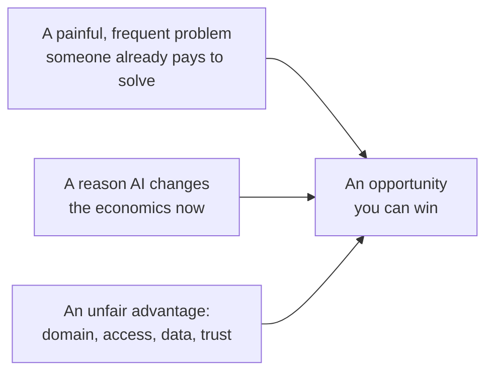
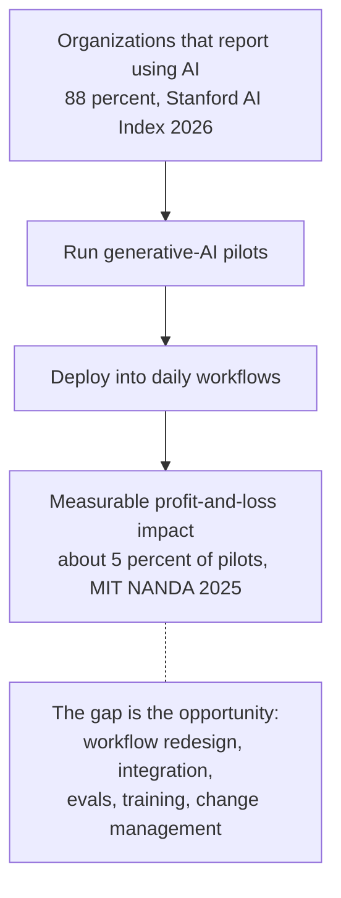
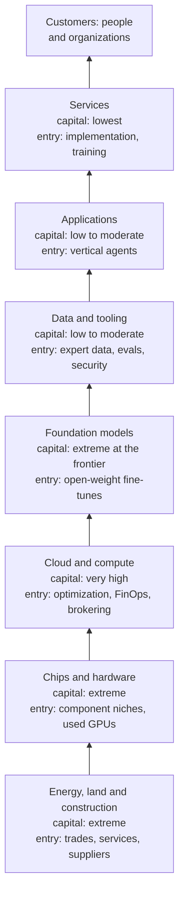
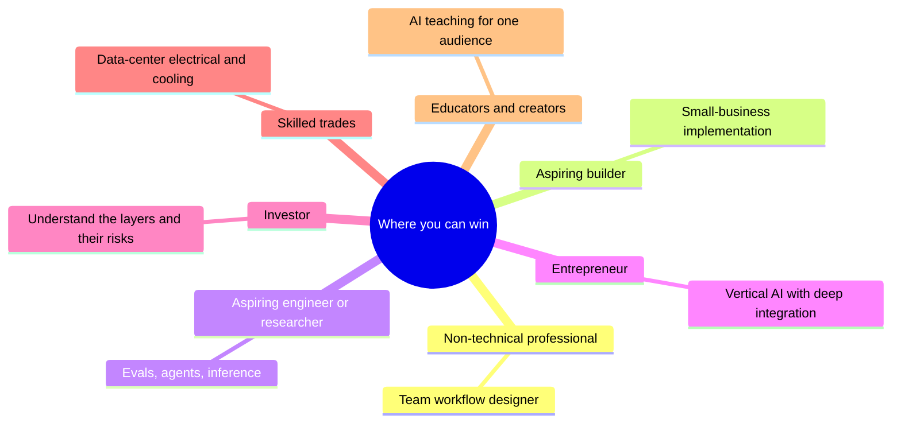

# Chapter 64: Opportunities: Where You Can Win

*This chapter maps where the real openings in AI are, for seven kinds of people and at every layer of the stack, gives you more than twenty concrete business ideas with who pays and why, and hands you a step-by-step method and worksheet for testing an idea before you bet on it.*

## What you'll learn
- What makes something an opportunity rather than a trend: a painful problem, a reason AI changes the economics now, and a reason you in particular can win.
- Why the gap between "almost every company uses AI" and "few get measurable value from it" is the biggest opening of 2026.
- Where the opportunities sit at each layer of the AI stack, from power and construction up to services, and which layers newcomers can realistically enter.
- The best bets for seven audiences: non-technical professionals, aspiring builders, aspiring engineers and researchers, entrepreneurs, investors, skilled trades, and educators and creators.
- Twenty-six concrete business ideas, each with who pays, why they pay, how it is priced and what is hardest.
- An eight-step method and a scoring worksheet for finding and validating an AI opportunity, with worked unit economics.
- The open problems worth working on, and the pitfalls that sink most AI ventures: thin wrappers, platform dependence, broken unit economics and hype.

## Before you start
This chapter builds on the rest of Part X. Chapter 61 (The AI Industry Map: Who Makes Money and How) explains the layers of the industry and its money vocabulary, Chapter 62 (The Complete AI Skills Map) explains the skills mentioned here, and Chapter 63 (Careers in AI: Every Role Explained) covers jobs. Chapter 31 (Shipping AI: Evals, Reliability, Security and Product Design) introduced evals and unit economics, and Chapter 29 (Coding With AI and Building Without Code) introduced no-code automation and app builders. Chapter 43 (The Economics of AI Compute) explains the compute economics behind the infrastructure layers. Nothing here requires programming.

## What an opportunity is, and why 2026 is full of them

Every week brings a new AI product, a new funding round, a new claim that some industry is about to be transformed. Most of that noise is not an opportunity for you. This section gives you a sharper definition, then shows why late 2026 is unusually rich in real openings.

### Three ingredients

An opportunity, in the sense this chapter uses, needs three things at once (Figure 64.1).

1. **A painful, frequent problem that someone already pays to solve.** They spend money, staff time or lost customers on it today.
2. **A reason AI changes the economics now.** Something that was too expensive, too slow or impossible last year has become cheap and good enough.
3. **A reason you can win.** Domain knowledge, access to buyers, data, relationships, a trade license, or trust that others lack.

*Figure 64.1: The three ingredients of an opportunity. Missing any one of them turns it into a hobby, a science project or someone else's business.*

> **Definition — Opportunity:** In this chapter, a chance to create value that combines a painful problem people already pay to solve, a reason AI makes a new solution practical now, and an advantage that lets you in particular deliver it.

> **Definition — Pain point:** A specific, recurring problem that costs someone time, money or customers, such as missed phone calls or slow insurance paperwork. The sharper and more frequent the pain, the stronger the opportunity.

> **Definition — Willingness to pay:** Evidence that a buyer will actually spend money to solve a problem, such as an existing budget, a current vendor, or staff hours already devoted to it. Saying "that sounds useful" is not willingness to pay.

Most failed AI ideas are missing one ingredient. A clever AI demo for a problem nobody pays to solve has ingredient two without one. A painful problem that AI still cannot handle reliably, such as fully autonomous legal advice, has ingredient one without two. And a great idea in an industry you know nothing about, sold to buyers you cannot reach, lacks ingredient three: someone with that advantage will usually beat you.

> **Key idea:** Start from a problem you understand better than most people, not from a technology looking for a use. Your existing job, industry or trade is usually where your unfair advantage lives.

### Why AI changes the economics now

Ingredient two is unusually strong in 2026 for three reasons.

- **Capability crossed thresholds.** Models now read messy documents, hold spoken conversations, write working code and carry out multi-step tasks as agents (Chapters 22, 28 and 29). Tasks that needed a person a few years ago can now be drafted or done by software, at least inside the jagged frontier (Chapter 63).
- **Prices fell fast.** The price of reaching a fixed level of capability has dropped by large factors every year; Epoch AI measured the price of reaching GPT-4-level performance on one hard science benchmark falling about 40-fold per year (Chapter 23 explains why). A feature that would have cost dollars per use in 2023 can cost fractions of a cent.
- **Tools for non-programmers matured.** No-code automation platforms, AI app builders and connectors (Chapter 29) let people outside engineering build working systems.

### The gap between adoption and value

The single biggest signal in the 2026 data is a gap. Stanford's 2026 AI Index reports that 88% of organizations say they have adopted AI. Yet MIT's NANDA initiative, in its July 2025 "GenAI Divide" report, found that only about 5% of enterprise generative-AI pilots delivered rapid revenue acceleration or measurable profit-and-loss impact. The report blamed brittle workflows and poor fit with daily operations, not weak models. (Headlines turned this into "95% of AI projects fail," which overstates it: the finding is about measurable financial impact, not about whether anything useful happened.)

> **Definition — Pilot:** A small, time-limited trial of a technology with a limited group of users, run to see whether it works before a full rollout. Pilots that never become everyday practice are sometimes said to be stuck in "pilot purgatory."

> **Definition — P&L (profit and loss):** A company's statement of revenue minus costs over a period. "Measurable P&L impact" means a project changed revenue or costs by an amount someone can actually see in the accounts.

*Figure 64.2: The pilot-to-value funnel. The narrowing between "using AI" and "measurable impact" is where much of the 2026 opportunity lies.*

Money is flowing into this gap. Menlo Ventures, a venture-capital firm with its own portfolio interests, estimated that enterprise spending on generative AI reached $37 billion in 2025, up from $11.5 billion in 2024, with about $19 billion of it going to applications. The organizations spending that money mostly do not need a smarter model. They need someone to connect the model to their real work, measure whether it helps and teach their people to use it well. That someone can be you.

> **Watch out:** "Adoption equals value" is one of the most expensive misconceptions in business. A company where every employee has a chatbot login may be getting almost nothing from it. When you look for opportunities, look for the places where AI is in use but the results are missing.

## The opportunity map by layer of the stack

Chapter 61 described the AI industry as a stack of layers, each selling to the one above it. Opportunities exist at every layer, but the entry requirements differ enormously. Figure 64.3 shows the stack with the capital each layer needs and where newcomers can realistically enter.

> **Definition — The AI stack (value chain):** The layers of businesses that together deliver AI to users, from energy and construction through chips, cloud computing, models, data and tools, applications and services. Money flows down the stack and capability flows up.

*Figure 64.3: The AI stack as an opportunity map. Capability flows upward; customers' money flows back down. Capital needs fall sharply toward the top.*

Table 64.1 adds what each layer sells, where newcomers can win and one dated headline number to anchor the scale.

| Layer | What it sells | Where newcomers can win | A headline number (source, date) |
|---|---|---|---|
| Energy, land and construction | Power, sites, buildings, cooling and electrical systems | Skilled trades, commissioning, local suppliers, permitting and community services, powered-land development, workforce training | Building and electromechanical systems cost about $10–18M per megawatt (industry estimates); Epoch AI estimates about $38B of capital per gigawatt for the largest campuses |
| Chips and hardware | GPUs, custom accelerators, memory, networking, cooling hardware | Component niches (cooling parts, power conversion, test equipment), refurbishing and reselling older GPUs | Nvidia: quarterly revenue $96.2B, of which data center $89.0B, gross margin 75.0% (SEC filing, quarter ended July 26, 2026) |
| Cloud and compute | Rented chips and managed AI services | Cost optimization, utilization dashboards, compute brokering, inference on cheaper or alternative chips | Microsoft, Alphabet, Amazon and Meta guided to about $720–745B of combined 2026 capital spending (reported, 2026) |
| Foundation models | Model access through APIs, subscriptions and enterprise deals | Fine-tuned open-weight models for one industry, private and local deployments, model selection and routing | OpenAI run-rate about $50B (Sept 2026) and Anthropic over $65B (July 2026), both reported and measured differently |
| Data and tooling | Human data, RL environments, evals, observability, security, connectors | Expert-data niches, eval packs, agent security, MCP servers, provenance tools | Mercor about $2B gross run-rate (June 2026, reported), of which contractors receive 60–70% |
| Applications | Software that end users use: general assistants and industry-specific tools | Vertical agents, outcome-priced services, agent-ready commerce | Enterprise generative-AI spending $37B in 2025, about $19B at the application layer (Menlo Ventures estimate) |
| Services | Implementation, consulting, training, managed AI services | Small-business implementation, AI-enabled agencies, training, rescue and hardening services | About 5% of enterprise pilots showed measurable P&L impact (MIT NANDA, July 2025) |

*Table 64.1: The stack as an opportunity map. Numbers marked "reported" come from secondary sources.*

> **Definition — Picks and shovels:** Selling tools, equipment or services to everyone in a boom instead of betting on one winner, like selling shovels to gold miners. Nvidia is the classic AI example, but small businesses can play the same strategy one level down.

> **Definition — Hyperscaler:** One of the very largest cloud and computing companies, such as Amazon Web Services, Microsoft Azure and Google Cloud, plus Meta and Oracle for their own buildouts, which build data centers at enormous scale.

> **Definition — Neocloud:** A newer cloud company that specializes in renting GPUs for AI, such as CoreWeave, Nebius or Lambda.

> **Definition — Capex (capital expenditure):** Money spent on long-lived physical assets such as data centers, chips and power equipment. Big-tech AI capex is the engine of the data-center boom.

> **Definition — Open-weight model:** A model whose trained parameters are published so anyone can download, run and modify it, within its license. The weights are free, but running them still costs compute and engineering (Chapter 30).

Three patterns stand out in Table 64.1.

**The bottom layers are capital-hungry but labor-hungry too.** You will not build a chip foundry or a gigawatt campus. But every one of those campuses needs electricians, pipefitters, commissioning agents, caterers, trainers and community liaisons. Work through the scale: at $10–18 million per megawatt for the building and its electrical and mechanical systems, a single 1,000-megawatt campus spends roughly 1,000 × $10–18 million = $10–18 billion on construction-type work before a single chip arrives. A large share of that money pays for skilled labor and local services.

**The middle layers reward specialists.** Cloud, compute and data-tooling opportunities need technical depth, but not enormous capital. A consultant who can cut a company's GPU bill or a two-person firm that builds hard evaluation tasks for labs can start with a laptop.

**The top layers are open to almost everyone.** Applications and services need the least capital and the most domain knowledge. That is why most readers of this book will find their best opportunity here, close to an industry they already understand.

> **At the frontier (2026):** The data-and-tooling layer became a business category of its own in 2025 and 2026. Labs now buy expert-written training data and RL environments, simulated tasks with automatic grading that models practice on (Chapter 21). Mercor, an expert-data marketplace, reportedly grew from about $760 million to about $2 billion of gross run-rate in six months. Most of that money passes through to the doctors, lawyers, coders and other experts who do the work.

## The opportunity map by audience

The same AI boom looks very different depending on where you stand. Figure 64.4 summarizes the best bet for each of seven audiences; the subsections give the full picture, a first move you could make this month, and the trap to avoid.

*Figure 64.4: The strongest single opportunity for each of seven audiences.*

### The non-technical professional

This is the most likely starting point for readers of this book, and in some ways the strongest. You already have ingredient three, deep knowledge of a field, and AI fluency is a smaller gap to close than domain expertise is.

- **Become your team's workflow designer.** The scarce skill is not prompting; it is redesigning a workflow so AI does the right parts and humans check the right parts. The 88% versus 5% gap is a gap of people who connect AI to real work. This often grows into a formal AI adoption-lead role.
- **Domain expert plus AI.** The AI-native accountant, nurse, paralegal, teacher or recruiter knows which errors matter, so they can write the evals, guidelines and quality checks that engineers cannot.
- **Expert contracting.** Labs pay domain experts to write and grade training data; Mercor reports its experts average $85 or more per hour (company figures reported by Sacra). It is a good side income and an education in how models fail, but projects can end abruptly.
- **AI governance and compliance.** Every regulated industry needs AI policies, vendor reviews and, for companies selling into Europe, EU AI Act compliance (Chapter 59). People from privacy, legal, audit and risk backgrounds transfer directly.
- **Sales and customer success for AI products.** The largest hiring category at the frontier labs in October 2026 (Chapter 63). Industry knowledge plus AI fluency is the qualification.

**First move this month:** log your work for one week, pick the most painful recurring task, and build a reusable assistant or automation for it that a colleague also uses. **Trap:** if you are early in your career in a highly exposed occupation, do not compete with AI on the tasks it automates; invest in judgment, client relationships, coordination and verification (Chapter 63).

### The aspiring builder

You are comfortable with no-code tools and app builders, or willing to become so, but you are not a professional programmer.

- **AI implementation for small businesses.** Clinics, law offices, trades, real-estate agents and restaurants need intake automation, scheduling, follow-ups, review responses, quoting and document processing. A common structure is a fixed-price audit, then an implementation project, then a monthly retainer.
- **Internal tools inside your company.** Dashboards, trackers and assistants built with AI app builders. Being "the person who builds things" is a fast route into product or operations-engineering roles.
- **Templates and productized setups.** Package one proven workflow for one niche, such as an intake flow for physiotherapy clinics built in n8n, and sell it many times.
- **Evaluation for your industry.** Help companies in a field you know test whether AI tools actually work on their cases, using the golden-set method from Chapter 31.
- **MCP servers and connectors.** Build the bridge that lets AI assistants use a niche or old piece of software that nobody else has connected (Chapter 28).

**First move this month:** do a free implementation for one local business, measure the time saved after two weeks, and write it up as a one-page case study. **Trap:** vibe-coded apps that handle customer data without a security review (see the pitfalls section).

### The aspiring engineer or researcher

You can program, or are committed to learning, and want deep technical work.

- **AI engineer.** The broadest technical demand outside the labs. What sets candidates apart is evals, retrieval quality and agent reliability, shown through public error-analysis write-ups.
- **Forward-deployed engineering.** One of the fastest-growing roles of 2025 and 2026, for engineers who like customers, ambiguity and travel.
- **Inference and performance engineering.** Every efficiency gain is money at fleet scale; posted ranges reached $850K base at Anthropic in October 2026 (Chapter 63). Systems, high-performance computing, game-engine and compiler backgrounds transfer well.
- **Data-center and compute engineering.** Electrical, mechanical and controls engineers with critical-facility experience are hired directly by labs.
- **Safety, evals and interpretability.** A small field with funded on-ramps such as MATS, ARENA and the Anthropic Fellows Program, where public replications count heavily.
- **Open-source contributions.** Work on serving engines such as vLLM and SGLang, Hugging Face libraries, or evaluation frameworks is visible proof of skill.

**First move this month:** build one small system end to end, collect 100 real outputs, label the failures, fix the biggest category and publish the write-up. **Trap:** collecting course certificates without shipping anything (Chapter 65 covers roadmaps).

### The entrepreneur

You want to build a company. The 2025 and 2026 winners offer patterns worth copying.

- **Vertical AI with deep workflow integration.** Harvey, a legal AI company, shows the pattern: legal-specific workflows, about 10% of its staff ex-lawyers in customer roles, and premium pricing reported at around $1,200 per lawyer per month with roughly 20-seat minimums. It reportedly passed $400 million of annual recurring revenue in August 2026. Less glamorous verticals remain wide open: insurance claims, freight, construction estimating, compliance, dental billing and government services.
- **Outcome-priced agents.** Sierra, which builds customer-service agents, charges per conversation or per successful resolution. Charging for results aligns your price with the customer's value and avoids a trap of per-seat pricing: when AI lets a customer employ fewer people, a per-seat product earns less.
- **Services-as-software.** Buy or build a service business, such as bookkeeping, IT support or back-office work, and run it with AI for better margins. Distribution and trust come with the business.
- **Human data and RL environments.** Labs buy expert data and training environments. The risks are a small number of very large customers and abrupt shifts in demand.
- **Picks and shovels for AI builders.** Evals, observability, agent security, data pipelines and compliance tooling.
- **The physical supply chain.** Power equipment, cooling components, construction services, workforce training and site development.

**First move this month:** run the eight-step method later in this chapter on two ideas from your own industry. **Trap:** a thin wrapper that the next model release makes obsolete.

### The investor

This subsection is educational, not investment advice. Ordinary investors can reach most layers through public markets: chipmakers, hyperscalers, neoclouds such as CoreWeave, memory makers, power and utility companies, and newly listed AI-heavy companies such as SpaceX (which absorbed xAI). Anthropic was reported in October 2026 to be preparing a mid-November public listing. Each layer carries different risks.

- **Understand the layer you are buying.** Chipmakers ride capex cycles; neoclouds carry debt and customer concentration (Microsoft was about 67% of CoreWeave's 2025 revenue, as reported); labs carry heavy losses while they grow; utilities carry regulatory risk.
- **Watch the bridge between capex and revenue.** The big four cloud and platform companies guided to about $720–745 billion of 2026 capex (reported). Enterprise spending on generative AI was about $37 billion in 2025 (Menlo Ventures estimate), and OpenAI's projected cumulative negative free cash flow for 2026 to 2030 was reported by the Financial Times at $278 billion. The big question is whether application revenue grows into the infrastructure.
- **Read primary documents.** Quarterly reports, S-1 filings and earnings releases say exactly what is revenue, what is backlog and what is conditional. Nvidia's quarterly release is a model of clarity.
- **Keep hype-cycle discipline.** Hot listings swing wildly. SpaceX priced its June 2026 IPO at $135 a share, reportedly traded as high as about $225, and later fell back below its $150 opening price, according to the Motley Fool.

**First move this month:** take one AI company you are curious about and find its latest primary filing; write down which of its numbers are recognized revenue, run-rate, backlog or "up to" commitments (the vocabulary is in Chapter 61 and the pitfalls section below). **Trap:** confusing a valuation or a run-rate with money in the bank.

### Skilled trades

AI's physical buildout may be the most underrated opportunity in this book. The BLS counts about 821,000 electrician jobs in the US and projects 9% growth from 2025 to 2035, citing data-center electricity demand (BLS, May 2025 data).

- **The trades in demand:** electricians (often the biggest constraint at a site), HVAC and mechanical technicians and pipefitters (liquid cooling is largely plumbing), lineworkers and substation technicians, low-voltage and fiber technicians, controls technicians, construction managers, commissioning agents and critical-facility operators.
- **Pay upside:** lab-adjacent technician roles at OpenAI's Stargate sites were posted at $157K–$302K plus equity (OpenAI job board, Oct 2026), well above the electrician median of $63,190 (BLS, May 2025). Contractor and union pay near large builds is often high too; check locally.
- **Pathways:** registered apprenticeships such as the union-and-contractor electrical training programs, community-college HVAC and controls programs, military technical experience, and data-center operator training.
- **Business openings:** commissioning firms, specialized staffing and training, GPU maintenance and replacement logistics, refurbishing used equipment, and local services for construction crews.
- **Adjacent non-trade roles:** community engagement, permitting and land specialists, and workforce-development managers (OpenAI posted one at $176K–$385K, Oct 2026).

**First move this month:** find the nearest apprenticeship program or data-center operator course, and the nearest large data-center project in planning. **Trap:** ignoring AI tools themselves; technicians who use AI for documentation, diagnostics and scheduling stand out.

### Educators and creators

Adoption is held back by understanding, which makes clear teaching valuable. Stanford's 2026 AI Index reports that more than 80% of US high-school and college students use AI for schoolwork, while many schools are still writing their AI policies. The EU AI Act also includes a duty for organizations to ensure AI literacy among staff who use AI systems (Chapter 59).

- **Niche education.** "AI for nurses," "AI for contractors," "AI for small-firm lawyers." General AI content is saturated; field-specific, honest, tested advice is not.
- **Corporate training and workshops.** Employers pay for practical, safe, role-specific training, especially in regulated industries.
- **Teaching tools.** Tutoring that improves learning rather than handing out answers, and planning and feedback tools for teachers.
- **Generative media services.** Ad variants and product photography for small brands, dubbing and localization for creators, previsualization for indie film. Watch for platform churn: OpenAI's shutdown of its Sora video app (Chapter 47) showed the risk of building on one tool.

**First move this month:** pick one audience you belong to, write five honest, tested "how I use AI for X" guides, and see which one people share. **Trap:** repackaging free information without testing it; your edge is credibility in a specific field.
