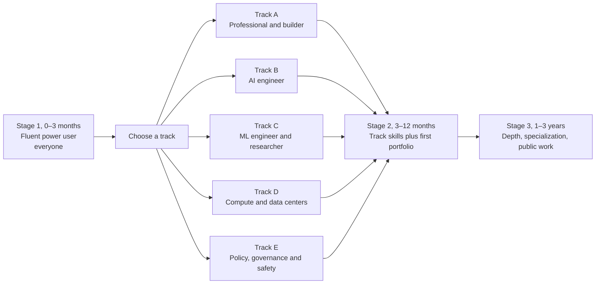
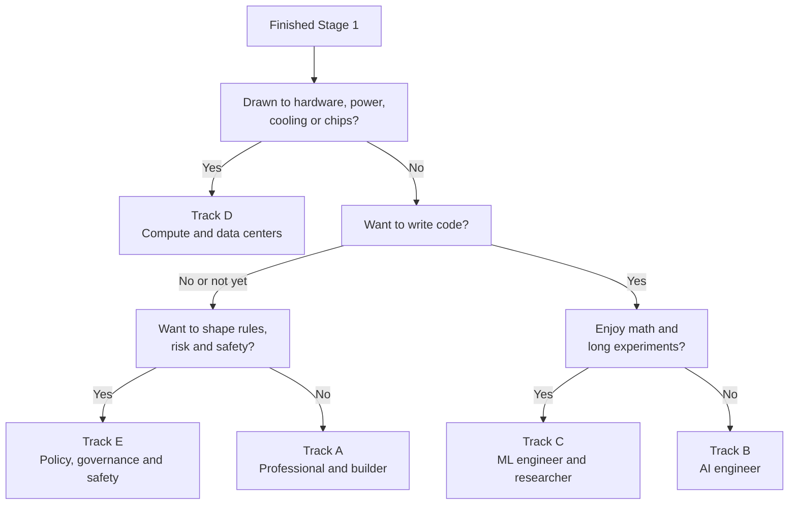
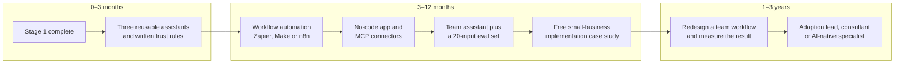
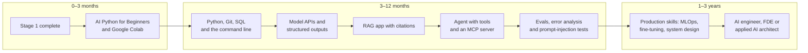
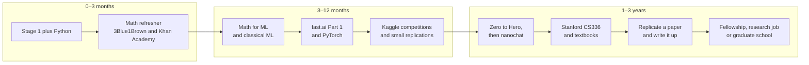
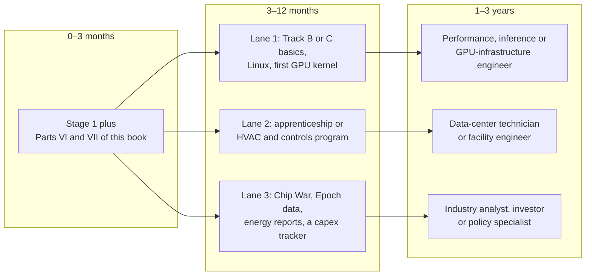
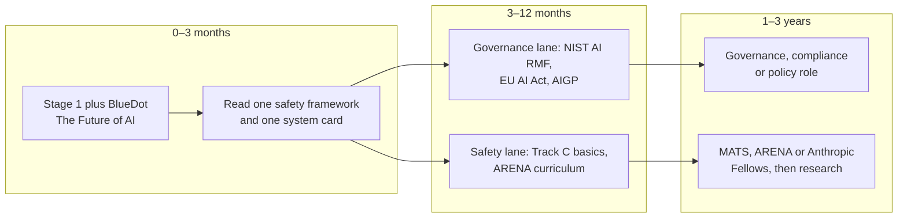

# Chapter 65: Your Learning Roadmap and How to Stay Current

*This chapter turns the whole book into a plan you can follow: staged roadmaps for five tracks with specific free and paid resources, a weekly schedule you can actually keep, portfolio projects that prove what you can do, and a routine and checklist for staying current without drowning in news or being fooled by hype.*

## What you'll learn

- How a staged roadmap (0–3 months, 3–12 months, 1–3 years) works, and why "build first, understand as you go" suits AI better than "master the math first".
- The first stage every reader should complete, whatever their goal: becoming a fluent, safe and skeptical power user in about 65 hours.
- Five tracks and how to choose between them: professional and builder, AI engineer, ML engineer and researcher, compute and data centers, and policy, governance and safety.
- Which courses, books, videos and tools to use at each stage, roughly how long the well-known ones take, and which are free and which cost money.
- A weekly study plan you can copy, with a worked time budget that shows when the effort pays for itself.
- When certifications matter, which portfolio projects impress hiring managers, and how to build in public without leaking anything you shouldn't.
- A sustainable routine for staying current, with newsletters, podcasts, people, papers and communities chosen for signal rather than volume.
- A ten-point checklist for judging AI news and hype, worked through on real 2026 headlines.

## Before you start

You can read this chapter at any point, even first. It leans on three neighbors. Chapter 62 (The Complete AI Skills Map) defines the seven skill levels this roadmap climbs. Chapter 63 (Careers in AI: Every Role Explained) describes the jobs each track leads to, with pay ranges. Chapter 61 (The AI Industry Map: Who Makes Money and How) explains the money vocabulary used in the hype checklist, and Chapter 24 (The 2026 Model Landscape and How to Read Benchmarks) explains benchmarks in depth. Every term is defined again briefly here, so you can follow along without having read them.

## Why you need a roadmap

Type "learn AI" into a search engine and you will find more courses, videos, books, newsletters and bootcamps than you could finish in ten lifetimes. Finding material is not the hard part. The hard part is choosing, putting things in a sensible order, and finishing. On top of that, AI moves so fast that any list of "the best tools" starts to go stale within months: products are renamed, courses are re-recorded, newsletters stop publishing, and last year's hot framework becomes this year's legacy code.

A good roadmap deals with both problems. It tells you what to learn and in what order, roughly how long each stage takes, and how you will know you have finished. It names specific resources, but it treats them as replaceable parts. The order and the finish lines stay the same; individual courses can be swapped for newer ones when they age.

> **Definition — Learning roadmap:** A plan that puts skills in a sensible order, gives each stage a time budget and a clear finish line, and names resources for each step. Unlike a fixed syllabus, its resources can be swapped as they go out of date while the order and the finish lines stay.

> **Definition — Track:** One of several paths through a learning roadmap, chosen by the kind of work you want to do, such as building AI apps or doing research. In this chapter all tracks share a common first stage and then diverge.

> **Definition — Milestone:** A concrete, checkable result that marks the end of a stage, such as "I save three hours a week with AI" or "I have published an evaluation of my own app." A milestone measures what you can do, not how many hours you spent.

You are not starting from zero. You have used a chatbot almost every day for more than a year. That already puts you ahead of most people on the first rung of a ladder that runs from casual user to power user, builder, engineer, researcher and frontier researcher. The goal of this chapter is to help you climb as far as you want, on purpose, rather than drifting.

Where does the ladder lead? Not mostly to research. On October 21, 2026, research was 68 of Anthropic's 675 open roles (about 10%) and 51 of OpenAI's 809 (about 6%), according to the two companies' job boards. Most of the hiring at the labs that build frontier models was in selling, deploying, scaling, securing and governing AI. Outside the labs, the share of jobs that use AI rather than invent it is far larger still. Chapter 63 goes through those roles one by one.

> **Key idea:** The roadmap is not a funnel toward research. Every track ends in real, paid work, and most AI jobs sit in the middle of the ladder: using, building, deploying, selling, securing and governing AI.

> **Analogy:** Learning AI is like learning a language. First you get by as a tourist with useful phrases (power user). Then you can hold a conversation (builder). Then you become fluent (engineer). A few people go on to write poetry (researcher). Immersion, using the language every day, beats grammar books alone, and you can live a rich life in a language without ever writing poetry in it.

### Three rules that make any roadmap work

**Rule 1: build first, understand as you go.** Many people stall because they believe they must master calculus, statistics and programming before touching AI. The most successful AI teachers of the past decade, including fast.ai's Jeremy Howard and Andrej Karpathy, teach the other way round: get something working, then open it up and learn why it works. Math becomes genuinely necessary at Level 5 of the skills map (ML engineering, see Chapter 62), not for using AI expertly or building apps with it.

> **Definition — Top-down learning:** Starting with a working whole, such as running a model or building a small app, and then digging into how each part works, instead of mastering every foundation first. The fast.ai deep learning course is built this way.

> **Definition — Bottom-up learning:** Learning foundations first (math, then programming, then theory) and only later building complete things. It produces deep understanding but loses many learners before they ever build anything.

**Rule 2: learn actively, not passively.** Watching a video feels like learning, but most of it fades within days. Psychologists have studied forgetting since Hermann Ebbinghaus measured his own memory of nonsense syllables in 1885, and the most reliable finding since then is simple: you remember what you practice pulling out of your head, spread over time.

> **Definition — Retrieval practice (active recall):** Strengthening memory by trying to recall something without looking, for example by answering quiz questions or explaining an idea from memory, instead of rereading it. Struggling to remember is part of what makes it work.

> **Definition — Spaced repetition:** Reviewing material at growing intervals (for example after 1 day, 3 days, a week, then a month) so that each review happens just before you would forget. Flashcard apps such as Anki schedule this automatically.

> **Definition — Deliberate practice:** Practice aimed at a specific weakness, with immediate feedback and a clear measure of success, rather than repeating what you can already do comfortably.

Your chatbot is an excellent quiz master. After each study session, ask it: "Quiz me with five questions on what I just learned about retrieval-augmented generation. Ask one at a time, wait for my answer, and tell me what I got wrong." Several chat apps now also offer a study or learning mode that asks you questions instead of handing you answers.

> **Watch out:** The trap is called "tutorial hell": watching course after course, feeling productive, and never building anything. A close cousin is letting the chatbot do the thinking. If it explains something and you nod along, you have not learned it yet. Close the chat and explain it back from memory, or build something with it, before you move on.

> **Definition — Tutorial hell:** The trap of consuming course after course without ever building something on your own. Each tutorial feels like progress, but the skills never become independent.

**Rule 3: every stage ends with evidence.** At the end of each stage you should have something you can show: a written set of rules for when you trust AI output, a working automation, a published write-up, a replicated paper. This evidence becomes your portfolio, which Chapter 63 explains often matters more than credentials in AI hiring.

> **Key idea:** Measure your progress by what you can now do and show, not by hours of video watched or certificates collected.

### A worked time budget

How much time does this take? Suppose you can give AI study five hours a week, about 45 minutes a day. Stage 1 lasts about three months, which is 13 weeks:

```
5 hours/week x 13 weeks = 65 hours of study in Stage 1
```

Is that worth it? The Stage 1 milestone is saving at least three hours a week in your own work. If you work about 48 weeks a year:

```
3 hours saved/week x 48 weeks = 144 hours saved per year
Break-even: 65 hours invested / 3 hours saved per week = about 22 weeks
```

So even a modest result repays the whole investment within about five months of using it, and then keeps paying. At five hours saved per week the yearly total is about 250 hours, the equivalent of six working weeks.

Course providers publish rough lengths for their courses. Here are the well-known ones used in this chapter, with lengths as listed by DeepLearning.AI and fast.ai as of October 2026:

| Course | Provider | Listed length | Weeks at 5 hours/week |
|---|---|---|---|
| Generative AI for Everyone | DeepLearning.AI | about 5 hours | 1 |
| AI Prompting for Everyone | DeepLearning.AI | about 7 hours | 1.5 |
| AI Python for Beginners | DeepLearning.AI | about 11.5 hours | 2.3 |
| Agentic AI | DeepLearning.AI | about 10 hours | 2 |
| Machine Learning Specialization | DeepLearning.AI and Stanford | about 95 hours | 19 |
| Mathematics for Machine Learning and Data Science | DeepLearning.AI | about 94 hours | 19 |
| Deep Learning Specialization | DeepLearning.AI | about 127 hours | 25 |
| Data Engineering (with AWS) | DeepLearning.AI | about 107 hours | 21 |
| Practical Deep Learning for Coders, Part 1 | fast.ai | 9 lessons of about 90 minutes | 3 for the videos alone |

Listed lengths usually count only the videos and quizzes. A sensible planning rule is to double them for real practice, and triple them for project-heavy courses. Applied to the Machine Learning Specialization:

```
95 listed hours x 2 = 190 real hours
190 hours / 8 hours per week = about 24 weeks, or six months
```

This is why the deeper tracks take years at a part-time pace, and why choosing a track matters: you cannot do everything, so you choose what to do first.

> **Try it:** Ask your chatbot: "I can study AI for [X] hours a week. Here is the course list from my book with listed hours: [paste the table]. Using a rule of doubling the listed hours for practice, how many weeks would each take, and which two should I start with if my goal is [your goal]?" Check its arithmetic.

### The roadmap at a glance

Figure 65.1 shows the overall shape. Everyone starts with Stage 1. After about three months you choose a track. Each track has its own second stage (3–12 months) and third stage (1–3 years), and the tracks overlap, so you can move between them.



*Figure 65.1: The roadmap at a glance. One shared first stage, five tracks, and two later stages that each end in a portfolio milestone.*

## Stage 1 (0–3 months): become a fluent power user

Everyone starts here, including future researchers and data-center engineers. A researcher who cannot brief a model well, or a policy analyst who cannot tell when a chatbot is bluffing, is handicapped in a world where these tools are everywhere. The goal of Stage 1 is threefold: use AI expertly and safely in your own work, understand conceptually how it works, and read AI news critically.

> **Definition — Power user:** Someone who gets consistently excellent results from AI tools by briefing them well, supplying the right context, checking their output, and delegating multi-step work to them. It is Level 1 of the skills map in Chapter 62.

Stage 1 has four blocks. Do them in parallel rather than one after another: a little understanding, a little structured course work, and a lot of practice every week.

### Block 1: understand the machine (about 10 hours)

You already know what a chatbot feels like. This block shows you what it is. Good starting points, all free:

- **Andrej Karpathy, "Intro to Large Language Models" (YouTube).** About an hour, from a founding member of OpenAI and former head of AI at Tesla. The clearest single explanation of what a model is, how it is trained, and where it fails.
- **Andrej Karpathy, "Deep Dive into LLMs like ChatGPT" (YouTube).** A much longer talk that walks the whole pipeline, from internet text to tokens to a pretrained model to a chat assistant to reasoning models. Watch it in chunks.
- **3Blue1Brown's neural network and transformer videos (3blue1brown.com and YouTube).** Beautiful animated explanations of what happens inside a neural network and a transformer, with no prior math assumed.
- **Anthropic Academy, "AI Capabilities and Limitations" (anthropic.skilljar.com).** A short, free course on what current models do well and badly.

If you have been reading this book in order, Chapters 18 and 25 cover the same ground and you can treat these as reinforcement.

### Block 2: structured fluency (about 15–25 hours)

Pick two or three of these structured courses. They overlap, which is fine: hearing the same idea from different teachers is a form of spaced repetition.

| Resource | What it is | Cost (as of late 2026) |
|---|---|---|
| Anthropic Academy: "AI Fluency: Framework and Foundations" and "Claude 101" (anthropic.skilljar.com) | Short courses on working with AI well, from Anthropic | Free |
| DeepLearning.AI "Generative AI for Everyone" (about 5 hours) and "AI Prompting for Everyone" (about 7 hours) | Andrew Ng's non-technical introductions | Free to start; certificates and some courses are paid, so check the course page |
| OpenAI Academy "Apply AI at Work" (academy.openai.com) | OpenAI's track for using AI in everyday jobs | Free |
| Google "AI Essentials" (grow.google, via Coursera) | Google's introductory course with a certificate | Paid (Coursera subscription) |
| Elements of AI (elementsofai.com) | A vendor-neutral introduction from the University of Helsinki | Free |

> **Watch out:** Courses made by AI companies teach their own products. They are good, but take at least one from a second company or a vendor-neutral source, so that you learn the ideas rather than one app's buttons. The buttons will change; the ideas will not.

### Block 3: practice (the most important block)

Practice is where Stage 1 is won or lost. These seven exercises, adapted from research on how AI skills develop, take you from casual use to power use:

1. **Audit your week.** For one week, log your work in 30-minute blocks and tag each task "AI does it", "AI assists" or "human only". Rank the top five candidates by hours saved.
2. **The same task three ways.** Give one real task to ChatGPT, Claude and Gemini with an identical prompt, score the outputs, then improve the prompt with context and examples and score again. You will usually find that context matters more than which model you use.
3. **Map the jagged frontier.** Write 15 mini-tests from your own field (easy, hard, tricky, and "requires local knowledge"), record where the model is excellent and where it fails confidently, and repeat in three months.
4. **Verification drill.** Ask for a researched answer with citations on a topic you know well and check every citation. Count the claims that were correct, misattributed or invented.
5. **Build a reusable assistant.** Create a Claude Project, custom GPT or Gemini Gem for one recurring task, with instructions, two worked examples and reference documents. Use it for two weeks and refine it.
6. **Delegate to an agent.** Give a deep-research or agent tool a real multi-step task, note where you had to step in, then write a better brief and run it again.
7. **Read the money.** Take one AI funding headline and classify every number in it as revenue, run-rate, valuation or an "up to" commitment. The hype checklist later in this chapter shows how.

> **Definition — Jagged frontier:** The uneven shape of AI ability: superhuman at some tasks and surprisingly poor at nearby ones that look just as easy. Stanford's 2026 AI Index notes a model that won gold at the International Mathematical Olympiad yet read analog clocks correctly only about half the time.

> **Definition — Reusable assistant:** A saved setup (a Claude Project, a custom GPT, a Gemini Gem or an Agent Skill) that bundles instructions, examples and reference files for one recurring task, so you do not have to re-explain it each time.

> **Definition — Trust rules:** Your personal written list of when you rely on AI output, when you check it, and when you do not use AI at all, based on your own verification drills. For example: "I always click every citation; I never paste client names; I trust it for first drafts but not for final numbers."

The exercises in Chapter 25 (prompting and context) and Chapter 29 (building without code) make good extra practice at this stage.

### Block 4: read two books

Books give you the big picture that short courses and news cannot. Pick two from this list, ideally one practical and one skeptical. All are paid books, and all are widely available from public libraries.

| Book | Angle | Why read it |
|---|---|---|
| Ethan Mollick, *Co-Intelligence* (2024) | Practical use | How to work alongside AI, from a Wharton professor who tests the tools constantly |
| Arvind Narayanan and Sayash Kapoor, *AI Snake Oil* (2024) | Skepticism | How to tell AI that works from AI that cannot work, especially in prediction |
| Chris Miller, *Chip War* (2022) | Industry | Why chips are the strategic center of AI, and how the supply chain got so concentrated |
| Karen Hao, *Empire of AI* (2025), or Parmy Olson, *Supremacy* (2024) | Lab history | How OpenAI, DeepMind and their rivals came to be, told by journalists |

### The Stage 1 milestone

You have finished Stage 1 when you can honestly say three things. You save at least three hours a week with AI in your own work. You have a written trust-rules document based on your own verification drills. And you can explain to a friend the difference between a company's run-rate and its revenue (the hype section of this chapter covers that). If you plan to take Track B or C, you can also start DeepLearning.AI's "AI Python for Beginners" (about 11.5 hours) in the last month.

### A week in Stage 1

Here is a five-hour week you can copy. Each slot ends with a small output, because an output is proof that the session was active rather than passive.

| Day | Time | What you do | What you produce |
|---|---|---|---|
| Monday | 30 min | Watch one section of a course or talk; pause before each new idea and predict what comes next | Three lines in your own words |
| Tuesday | 30 min | Apply Monday's idea to a real task from your work | A before-and-after prompt saved in your prompt library |
| Wednesday | 30 min | Retrieval practice: explain Monday's idea from memory to your chatbot and ask it to quiz you | A quiz score out of five |
| Thursday | 45 min | Build or refine one reusable assistant | An updated instructions file |
| Friday | 30 min | Verification drill: check three claims the AI made this week | One new entry in your trust rules |
| Saturday | 90 min | Project block: one of the seven exercises, end to end | A 150-word note on what you learned |
| Sunday | 45 min | Read a chapter of your book, then plan next week | Next week's plan |

The total is 30 + 30 + 30 + 45 + 30 + 90 + 45 = 300 minutes, which is five hours. If you have only three hours, keep Tuesday, Wednesday, Saturday and Sunday: the practice slots matter more than the watching slots.

Across the 13 weeks, a good sequence looks like this:

| Weeks | Focus | Book chapters that help |
|---|---|---|
| 1–2 | How models work: tokens, context, training versus inference, hallucination | Chapters 18 and 25 |
| 3–4 | Prompting and context engineering; your first reusable assistant | Chapter 25 |
| 5–6 | Verification and trust rules; mapping the jagged frontier | Chapters 24 and 55 |
| 7–8 | Files, images, voice and spreadsheets (multimodal work) | Chapter 22 |
| 9–10 | Deep research and agents; delegating multi-step work | Chapter 28 |
| 11 | Reading AI money and news critically | Chapter 61 and this chapter |
| 12–13 | Capstone: redesign one of your own weekly workflows and measure the time saved | Chapter 62 |

> **Try it:** Paste the weekly table above into your chatbot and say: "Turn this into a 13-week calendar starting next Monday, fitted around these fixed commitments: [list them]. Give it to me as a downloadable calendar file." Import it, and treat the slots like meetings you cannot skip.

## Choosing your track

After Stage 1 you choose where to go deeper. Five tracks cover almost every way people work with AI. The table summarizes them; the sections that follow give each one its own staged roadmap.

| Track | Who it suits | Weekly time | Where it leads (see Chapter 63) | Coding needed |
|---|---|---|---|---|
| A. Professional and builder | Anyone, especially people with deep knowledge of a field | 3–6 hours | AI-enabled professional, automation specialist, adoption lead, AI sales and customer success | None to light |
| B. AI engineer | People who enjoy building software or want to learn | 6–10 hours | AI engineer, forward-deployed engineer, applied AI architect, AI product manager | Yes |
| C. ML engineer and researcher | People who enjoy math and long, patient experiments | 10–15+ hours | ML engineer, research engineer, research scientist, evals researcher | Heavy, plus math |
| D. Compute and data centers | People drawn to hardware, power, cooling, chips or the economics of compute | Varies by lane | Performance and infrastructure engineer, data-center technician or engineer, industry analyst | Depends on lane |
| E. Policy, governance and safety | People from law, policy, compliance, ethics or research | 4–8 hours | Governance and compliance, policy, trust and safety, safety researcher | Light for policy, heavy for technical safety |

Figure 65.2 is a quick way to choose. It is a starting point, not a verdict. You can change tracks later, and many of the strongest careers combine two.



*Figure 65.2: A rough track chooser. Answer honestly about what you enjoy, not about which title sounds most impressive.*

### Depth plus breadth: the T-shape

The most valuable people in the AI economy are rarely the ones who know a little about everything. They usually combine depth in one area with enough breadth to connect it to everything else.

> **Definition — T-shaped skills:** A skill profile with deep expertise in one area (the vertical bar of the T) plus broad working knowledge across many (the crossbar). A nurse who also knows prompting, automation and evaluation is T-shaped.

> **Definition — Domain expertise:** Deep knowledge of a particular field, such as medicine, law, accounting, logistics, teaching or a skilled trade. In AI work it lets you judge which errors matter, write realistic tests and spot problems engineers would miss.

```
  crossbar: AI fluency (prompting, context, automation, evals,
            governance basics, reading the industry)
 +--------------------------------------------------------+
 |                     +---------+                        |
 +---------------------|  YOUR   |------------------------+
                       | DOMAIN  |
                       |         |
                       | nursing,|
                       | law,    |
                       | finance,|
                       | trades  |
                       +---------+
```

*Figure 65.3: The T-shaped profile. Your existing field is the vertical bar; this book and the roadmap build the crossbar. A "pi-shaped" profile adds a second deep bar, such as law plus software.*

This matters for track choice. If you already have deep expertise in a field, Track A (or Track E, if your field is law or compliance) often gives the fastest return, because the crossbar multiplies a bar you already have. If you are early in your career with no deep field yet, Track B or C can become your vertical bar.

> **Analogy:** The skill tree in a video game. You do not need to unlock every branch. Pick a path, level up, and use what you unlock. Respecs are allowed: plenty of AI engineers started in Track A, and plenty of policy experts started as engineers.

## Track A: the professional, power user and builder

Track A is for anyone who wants AI to transform their own work and their team's work without becoming a software engineer. It suits domain experts especially well: the accountant, nurse, paralegal, teacher, recruiter, operations manager or salesperson who knows exactly where the pain is. It leads to roles such as AI-enabled professional, AI automation specialist, internal AI adoption lead, and sales or customer-success work for AI products (Chapter 63).



*Figure 65.4: Track A, professional and builder. The arc runs from personal productivity to systems that run without you, and then to redesigning how a whole team works.*

### 3–12 months: from chatting to systems

The big shift in this stage is from AI you talk to toward AI that runs while you sleep.

> **Definition — Workflow automation:** Connecting apps so that work flows between them automatically, using triggers and actions, for example "when a form is submitted, summarize it with AI, add a row to a spreadsheet and email the team." Zapier, Make, n8n and Microsoft Power Automate are popular tools.

> **Definition — Trigger:** The event that starts an automation, such as a new email, a submitted form, a new file in a folder or a set time each morning.

> **Definition — No-code tool:** Software that lets you build apps or automations by clicking, dragging and describing what you want in plain language, without writing program code yourself.

> **Definition — Vibe coding:** Building software by describing what you want in plain language to an AI tool (such as Lovable, Replit, Bolt or Claude Code) and iterating on what it produces, often without reading the code it writes. Chapter 29 explains when this is safe and when to call a professional.

> **Definition — MCP (Model Context Protocol):** An open standard for connecting AI assistants to tools and data sources such as email, calendars, drives and databases, sometimes called a "USB-C port for AI." Chapter 28 explains how it works.

> **Definition — AI agent:** An AI system that takes several steps toward a goal on its own, using tools such as web search, a browser or code, instead of answering once. Deep-research tools and coding agents are agents.

The skills to build in this stage, with resources:

| Skill | How to learn it | Cost |
|---|---|---|
| Workflow automation | Each tool's own academy, templates and free tier (Zapier, Make, n8n, Power Automate); build three automations for your own job | Free tiers; paid plans for heavier use |
| No-code app building | DeepLearning.AI "Build with Andrew" (about 1 hour, no coding); then build one small tool you will really use with Lovable, Replit or Bolt | Course free; app builders have free tiers and paid plans |
| Connecting tools (MCP and connectors) | Anthropic Academy "Introduction to Model Context Protocol"; your chat app's connector settings | Free |
| Delegating to agents | Anthropic Academy "Introduction to Claude Cowork"; practice with ChatGPT agent, Claude Cowork or Gemini on real tasks | Courses free; agent features often need a paid chat plan |
| Spreadsheet plus AI analysis | Excel or Google Sheets with their built-in AI; Kaggle Learn "Intro to Programming" when ready | Free to low cost |
| Basic evaluation for builders | Hamel Husain's free writing on evals (hamel.dev); keep 20 test inputs for every assistant you build | Free |
| AI at work and in small businesses | Anthropic Academy "AI Fluency for Small Businesses"; OpenAI Academy "Lead AI Adoption" | Free |
| Governance basics | The NIST AI Risk Management Framework (free from nist.gov); IAPP AIGP materials if governance is your direction | NIST free; AIGP paid |

> **Definition — Eval set (golden set):** A fixed collection of test inputs, each with a note on what a good output looks like, that you re-run every time you change a prompt, model or tool. It is the habit that separates hobby projects from reliable tools.

**A worked example: what one automation is worth.** Suppose you spend 90 minutes every Monday turning a sales spreadsheet into a summary email for your manager. You build an automation that drafts the summary for you, and you spend 15 minutes checking and sending it.

```
Time saved per week: 90 - 15 = 75 minutes
Weeks per year: about 48
Time saved per year: 75 x 48 = 3,600 minutes = 60 hours
If building it took 6 hours: payback = 6 hours / 1.25 hours per week
                                     = about 5 weeks
```

Sixty hours a year from one automation is a week and a half of working time. Three or four of these, documented with before-and-after numbers, are a convincing portfolio for an internal "AI lead" role.

The best single project in this stage, according to people who hire for consulting and forward-deployed roles, is a free implementation for a real small business. Find a local business (a dental office, a contractor, a nonprofit), interview the owner, map one painful workflow such as intake, quotes, scheduling or review responses, implement an AI-assisted fix, measure the time saved after two weeks, and write it up as a case study.

### 1–3 years: becoming the person who redesigns the work

In this stage you stop being the person whose tasks are being automated and become the person who decides how the work should be done. The evidence for why this matters is striking. Stanford's 2026 AI Index reports that 88% of organizations say they have adopted AI, yet an MIT study from July 2025 reportedly found that only about 5% of enterprise generative-AI pilots produced rapid revenue gains or measurable profit-and-loss impact. The study blamed brittle workflows and poor fit with daily operations, not weak models. The scarce skill is connecting AI to real work.

Directions people take from here:

- **AI adoption lead inside a company.** Picking use cases, running training, building shared assistants, setting policy with legal and IT, and measuring return on investment.
- **AI implementation consultant for small businesses.** A common pattern is a fixed-price audit, then an implementation, then a monthly retainer for maintenance and improvements.
- **The AI-native specialist.** The accountant, nurse or paralegal who writes the evaluation rubrics and quality checks for AI in their field, because they know which errors matter.
- **Teaching and content.** Workshops, internal training and niche newsletters ("AI for physiotherapists") do well because general AI content is saturated.
- **Expert contractor work.** Labs pay domain experts to write, grade and critique model outputs. Mercor reports that its experts average more than $85 an hour, according to the research firm Sacra, but the work is project-based and can vanish abruptly: Scale AI reportedly ended work with about 500 contractors in July 2025 after Meta bought a large stake in it. Treat it as a side income and an education, not a career foundation.

Some light coding helps even in Track A. The first month of Track B (Python basics) makes you far more effective with automation tools and app builders, because you can read what they produce.

> **Watch out:** Adoption is not impact. Rolling out a chat tool to 500 employees is easy; changing a workflow so that a team does better work in less time is hard. Always measure the before and after, in hours, errors or money, or you will not be able to prove what you achieved.

## Track B: the AI engineer

Track B is for people who want to build software products on top of AI models. The job of the AI engineer, sometimes called an LLM application engineer, is the most-hired technical AI role outside the labs. It also leads to forward-deployed engineering, applied AI architecture and AI product management. You do not need a computer-science degree, but you do need to learn to code. The good news is that AI coding assistants make learning to code far easier than it was a few years ago.

> **Definition — AI engineer:** A software engineer who builds products on top of existing AI models, working on prompts and context pipelines, retrieval, tool use, agents, evaluation, cost and speed. It is distinct from training models, which is the work of ML engineers and researchers.



*Figure 65.5: Track B, AI engineer. The spine of the track is a sequence of projects, each one adding a layer: code, model calls, your own data, tools, and finally the evaluation that turns a demo into a product.*

### 0–3 months: Stage 1 plus first code

Finish Stage 1, and in the last month start DeepLearning.AI's "AI Python for Beginners" (about 11.5 hours). Run your code in Google Colab so you install nothing. Chapter 3 introduced Colab and Chapter 26 walks through a complete first API call.

> **Definition — Python:** The most widely used programming language in AI, known for readable code and a huge collection of ready-made libraries. Almost every AI course, tool and research codebase uses it.

> **Definition — Google Colab:** A free Google website where you can write and run Python in your browser, in a "notebook" that mixes code, results and notes, with optional access to a GPU. Nothing needs to be installed on your computer.

> **Definition — Git and GitHub:** Git is a tool that records every version of your code so you can undo mistakes and collaborate; GitHub is the website where most people store and share Git projects. A GitHub profile is the standard place to show your code to employers.

### 3–12 months: the core stack

This is the heart of Track B. Work through it as a series of projects, using courses as references rather than as the main event.

| Skill | Well-known resources | Cost |
|---|---|---|
| Python fluency | Harvard CS50P "Introduction to Programming with Python"; Kaggle Learn Python and Pandas | Free (CS50 offers an optional paid certificate) |
| Command line and Git | MIT "The Missing Semester of Your CS Education"; GitHub Skills | Free |
| SQL | SQLBolt; Kaggle Learn SQL; the Mode SQL tutorial | Free |
| Model APIs | Anthropic Academy "Claude Platform 101" and "Building with the Claude API"; OpenAI Academy "Build with AI"; each provider's documentation and cookbook | Free to learn; API calls cost money (usually a few dollars for learning projects) |
| LLM applications and agents | Hugging Face LLM Course, Agents Course and Context Course (huggingface.co/learn); DeepLearning.AI "Agentic AI" (about 10 hours); Anthropic's "Building effective agents" guidance | Free |
| Retrieval (RAG) | Hugging Face Open-Source AI Cookbook; the documentation for LlamaIndex or LangChain | Free |
| Evaluation | Hamel Husain's blog (hamel.dev); "AI Evals for Engineers and PMs" by Hamel Husain and Shreya Shankar; DeepLearning.AI "Evaluating AI Agents" | Blog free; the evals course is paid |
| AI security | OWASP Top 10 for LLM Applications; Simon Willison's writing on prompt injection (simonwillison.net) | Free |
| The one book | Chip Huyen, *AI Engineering* (O'Reilly, 2025) | Paid |

> **Definition — SQL (Structured Query Language):** The standard language for asking questions of databases, such as "total sales by region last month." Most business data lives in databases, so SQL remains one of the most requested data skills.

> **Definition — API (application programming interface):** A way for one program to talk to another. When an app uses Claude or GPT behind the scenes, it sends text to the model's API and gets a response back, paying per token.

> **Definition — RAG (retrieval-augmented generation):** Looking up relevant passages from your own documents and handing them to the model along with the question, so that answers draw on your data and can cite it. Chapter 27 builds one.

> **Definition — Evals (evaluations):** Systematic tests of whether an AI system does what you want, the "unit tests" and "report cards" of AI products. Building good evals is widely named one of the most valuable AI engineering skills of 2025–2026.

> **Definition — Error analysis:** Collecting many real outputs from your system, reading them, labeling what went wrong, counting each kind of failure, fixing the most common one, and measuring again. It is the core habit of strong AI engineers.

> **Definition — Prompt injection:** An attack in which instructions hidden in content the AI reads (a web page, an email, a document) hijack its behavior, for example telling an agent to send private data somewhere. Chapter 31 covers defenses.

**A week in Track B.** At eight hours a week, a balanced week looks like this:

| Day | Time | Activity | Output |
|---|---|---|---|
| Monday | 1 hour | Course or documentation: one new concept (for example, tool calling) | Notes plus a 10-line code snippet that uses it |
| Tuesday | 1 hour | Coding practice on that concept, with an AI assistant explaining errors | A working notebook pushed to GitHub |
| Wednesday | 30 min | Retrieval practice: quiz yourself on the week's concepts | A score, and a list of weak spots |
| Thursday | 1.5 hours | Project work on your current portfolio project | A commit with a short message describing the change |
| Friday | 30 min | Read one practitioner post (Hamel Husain, Simon Willison, Latent Space) | Two sentences on what you would change in your project |
| Saturday | 3 hours | Deep project block: build, then run your eval set | Eval results in a spreadsheet |
| Sunday | 30 min | Write up the week in public or in a private log | A short progress note |

That adds up to 1 + 1 + 0.5 + 1.5 + 0.5 + 3 + 0.5 = 8 hours, and more than half of it is building.

**A worked example: what learning projects cost.** Students often worry about API bills. Suppose your RAG project's eval set has 30 questions, and each question sends about 4,000 tokens (the question plus retrieved passages) and gets back about 400. Using an illustrative price of $3 per million input tokens and $15 per million output tokens (real prices vary by model; Chapter 26 shows how to check current ones):

```
Input:  30 x 4,000 = 120,000 tokens x $3 / 1,000,000  = $0.36
Output: 30 x   400 =  12,000 tokens x $15 / 1,000,000 = $0.18
One full eval run                                      = $0.54
Fifty eval runs over a whole project                   = about $27
```

A small, cheap model would cost a fraction of that. For most learners the real cost of Track B is time, not money.

### 1–3 years: production depth

The third stage turns a capable builder into someone companies trust with production systems:

- **MLOps and production practice.** Chip Huyen's *Designing Machine Learning Systems* (paid) and the MLOps Community (free) cover deployment, monitoring and drift.
- **Fine-tuning basics.** Knowing when to fine-tune and, just as important, when not to. Hugging Face's free "a smol course" on post-training, and the documentation for the TRL and Unsloth libraries. Chapter 30 explains the decision.
- **Data engineering.** *Fundamentals of Data Engineering* by Joe Reis and Matt Housley (paid), or the DeepLearning.AI and AWS "Data Engineering" program (about 107 hours).
- **System design.** Martin Kleppmann's *Designing Data-Intensive Applications* (paid), the classic on how reliable software systems are built.
- **A specialty.** Pick an industry (finance, health, legal, government) or a layer (search quality, agent reliability, AI security) and go deep.

> **Definition — FDE (forward-deployed engineer):** An engineer who embeds with a customer for weeks or months to build and deploy AI solutions on the customer's own systems: half engineer, half consultant. The role began at Palantir and became one of the fastest-growing AI roles of 2025–2026.

> **At the frontier (2026):** Lab hiring shows where Track B leads. On October 21, 2026, OpenAI listed 120 open roles in Applied AI and had a dedicated Forward Deployed Engineering department with 31 open roles, while Anthropic's Applied AI department had 61 openings. These teams take models to customers, and what they look for is exactly this track: solid engineering, retrieval, agents, evals, and the ability to work with real customers on messy problems.

> **Watch out:** A slick demo is not a product. Many portfolios show a chatbot that works on five hand-picked questions. Hiring managers for AI engineering roles look for the opposite: an eval set, a measured failure rate, an error analysis, and a fix that moved the number. Publish error analyses, not just demos.

## Track C: the ML engineer and researcher

Track C is for people who want to train models, not just use them: ML engineers who build, train and deploy models in production, and researchers who push what models can do. It is the longest track and the one where math matters most. Plan on years at a part-time pace, or a degree program, or both.

> **Definition — ML engineer (MLE):** An engineer who builds, trains, deploys and maintains machine-learning models in production, such as the models behind fraud detection, recommendations or a company's fine-tuned language model.

> **Definition — Research engineer:** An engineer at an AI lab who implements and runs large experiments, builds research tools and debugs training at scale. At frontier labs the line between research engineers and research scientists is blurry, and many job postings cover both.

> **Definition — Research scientist:** A researcher who sets research direction, forms hypotheses, designs experiments and interprets results. A PhD is typical but not universal.



*Figure 65.6: Track C, ML engineer and researcher. The track moves from understanding models to training small ones yourself to reproducing and extending published research.*

### 0–3 months: Stage 1, Python and a math refresher

Alongside Stage 1, start Python (as in Track B) and refresh the math. Chapters 5 and 6 of this book cover the essentials in plain words. For more:

- **3Blue1Brown, "Essence of Linear Algebra" and "Essence of Calculus" (free on YouTube).** Visual, intuitive series that make vectors, matrices and derivatives feel obvious.
- **Khan Academy (free).** Patient, exercise-based lessons in algebra, calculus, probability and statistics.

> **Definition — Linear algebra:** The math of vectors and matrices, lists and tables of numbers and the operations on them. A neural network is mostly matrix multiplication, so linear algebra is its native language (Chapter 5).

> **Definition — Gradient:** The direction and steepness of the slope of a function with many inputs. Training a model means repeatedly nudging its parameters a small step downhill along the gradient of its error (Chapter 6).

### 3–12 months: classical ML and your first deep learning

- **DeepLearning.AI "Mathematics for Machine Learning and Data Science" (about 94 hours)**, if you want a structured math course.
- **Andrew Ng's Machine Learning Specialization (about 95 hours)**, the standard first course in classical machine learning: regression, classification, trees, overfitting and evaluation.
- **Aurélien Géron, *Hands-On Machine Learning* (O'Reilly, paid)**, the classic practical book with runnable code.
- **fast.ai "Practical Deep Learning for Coders", Part 1 (free, course.fast.ai)**: nine lessons of about 90 minutes, built top-down. It assumes about a year of coding experience, so do Python first.
- **Kaggle (free)**: practice datasets, short courses and competitions where you can compare your models with thousands of others.

> **Definition — PyTorch:** The most widely used software library for building and training neural networks, originally developed at Meta. Most research code and most modern courses use it.

> **Definition — Kaggle competition:** A public contest on the Kaggle website in which people build models for the same dataset and are ranked on a hidden test set. Competitions are a free way to practice and to compare your skills honestly.

### 1–3 years: from scratch to the frontier

This is where you build real depth. Well-known, stable resources for this stage:

| Resource | What it is | Cost |
|---|---|---|
| Andrej Karpathy, "Neural Networks: Zero to Hero" (karpathy.ai/zero-to-hero.html) | 8 lectures that build from a tiny automatic-differentiation engine (micrograd) to a GPT and its tokenizer, typing every line | Free |
| Karpathy's nanochat (github.com/karpathy/nanochat) | A minimal full-stack harness covering tokenizer, pretraining, fine-tuning, RL, evaluation and inference | Code free; rented GPU time about $48 |
| Simon Prince, *Understanding Deep Learning* (udlbook.github.io/udlbook) | A clear, modern, well-illustrated textbook | Free PDF; print edition paid |
| *Dive into Deep Learning* (d2l.ai) | An interactive textbook with runnable code for every chapter | Free |
| Sebastian Raschka, *Build a Large Language Model (From Scratch)* | Builds a GPT-style model step by step | Book paid; code free on GitHub |
| Stanford CS336 "Language Modeling from Scratch" (cs336.stanford.edu) | Spring 2026 course by Tatsu Hashimoto and Percy Liang with five assignments: basics, systems and Triton, scaling laws, data, and alignment and reasoning RL | Lectures free on YouTube |
| Stanford CS224N (natural language processing), CS231n (computer vision), MIT 6.S191 (intro deep learning) | Well-known university courses with lectures online | Free |
| fast.ai Part 2 | More than 30 hours, from foundations up to diffusion models | Free |
| Nathan Lambert's RLHF book and his Interconnects newsletter | Post-training, RLHF and reinforcement learning for language models | Book free online; newsletter free with a paid tier |
| Hugging Face "a smol course" and the TRL library | Hands-on post-training of small models | Free |

**A worked example: what nanochat costs.** Karpathy reports that nanochat trains a model with roughly GPT-2-level capability in about 2 hours on one node of 8 H100 GPUs, for about $48. Unpacking that:

```
GPU-hours used: 8 GPUs x 2 hours = 16 GPU-hours
Implied price:  $48 / 16 GPU-hours = $3 per GPU-hour
```

Compare that with the frontier runs in Chapter 37, which use tens of thousands of GPUs for months. Training something real yourself, for the price of a dinner, is one of the best ways to make the rest of this book concrete.

> **At the frontier (2026):** The gap between "what a lab does" and "what a student can do" has narrowed for learning purposes. Stanford's CS336 has students build a language model end to end, including writing an efficient attention kernel and running reinforcement learning, and nanochat puts a complete training pipeline within reach of one person with a credit card. The frontier itself is far beyond these, but the ideas are the same ones.

### Research skills: reading, replicating and writing

Research is a craft with its own skills, and you can start practicing them before you have any formal research role.

> **Definition — Preprint:** A research paper posted publicly before, or instead of, formal peer review. Most AI research appears first as a preprint on arXiv (arxiv.org), so it is fast but has not necessarily been checked by independent reviewers.

> **Definition — Peer review:** The process by which independent experts evaluate a paper before a journal or conference publishes it. It catches many errors but not all, and AI moves so fast that much important work is read and used before review.

**Reading papers.** A widely used method is the "three-pass" approach described by the computer scientist S. Keshav in his short 2007 note "How to Read a Paper". First pass, five to ten minutes: title, abstract, introduction, section headings, figures and conclusion, to decide whether the paper matters to you. Second pass, about an hour: read it properly, but skip the proofs and fine details, and note what you do not understand. Third pass, several hours: reconstruct the work as if you had to do it yourself. Your chatbot can explain jargon and equations during the second pass, but always check its explanation against the paper itself, because models can describe papers they have not actually read.

**Replicating.** Pick a recent small-scale paper, reproduce its key figure, note any differences, and try one extension. Post the code and a write-up.

> **Definition — Replication:** Re-running another team's experiment, usually from their paper and code, to see whether you get the same result. It is the best way to learn a research area deeply and a strong signal to employers and fellowship programs.

> **Definition — Ablation:** An experiment that removes or changes one part of a system to measure how much that part matters, for example retraining without a particular data source.

> **Definition — Research taste:** The judgment to choose problems that are important, tractable and timely. It is considered the scarcest research skill and is built by reading widely, replicating, and discussing work with experienced researchers.

**Fellowships.** Several funded programs take people with strong public work, not just PhDs, especially in safety and interpretability (Track E describes them in more detail). Two worked examples, using the programs' own published terms as of October 2026:

```
MATS: 12 weeks x $1,250/week stipend = $15,000
      12 weeks x $2,000/week compute  = $24,000 of compute

Anthropic Fellows: about 4 months, or roughly 17 weeks
      17 x $3,850/week stipend = about $65,000
      plus about $15,000/month of compute = about $60,000
```

> **Definition — Fellowship:** A time-boxed, paid program in which newcomers do research with mentorship, such as MATS or the Anthropic Fellows Program. Fellowships are a common bridge into research roles.

> **Definition — Stipend:** A fixed payment to support someone during a fellowship or training program, usually lower than a salary and without the same benefits.

**Do you need a PhD?** For research scientist roles, a PhD remains typical. For research engineering it often is not required: frontier-lab postings commonly ask for "a Bachelor's degree or an equivalent combination of education, training, and/or experience." A strong public record of replications, open-source contributions and write-ups can substitute for credentials. Stanford's 2026 AI Index reports that new AI PhDs in the US and Canada rose 22% between 2022 and 2024, with most going into academia, so a PhD is far from the only path into industry research.

## Track D: compute, chips and data centers

AI runs on physical things: chips, servers, networks, buildings, power lines and cooling plants (Parts VI and VII of this book). Track D is for people drawn to that physical layer. It has three lanes that need very different preparation:

1. **Software for compute:** GPU, infrastructure and performance engineering, making training and inference faster and cheaper.
2. **The physical buildout:** the trades and facility engineers who build and run data centers.
3. **Understanding the industry:** analysts, investors, journalists, policy staff and business people who need to understand chips, power and the economics of compute.



*Figure 65.7: Track D, compute and data centers, in three lanes. Software engineers, tradespeople and analysts all share Stage 1 and the book's compute chapters, then diverge sharply.*

### Lane 1: GPU, infrastructure and performance engineering

This lane assumes about a year of Track B or Track C first, because you need solid programming and a working understanding of how models train and serve. Then:

| Resource | What it is | Cost |
|---|---|---|
| *Programming Massively Parallel Processors* by Hwu, Kirk and El Hajj | The standard textbook on GPU programming | Paid |
| GPU MODE lectures and Discord (github.com/gpu-mode/lectures) | A large community of people learning and teaching GPU kernel programming | Free |
| Triton tutorials (triton-lang.org) | Writing fast GPU kernels in a Python-like language | Free |
| NVIDIA CUDA documentation (docs.nvidia.com) | The official programming guide for NVIDIA GPUs | Free |
| Hugging Face "The Ultra-Scale Playbook" | How training is split across many GPUs, with measurements | Free |
| Google DeepMind "How to Scale Your Model" (jax-ml.github.io/scaling-book) | The math of scaling models across TPUs and GPUs | Free |
| Stanford CS336, systems assignment | Writing FlashAttention-2 in Triton | Free |
| Kleppmann, *Designing Data-Intensive Applications* | Distributed systems foundations | Paid |

> **Definition — CUDA:** NVIDIA's programming platform for its GPUs. Much of the AI software world is built on it, which is a large part of NVIDIA's competitive advantage (Chapter 35).

> **Definition — GPU kernel:** A small program that runs on a GPU, performing one operation such as a matrix multiplication across thousands of cores at once. Faster kernels make training and inference cheaper.

> **Definition — Triton:** An open-source language and compiler for writing GPU kernels in Python-like code, widely used for custom AI operations.

> **Definition — Distributed systems:** Software that runs across many machines that must coordinate, cope with failures and stay consistent. Frontier training runs are distributed systems spanning tens of thousands of chips.

A good first project: implement a softmax or matrix-multiply kernel in Triton, benchmark it against PyTorch's built-in version, and write up what you learned about memory bandwidth (Chapter 33). You can rent a cloud GPU for an hour for roughly $3–8, or use Colab's free GPU for small experiments. Remember to shut the rented machine down when you finish: billing continues until you do.

The pay at the top of this lane reflects how much money efficiency saves. Anthropic's posted base ranges for performance and inference engineers reached $850,000 in October 2026, though those are the very top of the market (Chapter 63 puts them in context).

### Lane 2: the physical buildout

Most of the people building AI data centers are electricians, mechanical and HVAC technicians, pipefitters, lineworkers, low-voltage and fiber technicians, controls technicians, construction managers, commissioning agents and the operators who run facilities around the clock.

> **Definition — Registered apprenticeship:** A formal, paid training program that combines on-the-job work under licensed professionals with classroom instruction, leading to a recognized credential. In the US, electrical apprenticeships are often run jointly by unions and contractors (the IBEW and NECA) and typically last several years.

> **Definition — Critical facilities technician:** A tradesperson who operates and maintains a data center's power and cooling systems around the clock, where a failure could take thousands of servers offline.

> **Definition — Commissioning:** The systematic testing of a new building's systems (power, cooling, fire protection, controls) to prove they work as designed before the facility goes live.

Pathways include registered apprenticeships (in the US, the electrical training programs run by the IBEW and NECA), community-college HVAC and building-controls programs, military technical experience, and the operator training programs that data-center companies run. For engineers, the route is an electrical or mechanical engineering degree, critical-facility experience, and in many places a professional engineering license.

The numbers show why this lane matters. The US Bureau of Labor Statistics put the median electrician wage at $63,190 in May 2025 and projected 9% job growth for 2025–2035, citing data-center electricity demand as a driver. At the high end, OpenAI posted a "Datacenter Networking Technician, AI Compute Deployment – Stargate" role at $157,000–$302,000 and Anthropic posted data-center electrical, mechanical and controls engineer roles at $320,000–$405,000, both in October 2026. Those are top-of-market postings, not typical wages, but they show the demand.

> **Key idea:** Pairing a trade credential with basic AI literacy (Stage 1) is a real differentiator. Technicians who can use AI for documentation, diagnostics and scheduling, and who understand what the racks they power are doing, stand out.

### Lane 3: understanding the industry

For analysts, investors, journalists, policy staff and business people:

- **Chris Miller, *Chip War* (paid book):** the history and geopolitics of semiconductors.
- **Epoch AI (epoch.ai, free):** data on training compute, costs, hardware and data-center buildouts, with clear charts and methods.
- **SemiAnalysis (mostly paid):** deep industry analysis of chips, data centers and compute economics; some articles are free.
- **The IEA's "Energy and AI" report (April 2025) and Lawrence Berkeley National Laboratory's December 2024 report on US data-center energy use (both free):** the reference numbers on AI's electricity demand (Chapter 41).
- **Uptime Institute (uptimeinstitute.com):** the data-center industry's reliability standards body; some research is free, training and certification are paid.
- **The Acquired podcast's episodes on NVIDIA, and the Asianometry YouTube channel (free):** long-form histories of the companies and technologies.
- **Company filings (sec.gov, free):** NVIDIA's quarterly earnings releases and the hyperscalers' capital-spending guidance are primary sources (Chapter 43).

Good projects for this lane: build a spreadsheet that tracks the big four hyperscalers' capital spending each quarter from their own filings, or use Google Earth Pro's free historical imagery to watch a megaproject such as Abilene grow over two years (Chapter 42).

## Track E: policy, governance and safety

Track E is for people who want to shape how AI is governed and made safe. It has two lanes. The governance and policy lane suits people from law, policy, compliance, privacy, audit and government, and needs technical literacy rather than coding. The technical safety lane is research: interpretability, alignment, evaluations and control. It needs the foundations of Track C.

> **Definition — AI governance:** The policies, processes and controls an organization uses to manage AI risks and comply with laws, such as approving use cases, reviewing vendors, testing systems and keeping records.

> **Definition — Risk management framework:** A structured method for identifying, measuring and reducing risks. The NIST AI Risk Management Framework, free from the US National Institute of Standards and Technology, is the most widely used for AI.

> **Definition — Interpretability:** Research into what is happening inside a neural network: which internal features it represents and how they combine to produce behavior (Chapter 57).

> **Definition — Alignment:** The project of making AI systems reliably pursue the goals and values their developers and users intend, rather than something subtly different (Chapters 55 and 56).

> **Definition — System card:** A document a lab publishes with a model release describing its capabilities, safety testing, known limitations and safeguards. It is a primary source for anyone tracking AI risk.



*Figure 65.8: Track E, policy, governance and safety. A shared start, then a governance lane that needs technical literacy and a research lane that needs technical depth.*

### 0–3 months: a shared start

Alongside Stage 1:

- **BlueDot Impact, "The Future of AI" (bluedot.org, free):** a two-hour introduction to the big questions.
- **Chapters 55–60 of this book**, which cover what can go wrong, how labs make AI safer, interpretability and evaluations, misuse, law and policy, and the big debates.
- **One frontier safety framework and one system card.** Read, for example, Anthropic's Responsible Scaling Policy or Google DeepMind's Frontier Safety Framework, and the system card of a recent major model. Primary documents are the raw material of this whole track.
- **The International AI Safety Report (internationalaisafetyreport.org, free):** the large international scientific review of AI risks chaired by Yoshua Bengio.

### 3–12 months: governance and policy lane

| Resource | What it is | Cost |
|---|---|---|
| NIST AI Risk Management Framework (nist.gov) | The most widely used voluntary AI risk framework | Free |
| The EU AI Act (official text, plus explainer sites such as artificialintelligenceact.eu) | The European Union's risk-based AI law; check the current timeline, since a 2026 amendment (the Digital Omnibus) delayed several high-risk deadlines | Free |
| ISO/IEC 42001 | The international standard for AI management systems | Paid standard and training |
| IAPP AIGP (iapp.org) | The AI Governance Professional certification from the International Association of Privacy Professionals | Paid |
| BlueDot Impact governance courses | Cohort-based courses on AI governance | Free, with competitive admission |
| GovAI, CSET (Georgetown), RAND and IAPS publications | Research from leading AI policy think tanks | Free |
| AI Incident Database (incidentdatabase.ai) | A public record of real AI failures and harms | Free |

Good projects: build a risk register for one AI tool your organization uses, following the NIST AI RMF; classify ten real products under the EU AI Act's risk tiers; or follow one live bill through your legislature and write a one-page brief.

### 3–12 months: technical safety lane

Do the first year of Track C, then add safety-specific material: the ARENA curriculum (arena.education, free online), Anthropic's Transformer Circuits thread (transformer-circuits.pub), Neuronpedia for exploring model features (neuronpedia.org), Neel Nanda's guides to getting started in mechanistic interpretability, and the UK AI Security Institute's open-source Inspect framework for running evaluations. A good first project is to replicate a small interpretability or post-training result, or to design a 50-question evaluation in a domain you know well.

### 1–3 years: going professional

- **Fellowships and bootcamps.** MATS runs 12-week research programs; as of October 2026 it had 631 alumni since 2021, 75% of whom now work in alignment, transparency or security. ARENA runs 4–5 week in-person bootcamps in London with costs covered. The Anthropic Fellows Program runs for four months with a $3,850 weekly stipend.
- **Career guidance.** 80,000 Hours' AI safety career review and podcast (80000hours.org, free) are the most detailed public guides to this field.
- **Job postings as syllabi.** Lab policy and safety postings list exactly what employers want. In October 2026 Anthropic posted a Policy Design Manager role at $245,000–$285,000 base and a Technical AI Governance role at $265,000–$295,000; government institutes and think tanks pay much less.
- **Government and nonprofits.** AI safety institutes (the UK AI Security Institute and the US Center for AI Standards and Innovation), evaluation nonprofits such as METR and Apollo Research, and think tanks all hire technical and policy staff.

The field is small, which means individual contributions are visible. 80,000 Hours estimated that only about 300 people (a range of 76 to 536 full-time equivalents) worked on technical AI safety aimed at the most extreme risks as of 2022. It has grown since, but it remains a field where one good replication or one sharp policy brief can get you noticed.

**Read across the debate.** Policy and safety work requires understanding people you disagree with (Chapter 60). Read at least one book from each side: Arvind Narayanan and Sayash Kapoor's *AI Snake Oil* and their "AI as Normal Technology" essays argue that AI is a powerful but ordinary technology whose main harms are present-day ones; Stuart Russell's *Human Compatible* and Brian Christian's *The Alignment Problem* explain why aligning powerful AI is hard; and Eliezer Yudkowsky and Nate Soares's *If Anyone Builds It, Everyone Dies* (2025) is the starkest statement of the extinction-risk case. You do not have to agree with any of them, but you should be able to state each side's best argument in a way its proponents would accept.

> **Watch out:** Policy work is not "non-technical" by default. The most effective policy people understand how models are trained, evaluated and deployed (Parts IV and V of this book) well enough to know which rules are enforceable and which are not. Technical literacy is what separates a credible policy voice from a commentator.
