# Chapter 65: Your Learning Roadmap and How to Stay Current

*This chapter turns the whole book into a plan you can follow: staged roadmaps for five tracks with specific free and paid resources, a weekly schedule you can actually keep, portfolio projects that prove what you can do, and a routine and checklist for staying current without drowning in news or being fooled by hype.*

## What you'll learn

- How a staged roadmap (0–3 months, 3–12 months, 1–3 years) works, and why "build first, understand as you go" suits AI better than "master the math first".
- The first stage every reader should complete, whatever their goal: becoming a fluent, safe and skeptical power user in about 65 hours.
- Five tracks and how to choose between them: professional and builder, AI engineer, ML engineer and researcher, compute and data centers, and policy, governance and safety.
- Which courses, books, videos and tools to use at each stage, roughly how long the well-known ones take, and which are free and which cost money.
- A weekly study plan you can copy, with a worked time budget that shows when the effort pays for itself.
- When certifications matter, which portfolio projects impress hiring managers, and how to build in public without leaking anything you shouldn't.
- A sustainable routine for staying current, with newsletters, podcasts, people, papers and communities chosen for signal rather than volume.
- A ten-point checklist for judging AI news and hype, worked through on real 2026 headlines.

## Before you start

You can read this chapter at any point, even first. It leans on three neighbors. Chapter 62 (The Complete AI Skills Map) defines the seven skill levels this roadmap climbs. Chapter 63 (Careers in AI: Every Role Explained) describes the jobs each track leads to, with pay ranges. Chapter 61 (The AI Industry Map: Who Makes Money and How) explains the money vocabulary used in the hype checklist, and Chapter 24 (The 2026 Model Landscape and How to Read Benchmarks) explains benchmarks in depth. Every term is defined again briefly here, so you can follow along without having read them.

## Why you need a roadmap

Type "learn AI" into a search engine and you will find more courses, videos, books, newsletters and bootcamps than you could finish in ten lifetimes. Finding material is not the hard part. The hard part is choosing, putting things in a sensible order, and finishing. On top of that, AI moves so fast that any list of "the best tools" starts to go stale within months: products are renamed, courses are re-recorded, newsletters stop publishing, and last year's hot framework becomes this year's legacy code.

A good roadmap deals with both problems. It tells you what to learn and in what order, roughly how long each stage takes, and how you will know you have finished. It names specific resources, but it treats them as replaceable parts. The order and the finish lines stay the same; individual courses can be swapped for newer ones when they age.

> **Definition — Learning roadmap:** A plan that puts skills in a sensible order, gives each stage a time budget and a clear finish line, and names resources for each step. Unlike a fixed syllabus, its resources can be swapped as they go out of date while the order and the finish lines stay.

> **Definition — Track:** One of several paths through a learning roadmap, chosen by the kind of work you want to do, such as building AI apps or doing research. In this chapter all tracks share a common first stage and then diverge.

> **Definition — Milestone:** A concrete, checkable result that marks the end of a stage, such as "I save three hours a week with AI" or "I have published an evaluation of my own app." A milestone measures what you can do, not how many hours you spent.

You are not starting from zero. You have used a chatbot almost every day for more than a year. That already puts you ahead of most people on the first rung of a ladder that runs from casual user to power user, builder, engineer, researcher and frontier researcher. The goal of this chapter is to help you climb as far as you want, on purpose, rather than drifting.

Where does the ladder lead? Not mostly to research. On October 21, 2026, research was 68 of Anthropic's 675 open roles (about 10%) and 51 of OpenAI's 809 (about 6%), according to the two companies' job boards. Most of the hiring at the labs that build frontier models was in selling, deploying, scaling, securing and governing AI. Outside the labs, the share of jobs that use AI rather than invent it is far larger still. Chapter 63 goes through those roles one by one.

> **Key idea:** The roadmap is not a funnel toward research. Every track ends in real, paid work, and most AI jobs sit in the middle of the ladder: using, building, deploying, selling, securing and governing AI.

> **Analogy:** Learning AI is like learning a language. First you get by as a tourist with useful phrases (power user). Then you can hold a conversation (builder). Then you become fluent (engineer). A few people go on to write poetry (researcher). Immersion, using the language every day, beats grammar books alone, and you can live a rich life in a language without ever writing poetry in it.

### Three rules that make any roadmap work

**Rule 1: build first, understand as you go.** Many people stall because they believe they must master calculus, statistics and programming before touching AI. The most successful AI teachers of the past decade, including fast.ai's Jeremy Howard and Andrej Karpathy, teach the other way round: get something working, then open it up and learn why it works. Math becomes genuinely necessary at Level 5 of the skills map (ML engineering, see Chapter 62), not for using AI expertly or building apps with it.

> **Definition — Top-down learning:** Starting with a working whole, such as running a model or building a small app, and then digging into how each part works, instead of mastering every foundation first. The fast.ai deep learning course is built this way.

**Rule 2: learn actively, not passively.** Watching a video feels like learning, but most of it fades within days. Psychologists have studied forgetting since Hermann Ebbinghaus measured his own memory of nonsense syllables in 1885, and the most reliable finding since then is simple: you remember what you practice pulling out of your head, spread over time.

> **Definition — Retrieval practice (active recall):** Strengthening memory by trying to recall something without looking, for example by answering quiz questions or explaining an idea from memory, instead of rereading it. Struggling to remember is part of what makes it work.

> **Definition — Spaced repetition:** Reviewing material at growing intervals (for example after 1 day, 3 days, a week, then a month) so that each review happens just before you would forget. Flashcard apps such as Anki schedule this automatically.

> **Definition — Deliberate practice:** Practice aimed at a specific weakness, with immediate feedback and a clear measure of success, rather than repeating what you can already do comfortably.

Your chatbot is an excellent quiz master. After each study session, ask it: "Quiz me with five questions on what I just learned about retrieval-augmented generation. Ask one at a time, wait for my answer, and tell me what I got wrong." Several chat apps now also offer a study or learning mode that asks you questions instead of handing you answers.

> **Watch out:** The trap is called "tutorial hell": watching course after course, feeling productive, and never building anything. A close cousin is letting the chatbot do the thinking. If it explains something and you nod along, you have not learned it yet. Close the chat and explain it back from memory, or build something with it, before you move on.

> **Definition — Tutorial hell:** The trap of consuming course after course without ever building something on your own. Each tutorial feels like progress, but the skills never become independent.

**Rule 3: every stage ends with evidence.** At the end of each stage you should have something you can show: a written set of rules for when you trust AI output, a working automation, a published write-up, a replicated paper. This evidence becomes your portfolio, which Chapter 63 explains often matters more than credentials in AI hiring.

> **Key idea:** Measure your progress by what you can now do and show, not by hours of video watched or certificates collected.

### A worked time budget

How much time does this take? Suppose you can give AI study five hours a week, about 45 minutes a day. Stage 1 lasts about three months, which is 13 weeks:

```
5 hours/week x 13 weeks = 65 hours of study in Stage 1
```

Is that worth it? The Stage 1 milestone is saving at least three hours a week in your own work. If you work about 48 weeks a year:

```
3 hours saved/week x 48 weeks = 144 hours saved per year
Break-even: 65 hours invested / 3 hours saved per week = about 22 weeks
```

So even a modest result repays the whole investment within about five months of using it, and then keeps paying. At five hours saved per week the yearly total is about 250 hours, the equivalent of six working weeks.

Course providers publish rough lengths for their courses. Here are the well-known ones used in this chapter, with lengths as listed by DeepLearning.AI and fast.ai as of October 2026:

| Course | Provider | Listed length | Weeks at 5 hours/week |
|---|---|---|---|
| Generative AI for Everyone | DeepLearning.AI | about 5 hours | 1 |
| AI Prompting for Everyone | DeepLearning.AI | about 7 hours | 1.5 |
| AI Python for Beginners | DeepLearning.AI | about 11.5 hours | 2.3 |
| Agentic AI | DeepLearning.AI | about 10 hours | 2 |
| Machine Learning Specialization | DeepLearning.AI and Stanford | about 95 hours | 19 |
| Mathematics for Machine Learning and Data Science | DeepLearning.AI | about 94 hours | 19 |
| Deep Learning Specialization | DeepLearning.AI | about 127 hours | 25 |
| Data Engineering (with AWS) | DeepLearning.AI | about 107 hours | 21 |
| Practical Deep Learning for Coders, Part 1 | fast.ai | 9 lessons of about 90 minutes | 3 for the videos alone |

Listed lengths usually count only the videos and quizzes. A sensible planning rule is to double them for real practice, and triple them for project-heavy courses. Applied to the Machine Learning Specialization:

```
95 listed hours x 2 = 190 real hours
190 hours / 8 hours per week = about 24 weeks, or six months
```

This is why the deeper tracks take years at a part-time pace, and why choosing a track matters: you cannot do everything, so you choose what to do first.

> **Try it:** Ask your chatbot: "I can study AI for [X] hours a week. Here is the course list from my book with listed hours: [paste the table]. Using a rule of doubling the listed hours for practice, how many weeks would each take, and which two should I start with if my goal is [your goal]?" Check its arithmetic.

### The roadmap at a glance

Figure 65.1 shows the overall shape. Everyone starts with Stage 1. After about three months you choose a track. Each track has its own second stage (3–12 months) and third stage (1–3 years), and the tracks overlap, so you can move between them.

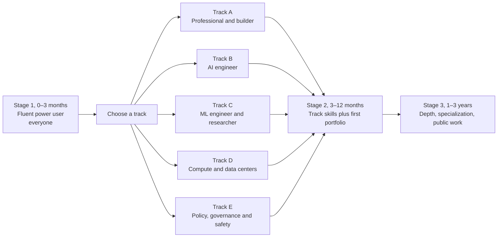

*Figure 65.1: The roadmap at a glance. One shared first stage, five tracks, and two later stages that each end in a portfolio milestone.*

## Stage 1 (0–3 months): become a fluent power user

Everyone starts here, including future researchers and data-center engineers. A researcher who cannot brief a model well, or a policy analyst who cannot tell when a chatbot is bluffing, is handicapped in a world where these tools are everywhere. The goal of Stage 1 is threefold: use AI expertly and safely in your own work, understand conceptually how it works, and read AI news critically.

> **Definition — Power user:** Someone who gets consistently excellent results from AI tools by briefing them well, supplying the right context, checking their output, and delegating multi-step work to them. It is Level 1 of the skills map in Chapter 62.

Stage 1 has four blocks. Do them in parallel rather than one after another: a little understanding, a little structured course work, and a lot of practice every week.

### Block 1: understand the machine (about 10 hours)

You already know what a chatbot feels like. This block shows you what it is. Good starting points, all free:

- **Andrej Karpathy, "Intro to Large Language Models" (YouTube).** About an hour, from a founding member of OpenAI and former head of AI at Tesla. The clearest single explanation of what a model is, how it is trained, and where it fails.
- **Andrej Karpathy, "Deep Dive into LLMs like ChatGPT" (YouTube).** A much longer talk that walks the whole pipeline, from internet text to tokens to a pretrained model to a chat assistant to reasoning models. Watch it in chunks.
- **3Blue1Brown's neural network and transformer videos (3blue1brown.com and YouTube).** Beautiful animated explanations of what happens inside a neural network and a transformer, with no prior math assumed.
- **Anthropic Academy, "AI Capabilities and Limitations" (anthropic.skilljar.com).** A short, free course on what current models do well and badly.

If you have been reading this book in order, Chapters 18 and 25 cover the same ground and you can treat these as reinforcement.

### Block 2: structured fluency (about 15–25 hours)

Pick two or three of these structured courses. They overlap, which is fine: hearing the same idea from different teachers is a form of spaced repetition.

| Resource | What it is | Cost (as of late 2026) |
|---|---|---|
| Anthropic Academy: "AI Fluency: Framework and Foundations" and "Claude 101" (anthropic.skilljar.com) | Short courses on working with AI well, from Anthropic | Free |
| DeepLearning.AI "Generative AI for Everyone" (about 5 hours) and "AI Prompting for Everyone" (about 7 hours) | Andrew Ng's non-technical introductions | Free to start; certificates and some courses are paid, so check the course page |
| OpenAI Academy "Apply AI at Work" (academy.openai.com) | OpenAI's track for using AI in everyday jobs | Free |
| Google "AI Essentials" (grow.google, via Coursera) | Google's introductory course with a certificate | Paid (Coursera subscription) |
| Elements of AI (elementsofai.com) | A vendor-neutral introduction from the University of Helsinki | Free |

> **Watch out:** Courses made by AI companies teach their own products. They are good, but take at least one from a second company or a vendor-neutral source, so that you learn the ideas rather than one app's buttons. The buttons will change; the ideas will not.

### Block 3: practice (the most important block)

Practice is where Stage 1 is won or lost. These seven exercises, adapted from research on how AI skills develop, take you from casual use to power use:

1. **Audit your week.** For one week, log your work in 30-minute blocks and tag each task "AI does it", "AI assists" or "human only". Rank the top five candidates by hours saved.
2. **The same task three ways.** Give one real task to ChatGPT, Claude and Gemini with an identical prompt, score the outputs, then improve the prompt with context and examples and score again. You will usually find that context matters more than which model you use.
3. **Map the jagged frontier.** Write 15 mini-tests from your own field (easy, hard, tricky, and "requires local knowledge"), record where the model is excellent and where it fails confidently, and repeat in three months.
4. **Verification drill.** Ask for a researched answer with citations on a topic you know well and check every citation. Count the claims that were correct, misattributed or invented.
5. **Build a reusable assistant.** Create a Claude Project, custom GPT or Gemini Gem for one recurring task, with instructions, two worked examples and reference documents. Use it for two weeks and refine it.
6. **Delegate to an agent.** Give a deep-research or agent tool a real multi-step task, note where you had to step in, then write a better brief and run it again.
7. **Read the money.** Take one AI funding headline and classify every number in it as revenue, run-rate, valuation or an "up to" commitment. The hype checklist later in this chapter shows how.

> **Definition — Jagged frontier:** The uneven shape of AI ability: superhuman at some tasks and surprisingly poor at nearby ones that look just as easy. Stanford's 2026 AI Index notes a model that won gold at the International Mathematical Olympiad yet read analog clocks correctly only about half the time.

> **Definition — Reusable assistant:** A saved setup (a Claude Project, a custom GPT, a Gemini Gem or an Agent Skill) that bundles instructions, examples and reference files for one recurring task, so you do not have to re-explain it each time.

> **Definition — Trust rules:** Your personal written list of when you rely on AI output, when you check it, and when you do not use AI at all, based on your own verification drills. For example: "I always click every citation; I never paste client names; I trust it for first drafts but not for final numbers."

The exercises in Chapter 25 (prompting and context) and Chapter 29 (building without code) make good extra practice at this stage.

### Block 4: read two books

Books give you the big picture that short courses and news cannot. Pick two from this list, ideally one practical and one skeptical. All are paid books, and all are widely available from public libraries.

| Book | Angle | Why read it |
|---|---|---|
| Ethan Mollick, *Co-Intelligence* (2024) | Practical use | How to work alongside AI, from a Wharton professor who tests the tools constantly |
| Arvind Narayanan and Sayash Kapoor, *AI Snake Oil* (2024) | Skepticism | How to tell AI that works from AI that cannot work, especially in prediction |
| Chris Miller, *Chip War* (2022) | Industry | Why chips are the strategic center of AI, and how the supply chain got so concentrated |
| Karen Hao, *Empire of AI* (2025), or Parmy Olson, *Supremacy* (2024) | Lab history | How OpenAI, DeepMind and their rivals came to be, told by journalists |

### The Stage 1 milestone

You have finished Stage 1 when you can honestly say three things. You save at least three hours a week with AI in your own work. You have a written trust-rules document based on your own verification drills. And you can explain to a friend the difference between a company's run-rate and its revenue (the hype section of this chapter covers that). If you plan to take Track B or C, you can also start DeepLearning.AI's "AI Python for Beginners" (about 11.5 hours) in the last month.

### A week in Stage 1

Here is a five-hour week you can copy. Each slot ends with a small output, because an output is proof that the session was active rather than passive.

| Day | Time | What you do | What you produce |
|---|---|---|---|
| Monday | 30 min | Watch one section of a course or talk; pause before each new idea and predict what comes next | Three lines in your own words |
| Tuesday | 30 min | Apply Monday's idea to a real task from your work | A before-and-after prompt saved in your prompt library |
| Wednesday | 30 min | Retrieval practice: explain Monday's idea from memory to your chatbot and ask it to quiz you | A quiz score out of five |
| Thursday | 45 min | Build or refine one reusable assistant | An updated instructions file |
| Friday | 30 min | Verification drill: check three claims the AI made this week | One new entry in your trust rules |
| Saturday | 90 min | Project block: one of the seven exercises, end to end | A 150-word note on what you learned |
| Sunday | 45 min | Read a chapter of your book, then plan next week | Next week's plan |

The total is 30 + 30 + 30 + 45 + 30 + 90 + 45 = 300 minutes, which is five hours. If you have only three hours, keep Tuesday, Wednesday, Saturday and Sunday: the practice slots matter more than the watching slots.

Across the 13 weeks, a good sequence looks like this:

| Weeks | Focus | Book chapters that help |
|---|---|---|
| 1–2 | How models work: tokens, context, training versus inference, hallucination | Chapters 18 and 25 |
| 3–4 | Prompting and context engineering; your first reusable assistant | Chapter 25 |
| 5–6 | Verification and trust rules; mapping the jagged frontier | Chapters 24 and 55 |
| 7–8 | Files, images, voice and spreadsheets (multimodal work) | Chapter 22 |
| 9–10 | Deep research and agents; delegating multi-step work | Chapter 28 |
| 11 | Reading AI money and news critically | Chapter 61 and this chapter |
| 12–13 | Capstone: redesign one of your own weekly workflows and measure the time saved | Chapter 62 |

> **Try it:** Paste the weekly table above into your chatbot and say: "Turn this into a 13-week calendar starting next Monday, fitted around these fixed commitments: [list them]. Give it to me as a downloadable calendar file." Import it, and treat the slots like meetings you cannot skip.

## Choosing your track

After Stage 1 you choose where to go deeper. Five tracks cover almost every way people work with AI. The table summarizes them; the sections that follow give each one its own staged roadmap.

| Track | Who it suits | Weekly time | Where it leads (see Chapter 63) | Coding needed |
|---|---|---|---|---|
| A. Professional and builder | Anyone, especially people with deep knowledge of a field | 3–6 hours | AI-enabled professional, automation specialist, adoption lead, AI sales and customer success | None to light |
| B. AI engineer | People who enjoy building software or want to learn | 6–10 hours | AI engineer, forward-deployed engineer, applied AI architect, AI product manager | Yes |
| C. ML engineer and researcher | People who enjoy math and long, patient experiments | 10–15+ hours | ML engineer, research engineer, research scientist, evals researcher | Heavy, plus math |
| D. Compute and data centers | People drawn to hardware, power, cooling, chips or the economics of compute | Varies by lane | Performance and infrastructure engineer, data-center technician or engineer, industry analyst | Depends on lane |
| E. Policy, governance and safety | People from law, policy, compliance, ethics or research | 4–8 hours | Governance and compliance, policy, trust and safety, safety researcher | Light for policy, heavy for technical safety |

Figure 65.2 is a quick way to choose. It is a starting point, not a verdict. You can change tracks later, and many of the strongest careers combine two.

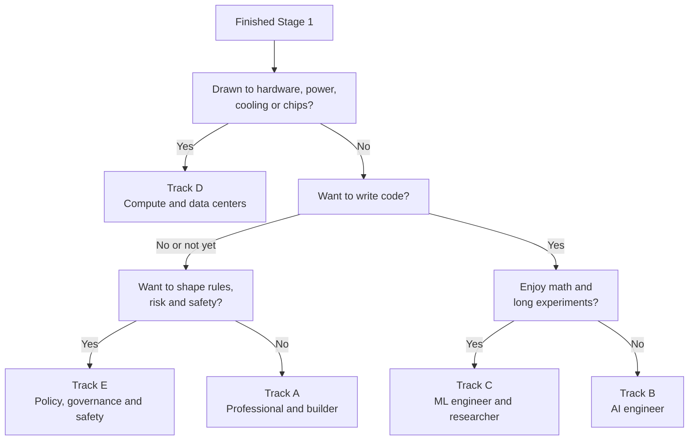

*Figure 65.2: A rough track chooser. Answer honestly about what you enjoy, not about which title sounds most impressive.*

### Depth plus breadth: the T-shape

The most valuable people in the AI economy are rarely the ones who know a little about everything. They usually combine depth in one area with enough breadth to connect it to everything else.

> **Definition — T-shaped skills:** A skill profile with deep expertise in one area (the vertical bar of the T) plus broad working knowledge across many (the crossbar). A nurse who also knows prompting, automation and evaluation is T-shaped.

> **Definition — Domain expertise:** Deep knowledge of a particular field, such as medicine, law, accounting, logistics, teaching or a skilled trade. In AI work it lets you judge which errors matter, write realistic tests and spot problems engineers would miss.

```
  crossbar: AI fluency (prompting, context, automation, evals,
            governance basics, reading the industry)
 +--------------------------------------------------------+
 |                     +---------+                        |
 +---------------------|  YOUR   |------------------------+
                       | DOMAIN  |
                       |         |
                       | nursing,|
                       | law,    |
                       | finance,|
                       | trades  |
                       +---------+
```

*Figure 65.3: The T-shaped profile. Your existing field is the vertical bar; this book and the roadmap build the crossbar. A "pi-shaped" profile adds a second deep bar, such as law plus software.*

This matters for track choice. If you already have deep expertise in a field, Track A (or Track E, if your field is law or compliance) often gives the fastest return, because the crossbar multiplies a bar you already have. If you are early in your career with no deep field yet, Track B or C can become your vertical bar.

> **Analogy:** The skill tree in a video game. You do not need to unlock every branch. Pick a path, level up, and use what you unlock. Respecs are allowed: plenty of AI engineers started in Track A, and plenty of policy experts started as engineers.

## Track A: the professional, power user and builder

Track A is for anyone who wants AI to transform their own work and their team's work without becoming a software engineer. It suits domain experts especially well: the accountant, nurse, paralegal, teacher, recruiter, operations manager or salesperson who knows exactly where the pain is. It leads to roles such as AI-enabled professional, AI automation specialist, internal AI adoption lead, and sales or customer-success work for AI products (Chapter 63).

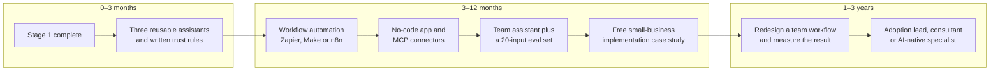

*Figure 65.4: Track A, professional and builder. The arc runs from personal productivity to systems that run without you, and then to redesigning how a whole team works.*

### 3–12 months: from chatting to systems

The big shift in this stage is from AI you talk to toward AI that runs while you sleep.

> **Definition — Workflow automation:** Connecting apps so that work flows between them automatically: a trigger (an event such as a submitted form or a new email) starts a chain of actions, for example "when a form is submitted, summarize it with AI, add a row to a spreadsheet and email the team." Zapier, Make, n8n and Microsoft Power Automate are popular tools.

> **Definition — Vibe coding:** Building software by describing what you want in plain language to an AI tool (such as Lovable, Replit, Bolt or Claude Code) and iterating on what it produces, often without reading the code it writes. Chapter 29 explains when this is safe and when to call a professional.

> **Definition — MCP (Model Context Protocol):** An open standard for connecting AI assistants to tools and data sources such as email, calendars, drives and databases, sometimes called a "USB-C port for AI." Chapter 28 explains how it works.

> **Definition — AI agent:** An AI system that takes several steps toward a goal on its own, using tools such as web search, a browser or code, instead of answering once. Deep-research tools and coding agents are agents.

The skills to build in this stage, with resources:

| Skill | How to learn it | Cost |
|---|---|---|
| Workflow automation | Each tool's own academy, templates and free tier (Zapier, Make, n8n, Power Automate); build three automations for your own job | Free tiers; paid plans for heavier use |
| No-code app building | DeepLearning.AI "Build with Andrew" (about 1 hour, no coding); then build one small tool you will really use with Lovable, Replit or Bolt | Course free; app builders have free tiers and paid plans |
| Connecting tools (MCP and connectors) | Anthropic Academy "Introduction to Model Context Protocol"; your chat app's connector settings | Free |
| Delegating to agents | Anthropic Academy "Introduction to Claude Cowork"; practice with ChatGPT agent, Claude Cowork or Gemini on real tasks | Courses free; agent features often need a paid chat plan |
| Spreadsheet plus AI analysis | Excel or Google Sheets with their built-in AI; Kaggle Learn "Intro to Programming" when ready | Free to low cost |
| Basic evaluation for builders | Hamel Husain's free writing on evals (hamel.dev); keep 20 test inputs for every assistant you build | Free |
| AI at work and in small businesses | Anthropic Academy "AI Fluency for Small Businesses"; OpenAI Academy "Lead AI Adoption" | Free |
| Governance basics | The NIST AI Risk Management Framework (free from nist.gov); IAPP AIGP materials if governance is your direction | NIST free; AIGP paid |

> **Definition — Eval set (golden set):** A fixed collection of test inputs, each with a note on what a good output looks like, that you re-run every time you change a prompt, model or tool. It is the habit that separates hobby projects from reliable tools.

**A worked example: what one automation is worth.** Suppose you spend 90 minutes every Monday turning a sales spreadsheet into a summary email for your manager. You build an automation that drafts the summary for you, and you spend 15 minutes checking and sending it.

```
Time saved per week: 90 - 15 = 75 minutes
Weeks per year: about 48
Time saved per year: 75 x 48 = 3,600 minutes = 60 hours
If building it took 6 hours: payback = 6 hours / 1.25 hours per week
                                     = about 5 weeks
```

Sixty hours a year from one automation is a week and a half of working time. Three or four of these, documented with before-and-after numbers, are a convincing portfolio for an internal "AI lead" role.

The best single project in this stage, according to people who hire for consulting and forward-deployed roles, is a free implementation for a real small business. Find a local business (a dental office, a contractor, a nonprofit), interview the owner, map one painful workflow such as intake, quotes, scheduling or review responses, implement an AI-assisted fix, measure the time saved after two weeks, and write it up as a case study.

### 1–3 years: becoming the person who redesigns the work

In this stage you stop being the person whose tasks are being automated and become the person who decides how the work should be done. The evidence for why this matters is striking. Stanford's 2026 AI Index reports that 88% of organizations say they have adopted AI, yet an MIT study from July 2025 reportedly found that only about 5% of enterprise generative-AI pilots produced rapid revenue gains or measurable profit-and-loss impact. The study blamed brittle workflows and poor fit with daily operations, not weak models. The scarce skill is connecting AI to real work.

Directions people take from here:

- **AI adoption lead inside a company.** Picking use cases, running training, building shared assistants, setting policy with legal and IT, and measuring return on investment.
- **AI implementation consultant for small businesses.** A common pattern is a fixed-price audit, then an implementation, then a monthly retainer for maintenance and improvements.
- **The AI-native specialist.** The accountant, nurse or paralegal who writes the evaluation rubrics and quality checks for AI in their field, because they know which errors matter.
- **Teaching and content.** Workshops, internal training and niche newsletters ("AI for physiotherapists") do well because general AI content is saturated.
- **Expert contractor work.** Labs pay domain experts to write, grade and critique model outputs. Mercor reports that its experts average more than $85 an hour, according to the research firm Sacra, but the work is project-based and can vanish abruptly: Scale AI reportedly ended work with about 500 contractors in July 2025 after Meta bought a large stake in it. Treat it as a side income and an education, not a career foundation.

Some light coding helps even in Track A. The first month of Track B (Python basics) makes you far more effective with automation tools and app builders, because you can read what they produce.

> **Watch out:** Adoption is not impact. Rolling out a chat tool to 500 employees is easy; changing a workflow so that a team does better work in less time is hard. Always measure the before and after, in hours, errors or money, or you will not be able to prove what you achieved.

## Track B: the AI engineer

Track B is for people who want to build software products on top of AI models. The job of the AI engineer, sometimes called an LLM application engineer, is the most-hired technical AI role outside the labs. It also leads to forward-deployed engineering, applied AI architecture and AI product management. You do not need a computer-science degree, but you do need to learn to code. The good news is that AI coding assistants make learning to code far easier than it was a few years ago.

> **Definition — AI engineer:** A software engineer who builds products on top of existing AI models, working on prompts and context pipelines, retrieval, tool use, agents, evaluation, cost and speed. It is distinct from training models, which is the work of ML engineers and researchers.

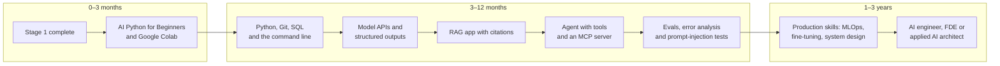

*Figure 65.5: Track B, AI engineer. The spine of the track is a sequence of projects, each one adding a layer: code, model calls, your own data, tools, and finally the evaluation that turns a demo into a product.*

### 0–3 months: Stage 1 plus first code

Finish Stage 1, and in the last month start DeepLearning.AI's "AI Python for Beginners" (about 11.5 hours). Run your code in Google Colab, a free Google website that runs Python in your browser (Chapter 3), so you install nothing. Learn the basics of Git, the tool that records every version of your code, and GitHub, the website where most people store and share it; a GitHub profile is the standard place to show your code to employers. Chapter 26 walks through a complete first API call.

> **Definition — Python:** The most widely used programming language in AI, known for readable code and a huge collection of ready-made libraries. Almost every AI course, tool and research codebase uses it.

### 3–12 months: the core stack

This is the heart of Track B. Work through it as a series of projects, using courses as references rather than as the main event. Three terms from earlier chapters appear in the table: SQL is the standard language for asking questions of databases (Chapter 11); an API is the doorway through which a program sends text to a model and gets an answer back, paying per token (Chapter 26); and prompt injection is the attack in which instructions hidden in content an AI reads hijack its behavior (Chapter 31).

| Skill | Well-known resources | Cost |
|---|---|---|
| Python fluency | Harvard CS50P "Introduction to Programming with Python"; Kaggle Learn Python and Pandas | Free (CS50 offers an optional paid certificate) |
| Command line and Git | MIT "The Missing Semester of Your CS Education"; GitHub Skills | Free |
| SQL | SQLBolt; Kaggle Learn SQL; the Mode SQL tutorial | Free |
| Model APIs | Anthropic Academy "Claude Platform 101" and "Building with the Claude API"; OpenAI Academy "Build with AI"; each provider's documentation and cookbook | Free to learn; API calls cost money (usually a few dollars for learning projects) |
| LLM applications and agents | Hugging Face LLM Course, Agents Course and Context Course (huggingface.co/learn); DeepLearning.AI "Agentic AI" (about 10 hours); Anthropic's "Building effective agents" guidance | Free |
| Retrieval (RAG) | Hugging Face Open-Source AI Cookbook; the documentation for LlamaIndex or LangChain | Free |
| Evaluation | Hamel Husain's blog (hamel.dev); "AI Evals for Engineers and PMs" by Hamel Husain and Shreya Shankar; DeepLearning.AI "Evaluating AI Agents" | Blog free; the evals course is paid |
| AI security | OWASP Top 10 for LLM Applications; Simon Willison's writing on prompt injection (simonwillison.net) | Free |
| The one book | Chip Huyen, *AI Engineering* (O'Reilly, 2025) | Paid |

> **Definition — RAG (retrieval-augmented generation):** Looking up relevant passages from your own documents and handing them to the model along with the question, so that answers draw on your data and can cite it. Chapter 27 builds one.

> **Definition — Evals (evaluations):** Systematic tests of whether an AI system does what you want, the "unit tests" and "report cards" of AI products. Building good evals is widely named one of the most valuable AI engineering skills of 2025–2026.

> **Definition — Error analysis:** Collecting many real outputs from your system, reading them, labeling what went wrong, counting each kind of failure, fixing the most common one, and measuring again. It is the core habit of strong AI engineers.

**A week in Track B.** At eight hours a week, a balanced week looks like this:

| Day | Time | Activity | Output |
|---|---|---|---|
| Monday | 1 hour | Course or documentation: one new concept (for example, tool calling) | Notes plus a 10-line code snippet that uses it |
| Tuesday | 1 hour | Coding practice on that concept, with an AI assistant explaining errors | A working notebook pushed to GitHub |
| Wednesday | 30 min | Retrieval practice: quiz yourself on the week's concepts | A score, and a list of weak spots |
| Thursday | 1.5 hours | Project work on your current portfolio project | A commit with a short message describing the change |
| Friday | 30 min | Read one practitioner post (Hamel Husain, Simon Willison, Latent Space) | Two sentences on what you would change in your project |
| Saturday | 3 hours | Deep project block: build, then run your eval set | Eval results in a spreadsheet |
| Sunday | 30 min | Write up the week in public or in a private log | A short progress note |

That adds up to 1 + 1 + 0.5 + 1.5 + 0.5 + 3 + 0.5 = 8 hours, and more than half of it is building.

**A worked example: what learning projects cost.** Students often worry about API bills. Suppose your RAG project's eval set has 30 questions, and each question sends about 4,000 tokens (the question plus retrieved passages) and gets back about 400. Using an illustrative price of $3 per million input tokens and $15 per million output tokens (real prices vary by model; Chapter 26 shows how to check current ones):

```
Input:  30 x 4,000 = 120,000 tokens x $3 / 1,000,000  = $0.36
Output: 30 x   400 =  12,000 tokens x $15 / 1,000,000 = $0.18
One full eval run                                      = $0.54
Fifty eval runs over a whole project                   = about $27
```

A small, cheap model would cost a fraction of that. For most learners the real cost of Track B is time, not money.

### 1–3 years: production depth

The third stage turns a capable builder into someone companies trust with production systems:

- **MLOps and production practice.** Chip Huyen's *Designing Machine Learning Systems* (paid) and the MLOps Community (free) cover deployment, monitoring and drift.
- **Fine-tuning basics.** Knowing when to fine-tune and, just as important, when not to. Hugging Face's free "a smol course" on post-training, and the documentation for the TRL and Unsloth libraries. Chapter 30 explains the decision.
- **Data engineering.** *Fundamentals of Data Engineering* by Joe Reis and Matt Housley (paid), or the DeepLearning.AI and AWS "Data Engineering" program (about 107 hours).
- **System design.** Martin Kleppmann's *Designing Data-Intensive Applications* (paid), the classic on how reliable software systems are built.
- **A specialty.** Pick an industry (finance, health, legal, government) or a layer (search quality, agent reliability, AI security) and go deep.

> **Definition — FDE (forward-deployed engineer):** An engineer who embeds with a customer for weeks or months to build and deploy AI solutions on the customer's own systems: half engineer, half consultant. The role began at Palantir and became one of the fastest-growing AI roles of 2025–2026.

> **At the frontier (2026):** Lab hiring shows where Track B leads. On October 21, 2026, OpenAI listed 120 open roles in Applied AI and had a dedicated Forward Deployed Engineering department with 31 open roles, while Anthropic's Applied AI department had 61 openings. These teams take models to customers, and what they look for is exactly this track: solid engineering, retrieval, agents, evals, and the ability to work with real customers on messy problems.

> **Watch out:** A slick demo is not a product. Many portfolios show a chatbot that works on five hand-picked questions. Hiring managers for AI engineering roles look for the opposite: an eval set, a measured failure rate, an error analysis, and a fix that moved the number. Publish error analyses, not just demos.

## Track C: the ML engineer and researcher

Track C is for people who want to train models, not just use them: ML engineers who build, train and deploy models in production, and researchers who push what models can do. It is the longest track and the one where math matters most. Plan on years at a part-time pace, or a degree program, or both.

> **Definition — ML engineer (MLE):** An engineer who builds, trains, deploys and maintains machine-learning models in production, such as the models behind fraud detection, recommendations or a company's fine-tuned language model.

> **Definition — Research engineer:** An engineer at an AI lab who implements and runs large experiments, builds research tools and debugs training at scale. At frontier labs the line between research engineers and research scientists is blurry, and many job postings cover both.

Research scientists, by contrast, set research directions, form hypotheses, design experiments and interpret results; for them a PhD is typical but not universal.

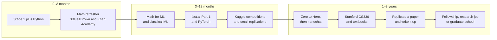

*Figure 65.6: Track C, ML engineer and researcher. The track moves from understanding models to training small ones yourself to reproducing and extending published research.*

### 0–3 months: Stage 1, Python and a math refresher

Alongside Stage 1, start Python (as in Track B) and refresh the math. Chapters 5 and 6 of this book cover the essentials in plain words. For more:

- **3Blue1Brown, "Essence of Linear Algebra" and "Essence of Calculus" (free on YouTube).** Visual, intuitive series that make vectors, matrices and derivatives feel obvious.
- **Khan Academy (free).** Patient, exercise-based lessons in algebra, calculus, probability and statistics.

### 3–12 months: classical ML and your first deep learning

- **DeepLearning.AI "Mathematics for Machine Learning and Data Science" (about 94 hours)**, if you want a structured math course.
- **Andrew Ng's Machine Learning Specialization (about 95 hours)**, the standard first course in classical machine learning: regression, classification, trees, overfitting and evaluation.
- **Aurélien Géron, *Hands-On Machine Learning* (O'Reilly, paid)**, the classic practical book with runnable code.
- **fast.ai "Practical Deep Learning for Coders", Part 1 (free, course.fast.ai)**: nine lessons of about 90 minutes, built top-down on PyTorch, the most widely used library for building and training neural networks (Chapter 13). It assumes about a year of coding experience, so do Python first.
- **Kaggle (free)**: practice datasets, short courses and competitions where you can compare your models with thousands of others.

> **Definition — Kaggle competition:** A public contest on the Kaggle website in which people build models for the same dataset and are ranked on a hidden test set. Competitions are a free way to practice and to compare your skills honestly.

### 1–3 years: from scratch to the frontier

This is where you build real depth. Well-known, stable resources for this stage:

| Resource | What it is | Cost |
|---|---|---|
| Andrej Karpathy, "Neural Networks: Zero to Hero" (karpathy.ai/zero-to-hero.html) | 8 lectures that build from a tiny automatic-differentiation engine (micrograd) to a GPT and its tokenizer, typing every line | Free |
| Karpathy's nanochat (github.com/karpathy/nanochat) | A minimal full-stack harness covering tokenizer, pretraining, fine-tuning, RL, evaluation and inference | Code free; rented GPU time about $48 |
| Simon Prince, *Understanding Deep Learning* (udlbook.github.io/udlbook) | A clear, modern, well-illustrated textbook | Free PDF; print edition paid |
| *Dive into Deep Learning* (d2l.ai) | An interactive textbook with runnable code for every chapter | Free |
| Sebastian Raschka, *Build a Large Language Model (From Scratch)* | Builds a GPT-style model step by step | Book paid; code free on GitHub |
| Stanford CS336 "Language Modeling from Scratch" (cs336.stanford.edu) | Spring 2026 course by Tatsu Hashimoto and Percy Liang with five assignments: basics, systems and Triton, scaling laws, data, and alignment and reasoning RL | Lectures free on YouTube |
| Stanford CS224N (natural language processing), CS231n (computer vision), MIT 6.S191 (intro deep learning) | Well-known university courses with lectures online | Free |
| fast.ai Part 2 | More than 30 hours, from foundations up to diffusion models | Free |
| Nathan Lambert's RLHF book and his Interconnects newsletter | Post-training, RLHF and reinforcement learning for language models | Book free online; newsletter free with a paid tier |
| Hugging Face "a smol course" and the TRL library | Hands-on post-training of small models | Free |

**A worked example: what nanochat costs.** Karpathy reports that nanochat trains a model with roughly GPT-2-level capability in about 2 hours on one node of 8 H100 GPUs, for about $48. Unpacking that:

```
GPU-hours used: 8 GPUs x 2 hours = 16 GPU-hours
Implied price:  $48 / 16 GPU-hours = $3 per GPU-hour
```

Compare that with the frontier runs in Chapter 37, which use tens of thousands of GPUs for months. Training something real yourself, for the price of a dinner, is one of the best ways to make the rest of this book concrete.

> **At the frontier (2026):** The gap between "what a lab does" and "what a student can do" has narrowed for learning purposes. Stanford's CS336 has students build a language model end to end, including writing an efficient attention kernel and running reinforcement learning, and nanochat puts a complete training pipeline within reach of one person with a credit card. The frontier itself is far beyond these, but the ideas are the same ones.

### Research skills: reading, replicating and writing

Research is a craft with its own skills, and you can start practicing them before you have any formal research role.

> **Definition — Preprint:** A research paper posted publicly before, or instead of, formal peer review. Most AI research appears first as a preprint on arXiv (arxiv.org), so it is fast but has not necessarily been checked by independent reviewers.

> **Definition — Peer review:** The process by which independent experts evaluate a paper before a journal or conference publishes it. It catches many errors but not all, and AI moves so fast that much important work is read and used before review.

**Reading papers.** A widely used method is the "three-pass" approach described by the computer scientist S. Keshav in his short 2007 note "How to Read a Paper". First pass, five to ten minutes: title, abstract, introduction, section headings, figures and conclusion, to decide whether the paper matters to you. Second pass, about an hour: read it properly, but skip the proofs and fine details, and note what you do not understand. Third pass, several hours: reconstruct the work as if you had to do it yourself. Your chatbot can explain jargon and equations during the second pass, but always check its explanation against the paper itself, because models can describe papers they have not actually read.

**Replicating.** Pick a recent small-scale paper, reproduce its key figure, note any differences, and try one extension. Post the code and a write-up.

> **Definition — Replication:** Re-running another team's experiment, usually from their paper and code, to see whether you get the same result. It is the best way to learn a research area deeply and a strong signal to employers and fellowship programs.

> **Definition — Ablation:** An experiment that removes or changes one part of a system to measure how much that part matters, for example retraining without a particular data source.

> **Definition — Research taste:** The judgment to choose problems that are important, tractable and timely. It is considered the scarcest research skill and is built by reading widely, replicating, and discussing work with experienced researchers.

**Fellowships.** Several funded programs take people with strong public work, not just PhDs, especially in safety and interpretability (Track E describes them in more detail). Two worked examples, using the programs' own published terms as of October 2026:

```
MATS: 12 weeks x $1,250/week stipend = $15,000
      12 weeks x $2,000/week compute  = $24,000 of compute

Anthropic Fellows: about 4 months, or roughly 17 weeks
      17 x $3,850/week stipend = about $65,000
      plus about $15,000/month of compute = about $60,000
```

> **Definition — Fellowship:** A time-boxed, paid program in which newcomers do research with mentorship, such as MATS or the Anthropic Fellows Program. Fellowships are a common bridge into research roles.

**Do you need a PhD?** For research scientist roles, a PhD remains typical. For research engineering it often is not required: frontier-lab postings commonly ask for "a Bachelor's degree or an equivalent combination of education, training, and/or experience." A strong public record of replications, open-source contributions and write-ups can substitute for credentials. Stanford's 2026 AI Index reports that new AI PhDs in the US and Canada rose 22% between 2022 and 2024, with most going into academia, so a PhD is far from the only path into industry research.

## Track D: compute, chips and data centers

AI runs on physical things: chips, servers, networks, buildings, power lines and cooling plants (Parts VI and VII of this book). Track D is for people drawn to that physical layer. It has three lanes that need very different preparation:

1. **Software for compute:** GPU, infrastructure and performance engineering, making training and inference faster and cheaper.
2. **The physical buildout:** the trades and facility engineers who build and run data centers.
3. **Understanding the industry:** analysts, investors, journalists, policy staff and business people who need to understand chips, power and the economics of compute.

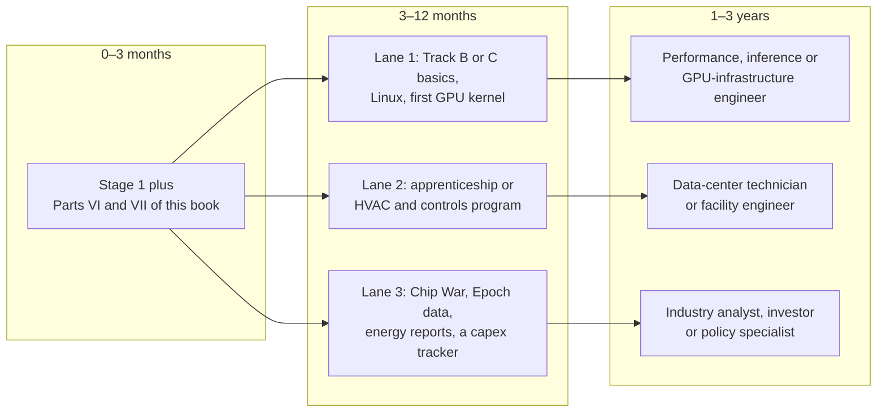

*Figure 65.7: Track D, compute and data centers, in three lanes. Software engineers, tradespeople and analysts all share Stage 1 and the book's compute chapters, then diverge sharply.*

### Lane 1: GPU, infrastructure and performance engineering

This lane assumes about a year of Track B or Track C first, because you need solid programming and a working understanding of how models train and serve. Then:

| Resource | What it is | Cost |
|---|---|---|
| *Programming Massively Parallel Processors* by Hwu, Kirk and El Hajj | The standard textbook on GPU programming | Paid |
| GPU MODE lectures and Discord (github.com/gpu-mode/lectures) | A large community of people learning and teaching GPU kernel programming | Free |
| Triton tutorials (triton-lang.org) | Writing fast GPU kernels in a Python-like language | Free |
| NVIDIA CUDA documentation (docs.nvidia.com) | The official programming guide for NVIDIA GPUs | Free |
| Hugging Face "The Ultra-Scale Playbook" | How training is split across many GPUs, with measurements | Free |
| Google DeepMind "How to Scale Your Model" (jax-ml.github.io/scaling-book) | The math of scaling models across TPUs and GPUs | Free |
| Stanford CS336, systems assignment | Writing FlashAttention-2 in Triton | Free |
| Kleppmann, *Designing Data-Intensive Applications* | How software that runs across many coordinating machines is built and kept reliable | Paid |

> **Definition — CUDA:** NVIDIA's programming platform for its GPUs. Much of the AI software world is built on it, which is a large part of NVIDIA's competitive advantage (Chapter 35).

> **Definition — GPU kernel:** A small program that runs on a GPU, performing one operation such as a matrix multiplication across thousands of cores at once. Faster kernels make training and inference cheaper.

A good first project: implement a softmax or matrix-multiply kernel in Triton, benchmark it against PyTorch's built-in version, and write up what you learned about memory bandwidth (Chapter 33). You can rent a cloud GPU for an hour for roughly $3–8, or use Colab's free GPU for small experiments. Remember to shut the rented machine down when you finish: billing continues until you do.

The pay at the top of this lane reflects how much money efficiency saves. Anthropic's posted base ranges for performance and inference engineers reached $850,000 in October 2026, though those are the very top of the market (Chapter 63 puts them in context).

### Lane 2: the physical buildout

Most of the people building AI data centers are electricians, mechanical and HVAC technicians, pipefitters, lineworkers, low-voltage and fiber technicians, controls technicians, construction managers, commissioning agents (who test that a new building's power, cooling and controls work as designed before it goes live) and the operators who run facilities around the clock.

> **Definition — Registered apprenticeship:** A formal, paid training program that combines on-the-job work under licensed professionals with classroom instruction, leading to a recognized credential. In the US, electrical apprenticeships are often run jointly by unions and contractors (the IBEW and NECA) and typically last several years.

> **Definition — Critical facilities technician:** A tradesperson who operates and maintains a data center's power and cooling systems around the clock, where a failure could take thousands of servers offline.

Pathways include registered apprenticeships (in the US, the electrical training programs run by the IBEW and NECA), community-college HVAC and building-controls programs, military technical experience, and the operator training programs that data-center companies run. For engineers, the route is an electrical or mechanical engineering degree, critical-facility experience, and in many places a professional engineering license.

The numbers show why this lane matters. The US Bureau of Labor Statistics put the median electrician wage at $63,190 in May 2025 and projected 9% job growth for 2025–2035, citing data-center electricity demand as a driver. At the high end, OpenAI posted a "Datacenter Networking Technician, AI Compute Deployment – Stargate" role at $157,000–$302,000 and Anthropic posted data-center electrical, mechanical and controls engineer roles at $320,000–$405,000, both in October 2026. Those are top-of-market postings, not typical wages, but they show the demand.

> **Key idea:** Pairing a trade credential with basic AI literacy (Stage 1) is a real differentiator. Technicians who can use AI for documentation, diagnostics and scheduling, and who understand what the racks they power are doing, stand out.

### Lane 3: understanding the industry

For analysts, investors, journalists, policy staff and business people:

- **Chris Miller, *Chip War* (paid book):** the history and geopolitics of semiconductors.
- **Epoch AI (epoch.ai, free):** data on training compute, costs, hardware and data-center buildouts, with clear charts and methods.
- **SemiAnalysis (mostly paid):** deep industry analysis of chips, data centers and compute economics; some articles are free.
- **The IEA's "Energy and AI" report (April 2025) and Lawrence Berkeley National Laboratory's December 2024 report on US data-center energy use (both free):** the reference numbers on AI's electricity demand (Chapter 41).
- **Uptime Institute (uptimeinstitute.com):** the data-center industry's reliability standards body; some research is free, training and certification are paid.
- **The Acquired podcast's episodes on NVIDIA, and the Asianometry YouTube channel (free):** long-form histories of the companies and technologies.
- **Company filings (sec.gov, free):** NVIDIA's quarterly earnings releases and the hyperscalers' capital-spending guidance are primary sources (Chapter 43).

Good projects for this lane: build a spreadsheet that tracks the big four hyperscalers' capital spending each quarter from their own filings, or use Google Earth Pro's free historical imagery to watch a megaproject such as Abilene grow over two years (Chapter 42).

## Track E: policy, governance and safety

Track E is for people who want to shape how AI is governed and made safe. It has two lanes. The governance and policy lane suits people from law, policy, compliance, privacy, audit and government, and needs technical literacy rather than coding. The technical safety lane is research: interpretability, alignment, evaluations and control. It needs the foundations of Track C.

> **Definition — AI governance:** The policies, processes and controls an organization uses to manage AI risks and comply with laws, such as approving use cases, reviewing vendors, testing systems and keeping records.

> **Definition — Risk management framework:** A structured method for identifying, measuring and reducing risks. The NIST AI Risk Management Framework, free from the US National Institute of Standards and Technology, is the most widely used for AI.

> **Definition — Interpretability:** Research into what is happening inside a neural network: which internal features it represents and how they combine to produce behavior (Chapter 57).

> **Definition — Alignment:** The project of making AI systems reliably pursue the goals and values their developers and users intend, rather than something subtly different (Chapters 55 and 56).

> **Definition — System card:** A document a lab publishes with a model release describing its capabilities, safety testing, known limitations and safeguards. It is a primary source for anyone tracking AI risk.

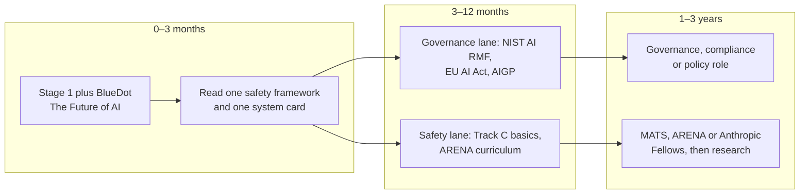

*Figure 65.8: Track E, policy, governance and safety. A shared start, then a governance lane that needs technical literacy and a research lane that needs technical depth.*

### 0–3 months: a shared start

Alongside Stage 1:

- **BlueDot Impact, "The Future of AI" (bluedot.org, free):** a two-hour introduction to the big questions.
- **Chapters 55–60 of this book**, which cover what can go wrong, how labs make AI safer, interpretability and evaluations, misuse, law and policy, and the big debates.
- **One frontier safety framework and one system card.** Read, for example, Anthropic's Responsible Scaling Policy or Google DeepMind's Frontier Safety Framework, and the system card of a recent major model. Primary documents are the raw material of this whole track.
- **The International AI Safety Report (internationalaisafetyreport.org, free):** the large international scientific review of AI risks chaired by Yoshua Bengio.

### 3–12 months: governance and policy lane

| Resource | What it is | Cost |
|---|---|---|
| NIST AI Risk Management Framework (nist.gov) | The most widely used voluntary AI risk framework | Free |
| The EU AI Act (official text, plus explainer sites such as artificialintelligenceact.eu) | The European Union's risk-based AI law; check the current timeline, since a 2026 amendment (the Digital Omnibus) delayed several high-risk deadlines | Free |
| ISO/IEC 42001 | The international standard for AI management systems | Paid standard and training |
| IAPP AIGP (iapp.org) | The AI Governance Professional certification from the International Association of Privacy Professionals | Paid |
| BlueDot Impact governance courses | Cohort-based courses on AI governance | Free, with competitive admission |
| GovAI, CSET (Georgetown), RAND and IAPS publications | Research from leading AI policy think tanks | Free |
| AI Incident Database (incidentdatabase.ai) | A public record of real AI failures and harms | Free |

Good projects: build a risk register for one AI tool your organization uses, following the NIST AI RMF; classify ten real products under the EU AI Act's risk tiers; or follow one live bill through your legislature and write a one-page brief.

### 3–12 months: technical safety lane

Do the first year of Track C, then add safety-specific material: the ARENA curriculum (arena.education, free online), Anthropic's Transformer Circuits thread (transformer-circuits.pub), Neuronpedia for exploring model features (neuronpedia.org), Neel Nanda's guides to getting started in mechanistic interpretability, and the UK AI Security Institute's open-source Inspect framework for running evaluations. A good first project is to replicate a small interpretability or post-training result, or to design a 50-question evaluation in a domain you know well.

### 1–3 years: going professional

- **Fellowships and bootcamps.** MATS runs 12-week research programs; as of October 2026 it had 631 alumni since 2021, 75% of whom now work in alignment, transparency or security. ARENA runs 4–5 week in-person bootcamps in London with costs covered. The Anthropic Fellows Program runs for four months with a $3,850 weekly stipend.
- **Career guidance.** 80,000 Hours' AI safety career review and podcast (80000hours.org, free) are the most detailed public guides to this field.
- **Job postings as syllabi.** Lab policy and safety postings list exactly what employers want. In October 2026 Anthropic posted a Policy Design Manager role at $245,000–$285,000 base and a Technical AI Governance role at $265,000–$295,000; government institutes and think tanks pay much less.
- **Government and nonprofits.** AI safety institutes (the UK AI Security Institute and the US Center for AI Standards and Innovation), evaluation nonprofits such as METR and Apollo Research, and think tanks all hire technical and policy staff.

The field is small, which means individual contributions are visible. 80,000 Hours estimated that only about 300 people (a range of 76 to 536 full-time equivalents) worked on technical AI safety aimed at the most extreme risks as of 2022. It has grown since, but it remains a field where one good replication or one sharp policy brief can get you noticed.

**Read across the debate.** Policy and safety work requires understanding people you disagree with (Chapter 60). Read at least one book from each side: Arvind Narayanan and Sayash Kapoor's *AI Snake Oil* and their "AI as Normal Technology" essays argue that AI is a powerful but ordinary technology whose main harms are present-day ones; Stuart Russell's *Human Compatible* and Brian Christian's *The Alignment Problem* explain why aligning powerful AI is hard; and Eliezer Yudkowsky and Nate Soares's *If Anyone Builds It, Everyone Dies* (2025) is the starkest statement of the extinction-risk case. You do not have to agree with any of them, but you should be able to state each side's best argument in a way its proponents would accept.

> **Watch out:** Policy work is not "non-technical" by default. The most effective policy people understand how models are trained, evaluated and deployed (Parts IV and V of this book) well enough to know which rules are enforceable and which are not. Technical literacy is what separates a credible policy voice from a commentator.

## Certifications: when they matter

Should you collect certificates? The honest answer is: sometimes, and less often than course marketing suggests.

> **Definition — Certification:** A credential earned by passing an exam set by a company or professional body, such as the AWS Certified AI Practitioner or the IAPP AI Governance Professional (AIGP). It tests a defined body of knowledge and often has to be renewed.

> **Definition — Certificate of completion:** Proof that you finished a course, such as those from Anthropic Academy, DeepLearning.AI or Hugging Face. It shows initiative and structured learning, but it is not a tested qualification.

Certifications matter most where a buyer or a human-resources filter asks for them: cloud-centered enterprises, consulting firms and systems integrators, government contracting, and governance and compliance roles. They matter little for frontier-lab research, research engineering and startup engineering, where public work (code, papers, evaluations, write-ups) dominates. For the trades, the reverse is true: a license or a completed apprenticeship is not optional, it is the job's entry ticket.

| Credential | Cost | Helps most for | Matters little for |
|---|---|---|---|
| AWS Certified AI Practitioner | $100; 65 questions in 90 minutes; no prerequisites (as of October 2026) | Roles in companies that run on AWS; consulting | Research and startup engineering |
| Cloud ML certifications (AWS Machine Learning Engineer Associate, Google Cloud Professional Machine Learning Engineer, Microsoft's Azure AI certifications) | Paid | Enterprise-facing ML and AI engineering roles | Research roles |
| IAPP AIGP (AI Governance Professional) | Paid | Governance, privacy, compliance and risk roles | Engineering roles |
| ISO/IEC 42001 implementer or auditor training | Paid | Auditors and compliance teams | Most other roles |
| Electrical license or completed apprenticeship; professional engineering license | Through an apprenticeship or exams | Data-center trades and facility design | Software roles |
| Completion certificates from free courses | Free (some providers charge for the certificate) | Showing initiative; structuring your learning | Being treated as a qualification |

**A worked example: certificates versus portfolio.** Suppose, for illustration, that preparing for a certification takes about 40 hours and a solid portfolio project takes about 50.

```
Option 1: five certifications       5 x 40 hours = 200 hours
Option 2: one certification          1 x 40 hours =  40 hours
          plus three projects        3 x 50 hours = 150 hours
                                     total        = 190 hours
```

The time is about the same. But Option 2 gives a hiring manager three concrete things to look at and three stories for you to tell in an interview, plus the one certificate that a filter might require. The rule of thumb in AI hiring: one relevant certification plus three strong portfolio pieces beats five certifications and no portfolio.

> **Watch out:** "Certifications are the way in" is one of the most common misconceptions about AI careers. They help at the door of some enterprises. For building roles, what gets you hired is evidence that you can build things that work and that you know how to prove it.

## Portfolio projects that prove what you can do

> **Definition — Portfolio:** Public evidence of what you can do: projects, write-ups, code repositories, demos and case studies. In AI hiring it often matters more than credentials, because skills change faster than degrees can track them.

> **Definition — Case study:** A short write-up of one real project: the problem, who had it, what you built, how you measured it, the results, and what you would do next. It is the standard portfolio format for consultants, forward-deployed engineers and product people.

What makes a portfolio project convincing? Hiring managers in AI repeatedly describe the same features. It solves a real problem for a real person, not a toy. It has an evaluation with numbers. It shows an error analysis: what went wrong, how often, and what you did about it. It reports cost per use. It is honest about limitations. And it is written up clearly enough that a busy person can understand it in three minutes.

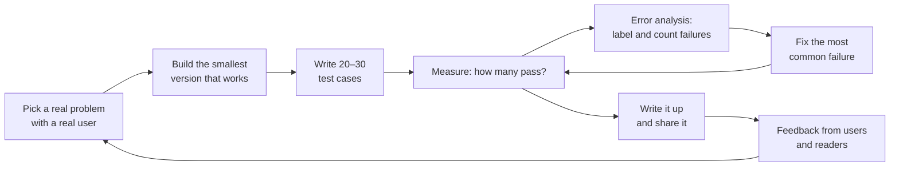

*Figure 65.9: The portfolio project cycle. The inner loop (measure, analyze, fix, measure again) is what separates a product from a demo; the outer loop keeps you working on problems people care about.*

**A worked example: the numbers that make a write-up.** Suppose you build a question-answering assistant over a 150-page employee handbook, and write 30 test questions with correct answers.

```
First run:    19 of 30 correct = 63%
Failures (11), labeled by hand:
  6  retrieval missed the right section
  3  right section found, answer ignored it
  2  correct answer, wrong format
Fix the biggest category (smaller chunks with section titles attached)
Second run:   25 of 30 correct = 83%
```

Then add cost. If each question sends about 3,000 tokens and gets about 500 back, at an illustrative $3 per million input tokens and $15 per million output tokens:

```
3,000 x $3  / 1,000,000 = $0.0090
  500 x $15 / 1,000,000 = $0.0075
Cost per question        = $0.0165, about 1.7 cents
```

"I raised accuracy from 63% to 83% by fixing retrieval, at under two cents a question" is a sentence that gets interviews. "I built a chatbot for our handbook" is not.

Here are portfolio ideas for every track, roughly in order of difficulty:

| Project | Track | Rough time | What it proves |
|---|---|---|---|
| Automation map of your own job, with hours saved measured over a month | A | 5–10 hours | You can find where AI pays off |
| A reusable assistant for a colleague, improved through feedback on 10 real uses | A | 10 hours | User research for AI |
| A three-step automation (form, AI summary, spreadsheet, email) with error handling | A | 10–15 hours | You can build systems, not just chats |
| Free AI implementation for a local small business, written up as a case study | A, B | 20–40 hours | Discovery, delivery and measurement; the best item for consultants and FDEs |
| A small app built with an AI app builder that real people use | A, B | 10–30 hours | Shipping |
| A RAG app with citations and a 30-question eval, comparing two chunking strategies | B | 30–50 hours | Retrieval and evaluation skills |
| An agent with two or three tools and an MCP server you wrote, with a failure log | B | 40–60 hours | Agent engineering |
| A prompt-injection red-team of your own agent: 15 attacks and the mitigations | B, E | 15–25 hours | Security thinking |
| Fine-tuning a small open model with LoRA, compared against prompting a frontier model on cost and quality | B, C | 30–50 hours | Knowing when fine-tuning is worth it |
| Training a tiny language model end to end with nanochat, documenting each stage | C | 20–40 hours plus about $48 | Understanding of the whole training pipeline |
| A Triton or CUDA kernel benchmarked against PyTorch's built-in version | D | 30–60 hours | GPU performance skills |
| A quarterly hyperscaler capital-spending tracker built from company filings | D | 15–25 hours | Reading primary sources about the industry |
| A risk register for one AI tool, following the NIST AI RMF | E | 15–25 hours | Practical governance |
| A replication of a small interpretability or post-training paper, with code and write-up | C, E | 60–120 hours | Research ability; doubles as a fellowship application |
| A new benchmark of 50–200 hard tasks in your own field, with expert answers and a rubric, run on several models | All | 40–100 hours | Turns domain expertise directly into AI-research credibility |

A good write-up follows a simple shape, which you can paste into your notes and fill in:

```
TITLE: what it does, for whom, in one line
PROBLEM: who has it, how they solve it today, what it costs them
APPROACH: what you built and why this design
EVALUATION: the test set, the metric, how you scored it
RESULTS: before and after, with numbers
FAILURES: the main error types and how often each happened
COST: per use and per month at realistic volume
LIMITS: what it does not do, and what could go wrong
NEXT: what you would do with another month
```

*Figure 65.10: A one-page write-up template for any portfolio project.*

## Building in public

> **Definition — Building in public:** Sharing your work and what you are learning as you go, through posts, code and write-ups, rather than only showing finished results. It builds visibility, invites feedback and creates a record of steady progress.

Building in public does three things for you. It makes you finish things, because you told people you would. It brings feedback from people who know more than you. And it creates a visible trail that employers, clients and collaborators can follow, which matters more than any single polished project. A hiring manager who can see twelve weeks of steady, honest progress learns more about you than from a résumé line.

Where to share: GitHub for code (with a good README, the front-page explanation of the project); a personal blog or newsletter for write-ups; LinkedIn, X or Bluesky for short updates; Hugging Face Spaces for live demos; YouTube for walkthroughs; and the communities listed later in this chapter for questions and feedback. Local meetups and company "AI guilds" are excellent places to give your first five-minute talk.

What to post: weekly progress notes; short "today I learned" posts; full project write-ups using the template above; honest accounts of what failed and why; and summaries of papers you read, in your own words.

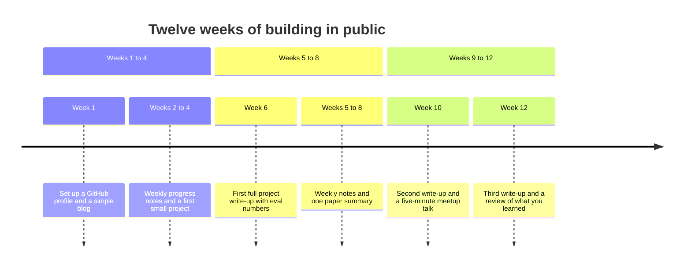

*Figure 65.11: A 12-week building-in-public plan. By week 12 you have about 12 weekly notes, 3 write-ups and a talk: some 16 public pieces of evidence.*

A few rules keep building in public safe:

- **Never post your employer's or clients' data, code or documents**, and never paste confidential material into public tools. Check your employer's policies on AI use and on social media before you post about work.
- **Credit your sources** and the people who helped you.
- **Say when AI helped you write or build something.** It is normal now, and hiding it damages trust if discovered.
- **Be honest about failures and limits.** Inflated claims are easy to spot and they follow you.
- **Do not chase hype.** Posts that explain one thing clearly age far better than posts that call every release a revolution.

> **Key idea:** Your public record is a compounding asset. Small, honest, regular posts beat rare, polished ones, because they show the thing employers most want to see: that you keep learning.

## Staying current without drowning

AI news never stops. Several major model releases can land in a single month, alongside new papers, products, funding rounds, lawsuits and policy changes. Trying to follow all of it is a recipe for anxiety and shallow knowledge. The goal is not to know everything; it is to notice the few changes that matter for your work, and to keep building durable skills while the surface churns.

> **Definition — Information diet:** A deliberate, limited set of sources and times for consuming news, chosen for quality and relevance, so that staying informed takes a fixed, small amount of time instead of an endless scroll.

> **Definition — RSS feed:** A standard format that websites use to publish their latest posts, which a feed-reader app collects in one place in the order they appear, with no algorithm deciding what you see.

### A sustainable routine

A routine that works for most people has four rhythms:

- **Daily, 20 minutes:** one newsletter, plus one hands-on try of something new (a feature, a model, a tool).
- **Weekly, 1 hour:** one long-form podcast episode or one paper, read with the three-pass method.
- **Monthly, 1 hour:** re-run your personal jagged-frontier test from Stage 1 and note what changed.
- **Quarterly, 2 hours:** update your skills map, your portfolio and your plan for the next quarter.

How much time is that per week, on average?

```
Daily:      20 min x 5 weekdays           = 100 min
Weekly:     60 min                        =  60 min
Monthly:    60 min / about 4.3 weeks      =  14 min
Quarterly: 120 min / 13 weeks             =   9 min
Total                                     = 183 min, about 3 hours
```

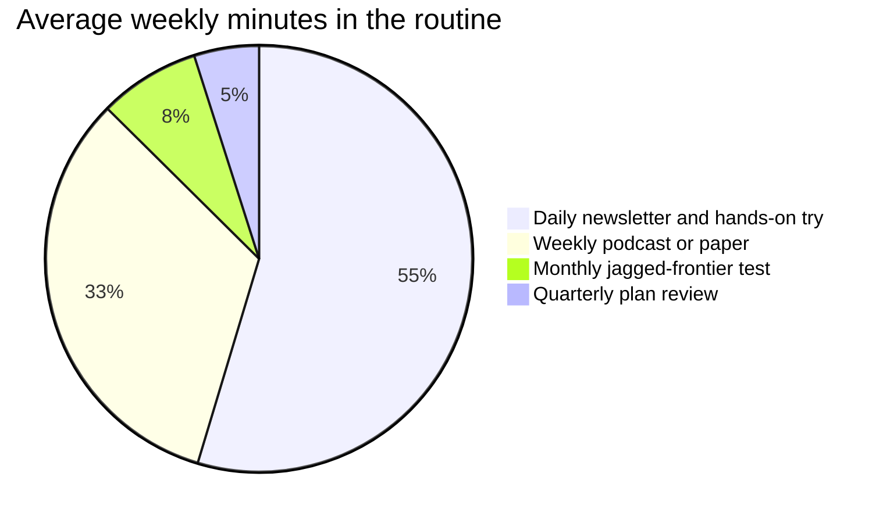

*Figure 65.12: A sustainable routine takes about three hours a week. More than half of it is the daily habit; the rest is slower, deeper material.*

Three hours a week is enough to stay well informed. It is also a ceiling worth respecting: if you find yourself spending far more time reading about AI than using it, cut sources.

### Newsletters and blogs

Pick one or two to start. Free means free to read; several offer an optional paid tier, and two (SemiAnalysis and Stratechery) put most of their best material behind a subscription.

| Newsletter or blog | Focus | Best for track | Cost |
|---|---|---|---|
| Import AI (Jack Clark) | Research and policy, weekly | C, E | Free |
| The Batch (DeepLearning.AI) | Broad weekly news with explanations | All | Free |
| One Useful Thing (Ethan Mollick) | Practical use of AI at work | A | Free |
| Simon Willison's blog | Hands-on notes on new models, tools and AI security | A, B | Free |
| Latent Space (swyx and Alessio) | AI engineering | B | Free |
| Interconnects (Nathan Lambert) | Post-training and open models | C | Free with a paid tier |
| Ahead of AI (Sebastian Raschka) | Research digests | C | Free with a paid tier |
| SemiAnalysis (Dylan Patel) | Chips, data centers and compute economics | D | Mostly paid |
| Stratechery (Ben Thompson) | Business strategy of tech and AI | A, D | Mostly paid |
| AI as Normal Technology (Narayanan and Kapoor) | Skeptical, evidence-based analysis | All, especially E | Free |
| Don't Worry About the Vase (Zvi Mowshowitz) | Exhaustive weekly roundups, with a safety focus | E | Free |
| Epoch AI | Data and analysis on compute, training costs and trends | C, D, E | Free |

### Podcasts

All free. Pick one for your commute or walk.

| Podcast | What it is | Best for |
|---|---|---|
| Dwarkesh Podcast | Long, deep interviews with lab leaders and researchers | Big-picture understanding |
| Latent Space | AI engineering, from practitioners | Track B |
| No Priors | Interviews with founders and researchers | Business and products |
| Hard Fork (The New York Times) | Weekly tech news for a general audience | Everyone |
| Lenny's Podcast | Product management, including many AI episodes | AI product work |
| Training Data (Sequoia) | Founders and builders of AI companies | Business |
| The Cognitive Revolution | Interviews on AI capabilities and impacts | Broad coverage |
| Acquired | Long company histories, including NVIDIA | Track D, business |
| 80,000 Hours Podcast | AI safety, policy and careers | Track E |
| Machine Learning Street Talk | Technical and philosophical conversations with researchers | Track C |

### Data, leaderboards and primary documents

Use these critically: each measures something specific, and none measures "which AI is best".

- **Epoch AI:** trends in compute, cost, hardware and benchmarks.
- **METR:** evaluations of how long a task AI agents can complete.
- **Artificial Analysis:** independent comparisons of model price, speed and quality.
- **LMArena:** rankings from human preference votes, which are sensitive to style as well as substance.
- **Stanford AI Index:** the annual report on the state of AI.
- **Lab system cards and model cards:** the primary source for what a model can do and how it was safety-tested.

> **Definition — Leaderboard:** A public ranking of AI models on a benchmark or by human votes. Leaderboards are useful snapshots, but each measures one narrow thing and can be gamed or saturated (Chapter 24).

### Communities

Communities are where you ask questions, get feedback and meet collaborators.

| Community | Good for |
|---|---|
| Hugging Face forums and Discord | Open models, courses, datasets and demos |
| Kaggle | Practice datasets, competitions and public notebooks |
| r/LocalLLaMA (Reddit) | Running open-weight models on your own hardware |
| GPU MODE Discord | GPU kernels and performance engineering |
| MLOps Community | Production ML and AI engineering |
| fast.ai forums | Learners working through the fast.ai courses |
| EleutherAI Discord | Open-source AI research |
| LessWrong and the AI Alignment Forum | AI safety and alignment discussion |
| Local meetups and company AI guilds | Talks, demos and in-person connections |

### People worth following

Following individuals often gives better signal than following outlets. A balanced set, by area:

- **Teaching and fundamentals:** Andrej Karpathy, Andrew Ng, Jeremy Howard.
- **Applied AI engineering:** Simon Willison, Chip Huyen, Hamel Husain, swyx.
- **Research digests:** Sebastian Raschka, Nathan Lambert, Lilian Weng (her blog).
- **Lab leaders:** Dario Amodei (essays such as "Machines of Loving Grace"), Sam Altman (his blog), Demis Hassabis, Jack Clark.
- **Interpretability:** Chris Olah.
- **Economics and work:** Ethan Mollick, Erik Brynjolfsson.
- **Industry and compute:** Dylan Patel, Ben Thompson.
- **Interviews:** Dwarkesh Patel.
- **Skeptics and critics:** Arvind Narayanan and Sayash Kapoor, Gary Marcus, François Chollet (creator of the ARC Prize benchmarks).

Follow at least one skeptic, even if you are enthusiastic, and at least one enthusiast, even if you are skeptical. Your errors will mostly come from the side you do not read.

### Using AI to keep up with AI

Your chatbot can help, with care. Deep-research tools can produce a weekly digest of developments in your niche, and a reusable assistant can summarize your newsletters into one page. But AI summaries of news inherit the news's errors and add their own, and models can confidently misstate dates, numbers and who said what. Use AI to triage and explain, then read the original for anything you will act on or repeat.

> **Try it:** Create a reusable assistant called "Weekly AI briefing". In its instructions, list your track, your two newsletters, and the topics you care about, and tell it: "Separate confirmed facts from claims and predictions. For every number, say whether it is revenue, run-rate, valuation or an 'up to' figure, and give the original source." Run it once a week for a month and spot-check three claims each time.

> **At the frontier (2026):** The companies building frontier AI have become major educators. As of October 2026, Anthropic Academy listed 23 free courses (including Claude Code 101, Building with the Claude API, Introduction to MCP, Introduction to agent skills and an AI Fluency series), OpenAI Academy offered tracks for working, building, leading adoption and teaching, and Hugging Face offered 12 free courses ranging from LLMs and agents to robotics. Because they are made by the builders, they are often the fastest way to learn new features, but remember that each teaches its maker's products first.

> **Watch out:** You do not need to try every new model in its first week. Most releases change little about how you should work, and the ones that matter will still matter a month later. Spend your energy on durable skills (briefing, context, verification, evaluation, your domain) that improve with every model, rather than on tricks that expire with the next release.

## Checking AI news and hype: a ten-point checklist

AI news is full of enormous numbers, bold claims and impressive demos. Some are exactly right, some are technically true but misleading, and some are wrong. You do not need to be an accountant or a researcher to tell them apart. You need a habit: run the same ten questions over any claim that matters to you.

> **Definition — Hype cycle:** The pattern new technologies often follow: inflated expectations, then disillusionment, then steady productive use. Being able to tell which phase a claim belongs to is a valuable skill.

> **Definition — Primary source:** The original document behind a claim: a company's official filing, a research paper, a system card, a court document or an official announcement. A secondary source, such as a news article, reports on it and can add errors or drop caveats.

**1. What kind of number is it?** Revenue, run-rate, recurring revenue, bookings, valuation and "up to" commitments are different things, and headlines often blur them.

> **Definition — Recognized revenue:** Money counted under formal accounting rules, only once the service has actually been delivered. It is the most conservative and comparable revenue figure.

> **Definition — Run-rate (annualized revenue):** Recent revenue, often a single month, multiplied up to a full year. One $5 billion month gives a "$60 billion run-rate". It flatters fast-growing companies, and different firms calculate it differently. ARR (annual recurring revenue) is a similar pace reading based on subscriptions and contracts.

> **Analogy:** Run-rate is a speedometer: how fast the car is going this minute. Recognized revenue is the odometer: how far it actually went. Both are true, but they answer different questions.

A worked example from 2026, based on secondary reports gathered by the research firm Sacra and others: Anthropic's reported recognized revenue for the first three quarters of 2026 was $4.8 billion, $11.5 billion and $16.8 billion.

```
Recognized revenue, Q1 to Q3 2026: 4.8 + 11.5 + 16.8 = $33.1 billion
Reported run-rate at the end of July 2026: over $65 billion
```

Both figures can be true at once, because a fast-growing company's current pace is far above what it booked earlier in the year. Methods matter too: Anthropic reportedly books sales made through cloud resellers at their gross value, which inflates its top line relative to companies that report such sales net. And OpenAI's annualized revenue was reported at about $50 billion in September 2026 by the Financial Times, with Bloomberg reporting a company expectation of $70 billion or more by the end of 2026; the FT noted that an earlier $70 billion figure came from a different method. Compare like with like.

**2. Who says so, and what do they gain?** Venture-capital surveys come from firms with portfolio interests. Company blogs are marketing. Short-sellers profit when a stock falls. Rival labs have reasons to talk each other down. A source with an incentive can still be right, so the response is not to dismiss it but to look for independent corroboration.

**3. Find the primary source.** Read the filing, the paper, the system card or the official blog, not the post about the article about the paper. NVIDIA's quarterly earnings release is a model of a clear primary source: for the quarter ending July 26, 2026 it reported revenue of $96.2 billion, of which $89.0 billion came from its data-center business.

**4. Look for the denominator and the comparison.** Percentages without a base hide the story. A job category that grows from 20 postings to 220 has grown 1,000%, yet it is still tiny. And framing changes meaning: an MIT study from July 2025 reportedly found that about 5% of enterprise generative-AI pilots achieved rapid revenue gains or measurable profit impact. Media turned that into "95% of AI pilots fail", which is not what the study measured.

> **Definition — Base rate:** How common something is to begin with, the "denominator" that gives a number meaning. A tenfold rise in something rare can still leave it rare, and a 95% figure means little until you know 95% of what.

**5. Benchmarks: independent, uncontaminated, unsaturated?** A lab's own chart of its own model is a starting point, not proof. Prefer third-party evaluations from organizations such as METR, Epoch AI and government AI institutes. Ask whether the test questions could have leaked into training data, and whether top models all score near 100% already, in which case the benchmark no longer separates them. And remember the jagged frontier: a gold medal at the International Mathematical Olympiad tells you little about reading an analog clock.

> **Definition — Benchmark contamination:** When a benchmark's test questions, or close copies, end up in a model's training data, so a high score reflects memory rather than ability (Chapter 24).

**6. Demo or deployment?** A demo shows that something can work at least once, under chosen conditions. Deployment shows it works for real users at scale. Ask: has it shipped, to how many people, and what do they report? Stanford's 2026 AI Index found 88% of organizations saying they had adopted AI; adoption is not the same as impact. For robots in particular, check whether a demo was teleoperated by a hidden human (Chapter 49).

**7. "Up to", contingent and circular deals.** Headline figures are often maximums that depend on conditions.

> **Definition — "Up to" deal:** A deal announced at its maximum possible value, where much of the money depends on conditions such as milestones, an IPO or future purchases. The headline is the ceiling, not what will necessarily happen.

> **Definition — Circular deal:** An arrangement in which a supplier invests in a customer that then spends the money buying from that supplier, such as a chipmaker investing in an AI lab that buys its chips. It is real business, but it can make demand look larger and more independent than it is.

> **Analogy:** An "up to" deal is like a gym membership that offers "up to 365 visits a year". The headline is the maximum, not a forecast of how often anyone will go.

A worked example: Bloomberg Law reported in March 2026 that Amazon agreed to invest $50 billion in OpenAI, of which $35 billion was contingent on an IPO or a technical milestone.

```
Headline:       $50 billion
Contingent:     $35 billion
Unconditional:  50 - 35 = $15 billion, or 30% of the headline
```

The same discipline applies to valuations.

> **Definition — Valuation (post-money):** What investors agree a company is worth immediately after a funding round, including the new money. It is the price of a small slice multiplied up to the whole company, not cash anyone holds.

When Anthropic reportedly raised $65 billion at a $965 billion post-money valuation in May 2026, the pre-money valuation was 965 − 65 = $900 billion, and the new investors bought roughly 65 ÷ 965 ≈ 6.7% of the company. Nobody paid $965 billion for anything.

**8. Wait 48 hours.** First reports of leaks, valuations and "breakthroughs" are frequently revised, corrected or retracted. If a story still matters in two days, it will still be there, with better details.

**9. Track predictions.** Keep a simple log of what experts, companies and you yourself predicted, with dates, and check back. Over a year this is the best way to learn whose judgment to trust, including your own.

**10. Separate "can", "will" and "should".** Whether something is technically possible, whether it will actually be adopted at scale, and whether it would be good are three different questions with different kinds of evidence. Many arguments about AI go wrong by answering one and claiming to have answered the others.

Figure 65.13 compresses the checklist into a flow you can run in about two minutes.

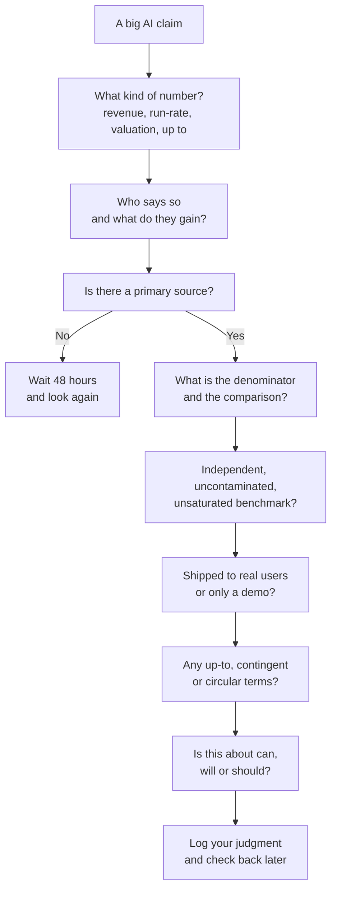

*Figure 65.13: The hype check as a flow. Most misleading claims fail at the first, fourth or sixth question.*

**A worked dissection.** Here is an invented headline of the kind you will see every week: "AI startup Nimbus hits $1 billion ARR, raises $2 billion at a $40 billion valuation, signs up-to-$10 billion compute deal with its chip investor, and beats GPT on a top benchmark." Running the checklist:

- "$1 billion ARR" is a pace, not money collected. Is it based on one strong month? Gross or net of reseller fees?
- "$40 billion valuation" means investors bought about 2 ÷ 40 = 5% of the company at that price. It says nothing about profit.
- "Up to $10 billion" is a ceiling over several years, probably with conditions, and the deal is with an investor: a possible circular flow.
- "Beats GPT on a top benchmark" raises three questions: which model version, run by whom, and is the benchmark saturated or contaminated?
- What is missing: recognized revenue, gross margin, customer concentration and any independent evaluation.

None of this means Nimbus is a bad company. It means the headline, by itself, tells you much less than it seems to.

> **Key idea:** You do not have to decide whether AI is "overhyped" in general. Judge each claim on its own: what kind of number, from whom, compared with what, measured how, shipped or not.

## Your one-page plan

Everything in this chapter fits on one page. Fill this in, put it somewhere you will see it, and review it each quarter.

```
MY TRACK (and why):
WEEKLY HOURS I CAN PROTECT:          WHEN (days and times):
STAGE AND DATES:  Stage __, from ______ to ______
THIS QUARTER'S MILESTONE (checkable):
RESOURCES THIS QUARTER (max 3):
  1.
  2.
  3.
PORTFOLIO PROJECT THIS QUARTER:
  Real user:                 Eval set size:
INFORMATION DIET: newsletter ______  podcast ______
                  community ______
PUBLIC OUTPUT: where ______  how often ______
NEXT REVIEW DATE:
```

*Figure 65.14: A one-page learning plan. Three resources at most per quarter: finishing beats collecting.*

## In plain English

Learning AI is less about finding resources than about choosing a direction, putting things in order, and finishing. Everyone should start the same way: spend about three months, at roughly five hours a week, becoming a fluent and careful power user. That means understanding in broad strokes how chatbots work, taking a couple of short courses, practicing on your real work, writing down your own rules for when to trust AI, and reading two good books.

Then pick a track. Track A makes you the person who redesigns how work gets done with AI, without becoming a programmer. Track B makes you an AI engineer who builds products on top of models. Track C goes into training models and research, and takes the longest. Track D is about the physical and economic machinery: GPUs, data centers, trades and the industry. Track E is about governance, policy and safety. Each track has its own three-to-twelve-month and one-to-three-year stages, with specific free and paid resources.

Throughout, build things and show them. A few strong projects with real users, honest numbers and clear write-ups beat a pile of certificates, except in the enterprise, cloud, governance and trades settings where specific credentials open doors. Sharing your progress publicly, safely and honestly, compounds over time.

To stay current, keep a small information diet of about three hours a week: one newsletter a day, one podcast or paper a week, a monthly test of what models can now do, and a quarterly review. And run a simple checklist over any big AI claim: what kind of number it is, who says it and why, where the original source is, what it is compared with, whether the test was independent, whether it has really shipped, and whether any "up to" or circular terms hide inside it.

## Key terms

Learning roadmap, track, milestone, top-down learning, retrieval practice (active recall), spaced repetition, deliberate practice, tutorial hell, power user, jagged frontier, reusable assistant, trust rules, T-shaped skills, domain expertise, workflow automation, vibe coding, MCP (Model Context Protocol), AI agent, eval set (golden set), AI engineer, Python, RAG (retrieval-augmented generation), evals (evaluations), error analysis, FDE (forward-deployed engineer), ML engineer (MLE), research engineer, Kaggle competition, preprint, peer review, replication, ablation, research taste, fellowship, CUDA, GPU kernel, registered apprenticeship, critical facilities technician, AI governance, risk management framework, interpretability, alignment, system card, certification, certificate of completion, portfolio, case study, building in public, information diet, RSS feed, leaderboard, hype cycle, primary source, recognized revenue, run-rate (annualized revenue), base rate, benchmark contamination, "up to" deal, circular deal, valuation (post-money).

## Exercises

1. **[Easy] Write your one-page plan.** (1) Use Figure 65.2 to choose a track, and write one sentence on why. (2) Open your calendar and block the weekly hours you can genuinely protect, as fixed appointments. (3) Choose at most three resources for this quarter from your track's section; open each course page and write down its listed hours and whether it is free or paid. (4) Write a milestone someone else could check ("I have an eval set of 20 inputs for my team assistant and it passes 16"). (5) Fill in Figure 65.14, paste it into your chatbot and ask: "What is the weakest, vaguest or most unrealistic part of this plan?" Revise once. **What you'll learn:** A plan with protected time, few resources and a checkable finish line is far more likely to be completed than a long reading list.

2. **[Easy] Turn a job posting into a syllabus.** (1) Open a job board, for example Anthropic's (job-boards.greenhouse.io/anthropic), OpenAI's (jobs.ashbyhq.com/openai), or a local employer's careers page. (2) Pick one role in your track and copy its requirements into a document. (3) Ask your chatbot to group the requirements into skills and to suggest which resources from this chapter's tables cover each one. (4) Mark each skill as "have", "partly" or "missing". (5) Pick the two biggest gaps and put them in next quarter's plan. **What you'll learn:** Employers publish exactly what they want; job postings make excellent, free, up-to-date syllabi.

3. **[Easy] Set up your information diet.** (1) From the tables in this chapter, choose one newsletter, one podcast and one community that fit your track. (2) Subscribe, and send the newsletter to a dedicated email folder or a feed-reader app so it does not mix with your inbox. (3) Put a 20-minute daily slot in your calendar. (4) After two weeks, unsubscribe from anything you skipped twice, and add one source from the skeptics list if you have none. **What you'll learn:** Staying current is a design problem: a few chosen sources, at a fixed time, beat an endless feed.

4. **[Medium] Prove spaced retrieval to yourself.** (1) Pick two concepts from this book that are new to you, such as the KV cache (Chapter 23) and PUE (Chapter 40). (2) On day 1, read about both for 15 minutes each. (3) For concept A only, on days 2, 4, 7 and 14, close your notes and ask your chatbot: "Quiz me with five questions on [concept], one at a time, and grade my answers." Record each score. (4) For concept B, just reread the section on the same days. (5) On day 21, have the chatbot quiz you on both and compare. **What you'll learn:** Pulling ideas out of memory at growing intervals beats rereading, and your chatbot can run the whole system for free.

5. **[Medium] Dissect a real headline.** (1) Find one AI headline this week about revenue, funding, a compute deal or a benchmark result. (2) List every number in it and label each as recognized revenue, run-rate or ARR, valuation, an "up to" amount, or a benchmark score. (3) Find the primary source (an SEC filing at sec.gov, the company's own post, the paper or the system card). (4) Run all ten checklist questions and note which ones the article answered and which it skipped. (5) Write three sentences: what the headline said, what it did not say, and what you would want to know next. **What you'll learn:** Most misleading AI news is technically true; the skill is spotting what kind of number you are looking at and what is missing.

6. **[Medium] Start a prediction log and score it.** (1) In a spreadsheet, write ten specific predictions about AI that will resolve within three to twelve months (for example, "A major lab releases a new flagship model before March"), each with a probability between 0 and 1. (2) When each resolves, enter 1 if it happened and 0 if not. (3) Score each with (probability − outcome) squared: a 0.7 prediction that came true scores (0.7 − 1)² = 0.09; a 0.9 prediction that did not scores (0.9 − 0)² = 0.81. (4) Average the scores. This average is called a Brier score; lower is better, and someone who always says 0.5 scores 0.25. (5) Do the same for two pundits you follow, using their public statements. **What you'll learn:** Tracking predictions turns vague impressions of who is "usually right" into evidence, including about yourself.

7. **[Medium] Course time-and-cost audit.** (1) Choose three courses or books for your track from this chapter. (2) For each, record the listed hours, whether it is free, free to audit with a paid certificate, or paid, and any certificate cost, from the provider's own page. (3) Double the listed hours for practice (triple for project-heavy courses). (4) Divide by your weekly hours to get weeks: for example, a 40-hour course becomes 80 real hours, which at 5 hours a week is 16 weeks. (5) Put the three in order and check that the total fits your stage. **What you'll learn:** Realistic time estimates prevent the most common failure, which is starting too many things and finishing none.

8. **[Medium] Write up a project like a professional.** (1) Take a project you have already done, such as the custom assistant from Chapter 25 or the automation from Chapter 29. (2) Write 20 test inputs with a note on what a good output looks like. (3) Run them, score each as pass or fail, and label every failure by type. (4) Fix the most common failure type and run all 20 again. (5) Fill in the write-up template in Figure 65.10, with real numbers, and ask one person to read it and tell you what was unclear. **What you'll learn:** Evaluation plus an honest write-up turns an ordinary project into strong portfolio evidence.

9. **[Challenge] Read a paper with the three-pass method.** (1) Choose a famous, readable paper, such as "Attention Is All You Need" (2017, arxiv.org/abs/1706.03762), or a recent report from METR or Epoch AI. (2) First pass, 10 minutes: title, abstract, introduction, headings, figures and conclusion; write three sentences on what it claims. (3) Second pass, about an hour: read it properly, skipping proofs, and list everything you did not understand. (4) Ask your chatbot to explain each item on your list, then check each explanation against the paper itself. (5) Ask the chatbot for its own summary of the paper and compare it with yours, noting any claim it got wrong or invented. **What you'll learn:** How researchers read efficiently, and how to use AI as a reading companion without trusting it blindly.

10. **[Challenge] A 30-day building-in-public sprint.** (1) Pick a small project from the portfolio table for your track. (2) On day 1, post a short plan: what you will build, for whom, and how you will measure it. (3) Post a progress note every week, including one thing that failed. (4) On day 30, publish a write-up using Figure 65.10. (5) Before every post, check it against the safety rules in this chapter (no employer or client data, credit sources, disclose AI help). (6) Count the comments, questions and offers of help you received. **What you'll learn:** Public, regular, honest progress makes you finish, brings feedback, and starts a record that compounds.

11. **[Challenge] The quarterly jagged-frontier re-test.** (1) Write 15 tasks from your own field: 5 easy, 5 hard, 3 tricky (with a trap a newcomer would fall into) and 2 that need local knowledge. (2) Run each on two different chatbots and score each answer 0 (wrong), 1 (partly right) or 2 (right), for a maximum of 30 per chatbot. (3) Record scores and notable failures in a spreadsheet. (4) Repeat in three months with the then-current models and compute the change. (5) Update your trust rules and decide one task you will now delegate and one you will not. **What you'll learn:** Your own small, private benchmark is the most relevant measure of AI progress for your work, and re-running it keeps your trust calibrated.

## Areas of opportunity

- **Niche AI educator and workshop leader.** General AI content is saturated, but "AI for physiotherapists", "AI for electrical contractors" or "AI for school administrators" is not. Professionals and their employers pay for practical, field-specific training, and a domain expert who has done Track A is well placed to provide it.
- **Internal AI champion and adoption lead.** Companies that bought AI tools for thousands of employees need people who run training, build shared assistants and prompt libraries, and measure time saved. This often starts informally (lunch-and-learns) and becomes a formal role.
- **Technical instructor and developer educator.** AI companies need people who can teach their tools. In October 2026 Anthropic posted a Lead Technical Instructor role at $270,000–$365,000 and a Developer Education Lead at $290,000–$365,000 (base), showing how much adoption is bottlenecked by understanding.
- **Specialist analysis and curation.** Readers will pay for trusted, primary-source analysis of one slice of AI, as the paid tiers of compute- and research-focused newsletters show. A careful analyst covering, say, AI in insurance or AI regulation in one country can build an audience and a consulting practice.
- **Learning tools that make people think.** There is demand for AI tutoring that improves learning rather than handing out answers, and for new assessments that still measure skill when students have AI. Teachers who can design and test these are valuable to schools and education companies.
- **Evaluation-as-a-service for a field.** The domain benchmark from your portfolio (tax edge cases, clinical vignettes, building-code questions) can become a service that helps companies in your industry test whether AI tools actually work on their cases.
- **Workforce training for the physical buildout.** Data centers need electricians, HVAC and controls technicians and operators faster than traditional pipelines supply them. Training providers, community colleges and companies are hiring for this; OpenAI posted a "Workforce Development and Education Manager, Infrastructure Sites" role at $176,000–$385,000 in October 2026.
- **Community building.** Meetups, Discord servers, study groups and small conferences make their organizers into hubs that employers and collaborators seek out. It is low-cost to start and compounds like building in public.
- **Open problems worth working on.** How to measure whether AI tutoring helps people learn over months, not minutes; credentials that verify real skill (for example, by checking portfolio work) rather than course completion; tools that track the forecasting record of experts and companies; and better automatic flagging of misleading AI claims, such as run-rates presented as revenue.

## Check your understanding

1. Why does every track in this roadmap begin with the same Stage 1, even for future researchers and data-center engineers?
2. A company earned $6 billion last month. What run-rate would it announce, and why might that figure mislead?
3. A course lists 30 hours. You can study 4 hours a week. Using the doubling rule, roughly how many weeks should you plan for?
4. Name four features that make a portfolio project convincing to a hiring manager.
5. In which settings do certifications matter most, and where do they matter least? Give one example of each.
6. A headline announces an "up to $20 billion" investment, of which $14 billion is contingent on milestones. How much is unconditional, as a dollar figure and as a share of the headline?
7. What is retrieval practice, and how can a chatbot either help or undermine it?
8. Why does this chapter recommend following at least one skeptic and at least one enthusiast?

<details><summary>Answers</summary>

1. Every kind of AI work now happens in a world full of AI tools, so everyone benefits from briefing models well, checking their output and reading AI news critically. Stage 1 also builds conceptual understanding of how models work, which every track relies on, and it pays for itself quickly: saving three hours a week repays the roughly 65 hours of study in about 22 weeks.
2. $6 billion × 12 = a $72 billion run-rate. It may mislead because it assumes one month repeats all year, which flatters fast growth or a single strong month; it is not money already earned (recognized revenue may be much lower); and companies calculate it differently, for example counting reseller sales gross or net.
3. 30 × 2 = 60 real hours; 60 ÷ 4 = 15 weeks, or about three and a half months.
4. Any four of: it solves a real problem for a real user; it has an eval set with numbers; it includes an error analysis with failure types counted; it shows a before-and-after improvement; it reports cost per use; it is honest about limitations; it is clearly written up so a busy reader understands it in minutes.
5. They matter most where a buyer or HR filter requires them: cloud-centered enterprises (for example, the AWS Certified AI Practitioner in an AWS shop), consulting and systems integrators, government contracting, and governance and compliance (the IAPP AIGP). They matter least in frontier research, research engineering and startup engineering, where public work dominates. In the trades, licenses and apprenticeships are essential.
6. $20 billion − $14 billion = $6 billion unconditional, which is 6 ÷ 20 = 30% of the headline.
7. Retrieval practice means strengthening memory by recalling information without looking, for example by answering quiz questions or explaining an idea from memory. A chatbot helps when it quizzes you and grades your answers; it undermines learning when it explains everything and you simply nod along, because then the effort of recall, which is what builds memory, never happens.
8. Your errors tend to come from the side you do not read. Skeptics catch inflated claims and weak evidence; enthusiasts and practitioners catch real capability changes that skeptics may dismiss. Reading both keeps your judgment calibrated, and lets you state each side's best argument fairly.

</details>

## Going deeper

- **Andrej Karpathy, "Neural Networks: Zero to Hero" (karpathy.ai/zero-to-hero.html).** Eight free lectures that build from a tiny learning engine to a working GPT, typing every line; the single best route from "I use AI" to "I understand how it is trained."
- **Hugging Face Learn (huggingface.co/learn).** Twelve free courses, including LLMs, agents, context engineering, post-training, diffusion, audio and robotics, kept current by the company at the center of open-source AI.
- **Anthropic Academy (anthropic.skilljar.com) and OpenAI Academy (academy.openai.com).** Free courses from two frontier labs on working with and building on their models, from AI fluency to APIs, MCP and agents.
- **fast.ai, "Practical Deep Learning for Coders" (course.fast.ai).** The classic free top-down deep learning course; proof that you can train real models before mastering all the math.
- **Chip Huyen, *AI Engineering* (O'Reilly, 2025).** The best single book for Track B, covering evaluation, retrieval, agents, fine-tuning and production trade-offs.
- **Arvind Narayanan and Sayash Kapoor, *AI Snake Oil* (2024), and their "AI as Normal Technology" writing.** The most useful toolkit for telling AI that works from AI that cannot, written by two Princeton computer scientists.
- **Epoch AI (epoch.ai).** Free, carefully sourced data on compute, training costs, hardware and data centers; the place to check a number before you repeat it.
- **80,000 Hours, AI safety career review and podcast (80000hours.org).** The most detailed public guide to careers in AI safety and policy, with honest discussion of fit and trade-offs.
- **S. Keshav, "How to Read a Paper" (2007).** A two-page note describing the three-pass method; it will save you hundreds of hours over a career of reading research.
- **Appendix E of this book.** The full list of courses, books, newsletters, podcasts and communities, grouped by level and type, with costs and links.
