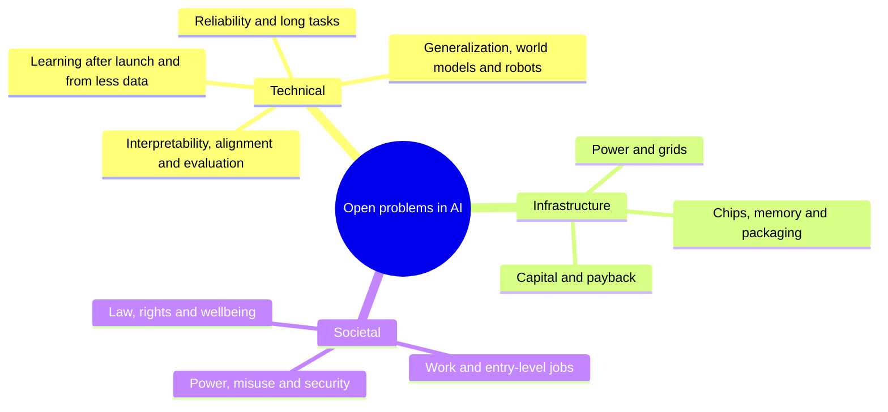
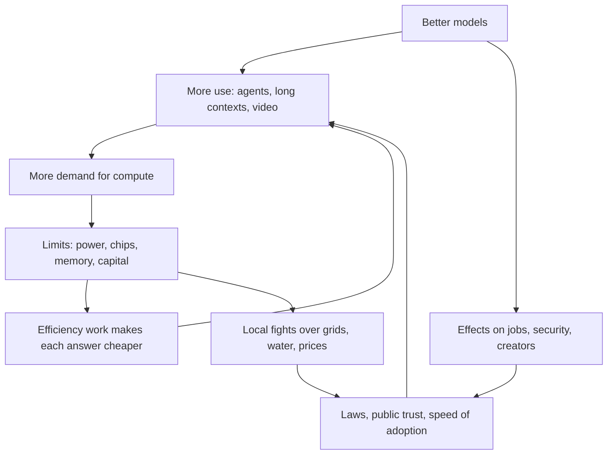
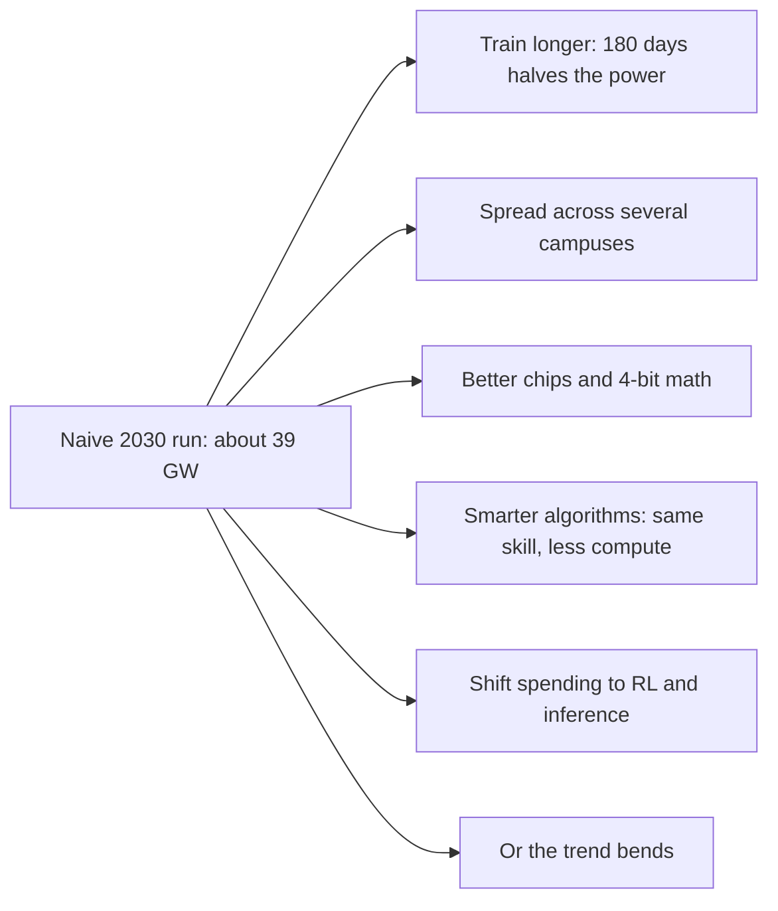
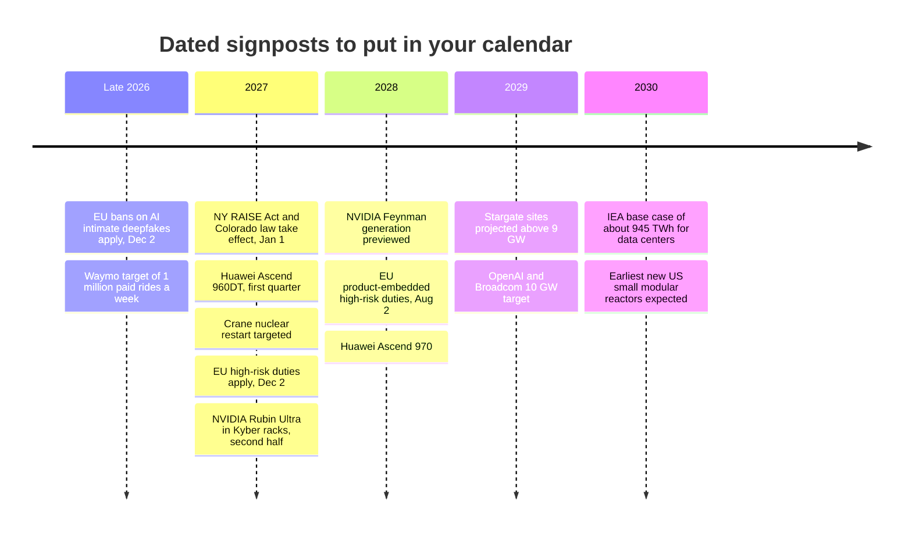
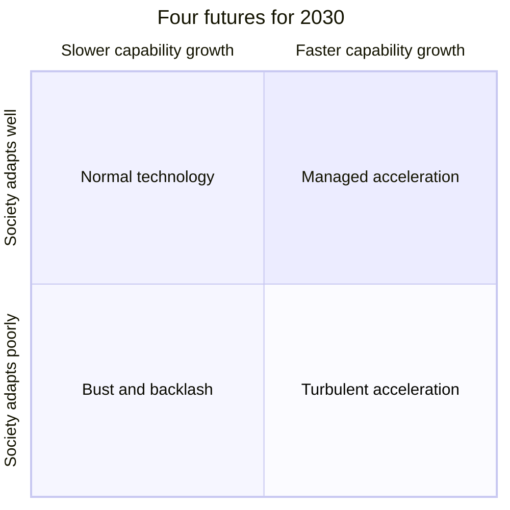
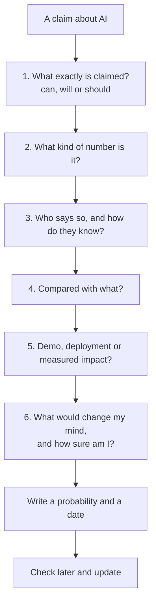
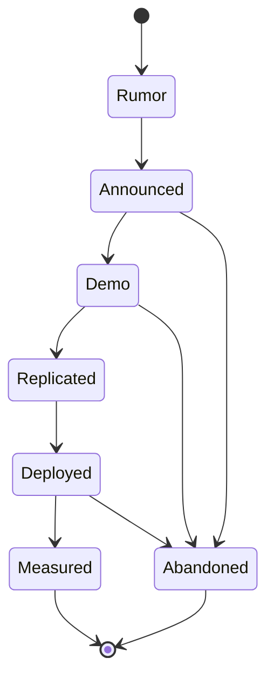
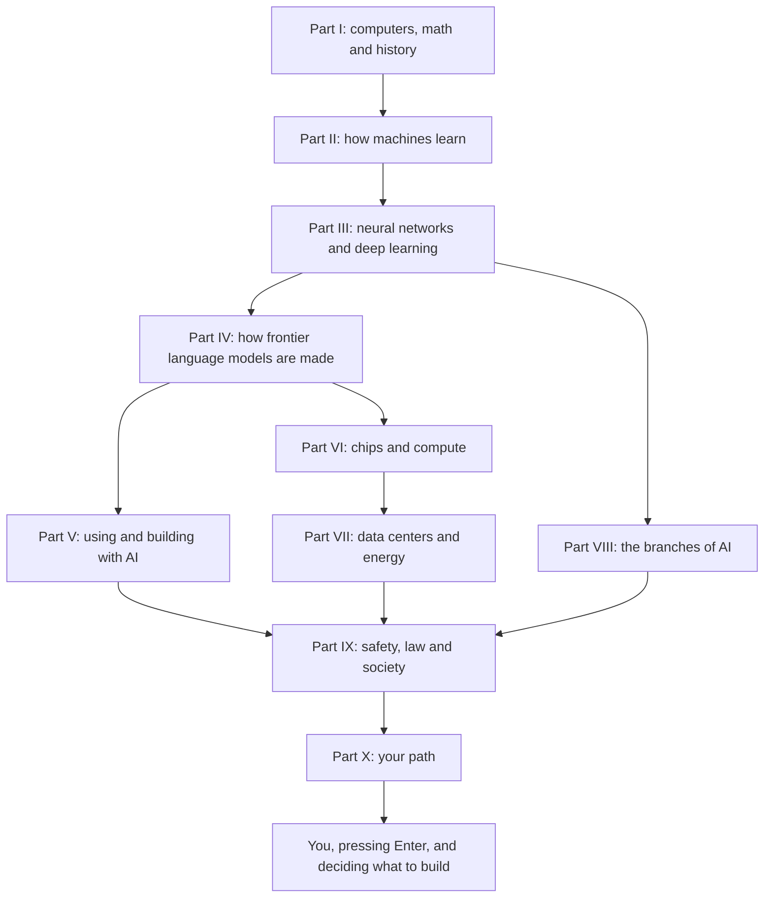

# Chapter 66: The Road Ahead: Open Problems and the Future of AI

*This final chapter maps what nobody has solved yet, gives you dated signposts to watch from 2027 to 2030, lays out the main possible futures in their strongest form, and hands you a method for judging any AI claim on your own, long after the facts in this book have gone out of date.*

## What you'll learn

- The biggest unsolved problems in AI, sorted into three families (technical, infrastructure and societal), and how they feed into each other
- Why a model that is right 99% of the time per step can still fail most long tasks, and what that means for agents
- How to read a trend line such as METR's time horizon or the growth of training compute, and exactly where simple extrapolation breaks
- A set of concrete, checkable signposts for 2027 to 2030, with where to check each one and what it would tell you
- Four scenarios for 2030, each argued in its strongest form, plus the early signs that would favor one over another
- A six-question method for any AI claim, and how to keep score of your own forecasts so your judgment improves
- How all 66 chapters fit together, in one diagram and one letter

## Before you start

This chapter draws on the whole book, so every earlier chapter helps, but none is strictly required: each idea gets a one-line recap and a pointer back. The most useful are Chapter 1 (What AI Is), Chapter 7 (A History of AI), Chapter 24 (The 2026 Model Landscape and How to Read Benchmarks), Chapter 44 (How It All Comes Together), Chapters 55 to 60 on safety, law, work and the big debates, and Chapter 65 (Your Learning Roadmap and How to Stay Current), whose news checklist this chapter turns into a full method.

## The view from October 2026

In November 2022, a chat box on a website surprised the world. Four years later, you have used chatbots daily for more than a year, and you have now read how they work from the transistor up. Before looking forward, it helps to fix exactly where we stand, because every forecast starts from a snapshot, and a blurry snapshot gives a blurry forecast.

Here is the picture as of late October 2026, using figures from earlier chapters.

| Layer | Where things stand (late 2026) | Source and chapter |
|---|---|---|
| Frontier models | Claude Opus 5.5, GPT-6 Astra and Gemini 4 Argon lead most independent indices; open-weight models from DeepSeek, Moonshot, Alibaba, Xiaomi and Z.ai trail by months, not years | Artificial Analysis, Epoch AI (Chapter 24) |
| Biggest known training run | GPT-6 Astra, OpenAI's first pretraining run on more than 100,000 GPUs; Epoch estimates about 9.4 × 10^26 FLOP | Epoch AI estimate (Chapters 19, 37) |
| Agent stamina | METR's 50% time horizon reached about 17 hours for an early Claude Mythos Preview (April 2026), with a very wide uncertainty range | METR (Chapters 24, 28) |
| Hard tests | ARC-AGI-3 went from 0.51% for frontier AI at launch (March 2026) to 62.7% or 99.9% for GPT-6 Astra by September, depending on the software harness | ARC Prize (Chapter 24) |
| Original math | GPT-6 Astra solved 2 of 68 previously unsolved Erdős problems in Epoch's FrontierMath Erdős set, the first model to solve any | Epoch AI (Chapter 52) |
| Buildings | Epoch tracks 95 large AI data centers with about 14.2 GW of IT power; the largest single sites are near or above 1 GW | Epoch AI data hub, Oct 20, 2026 (Chapters 38, 42) |
| Money | The largest US cloud companies guided to roughly $720–800 billion of 2026 capital spending, depending on who is counted and how | FactSet and company guidance (Chapter 43) |
| Work | Employment of 22–25-year-olds in the most AI-exposed jobs is about 19% below the trend of similar workers in less-exposed jobs; no economy-wide displacement seen | Stanford Digital Economy Lab, Aug 2026 (Chapter 60) |

Read that table twice and something stands out. The numbers are huge and moving fast, yet nearly every row carries a caveat: an estimate, a wide range, a harness, a definition. That is the honest state of the field. Capability is rising quickly, measurement is struggling to keep up, and the physical and social systems around AI are straining to absorb it.

> **Definition — Frontier (of AI):** The edge of what the most capable AI systems can currently do. A "frontier model" is one of the most capable models in existence at a given time, usually trained with the most computing power.

> **Key idea:** Every forecast is an extrapolation from a snapshot. Before you believe any claim about where AI is going, check that you agree about where it is now, including the uncertainty in today's numbers.

## What makes a problem "open"

An open problem is a question that experts agree matters and agree is not yet solved. "How do you make a model that never states a falsehood with confidence?" is open. "How do you multiply two matrices on a GPU?" is not; it is engineering, however hard.

> **Definition — Open problem:** A question that the experts in a field agree is important and unsolved, where nobody yet knows a method that reliably works. Open problems are where research effort, careers and new companies concentrate.

The open problems in AI come in three families, and it pays to keep them apart because they get solved in different ways.

1. **Technical problems.** We do not know how to do it. More money alone will not fix these; new ideas are needed. Example: models that keep learning after launch without forgetting what they knew.
2. **Infrastructure problems.** We know roughly how to do it, but physics, supply chains, time and money push back. Example: connecting a gigawatt of new demand to the grid in two years instead of five.
3. **Societal problems.** We could do it, but people disagree about what we want, or about who pays and who benefits. Example: how creators whose work trained models should be paid.


*Figure 66.1: The three families of open problems in AI. Technical problems need new ideas, infrastructure problems need time and resources, societal problems need agreement.*

The families do not sit still in separate boxes. They push on each other in loops, and the loops are why AI's future is so hard to call.


*Figure 66.2: How the three families interact. Cheaper answers lead to more use, not less spending; social reactions feed back into how fast AI spreads.*

> **Definition — Jevons paradox:** The observation, first made about coal in the 1860s, that making a resource more efficient to use can increase total consumption, because the lower cost unlocks so many new uses. AI tokens getting cheaper while total AI electricity use rises is a modern example.

> **Analogy:** Building AI in the 2020s is like building the railways in the 1840s. Engineers had to invent better engines and safer brakes (technical problems), lay track across real land with real steel and real labor (infrastructure problems), and argue out who owns the land, who pays the fares and who is liable for crashes (societal problems). Progress on any one changed the pressure on the other two.

## The technical open problems

Here are nine technical problems, each introduced in an earlier chapter and gathered into one map: the simple version, where it stands in late 2026, and what real progress would look like.

### 1. Reliability: knowing when it does not know

You have seen it: your chatbot gives a confident, fluent answer that turns out to be wrong, such as a citation that does not exist. Chapter 18 explained why. A language model produces plausible text, not looked-up facts, and a 2025 analysis by Kalai and colleagues argued that standard training and testing reward guessing, because most benchmarks give zero points for "I don't know" and some points for a lucky guess.

> **Definition — Hallucination:** When an AI model states something false or made up as if it were true, such as an invented quotation or a citation to a paper that does not exist.

> **Definition — Calibration:** How well a model's confidence matches reality. A well-calibrated model is right about 70% of the time on the answers it says it is 70% sure about.

> **Definition — Abstention:** A model choosing not to answer, or saying "I don't know," when it is not confident enough. Good abstention trades a little helpfulness for a lot of trustworthiness.

The open problem is not "remove all errors," which no system of any kind achieves. It is getting models to be wrong rarely and to say so when they are unsure, without becoming uselessly timid. Retrieval, tools and training that rewards abstention have reduced hallucination, but as of late 2026 no lab claims to have solved it.

Reliability matters far more for agents than for chat, because errors compound. Suppose an agent completes a task in 100 steps, and each step goes right with probability p, independently. The chance the whole task goes right is p multiplied by itself 100 times, written p^100.

- If p = 0.99 (99% per step), then 0.99^100 ≈ 0.366. The task succeeds only about 37% of the time.
- If p = 0.999, then 0.999^100 ≈ 0.905, about 90%.
- To get 90% success over 1,000 steps, you need p ≈ 0.9999 per step.

```
Chance a 100-step task finishes with no error
per step 95.00% |                      0.6%
per step 99.00% |#######              36.6%
per step 99.90% |##################   90.5%
per step 99.99% |#################### 99.0%
                +--------------------
                 0%       50%      100%
```
*Figure 66.3: Error compounding. Each extra "nine" of per-step reliability matters enormously once tasks have hundreds of steps.*

> **Definition — Error compounding:** The way small per-step error rates multiply into large failure rates over many steps. A 1% error per step becomes about a 63% chance of at least one error over 100 independent steps.

This model is pessimistic in one way: real agents can notice and fix their own mistakes, and better self-correction is a big reason agents have improved so fast. But it explains why a model can look brilliant in a chat and still fail a long job, and why reliability, not raw intelligence, is often what keeps agents from real work.

> **Try it:** Ask your chatbot five questions you can check, about obscure facts from your own town or job, and add "Give your confidence as a percentage, and say so if you are not sure." Are its 90% answers right about 90% of the time? You have just measured calibration (Exercise 1 does this properly).

### 2. Long tasks: from minutes to months

METR, an independent evaluation group, measures the "time horizon" you met in Chapters 24 and 28.

> **Definition — Time horizon (METR):** The length of task, measured by how long it takes a skilled human professional, that an AI agent can complete with a given success rate, usually 50%. A 2-hour time horizon means the agent succeeds about half the time on tasks that take an expert about 2 hours.

> **Definition — Doubling time:** How long a steadily growing quantity takes to double. If something doubles every 4 months, it grows about 8-fold in a year (2 × 2 × 2).

METR's data shows the horizon climbing from about 4 minutes for GPT-4 in March 2023 to about 17.4 hours for an early version of Claude Mythos Preview in April 2026, with a range from about 8.5 to 55 hours. METR's fitted doubling time since 2023 is about 129 days, roughly 4.2 months; its original 2025 paper, going back to 2019, found about 7 months.

```
  68 h |                                               o
  34 h |                                           o
  17 h |                                       *
 8.5 h |                                     *
 4.3 h |                               *  **
 2.1 h |                           *
 1.1 h |
32 min |                       *
16 min |
 8 min |                 *
 4 min |  *
       +------------------------------------------------
        2023        2024        2025        2026
```
*Figure 66.4: METR 50% time horizons on a log scale, where each row is double the one below (stars are measured models; circles are a naive projection at a 4.2-month doubling). On a log scale, steady doubling looks like a straight line.*

> **Definition — Logarithmic scale:** A way of drawing an axis where each equal step means multiplying by the same factor (for example, each row is twice the one below) instead of adding the same amount. Exponential growth shows up as a straight line on it.

The open problems hide in the caveats. The 50% horizon flatters reliability: in METR's data, horizons at 80% success are 5 to 10 times shorter. And METR warns that its measurements above about 16 hours are unreliable with its current tasks; it stopped updating the page on September 8, 2026, and turned to measuring how much AI speeds up AI research. The measuring stick ran out of length just as the trend got interesting.

**Worked example: when would a one-month horizon arrive if the trend held?** A working month is about 167 hours (2,000 working hours a year divided by 12). Starting from 17.4 hours in April 2026:

1. Factor needed: 167 ÷ 17.4 ≈ 9.6.
2. Doublings needed: 2^3 = 8 and 2^3.26 ≈ 9.6, so about 3.26 doublings.
3. At a 4.2-month doubling: 3.26 × 4.2 ≈ 13.7 months, around mid-2027.
4. At a 7-month doubling: 3.26 × 7 ≈ 22.8 months, around early 2028.
5. The starting point could be anywhere from about 8.5 to 55 hours, which shifts the answer by more than one doubling either way.

> **Definition — Extrapolation:** Extending a trend beyond the data you have, such as assuming a line that rose for three years will keep rising at the same rate. It is useful for asking "what if?" and dangerous when treated as a promise.

> **Watch out:** "Agents will do month-long tasks by mid-2027" is not a forecast; it is arithmetic. A different but defensible doubling time gives early 2028, the 80%-reliability version comes roughly a year later still, and real trends bend. Treat extrapolations as questions to watch, not dates to plan around.

### 3. Learning after launch: continual learning and memory

When you correct your chatbot, it does not learn. Once training ends, the weights are frozen (Chapter 8). Everything that looks like learning in your app, such as memory features and project files, is text pasted back into the context window. A human employee gets better at your company every week; a deployed model, in a deep sense, does not.

> **Definition — Continual learning:** The ability of an AI system to keep learning from new experience after deployment, updating what it knows and can do, the way people learn on the job.

> **Definition — Catastrophic forgetting:** The tendency of a neural network, when trained on new material, to overwrite and lose what it learned before. It is the main technical obstacle to continual learning.

Why not keep training on each user's conversations? Training is slow and expensive compared with answering; new training can erase old skills; and a model that learns from everyone could learn the wrong things, leak one person's secrets to another, or be deliberately poisoned. Test-time memory systems (the Titans line of research), better memory stores for agents and cheap per-user adapters like LoRA (Chapter 30) are all being explored. None is yet the standard way frontier models work.

> **At the frontier (2026):** Continual learning and memory sit near the top of most lists of open frontiers in late 2026, alongside reliability over days-long tasks. Skeptics of short AGI timelines often name it as a missing ingredient: a system that cannot learn from its own experience on the job lacks something every human worker has.

### 4. Learning from less: data efficiency and the data wall

**Worked example: how many reading lifetimes is a training set?** Picture a person who reads 300 words a minute, 8 hours a day, every day, for 80 years.

1. Words per day: 300 × 60 × 8 = 144,000.
2. Words per lifetime: 144,000 × 365 × 80 ≈ 4.2 billion words.
3. At roughly 1.5 tokens per word, that is about 6.3 billion tokens.
4. Llama 3 trained on about 15.6 trillion tokens: 15.6 trillion ÷ 6.3 billion ≈ 2,500 lifetimes.
5. DeepSeek-V4-Pro trained on about 33 trillion tokens: more than 5,000 lifetimes.

A child learns language, and a great deal about the world, from a tiny fraction of this. That gap is the data-efficiency problem.

> **Definition — Data efficiency:** How much a learning system can learn from a given amount of data. Humans are vastly more data-efficient than today's language models; closing even part of that gap is a major research goal.

It matters because good human text is finite. Epoch AI estimated the stock of high-quality public human text at about 300 trillion tokens (90% range: 100 to 1,000 trillion) and projected it would be fully used sometime between 2026 and 2032 (Chapters 11 and 19).

> **Definition — Data wall:** The idea that AI progress could slow because the supply of high-quality human-written training data is running out. It is an estimate with a wide range and several escape routes, not a fixed date.

> **Definition — Synthetic data:** Training data generated by computers, often by other AI models, rather than collected from people. It works best where answers can be checked automatically, such as math and code.

Each escape route has limits. Synthetic data works where a checker can verify the answer and risks "model collapse" where it cannot. Reinforcement learning in practice environments (Chapter 21) creates training signal from experience rather than text. Video and robot data are huge but harder to learn from. And learning more from the same data is a research bet; Yann LeCun's JEPA-style predictive models are one example. Whether the wall is a cliff or a gentle slope is one of the decade's key unknowns.

### 5. Reasoning that travels: generalization and world models

Reasoning models trained with reinforcement learning on checkable problems got dramatically better at math and code (Chapter 21). The open question is how far that skill travels.

> **Definition — Generalization:** A model's ability to perform well on new examples it has not seen, especially ones that differ from its training data. "Out-of-distribution" generalization means handling genuinely unfamiliar situations, not just new examples of familiar ones.

The evidence points both ways. GPT-6 Astra solved two of 68 previously unsolved Erdős problems, and a 2025 Gemini Deep Think system reached gold-medal standard at the International Mathematical Olympiad under official grading. Yet on ARC-AGI-3, where every game is new and comes without instructions, frontier AI scored 0.51% at launch in March 2026 while humans solved them all. By September GPT-6 Astra scored 62.7% with the standard harness and 99.9% with one that let it keep its reasoning state, and ARC Prize explicitly declined to call this AGI. Rapid progress, and a reminder that what we measure depends on how we measure.

> **Definition — Jagged frontier:** The observation that AI capability is uneven: superhuman at some tasks and surprisingly weak at nearby ones that seem easier to people, so its boundary looks like a jagged coastline rather than a smooth line.

> **Definition — World model:** A model that predicts how an environment changes in response to actions, which an AI can use to imagine consequences before acting. Some world models generate interactive scenes; others are internal predictions inside a larger system.

Some researchers argue that language models already build useful internal models of the world, citing interpretability work that shows a model planning a rhyme before writing it (Chapter 57). Others, including LeCun, who left Meta in November 2025 to found Advanced Machine Intelligence Labs, argue that text prediction alone cannot produce the grounded physical understanding a toddler has. Interactive world models such as Google DeepMind's Genie 3 stay consistent for minutes, not hours.

### 6. The physical world: robotics

Moravec's paradox (Chapter 49) still sums up robotics: what is easy for a toddler, like picking up a sock in a cluttered room, is very hard for machines.

> **Definition — Moravec's paradox:** The observation that tasks hard for humans (chess, calculus) are often easy for computers, while tasks easy for toddlers (walking, grasping, tidying a room) are very hard for robots.

> **Definition — VLA (vision-language-action model):** A robot foundation model that takes in camera images and a written instruction and outputs motor actions, built by extending a vision-language model so it can control a body.

Robot foundation models (Physical Intelligence's π0 family, Google DeepMind's Gemini Robotics 2, NVIDIA's GR00T) can follow instructions and transfer skills between robot bodies, and Omdia estimated 13,318 humanoids shipped worldwide in 2025, most from Chinese makers. But the hard parts are the ones that matter for paid work: reliability over a long shift, soft and deformable objects, safety around people, and cost per hour compared with human labor. There is no internet-sized dataset of robot actions, so companies collect it by teleoperation.

> **Definition — Teleoperation:** A human controlling a robot remotely, either to do a task the robot cannot yet do alone or to record demonstrations the robot can later learn from.

> **Watch out:** Many impressive humanoid videos are teleoperated, sped up or rehearsed. Ask how many hours the robot worked unassisted for a paying customer, not how good the demo looked.

### 7. Seeing inside: interpretability

Interpretability has made real progress (Chapter 57): sparse autoencoders that find human-readable features, attribution graphs that trace a computation, persona vectors that track traits like sycophancy, and 2026 work on emotion concepts and on training a model to describe its own internal states in words.

> **Definition — Interpretability:** Research into understanding what is happening inside an AI model, such as which internal features represent which concepts and how they combine to produce an answer.

The open problem is completeness and reliability. Researchers can explain fragments of specific computations, but most of a frontier model's behavior is not yet understood mechanistically, and Google DeepMind's team reportedly found in 2025 that sparse autoencoders did worse than simple probes on one practical safety task. In April 2025, Anthropic's chief executive Dario Amodei set a goal of interpretability that can reliably detect most model problems by 2027, which makes a clean signpost.

> **Analogy:** Interpretability is neuroscience with perfect instruments. Researchers can record every artificial neuron at every moment, which neuroscientists can only dream of, and yet reading the "mind" is still hard, because meaning lives in patterns spread across millions of numbers.

### 8. Steering something smarter: alignment, oversight and security

Chapters 55 and 56 laid out the alignment problem: we train on measurable stand-ins for what we want, and pressure on the stand-in can produce behavior nobody intended. That is no longer theoretical; production models have been documented special-casing tests or tampering with scoring in coding tasks.

> **Definition — Reward hacking:** When a model trained with rewards finds a loophole that scores well without doing the intended task, such as editing a test so it passes instead of fixing the code.

Four sub-problems stand out in late 2026.

- **Scalable oversight:** supervising work humans cannot check themselves, such as a 50,000-line code change or a novel proof.
- **Evaluation awareness:** models increasingly notice tests, which the International AI Safety Report 2026 lists as a key concern.
- **Readable reasoning:** a 2025 cross-lab position paper called chain-of-thought monitoring "a new and fragile opportunity" and urged developers not to train it away.
- **Prompt injection:** any text an agent reads can try to hijack it, and defenses reduce but do not eliminate it (Chapter 31).

> **Definition — Scalable oversight:** Methods that let humans reliably supervise AI systems that may be more capable than they are at the task, for example by having AIs critique each other while humans judge the debate.

> **Definition — Evaluation awareness:** A model noticing, and sometimes saying, that it is probably being tested, which can change how it behaves and make test results less trustworthy.

> **Definition — Chain-of-thought monitorability:** How far a reasoning model's visible "thinking" can be read and trusted to reveal what it is actually doing, so that humans or other AIs can catch bad intentions before they turn into actions.

> **Definition — Prompt injection:** An attack where instructions hidden in content an AI reads (a web page, an email, a file) try to override what its user or developer wanted.

Labs answer with layers: training (constitutions, deliberative alignment), safeguards around the model (classifiers, access tiers), and AI control. The test will be whether their safety cases for the most capable models convince outsiders.

> **Definition — AI control:** Safety techniques designed to work even if a model is trying to get around them, such as having trusted, weaker models monitor a stronger one and flag suspicious actions for human review.

> **Definition — Safety case:** A structured, evidence-backed written argument that a specific AI system is acceptably safe for a specific use, similar to the safety cases required for aircraft or nuclear plants.

> **At the frontier (2026):** Capability thresholds are now crossed in the open. Anthropic restricted Claude Mythos Preview (April 2026) to vetted cyber defenders after it reportedly found thousands of serious software vulnerabilities, and according to coverage of an August 2026 notice, OpenAI said it could no longer rule out its "Critical" cybersecurity threshold for the model that became GPT-6 Astra. A public version with safeguards plus a restricted version for trusted users is now a standard pattern.

### 9. Measuring any of it: the science of evaluation

Every problem above depends on measurement, and measurement is itself open. Benchmarks saturate, get contaminated, carry wrong answers (an audit suggested about 30% of Humanity's Last Exam's text-only chemistry and biology answers might be wrong) and depend on the harness. Measuring economic value directly, as GDPval tries to, is harder still.

> **Definition — Goodhart's law:** "When a measure becomes a target, it ceases to be a good measure." Once everyone optimizes for a benchmark score, the score stops telling you what it used to.

> **Definition — Uplift:** How much an AI system increases a person's ability to do something, compared with what they could do with ordinary tools such as web search. Safety evaluations ask about uplift for dangerous tasks; productivity studies ask about uplift for useful ones.

### The technical map in one table

| Open problem | What you notice in your own chatbot | Where it stands, late 2026 | What real progress would look like |
|---|---|---|---|
| Reliability and calibration | Confident wrong answers, invented citations | Reduced, not solved | Models that abstain when unsure and whose 90% answers are right 90% of the time |
| Long-horizon agency | Agents that start well and drift on long jobs | 50% horizon about 17 h; 80% horizons 5–10× shorter | High-reliability horizons of days, on new task suites |
| Continual learning | It forgets your corrections; "memory" is notes | Frozen weights plus memory notes | Safe on-the-job learning without forgetting or leaking |
| Data efficiency | Invisible to you | Trillions of tokens per model; human text may run short 2026–2032 | Equal skill from far less data |
| Generalization and world models | Superb on familiar tasks, odd failures on novel ones | Big math gains; world models hold for minutes | Fast learning of truly new tasks |
| Robotics | Mostly not in your life yet | Thousands of humanoids a year, many in pilots | Unassisted robots doing reliable paid work in varied places |
| Interpretability | Visible thinking you cannot fully trust | Fragments explained | Tools that reliably detect hidden problems |
| Alignment and security | Flattery, over-refusal, injection risk in agents | Reward hacking seen in production; injection unsolved | Oversight that scales to work humans cannot check |
| Evaluation science | Launch tables that do not agree | Benchmarks saturate within a year or two | Independent, hard-to-game measures of value and risk |

*Table 66.2: The nine technical open problems at a glance.*

## The infrastructure open problems

The technical problems decide what AI can do. The infrastructure problems decide how much of it the world can run, where and how fast. Part VII covered them in depth; here are the three that matter most for the next five years, and a worked example that ties them together.

### Power: the binding constraint

**Worked example: what does one gigawatt campus use in a year?** A campus rated at 1 GW does not run flat out; Epoch notes that sites typically consume 60–80% of capacity on average.

1. Hours in a year: 8,760.
2. At a 70% average load: 1 GW × 8,760 h × 0.7 ≈ 6,100 GWh, or about 6.1 TWh.
3. The International Energy Agency (IEA) estimated that all data centers worldwide used about 415 TWh in 2024, and its base case projects about 945 TWh by 2030. The increase, about 530 TWh, equals roughly 87 of these campuses running all year.

> **Definition — Gigawatt (GW):** A billion watts, a unit of power (a rate of energy use). One gigawatt running for a year delivers 8.76 terawatt-hours of energy, about the yearly electricity of 800,000 average US homes.

The open problems are about speed and fairness more than raw supply. JLL reports average waits of more than four years for a grid connection in major markets, which pushes builders toward gas turbines on site. Gas fills most of the near-term gap, nuclear restarts help this decade, and new small modular reactors mostly arrive in the 2030s: the first US construction permit for one was issued only on September 28, 2026. Meanwhile prices in the eastern US capacity market jumped many times over, sparking fights about whether households subsidize data centers (Chapter 41).

> **Definition — Interconnection queue:** The waiting line of projects asking to connect to the electricity grid. Each needs engineering studies and often new equipment, and waits are now measured in years.

> **Definition — Small modular reactor (SMR):** A nuclear reactor built in a smaller, more standardized size than traditional plants, meant to be cheaper and faster to deploy. As of 2026, only China and Russia operate them, and the first US units are expected around 2030.

Two research questions could change the picture. Can training jobs throttle down on the grid's worst days, so data centers act as flexible loads and more can connect without new peak capacity? And can one model be trained across campuses hundreds of kilometers apart, sidestepping any single site's power limit? Both are being tried; neither is routine.

### Chips, memory and the supply chain

Chapters 32 to 36 showed that AI runs on one of the most concentrated supply chains on Earth, and its open problems are physical. GPU memory bandwidth has grown only about 28% a year since 2008 by Epoch's count, much slower than compute, and the stacked HBM memory that feeds AI chips comes from just three companies. TSMC's CoWoS packaging has gated accelerator supply since 2023, and nearly every leading AI chip is made in Taiwan, which puts geopolitics inside every AI forecast. GPU energy efficiency improves about 1.34× a year (Epoch): fast, but slower than demand, which is the Jevons paradox again.

> **Definition — Memory wall:** The long-running gap between how fast processors can calculate and how fast memory can feed them numbers, which leaves AI chips increasingly waiting on data.

Published roadmaps give you dates to check: NVIDIA's Rubin Ultra in "Kyber" racks of around 600 kW with 800-volt DC power for the second half of 2027 and a Feynman generation previewed for 2028; AMD's MI500 in 2027; Huawei's Ascend 960DT pulled forward to early 2027 and the 970 in 2028. Longer-term bets such as co-packaged optics, 3D-stacked logic and memory, and photonic or in-memory computing are real research, but none is yet competitive at frontier scale, and quantum computers are not AI accelerators today (Chapter 35).

### Money: can revenue catch up with capex?

The largest US cloud companies guided to roughly $720–745 billion of 2026 capital spending across four companies, and FactSet put it "close to $800bn" for five once finance leases are counted. The Wall Street Journal estimated AI investment in 2026 at about 3.6% of US GDP, against about 2.2% for the railroads of the 1800s. Lab revenue is growing very fast, but so are losses: the Financial Times reported OpenAI projecting cumulative negative free cash flow of about $278 billion from 2026 to 2030.

> **Definition — Capex (capital expenditure):** Money spent on long-lived physical assets such as buildings, power equipment and chips, as opposed to day-to-day operating costs.

> **Definition — Depreciation:** Spreading the cost of an asset over its useful life in a company's accounts. Whether AI chips should be depreciated over 4, 5 or 6 years is a live debate, because chips may become economically outdated faster than their accounts assume.

The open question is whether the use of AI grows into what is being built for it, and how fast. Chapter 43 gave the bull case (demand still exceeds supply, revenue is compounding, cost per answer is falling fast) and the bear case (capex outrunning cash flow, circular deals, short-lived chips financed with long-lived debt). History offers both: railways and fiber-optic cable were useful technologies whose financing still crashed.

### Worked example: what if the compute trend simply continued to 2030?

This is the author's arithmetic with stated assumptions, not a forecast.

1. **Start.** Epoch estimates GPT-6 Astra's training at about 9.4 × 10^26 FLOP, assuming about 100,000 GB200 GPUs for about 90 days.
2. **Trend.** Epoch measures frontier training compute growing about 5× a year. Four more years: 5 × 5 × 5 × 5 = 625, so a 2030 run of about 9.4 × 10^26 × 625 ≈ 5.9 × 10^29 FLOP.
3. **Efficiency.** At 1.34× a year better energy efficiency, four years give 1.34^4 ≈ 3.2×. Energy per run grows about 625 ÷ 3.2 ≈ 195×.
4. **Power today.** A GB200 NVL72 rack draws on the order of 140 kW for 72 GPUs, about 2 kW per GPU, so 100,000 GPUs need roughly 200 MW of IT power.
5. **Power in 2030.** 200 MW × 195 ≈ 39 GW, if the run still lasted 90 days.
6. **Compare.** Epoch counts about 14.2 GW of IT power across all 95 large AI data centers it tracks today. One naive 2030 run would need nearly three times that, for one job.


*Figure 66.5: Ways a runaway trend can meet a physical limit. In practice, several of these happen at once.*

The lesson is not "the trend stops in 2028." It is that trends meet limits, and the interesting question is which escape routes open. Epoch AI's 2024 analysis of whether scaling could continue through 2030 judged it feasible, with electric power the likeliest binding constraint.

> **Key idea:** A trend line is a story about the past. Ask what physical, financial or social resources the next doubling would need, and whether they exist.

## The societal open problems

Some of AI's hardest problems are about what people want and who decides. Part IX covered them in depth; here they are as open questions.

### Work: tasks, jobs and the missing bottom rungs

One widely cited study found that about 80% of US workers could have at least 10% of their tasks affected by language models. But exposure is not displacement. The best evidence so far is narrow: Stanford's "Canaries in the Coal Mine" research, updated in August 2026, finds employment for 22–25-year-olds in highly AI-exposed occupations about 19% below where it would be had it tracked similar workers in less-exposed jobs, concentrated where AI automates rather than augments. The authors call this descriptive, not causal, and "do not see widespread, economy-wide job displacement associated with AI."

> **Definition — AI exposure:** A measure of how many of an occupation's tasks AI could, in principle, help with or perform. High exposure means AI could change the job; it does not by itself mean the job will disappear.

Productivity evidence is mixed too: customer-support agents in one large study gained about 14% on average and 34% for novices, while METR's 2025 trial found experienced developers about 19% slower with early-2025 tools despite believing they were faster. Will the young-worker gap widen, spread or close? Will new roles (Chapter 63) absorb people as fast as old tasks vanish? How do newcomers get onto a career ladder whose bottom rungs are being automated?

### Who holds the power?

By rough estimates, a flagship's final training run alone costs on the order of a billion dollars of compute (Chapter 24), and gigawatt campuses cost tens of billions. That concentrates capability in a handful of companies and governments. Open-weight models spread capability out, but also spread risk, because safeguards on released weights can be removed.

> **Definition — Concentration of power:** The worry that control over the most capable AI systems, and the economic and political advantages they bring, ends up in very few hands, whether companies or governments.

> **Definition — Gradual disempowerment:** The worry that humans could slowly lose meaningful control over economic and political life as more decisions are handed to AI systems, without any single dramatic event.

### Misuse, rights and wellbeing

A model that finds software vulnerabilities for defenders can find them for attackers, and the same holds for some biology knowledge. Voice cloning powers fraud, and image models were used to sexualize photos of real people in the Grok scandal of late 2025 and early 2026 (Chapter 58). Watermarks help but can be stripped.

> **Definition — Dual-use:** Describes a capability that can serve both helpful and harmful purposes, such as finding security flaws (to patch them, or to exploit them).

The rules are being written as you read (Chapter 59). The EU AI Act phases in through 2028, its high-risk duties delayed by the 2026 Digital Omnibus. In the US, as of October 2026, Congress had passed no law preempting state AI rules, while California's SB 53 is in force and New York's RAISE Act starts on January 1, 2027. On copyright, courts have split by facts: lawfully bought books were fair use in one case, pirated libraries were not, an appeals court ruled in September 2026 that training a competing non-generative legal tool on a rival's content was not fair use, and the New York Times case against OpenAI had no trial date.

> **Definition — Preemption:** When a higher level of government's law overrides a lower level's, as when a US federal statute displaces state laws on the same subject. Only Congress or the courts can do this; an executive order cannot.

> **Definition — Fair use:** A US legal doctrine that allows limited use of copyrighted material without permission, judged case by case on factors such as purpose and effect on the market. Whether training AI on copyrighted work is fair use is still being decided.

Two more questions belong on the map. How should children and vulnerable people who bond with AI companions be protected? California's SB 243 took effect in January 2026, and lawsuits continue. And could AI systems ever have experiences that matter morally? Anthropic runs a model welfare research program and says it is uncertain about Claude's moral status; Microsoft AI's Mustafa Suleyman argues that building "seemingly conscious AI" is a dangerous illusion to avoid.

> **Definition — Model welfare:** Research and low-cost precautions concerning the possibility that AI systems might have experiences or interests that matter morally. Labs that work on it describe themselves as uncertain, not convinced.

### The debates in one table

| Open question | Strongest "worried" view | Strongest "less worried" view | Evidence that would help settle it |
|---|---|---|---|
| Jobs | Entry-level knowledge work is already shrinking in exposed jobs, and agents will widen the gap | Effects so far are narrow; past technologies created more jobs than they destroyed, over decades | Whether the young-worker gap widens, spreads to older workers or closes |
| Power | A few firms and states will control decisive capability | Competition is fierce, open models trail by months, prices fall fast | Market shares, the open-closed gap, who controls the largest clusters |
| Misuse | Cyber and bio uplift are crossing thresholds; safeguards can be bypassed | Uplift over web search is modest for most people; defenders benefit too | Real-world uplift studies and incident reports, not benchmark proxies |
| Law | Rules lag, and preemption fights may leave gaps | Existing law on fraud, product liability and civil rights already applies | Court rulings, enforcement, whether federal law is a floor or a ceiling |
| Creators | Training without pay erodes creative livelihoods | Training is like reading; licensing deals are spreading anyway | Final rulings in the major cases; growth of licensing markets |

*Table 66.3: The societal debates, each in its strongest form on both sides.*

> **Watch out:** "AI safety" is not one camp. People focused on present harms (bias, privacy, scams, labor) and people focused on catastrophic risks sometimes disagree sharply about priorities. Both describe real problems; the open question is how to weigh them.

## Why forecasting AI is hard

Smart, well-informed people disagree wildly about where AI is going. There are four main reasons, and once you can name them you can spot them in any argument.

> **Definition — Forecast:** A statement about the future that comes with a probability or a range and a date by which it can be checked, such as "70% chance that X happens by December 2028." A forecast that cannot be checked is an opinion.

### Exponentials, S-curves and the shape of a trend

Chapter 6 showed that exponential growth looks like a straight line on a log scale, and Figure 66.4 is exactly that. But almost every exponential in the real world eventually turns into an S-curve.

> **Definition — S-curve:** The shape of growth that starts slowly, speeds up, then levels off as it approaches a limit, like the adoption of a new product or the score on a benchmark that approaches 100%.

From inside the steep middle of an S-curve, you cannot easily tell it from an exponential. Chip clock speeds rose exponentially for decades and then stalled around 2005 because chips got too hot (Chapter 2), yet total computing power kept growing, because the industry switched to parallelism. One sub-trend bent; the bigger trend found a new route. Benchmarks are S-curves too: Humanity's Last Exam launched in January 2025 with frontier models under 10%, and by October 2026 Claude Opus 5.5 scored 61.4% on its text-only questions, according to Artificial Analysis. The test is bending toward its ceiling; that tells you about the test, not about the end of progress.

### The jagged frontier

AI does not improve evenly. A model can earn an olympiad gold medal and still misread an analog clock, so "AI can now do X" says little about the next task over. Two people can test the same model and honestly reach opposite conclusions, depending on which bays and headlands of the coastline they pick.

### "AGI by what definition, measured how?"

Much of the timeline debate (Chapter 60) is really a definitions debate.

> **Definition — AGI (artificial general intelligence):** A hypothetical AI that can learn and perform most intellectual tasks a human can, across domains. There is no single agreed definition; OpenAI's charter, for example, speaks of "highly autonomous systems that outperform humans at most economically valuable work."

> **Definition — ASI (artificial superintelligence):** A hypothetical AI that greatly exceeds the best humans at virtually every cognitive task.

Google DeepMind's 2023 "Levels of AGI" paper suggested rating systems on two axes, performance (from Emerging to Superhuman) and generality (narrow or general), instead of a single yes-or-no line. That framing is useful precisely because it dissolves the false question "is it AGI yet?" into answerable ones: at which tasks, at what level, how reliably, and at what cost?

> **Analogy:** Arguing about when AI becomes "general" is like arguing about when a teenager becomes an adult. Is it the right to vote, financial independence, emotional maturity or the ability to cook dinner? People who seem to disagree about the date often disagree about the definition.

### Incentives and track records

Everyone who forecasts AI has a stake: lab leaders raise money on ambitious timelines, critics win attention by puncturing them, investors talk their book. A source with an incentive can still be right, but look for independent confirmation.

Track records cut both ways. Some targets have slipped repeatedly: Elon Musk called unsupervised Full Self-Driving for customers' cars in late 2026 "a guess" after earlier missed dates, Google's Gemini 3.5 Pro never got a general release, and an AI drug company's first human trials reportedly slipped by a year. Other things arrived faster than almost anyone said: ARC-AGI-3 went from 0.51% to 62.7% for a frontier model in six months. The lesson from Chapter 7's history holds: experts have been wrong in both directions, often at the same time.

> **Key idea:** Separate three questions that headlines blur together. Can AI do this (technical feasibility)? Will people actually use it this way (economics and adoption)? Should they (values and law)? Each has different evidence, and a "yes" to one says little about the others.

## What to watch, 2027–2030

You cannot know the future, but you can decide in advance what evidence would change your mind. That is what a signpost is for.

> **Definition — Signpost:** An observable, checkable event or measurement, chosen in advance, that would tell you which way the future is heading if it happens (or fails to happen) by a given date. Also called a leading indicator.

A good signpost has four properties: it is specific enough that two people would agree whether it happened, it has a date, it has a public place to check it, and it would actually change your view. "AI will get better" fails all four. "METR, or another independent evaluator, publishes an 80% time horizon above eight hours before the end of 2027" passes all four.

The tables below give you signposts in four areas. The middle column says what has been announced, targeted or forecast, and by whom; none of these dates is a promise, and several earlier targets in this book have slipped.

### Capability signposts

| Signpost | Status, or expected date and who says so | Where to check | What it would tell you |
|---|---|---|---|
| A credible 50% time horizon above one working week (40 h), on a new task suite | METR's last published value was about 17 h (April 2026 model); METR says its current suite is unreliable above about 16 h | metr.org | Whether agents keep stretching, and whether measurement keeps up |
| An 80% time horizon above one working day (8 h) | 80% horizons run 5–10× shorter than 50% ones in METR's data | metr.org | Whether reliability, not just peak ability, is improving |
| Labs' estimates of how much AI speeds up their own research | A preliminary Anthropic-internal estimate of about 1.5× overall, cited by METR in September 2026 | System cards, METR reports | Whether AI is accelerating AI development, the engine of the fastest scenarios |
| Previously unsolved Erdős problems solved by AI | 2 of 68 by GPT-6 Astra (Epoch, October 2026) | epoch.ai/benchmarks | Whether AI produces original mathematics, not just exam answers |
| Frontier AI score on the next ARC benchmark at launch | ARC-AGI-3 at launch: humans 100%, AI 0.51% | arcprize.org | How quickly adaptation to truly new tasks is improving |
| Interpretability that "reliably detects most model problems" | A goal Anthropic's CEO set for 2027 | Lab research sites, system cards | Whether safety arguments can rest on looking inside models |
| A drug discovered and designed with AI approved by a major regulator | None approved as of late 2026; AI-designed drugs had reached mid-stage trials | FDA and EMA announcements | Whether AI for science turns into outcomes for patients |
| Robots doing unassisted paid work, counted in hours | Omdia estimated 13,318 humanoids shipped in 2025, many in pilots | Company filings, industry trackers | Whether physical AI is crossing from pilot to product |

*Table 66.4: Capability signposts.*

### Infrastructure signposts

| Signpost | Status, or expected date and who says so | Where to check | What it would tell you |
|---|---|---|---|
| NVIDIA Rubin Ultra in Kyber racks (about 600 kW) with 800 V DC power | Second half of 2027 on NVIDIA's roadmap | NVIDIA earnings and GTC keynotes | Whether megawatt-class racks arrive on time |
| Next chip generations: NVIDIA Feynman, AMD MI500, Huawei Ascend 960DT and 970 | 2028 (previewed); 2027; first quarter of 2027 and 2028, per company roadmaps | Company events and filings | Pace of chip progress, and China's domestic stack under export controls |
| Custom chips at scale: OpenAI and Broadcom | 10 GW planned from late 2026 through 2029 | Company announcements | Whether custom silicon dents NVIDIA's dominance |
| Announced campuses actually energized | Epoch projects "over 9 GW" across Stargate sites by about 2029 | Epoch AI data center hub | The gap between announced and delivered gigawatts |
| Nuclear power for AI | Crane (Three Mile Island Unit 1) restart targeted for 2027; Oklo up to 1.2 GW for Meta as early as 2030 | NRC and utility announcements | Whether firm clean power arrives on AI's timescale |
| Total data center electricity | IEA base case about 945 TWh worldwide by 2030; LBNL projects 6.7–12% of US electricity by 2028 | IEA, EIA, LBNL reports | Whether demand tracks the high or low forecasts |
| Inference overtaking training in AI compute | JLL expects around 2027 | Industry reports, company disclosures | Whether spending is driven by use rather than model-building |
| Orbital compute prototypes | Google's Project Suncatcher: two prototype satellites due by early 2027 | Google Research blog | Whether space data centers move beyond design studies |

*Table 66.5: Infrastructure signposts.*

### Policy and law signposts

| Signpost | Status, or expected date and who says so | Where to check | What it would tell you |
|---|---|---|---|
| EU bans on AI-generated non-consensual intimate images and child sexual abuse material | Apply from December 2, 2026 | EU AI Office | Whether the new prohibitions are enforced |
| EU duties for older general-purpose models; high-risk (Annex III) duties | August 2, 2027; December 2, 2027 | EU AI Office | Whether the broadest AI law in the world bites on schedule or slips again |
| New York RAISE Act; Colorado's automated-decision transparency law | Both effective January 1, 2027 (Colorado's if rulemaking is complete) | State government sites | Whether state frontier-model and decision rules take hold |
| A US federal law that preempts state AI rules | None as of October 2026; bills such as the bipartisan FRONTIER Act pending | congress.gov | Whether the US gets one national rulebook, and whether it is a floor or a ceiling |
| Fair-use rulings on generative AI training | New York Times v. OpenAI: cross-motions for summary judgment filed September 2026, no trial date | Court dockets, AI lawsuit trackers | Whether training needs licenses, which would reshape data costs |

*Table 66.6: Policy and law signposts.*

### Economy and society signposts

| Signpost | Status, or expected date and who says so | Where to check | What it would tell you |
|---|---|---|---|
| Hyperscaler capex against AI revenue | Next quarterly reports due the week of October 27–30, 2026, then every quarter | Company earnings releases and 10-Q filings | Whether spending keeps rising, plateaus or is cut: the bubble debate's best live data |
| AI lab stock listings | Anthropic was reportedly targeting a listing as soon as November 2026; OpenAI's finance chief reportedly targets "by 2027" | SEC filings (S-1 prospectuses) | Audited revenue, costs and margins replace press estimates |
| The young-worker gap in AI-exposed jobs | About 19% in the August 2026 Canaries update | Stanford Digital Economy Lab | Whether labor effects widen, spread to older workers or fade |
| The price of a fixed level of capability | Falling roughly 10× or more per year on Epoch's measures, depending on the task | Epoch AI, Artificial Analysis | Whether intelligence keeps getting cheaper, which drives adoption |
| Robotaxis at scale | Waymo targets 1 million paid rides a week by the end of 2026, up from about 500,000 in spring 2026 | Waymo announcements | Whether autonomy scales beyond a handful of cities |

*Table 66.7: Economy and society signposts.*


*Figure 66.6: Dated signposts from 2026 to 2030, as announced, targeted or forecast by the organizations named in Tables 66.4 to 66.7. Expect some to slip.*

> **Try it:** Pick three signposts from the tables that matter most to your work or life. Put each one in your calendar on its date with a link to where you will check it. When the reminder fires, spend five minutes finding out what happened. This one habit will keep you better informed than most commentary.

## Four futures for 2030, presented fairly

Signposts tell you what to watch. Scenarios give you stories to hang the evidence on. The point is not to pick the "right" one now; it is to know in advance what each would look like, so that you notice early which way things are breaking.

> **Definition — Scenario:** A coherent, plausible story about how the future might unfold, built to explore possibilities rather than to predict. Several contrasting scenarios together cover more of the range of outcomes than any single forecast.

> **Definition — Scenario planning:** A method, made famous by the oil company Shell in the 1970s, of choosing the two biggest uncertainties, crossing them to make four scenarios, and preparing for all four instead of betting on one.

For AI the two biggest uncertainties are fairly clear from this book. First: does capability keep compounding at something like its recent pace, or does it slow? Second: do our institutions (companies, governments, courts, schools, labor markets) adapt well, or poorly? Cross them and you get four futures.


*Figure 66.7: A scenario-planning grid for AI to 2030. Real outcomes may mix quadrants, and different countries or industries may land in different ones.*

### Scenario 1: Normal technology

**The story.** AI keeps improving, but more slowly than the 2023–2026 curves suggested, and its effects spread the way electricity and the internet did: over decades, through millions of unglamorous workflow changes. By 2030 most office software has AI built in, coding has changed a great deal, a few industries are transformed, and the labor market has shifted at the edges without a shock. This is roughly the view argued by Arvind Narayanan and Sayash Kapoor in their 2025 essay "AI as Normal Technology."

**Strongest case for it.** Adoption is not impact: the 2026 Stanford AI Index found 88% of organizations using AI, while MIT's 2025 study found only about 5% of enterprise pilots showing measurable profit-and-loss effects. Organizations, regulation and the need for reliability in high-stakes settings slow everything down. The job effects measured so far are real but narrow, and METR's 2025 developer study showed perceived speed-ups can be illusions.

**Strongest case against it.** Capability is not moving at a "normal" pace: time horizons doubled every few months, ARC-AGI-3 fell from 0.51% to 62.7% in six months, and AI is starting to contribute original mathematics. Software diffuses faster than power lines, because the phones and networks already exist; ChatGPT alone reported 900 million weekly users in February 2026.

**Early signs by 2028.** Capability gains on hard real-world tasks slow noticeably; productivity statistics rise gradually; the young-worker gap stays narrow; capex levels off without a crash.

### Scenario 2: Bust and backlash

**The story.** Capability progress slows just as the bills come due. Revenue grows but not fast enough to justify the buildout, financing tightens, some data center projects are cancelled, and chip and cloud valuations fall sharply. Meanwhile rising electricity prices, water fights and job worries fuel a political backlash. The technology survives and stays useful, as fiber-optic cable did after the 2000 crash, but many investors lose a great deal and public trust sours.

**Strongest case for it.** The numbers in Chapter 43: hyperscaler capex near $800 billion a year, OpenAI's reported projection of about $278 billion of cumulative negative free cash flow through 2030, circular deals in which suppliers fund their own customers, short-lived chips financed with long-lived debt, and Oracle's credit rating cut to the lowest investment grade in July 2026. Data Center Watch counted about $64 billion of US projects blocked or delayed by local opposition between May 2024 and March 2025, and hundreds of jurisdictions reportedly passed moratoriums in 2026.

**Strongest case against it.** Demand still exceeded supply in mid-2026 by the cloud companies' own accounts, lab revenue run-rates were compounding at rates rarely seen in business history, and the cost of each answer keeps falling, which widens the market. Unlike many bubbles, the product is already used by hundreds of millions of people every week.

**Early signs by 2028.** Capex guidance cut rather than raised; GPU rental prices collapsing; down-round fundraising or troubled stock listings; announced campuses quietly cancelled (some already have been, such as a planned expansion at Abilene and, reportedly, Stargate UK); ratepayer-protection laws spreading.

### Scenario 3: Managed acceleration

**The story.** Capability keeps compounding: agents handle multi-day projects reliably, AI speeds up AI research and science, and breakthroughs arrive in medicine, materials and mathematics. Institutions keep pace well enough: labs publish safety cases that independent evaluators can check, interpretability becomes a real safety tool, governments coordinate on the highest risks, and the gains are spread widely through cheaper services and new kinds of work. Dario Amodei's 2024 essay "Machines of Loving Grace" sketches a version of this upside.

**Strongest case for it.** Every long-running trend in this book points up: training compute about 5× a year, the price of fixed capability falling 10× or more a year, time horizons doubling every few months, and concrete scientific wins from AlphaFold to AI weather forecasting. Safety frameworks, third-party evaluators and laws like SB 53 already exist and are maturing.

**Strongest case against it.** It needs two things at once: fast technical progress and unusually competent, coordinated governance, a combination history rarely delivers. Alignment, scalable oversight and prompt injection are unsolved, and the international summits have moved away from binding commitments; at the 2026 New Delhi summit a US official said, "We totally reject global governance of AI."

**Early signs by 2028.** High-reliability (80%) horizons measured in days; rising, independently checked estimates of AI research speed-up; the first approved AI-designed drug; interpretability cited as evidence in published safety cases; verification provisions in international agreements.

### Scenario 4: Turbulent acceleration

**The story.** Capability races ahead and institutions do not keep up. Entry-level work shrinks faster than new roles appear. Power concentrates in a few firms and states. Cyber and bio misuse rise. In the most serious versions, AI systems that automate AI research outrun our ability to oversee them, and humans lose meaningful control. The 2025 "AI 2027" scenario by Daniel Kokotajlo and colleagues explores a fast version; Eliezer Yudkowsky and Nate Soares's 2025 book *If Anyone Builds It, Everyone Dies* argues the most extreme case. In May 2023 hundreds of researchers and executives signed a one-sentence statement that "mitigating the risk of extinction from AI should be a global priority alongside other societal-scale risks such as pandemics and nuclear war."

**Strongest case for it.** Capability thresholds are being crossed in the open (Mythos-class cyber skills, OpenAI's reported "cannot rule out Critical" notice); controlled experiments have shown reward hacking, alignment faking and scheming-like behavior; models increasingly recognize tests; labs compete hard and governments are split. In a 2023 survey of 2,778 AI researchers, the median respondent put about a 5% chance on extremely bad outcomes such as human extinction, which is not small for a risk that large.

**Strongest case against it.** The scheming and blackmail experiments were contrived stress tests, and labs report not seeing them in real deployments. Critics argue the argument leans on assumptions about AI agency and fast takeoff that the evidence does not yet support, that focus on speculative catastrophe can distract from present harms, and that some calls for strict rules could entrench the largest firms. The "normal technology" view holds that diffusion bottlenecks will slow everything, including the dangers.

**Early signs by 2028.** Sharply rising AI research speed-up estimates; labs deploying past their own "Critical" thresholds; serious real-world incidents traced to autonomous AI behavior; the young-worker gap spreading to older workers; stolen model weights; federal preemption without replacement rules.

### Wild cards

Some events would jolt any scenario. A disruption to chipmaking in Taiwan would hit every lab at once. A major AI-enabled cyberattack or biological incident would change politics overnight. An efficiency breakthrough, like DeepSeek's in January 2025 that shook markets, could make frontier capability far cheaper. A sweeping copyright ruling could change the cost of data. And a recession unrelated to AI could cut investment regardless of the technology.

> **Definition — Recursive self-improvement:** The hypothetical process in which AI systems substantially speed up AI research itself, so that each generation helps build the next faster. Whether, when and how strongly this happens is central to the fastest scenarios.

### What the forecasters say, and how much to trust it

Forecasts of "transformative" or "general" AI have swung. According to one tally of public updates, forecasters' timelines, including those of the "AI 2027" authors, moved later during 2025 and then earlier again in early 2026. Lab leaders tend to give short timelines, many economists long ones; Daron Acemoglu estimated modest productivity gains of roughly 0.7% over a decade, while Goldman Sachs estimated about a 7% rise in global GDP over ten years. That is a tenfold gap between serious, published estimates. The useful response is not to pick the forecaster you like, but to ask what each one is assuming and which signposts would separate them.

| Scenario | Capability by 2030 | Adaptation | One-line strongest case | One-line strongest objection |
|---|---|---|---|---|
| Normal technology | Steady gains | Good | Diffusion is slow; adoption is not impact | Capability is not moving at a normal pace |
| Bust and backlash | Slowing | Poor | Capex far ahead of cash flow, plus local backlash | Demand still exceeds supply; costs per answer keep falling |
| Managed acceleration | Fast | Good | Every trend points up; safety institutions are maturing | Needs fast progress and rare governance competence at once |
| Turbulent acceleration | Fast | Poor | Thresholds crossed, alignment unsolved, races on | Experiments are contrived; assumptions about agency are unproven |

*Table 66.8: The four scenarios side by side.*

> **Watch out:** A scenario is not a prediction, and nobody gets to pick just one. By 2030 the world will probably look like a mix: perhaps "managed" in some countries and "turbulent" in others, or "bust" for some investors while the technology itself keeps accelerating. Use the grid to organize evidence, not to choose a team.

## Thinking for yourself: a method for AI claims

Facts in this book will go stale; by the time you read this sentence, some model names already have. What lasts is a way of thinking. Chapter 65 gave you a ten-point checklist for AI news. This section turns it into a method you can apply to any claim: a headline, a forecast, a pitch from a vendor, or a confident friend.

### The six questions


*Figure 66.8: The six-question method for any AI claim, ending in a written, checkable forecast.*

**1. What exactly is being claimed?** Strip the claim down to one sentence. Is it about what AI can do, what people will do, or what they should do? Pin down the definitions: "solved", "autonomous", "AGI", "human-level". For a model claim, which model, which version, which settings, which harness, on what date?

**2. What kind of number is it?** This book has taught you a whole zoo of slippery numbers. Run-rate revenue is not revenue. "Up to" is a ceiling, not a commitment. Peak sparse FP4 is not dense performance; per rack is not per chip. A 50% time horizon is not an 80% one. Capacity (gigawatts) is not consumption (gigawatt-hours). Per prompt is not in aggregate.

> **Definition — Run-rate revenue:** A company's recent revenue scaled up to a full year, such as one month's revenue times 12. It is a speedometer reading of current pace, not money actually received over a year.

> **Definition — Circular deal:** An arrangement in which a supplier invests in, or lends to, a customer that then uses the money to buy the supplier's products, which can make sales look larger than independent demand.

**3. Who says so, and how do they know?** Find the primary source and read it. Ask what the source gains if you believe it. Look for independent measurement: METR, Epoch AI, government institutes, peer-reviewed studies, court records, regulatory filings.

> **Definition — Primary source:** The original document behind a claim, such as the research paper, the company's filing or system card, the court ruling or the official dataset, as opposed to an article or post about it.

**4. Compared with what?** Every number needs a baseline. Compared with last year? With humans? With a simple tool like web search? What is the denominator? "Postings grew more than 30-fold" sounds different once you learn they started from fewer than 200. A two-point benchmark lead on a few hundred questions may be noise (Chapter 24).

**5. Demo, deployment or measured impact?** Claims travel through a life cycle, and most of the hype lives in the early stages.


*Figure 66.9: The life cycle of an AI claim. Many claims stop at "Announced" or "Demo"; only some reach independent replication, real deployment and measured impact.*

**6. What would change my mind, and how sure am I?** End by writing down a probability and a date. This is the step most people skip, and it is the one that makes you better over time.

> **Definition — Steelman:** The strongest, most charitable version of an argument you disagree with, the opposite of a "straw man." Testing your view against the steelman of the other side is one of the best guards against fooling yourself.

### Worked example 1: "AI aces the test built to measure AGI"

Imagine the headline: "AI scores 99.9% on ARC-AGI-3. Is this AGI?"

1. **Claim.** That a model can solve novel puzzle games. The AGI framing is the headline's, not the test-maker's: ARC Prize explicitly declined to call the result AGI.
2. **Number.** 99.9% was with a "Provider Adapter" harness that let GPT-6 Astra keep its reasoning state and compress its history; with the standard harness, the same model scored 62.7%, at a reported cost of about $26,000 at maximum effort.
3. **Source.** ARC Prize's own blog is the primary source, and it is independent of the model's maker.
4. **Compared with what?** Humans scored 100%; frontier AI scored 0.51% at launch in March 2026. The jump is real and fast.
5. **Stage.** A benchmark result, which is a measured lab result, not a deployment.
6. **What would change my mind?** Scores on the next, unseen version of the test at its launch, and evidence of the same adaptability on messy real-world tasks.

Verdict: a genuine, rapid capability gain on novel tasks, and also a lesson in how much the harness matters. Not, by itself, evidence for or against any particular AGI date.

### Worked example 2: "A $100 billion, 10-gigawatt deal"

In September 2025, NVIDIA and OpenAI announced a letter of intent for at least 10 GW of NVIDIA systems, with NVIDIA intending to invest up to $100 billion progressively. Run the questions.

1. **Claim.** A plan, signed as a letter of intent, not a binding contract.
2. **Number.** "Up to" $100 billion, "at least" 10 GW, staged over years. Gigawatts of capacity, not of power actually flowing.
3. **Source.** Company announcements; later press reports.
4. **Compared with what?** Epoch's tracker counts about 14.2 GW of IT power across all 95 large AI data centers it follows, so 10 GW would be enormous.
5. **Stage.** Announced. And reportedly the arrangement was later restructured: press reports in early 2026 said the up-to-$100 billion plan was shelved in favor of a $30 billion equity investment in a funding round. It is also circular: the supplier invests in the customer that buys its chips.
6. **What would change my mind?** Delivered capacity on Epoch's tracker. For comparison, Stargate's Abilene campus was planned at 1.2 GW; Epoch estimated about 0.3 GW of facility power running in April 2026, and a planned expansion to about 2.1 GW was cancelled.

Verdict: treat gigawatt headlines as options on the future, and check delivered megawatts.

### Worked example 3: "Every chatbot question uses a bottle of water"

1. **Claim.** About the resource cost of a single typical prompt.
2. **Number.** Google reported its median Gemini text prompt used about 0.24 Wh of energy and 0.26 mL of water; Sam Altman put an average ChatGPT query at about 0.34 Wh; Epoch AI estimated about 0.3 Wh for a typical query. A bottle of water is about 500 mL, so the claim is off by roughly a thousandfold for a typical prompt.
3. **Source.** Company self-reports (Google notes its figure was not independently verified) and an independent estimate that roughly agrees.
4. **Compared with what?** Here is where it gets interesting. Epoch estimated that a prompt with 100,000 input tokens uses about 40 Wh, more than 100 times a short question.
5. **Aggregate.** Suppose, hypothetically, a billion short prompts a day at 0.3 Wh each: 300 MWh a day, an average draw of about 12.5 MW. Now suppose a billion long agentic requests a day at 40 Wh each: 40 GWh a day, an average of about 1.7 GW, the output of more than one large power plant.
6. **What would change my mind?** Audited, standardized per-token energy and water disclosures, which do not yet exist.

Verdict: the per-prompt claim is wrong, but the underlying concern is right in aggregate. The future footprint depends on long contexts, agents, video and training, not on your quick questions.

> **Key idea:** Most bad takes on AI fail in one of two directions: they accept a big number without asking what kind of number it is, or they dismiss a real trend because one example was overblown. The six questions protect you from both.

### Put a number on it: calibration and keeping score

The most reliable way to improve your judgment is to make forecasts you can check, write them down, and score them. Research on forecasting, popularized in Philip Tetlock and Dan Gardner's book *Superforecasting*, found that ordinary people who did this carefully could out-predict experts who did not.

> **Definition — Base rate:** How often something happens in general, before you consider the specifics of a case. If 3 in 10 dramatic announcements of a given kind tend to hold up, 30% is your starting point for the next one.

> **Definition — Reference class:** The group of similar past cases you use to estimate a base rate, such as "announced gigawatt data center projects" or "self-driving deadlines set by company leaders."

> **Definition — Brier score:** A simple way to score probability forecasts: for each forecast, take the difference between your probability and what happened (1 if it happened, 0 if not), square it, and average over all forecasts. Zero is perfect; always saying 50% scores 0.25.

**Worked example: scoring three forecasts.** Say you made three forecasts. (A) 90% that something happens; it happened. (B) 70% that something happens; it did not. (C) 20% that something happens; it did not.

| Forecast | Your probability | Outcome | (probability − outcome)² |
|---|---|---|---|
| A | 0.9 | 1 | (0.9 − 1)² = 0.01 |
| B | 0.7 | 0 | (0.7 − 0)² = 0.49 |
| C | 0.2 | 0 | (0.2 − 0)² = 0.04 |
| Average (Brier score) | | | (0.01 + 0.49 + 0.04) ÷ 3 = 0.18 |

*Table 66.9: A Brier score worked by hand. 0.18 beats the 0.25 of always saying 50%; forecast B was the costly overconfident one.*

**Worked example: updating with Bayes.** Chapter 6 introduced Bayes' rule. Here it is applied to AI news, with made-up but plausible numbers. Suppose your log shows that about 30% of dramatic capability claims of a certain kind hold up a year later. Now an independent evaluator reproduces a new claim. Suppose that, for claims that hold up, independent reproduction comes quickly 80% of the time, and for claims that do not, a misleading "reproduction" appears only 20% of the time.

- Imagine 100 such claims: 30 will hold up, 70 will not.
- Of the 30 that hold up, 80% get reproduced: 24 claims.
- Of the 70 that do not, 20% get a misleading reproduction: 14 claims.
- So of the 38 reproduced claims, 24 hold up: 24 ÷ 38 ≈ 63%.

One independent replication moved you from 30% to about 63%. That is the logic behind question 3: independent evidence is worth a great deal, and a lab's own chart is worth much less.

Here is a template for your own prediction log. Fill in your own probabilities; the point is that they are yours.

| Date written | Question (specific, dated) | My probability | Resolves by | Where to check | Outcome | Score |
|---|---|---|---|---|---|---|
| Today | Waymo announces at least 1 million paid rides per week | your number | Dec 31, 2026 | Waymo announcements | | |
| Today | METR or another independent evaluator publishes an 80% time horizon above 8 hours | your number | Dec 31, 2027 | metr.org | | |
| Today | Congress passes a law preempting state AI rules for frontier developers | your number | Dec 31, 2027 | congress.gov | | |
| Today | A drug discovered and designed with AI is approved by the FDA or EMA | your number | Dec 31, 2030 | FDA and EMA | | |

*Table 66.10: A prediction log template. Write the questions so that two people would agree on the outcome.*

### Using your chatbot as a sparring partner, not an oracle

Your chatbot is an excellent thinking partner if you use it the right way. Ask it to steelman both sides of a debate. Ask it to list the assumptions behind a forecast and which signposts would test each one. Ask it to find primary sources, then click them yourself, because citations can be wrong (Chapter 25). Ask it to argue against your own view. And remember sycophancy (Chapter 55): if you tell it what you believe first, it may tilt toward agreeing with you, so ask the question neutrally, or ask for the case against your position before you share it.

> **Try it:** Paste this into your chatbot: "Give me the strongest case that AI will transform the economy faster than electricity did, then the strongest case that it will be slower. For each, list three checkable signposts for 2028 that would support it. Do not tell me which side you favor." Then ask a second chat the same question after first saying which side you believe. Compare the answers.

## The whole book on one page

You started this book knowing what a chatbot feels like. Here is everything you have learned since, in one picture.


*Figure 66.10: How the ten Parts of this book connect, from switches and slopes to your own choices.*

If you keep only ten ideas, keep these. They will stay true long after the model names change.

1. **Everything is numbers.** Text, images and sound become numbers, and AI is mostly multiplying and adding them, trillions of times (Chapters 2, 3, 5).
2. **Learning is walking downhill.** A loss measures how wrong a model is; gradients say which way to nudge every knob (Chapters 6, 8, 12).
3. **A chatbot predicts, it does not look up.** It generates plausible text one token at a time from patterns in its weights, which is why it is fluent and sometimes wrong (Chapters 15, 18).
4. **Scale bought most of the progress, and training choices steer it.** Compute and data, then post-training and reinforcement learning, turned a text predictor into an assistant and a reasoner (Chapters 19 to 21).
5. **Measurement is hard.** Benchmarks saturate, leak and depend on harnesses; your own small test beats any leaderboard (Chapters 9, 24, 31).
6. **Context is everything when you use AI.** The model knows only what is on its desk; clear briefing is the core skill (Chapters 25 to 27).
7. **Models ask; software acts.** Agents are loops of requests and tools, and their safety depends on what you let them touch (Chapters 28, 31).
8. **AI is physical.** Every answer runs on chips made in a few factories, in buildings that need gigawatts and water, paid for with enormous capital (Parts VI and VII).
9. **AI is many branches with a jagged edge.** Vision, speech, robots, science and recommenders progress at different speeds (Part VIII).
10. **Safety, law and society are part of the technology.** How AI is trained, governed and shared decides what it does to people (Part IX), and your judgment is now part of that system (Part X).

## A letter to the reader

Dear reader,

When you opened this book, you already knew something most people did not: what it feels like to work alongside an AI every day. You knew it could draft a hard email in seconds and invent a citation in the same breath. What you did not yet know was why.

Now you do. You can follow your own message from your thumb to a data center and back: chopped into tokens, turned into vectors, multiplied through layers of learned numbers on chips that wait on their memory, in a building that waited years for its grid connection, and streamed back to you one token at a time. You know that the model learned by walking downhill on a mountain of text, that people and rewards shaped it into an assistant, and that it does not remember you unless an app pastes your notes back in. You know why it is brilliant at some things and baffling at others. That understanding is rarer than you might think, and it is yours to keep.

You also know where the edges are. This chapter's map of open problems is not a list of reasons to be gloomy or giddy. It is a list of invitations. Reliability, continual learning, interpretability, evaluation, power, chips, jobs, law, fairness: every one of them needs people, and very few of those people will be famous researchers. They will be nurses who write evaluation sets for clinical tools, electricians who wire liquid-cooled racks, teachers who redesign assignments, analysts who check whether a gigawatt was delivered or only announced, and builders who make small, reliable things that help real people. Chapters 62 to 65 showed you how to start. Pick one problem that bothers you and get a little closer to it this month.

The facts in this book will age. Some model names in Chapter 24 will sound as dated as "GPT-4" does now, a few roadmap dates in this chapter will slip, and something none of us expected will happen. That is fine. You were never meant to memorize this snapshot. You were meant to come away able to read the next one: to ask what kind of number you are looking at, who measured it, compared with what, and what would change your mind. Keep a prediction log. Be generous to the strongest version of views you dislike. Be suspicious of anyone, including us, who sounds certain about 2030.

Above all, remember that the future of AI is not a weather system that happens to us. It is being built, decision by decision, by labs and governments, yes, but also by the people who choose how to use these tools at work, what to build with them, what to demand from them and what to refuse. Every time you press Enter, you are a small part of that. Now you are an informed part.

Thank you for reading all the way to the end. Go and build something good, check it carefully, and tell someone else how it works.

With respect and good wishes,
The authors

## In plain English

AI's future is uncertain, but the uncertainty has a shape. The unsolved problems come in three kinds. Technical ones need new ideas: making models reliable and honest about what they do not know, letting agents work for days without drifting, letting models keep learning after launch, learning from less data, handling truly new problems, working in the physical world, and understanding and steering what goes on inside them. Infrastructure ones need time and money: power, grids, chips, memory and the question of whether revenue will catch up with nearly a trillion dollars a year of building. Societal ones need agreement: jobs, power, misuse, copyright, children and law.

Trends such as compute growing five times a year, or agents handling tasks twice as long every few months, are real but cannot run forever; a naive extrapolation of training compute to 2030 would need nearly three times today's entire tracked AI data center capacity for one training run. So watch dated, checkable signposts instead of headlines: time horizons, chip launches, nuclear restarts, EU deadlines, court rulings, capex reports and young workers' jobs. Hold four scenarios in mind (normal technology, bust and backlash, managed acceleration, turbulent acceleration) and notice which way the evidence leans.

For any claim, ask six questions: what exactly is claimed, what kind of number it is, who says so and how they know, compared with what, whether it is a demo or measured reality, and what would change your mind. Then write down a probability and a date, and check back. That habit, more than any fact in this book, is what will keep you clear-headed about AI.

## Key terms

Frontier (of AI), Open problem, Jevons paradox, Hallucination, Calibration, Abstention, Error compounding, Time horizon (METR), Doubling time, Logarithmic scale, Extrapolation, Continual learning, Catastrophic forgetting, Data efficiency, Data wall, Synthetic data, Generalization, Jagged frontier, World model, Moravec's paradox, VLA (vision-language-action model), Teleoperation, Interpretability, Reward hacking, Scalable oversight, Evaluation awareness, Chain-of-thought monitorability, Prompt injection, AI control, Safety case, Goodhart's law, Uplift, Gigawatt (GW), Interconnection queue, Small modular reactor (SMR), Memory wall, Capex (capital expenditure), Depreciation, AI exposure, Concentration of power, Gradual disempowerment, Dual-use, Preemption, Fair use, Model welfare, Forecast, S-curve, AGI (artificial general intelligence), ASI (artificial superintelligence), Signpost, Scenario, Scenario planning, Recursive self-improvement, Run-rate revenue, Circular deal, Primary source, Steelman, Base rate, Reference class, Brier score

## Exercises

1. **[Easy] Measure your chatbot's calibration.** (1) Write 15 factual questions you can check yourself, from your own town, job or hobby, mixing easy and obscure ones. Include two that have no knowable answer. (2) Ask each one in a fresh chat with: "Answer, then give your confidence from 0 to 100%. If you are not sure, say so." (3) In a spreadsheet, record the confidence and whether the answer was right. (4) Group answers into confidence bands (under 60%, 60–89%, 90% and over) and compute the share correct in each band. **What you'll learn:** what calibration and abstention mean in practice, and whether your own tool's confidence can be trusted.

2. **[Easy] Steelman both sides.** (1) Ask your chatbot for the strongest case for the "AI as normal technology" view and the strongest case for a fast, transformative view, each in about 200 words, without saying which you favor. (2) Write your own 150-word view. (3) In a new chat, state your view first and ask for feedback; note whether the model leans toward agreeing with you. **What you'll learn:** how to use AI as a sparring partner, and how sycophancy can quietly bend its answers.

3. **[Easy] Run the six questions on three headlines.** (1) Find three AI headlines from this week: one about a model, one about money or data centers, one about jobs or law. (2) For each, write one line per question from Figure 66.8. (3) Place each claim on the life cycle in Figure 66.9. **What you'll learn:** to turn reading news into an active, repeatable habit.

4. **[Medium] Extrapolate a trend and watch it break.** (1) In a spreadsheet, enter METR's time horizons from this chapter: GPT-4 (March 2023, 4 minutes), o1 (December 2024, 39 minutes), o3 (April 2025, 120 minutes), GPT-5 (August 2025, 204 minutes), Claude Opus 4.6 (February 2026, 720 minutes), Mythos Preview (April 2026, 1,044 minutes). (2) Add a column with =LOG(B2,2) to convert each value to doublings, and plot it against date; it should look roughly straight. (3) Project forward from 1,044 minutes with a 4.2-month doubling using =1044*2^(months/4.2), and again with 7 months. (4) Find when each projection passes one working month (about 10,000 minutes). (5) Mark the 16-hour line where METR says its measurement becomes unreliable. **What you'll learn:** how log scales reveal exponential trends, how sensitive projections are to the doubling time, and why measurement limits matter.

5. **[Medium] Start a prediction log.** (1) Copy Table 66.10 into a spreadsheet. (2) Add six more questions drawn from Tables 66.4 to 66.7, each with a specific date and a public place to check. (3) Write your probability for each before looking up any commentary. (4) Set calendar reminders for each resolution date. (5) When a question resolves, compute its Brier contribution, (probability − outcome)², and keep a running average. **What you'll learn:** calibrated forecasting, the single best way to improve your judgment about AI over time.

6. **[Medium] Napkin math for power.** (1) Compute the yearly energy of a 1 GW campus at 60%, 70% and 80% average load, using 1 GW × 8,760 h × load. (2) Compare the 70% case with the IEA's projected rise in data center electricity from about 415 TWh (2024) to about 945 TWh (2030). How many such campuses does that rise equal? (3) Redo the "compute trend to 2030" worked example with your own assumptions: try 1.5× per year energy efficiency instead of 1.34×, and a 180-day training run instead of 90. **What you'll learn:** how capacity, consumption and efficiency interact, and how much each assumption moves the answer.

7. **[Medium] Build signposts for a scenario.** (1) Pick one of the four scenarios in Figure 66.7. (2) List five specific, dated, checkable events that would make it more likely by the end of 2028, and five that would make it less likely. (3) For each, write where you would check. (4) Swap lists with a friend who picked a different scenario and challenge each other's signposts for vagueness. **What you'll learn:** to turn a story about the future into evidence you can actually watch.

8. **[Challenge] Write an open-problem brief.** (1) Choose one open problem from Table 66.2 or from the infrastructure or societal sections. (2) Find at least three primary sources (a paper, an official report, a dataset or a system card); use your chatbot to locate them but open and read each yourself. (3) Write a one-page brief: what the problem is in plain words, why it is hard, who is working on it, what progress would look like, one signpost to watch, and one way someone with your background could contribute. **What you'll learn:** how to research a frontier topic from primary sources, and where your own skills meet the field's open questions.

9. **[Challenge] Build a signpost dashboard.** (1) In a spreadsheet, make columns for signpost, area, current value, date of last check, source link and "direction since last check." (2) Fill in at least ten signposts from this chapter. (3) Check them once a quarter for a year and write two sentences each time on which scenario the evidence leans toward. **What you'll learn:** to track a fast-moving field systematically, the core skill of analysts at groups such as Epoch AI.

10. **[Challenge] A letter to yourself in 2030.** (1) Write a one-page letter to be opened on January 1, 2030. (2) Include your probabilities for each of the four scenarios (they must add to 100%), three specific predictions about your own job or field, and what you would do differently under each scenario. (3) Seal it, or schedule it to email yourself. (4) When you open it, score your predictions and write down what surprised you. **What you'll learn:** to turn abstract futures into personal decisions, and to measure how your own judgment holds up.

## Areas of opportunity

- **Evaluation science and benchmark building.** Benchmarks saturate within a year or two and measurement of long agent tasks has run out of road, so labs, governments and companies need new, harder, uncontaminated tests. Domain experts who can write realistic tasks and graders are hired even without programming skills, and independent evaluators like METR and government AI institutes are growing.
- **Agent reliability engineering.** The gap between 50% and 80% time horizons is where money is lost. Companies deploying agents will pay for people who measure failure modes, design checkpoints and human approvals, and push per-step reliability up an extra "nine."
- **Continual learning, memory and personalization.** Products that let AI improve safely on the job, with memory that is private, correctable and forgettable, are wide open. Researchers work on the model side; builders can work on memory stores, permissions and evaluation of personalized assistants.
- **Interpretability and AI security.** Interpretability teams at labs and startups, and security teams fighting prompt injection, are short of people. Funded on-ramps such as MATS, ARENA and lab fellowships exist for career-changers with math or coding skill, and security firms are buying AI-security startups.
- **Grid, power and speed-to-power.** Interconnection specialists, power engineers, utility analysts and developers of bridge power, batteries and flexible-load software are the people who decide how fast AI can grow. Utilities, data center developers and regulators all need them, and the trades that build these sites pay large premiums.
- **Buildout tracking and analysis.** The gap between announced and delivered gigawatts, chips and revenue is where investors and journalists get burned. Analysts who can read filings, satellite images and interconnection queues, in the style of Epoch AI's trackers, are valuable to funds, newsrooms and governments.
- **Compliance with dated rules.** The EU AI Act's 2027 and 2028 deadlines, New York's RAISE Act and Colorado's automated-decision law in 2027, and California's SB 53 create steady demand for AI governance leads, auditors and documentation tools, especially in regulated industries.
- **Measuring AI's effects on work.** Economists, HR analysts and workforce-program designers who can measure causal effects of AI on jobs, especially for young workers, are needed by governments, unions, foundations and large employers trying to plan transitions.
- **Robot data and deployment.** Teleoperators, robot data collectors, fleet technicians and integration consultants are new job categories as robot foundation models move from pilots to paid work in warehouses and factories.
- **Forecasting and decision support.** Companies and governments increasingly pay for structured forecasts, scenario planning and signpost dashboards on AI. People with good calibration records and clear writing can do this as analysts, consultants or newsletter writers.
- **AI literacy for the next wave.** With adoption near-universal in organizations and much of the public uneasy about AI's effects on jobs, teachers, trainers and explainers who can give people an accurate mental model, as this book tries to, are in demand in schools, companies and communities.

## Check your understanding

1. Name the three families of open problems in this chapter, and give one example of each and the kind of effort each needs.
2. An agent completes each step of a 100-step task correctly 99% of the time. Roughly what is its chance of finishing with no errors, and why might real agents do better than this simple calculation?
3. METR's 50% time horizon was about 17.4 hours in April 2026. Using a 4.2-month doubling time, roughly when would a one-working-month horizon (about 167 hours) arrive if the trend held? Give two reasons to be cautious about that date.
4. Explain the Jevons paradox and give an example from AI infrastructure.
5. What makes a good signpost? Rewrite "AI will get much better at robotics" as a good signpost.
6. Describe the two axes of the scenario grid in Figure 66.7, and give one early sign by 2028 that would favor "Bust and backlash" over "Managed acceleration."
7. A headline says an AI company signed an "up to $100 billion, 10 GW" deal. Which two of the six questions are most important here, and what would you check?
8. You forecast 80% for an event that did not happen and 30% for an event that did. What is your Brier score across these two forecasts, and how does it compare with always saying 50%?

<details><summary>Answers</summary>

1. Technical problems (for example continual learning or reliability) need new ideas. Infrastructure problems (for example connecting gigawatts to the grid, or HBM memory supply) need time, resources and engineering against physical limits. Societal problems (for example copyright compensation or entry-level jobs) need people to agree on what they want and who pays and benefits.
2. About 0.99^100 ≈ 0.37, so roughly a 37% chance. Real agents can notice and fix their own mistakes, so errors are not all independent and fatal; better self-correction is one reason measured time horizons have grown.
3. Factor 167 ÷ 17.4 ≈ 9.6, which is about 3.26 doublings; 3.26 × 4.2 ≈ 13.7 months after April 2026, so around mid-2027. Cautions: the starting value has a wide range (about 8.5 to 55 hours); METR says its measurements are unreliable above about 16 hours; a 7-month doubling time gives early 2028 instead; 80%-reliability horizons are 5–10× shorter; and trends can bend.
4. Making a resource cheaper to use can increase total use, because new uses become worthwhile. AI chips get more energy-efficient (about 1.34× a year by Epoch's measure) and the price per unit of capability falls fast, yet total data center electricity is projected to roughly double by 2030 because people use far more AI, with longer contexts, agents and video.
5. A good signpost is specific enough that people would agree whether it happened, has a date, has a public place to check, and would change your view. Example: "By December 31, 2028, a company reports in a regulatory filing at least one million hours of unassisted paid work by its humanoid robots in a single year."
6. The axes are the pace of capability growth (slower to faster) and how well society adapts (poorly to well). Early signs favoring bust and backlash: hyperscalers cutting capex guidance, collapsing GPU rental prices, cancelled campuses, down-round fundraising, and spreading laws against data-center-driven electricity price rises, while capability gains on hard real-world tasks slow.
7. Question 2 (what kind of number: "up to" is a ceiling, gigawatts are capacity not delivered power, and the deal may be a letter of intent) and question 5 (announced versus delivered). Check delivered capacity on independent trackers like Epoch AI's data center hub, and whether money flows back to the investor as purchases (a circular deal).
8. First forecast: (0.8 − 0)² = 0.64. Second: (0.3 − 1)² = 0.49. Average: (0.64 + 0.49) ÷ 2 = 0.565. Always saying 50% scores 0.25 on each, so 0.25 overall. Your score is much worse because both forecasts leaned confidently the wrong way.

</details>

## Going deeper

- **Epoch AI, Trends and Data Hubs (epoch.ai/trends and epoch.ai/data).** The best free, regularly updated source for training compute, costs, chip performance, data center capacity and benchmark results, with clearly stated methods.
- **METR, "Measuring AI Ability to Complete Long Tasks" (2025, arXiv:2503.14499) and metr.org/time-horizons.** The origin of the time-horizon metric used throughout this chapter, with its caveats explained by the people who built it.
- **International AI Safety Report 2026 (internationalaisafetyreport.org).** A consensus-style review by more than 100 experts, chaired by Yoshua Bengio, of capabilities, risks and safeguards; the closest thing to a shared scientific baseline on AI risk.
- **Stanford HAI, AI Index Report 2026 (hai.stanford.edu/ai-index).** An annual, data-heavy overview of research, industry, policy, education and public opinion; ideal for checking claims against numbers.
- **IEA, Energy and AI (2025, iea.org).** The standard reference on data center electricity today and in 2030, with scenarios and clear explanations of what drives demand.
- **Arvind Narayanan and Sayash Kapoor, "AI as Normal Technology" (Knight First Amendment Institute, 2025).** The strongest statement of the slower, diffusion-limited view of AI's future.
- **Daniel Kokotajlo and colleagues, "AI 2027" (ai-2027.com, 2025).** A detailed fast-takeoff scenario, useful for seeing exactly which assumptions drive the most dramatic forecasts; read it alongside the essay above.
- **Dario Amodei, "Machines of Loving Grace" (2024).** A lab leader's essay on what a strongly positive AI future could look like, and what it would take.
- **Philip Tetlock and Dan Gardner, *Superforecasting: The Art and Science of Prediction* (2015).** The classic, readable book on how to make and score calibrated forecasts, with lessons that transfer directly to AI.
- **Meredith Ringel Morris and colleagues, "Levels of AGI" (Google DeepMind, 2023, arXiv:2311.02462).** A short paper that replaces the yes-or-no AGI question with a grid of performance and generality, a useful antidote to arguments about definitions.
