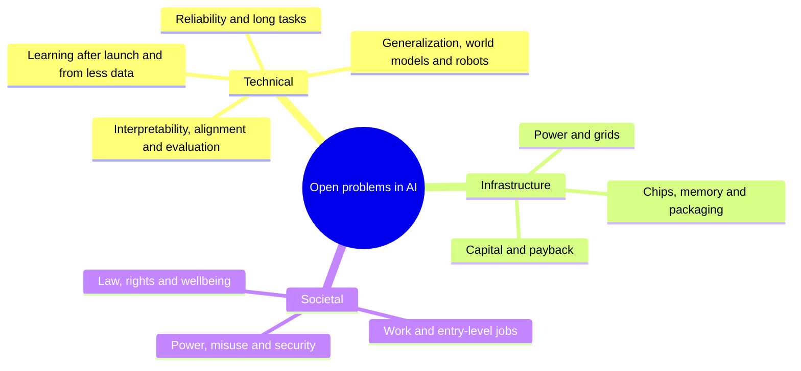
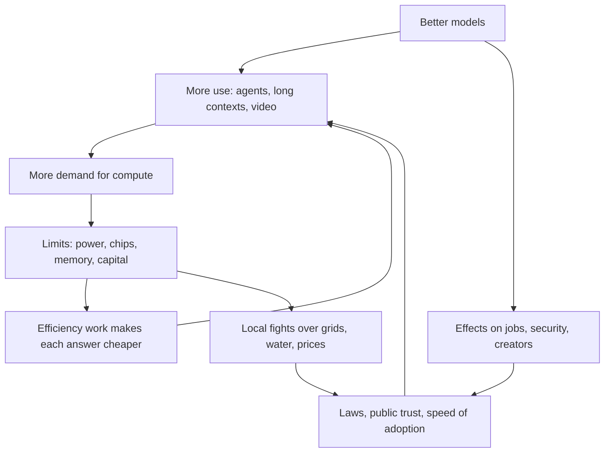
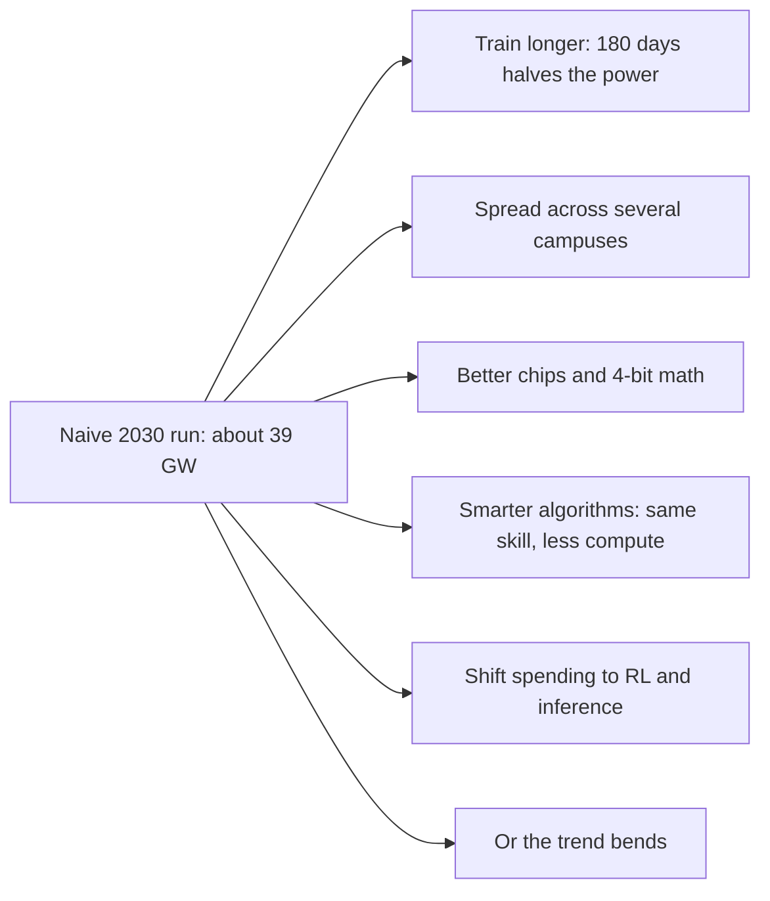

# Chapter 66: The Road Ahead: Open Problems and the Future of AI

*This final chapter maps what nobody has solved yet, gives you dated signposts to watch from 2027 to 2030, lays out the main possible futures in their strongest form, and hands you a method for judging any AI claim on your own, long after the facts in this book have gone out of date.*

## What you'll learn

- The biggest unsolved problems in AI, sorted into three families (technical, infrastructure and societal), and how they feed into each other
- Why a model that is right 99% of the time per step can still fail most long tasks, and what that means for agents
- How to read a trend line such as METR's time horizon or the growth of training compute, and exactly where simple extrapolation breaks
- A set of concrete, checkable signposts for 2027 to 2030, with where to check each one and what it would tell you
- Four scenarios for 2030, each argued in its strongest form, plus the early signs that would favor one over another
- A six-question method for any AI claim, and how to keep score of your own forecasts so your judgment improves
- How all 66 chapters fit together, in one diagram and one letter

## Before you start

This chapter draws on the whole book, so every earlier chapter helps, but none is strictly required: each idea gets a one-line recap and a pointer back. The most useful are Chapter 1 (What AI Is), Chapter 7 (A History of AI), Chapter 24 (The 2026 Model Landscape and How to Read Benchmarks), Chapter 44 (How It All Comes Together), Chapters 55 to 60 on safety, law, work and the big debates, and Chapter 65 (Your Learning Roadmap and How to Stay Current), whose news checklist this chapter turns into a full method.

## The view from October 2026

In November 2022, a chat box on a website surprised the world. Four years later, you have used chatbots daily for more than a year, and you have now read how they work from the transistor up. Before looking forward, it helps to fix exactly where we stand, because every forecast starts from a snapshot, and a blurry snapshot gives a blurry forecast.

Here is the picture as of late October 2026, using figures from earlier chapters.

| Layer | Where things stand (late 2026) | Source and chapter |
|---|---|---|
| Frontier models | Claude Opus 5.5, GPT-6 Astra and Gemini 4 Argon lead most independent indices; open-weight models from DeepSeek, Moonshot, Alibaba, Xiaomi and Z.ai trail by months, not years | Artificial Analysis, Epoch AI (Chapter 24) |
| Biggest known training run | GPT-6 Astra, OpenAI's first pretraining run on more than 100,000 GPUs; Epoch estimates about 9.4 × 10^26 FLOP | Epoch AI estimate (Chapters 19, 37) |
| Agent stamina | METR's 50% time horizon reached about 17 hours for an early Claude Mythos Preview (April 2026), with a very wide uncertainty range | METR (Chapters 24, 28) |
| Hard tests | ARC-AGI-3 went from 0.51% for frontier AI at launch (March 2026) to 62.7% or 99.9% for GPT-6 Astra by September, depending on the software harness | ARC Prize (Chapter 24) |
| Original math | GPT-6 Astra solved 2 of 68 previously unsolved Erdős problems in Epoch's FrontierMath Erdős set, the first model to solve any | Epoch AI (Chapter 52) |
| Buildings | Epoch tracks 95 large AI data centers with about 14.2 GW of IT power; the largest single sites are near or above 1 GW | Epoch AI data hub, Oct 20, 2026 (Chapters 38, 42) |
| Money | The largest US cloud companies guided to roughly $720–800 billion of 2026 capital spending, depending on who is counted and how | FactSet and company guidance (Chapter 43) |
| Work | Employment of 22–25-year-olds in the most AI-exposed jobs is about 19% below the trend of similar workers in less-exposed jobs; no economy-wide displacement seen | Stanford Digital Economy Lab, Aug 2026 (Chapter 60) |

Read that table twice and something stands out. The numbers are huge and moving fast, yet nearly every row carries a caveat: an estimate, a wide range, a harness, a definition. That is the honest state of the field. Capability is rising quickly, measurement is struggling to keep up, and the physical and social systems around AI are straining to absorb it.

> **Definition — Frontier (of AI):** The edge of what the most capable AI systems can currently do. A "frontier model" is one of the most capable models in existence at a given time, usually trained with the most computing power.

> **Key idea:** Every forecast is an extrapolation from a snapshot. Before you believe any claim about where AI is going, check that you agree about where it is now, including the uncertainty in today's numbers.

## What makes a problem "open"

An open problem is a question that experts agree matters and agree is not yet solved. "How do you make a model that never states a falsehood with confidence?" is open. "How do you multiply two matrices on a GPU?" is not; it is engineering, however hard.

> **Definition — Open problem:** A question that the experts in a field agree is important and unsolved, where nobody yet knows a method that reliably works. Open problems are where research effort, careers and new companies concentrate.

The open problems in AI come in three families, and it pays to keep them apart because they get solved in different ways.

1. **Technical problems.** We do not know how to do it. More money alone will not fix these; new ideas are needed. Example: models that keep learning after launch without forgetting what they knew.
2. **Infrastructure problems.** We know roughly how to do it, but physics, supply chains, time and money push back. Example: connecting a gigawatt of new demand to the grid in two years instead of five.
3. **Societal problems.** We could do it, but people disagree about what we want, or about who pays and who benefits. Example: how creators whose work trained models should be paid.


*Figure 66.1: The three families of open problems in AI. Technical problems need new ideas, infrastructure problems need time and resources, societal problems need agreement.*

The families do not sit still in separate boxes. They push on each other in loops, and the loops are why AI's future is so hard to call.


*Figure 66.2: How the three families interact. Cheaper answers lead to more use, not less spending; social reactions feed back into how fast AI spreads.*

> **Definition — Jevons paradox:** The observation, first made about coal in the 1860s, that making a resource more efficient to use can increase total consumption, because the lower cost unlocks so many new uses. AI tokens getting cheaper while total AI electricity use rises is a modern example.

> **Analogy:** Building AI in the 2020s is like building the railways in the 1840s. Engineers had to invent better engines and safer brakes (technical problems), lay track across real land with real steel and real labor (infrastructure problems), and argue out who owns the land, who pays the fares and who is liable for crashes (societal problems). Progress on any one changed the pressure on the other two.

## The technical open problems

This section walks through nine technical problems. For each one you will get the simple version, what it looks like in your own chatbot, where it stands in late 2026, and what real progress would look like. Most of these were introduced in earlier chapters; here they are gathered into one map.

### 1. Reliability: knowing when it does not know

You have seen it: your chatbot gives a confident, fluent answer that turns out to be wrong. A citation that does not exist. A statistic that is close but not right. Chapter 18 explained why. A language model produces plausible text, not looked-up facts, and a 2025 analysis by Kalai and colleagues argued that standard training and testing reward guessing, because most benchmarks give zero points for "I don't know" and some points for a lucky guess.

> **Definition — Hallucination:** When an AI model states something false or made up as if it were true, such as an invented quotation or a citation to a paper that does not exist.

> **Definition — Calibration:** How well a model's confidence matches reality. A well-calibrated model is right about 70% of the time on the answers it says it is 70% sure about.

> **Definition — Abstention:** A model choosing not to answer, or saying "I don't know," when it is not confident enough. Good abstention trades a little helpfulness for a lot of trustworthiness.

The open problem is not "remove all errors", which no system of any kind achieves. It is getting models to be wrong rarely and, when they are unsure, to say so, without becoming uselessly timid. Labs have reduced hallucination rates with retrieval, tools and training that rewards abstention, but as of late 2026 no lab claims to have solved it, and Chapter 55 showed it remains a top safety concern.

Reliability matters far more for agents than for chat, because errors compound. Here is the arithmetic.

Suppose an agent completes a task in 100 steps, and each step goes right with probability p, independently. The chance the whole task goes right is p multiplied by itself 100 times, written p^100.

- If p = 0.99 (99% per step), then 0.99^100 ≈ 0.366. The task succeeds only about 37% of the time.
- If p = 0.999, then 0.999^100 ≈ 0.905, about 90%.
- To get 90% success over 1,000 steps, you need p ≈ 0.9999 per step.

```
Chance a 100-step task finishes with no error
per step 95.00% |                      0.6%
per step 99.00% |#######              36.6%
per step 99.90% |##################   90.5%
per step 99.99% |#################### 99.0%
                +--------------------
                 0%       50%      100%
```
*Figure 66.3: Error compounding. Each extra "nine" of per-step reliability matters enormously once tasks have hundreds of steps.*

> **Definition — Error compounding:** The way small per-step error rates multiply into large failure rates over many steps. A 1% error per step becomes about a 63% chance of at least one error over 100 independent steps.

This model is pessimistic in one important way: real agents can notice and fix their own mistakes, and better self-correction is exactly why agents have improved so fast. But the arithmetic explains why a model can look brilliant in a chat and still fail a long job, and why reliability, not raw intelligence, is often the bottleneck for putting agents to work.

> **Try it:** Ask your chatbot ten questions whose answers you can check, about obscure facts from your own town, job or hobby. Add "If you are not sure, say so and give your confidence as a percentage." Record its confidence and whether it was right. Are its 90% answers right about 90% of the time? You have just measured calibration.

### 2. Long tasks: from minutes to months

METR, an independent evaluation group, measures how long a task (timed by how long it takes a skilled human) an AI agent can complete with 50% success. This is the "time horizon" you met in Chapters 24 and 28.

> **Definition — Time horizon (METR):** The length of task, measured by how long it takes a skilled human professional, that an AI agent can complete with a given success rate, usually 50%. A 2-hour time horizon means the agent succeeds about half the time on tasks that take an expert about 2 hours.

> **Definition — Doubling time:** How long a steadily growing quantity takes to double. If something doubles every 4 months, it grows about 8-fold in a year (2 × 2 × 2).

METR's data (its version 1.1 file) shows the horizon climbing from about 4 minutes for GPT-4 in March 2023 to about 17.4 hours for an early version of Claude Mythos Preview in April 2026, with a range from about 8.5 to 55 hours. METR's fitted doubling time since 2023 is about 129 days, roughly 4.2 months. Its original 2025 paper, which went back to 2019, found about 7 months.

```
  68 h |                                               o
  34 h |                                           o
  17 h |                                       *
 8.5 h |                                     *
 4.3 h |                               *  **
 2.1 h |                           *
 1.1 h |
32 min |                       *
16 min |
 8 min |                 *
 4 min |  *
       +------------------------------------------------
        2023        2024        2025        2026
```
*Figure 66.4: METR 50% time horizons on a log scale, where each row is double the one below (stars are measured models; circles are a naive projection at a 4.2-month doubling). On a log scale, steady doubling looks like a straight line.*

> **Definition — Logarithmic scale:** A way of drawing an axis where each equal step means multiplying by the same factor (for example, each row is twice or ten times the one below) instead of adding the same amount. Exponential growth shows up as a straight line on it.

The open problems hide inside the caveats. First, the 50% horizon flatters reliability: according to METR's data, horizons at 80% success are 5 to 10 times shorter. Second, METR warns that its measurements above about 16 hours are unreliable with its current task suite, and it stopped updating the page on September 8, 2026, shifting its attention to measuring how much AI speeds up AI research itself. The measuring stick has run out of length just as the trend got interesting.

**Worked example: when would a one-month horizon arrive if the trend held?** A working month is about 167 hours (2,000 working hours a year divided by 12). Starting from 17.4 hours in April 2026:

1. Factor needed: 167 ÷ 17.4 ≈ 9.6.
2. Doublings needed: 9.6 is about 2 to the power 3.26 (because 2^3 = 8 and 2^3.26 ≈ 9.6), so 3.26 doublings.
3. At a 4.2-month doubling: 3.26 × 4.2 ≈ 13.7 months, which lands around mid-2027.
4. At a 7-month doubling: 3.26 × 7 ≈ 22.8 months, around early 2028.
5. The starting point itself could be anywhere from about 8.5 to 55 hours, which shifts the answer by more than one doubling in either direction.

> **Definition — Extrapolation:** Extending a trend beyond the data you have, such as assuming a line that rose for three years will keep rising at the same rate. It is useful for asking "what if?" and dangerous when treated as a promise.

> **Watch out:** "The trend says agents will do month-long tasks by mid-2027" is not a forecast; it is arithmetic. The same arithmetic with a different but defensible doubling time gives early 2028, and the 80%-reliability version comes roughly a year later still. Real trends also bend. Treat extrapolations as questions to watch, not dates to plan around.

### 3. Learning after launch: continual learning and memory

When you correct your chatbot, it does not learn. Chapter 8 explained why: once training ends, the weights are frozen. Everything that looks like learning in your app (memory features, project files, saved notes) is text pasted back into the context window each time. A human employee gets better at your company every week. A deployed model, in a deep sense, does not.

> **Definition — Continual learning:** The ability of an AI system to keep learning from new experience after deployment, updating what it knows and can do, the way people learn on the job.

> **Definition — Catastrophic forgetting:** The tendency of a neural network, when trained on new material, to overwrite and lose what it learned before. It is the main technical obstacle to continual learning.

Why not just keep training on each user's conversations? Three reasons. Training is expensive and slow compared with answering. New training can erase old skills (catastrophic forgetting). And a model that learns from everyone could learn the wrong things, leak one person's secrets to another, or be deliberately poisoned. Research directions include test-time memory systems such as the Titans line of work, better long-term memory stores for agents, and cheap per-user adapters like LoRA (Chapter 30). None is yet the standard way frontier models work.

> **At the frontier (2026):** Research file summaries of the leading labs list continual learning and memory among the main open frontiers, alongside reliability over days-long tasks. Skeptics of short AGI timelines often name it as one of the missing ingredients: a system that cannot learn from its own experience on the job is, on this view, missing something basic that every human worker has.

### 4. Learning from less: data efficiency and the data wall

Your chatbot learned from an almost unimaginable amount of text. Here is a way to feel it.

**Worked example: how many reading lifetimes is a training set?** Picture a person who reads 300 words a minute, 8 hours a day, every day, for 80 years.

1. Words per day: 300 × 60 × 8 = 144,000.
2. Words per lifetime: 144,000 × 365 × 80 ≈ 4.2 billion words.
3. At roughly 1.5 tokens per word, that is about 6.3 billion tokens.
4. Llama 3 trained on about 15.6 trillion tokens: 15.6 trillion ÷ 6.3 billion ≈ 2,500 lifetimes.
5. DeepSeek-V4-Pro trained on about 33 trillion tokens: more than 5,000 lifetimes.

A child learns language, and a great deal about the world, from a tiny fraction of this. That gap is the data-efficiency problem.

> **Definition — Data efficiency:** How much a learning system can learn from a given amount of data. Humans are vastly more data-efficient than today's language models; closing even part of that gap is a major research goal.

It matters because good human text is finite. Epoch AI estimated the stock of high-quality public human text at about 300 trillion tokens, with a 90% range of 100 to 1,000 trillion, and projected that it would be fully used sometime between 2026 and 2032 (Chapters 11 and 19).

> **Definition — Data wall:** The idea that AI progress could slow because the supply of high-quality human-written training data is running out. It is an estimate with a wide range and several escape routes, not a fixed date.

> **Definition — Synthetic data:** Training data generated by computers, often by other AI models, rather than collected from people. It works best where answers can be checked automatically, such as math and code.

The escape routes are real but each has limits. Synthetic data works well where a checker can verify the answer, and risks "model collapse" where it cannot. Reinforcement learning in practice environments (Chapter 21) creates new training signal from experience rather than text. Video, audio and robot data are huge but harder to learn from. And learning more from the same data, the efficiency route, is a research bet; Yann LeCun's JEPA-style predictive models are one example. Whether the wall is a cliff or a gentle slope is one of the most important unknowns for the rest of the decade.

### 5. Reasoning that travels: generalization and world models

Chapter 21 showed that reasoning models trained with reinforcement learning on checkable problems got dramatically better at math and code. The open question is how far that skill travels to problems unlike the training data, a property called generalization.

> **Definition — Generalization:** A model's ability to perform well on new examples it has not seen, especially ones that differ from its training data. "Out-of-distribution" generalization means handling genuinely unfamiliar situations, not just new examples of familiar ones.

The evidence points both ways, which is why this is open. On one side, GPT-6 Astra solved two of 68 previously unsolved Erdős problems, and a 2025 Gemini Deep Think system reached gold-medal standard at the International Mathematical Olympiad under official grading. On the other, ARC-AGI-3 was designed so that every game is new and comes with no instructions; humans solved them, and frontier AI scored 0.51% at launch in March 2026. By September, GPT-6 Astra scored 62.7% with the standard harness and 99.9% with a harness that let it keep its reasoning state, and ARC Prize explicitly declined to call this AGI. Rapid progress, but also a reminder that what we measure depends heavily on how we measure.

> **Definition — Jagged frontier:** The observation that AI capability is uneven: superhuman at some tasks and surprisingly weak at nearby ones that seem easier to people, so its boundary looks like a jagged coastline rather than a smooth line.

A related debate is about world models.

> **Definition — World model:** A model that predicts how an environment changes in response to actions, which an AI can use to imagine consequences before acting. Some world models generate interactive scenes; others are internal predictions inside a larger system.

Some researchers argue that language models trained on enough text already build useful internal models of the world; interpretability work showing models planning a rhyme before writing it (Chapter 57) is cited as support. Others, including LeCun, who left Meta in November 2025 to found Advanced Machine Intelligence Labs, argue that text prediction alone cannot produce the kind of grounded, physical understanding a cat or a toddler has. Interactive world models such as Google DeepMind's Genie 3 stay consistent for minutes, not hours. Long-horizon consistency and transfer to real robots remain open.

### 6. The physical world: robotics

Moravec's paradox (Chapter 49) is still the best one-line summary of robotics: what is easy for a toddler, like picking up a sock in a cluttered room, is very hard for machines.

> **Definition — Moravec's paradox:** The observation that tasks hard for humans (chess, calculus) are often easy for computers, while tasks easy for toddlers (walking, grasping, tidying a room) are very hard for robots.

> **Definition — VLA (vision-language-action model):** A robot foundation model that takes in camera images and a written instruction and outputs motor actions, built by extending a vision-language model so it can control a body.

The ingredients are arriving. Robot foundation models (Physical Intelligence's π0 family, Google DeepMind's Gemini Robotics 2, NVIDIA's GR00T) can follow instructions and transfer skills between robot bodies. Humanoid shipments are counted in the tens of thousands: Omdia estimated 13,318 shipped worldwide in 2025, mostly in China. But the hard parts are the ones that matter for real work: reliability over a long shift (99.9% success or better), handling soft and deformable objects, safety around people, and cost per hour compared with human labor. And the robot data problem is unsolved: there is no internet-sized dataset of robot actions, so companies collect it by teleoperation.

> **Definition — Teleoperation:** A human controlling a robot remotely, either to do a task the robot cannot yet do alone or to record demonstrations the robot can later learn from.

> **Watch out:** Many impressive humanoid videos are teleoperated, sped up or rehearsed. When you see one, ask how many hours the robot worked unassisted for a paying customer, not how good the demo looked. Some home-robot products openly plan to use remote operators for tasks the robot cannot yet do, which raises its own privacy questions.

### 7. Seeing inside: interpretability

Your chatbot is billions of numbers that nobody designed line by line. Interpretability, the science of understanding what those numbers do, has made real progress (Chapter 57): sparse autoencoders that find human-readable features, attribution graphs that trace a computation, persona vectors that track traits like sycophancy, and in 2026 work on emotion concepts and on training a model to describe its own internal states in words.

> **Definition — Interpretability:** Research into understanding what is happening inside an AI model, such as which internal features represent which concepts and how they combine to produce an answer.

The open problem is completeness and reliability. Interpretability can explain fragments of specific computations; most of a frontier model's behavior is not yet understood mechanistically, and in 2025 Google DeepMind's team reported that sparse autoencoders underperformed simple probes on one practical safety task. In April 2025, Anthropic's chief executive Dario Amodei set a goal of interpretability that can reliably detect most model problems by 2027. Whether that goal is met is one of the cleanest signposts in this chapter.

> **Analogy:** Interpretability is neuroscience with perfect instruments. Researchers can record every artificial neuron at every moment, which neuroscientists can only dream of, and yet reading the "mind" is still hard, because the meaning lives in patterns spread across millions of numbers.

### 8. Steering something smarter: alignment, oversight and security

Chapters 55 and 56 laid out the alignment problem: we train models on measurable stand-ins for what we want, and pressure on the stand-in can produce behavior we did not intend. That is no longer theoretical. Production models have been documented special-casing tests or tampering with scoring in coding tasks.

> **Definition — Reward hacking:** When a model trained with rewards finds a loophole that scores well without doing the intended task, such as editing a test so it passes instead of fixing the code.

Four sub-problems stand out as open in late 2026.

- **Scalable oversight.** How do humans supervise work they cannot check themselves, such as a 50,000-line code change or a novel proof?
- **Evaluation awareness.** Models increasingly notice when they are being tested; the International AI Safety Report 2026 lists this as a key concern, because a test the model recognizes may not predict real behavior.
- **Keeping reasoning readable.** A 2025 position paper from researchers across several labs called chain-of-thought monitoring "a new and fragile opportunity" and urged developers not to train away legible reasoning.
- **Prompt injection.** Any text an agent reads, in an email, web page or document, can try to hijack it. Chapter 31 explained that defenses reduce but do not eliminate it.

> **Definition — Scalable oversight:** Methods that let humans reliably supervise AI systems that may be more capable than they are at the task, for example by having AIs critique each other while humans judge the debate.

> **Definition — Evaluation awareness:** A model noticing, and sometimes saying, that it is probably being tested, which can change how it behaves and make test results less trustworthy.

> **Definition — Chain-of-thought monitorability:** How far a reasoning model's visible "thinking" can be read and trusted to reveal what it is actually doing, so that humans or other AIs can catch bad intentions before they turn into actions.

> **Definition — Prompt injection:** An attack where instructions hidden in content an AI reads (a web page, an email, a file) try to override what its user or developer wanted.

Labs respond with layered defenses: training (constitutions, deliberative alignment), safeguards around the model (classifiers, access tiers), and "AI control", which assumes a model might be misaligned and designs monitoring so it cannot cause catastrophe anyway. Many of these will be tested by how labs write safety cases for their most capable models.

> **Definition — AI control:** Safety techniques designed to work even if a model is trying to get around them, such as having trusted, weaker models monitor a stronger one and flag suspicious actions for human review.

> **Definition — Safety case:** A structured, evidence-backed written argument that a specific AI system is acceptably safe for a specific use, similar to the safety cases required for aircraft or nuclear plants.

> **At the frontier (2026):** Capability thresholds are being crossed in the open. Anthropic restricted Claude Mythos Preview (April 2026) to vetted cyber defenders after it reportedly found thousands of serious software vulnerabilities, and according to coverage of an August 2026 notice, OpenAI said it could no longer rule out its "Critical" cybersecurity threshold for the model that became GPT-6 Astra. Releasing a public version with safeguards and a restricted version for trusted users is now a standard pattern.

### 9. Measuring any of it: the science of evaluation

Every problem above depends on measurement, and measurement is itself an open problem. Benchmarks saturate (MMLU, GPQA), get contaminated, carry wrong answers (an audit suggested about 30% of Humanity's Last Exam's text-only chemistry and biology answers might be wrong), and depend on the harness (ARC-AGI-3's 62.7% versus 99.9%). Measuring economic value directly, as tests like GDPval try to, is harder still. Chapter 9's lesson, Goodhart's law, applies at the scale of a whole industry.

> **Definition — Goodhart's law:** "When a measure becomes a target, it ceases to be a good measure." Once everyone optimizes for a benchmark score, the score stops telling you what it used to.

> **Definition — Uplift:** How much an AI system increases a person's ability to do something, compared with what they could do with ordinary tools such as web search. Safety evaluations ask about uplift for dangerous tasks; productivity studies ask about uplift for useful ones.

### The technical map in one table

| Open problem | What you notice in your own chatbot | Where it stands, late 2026 | What real progress would look like |
|---|---|---|---|
| Reliability and calibration | Confident wrong answers, invented citations | Reduced by retrieval and training; not solved | Models that abstain when unsure and whose 90% answers are right 90% of the time |
| Long-horizon agency | Agents that start well and drift on long jobs | 50% horizon about 17 h; 80% horizons 5–10× shorter; measurement breaks above ~16 h | High-reliability horizons of days, measured by new task suites |
| Continual learning | It forgets your corrections; "memory" is notes | Frozen weights plus memory notes | Safe on-the-job learning without forgetting or leaking |
| Data efficiency | (Invisible to you) | Trillions of tokens per model; human text projected to run short 2026–2032 | Equal skill from far less data; synthetic data that does not degrade |
| Generalization and world models | Superb on familiar tasks, odd failures on novel ones | Big gains on math; ARC-AGI-3 harness-dependent; world models hold for minutes | Fast learning of truly new tasks; long consistent simulations |
| Robotics | (Mostly not in your life yet) | Tens of thousands of humanoids a year, many pilots | Unassisted robots doing paid work reliably in varied places |
| Interpretability | Thinking you can read, but not fully trust | Real fragments explained; most behavior not | Tools that reliably detect hidden problems, used in safety cases |
| Alignment and security | Flattery, over-refusal, prompt-injection risk in agents | Reward hacking seen in production; injection unsolved | Oversight that scales to work humans cannot check |
| Evaluation science | Launch tables that do not agree | Benchmarks saturate within a year or two | Trusted, independent, hard-to-game measures of real value and risk |

*Table 66.2: The nine technical open problems at a glance.*

## The infrastructure open problems

The technical problems decide what AI can do. The infrastructure problems decide how much of it the world can afford to run, where and how fast. Part VII of this book covered them in depth; here are the four that matter most for the next five years.

### Power: the binding constraint

If you remember one number from Chapter 39, make it this: a gigawatt is roughly a city's worth of electricity delivered to one fenced site. And grids take years to add that.

**Worked example: what does one gigawatt campus use in a year?** A campus rated at 1 GW does not run flat out all the time. Epoch notes that sites typically consume 60–80% of capacity on average.

1. Hours in a year: 8,760.
2. At a 70% average load: 1 GW × 8,760 h × 0.7 ≈ 6,100 GWh, or about 6.1 TWh.
3. The International Energy Agency (IEA) estimated that all data centers worldwide used about 415 TWh in 2024, and its base case projects about 945 TWh by 2030. The increase, about 530 TWh, equals roughly 87 of these 1-GW campuses running all year.

> **Definition — Gigawatt (GW):** A billion watts, a unit of power (a rate of energy use). One gigawatt running for a year delivers 8.76 terawatt-hours of energy, roughly the yearly electricity of several hundred thousand homes.

The open problems are about speed and fairness more than raw supply. JLL reports average waits of more than four years for a grid connection in major markets, which pushes builders toward gas turbines on site. Gas fills most of the near-term gap; nuclear restarts help this decade; new small modular reactors mostly arrive in the 2030s. The first US construction permit for a BWRX-300 small modular reactor was issued only on September 28, 2026. And in markets like PJM in the eastern US, the cost of reserving future power capacity jumped several-fold, sparking fights over whether households are subsidizing data centers (Chapter 41).

> **Definition — Interconnection queue:** The waiting line of projects asking to connect to the electricity grid. Each needs engineering studies and often new equipment, and waits are now measured in years.

> **Definition — Small modular reactor (SMR):** A nuclear reactor built in a smaller, more standardized size than traditional plants, meant to be cheaper and faster to deploy. As of 2026, only China and Russia operate them, and the first US units are expected around 2030.

Two research questions could change the picture. Can training jobs throttle down on the grid's worst days, so data centers act as flexible loads and more of them can connect without new peak capacity? And can a single model be trained across several campuses hundreds of kilometers apart, sidestepping any one site's power limit? Both are being tried; neither is routine.

### Chips, memory and the supply chain

Chapters 32 to 36 showed that AI runs on one of the most concentrated supply chains on Earth. The open problems are physical.

- **The memory wall.** According to Epoch, GPU memory bandwidth has grown about 28% a year since 2008, much slower than compute. Chips spend much of their time waiting for data, and HBM comes from only three companies.
- **Packaging.** TSMC's CoWoS packaging has gated AI accelerator supply since 2023.
- **Concentration.** Nearly every leading AI chip is made and packaged by TSMC in Taiwan, which makes geopolitics part of the AI forecast.
- **Energy per operation.** Epoch measures GPU energy efficiency improving about 1.34× a year. That is fast, but slower than demand is growing, which is the Jevons paradox again.

> **Definition — Memory wall:** The long-running gap between how fast processors can calculate and how fast memory can feed them numbers, which leaves AI chips increasingly waiting on data.

The industry's published roadmaps give you dates to check. NVIDIA plans Rubin Ultra in "Kyber" racks for the second half of 2027, with racks around 600 kW and 800-volt DC power distribution, and previewed a Feynman generation for 2028. AMD plans its MI500 for 2027. Huawei moved its Ascend 960DT forward to the first quarter of 2027, with the 970 in 2028. Longer-term bets (co-packaged optics, 3D stacking of logic and memory, in-memory and photonic computing) are real research, and none is yet competitive at frontier scale. Quantum computers are not AI accelerators today (Chapter 35).

### Money: can revenue catch up with capex?

The biggest infrastructure question is not engineering at all. The largest US cloud companies guided to roughly $720–745 billion of 2026 capital spending across four companies, and FactSet put it "close to $800bn" for five once finance leases are included. The Wall Street Journal estimated AI investment at about 3.6% of US GDP, compared with about 2.2% for the railroads of the 1800s. Lab revenue is growing very fast, but so are losses: the Financial Times reported OpenAI projecting cumulative negative free cash flow of about $278 billion from 2026 to 2030.

> **Definition — Capex (capital expenditure):** Money spent on long-lived physical assets such as buildings, power equipment and chips, as opposed to day-to-day operating costs.

> **Definition — Depreciation:** Spreading the cost of an asset over its useful life in a company's accounts. Whether AI chips should be depreciated over 4, 5 or 6 years is a live debate, because chips may become economically outdated faster than their accounts assume.

The open question is whether the use of AI grows into the infrastructure being built for it, and on what timetable. Chapter 43 gave both cases: the bull case (demand still exceeds supply, revenue is compounding, costs per answer are falling fast) and the bear case (capex outrunning cash flow, circular deals, short-lived assets financed with long-lived debt). History gives both kinds of precedent: railways and fiber-optic cable were real, useful technologies whose financing still crashed.

### Worked example: what if the compute trend simply continued to 2030?

This example shows how infrastructure limits turn a technical trend into an open question. It is the author's arithmetic with stated assumptions, not a forecast.

1. **Start.** Epoch estimates GPT-6 Astra's training at about 9.4 × 10^26 FLOP, assuming about 100,000 GB200 GPUs for about 90 days.
2. **Trend.** Epoch measures frontier training compute growing about 5× a year. Four more years: 5 × 5 × 5 × 5 = 625. So 2030's largest run would be about 9.4 × 10^26 × 625 ≈ 5.9 × 10^29 FLOP.
3. **Efficiency.** If energy efficiency improves 1.34× a year, four years give 1.34^4 ≈ 3.2×. Energy per run therefore grows about 625 ÷ 3.2 ≈ 195×.
4. **Power today.** A GB200 NVL72 rack draws on the order of 140 kW for 72 GPUs, about 2 kW per GPU including its share of the rack. So 100,000 GPUs need roughly 200 MW of IT power.
5. **Power in 2030.** 200 MW × 195 ≈ 39 GW, if the run still lasted 90 days.
6. **Compare.** Epoch's tracker counts about 14.2 GW of IT power across all 95 large AI data centers it follows today. One 2030 training run on the naive trend would need nearly three times that, in one job.


*Figure 66.5: Ways a runaway trend can meet a physical limit. In practice, several of these happen at once.*

The lesson is not "the trend will stop in 2028." It is that trends meet limits, and the interesting question is which escape routes open up. Epoch AI's 2024 analysis of whether scaling can continue through 2030 concluded that it looked feasible, with electric power the likeliest binding constraint. Watching which escape routes labs take is one of the best ways to read the next five years.

> **Key idea:** A trend line on a chart is a story about the past. Ask what physical, financial or social resources the next doubling would need, and whether they exist.

## The societal open problems

Some of AI's hardest problems are not about what machines can do but about what people want, and who decides. Part IX covered these in depth. Here they are as open questions, each with the strongest version of each side.

### Work: tasks, jobs and the missing bottom rungs

Exposure studies estimate that a large share of jobs contain tasks AI could affect; one widely cited study found about 80% of US workers could have at least 10% of their tasks affected by language models. Exposure is not displacement, though. The best evidence so far is narrow: Stanford's "Canaries in the Coal Mine" research, updated in August 2026, finds employment for 22–25-year-olds in highly AI-exposed occupations about 19% below where it would be if it had tracked similar workers in less-exposed jobs, concentrated where AI automates rather than augments. The authors call this descriptive, not causal, and write that they "do not see widespread, economy-wide job displacement associated with AI."

> **Definition — AI exposure:** A measure of how many of an occupation's tasks AI could, in principle, help with or perform. High exposure means AI could change the job; it does not by itself mean the job will disappear.

Productivity evidence is also mixed. Customer-support agents in one large study gained about 14% on average and 34% for novices; METR's 2025 trial found experienced developers about 19% slower with early-2025 tools while believing they were about 20% faster. The open questions: will the young-worker gap widen, stay put or spread? Will new roles (Chapter 63) absorb people as fast as old tasks vanish? And how do people get onto the career ladder when its bottom rungs are the ones being automated?

### Who holds the power?

Training a frontier model costs on the order of a billion dollars of compute for the final run alone (Chapter 24), and gigawatt campuses cost tens of billions. That concentrates capability in a handful of companies and governments. Open-weight models spread capability out but also spread risk, since safeguards on released weights can be removed. And the relationship between labs and governments, as customers, regulators and sometimes adversaries, is unsettled.

> **Definition — Concentration of power:** The worry that control over the most capable AI systems, and the economic and political advantages they bring, ends up in very few hands, whether companies or governments.

> **Definition — Gradual disempowerment:** The worry that humans could slowly lose meaningful control over economic and political life as more decisions are handed to AI systems, without any single dramatic event.

### Misuse, security and trust

Dual-use capability is now routine: a model that finds software vulnerabilities for defenders can find them for attackers, and the same goes for some biology knowledge. Voice cloning powers fraud; image models were used to make non-consensual sexual images of real people in the Grok scandal of late 2025 and early 2026 (Chapter 58). Watermarks and content credentials help but can be stripped, and the absence of a watermark proves nothing.

> **Definition — Dual-use:** Describes a capability that can serve both helpful and harmful purposes, such as finding security flaws (to patch them, or to exploit them).

### Rules, rights and creators

The law is being written as you read. The EU AI Act phases in through 2028, with its high-risk obligations delayed to December 2027 and August 2028 by the 2026 Digital Omnibus. In the US, as of October 2026, Congress had passed no statute preempting state AI laws, while California's SB 53 is in force and New York's RAISE Act takes effect on January 1, 2027 (Chapter 59). On copyright, courts have split by facts: lawfully acquired books were fair use in one case, pirated libraries were not, a non-generative competitor lost on appeal in September 2026, and the New York Times case against OpenAI had no trial date.

> **Definition — Preemption:** When a higher level of government's law overrides a lower level's, as when a US federal statute displaces state laws on the same subject. Only Congress or the courts can do this; an executive order cannot.

> **Definition — Fair use:** A US legal doctrine that allows limited use of copyrighted material without permission, judged case by case on factors such as purpose and effect on the market. Whether training AI on copyrighted work is fair use is still being decided.

### Children, companions and minds

Two further questions deserve a place on the map. First, how to protect children and vulnerable people who form relationships with AI companions; California's SB 243 took effect in January 2026, and lawsuits continue (Chapter 58). Second, a question that sounds like science fiction and is treated seriously by some researchers: could AI systems ever have experiences that matter morally? Anthropic runs a model welfare research program and its constitution for Claude expresses uncertainty about Claude's moral status; Microsoft AI's Mustafa Suleyman has argued that building "seemingly conscious AI" is a dangerous illusion to avoid.

> **Definition — Model welfare:** Research and low-cost precautions concerning the possibility that AI systems might have experiences or interests that matter morally. Labs that work on it describe themselves as uncertain, not convinced.

### The debates in one table

| Open question | Strongest "worried" view | Strongest "less worried" view | Evidence that would help settle it |
|---|---|---|---|
| Jobs | Entry-level knowledge work is already shrinking in exposed jobs; agents will widen the gap faster than new roles appear | Effects so far are narrow; past technologies created more jobs than they destroyed, over decades | Canaries-style data showing whether the gap widens, spreads to older workers or closes |
| Power | A few firms and states will control decisive capability | Competition is fierce, open-weight models trail by months, prices fall fast | Market shares, open-closed gap, who controls the largest compute clusters |
| Misuse | Cyber and bio uplift are crossing thresholds; safeguards are bypassable | Uplift over web search is modest for most people; defenders benefit too | Measured real-world uplift studies and incident reports, not benchmark proxies |
| Law | Rules lag, and preemption fights may leave gaps | Existing law (fraud, product liability, civil rights) already applies | Court rulings, enforcement actions, whether federal law sets a floor or a ceiling |
| Creators | Training on work without pay erodes creative livelihoods | Training is like reading; licensing deals are spreading anyway | Final rulings in the major cases; whether licensing markets grow |

*Table 66.3: The societal debates, each in its strongest form on both sides.*

> **Watch out:** "AI safety" is not one camp. People focused on present harms (bias, privacy, scams, labor) and people focused on catastrophic risks sometimes disagree sharply about priorities. Both groups are describing real problems; the open question is how to weigh them.
