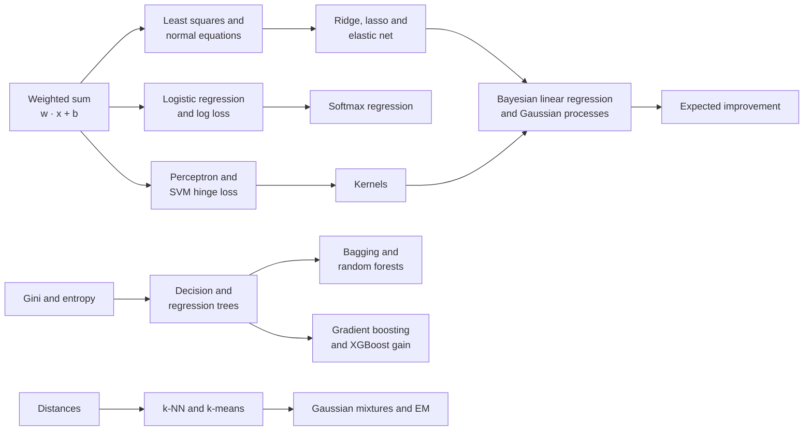
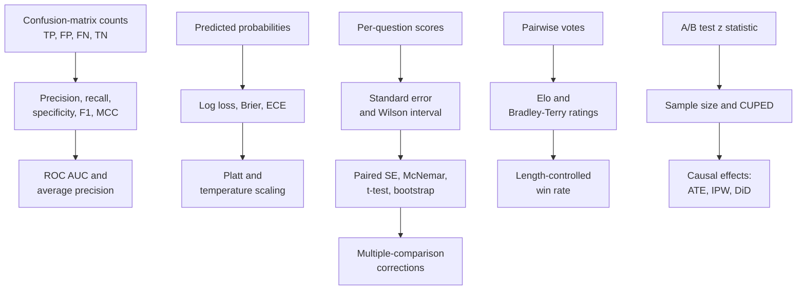
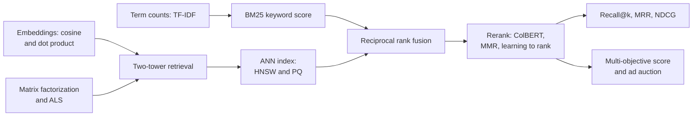

## Classical machine learning, evaluation and retrieval

This family holds the equations that do most of the everyday work of machine learning outside the giant neural networks, and the equations that decide whether any model, giant or small, is actually good. The first group builds models from data: weighted sums fitted by least squares (linear and logistic regression), margins and kernels (support vector machines and Gaussian processes), impurity scores that grow decision trees, and the voting and boosting rules that turn many trees into random forests and XGBoost, still the strongest tools for spreadsheet-style data in 2026. The second group finds structure without answers: distances, k-means, mixtures fitted by expectation-maximization, and PCA, t-SNE and UMAP for squashing many columns into a picture. The third and largest group is measurement: the confusion-matrix rates (precision, recall, F1, AUC), calibration scores, regression and forecasting errors, text-overlap scores such as BLEU, the pass@k estimators of coding benchmarks, and the statistics that put honest error bars on a leaderboard (standard errors, paired tests, the bootstrap, Elo and Bradley-Terry ratings, A/B tests and causal estimates). The last group ranks things: TF-IDF and BM25 for keyword search, approximate nearest-neighbor indexes for vector search, the ranking metrics NDCG and MRR that score both, and the matrix-factorization, two-tower and auction formulas behind recommenders and ads. The same few ideas recur throughout: a weighted sum, a squared or logarithmic error, a distance or dot product, and an average over examples with a standard error attached. The entries run from the simplest (rescaling a column) to the most specialized (ad auctions), so each one needs only those before it.

*Figure G.X: How the model-building equations connect. The weighted sum feeds regression, classification and margins; impurity scores feed trees and their ensembles; distances feed neighbors and clustering.*

*Figure G.X: How the evaluation equations connect: counts become rates and curves, probabilities become calibration scores, and every score gets an error bar before two systems are compared.*

*Figure G.X: How the retrieval and recommendation equations connect: a cheap first stage (keyword and vector search) finds candidates, fusion and reranking order them, and ranking metrics grade the final list.*

### Feature scaling (standardization and min-max)

**What it does:** Puts every input column on a comparable scale before a model uses distances or penalties.

`standardized x' = (x − μ) ÷ σ`; `min-max x' = (x − min) ÷ (max − min)`

- **x**: the original value of one feature for one example
- **x'**: the rescaled value
- **μ** (mu): the feature's mean on the training set
- **σ** (sigma): the feature's standard deviation on the training set
- **min**, **max**: the feature's smallest and largest training values

**In plain words:** Standardization turns a value into "how many standard deviations from average" (the z-score of Appendix B), so every column has mean 0 and spread 1. Min-max squeezes the training range into 0 to 1. The statistics must come from the training data only, or test information leaks in.

**Tiny example:** With μ = 40 and σ = 15, the value 85 standardizes to (85 − 40) ÷ 15 = 3. With a training range of 10 to 160, min-max gives (85 − 10) ÷ (160 − 10) = 75 ÷ 150 = 0.5.

**Where it is used:** Required before k-NN, SVMs, PCA, k-means and regularized linear models (scikit-learn StandardScaler and MinMaxScaler); input normalization for neural networks. Trees do not need it. A robust variant uses the median and interquartile range.
**In the book:** Chapter 11 (Feature engineering: standardization), Chapter 10 (k-nearest neighbors: feature scaling; Anomaly detection: z = 3) and Appendix B (z-score); min-max scaling is only here. The z-score itself is also in the foundations section of this appendix.

> **Definition — Min-max scaling:** Rescaling a feature so its smallest training value becomes 0 and its largest becomes 1, by subtracting the minimum and dividing by the range.

### Distance metrics (Minkowski family: Manhattan, Euclidean, Chebyshev; and Hamming)

**What it does:** Measures how far apart two lists of numbers, or two strings of symbols, are.

`d_p(x, z) = (sum over j of |x_j − z_j|^p)^(1 ÷ p)`; `p = 1` Manhattan; `p = 2` Euclidean; as p grows without limit, Chebyshev `max over j of |x_j − z_j|`; `Hamming = number of positions j where x_j ≠ z_j`

- **x**, **z**: two vectors with components x_j and z_j
- **j**: the position (feature) being compared
- **|...|**: absolute value, the size without the sign
- **p**: a number of at least 1 that picks the member of the family
- **d_p**: the distance for that p

**In plain words:** Manhattan adds the gaps along each axis, like walking city blocks. Euclidean is the straight-line distance of Appendix B. Chebyshev keeps only the single largest gap. Hamming counts the positions that differ and is used for binary codes and equal-length strings. Squared Euclidean distance (no square root) is what k-means minimizes.

**Tiny example:** x = [1, 2, 3] and z = [4, 0, 3] differ by 3, 2 and 0. Manhattan: 3 + 2 + 0 = 5. Euclidean: sqrt(9 + 4 + 0) = sqrt(13) ≈ 3.61. Chebyshev: 3. The codes 10110 and 11100 differ in positions 2 and 4, so their Hamming distance is 2.

**Where it is used:** k-NN, clustering, vector databases (L2 and inner-product indexes in FAISS and pgvector), search over binary-quantized embeddings (Hamming), error-correcting codes.
**In the book:** Chapter 10 (k-nearest neighbors) and Appendix B (Distance) for Euclidean; Chapter 48 (A*: search with a sense of direction) for Manhattan; the general p-norm, Chebyshev and Hamming are only here.

> **Definition — Minkowski distance:** A family of distances between two vectors that raises each coordinate gap to a power p, adds them and takes the p-th root; p = 1 gives Manhattan distance and p = 2 gives ordinary straight-line (Euclidean) distance.

> **Definition — Hamming distance:** The number of positions at which two equal-length strings or binary codes differ, such as 2 for 10110 and 11100.

### Cosine similarity and its link to Euclidean distance

**What it does:** Scores how closely two vectors point the same way, and shows why dot product, cosine and distance agree on unit vectors.

`cos(a, b) = (a · b) ÷ (length(a) × length(b))`; for vectors of length 1: `length(a − b)^2 = 2 − 2 × cos(a, b)`

- **a**, **b**: two vectors, such as embeddings
- **a · b**: their dot product
- **length(...)**: the Euclidean length (norm) of a vector

**In plain words:** Cosine is 1 for the same direction, 0 for unrelated, −1 for opposite. When every embedding is first scaled to length 1, the squared distance between two of them is just 2 − 2 × cosine, so ranking by largest dot product, largest cosine or smallest distance gives the same order. That is why vector databases offer all three.

**Tiny example:** a = [3, 4] and b = [4, 3]: dot product 12 + 12 = 24, lengths 5 and 5, cosine 24 ÷ 25 = 0.96. Scaled to length 1 they are [0.6, 0.8] and [0.8, 0.6], whose difference [−0.2, 0.2] has squared length 0.04 + 0.04 = 0.08, and 2 − 2 × 0.96 = 0.08.

**Where it is used:** Semantic search and RAG retrieval with embedding models, deduplication by embedding similarity, recommendation similarity, grading text by embedding similarity.
**In the book:** Chapter 27 (Measuring closeness: cosine similarity by hand), Chapter 5, Chapter 51 and Appendix B (Cosine similarity); the identity with distance is only here. Cosine similarity itself is also in the foundations section of this appendix.

### Jaccard similarity (and intersection over union)

**What it does:** Scores the overlap of two sets as the shared part divided by the combined part.

`J(A, B) = |A ∩ B| ÷ |A ∪ B|`; Jaccard distance `= 1 − J`

- **A**, **B**: two sets (of word shingles, items, pixels)
- **|A ∩ B|**: the number of elements in both
- **|A ∪ B|**: the number of elements in either
- **J**: the similarity, from 0 (nothing shared) to 1 (identical)

**In plain words:** Count what two sets share and divide by everything either one contains. Intersection over union (IoU) in object detection is the same formula applied to the areas of two boxes.

**Tiny example:** {cat, sat, mat, hat} and {cat, sat, mat, bat} share 3 words out of 5 distinct ones: J = 3 ÷ 5 = 0.6. Two 10 × 10 boxes overlapping in a 5 × 10 strip: IoU = 50 ÷ (100 + 100 − 50) = 50 ÷ 150 ≈ 0.33.

**Where it is used:** Near-duplicate detection in pretraining-data pipelines (pairs above a threshold such as 0.8 are treated as duplicates), set-based recommendation similarity, IoU in object detection and segmentation.
**In the book:** Chapter 19 (Cleaning the firehose: the curation pipeline, Jaccard 4 ÷ 6 = 0.67) and Chapter 45 (Scoring a detector, with a pencil: IoU 0.39).

### Mahalanobis distance

**What it does:** Measures how unusual a point is relative to a cloud of data, in units of standard deviation along the cloud's own directions.

`d_M(x) = sqrt((x − μ)^T × Σ^(−1) × (x − μ))`

- **x**: the point being measured
- **μ** (mu): the mean vector of the data
- **Σ** (Sigma): the data's covariance matrix (how every pair of features varies together)
- **Σ^(−1)**: its matrix inverse
- **T**: transpose, which turns the column (x − μ) into a row so the product is one number

**In plain words:** Ordinary distance treats every direction alike. Mahalanobis distance first stretches the space so the data cloud becomes round, then measures. A step along the direction where the data naturally spreads counts little; the same step across it counts a lot. With Σ equal to the identity matrix it is plain Euclidean distance, and in one dimension it is the absolute z-score.

**Tiny example:** Two features with variance 1 and correlation 0.8, so Σ = [[1, 0.8], [0.8, 1]] and Σ^(−1) = (1 ÷ 0.36) × [[1, −0.8], [−0.8, 1]] ≈ [[2.78, −2.22], [−2.22, 2.78]]. For x − μ = [1, 1] (along the trend): (1 − 0.8 − 0.8 + 1) ÷ 0.36 = 0.4 ÷ 0.36 ≈ 1.11, so d = sqrt(1.11) ≈ 1.05. For [1, −1] (against the trend): (1 + 0.8 + 0.8 + 1) ÷ 0.36 = 3.6 ÷ 0.36 = 10, so d = sqrt(10) ≈ 3.16. Both points have the same Euclidean distance, sqrt(2) ≈ 1.41.

**Where it is used:** Multivariate anomaly detection, out-of-distribution detection on network features (the Mahalanobis detector), Gaussian classifiers, chemometrics.
**In the book:** Only here (the one-feature z-score is in Chapter 10's anomaly detection and Appendix B).

> **Definition — Mahalanobis distance:** A distance from a point to the center of a data cloud that accounts for the cloud's spread and correlations, so it measures "how many standard deviations away" along every direction at once.

### Linear regression model

**What it does:** Predicts a number as a weighted sum of the input features plus a constant.

`y_hat = w_1 × x_1 + w_2 × x_2 + ... + w_d × x_d + b = w · x + b`

- **y_hat**: the prediction
- **x = [x_1, ..., x_d]**: the d input features
- **w = [w_1, ..., w_d]**: the learned weights, one per feature
- **b**: the bias (intercept)

**In plain words:** Each feature pushes the prediction up or down by its weight. The same expression set equal to zero, w · x + b = 0, is the boundary of a linear classifier.

**Tiny example:** w = [2, 3], x = [4, 1], b = 5: 2 × 4 + 3 × 1 + 5 = 16.

**Where it is used:** The baseline for every numeric prediction task (prices, demand, risk scores); the output layer of most neural networks, including an LLM's final unembedding, is this same weighted sum.
**In the book:** Chapter 8 (What a model really is; Worked example: fitting a line in a spreadsheet), Chapter 10 (Linear and logistic regression, revisited), Appendix B (Weighted sum).

### Least-squares objective (mean squared error) and its gradient

**What it does:** Scores a regression model by its average squared error and gives the slope used to improve the weights.

`L(w, b) = (1 ÷ n) × sum over i of (y_i − (w · x_i + b))^2`; `gradient for w = (2 ÷ n) × sum over i of (w · x_i + b − y_i) × x_i`; `gradient for b = (2 ÷ n) × sum over i of (w · x_i + b − y_i)`

- **n**: the number of training examples
- **x_i**, **y_i**: example i's features and true value
- **w · x_i + b**: the model's prediction for example i
- **L**: the loss (mean squared error)

**In plain words:** Square each error so big misses count much more, then average. The gradient says which way to nudge each weight to shrink the loss. Variants drop the 1 ÷ n (sum of squared errors), use 1 ÷ 2 to cancel the 2, or weight each squared error.

**Tiny example:** Data (1, 3) and (2, 5) with w = 1, b = 0: predictions 1 and 2, errors −2 and −3, loss (4 + 9) ÷ 2 = 6.5. Gradient for w: (2 ÷ 2) × (−2 × 1 + −3 × 2) = −8; for b: (2 ÷ 2) × (−2 − 3) = −5. Both are negative, so w and b should grow.

**Where it is used:** The training objective of linear regression and of any network that predicts real numbers (value heads, regression heads, the noise-prediction loss of diffusion models); the same formula on test data is the MSE metric.
**In the book:** Chapter 8 (Measuring wrongness: the loss function; Exercise 6), Appendix B (Mean squared error; MSE slopes for a line).

### Normal equations (closed-form least squares)

**What it does:** Solves for the best least-squares weights in one step instead of by trial and error.

`w = (X^T × X)^(−1) × X^T × y`, the solution of `X^T × X × w = X^T × y`

- **X**: the n × d data matrix, one row per example, with a column of 1s added so the bias is one of the weights
- **y**: the length-n list of targets
- **X^T**: the transpose of X (rows and columns swapped)
- **(...)^(−1)**: the matrix inverse
- **w**: the best weights, bias included

**In plain words:** Setting the least-squares gradient to zero gives a set of linear equations, and solving them gives the exact best weights. With one feature this collapses to Appendix B's "line of best fit" slope and intercept. Software solves it with QR or SVD (the pseudo-inverse) rather than an explicit inverse, which is more stable.

**Tiny example:** Appendix B's quiz data (1, 3), (2, 5), (3, 8), (4, 9). With a column of 1s, X^T × X = [[4, 10], [10, 30]] and X^T × y = [25, 73]. The determinant is 4 × 30 − 10 × 10 = 20, so the inverse is (1 ÷ 20) × [[30, −10], [−10, 4]]. Then w = (1 ÷ 20) × [30 × 25 − 10 × 73, −10 × 25 + 4 × 73] = (1 ÷ 20) × [20, 42] = [1, 2.1]: intercept 1 and slope 2.1, matching Appendix B.

**Where it is used:** scikit-learn LinearRegression, statistics packages and spreadsheet trendlines; linear probes on frozen network activations are often fit in closed form. The matrix inverse costs about d^3 operations, which is why huge problems use gradient descent instead.
**In the book:** Appendix B (Line of best fit, slope and intercept) for the one-feature case; Chapter 8 (Doing it in a spreadsheet) and Appendix F (Normal equations) in words; the matrix form is only here. The pseudo-inverse is also in the foundations section of this appendix.

### Polynomial and basis-function regression

**What it does:** Fits curves with a linear model by feeding it transformed copies of the input.

`y_hat = w_0 + w_1 × φ_1(x) + w_2 × φ_2(x) + ... + w_p × φ_p(x)`; polynomial case `φ_j(x) = x^j`

- **x**: the input
- **φ_j(x)** (phi): fixed basis functions applied to x (powers, splines, bumps, sine waves)
- **w_0, ..., w_p**: weights fit by least squares
- **p**: the number of basis functions (the degree, for polynomials)

**In plain words:** The model is still a weighted sum, just of new columns such as x and x squared, so least squares fits it exactly as before. Raising p lets the curve bend more, trading underfitting for overfitting.

**Tiny example:** With φ_1(x) = x and φ_2(x) = x^2, the weights w_0 = 0, w_1 = 0, w_2 = 1 fit (1, 1), (2, 4), (3, 9) exactly, and predict 4^2 = 16 at x = 4.

**Where it is used:** The classic illustration of overfitting; spline and Fourier features in forecasting (Prophet's seasonality) and in generalized additive models.
**In the book:** Chapter 8 (More than one feature; feature expansion) and Chapter 9 (A worked example: iced drinks and temperature, degrees 0 to 7).

### Ridge regression (L2 regularization)

**What it does:** Fits a linear model while charging a price for large weights.

`L(w) = sum over i of (y_i − w · x_i)^2 + λ × sum over j of w_j^2`; closed form `w = (X^T × X + λ × I)^(−1) × X^T × y`

- **λ** (lambda): the penalty strength, zero or more
- **w_j**: weight j (the bias is usually not penalized)
- **I**: the identity matrix (1s on the diagonal, 0s elsewhere)
- **X**, **y**, **x_i**, **y_i**: the data, as in the normal equations

**In plain words:** Larger λ shrinks the weights toward zero, which smooths the model and steadies it when features are correlated. It is the same as assuming, before seeing data, that weights are probably small (a Gaussian prior). In gradient descent the same penalty is called weight decay (see the optimizer entries in the neural networks and deep learning section of this appendix).

**Tiny example:** One feature, no bias, x = [1, 2], y = [2, 4]. Plain least squares: w = (1 × 2 + 2 × 4) ÷ (1 + 4) = 10 ÷ 5 = 2. Ridge with λ = 5: w = 10 ÷ (5 + 5) = 1. Check the ridge loss: at w = 2 it is 0 + 5 × 4 = 20; at w = 1 it is (1^2 + 2^2) + 5 × 1 = 10, lower.

**Where it is used:** The default regularizer for linear and logistic models (scikit-learn Ridge; LogisticRegression's default penalty is L2), the λ term in XGBoost leaf weights, L2 penalties in matrix factorization.
**In the book:** Chapter 9 (Regularization: keeping models simple on purpose); the closed form is only here.

### Lasso (L1 regularization) and soft thresholding

**What it does:** Fits a linear model with a penalty on the absolute size of weights, which sets unhelpful weights exactly to zero.

`L(w) = (1 ÷ (2n)) × sum over i of (y_i − w · x_i)^2 + λ × sum over j of |w_j|`; coordinate update `w_j = sign(z_j) × max(|z_j| − λ, 0)`

- **n**: the number of examples
- **|w_j|**: the absolute value of weight j
- **λ**: the penalty strength
- **z_j**: the least-squares value of w_j with all other weights held fixed (for standardized features)
- **sign(z)**: +1 for positive z, −1 for negative

**In plain words:** The update takes the unpenalized answer for one weight and pulls it toward zero by λ; if it would cross zero it stops at exactly zero. That "soft thresholding" is why the lasso picks a subset of features. It corresponds to a Laplace prior on the weights.

**Tiny example:** With λ = 0.3: z_j = 0.8 becomes 0.8 − 0.3 = 0.5; z_j = −0.9 becomes −0.6; z_j = −0.2 becomes 0, because |−0.2| − 0.3 is negative.

**Where it is used:** Sparse feature selection in tabular models, genomics and finance (scikit-learn Lasso, glmnet); the L1 penalty on sparse-autoencoder activations in interpretability research is the same term.
**In the book:** Chapter 9 (Regularization: L1 and L2 regularization) in words; the formula and update are only here.

> **Definition — Soft thresholding:** The update that shrinks a number toward zero by a fixed amount and sets it to exactly zero if it would cross; it is how the lasso turns small weights off.

### Elastic net penalty

**What it does:** Mixes the lasso and ridge penalties in one adjustable blend.

`penalty = λ × (α × sum over j of |w_j| + ((1 − α) ÷ 2) × sum over j of w_j^2)`

- **λ**: the overall penalty strength
- **α** (alpha): the mix, from 0 (pure ridge) to 1 (pure lasso)
- **w_j**: weight j

**In plain words:** The L1 part still zeroes out weights, while the L2 part keeps groups of correlated features together instead of arbitrarily picking one. The penalty is added to the least-squares or log-loss objective. scikit-learn calls the mix l1_ratio and the strength alpha.

**Tiny example:** Weights [2, −1, 0], λ = 0.1, α = 0.5: the L1 sum is 3 and the L2 sum is 4 + 1 = 5, so the penalty is 0.1 × (0.5 × 3 + 0.25 × 5) = 0.1 × 2.75 = 0.275.

**Where it is used:** Feature selection with correlated features in glmnet, scikit-learn ElasticNet and LogisticRegression(penalty='elasticnet').
**In the book:** Only here.

> **Definition — Elastic net:** A regularization penalty that adds a weighted mix of the lasso's sum of absolute weights and ridge's sum of squared weights, so it can drop useless features while keeping correlated ones together.

### Bayesian linear regression posterior

**What it does:** Gives not one best line but a whole probability distribution over lines, and an error bar for every prediction.

`S_N = (α × I + β × X^T × X)^(−1)`; `m_N = β × S_N × X^T × y`; predictive variance `σ_N^2(x) = 1 ÷ β + x^T × S_N × x`

- **α** (alpha): the prior precision of the weights (the prior says w is near 0 with variance 1 ÷ α)
- **β** (beta): the noise precision, 1 divided by the noise variance
- **X**, **y**, **I**: the data matrix, targets and identity matrix
- **m_N**: the posterior mean of the weights (the best guess)
- **S_N**: the posterior covariance (how unsure we still are)
- **x**: a new input; **σ_N^2(x)**: the variance of the prediction there

**In plain words:** Start with a belief that weights are small, then let the data sharpen it. The center of the updated belief is exactly the ridge solution with λ = α ÷ β. The prediction's uncertainty is the noise plus the weight uncertainty, and the second part grows for inputs far from the data.

**Tiny example:** One feature, no bias, α = β = 1, data x = [1, 2], y = [2, 4]. X^T × X = 5 and X^T × y = 10, so S_N = 1 ÷ (1 + 5) ≈ 0.167 and m_N = 10 ÷ 6 ≈ 1.67 (ridge with λ = 1 gives the same 10 ÷ 6). At x = 3 the prediction is 3 × 1.67 = 5.0 with variance 1 + 9 × 0.167 = 2.5; at x = 1 the variance is only 1 + 0.167 ≈ 1.17.

**Where it is used:** Uncertainty-aware regression, surrogates for Bayesian optimization, Thompson-sampling bandits with linear models; the conceptual bridge from ridge regression to Gaussian processes.
**In the book:** Only here.

> **Definition — Bayesian linear regression:** Linear regression that keeps a probability distribution over the weights instead of a single value, updated from a prior belief by the data, so every prediction comes with an error bar.

### Logistic regression (with log-odds and odds ratio)

**What it does:** Turns a weighted sum into a probability for a yes/no outcome.

`P(y = 1 given x) = sigmoid(w · x + b) = 1 ÷ (1 + exp(−(w · x + b)))`; equivalently `ln(p ÷ (1 − p)) = w · x + b`; odds ratio for feature j `= exp(w_j)`

- **x**, **w**, **b**: features, weights and bias
- **sigmoid**: the squashing function of Appendix B, from any number to 0 to 1
- **p**: the predicted probability of class 1
- **p ÷ (1 − p)**: the odds; **ln(...)** of it is the log-odds (logit)
- **exp(w_j)**: how many times the odds multiply when feature j rises by one unit, others fixed

**In plain words:** The model is linear in the log-odds, then the sigmoid converts back to a probability. The decision boundary is where w · x + b = 0 (probability 0.5). Neural networks' "logits" are named after this pre-sigmoid score.

**Tiny example:** Chapter 8's z = −4 + 1 × hours at 5 hours: z = 1, p = 1 ÷ (1 + e^(−1)) ≈ 0.731. Back to log-odds: ln(0.731 ÷ 0.269) = 1.0. The odds ratio exp(1) ≈ 2.72: each extra hour multiplies the odds by 2.72.

**Where it is used:** Credit scoring, medical risk, click-through prediction, spam filters; linear probes on LLM activations; the Bradley-Terry and reward-model formulas are logistic regressions on score differences.
**In the book:** Chapter 8 (Predicting categories: logistic regression; Decision boundaries), Chapter 10 (Linear and logistic regression, revisited; odds ratio e^(−0.6) ≈ 0.55), Appendix B (Sigmoid). Odds and log-odds are also in the foundations section of this appendix.

> **Definition — Odds ratio:** The factor by which the odds of an outcome multiply when one input rises by one unit; in logistic regression it is e raised to that input's weight.

### Binary log loss (binary cross-entropy), its gradient, and normalized entropy

**What it does:** Scores probability predictions for yes/no outcomes, heavily punishing confident mistakes.

`L = −(1 ÷ n) × sum over i of [y_i × ln(p_i) + (1 − y_i) × ln(1 − p_i)]`; gradient for w with `p_i = sigmoid(w · x_i + b)`: `(1 ÷ n) × sum over i of (p_i − y_i) × x_i`; normalized entropy `NE = L ÷ [−(p_bar × ln(p_bar) + (1 − p_bar) × ln(1 − p_bar))]`

- **y_i**: the true label of example i, 0 or 1
- **p_i**: the predicted probability that y_i = 1
- **n**: the number of examples
- **x_i**: example i's features
- **p_bar**: the base rate, the average of the y_i (such as the click-through rate)
- **NE**: the model's log loss divided by the log loss of always predicting p_bar

**In plain words:** Only one of the two terms is active for each example: −ln(p) for a yes, −ln(1 − p) for a no. The gradient is simply "predicted minus true, times the input". NE below 1 means the model beats the base rate, and it can be compared across datasets with different base rates; ads teams report it together with calibration = predicted clicks ÷ observed clicks.

**Tiny example:** Labels [1, 0, 1], predictions [0.9, 0.2, 0.6], one feature x = [1, 2, 3]. Terms: −ln 0.9 = 0.105, −ln 0.8 = 0.223, −ln 0.6 = 0.511; L = 0.839 ÷ 3 ≈ 0.280. Gradient: (−0.1 × 1 + 0.2 × 2 − 0.4 × 3) ÷ 3 = −0.9 ÷ 3 = −0.3. Base rate p_bar = 2/3, whose log loss is 0.637, so NE = 0.280 ÷ 0.637 ≈ 0.44.

**Where it is used:** Training loss for logistic regression, gradient-boosting classifiers (XGBoost binary:logistic), click-through models and safety classifiers; normalized entropy is the headline metric in Meta's ads click-prediction work (He et al., "Practical Lessons from Predicting Clicks on Ads at Facebook", 2014) and later industrial CTR papers.
**In the book:** Chapter 8 (Cross-entropy: the loss for categories), Chapter 6, Appendix B (Cross-entropy, one token); the two-term binary form, its gradient and NE are only here. The neural networks and deep learning section of this appendix covers the same loss computed from logits.

> **Definition — Normalized entropy (NE):** A model's average log loss divided by the log loss of always predicting the average rate; below 1 means the model adds information beyond the base rate.

### Multinomial logistic (softmax) regression

**What it does:** Extends logistic regression to more than two classes.

`P(y = k given x) = exp(w_k · x + b_k) ÷ sum over j = 1..K of exp(w_j · x + b_j)`; `loss = −ln P(y = true class given x)`

- **K**: the number of classes
- **w_k**, **b_k**: the weights and bias for class k
- **x**: the features
- **exp**: e to the power; the denominator makes the K probabilities add to 1 (the softmax of Appendix B)

**In plain words:** Each class gets its own weighted-sum score; softmax turns the scores into probabilities; the loss is minus the log of the probability given to the right class. With K = 2 it is ordinary logistic regression.

**Tiny example:** x = [1, 2] with w_1 = [1, 0], w_2 = [0, 1], w_3 = [0.5, 0.5] and zero biases: scores 1, 2, 1.5. Exponentials 2.718, 7.389, 4.482, total 14.589, so probabilities 0.186, 0.506, 0.307. If class 2 is right, the loss is −ln 0.506 ≈ 0.68.

**Where it is used:** Multi-class text and image classifiers and intent classifiers; the final layer of every classification network and of an LLM's next-token prediction has this form.
**In the book:** Chapter 10 (Linear and logistic regression, revisited: softmax regression, in words); the softmax itself is in Chapter 6 and Appendix B.

### Perceptron learning rule

**What it does:** Learns a linear yes/no classifier by nudging the weights only when it makes a mistake.

`y_hat = sign(w · x + b)`; if `y_i × (w · x_i + b) ≤ 0` then `w = w + η × y_i × x_i` and `b = b + η × y_i`; mistake bound `(R ÷ γ)^2`

- **y_i**: the true label, +1 or −1
- **sign(z)**: +1 for positive z, −1 otherwise
- **η** (eta): the learning rate, often 1
- **R**: the radius of a ball containing all the data
- **γ** (gamma): the margin by which the data can be separated

**In plain words:** If the sign of the score is wrong (or the score is zero), add the example to the weights when it should have been positive, or subtract it when it should have been negative. Novikoff's theorem says that on separable data the rule makes at most (R ÷ γ)^2 mistakes in total.

**Tiny example:** Start at w = [0, 0], b = 0, η = 1. Example x = [2, 1], y = +1: score 0, a mistake, so w = [2, 1], b = 1. Next x = [1, 3], y = −1: score 2 + 3 + 1 = 6, and −1 × 6 ≤ 0 is a mistake, so w = [2, 1] − [1, 3] = [1, −2], b = 0. With R = 5 and γ = 0.5, at most (5 ÷ 0.5)^2 = 100 mistakes are possible.

**Where it is used:** The historical root of neural networks (Rosenblatt, 1958) and still the first learning algorithm taught; structured perceptrons were used for tagging and parsing before deep learning.
**In the book:** Chapter 7 (The perceptron: a machine that learns, rule worked by hand), Chapter 10 (The perceptron: the bridge to neural networks), Chapter 12; the symbolic rule and mistake bound are only here. The neural networks and deep learning section of this appendix lists the step activation with the same rule.

### Fisher's linear discriminant (LDA)

**What it does:** Finds the single direction that best separates two classes relative to their spread.

`w is proportional to S_W^(−1) × (m_1 − m_0)`; criterion `J(w) = (w · (m_1 − m_0))^2 ÷ (w^T × S_W × w)`

- **m_0**, **m_1**: the mean feature vectors of class 0 and class 1
- **S_W**: the within-class scatter matrix, the sum over each class of (x − m_c) × (x − m_c)^T
- **w**: the projection direction
- **J(w)**: between-class separation divided by within-class spread along w

**In plain words:** Project every point onto a line and pick the line where the two class averages are far apart while each class stays tight. Dividing by S_W steers away from directions where the classes are naturally noisy. As a classifier, Gaussian LDA assumes each class is a bell curve with a shared covariance, which gives a straight-line boundary; QDA allows separate covariances and curved boundaries.

**Tiny example:** m_0 = [0, 0], m_1 = [2, 2], S_W = [[2, 0], [0, 8]] (the second feature is much noisier). S_W^(−1) × [2, 2] = [1, 0.25], so w points mostly along feature 1. J([1, 0.25]) = (2 + 0.5)^2 ÷ (2 × 1 + 8 × 0.0625) = 6.25 ÷ 2.5 = 2.5, better than the obvious diagonal [1, 1]: 16 ÷ 10 = 1.6.

**Where it is used:** Dimensionality reduction for classification, speaker-verification back-ends (PLDA), face recognition (Fisherfaces), simple biomedical classifiers; scikit-learn LinearDiscriminantAnalysis.
**In the book:** Appendix F (Gaussian discriminant analysis: LDA in words); the formulas are only here.

> **Definition — Fisher's linear discriminant:** The direction onto which two classes' projected averages are farthest apart relative to their projected spread; it is the basis of linear discriminant analysis.

### Maximum-margin hyperplane (hard-margin SVM)

**What it does:** Picks, among all lines that separate two classes, the one with the widest empty street around it.

`minimize (1 ÷ 2) × length(w)^2` subject to `y_i × (w · x_i + b) ≥ 1` for every i; `margin width = 2 ÷ length(w)`; distance of x from the boundary `= |w · x + b| ÷ length(w)`

- **w**, **b**: define the boundary w · x + b = 0
- **y_i**: the label of example i, +1 or −1
- **length(w)**: the Euclidean length of w

**In plain words:** The constraints say every point must be on the right side with a score of at least 1. Because the street's width is 2 ÷ length(w), making w short makes the street wide. The points that touch the street's edges are the support vectors; the rest do not matter.

**Tiny example:** w = [3, 4], b = −5: length 5, so the margin is 2 ÷ 5 = 0.4. The point x = [3, 1] scores 9 + 4 − 5 = 8 (fine for y = +1, since 8 ≥ 1) and sits 8 ÷ 5 = 1.6 from the boundary.

**Where it is used:** Support vector machines (scikit-learn SVC, LIBSVM, LIBLINEAR) for small and medium tabular, text and bioinformatics problems; margin ideas reappear in metric learning and margin-based losses.
**In the book:** Chapter 10 (Support vector machines: the widest street) in words; the formulas are only here.

### Soft-margin SVM, hinge loss and epsilon-insensitive loss

**What it does:** Lets an SVM tolerate some mistakes, and adapts the idea to predicting numbers.

`minimize (1 ÷ 2) × length(w)^2 + C × sum over i of max(0, 1 − y_i × (w · x_i + b))`; `hinge(y, f) = max(0, 1 − y × f)`; regression (SVR): `loss(y, f) = max(0, |y − f| − ε)`

- **C**: a positive constant trading street width against violations (large C means fewer violations, narrower street)
- **y**: the label, +1 or −1 (for SVR, the true number)
- **f = w · x + b**: the raw score or prediction
- **ε** (epsilon): the width of the SVR's no-penalty tube

**In plain words:** The hinge loss is zero for points safely beyond the street and grows in a straight line for points inside it or on the wrong side. Support vector regression ignores errors smaller than ε and charges linearly for larger ones. Squared hinge and the multi-class Crammer-Singer hinge are variants.

**Tiny example:** With y = +1: a score of 2.0 costs max(0, 1 − 2) = 0; a score of 0.4 costs 0.6; a wrong-side score of −0.5 costs 1.5. SVR with ε = 0.5 and true value 10: predicting 10.3 costs 0; predicting 11 costs 1 − 0.5 = 0.5.

**Where it is used:** Linear SVMs for text classification (LIBLINEAR, scikit-learn LinearSVC, SGDClassifier(loss='hinge')), SVR for small regression problems in engineering and chemistry, hinge losses in GAN discriminators and margin ranking losses.
**In the book:** Chapter 10 (Support vector machines: hyperparameter C) and Appendix F (SVM duality, SMO and the hinge loss) in words; the formulas are only here.

> **Definition — Support vector regression (SVR):** The regression version of a support vector machine, which ignores prediction errors smaller than a set tolerance and charges linearly for larger ones.

### SVM dual problem and the kernel trick

**What it does:** Rewrites the SVM so the data appear only through similarities between pairs of points, which lets it draw curved boundaries.

`maximize sum over i of α_i − (1 ÷ 2) × sum over i of sum over j of α_i × α_j × y_i × y_j × K(x_i, x_j)`, subject to `0 ≤ α_i ≤ C` and `sum over i of α_i × y_i = 0`; prediction `f(x) = sum over i of α_i × y_i × K(x_i, x) + b`

- **α_i** (alpha): one weight per training point, nonzero only for support vectors
- **C**: the soft-margin constant
- **y_i**: labels, +1 or −1
- **K(x, z)**: a kernel, a similarity equal to a dot product φ(x) · φ(z) in some feature space
- **φ** (phi): the (possibly huge) feature map the kernel stands for
- **b**: the bias

**In plain words:** The prediction is a weighted vote of the support vectors, each weighted by how similar it is to the new point. Because only dot products appear, swapping x · z for a kernel K(x, z) fits a linear model in an enormous feature space without ever computing that space. That swap is the kernel trick.

**Tiny example:** Two support vectors [1, 0] (y = +1) and [−1, 0] (y = −1), each with α = 0.5, linear kernel, b = 0 (the constraint holds: 0.5 − 0.5 = 0). For x = [0.6, 3]: f = 0.5 × 1 × 0.6 + 0.5 × (−1) × (−0.6) = 0.6, so class +1. The kernel trick in miniature: for x = [1, 2] and z = [3, 1], (x · z)^2 = 5^2 = 25, and the explicit features φ(v) = [v_1^2, sqrt(2) × v_1 × v_2, v_2^2] give [1, 2.83, 4] · [9, 4.24, 1] = 9 + 12 + 4 = 25.

**Where it is used:** Kernel SVMs (LIBSVM, scikit-learn SVC), kernel ridge regression, kernel PCA, Gaussian processes; the attention score in Transformers has been analyzed as a kernel.
**In the book:** Chapter 10 (Support vector machines: kernel trick, Figure 10.6) and Appendix F in words; the dual and the prediction formula are only here.

### Common kernels (RBF, polynomial, linear)

**What it does:** Gives standard ways to score how similar two inputs are, for kernel methods.

`RBF: K(x, z) = exp(−γ × length(x − z)^2)`, with `γ = 1 ÷ (2 × σ^2)`; `polynomial: K(x, z) = (x · z + c)^d`; `linear: K(x, z) = x · z`

- **x**, **z**: two inputs
- **γ** (gamma) or **σ** (sigma, the length scale): how fast similarity falls with distance
- **c**: a constant of zero or more
- **d**: the polynomial degree

**In plain words:** The RBF (Gaussian) kernel is 1 for identical points and fades toward 0 as they move apart; large γ means only very close points count as similar. The polynomial kernel corresponds to all feature products up to degree d. The linear kernel is the plain dot product. Laplacian, Matérn and periodic kernels are common variants in Gaussian processes.

**Tiny example:** x = [1, 2], z = [2, 4]: squared distance 1 + 4 = 5. RBF with γ = 0.1: exp(−0.5) ≈ 0.61; with γ = 1: exp(−5) ≈ 0.0067. The dot product is 2 + 8 = 10, so the linear kernel is 10 and the polynomial kernel with c = 1, d = 2 is 11^2 = 121.

**Where it is used:** The default SVM kernel (scikit-learn SVC uses RBF), Gaussian-process surrogates in Bayesian hyperparameter optimization, kernel two-sample tests (MMD, also used to evaluate generative models), random Fourier features.
**In the book:** Only here (Chapter 10 explains kernels in words).

> **Definition — RBF kernel (Gaussian kernel):** A similarity score between two inputs that equals 1 when they are identical and falls off like a bell curve as the distance between them grows; the default kernel of support vector machines.

### Gaussian process regression posterior

**What it does:** Predicts a value at a new input together with an honest uncertainty, using only similarities to the training points.

`mean(x_*) = k_*^T × (K + σ_n^2 × I)^(−1) × y`; `variance(x_*) = k(x_*, x_*) − k_*^T × (K + σ_n^2 × I)^(−1) × k_*`

- **k**: the kernel, which defines how similar two inputs are
- **K**: the n × n matrix of kernel values between all training inputs
- **x_***: the new input; **k_***: the list of its kernel values with each training input
- **y**: the training targets
- **σ_n^2**: the observation-noise variance
- **I**: the identity matrix; **T**: transpose

**In plain words:** The prediction is a similarity-weighted blend of the training targets. The variance starts at the kernel's full prior uncertainty and subtracts what nearby data explain, so it is small next to training points and grows away from them. Kernel settings are fit by maximizing the marginal likelihood. The matrix inverse costs about n^3 operations, so exact GPs suit small datasets.

**Tiny example:** One training point x = 0 with y = 1, RBF kernel k(a, b) = exp(−(a − b)^2 ÷ 2), noise 0.1. At x_* = 0: k_* = 1, mean = 1 ÷ 1.1 × 1 ≈ 0.91, variance = 1 − 1 ÷ 1.1 ≈ 0.09. At x_* = 2: k_* = exp(−2) ≈ 0.135, mean ≈ 0.123, variance = 1 − 0.135^2 ÷ 1.1 ≈ 0.98, almost total uncertainty.

**Where it is used:** Small-data regression with uncertainty (geostatistics "kriging", calibration of physical models) and the surrogate model inside Bayesian optimization of hyperparameters (Google Vizier, BoTorch, scikit-optimize).
**In the book:** Chapter 10 (Support vector machines: the Gaussian process paragraph, cubic cost) in words; the formulas are only here.

### Expected improvement (Bayesian optimization acquisition)

**What it does:** Scores which untried setting is most worth trying next, balancing "probably good" against "uncertain, might be great".

`EI(x) = (μ(x) − f_best − ξ) × Φ(Z) + σ(x) × φ(Z)`, with `Z = (μ(x) − f_best − ξ) ÷ σ(x)` (and `EI = 0` when `σ(x) = 0`)

- **x**: a candidate setting (such as a learning rate)
- **μ(x)**, **σ(x)**: the surrogate model's predicted mean and standard deviation of the score at x (usually from a Gaussian process)
- **f_best**: the best score found so far
- **ξ** (xi): a small exploration bonus, zero or more
- **Φ**: the standard normal cumulative distribution (the area under the bell curve to the left)
- **φ**: the standard normal density (the bell curve's height)

**In plain words:** EI is the average amount by which trying x would beat the current best, counting only the cases where it does. The first term rewards a high predicted score; the second rewards uncertainty. Probability of improvement and the upper confidence bound μ + κ × σ are alternatives, and the tree-structured Parzen estimator (TPE) instead picks x where good trials are dense relative to bad ones.

**Tiny example:** Best so far f_best = 0.80, ξ = 0. Candidate A: μ = 0.82, σ = 0.05, so Z = 0.4, Φ = 0.655, φ = 0.368, EI = 0.02 × 0.655 + 0.05 × 0.368 ≈ 0.0131 + 0.0184 = 0.0315. Candidate B: μ = 0.78, σ = 0.10, so Z = −0.2, Φ = 0.421, φ = 0.391, EI ≈ −0.0084 + 0.0391 = 0.0307. B is predicted worse than the best so far, yet nearly as attractive, because it is so uncertain.

**Where it is used:** Hyperparameter tuning services and libraries (Google Vizier, BoTorch and Ax, scikit-optimize; Optuna's default sampler is TPE), materials and drug-discovery experiment design.
**In the book:** Chapter 9 (Tuning hyperparameters without cheating: Bayesian optimization) and Chapter 10 in words; expected improvement is only here.

> **Definition — Acquisition function:** In Bayesian optimization, the score that decides which setting to try next by weighing a candidate's predicted quality against the uncertainty about it; expected improvement is the most common one.

> **Definition — Expected improvement:** An acquisition function equal to the average amount by which a candidate setting would beat the best result so far, counting only the outcomes where it does.

### k-nearest neighbors prediction (with the curse of dimensionality)

**What it does:** Predicts from the labels of the most similar training examples.

classification: `y_hat = most common label among the k training points closest to x`; regression: `y_hat = (1 ÷ k) × sum over i in N_k(x) of y_i`; distance-weighted: `y_hat = sum of (y_i ÷ d_i) ÷ sum of (1 ÷ d_i)`; cube edge needed to hold a fraction r of uniform data in d dimensions `= r^(1 ÷ d)`

- **x**: the new example
- **k**: how many neighbors to consult (chosen by cross-validation)
- **N_k(x)**: the set of the k nearest training points under some distance
- **y_i**: neighbor i's label or value
- **d_i**: the distance to neighbor i
- **r**, **d**: a fraction of the data and the number of dimensions

**In plain words:** Find the k closest examples and take a vote, an average, or an average that trusts closer neighbors more. The last formula is the curse of dimensionality: in many dimensions, even a small neighborhood has to stretch across most of each feature's range, so "nearest" neighbors stop being near.

**Tiny example:** Three nearest houses sold for 300, 320 and 340 (thousand) at distances 1, 2 and 4: the plain average is 320; the distance-weighted one is (300 + 160 + 85) ÷ (1 + 0.5 + 0.25) = 545 ÷ 1.75 ≈ 311. To hold 1% of uniform data in 10 dimensions a cube needs edges 0.01^(1 ÷ 10) ≈ 0.63 of the full range.

**Where it is used:** Recommendations from similar users or items, anomaly scores, few-shot classification on embeddings, kNN-LM and retrieval-based models; vector search is approximate k-NN.
**In the book:** Chapter 10 (k-nearest neighbors: you are like your neighbors); the weighted form and the edge formula are only here.

> **Definition — Curse of dimensionality:** The collection of problems that appear as the number of features grows, chiefly that data become so spread out that every point is far from every other and distance-based methods lose their meaning.

### Naive Bayes classifier

**What it does:** Picks the class whose prior times feature likelihoods is largest, assuming features are independent within each class.

`y_hat = argmax over classes c of [ln P(c) + sum over j of ln P(x_j given c)]`

- **c**: a class (such as spam or not spam)
- **P(c)**: the prior, the share of class c in the training data
- **x_j**: the value of feature j (such as "contains the word free")
- **P(x_j given c)**: how often that value occurs within class c
- **argmax**: the class that gives the largest value

**In plain words:** Bayes' rule says posterior is proportional to prior times likelihood; the "naive" step multiplies the likelihoods of all features as if independent. Adding logs instead of multiplying avoids numbers too small for the computer. Multinomial (word counts), Bernoulli (word present or absent) and Gaussian (bell curve per feature) versions differ only in how P(x_j given c) is computed.

**Tiny example:** Chapter 10's numbers: spam has prior 0.3 and P(free given spam) = 0.5; not-spam has 0.7 and 0.1. Products 0.15 versus 0.07, or in logs −1.20 − 0.69 = −1.90 versus −0.36 − 2.30 = −2.66, so spam wins, with probability 0.15 ÷ 0.22 ≈ 0.68.

**Where it is used:** Spam filtering, quick text-classification baselines, language identification, simple diagnosis models (scikit-learn MultinomialNB, GaussianNB).
**In the book:** Chapter 10 (Naive Bayes: adding up the clues), Appendix F, and Bayes' rule in Appendix B.

### Laplace (additive) smoothing

**What it does:** Stops a never-seen word from forcing a probability of zero.

`P(w given c) = (count(w, c) + α) ÷ (sum over words w' of count(w', c) + α × V)`

- **count(w, c)**: how often word (or feature value) w appears in class c
- **V**: the vocabulary size (number of possible values)
- **α** (alpha): a pseudo-count; α = 1 is add-one (Laplace) smoothing, values between 0 and 1 are Lidstone smoothing

**In plain words:** Pretend every possible word was seen α extra times. Rare words then get small but nonzero probabilities, and one unseen word no longer vetoes a whole class.

**Tiny example:** A word never seen in 100 spam words, vocabulary 50: (0 + 1) ÷ (100 + 50) ≈ 0.0067 instead of 0.

**Where it is used:** Naive Bayes text classifiers (the scikit-learn alpha parameter), n-gram language models, smoothing click-through estimates for items with few impressions.
**In the book:** Chapter 10 (Naive Bayes; Exercise 4 adds 1 to each count and 2 to each total); the general formula is only here.

> **Definition — Laplace smoothing (additive smoothing):** Adding a small pretend count to every possible outcome before turning counts into probabilities, so nothing gets probability zero just because it was not seen in training.

### Gini impurity

**What it does:** Scores how mixed the classes in a group are, and so how good a decision-tree split is.

`G = 1 − sum over classes k of p_k^2`; split score `= (n_L ÷ n) × G_L + (n_R ÷ n) × G_R`

- **p_k**: the fraction of the group's examples in class k
- **n_L**, **n_R**: the numbers of examples sent left and right; **n** their total
- **G_L**, **G_R**: the two children's impurities

**In plain words:** G is 0 for a pure group and largest for an even mix (0.5 with two classes). The tree tries every candidate question and keeps the one with the lowest weighted child impurity. This Gini is unrelated to the Gini coefficient of inequality.

**Tiny example:** Chapter 10's subscribers: 5 cancelled and 5 stayed gives 1 − (0.25 + 0.25) = 0.5. After "months 5 or more?", one side is pure (0) and the other has 5 of 6 cancelled: 1 − (25/36 + 1/36) ≈ 0.278, so the split scores 0.4 × 0 + 0.6 × 0.278 ≈ 0.17.

**Where it is used:** The default split criterion in CART and scikit-learn DecisionTreeClassifier and RandomForestClassifier; "mean decrease in impurity" feature importance adds up these decreases.
**In the book:** Chapter 10 (Decision trees: Twenty Questions learned from data; Exercise 3).

### Entropy and information gain (tree splitting)

**What it does:** Scores a decision-tree split by how many bits of uncertainty it removes.

`H(node) = −sum over classes k of p_k × log2(p_k)`; `IG = H(parent) − sum over children c of (n_c ÷ n) × H(c)`; C4.5 gain ratio `= IG ÷ SplitInfo`, with `SplitInfo = −sum over c of (n_c ÷ n) × log2(n_c ÷ n)`

- **p_k**: the share of class k in the node (a class with share 0 contributes 0)
- **H**: the node's entropy, in bits
- **n_c**: the number of examples sent to child c; **n**: the parent's count
- **IG**: the information gain of the split

**In plain words:** Entropy is 1 bit for a 50/50 node and 0 for a pure one. Information gain is the parent's entropy minus the weighted entropy of the children; the split with the largest gain wins. The gain ratio divides by the entropy of the split sizes, so a split into many tiny children is not unfairly favored.

**Tiny example:** Chapter 10's ten subscribers (5 and 5): H = 1 bit. "Months 5 or more?" gives a pure side of 4 (H = 0) and a side of 6 with 5 cancelled: H = −(5/6 × log2(5/6) + 1/6 × log2(1/6)) ≈ 0.650, so IG = 1 − 0.6 × 0.650 ≈ 0.61. "Hours 5 or more?" leaves two 4-to-1 sides with H ≈ 0.722 each, so IG ≈ 0.28. Months wins, as it did with Gini.

**Where it is used:** ID3 and C4.5 trees, scikit-learn's criterion='entropy'; LightGBM and XGBoost trained with log loss compute their gain from gradients instead (see the second-order boosting entry below).
**In the book:** Chapter 10 (Decision trees: Twenty Questions learned from data), with entropy itself in Chapter 6; Appendix B (Classical machine learning and search). Entropy is also in the foundations section of this appendix.

### Regression tree split (variance reduction)

**What it does:** Grows a tree that predicts numbers, choosing splits that make each side's values as alike as possible.

choose the split minimizing `sum over i in L of (y_i − mean_L)^2 + sum over i in R of (y_i − mean_R)^2`; leaf prediction `= mean of the y_i in the leaf`

- **L**, **R**: the examples sent left and right by a candidate question (a feature and a threshold)
- **y_i**: example i's target value
- **mean_L**, **mean_R**: the average target on each side

**In plain words:** Each side predicts its own average, and the split is scored by the total squared error left over. This is the same as maximizing the drop in variance. Absolute-error trees use medians instead, and count data use Poisson-type losses.

**Tiny example:** Targets 10, 12, 30, 34 sorted by a feature (total squared error around their mean 21.5 is 451). Splitting after the second value leaves means 11 and 32 and errors 1 + 1 + 4 + 4 = 10. Splitting after the first leaves 0 + 274.7; after the third, 242.7 + 0. The middle split wins.

**Where it is used:** CART regression trees, random-forest regressors, and the base learners of gradient boosting, which fit trees like this to residuals.
**In the book:** Only here (Chapter 10's boosting fits "a small tree" without explaining the split rule).

### Cost-complexity pruning

**What it does:** Trims a grown tree back by charging a fixed price for every leaf.

`R_α(T) = R(T) + α × |leaves(T)|`

- **T**: a tree (or a pruned version of it)
- **R(T)**: its training error (misclassification rate or summed squared error)
- **|leaves(T)|**: its number of leaves
- **α** (alpha): the price per leaf, zero or more

**In plain words:** Grow a big tree, then keep the subtree with the lowest error-plus-size score. Small α keeps big trees; large α prefers stumps. α is chosen by cross-validation. This is called weakest-link pruning.

**Tiny example:** A big tree with error 0.10 and 8 leaves against a pruned one with 0.14 and 3 leaves. At α = 0.01: 0.10 + 0.08 = 0.18 versus 0.14 + 0.03 = 0.17, so prune. At α = 0.005: 0.14 versus 0.155, so keep the big tree.

**Where it is used:** CART pruning (Breiman et al., 1984) and scikit-learn's ccp_alpha; gradient-boosting libraries use a similar per-leaf penalty γ in their split gain.
**In the book:** Only here.

> **Definition — Cost-complexity pruning:** Shrinking a decision tree by choosing the subtree that minimizes its training error plus a fixed penalty for each leaf, with the penalty set by cross-validation.

### Bagging (bootstrap aggregating) and the variance of an average

**What it does:** Averages models trained on resampled data, and says how much that averaging reduces variance.

`f_bag(x) = (1 ÷ B) × sum over b = 1..B of f_b(x)`; `Var(average) = ρ × σ^2 + ((1 − ρ) ÷ B) × σ^2`; `P(a row is left out of a bootstrap sample) = (1 − 1 ÷ n)^n ≈ exp(−1) ≈ 0.368`

- **f_b**: a model trained on bootstrap sample b (n rows drawn with replacement from the n training rows)
- **B**: the number of models
- **σ^2**: each model's variance
- **ρ** (rho): the correlation between two models' predictions
- **n**: the number of training rows

**In plain words:** Averaging B independent models divides variance by B, but correlated models share their errors, and that shared part ρ × σ^2 never averages away. Each bootstrap sample misses about 36.8% of the rows; predicting those left-out rows gives a free "out-of-bag" error estimate.

**Tiny example:** Five models predict 10, 12, 11, 13 and 9: the bag predicts 55 ÷ 5 = 11. With σ^2 = 4 and B = 10: if ρ = 0.5 the variance is 0.5 × 4 + 0.05 × 4 = 2.2; if ρ = 0 it is only 0.4. With n = 1,000 rows, (1 − 0.001)^1,000 ≈ 0.368.

**Where it is used:** Random forests, bagged trees, bootstrap ensembles for uncertainty; the same averaging logic underlies model soups, checkpoint averaging and ensembles of LLM judges.
**In the book:** Chapter 10 (Random forests: a crowd of trees: bagging, and the vote of five 70% trees); the formulas are only here.

> **Definition — Out-of-bag error:** An error estimate for a bagged ensemble computed by predicting each training row using only the models whose bootstrap samples happened to leave that row out.

### Random forest prediction (vote or average)

**What it does:** Combines many decorrelated decision trees into one prediction.

classification: `y_hat = most common class among f_1(x), ..., f_B(x)` (soft vote: average the trees' class probabilities); regression: `y_hat = (1 ÷ B) × sum over b of f_b(x)`; features tried per split `m ≈ sqrt(p)`

- **f_b(x)**: tree b's prediction for input x
- **B**: the number of trees
- **p**: the number of features
- **m**: how many randomly chosen features each split may consider

**In plain words:** Each tree trains on a bootstrap sample and, at every question, may look at only m random features, which makes the trees disagree in useful ways. The forest then votes (classification) or averages (regression). sqrt(p) is the usual classification default; p ÷ 3 is the classic regression choice, and scikit-learn's regressor now defaults to all features.

**Tiny example:** Five trees say stays, stays, cancels, stays, cancels: the forest says stays, 3 votes to 2. Five regression trees predicting 10, 12, 11, 13 and 9 average to 11. With p = 16 features, each split tries sqrt(16) = 4.

**Where it is used:** The robust default for tabular data (scikit-learn RandomForestClassifier, ranger, Spark MLlib), feature-importance analysis, fraud and remote-sensing models.
**In the book:** Chapter 10 (Random forests: a crowd of trees; Exercise 6), Appendix B (Classical machine learning and search).

### Gradient boosting update

**What it does:** Builds a strong model by adding small trees one at a time, each fixing the current mistakes.

`F_m(x) = F_(m−1)(x) + η × h_m(x)`, where `h_m` is fit to the pseudo-residuals `r_i = −(slope of L(y_i, F) with respect to F, at F = F_(m−1)(x_i))`

- **F_m**: the ensemble after m rounds; **F_0** is a constant (the mean target, or the log-odds of the base rate)
- **h_m**: a small tree fit to the r_i
- **η** (eta): the learning rate (shrinkage), between 0 and 1
- **L**: the loss; **y_i**: example i's target

**In plain words:** For squared error the pseudo-residual is just the ordinary residual y − F; for log loss it is y − p. Each round moves the prediction a fraction η of the way toward fixing the leftover error, which is gradient descent carried out in the space of functions. Stochastic gradient boosting fits each tree on a random subsample of rows.

**Tiny example:** Target 10, F_0 = 6, η = 0.5. Residual 4; a perfect tree predicts 4; F_1 = 6 + 0.5 × 4 = 8. Residual 2; F_2 = 8 + 0.5 × 2 = 9. For log loss with y = 1 and p = 0.7, the residual is 0.3.

**Where it is used:** The dominant method for tabular data in industry and Kaggle: XGBoost, LightGBM, CatBoost, scikit-learn HistGradientBoosting; ranking (LambdaMART), fraud, credit and ads.
**In the book:** Chapter 10 (Gradient boosting: a relay of tutors).

### Second-order boosting: optimal leaf weight and split gain (XGBoost)

**What it does:** Gives the best value for each leaf and the score of each candidate split, using both the slope and the curvature of the loss.

`w_j = −G_j ÷ (H_j + λ)`; `Gain = (1 ÷ 2) × [G_L^2 ÷ (H_L + λ) + G_R^2 ÷ (H_R + λ) − (G_L + G_R)^2 ÷ (H_L + H_R + λ)] − γ`

- **g_i**, **h_i**: the first derivative (slope) and second derivative (curvature) of the loss for example i at the current prediction
- **G_j**, **H_j**: the sums of g_i and h_i over the examples in leaf j (G_L, H_L and G_R, H_R for a split's left and right sides)
- **λ** (lambda): an L2 penalty on leaf values
- **γ** (gamma): a cost for adding a leaf
- **w_j**: the optimal value of leaf j

**In plain words:** Each tree minimizes a quadratic approximation of the loss, sum over leaves of [G_j × w_j + (1 ÷ 2) × (H_j + λ) × w_j^2] + γ × (number of leaves). Solving for each leaf gives w_j, and plugging it back gives how much a split lowers the loss. A split is kept only if Gain is positive.

**Tiny example:** Squared error, current prediction 0, targets 2, 4, −1, −3: g = [−2, −4, 1, 3] and every h = 1. Split the first two from the last two, with λ = 1: G_L = −6, H_L = 2, G_R = 4, H_R = 2. Leaf values 6 ÷ 3 = 2 and −4 ÷ 3 ≈ −1.33. Gain = 0.5 × (36 ÷ 3 + 16 ÷ 3 − 4 ÷ 5) = 0.5 × (12 + 5.33 − 0.8) ≈ 8.27; with γ = 1 it is 7.27, so keep the split.

**Where it is used:** XGBoost (Chen and Guestrin, 2016), and the same second-order formulas in LightGBM and CatBoost, the libraries behind most production tabular models.
**In the book:** Only here (Chapter 10 names XGBoost, LightGBM and CatBoost).

### AdaBoost weights

**What it does:** Boosts weak classifiers by giving more votes to accurate ones and more weight to the examples they get wrong.

`ε_m = sum over i of w_i × 1[h_m(x_i) ≠ y_i] ÷ sum over i of w_i`; `α_m = (1 ÷ 2) × ln((1 − ε_m) ÷ ε_m)`; `w_i = w_i × exp(−α_m × y_i × h_m(x_i))`, then rescale to sum 1; `H(x) = sign(sum over m of α_m × h_m(x))`

- **y_i**, **h_m(x_i)**: the true label and weak learner m's output, both +1 or −1
- **w_i**: example i's weight (start at 1 ÷ n)
- **1[...]**: 1 when the condition holds, 0 otherwise
- **ε_m**: learner m's weighted error
- **α_m**: learner m's vote
- **H(x)**: the final combined classifier

**In plain words:** A learner that is right more often gets a bigger vote. Examples it got wrong are multiplied by e^(α_m) and the rest by e^(−α_m), so the next learner concentrates on the hard cases. AdaBoost is gradient boosting with the exponential loss exp(−y × F(x)); SAMME extends it to many classes.

**Tiny example:** Four examples at weight 0.25; the first learner misses one, so ε = 0.25 and α = 0.5 × ln(3) ≈ 0.549. The missed example becomes 0.25 × 1.732 ≈ 0.433 and the others 0.25 × 0.577 ≈ 0.144 each; after rescaling (total 0.866) the missed one holds 0.5 of all weight and each other one 0.167.

**Where it is used:** Viola-Jones face detection (2001) and classic boosting; now mostly a teaching example and a scikit-learn option (AdaBoostClassifier).
**In the book:** Only here.

> **Definition — AdaBoost (adaptive boosting):** A boosting method that trains simple classifiers one after another, each on reweighted data that emphasizes the previous ones' mistakes, and combines them in a weighted vote.

### Permutation feature importance (and mean decrease in impurity)

**What it does:** Measures how much a model relies on a feature by scrambling it and watching the score drop.

`I_j = s − (1 ÷ K) × sum over k = 1..K of s_(k, j)`

- **s**: the model's score (accuracy, R squared, AUC) on held-out data
- **s_(k, j)**: the score after randomly shuffling feature j's column, on repeat k
- **K**: the number of shuffles
- **I_j**: the importance of feature j

**In plain words:** Shuffling a column breaks its link to the target while keeping its values; a big drop in score means the model needed that feature. Mean decrease in impurity (MDI), the feature_importances_ of tree libraries, instead adds up the impurity drops of every split on the feature; it is fast but favors features with many distinct values.

**Tiny example:** Held-out accuracy 0.90. Shuffling "months" three times gives 0.71, 0.74, 0.68 (mean 0.71), so I = 0.19; shuffling "hours" gives 0.88, 0.89, 0.87, so I = 0.02.

**Where it is used:** Debugging and explaining tabular models (scikit-learn permutation_importance; random-forest feature_importances_), checking for leakage.
**In the book:** Chapter 10 (Random forests: feature importance, Exercise 6) for MDI; permutation importance is only here.

> **Definition — Permutation importance:** A feature's importance measured as the drop in a model's held-out score when that feature's column is randomly shuffled.

### Shapley values for feature attribution (SHAP)

**What it does:** Splits one prediction fairly among the input features.

`φ_j = sum over subsets S of the other features of [|S|! × (p − |S| − 1)! ÷ p!] × [v(S with j) − v(S)]`; `f(x) = φ_0 + sum over j of φ_j`

- **p**: the number of features
- **S**: a subset of the features other than j; **|S|** its size
- **!**: factorial (4! = 4 × 3 × 2 × 1)
- **v(S)**: the model's expected output when only the features in S are known (the others averaged out)
- **φ_j** (phi): feature j's share; **φ_0**: the average prediction

**In plain words:** Imagine adding the features one at a time in every possible order, and credit each feature with the average change it causes when it joins. The factorial weights are exactly that average over orders. The shares always add up to the prediction minus the average. KernelSHAP samples orders; TreeSHAP computes the exact values for tree ensembles quickly.

**Tiny example:** Two features with v(none) = 50, v(1 only) = 60, v(2 only) = 70, v(both) = 100. Both weights are 0!1! ÷ 2! = 1!0! ÷ 2! = 0.5. φ_1 = 0.5 × (60 − 50) + 0.5 × (100 − 70) = 20; φ_2 = 0.5 × (70 − 50) + 0.5 × (100 − 60) = 30. Check: 50 + 20 + 30 = 100.

**Where it is used:** The standard explanation tool for gradient-boosted and other tabular models (the shap library; XGBoost and LightGBM pred_contribs), regulated credit and insurance decisions, data valuation (Data Shapley). Interpretability methods for neural networks are in the reinforcement learning, alignment and safety section of this appendix.
**In the book:** Chapter 48 (A short course in game theory: Shapley value worked by join orders) and Chapter 10 (SHAP, in words); the factorial formula is only here.

### k-means objective and Lloyd's algorithm

**What it does:** Groups points into k clusters by repeatedly assigning each to its nearest center and moving each center to the middle of its group.

`J = sum over i of length(x_i − μ_(c_i))^2`; assign: `c_i = argmin over k of length(x_i − μ_k)^2`; update: `μ_k = (1 ÷ n_k) × sum over points i with c_i = k of x_i`

- **x_i**: data point i
- **c_i**: the cluster point i is assigned to
- **μ_k** (mu): the center (centroid) of cluster k
- **n_k**: the number of points in cluster k
- **J**: the total squared distance from points to their centers

**In plain words:** Neither step can raise J, so the algorithm always settles, though possibly in a local minimum that depends on the starting centers. Plotting J against k and looking for the bend is the elbow method. Mini-batch k-means updates centers from small random batches.

**Tiny example:** Chapter 10's points 1, 2, 3, 10, 11, 12 with centers 2 and 11: J = (1 + 0 + 1) + (1 + 0 + 1) = 4.

**Where it is used:** Customer segmentation, color quantization, the coarse lists of IVF vector indexes and the codebooks of product quantization (FAISS k-means), clustering embeddings to balance or deduplicate training data; the codebook update in VQ-VAE tokenizers is an online version.
**In the book:** Chapter 10 (Clustering: finding groups without answers; the elbow trick); the objective J is only here.

### k-means++ seeding

**What it does:** Chooses well-spread starting centers for k-means.

`P(choose x as the next center) = D(x)^2 ÷ sum over all points x' of D(x')^2`

- **x**: a candidate point
- **D(x)**: the distance from x to the nearest center already chosen (the first center is picked uniformly at random)

**In plain words:** Points far from every existing center are much more likely to be picked next, so the seeds spread out. This gives an expected objective within a factor of about log(k) of the best possible.

**Tiny example:** Points 1, 2, 3, 10, 11, 12 with first center 2: D^2 = 1, 0, 1, 64, 81, 100, total 247. The point 12 is picked with probability 100 ÷ 247 ≈ 0.40, and some point of the far group with probability 245 ÷ 247 ≈ 0.99.

**Where it is used:** The default initialization in scikit-learn KMeans and most k-means implementations.
**In the book:** Only here (Chapter 10 says k-means is run several times and the best run kept).

> **Definition — k-means++:** A way to choose starting centers for k-means that picks each new center at random with probability proportional to its squared distance from the centers chosen so far.

### Silhouette score

**What it does:** Scores how well each point fits its own cluster compared with the next-nearest cluster.

`s(i) = (b(i) − a(i)) ÷ max(a(i), b(i))`

- **a(i)**: the average distance from point i to the other points in its own cluster
- **b(i)**: the average distance from point i to the points of the nearest other cluster
- **s(i)**: from −1 (probably misassigned) through 0 (on a border) to 1 (well clustered)

**In plain words:** A point is well placed when its own cluster is much closer than any other. Averaging s(i) over all points scores a clustering and helps choose k. Davies-Bouldin and Calinski-Harabasz are related internal scores.

**Tiny example:** Clusters {1, 2, 3} and {10, 11, 12}; for the point 3: a = (2 + 1) ÷ 2 = 1.5, b = (7 + 8 + 9) ÷ 3 = 8, s = (8 − 1.5) ÷ 8 ≈ 0.81.

**Where it is used:** Choosing the number of clusters and comparing clusterings (scikit-learn silhouette_score), for example when clustering embeddings or users.
**In the book:** Only here.

> **Definition — Silhouette score:** A measure from −1 to 1 of how much closer a point is to its own cluster than to the nearest other cluster; averaged over points, it scores a whole clustering.

### Hierarchical clustering linkage (single, complete, average, Ward)

**What it does:** Defines the distance between two clusters, which decides which pair to merge next.

`single: d(A, B) = min over a in A, b in B of d(a, b)`; `complete: max over a, b of d(a, b)`; `average: mean over all pairs of d(a, b)`; `Ward: increase in squared error = (n_A × n_B ÷ (n_A + n_B)) × length(μ_A − μ_B)^2`

- **A**, **B**: two clusters with n_A and n_B points and centroids μ_A and μ_B
- **d(a, b)**: the distance between two points

**In plain words:** Agglomerative clustering starts with every point alone and keeps merging the closest pair, building a tree (dendrogram). Single linkage tends to chain into long strands, complete linkage makes compact clusters, and Ward merges the pair that least increases the total within-cluster squared error.

**Tiny example:** A = {1, 2}, B = {5, 9}: pair distances 4, 8, 3, 7. Single 3, complete 8, average 22 ÷ 4 = 5.5. Ward: (2 × 2 ÷ 4) × (1.5 − 7)^2 = 30.25.

**Where it is used:** Taxonomies of documents, genes and products (scikit-learn AgglomerativeClustering, SciPy linkage); hierarchical clustering of embeddings for topic discovery and data curation.
**In the book:** Chapter 10 (Clustering: hierarchical clustering) in words; the linkage formulas are only here.

> **Definition — Linkage (in hierarchical clustering):** The rule for measuring the distance between two clusters, such as the closest pair of points (single), the farthest pair (complete), the average pair, or the increase in squared error (Ward).

> **Definition — Dendrogram:** A tree diagram that records the order in which hierarchical clustering merged points and groups, with the height of each join showing how far apart the merged groups were.

### Gaussian mixture model

**What it does:** Describes data as a blend of several bell curves, giving every point a soft membership in each.

`p(x) = sum over k = 1..K of π_k × N(x given μ_k, Σ_k)`, with `π_k ≥ 0` and `sum over k of π_k = 1`; `log-likelihood = sum over i of ln(sum over k of π_k × N(x_i given μ_k, Σ_k))`

- **K**: the number of components (clusters)
- **π_k** (pi): component k's mixing weight (its share of the data)
- **N(x given μ_k, Σ_k)**: the normal (bell-curve) density with mean μ_k and covariance Σ_k
- **x_i**: data point i

**In plain words:** The density at a point is a weighted sum of bell curves. The model is fit by maximizing the log-likelihood, usually with expectation-maximization (next entry). Variants restrict each Σ_k to be diagonal, spherical or shared.

**Tiny example:** One dimension, two equal components N(0, 1) and N(4, 1). At x = 1: the curves have heights 0.242 and 0.0044, so p(1) = 0.5 × 0.242 + 0.5 × 0.0044 ≈ 0.123 and ln p ≈ −2.09.

**Where it is used:** Soft clustering, density estimation and anomaly scores; classic speaker recognition (GMM-UBM) and the acoustic models of pre-neural speech recognizers (GMM-HMM); background subtraction in video.
**In the book:** Chapter 10 (Clustering: Gaussian mixture model, bell heights and a 67% / 33% membership worked); the mixture formula is only here.

### Expectation-maximization (EM) for Gaussian mixtures

**What it does:** Fits a mixture by alternating between guessing soft memberships and refitting each component to them.

E-step: `r_ik = π_k × N(x_i given μ_k, Σ_k) ÷ sum over j of π_j × N(x_i given μ_j, Σ_j)`; M-step: `N_k = sum over i of r_ik`, `μ_k = (1 ÷ N_k) × sum over i of r_ik × x_i`, `Σ_k = (1 ÷ N_k) × sum over i of r_ik × (x_i − μ_k) × (x_i − μ_k)^T`, `π_k = N_k ÷ n`

- **r_ik**: the responsibility, the probability that component k produced point i
- **N_k**: the effective number of points in component k
- **n**: the number of points
- **π_k**, **μ_k**, **Σ_k**: the mixture's weights, means and covariances
- **T**: transpose

**In plain words:** The E-step is Bayes' rule for each point; the M-step computes weighted averages, weighted spreads and shares. Each round can only raise the data's log-likelihood. In general, EM maximizes the expected complete-data log-likelihood Q(θ given θ_old) over hidden variables; k-means is its hard-assignment limit.

**Tiny example:** Continuing the mixture above with points 1 and 3. At x = 1 the responsibility of the first component is 0.121 ÷ 0.123 ≈ 0.98; at x = 3 it is about 0.02. Then N_1 = 0.98 + 0.02 = 1.0, μ_1 = (0.98 × 1 + 0.02 × 3) ÷ 1.0 ≈ 1.04 and π_1 = 1.0 ÷ 2 = 0.5.

**Where it is used:** Fitting mixtures (scikit-learn GaussianMixture), missing-data problems, the Baum-Welch algorithm for hidden Markov models, the Dawid-Skene model for combining noisy crowd labels; the variational bound used by VAEs generalizes the same bound.
**In the book:** Chapter 10 (Clustering: expectation-maximization, the E step worked as about 67%); the M-step formulas are only here.

> **Definition — Responsibility (in EM):** The probability, computed in the expectation step, that a given mixture component generated a given data point; it serves as a soft cluster membership.

### Kernel density estimation

**What it does:** Estimates a smooth probability density by placing a small bump on every data point.

`p_hat(x) = (1 ÷ (n × h)) × sum over i = 1..n of K((x − x_i) ÷ h)`; Silverman's rule of thumb `h ≈ 1.06 × σ × n^(−1 ÷ 5)`

- **x_i**: the n data points
- **h**: the bandwidth, the width of each bump
- **K**: a kernel that integrates to 1, usually the standard normal density
- **σ**: the sample standard deviation

**In plain words:** Add up a bump at each data point and scale so the total area is 1. Small h gives a spiky estimate, large h an oversmoothed one. In d dimensions the factor becomes 1 ÷ (n × h^d).

**Tiny example:** Points 0, 1 and 3 with h = 1 and a normal kernel; at x = 1 the bumps have heights 0.242, 0.399 and 0.054, so p_hat(1) = 0.695 ÷ 3 ≈ 0.23. For 100 points with σ = 1, Silverman gives h ≈ 1.06 × 100^(−0.2) ≈ 0.42.

**Where it is used:** Smoothed histograms in data analysis (seaborn kdeplot), density-based anomaly detection, and the good-trial and bad-trial densities inside the TPE hyperparameter optimizer.
**In the book:** Appendix F (Kernel density estimation) in words; the formula is only here.

> **Definition — Bandwidth (in kernel density estimation):** The width of the bump placed on each data point; it controls how smooth the estimated density is.

### Principal component analysis (projection and explained variance)

**What it does:** Finds the directions along which data spread most, and compresses each point to its coordinates along the top few.

`Σ = (1 ÷ n) × X_c^T × X_c`; `Σ × v_j = λ_j × v_j`; `z = V_k^T × (x − μ)`; explained variance ratio of component j `= λ_j ÷ sum over all l of λ_l`

- **X_c**: the n × d data matrix with each column's mean subtracted
- **Σ** (Sigma): the d × d covariance matrix
- **v_j**: the eigenvectors of Σ (the principal directions); **λ_j** (lambda): their eigenvalues (the variance along each), sorted largest first
- **V_k**: the d × k matrix of the top k eigenvectors
- **x**, **μ**: a data point and the mean vector
- **z**: the k-number summary of x; x is rebuilt approximately as μ + V_k × z

**In plain words:** The covariance matrix records how features vary together. Its eigenvectors are the axes of the data cloud and its eigenvalues say how much spread each axis holds. Projecting onto the top k axes keeps the most variance possible for k numbers. Software computes it from the SVD X_c = U × S × V^T, with λ_j = s_j^2 ÷ n (or ÷ (n − 1)).

**Tiny example:** Height and arm span, each with variance 2 and covariance 1.9: Σ = [[2, 1.9], [1.9, 2]]. Its eigenvalues are 3.9 (direction [0.707, 0.707], "overall size") and 0.1 (direction [0.707, −0.707]); the first keeps 3.9 ÷ 4 = 97.5% of the variance. A person 1 above average in height and 1.2 in arm span gets z = 0.707 × 1 + 0.707 × 1.2 ≈ 1.56.

**Where it is used:** Compressing features, visualizing embeddings and activations, whitening and noise reduction; PCA of LLM activations and of weight updates in interpretability and fine-tuning analysis.
**In the book:** Chapter 10 (Shrinking many columns into a few: PCA, t-SNE and UMAP; Exercise 8), Appendix B (Classical machine learning and search), Appendix F (Covariance and the covariance matrix). Eigenvectors and the SVD are also in the foundations section of this appendix.

### t-SNE (t-distributed stochastic neighbor embedding)

**What it does:** Places high-dimensional points on a 2-D map so that each point's near neighbors stay near.

`p_(j given i) = exp(−length(x_i − x_j)^2 ÷ (2 × σ_i^2)) ÷ sum over k ≠ i of exp(−length(x_i − x_k)^2 ÷ (2 × σ_i^2))`; `p_ij = (p_(j given i) + p_(i given j)) ÷ (2n)`; `q_ij = (1 + length(y_i − y_j)^2)^(−1) ÷ sum over k ≠ l of (1 + length(y_k − y_l)^2)^(−1)`; `cost = KL(P || Q) = sum over i ≠ j of p_ij × ln(p_ij ÷ q_ij)`

- **x_i**: the original high-dimensional points; **y_i**: their map positions
- **σ_i**: a per-point width chosen so the perplexity, 2^(entropy of point i's neighbor distribution), matches a setting (typically 5 to 50)
- **p_ij**: how strongly i and j are neighbors in the original space
- **q_ij**: how strongly they are neighbors on the map
- **n**: the number of points
- **KL**: the Kullback-Leibler divergence between the two neighbor patterns

**In plain words:** Turn distances into neighbor probabilities in both spaces, then move the map points by gradient descent until the patterns match. The map uses a heavy-tailed Student-t curve, so moderately far points can be pushed well apart and clusters separate cleanly. Distances between far-apart clusters in the picture mean little.

**Tiny example:** On the map, distances 1 and 3 give t-similarities 1 ÷ 2 = 0.5 and 1 ÷ 10 = 0.1, a ratio of 5. A Gaussian with σ = 1 would give exp(−0.5) ≈ 0.61 and exp(−4.5) ≈ 0.011, a ratio of about 55: the t-curve's heavy tail is far more forgiving of distance. A perplexity of 4 corresponds to a neighbor entropy of 2 bits.

**Where it is used:** Visualizing embeddings, word vectors, single-cell gene-expression data and network activations (scikit-learn TSNE, openTSNE).
**In the book:** Chapter 10 (t-SNE and UMAP, in words), Chapter 14.

> **Definition — Perplexity (in t-SNE):** A setting that roughly fixes how many neighbors each point pays attention to, defined as 2 raised to the entropy of that point's neighbor probabilities; it is unrelated to a language model's perplexity score except in its formula.

### UMAP (uniform manifold approximation and projection)

**What it does:** Builds a weighted neighbor graph of the data and lays it out in 2-D, faster than t-SNE and keeping more of the global shape.

`v_(j given i) = exp(−(d(x_i, x_j) − ρ_i) ÷ σ_i)`; `v_ij = v_(j given i) + v_(i given j) − v_(j given i) × v_(i given j)`; `w_ij = (1 + a × length(y_i − y_j)^(2b))^(−1)`; `loss = sum over i, j of [v_ij × ln(v_ij ÷ w_ij) + (1 − v_ij) × ln((1 − v_ij) ÷ (1 − w_ij))]`

- **d**: the distance in the original space
- **ρ_i** (rho): the distance from x_i to its nearest neighbor
- **σ_i**: a per-point scale set so each point's similarities add to log2 of the neighbor count
- **v_ij**: the edge weight between i and j in the k-nearest-neighbor graph
- **y_i**: map positions; **a**, **b**: constants fitted from the min_dist setting
- **w_ij**: the edge weight implied by the map

**In plain words:** Every point is connected to its nearest neighbors, with weights that start at 1 for the nearest one. The two directed weights are combined as a "fuzzy or". The map is then optimized with a cross-entropy that pulls connected points together and pushes others apart, using stochastic gradient descent with negative sampling.

**Tiny example:** With ρ_i = 1, σ_i = 0.5 and d = 2: v = exp(−(2 − 1) ÷ 0.5) = exp(−2) ≈ 0.135. If the reverse weight is 0.3, v_ij = 0.135 + 0.3 − 0.135 × 0.3 ≈ 0.395. With a = b = 1 and map distance 1, w = 0.5, and this pair's loss is 0.395 × ln(0.395 ÷ 0.5) + 0.605 × ln(0.605 ÷ 0.5) ≈ 0.022.

**Where it is used:** Visualizing embeddings and single-cell data (umap-learn, RAPIDS cuML) and as a reduction step before clustering embeddings (BERTopic).
**In the book:** Chapter 10 (t-SNE and UMAP, in words), Chapter 14.

### Isolation forest anomaly score

**What it does:** Scores how easy a point is to isolate with random cuts; outliers are isolated quickly.

`s(x, n) = 2^(−E[h(x)] ÷ c(n))`, with `c(n) = 2 × H(n − 1) − 2 × (n − 1) ÷ n` and `H(i) ≈ ln(i) + 0.5772`

- **h(x)**: the number of random splits needed to isolate point x in one random tree
- **E[h(x)]**: its average over the forest
- **n**: the subsample size used per tree
- **c(n)**: the average path length of an unsuccessful search in a binary search tree, used to normalize
- **H(i)**: the harmonic number; 0.5772 is the Euler-Mascheroni constant

**In plain words:** Odd points sit alone, so a few random cuts separate them, while typical points in dense regions need many. Scores near 1 mean anomalous; scores well below 0.5 mean normal.

**Tiny example:** n = 256: H(255) ≈ ln(255) + 0.577 ≈ 6.12, so c ≈ 12.24 − 1.99 ≈ 10.24. A point isolated after 2 cuts on average scores 2^(−2 ÷ 10.24) ≈ 0.87; one needing 12 scores 2^(−12 ÷ 10.24) ≈ 0.44.

**Where it is used:** Fraud, intrusion and sensor-fault detection, screening logs and metrics (scikit-learn IsolationForest).
**In the book:** Chapter 10 (Anomaly detection: spotting the odd one out, about 10 cuts for 1,000 points) in words; the score is only here.

### MinHash and locality-sensitive hashing

**What it does:** Finds near-duplicate documents among billions without comparing every pair.

`P(minhash(A) = minhash(B)) = J(A, B)`; with b bands of r hashes, `P(pair becomes a candidate) = 1 − (1 − J^r)^b`, threshold near `(1 ÷ b)^(1 ÷ r)`; random-hyperplane (SimHash) LSH: `P(sign(v · x) = sign(v · y)) = 1 − θ ÷ π`

- **minhash(A)**: the smallest hash value over the elements of set A under one random hash function
- **J(A, B)**: the Jaccard similarity of sets A and B
- **b**, **r**: the number of bands and hashes per band in the signature
- **v**: a random vector; **x**, **y**: two vectors; **θ** (theta): the angle between them; **π** ≈ 3.14159

**In plain words:** Two sets share their smallest hash exactly as often as their Jaccard similarity, so a signature of many minhashes estimates J. Banding turns that into a sharp filter: pairs that agree on any whole band are checked, which catches very similar pairs and almost never flags dissimilar ones. SimHash does the same for cosine similarity with random hyperplanes.

**Tiny example:** With b = 20 bands of r = 5: a pair with J = 0.8 becomes a candidate with probability 1 − (1 − 0.8^5)^20 = 1 − (1 − 0.328)^20 ≈ 0.9996; a pair with J = 0.3 only 1 − (1 − 0.0024)^20 ≈ 0.047. The threshold is about (1 ÷ 20)^(1 ÷ 5) ≈ 0.55. Two vectors 60 degrees apart agree on a SimHash bit with probability 1 − 60 ÷ 180 ≈ 0.67.

**Where it is used:** Fuzzy deduplication of web-scale pretraining corpora (MinHash LSH in pipelines such as Hugging Face's FineWeb and NVIDIA NeMo Curator), plagiarism and near-duplicate search, SimHash for web-page deduplication.
**In the book:** Chapter 19 (Most of the web is not worth reading: near-duplicate detection, MinHash) in words. The large language models section of this appendix covers the same MinHash banding as a step of pretraining-data cleaning; SimHash is only here.

> **Definition — Locality-sensitive hashing (LSH):** A family of hashing tricks designed so that similar items are likely to land in the same bucket, letting a system find near-duplicates or near neighbors without comparing every pair.

### Bias-variance decomposition

**What it does:** Splits a model's expected squared error on new data into systematic error, jumpiness and unavoidable noise.

`E[(y − f_hat(x))^2] = (E[f_hat(x)] − f(x))^2 + E[(f_hat(x) − E[f_hat(x)])^2] + σ^2`

- **x**: an input; **f(x)**: the true average outcome there
- **y**: an observed outcome, equal to f(x) plus random noise
- **f_hat**: the model learned from one random training set
- **E[...]**: the average over many possible training sets (and noise)
- **σ^2**: the variance of the noise

**In plain words:** The first term is squared bias: how far the average model is from the truth. The second is variance: how much the model swings from one training set to another. The third is noise no model can remove. Simple models have high bias, flexible ones high variance, and the best model balances them for the amount of data available. Very large networks can show double descent, where test error falls again past the point of fitting the training data exactly.

**Tiny example:** Chapter 9's café, at 32 °C where true sales average 80 and day-to-day noise has variance 4. Straight lines trained on five different samples predict 74, 76, 73, 75 and 77: mean 75, bias^2 = 25, variance (1 + 1 + 4 + 0 + 4) ÷ 5 = 2, expected error 25 + 2 + 4 = 31. Degree-7 curves predict 52, 110, 70, 95 and 73: mean 80, bias 0, but variance 411.6, so the expected error is 415.6.

**Where it is used:** The central explanation of underfitting versus overfitting, of regularization and of ensembling (bagging cuts the variance term).
**In the book:** Chapter 9 (Bias and variance: the dartboard; A twist: double descent), Appendix B (Classical machine learning and search).

### k-fold cross-validation estimate

**What it does:** Estimates how well a model will do on new data by rotating which part of the data is held out.

`CV_K = (1 ÷ K) × sum over k = 1..K of error_k`; leave-one-out shortcut for linear smoothers: `(1 ÷ n) × sum over i of ((y_i − y_hat_i) ÷ (1 − h_ii))^2`

- **K**: the number of folds (5 or 10 is typical; K = n is leave-one-out)
- **error_k**: the error of a model trained on the other K − 1 folds and tested on fold k
- **y_i**, **y_hat_i**: true and fitted values; **h_ii**: the leverage of example i (how much it pulls its own fit)
- **n**: the number of examples

**In plain words:** Every example is used for testing exactly once, and the K scores are averaged, which is far more reliable than one lucky split. Stratified folds keep class shares equal, grouped folds keep related rows together, and time series use walk-forward splits. Nested cross-validation tunes hyperparameters inside each outer fold.

**Tiny example:** Five fold error rates of 3%, 1%, 2%, 2% and 1.5% give CV = 9.5 ÷ 5 = 1.9%.

**Where it is used:** Model and hyperparameter selection on small and medium datasets (scikit-learn cross_val_score, GridSearchCV).
**In the book:** Chapter 9 (Cross-validation: don't trust one lucky split; Time series: never train on the future).

### Akaike and Bayesian information criteria (AIC, BIC)

**What it does:** Compares models fitted to the same data by rewarding fit and charging for parameters, with no held-out set.

`AIC = 2 × k − 2 × ln(L_hat)`; `BIC = k × ln(n) − 2 × ln(L_hat)`; small-sample `AICc = AIC + 2k(k + 1) ÷ (n − k − 1)`

- **k**: the number of fitted parameters
- **L_hat**: the model's maximized likelihood on the data
- **n**: the number of data points

**In plain words:** Lower is better for both. BIC's charge per parameter, ln(n), exceeds AIC's 2 once n is above about 7, so BIC prefers smaller models on big datasets.

**Tiny example:** n = 100. Model A has 3 parameters and ln L = −120; model B has 6 and ln L = −115. AIC: A = 6 + 240 = 246, B = 12 + 230 = 242, so B wins. BIC: A = 3 × 4.61 + 240 ≈ 253.8, B = 6 × 4.61 + 230 ≈ 257.6, so A wins. The two criteria disagree, which is common.

**Where it is used:** Choosing the number of mixture components, ARIMA orders (auto.arima, statsmodels) and regression variables without a held-out set.
**In the book:** Only here.

> **Definition — AIC (Akaike information criterion):** A score for comparing statistical models, equal to twice the number of parameters minus twice the log-likelihood; lower is better.

> **Definition — BIC (Bayesian information criterion):** A model-comparison score like AIC but charging ln(n) per parameter instead of 2, so it favors simpler models when there are many data points.

### Hoeffding test-set bound and uniform convergence (finite class, VC dimension)

**What it does:** Guarantees how close a measured error rate is to the true one, for one model on a test set and for the best of many models on training data.

single model on n test examples: `P(|error_test − error_true| > ε) ≤ 2 × exp(−2 × n × ε^2)`; finite class H with m training examples, with probability at least 1 − δ for every h in H: `|error_true(h) − error_train(h)| ≤ sqrt((1 ÷ (2m)) × ln(2 × |H| ÷ δ))`; VC version: gap of order `sqrt((d ÷ m) × ln(m ÷ d) + (1 ÷ m) × ln(1 ÷ δ))`

- **error_test**, **error_train**: measured error rates; **error_true**: the error on the whole distribution
- **ε** (epsilon): the allowed gap; **δ** (delta): the allowed chance of failure
- **n**, **m**: the numbers of test and training examples
- **H**: the set of models being chosen from; **|H|** its size; **h**: one model in it
- **d**: the VC dimension

**In plain words:** Hoeffding's inequality says an average of n independent yes/no outcomes rarely strays far from its true value, with the chance of a gap falling exponentially in n. Adding the union bound over every model in H shows that choosing among more models (larger ln|H|, or larger d) needs more data for the same guarantee. Modern deep networks beat these worst-case predictions, which motivated PAC-Bayes and double-descent research.

**Tiny example:** A test set of 1,000 and a gap of 5 points: 2 × exp(−2 × 1,000 × 0.0025) = 2 × exp(−5) ≈ 0.013, so a gap over 5 points happens less than 1.4% of the time. Choosing among |H| = 1,000 models with m = 10,000 and δ = 0.05: sqrt(ln(40,000) ÷ 20,000) = sqrt(10.6 ÷ 20,000) ≈ 0.023.

**Where it is used:** The learning-theory foundation for why more data and simpler model classes generalize (CS229), sizing held-out test sets and evaluation suites, the starting point of PAC learning.
**In the book:** Chapter 9 (Bias and variance: statistical learning theory, VC dimension and PAC learning) and Appendix F (Generalization bounds) in words; the formulas are only here.

> **Definition — Hoeffding's inequality:** A guarantee that the average of many independent bounded measurements, such as right/wrong answers, is unlikely to be far from its true mean, with the chance of a large gap shrinking exponentially as the number of measurements grows.

> **Definition — Union bound:** The rule that the probability that at least one of several events happens is at most the sum of their separate probabilities.

### Class weights and SMOTE for imbalanced data

**What it does:** Makes rare classes count more in training, by weighting their errors or by inventing extra examples of them.

balanced weight `w_c = n ÷ (K × n_c)`; `weighted loss = sum over i of w_(y_i) × loss_i`; SMOTE `x_new = x_i + u × (x_nn − x_i)`, with u uniform between 0 and 1

- **n**: the number of training examples; **K**: the number of classes; **n_c**: the count of class c
- **w_(y_i)**: the weight of example i's class
- **x_i**: a minority-class example; **x_nn**: one of its k nearest minority-class neighbors
- **u**: a random number from 0 to 1

**In plain words:** Balanced weights give every class the same total say in the loss. SMOTE (synthetic minority over-sampling) creates a new rare-class point somewhere on the line between two real ones. Undersampling the majority, focal loss and moving the decision threshold are alternatives.

**Tiny example:** 10,000 emails with 200 spam: w_spam = 10,000 ÷ (2 × 200) = 25 and w_ham = 10,000 ÷ 19,600 ≈ 0.51, so a spam mistake counts 49 times as much, as in Chapter 9. SMOTE with x_i = [2, 3], x_nn = [4, 7] and u = 0.25 makes [2.5, 4].

**Where it is used:** Fraud, disease and defect detection where positives are rare (scikit-learn class_weight='balanced', imbalanced-learn SMOTE, XGBoost scale_pos_weight).
**In the book:** Chapter 9 (The confusion matrix: class weights and oversampling); the formulas are only here.

> **Definition — SMOTE (synthetic minority over-sampling technique):** A way to balance a dataset by creating new examples of a rare class at random points between existing rare-class examples and their nearest rare-class neighbors.

### Uncertainty sampling for active learning

**What it does:** Picks which unlabeled examples to send to a human, choosing those the model is least sure about.

least confident: `x* = argmax over unlabeled x of (1 − max over y of P(y given x))`; margin: `x* = argmin over x of (P(y_1 given x) − P(y_2 given x))`; entropy: `x* = argmax over x of −sum over y of P(y given x) × ln P(y given x)`

- **P(y given x)**: the current model's predicted probability of label y for example x
- **y_1**, **y_2**: the two most probable labels
- **x***: the next example to label

**In plain words:** All three pick confusing examples: the top guess is weak, the top two are nearly tied, or the whole distribution is spread out. Query-by-committee (disagreement between models) and diversity-based batch selection are variants.

**Tiny example:** Example A has probabilities [0.9, 0.05, 0.05] and B has [0.4, 0.35, 0.25]. Least confident: 0.1 versus 0.6. Margin: 0.85 versus 0.05. Entropy: 0.39 versus 1.08. All three choose B.

**Where it is used:** Cutting labeling cost in data-labeling pipelines (Label Studio, Prodigy, Snorkel workflows) and choosing which model outputs go to human review.
**In the book:** Chapter 8 (Other ways to learn: active learning) and Chapter 10 (Retraining) in words; the criteria are only here.

> **Definition — Uncertainty sampling:** An active-learning strategy that asks humans to label the examples on which the current model's predictions are least confident.

### Prior-data fitted network objective (tabular foundation models)

**What it does:** Trains one network to predict on any small table in a single forward pass, by pretraining it on millions of synthetic tables.

`minimize over θ: E over synthetic datasets D drawn from a prior of [−ln q_θ(y_test given x_test, D_train)]`

- **θ** (theta): the network's parameters
- **q_θ**: a Transformer that reads a whole training set plus one test row and outputs a predicted distribution for that row's label
- **D**: a synthetic dataset, split into D_train (rows with labels) and a test row x_test with label y_test
- **E over ... of [...]**: the average over datasets sampled from a prior over data-generating processes (for example random causal graphs)

**In plain words:** It is ordinary log loss, averaged over a huge variety of made-up prediction problems. Minimizing it makes the network approximate the Bayesian posterior predictive P(y_test given x_test, D_train), so a new table needs no gradient training at all: the table is the prompt, as in in-context learning.

**Tiny example:** If on one synthetic table the network gives the true test label probability 0.8, that table adds −ln 0.8 ≈ 0.22 to the loss; probability 0.5 would add 0.69.

**Where it is used:** TabPFN (Hollmann et al.; version 2 published in Nature in January 2025) and similar tabular foundation models that compete with tuned gradient boosting on small and medium tables.
**In the book:** Chapter 10 (The 2025–26 twist: foundation models for spreadsheets) in words; the objective is only here.

> **Definition — Prior-data fitted network (PFN):** A neural network pretrained on many synthetic datasets so that, given a new small dataset in its input, it directly outputs predictions approximating Bayesian inference, without any further training.

### Accuracy (and balanced, top-k and chance-normalized accuracy)

**What it does:** Counts the share of predictions that are right, with variants that correct for imbalance and guessing.

`accuracy = (TP + TN) ÷ (TP + TN + FP + FN)`; `balanced accuracy = (TPR + TNR) ÷ 2`; `chance-normalized = (accuracy − chance) ÷ (1 − chance)`

- **TP**, **TN**, **FP**, **FN**: true positives, true negatives, false positives and false negatives (the confusion-matrix cells)
- **TPR**: recall (true positive rate); **TNR**: specificity (true negative rate)
- **chance**: the score of random guessing, such as 0.25 on four-option multiple choice

**In plain words:** Error rate is 1 − accuracy. Balanced accuracy averages the recall of each class, so always guessing the majority scores 1 ÷ K for K classes. Top-k accuracy counts a hit if the right class is among the k highest-scored. Chance normalization maps random guessing to 0 and perfection to 1.

**Tiny example:** Chapter 9's medical test (TP 9, FN 1, FP 50, TN 940): accuracy 949 ÷ 1,000 = 94.9%; balanced accuracy (0.900 + 0.949) ÷ 2 ≈ 0.925. A model scoring 70% on four-option questions has chance-normalized score (0.70 − 0.25) ÷ 0.75 = 0.60.

**Where it is used:** The headline score of most benchmarks (MMLU-style multiple choice, GPQA, ImageNet top-1 and top-5); misleading on imbalanced data. The Hugging Face Open LLM Leaderboard v2 normalized multiple-choice scores so random guessing maps to 0.
**In the book:** Chapter 9 (The confusion matrix: counting every kind of mistake); balanced and chance-normalized accuracy are only here.

> **Definition — Balanced accuracy:** The average of the recall of each class, which keeps a classifier from looking good just by always predicting the most common class.

### Precision (positive predictive value)

**What it does:** Measures what share of the items a model flagged were truly positive.

`precision = TP ÷ (TP + FP)`; false discovery rate `= 1 − precision`

- **TP**: true positives; **FP**: false positives

**In plain words:** Of everything the alarm went off for, how much was real? It is undefined when nothing is flagged (libraries return 0 or warn).

**Tiny example:** Chapter 9's test: 9 ÷ (9 + 50) ≈ 15.3%.

**Where it is used:** Spam and fraud alerts, search results, safety classifiers (how many blocked prompts were truly harmful), retrieval precision@k.
**In the book:** Chapter 9 (A worked medical test; Precision or recall: which matters more?), Chapter 45.

### Recall (sensitivity, true positive rate)

**What it does:** Measures what share of the real positives the model caught.

`recall = TPR = TP ÷ (TP + FN)`; miss rate `= 1 − recall`

- **TP**: true positives; **FN**: false negatives

**In plain words:** Of all the real cases, how many were found? Recall is the vertical axis of the ROC curve.

**Tiny example:** Chapter 9's test: 9 ÷ (9 + 1) = 90%.

**Where it is used:** Disease screening, fraud and safety detection where misses are costly; retrieval recall@k in RAG.
**In the book:** Chapter 9 (A worked medical test), Chapter 45.

### Specificity (true negative rate) and false positive rate

**What it does:** Measures how well a model clears the real negatives, and how often it raises false alarms on them.

`specificity = TNR = TN ÷ (TN + FP)`; `FPR = FP ÷ (FP + TN) = 1 − specificity`

- **TN**: true negatives; **FP**: false positives

**In plain words:** Specificity is the share of healthy people told they are healthy; the false positive rate is the share wrongly flagged, and it is the horizontal axis of the ROC curve.

**Tiny example:** Chapter 9's test: 940 ÷ 990 ≈ 94.9%, so FPR ≈ 5.1%.

**Where it is used:** Medical test reporting (sensitivity and specificity pairs), over-refusal rates of safety filters (benign prompts wrongly blocked), alert fatigue in security monitoring.
**In the book:** Chapter 9 (A worked medical test).

### F1 score and F-beta

**What it does:** Combines precision and recall into one number that is high only when both are.

`F1 = 2 × precision × recall ÷ (precision + recall) = 2 × TP ÷ (2 × TP + FP + FN)`; `F_β = (1 + β^2) × precision × recall ÷ (β^2 × precision + recall)`

- **TP**, **FP**, **FN**: confusion-matrix counts
- **β** (beta): how many times more recall matters than precision (F2 favors recall, F0.5 precision)

**In plain words:** F1 is the harmonic mean, which is dragged down by whichever of the two is worse.

**Tiny example:** Chapter 9's test: F1 = 18 ÷ (18 + 50 + 1) = 18 ÷ 69 ≈ 0.26. With precision 0.153 and recall 0.9, F2 ≈ 0.45 and F0.5 ≈ 0.18.

**Where it is used:** Information extraction, named-entity recognition, imbalanced classification, QA token F1 (SQuAD, DROP) and many shared tasks.
**In the book:** Chapter 9 (A worked medical test: F1 score); F-beta is only here.

### Other confusion-matrix rates and positive predictive value from prevalence

**What it does:** Completes the set of rates read off a confusion matrix, and shows how precision depends on how common positives are.

`NPV = TN ÷ (TN + FN)`; `FNR = FN ÷ (FN + TP)`; `FDR = FP ÷ (FP + TP)`; `prevalence = (TP + FN) ÷ total`; `PPV = (sensitivity × prevalence) ÷ (sensitivity × prevalence + (1 − specificity) × (1 − prevalence))`; `LR+ = sensitivity ÷ (1 − specificity)`

- **NPV**: negative predictive value, the share of predicted negatives that are truly negative
- **FNR**: false negative rate (miss rate); **FDR**: false discovery rate
- **prevalence**: the base rate of positives
- **PPV**: positive predictive value (precision); **LR+**: the positive likelihood ratio

**In plain words:** The PPV formula is Bayes' rule: the same test has far lower precision when positives are rare. That is why a very specific test can still give mostly false alarms on a rare disease.

**Tiny example:** Chapter 9's test: NPV = 940 ÷ 941 ≈ 99.9%, FNR = 1 ÷ 10 = 10%, FDR = 50 ÷ 59 ≈ 85%, prevalence 10 ÷ 1,000 = 1%. From the rates alone: PPV = 0.9 × 0.01 ÷ (0.009 + 0.0505 × 0.99) = 0.009 ÷ 0.059 ≈ 15.3%, the precision found by counting; LR+ = 0.9 ÷ 0.0505 ≈ 17.8.

**Where it is used:** Medical AI and screening tools, fraud and content-moderation planning, fairness audits comparing error rates across groups (equalized odds compares TPR and FPR).
**In the book:** Chapter 9 (A worked medical test), Chapter 6 and Appendix B (Bayes' rule; Bayes with natural frequencies); NPV, FNR and FDR are only here.

### Macro, micro and weighted averaging for multi-class metrics

**What it does:** Turns per-class scores into one number for a problem with several classes.

`macro-F1 = (1 ÷ K) × sum over classes k of F1_k`; `micro-F1 = F1 computed from TP, FP, FN summed over all classes`; `weighted-F1 = sum over k of (n_k ÷ n) × F1_k`

- **K**: the number of classes
- **F1_k**: class k's F1, treating it as positive and the rest as negative
- **n_k**: the number of true examples of class k (its support); **n**: their total

**In plain words:** Macro treats every class equally, so rare classes count as much as common ones. Micro treats every example equally and, for single-label problems, equals accuracy. Weighted sits in between. The same averaging applies to precision, recall and AUC.

**Tiny example:** Three classes with (TP, FP, FN) = (50, 10, 5), (5, 5, 10) and (20, 5, 5): F1 = 100 ÷ 115 ≈ 0.87, 10 ÷ 25 = 0.40 and 40 ÷ 50 = 0.80. Macro = 2.07 ÷ 3 ≈ 0.69. Micro from the totals (75, 20, 20) = 150 ÷ 190 ≈ 0.79. Weighted by supports 55, 15 and 25: ≈ 0.78.

**Where it is used:** Multi-class and multi-label classification reports (scikit-learn classification_report, average='macro'), NER and intent-detection benchmarks.
**In the book:** Chapter 9 (More than two classes: macro-averaging, in words); the formulas are only here.

> **Definition — Macro-averaging and micro-averaging:** Two ways to summarize a multi-class score: macro computes the score for each class and averages them equally, while micro pools all the counts first, so every example counts equally.

### Matthews correlation coefficient (MCC)

**What it does:** Scores a yes/no classifier with one number that uses all four confusion-matrix cells.

`MCC = (TP × TN − FP × FN) ÷ sqrt((TP + FP) × (TP + FN) × (TN + FP) × (TN + FN))`

- **TP**, **TN**, **FP**, **FN**: confusion-matrix counts

**In plain words:** MCC is the correlation between predicted and true labels: 1 is perfect, 0 no better than chance, −1 total disagreement. Because it uses every cell, it stays informative on imbalanced data where accuracy and F1 can mislead.

**Tiny example:** Chapter 9's test: (9 × 940 − 50 × 1) ÷ sqrt(59 × 10 × 990 × 941) = 8,410 ÷ sqrt(549,638,100) ≈ 8,410 ÷ 23,444 ≈ 0.36, far less flattering than its 94.9% accuracy.

**Where it is used:** Imbalanced binary classification in bioinformatics and defect prediction; reported for the CoLA task in the GLUE benchmark.
**In the book:** Only here.

> **Definition — Matthews correlation coefficient (MCC):** A score from −1 to 1 for a yes/no classifier, computed from all four confusion-matrix cells, where 0 means no better than chance; it stays meaningful when one class is rare.

### Cohen's kappa (agreement beyond chance)

**What it does:** Measures how much two raters agree beyond what their label habits would produce by chance.

`κ = (p_o − p_e) ÷ (1 − p_e)`; `p_e = sum over categories k of (share of rater 1 choosing k) × (share of rater 2 choosing k)`

- **p_o**: the observed fraction of items on which the two raters agree
- **p_e**: the agreement expected by chance from each rater's label frequencies
- **κ** (kappa): 1 for perfect agreement, 0 for chance level

**In plain words:** Two raters who both say "yes" most of the time will agree often by luck; kappa subtracts that luck. Weighted kappa handles ordered labels, and Fleiss' kappa and Krippendorff's alpha handle more than two raters.

**Tiny example:** Rater 1 says yes to 60% of items and rater 2 to 50%: p_e = 0.6 × 0.5 + 0.4 × 0.5 = 0.5. If they agree on 85%, κ = (0.85 − 0.5) ÷ (1 − 0.5) = 0.70, the value in Chapter 11.

**Where it is used:** Inter-annotator agreement in data labeling and preference collection, and agreement between LLM judges and human raters.
**In the book:** Chapter 11 (The labeling industry: Cohen's kappa); the chance-agreement sum is only here.

> **Definition — Cohen's kappa:** A measure of agreement between two raters that subtracts the agreement expected by chance, so 1 means perfect agreement and 0 means no better than chance.

### ROC curve and area under it (AUC)

**What it does:** Shows a classifier's trade-off between catching positives and raising false alarms at every threshold, and summarizes it in one number.

`ROC = the points (FPR(t), TPR(t)) as the threshold t sweeps`; `AUC = P(score of a random positive > score of a random negative)` (ties count 1 ÷ 2) `= U ÷ (n_pos × n_neg)`; Gini coefficient `= 2 × AUC − 1`

- **t**: the threshold above which a score counts as positive
- **TPR(t)**, **FPR(t)**: the true and false positive rates at that threshold
- **n_pos**, **n_neg**: the numbers of positives and negatives
- **U**: the Mann-Whitney U statistic, the count of correctly ordered positive-negative pairs

**In plain words:** AUC is 1 for a perfect ranking and 0.5 for random. It depends only on the order of the scores, not their values. Software computes it with the trapezoid rule over the curve. Credit scoring reports Gini = 2 × AUC − 1.

**Tiny example:** Positives scored 0.9 and 0.6, negatives 0.7, 0.3 and 0.2. Of the 2 × 3 = 6 pairs, the positive outranks the negative in 5 (only 0.6 versus 0.7 fails): AUC = 5 ÷ 6 ≈ 0.83, Gini ≈ 0.67.

**Where it is used:** Threshold-free comparison of classifiers and detectors in medical diagnostics, fraud, ads click models and safety classifiers; linear probes and deception or jailbreak detectors in interpretability research; membership-inference attacks.
**In the book:** Chapter 9 (Thresholds, ROC curves and AUC; 85 wins of 96 pairs = 0.885).

### Precision-recall curve, average precision and mean average precision

**What it does:** Summarizes how precision holds up as recall rises, the more informative view when positives are rare.

`AP = sum over n of (R_n − R_(n−1)) × P_n`; for a ranked list `AP = (1 ÷ number of relevant items) × sum over ranks k of precision@k × rel(k)`; `mAP = mean of AP over queries or classes`

- **P_n**, **R_n**: precision and recall at the n-th threshold or rank cutoff
- **rel(k)**: 1 if the item at rank k is relevant, 0 if not
- **precision@k**: the share of relevant items among the top k

**In plain words:** Walk down the ranked list; every time you hit a relevant item, note the precision so far; average those numbers. Object detection's mAP additionally requires a predicted box to overlap a true box with IoU above a threshold (COCO averages over IoU 0.5 to 0.95).

**Tiny example:** Ranked results relevant, not, relevant, not, relevant (3 relevant): precision at the hits is 1/1, 2/3 and 3/5, so AP = (1 + 0.667 + 0.6) ÷ 3 ≈ 0.76. Averaged with a second query's AP of 0.5, mAP ≈ 0.63.

**Where it is used:** Rare-event classification, information-retrieval evaluation (TREC), object-detection leaderboards (COCO mAP); scikit-learn average_precision_score.
**In the book:** Chapter 9 (When positives are rare: precision-recall curves) and Chapter 45 (mAP) in words; the formulas are only here.

> **Definition — Average precision (AP):** A single-number summary of a precision-recall curve, equal to the average of the precision values at each point where a relevant item is retrieved.

### Brier score

**What it does:** Scores probability forecasts by their squared distance from what actually happened.

`BS = (1 ÷ n) × sum over i of (p_i − y_i)^2`; multi-class `(1 ÷ n) × sum over i of sum over classes k of (p_ik − y_ik)^2`

- **p_i**: the forecast probability for case i; **y_i**: 1 if it happened, 0 if not
- **p_ik**, **y_ik**: the forecast and the 0/1 truth for class k
- **n**: the number of forecasts

**In plain words:** Lower is better; always saying 50% scores 0.25. Murphy's decomposition splits it into reliability (calibration) minus resolution (discrimination) plus the outcome's own uncertainty.

**Tiny example:** Forecasts 0.9 (it happened), 0.3 (it happened) and 0.2 (it did not): (0.01 + 0.49 + 0.04) ÷ 3 = 0.18, as in Chapter 66. A three-class forecast [0.7, 0.2, 0.1] when class 1 is true: 0.09 + 0.04 + 0.01 = 0.14.

**Where it is used:** Weather and geopolitical forecasting, forecasting tournaments and AI forecasting benchmarks such as ForecastBench, calibration checks of risk models.
**In the book:** Chapter 66 (Put a number on it: calibration and keeping score) and Chapter 65; the multi-class form is only here.

### Expected calibration error (ECE)

**What it does:** Measures how far a model's stated confidence is from its actual accuracy.

`ECE = sum over bins b = 1..B of (n_b ÷ n) × |accuracy(b) − confidence(b)|`; `MCE = max over b of |accuracy(b) − confidence(b)|`

- **B**: the number of confidence bins (often 10 or 15 of equal width)
- **n_b**: the number of predictions in bin b; **n**: the total
- **accuracy(b)**: the fraction correct in the bin
- **confidence(b)**: the average stated confidence in the bin
- **MCE**: the maximum calibration error, the worst bin

**In plain words:** Group predictions by how sure the model said it was, compare with how often it was right, and average the gaps weighted by bin size. A perfectly calibrated model has ECE 0 and its reliability diagram lies on the diagonal. Equal-mass bins and class-wise ECE are variants.

**Tiny example:** 40 predictions made at 90% confidence of which 30 were right (75%), and 60 at 60% of which 36 were right (60%): ECE = 0.4 × 0.15 + 0.6 × 0 = 0.06; MCE = 0.15.

**Where it is used:** Calibration studies of neural networks (Guo et al., 2017) and of LLMs, including the GPT-4 technical report's comparison before and after post-training and Anthropic's 2022 "Language Models (Mostly) Know What They Know".
**In the book:** Chapter 8 (Calibration: what "80% sure" should mean, Table 8.11) in words; the formula is only here.

> **Definition — Expected calibration error (ECE):** The size-weighted average gap between a model's stated confidence and its actual accuracy, computed over groups of predictions with similar confidence.

### Platt scaling and temperature scaling (recalibration)

**What it does:** Fixes over- or under-confident probabilities after training with one or two fitted numbers.

`Platt: P(y = 1 given s) = sigmoid(a × s + b)`; temperature scaling: `p = softmax(z ÷ T)`

- **s**: a model's raw score
- **a**, **b**: fitted by minimizing log loss on a held-out calibration set
- **z**: the logits (raw class scores) of a multi-class model
- **T**: a single temperature above 0, fitted the same way

**In plain words:** Platt scaling runs the raw score through a fitted logistic regression. Temperature scaling divides every logit by T; T above 1 softens overconfident predictions, and the predicted class never changes. Isotonic regression fits a non-decreasing step function instead, which is more flexible but needs more data.

**Tiny example:** Platt with a = 0.5, b = −0.2 turns s = 2 into sigmoid(0.8) ≈ 0.69. Logits [3, 1, 0] give a top probability of 20.09 ÷ 23.80 ≈ 0.84 at T = 1 and 4.48 ÷ 7.13 ≈ 0.63 at T = 2; class 1 stays on top.

**Where it is used:** Calibrating SVMs and boosted trees (scikit-learn CalibratedClassifierCV), deep classifiers (Guo et al., 2017), and the confidence scores of LLM-based classifiers and judges.
**In the book:** Chapter 8 (Calibration) in words; the temperature formula appears for sampling in Chapter 6 and Appendix B; using it for calibration is only here.

> **Definition — Platt scaling:** Recalibrating a classifier by passing its raw scores through a logistic function whose two parameters are fitted on held-out data.

> **Definition — Temperature scaling:** Recalibrating a classifier by dividing all its logits by one fitted number before the softmax, which makes its probabilities more or less confident without changing which class it picks.

> **Definition — Isotonic regression:** Fitting the best never-decreasing step function to data; used to recalibrate scores into probabilities when plenty of held-out data is available.

### Split conformal prediction

**What it does:** Turns any model's outputs into prediction sets or intervals that contain the truth with a guaranteed probability.

`q_hat = the ceil((n + 1) × (1 − α)) ÷ n empirical quantile of the calibration scores s_1, ..., s_n`; `C(x) = all labels y with s(x, y) ≤ q_hat`; guarantee `P(y_true in C(x)) ≥ 1 − α`

- **s(x, y)**: a nonconformity score, such as 1 − p_hat(y given x) for a classifier or |y − y_hat(x)| for a regressor
- **s_1, ..., s_n**: the scores of the true labels on n held-out calibration examples
- **α** (alpha): the allowed miss rate
- **ceil**: round up
- **C(x)**: the prediction set for a new input x

**In plain words:** Measure how "surprising" the true answers were on calibration data, find the cutoff that 1 − α of them fall under, and include every label at least that unsurprising. For regression this gives the interval y_hat ± q_hat. The guarantee holds whenever calibration and test data are exchangeable, even if the model is wrong.

**Tiny example:** Nine calibration scores 0.05, 0.10, 0.12, 0.20, 0.25, 0.30, 0.40, 0.55, 0.90 and α = 0.2: ceil(10 × 0.8) = 8, so q_hat is the 8th smallest, 0.55. A new image with probabilities cat 0.50, dog 0.46, fox 0.04 has scores 0.50, 0.54 and 0.96, so the set is {cat, dog}.

**Where it is used:** Distribution-free uncertainty for classifiers and regressors (MAPIE, crepes), medical and industrial prediction sets; research on conformal factuality and abstention for LLM outputs.
**In the book:** Only here.

> **Definition — Conformal prediction:** A method that wraps any model so it outputs a set of possible answers, or an interval, guaranteed to contain the true answer a chosen share of the time, using only a held-out calibration set.

### Mean absolute error (MAE)

**What it does:** Measures the average size of numeric prediction errors, in the original units.

`MAE = (1 ÷ n) × sum over i of |y_i − y_hat_i|`

- **y_i**, **y_hat_i**: the true value and prediction for case i
- **|...|**: absolute value
- **n**: the number of cases

**In plain words:** MAE is less sensitive to outliers than squared error, and the median is the single number that minimizes it. As a training loss it is the L1 loss; its blend with squared error, the Huber loss, is in the neural networks and deep learning section of this appendix.

**Tiny example:** Chapter 9's errors 20, 20, 20, 60 and 10 give MAE (20 + 20 + 20 + 60 + 10) ÷ 5 = 130 ÷ 5 = 26.

**Where it is used:** Forecasting, demand and price prediction, robust regression; the L1 loss trains some regression heads.
**In the book:** Chapter 9 (Measuring models that predict numbers; Exercise 5), Chapter 8 (Measuring wrongness).

### Root mean squared error (RMSE)

**What it does:** Measures typical prediction error while punishing large misses more than MAE does.

`RMSE = sqrt((1 ÷ n) × sum over i of (y_i − y_hat_i)^2)`

- **y_i**, **y_hat_i**: true values and predictions; **n**: the number of cases

**In plain words:** The square root of MSE, back in the original units; it is always at least as large as MAE.

**Tiny example:** The same errors squared: 400 × 3 + 3,600 + 100 = 4,900; 4,900 ÷ 5 = 980; sqrt(980) ≈ 31.3.

**Where it is used:** Regression benchmarks, rating prediction in recommenders (the Netflix Prize was scored on RMSE), weather and energy forecasting.
**In the book:** Chapter 9 (Measuring models that predict numbers), Chapter 51.

### Coefficient of determination (R squared) and adjusted R squared

**What it does:** Measures what share of the variation in the target a model explains, compared with always predicting the mean.

`R^2 = 1 − SS_res ÷ SS_tot`, with `SS_res = sum over i of (y_i − y_hat_i)^2` and `SS_tot = sum over i of (y_i − mean y)^2`; `adjusted R^2 = 1 − (1 − R^2) × (n − 1) ÷ (n − p − 1)`

- **SS_res**: the model's sum of squared errors
- **SS_tot**: the sum of squared errors of always predicting the mean
- **n**: the number of cases; **p**: the number of predictors

**In plain words:** 1 is perfect, 0 no better than the mean, and negative is worse than the mean (possible on test data). Adjusted R^2 charges for each extra predictor. Only for a straight-line fit on its own training data does R^2 equal the squared correlation.

**Tiny example:** Chapter 9: 1 − 4,900 ÷ 75,000 ≈ 0.935. With n = 5 and one predictor, adjusted R^2 = 1 − 0.065 × 4 ÷ 3 ≈ 0.913.

**Where it is used:** Reporting regression fit in science and business; the "explained variance" of probes, scaling-law fits and reward models.
**In the book:** Chapter 9 (Measuring models that predict numbers; the RSQ spreadsheet pitfall); adjusted R^2 is only here.

### Mean absolute percentage error (MAPE) and symmetric MAPE

**What it does:** Expresses forecast error as a percentage of the true value.

`MAPE = (100% ÷ n) × sum over i of |(y_i − y_hat_i) ÷ y_i|`; `sMAPE = (100% ÷ n) × sum over i of 2 × |y_i − y_hat_i| ÷ (|y_i| + |y_hat_i|)`

- **y_i**, **y_hat_i**: true values and forecasts; **n**: the number of cases

**In plain words:** Business users find percentages intuitive, but MAPE explodes when the true value is near zero and punishes over-forecasts more than under-forecasts. sMAPE (one of several definitions in use) divides by the average of the two values instead, which bounds it.

**Tiny example:** True 100 and 200, forecasts 110 and 180: MAPE = (10% + 10%) ÷ 2 = 10%. sMAPE = (2 × 10 ÷ 210 + 2 × 20 ÷ 380) ÷ 2 = (9.5% + 10.5%) ÷ 2 ≈ 10.0%.

**Where it is used:** Demand and sales forecasting reports, energy load forecasting, the M-competitions (M4 used sMAPE).
**In the book:** Chapter 9 (Measuring models that predict numbers); sMAPE is only here.

### Simple moving average

**What it does:** Smooths a time series, or forecasts the next value, by averaging the last few values.

`SMA_t = (1 ÷ k) × sum over i = 0..k−1 of y_(t−i)`

- **y_t**: the series value at time t
- **k**: the window length

**In plain words:** A longer window smooths more but reacts more slowly. A centered moving average estimates the trend in seasonal decomposition.

**Tiny example:** The last three values 10, 12 and 14 average to 12, the forecast for the next step.

**Where it is used:** Smoothing noisy metrics and training-loss curves, simple demand forecasts, trend extraction in classical decomposition.
**In the book:** Chapter 10 (Forecasting time series: 7-day moving average 1,070 ÷ 7 ≈ 153; Exercise 5).

> **Definition — Simple moving average:** The plain average of the most recent k values of a series, recomputed at every step to smooth the series or forecast its next value.

### Exponential smoothing (exponential moving average)

**What it does:** Tracks a series' level by blending each new value with the previous estimate.

`s_t = α × y_t + (1 − α) × s_(t−1)`; forecast `y_hat_(t+1) = s_t`

- **y_t**: the new observation
- **s_t**: the smoothed level
- **α** (alpha): the smoothing weight between 0 and 1 (higher reacts faster)

**In plain words:** Unrolled, the weight on a value i steps back is α × (1 − α)^i, fading exponentially. When starting from s_0 = 0, dividing by 1 − (1 − α)^t removes the startup bias. The same update averages training losses and, under other names, gradients (Adam's moments) and model weights (see the neural networks and deep learning section of this appendix).

**Tiny example:** Chapter 10: α = 0.3, previous level 100, new value 120: 0.3 × 120 + 0.7 × 100 = 106.

**Where it is used:** Simple exponential smoothing forecasts (statsmodels, R forecast), smoothed loss curves in training dashboards, monitoring baselines.
**In the book:** Chapter 10 (Forecasting time series: exponential smoothing; Exercise 5).

### Holt-Winters (trend and seasonal exponential smoothing)

**What it does:** Extends exponential smoothing to track a level, a trend and a repeating seasonal pattern at once.

`level l_t = α × (y_t − s_(t−m)) + (1 − α) × (l_(t−1) + b_(t−1))`; `trend b_t = β × (l_t − l_(t−1)) + (1 − β) × b_(t−1)`; `season s_t = γ × (y_t − l_t) + (1 − γ) × s_(t−m)`; forecast `y_hat_(t+h) = l_t + h × b_t + s_(t+h−m×(floor((h−1) ÷ m)+1))`

- **y_t**: the observation at time t
- **l_t**, **b_t**, **s_t**: the level, the trend (slope per step) and the seasonal effect
- **m**: the season length (7 for daily data with a weekly cycle, 12 for monthly data)
- **α**, **β**, **γ**: smoothing weights between 0 and 1
- **h**: the forecast horizon; **floor**: round down (the index picks the latest observed season)

**In plain words:** Each component is smoothed like a moving average of its own: the level from deseasonalized data, the trend from changes in level, the season from what is left. The forecast adds them up. This is the additive form; the multiplicative form divides by the season. Holt's linear method drops the season, and a damped trend multiplies it by φ^h. Hyndman's textbook writes the seasonal update with y_t − l_(t−1) − b_(t−1) instead of y_t − l_t.

**Tiny example:** Quarterly data, α = β = γ = 0.5. Previous level 100, trend 2, this quarter's seasonal effect 10, new value 115. Level 0.5 × (115 − 10) + 0.5 × 102 = 103.5; trend 0.5 × 3.5 + 0.5 × 2 = 2.75; season 0.5 × (115 − 103.5) + 0.5 × 10 = 10.75. If next quarter's seasonal effect is −5, the forecast is 103.5 + 2.75 − 5 = 101.25.

**Where it is used:** Classic business and operations forecasting (statsmodels ExponentialSmoothing, R's ets), a strong baseline in forecasting competitions and for time-series foundation models.
**In the book:** Only here (Chapter 10 has exponential smoothing and the trend-plus-season picture separately).

> **Definition — Holt-Winters method:** A forecasting method that keeps three exponentially smoothed estimates, a level, a trend and a seasonal pattern, and adds them to predict future values.

### Autocorrelation function

**What it does:** Measures how much a series resembles a shifted copy of itself, revealing cycles and trends.

`ρ_k = sum over t = k+1..T of (y_t − mean y) × (y_(t−k) − mean y) ÷ sum over t = 1..T of (y_t − mean y)^2`

- **y_t**: the series, of length T
- **k**: the lag (how many steps to shift)
- **ρ_k** (rho): the lag-k autocorrelation, from −1 to 1

**In plain words:** A peak at lag m reveals a season of length m; a slow decay suggests a trend (difference the series first). For random noise, values outside about ±1.96 ÷ sqrt(T) are significant. The partial autocorrelation removes the effect of shorter lags and suggests the AR order; the Ljung-Box test checks that forecast residuals look random.

**Tiny example:** The series 1, 3, 1, 3 has mean 2 and deviations −1, 1, −1, 1 (squares add to 4). Lag 1: (1 × −1) + (−1 × 1) + (1 × −1) = −3, so ρ_1 = −0.75. Lag 2: (−1 × −1) + (1 × 1) = 2, so ρ_2 = 0.5, showing the period-2 cycle.

**Where it is used:** Choosing ARIMA orders, detecting seasonality, checking that forecast residuals are random.
**In the book:** Only here (Chapter 10 defines lag features).

> **Definition — Autocorrelation:** The correlation between a time series and a copy of itself shifted by some number of steps; peaks reveal repeating cycles.

### Autoregressive and ARIMA models

**What it does:** Forecasts a series from its own recent values and recent forecast errors, after removing trend by differencing.

`y'_t = c + φ_1 × y'_(t−1) + ... + φ_p × y'_(t−p) + ε_t + θ_1 × ε_(t−1) + ... + θ_q × ε_(t−q)`, with `y'_t = y_t − y_(t−1)` applied d times

- **y'_t**: the series after d rounds of differencing
- **c**: a constant
- **φ_1..φ_p** (phi): autoregressive weights on past values
- **θ_1..θ_q** (theta): moving-average weights on past forecast errors
- **ε_t**: the random error (white noise) at time t
- **p**, **d**, **q**: the three orders in ARIMA(p, d, q)

**In plain words:** "AR" regresses on past values, "I" (integrated) differences away the trend, "MA" corrects using recent errors. Seasonal ARIMA adds the same terms at the season lag, and ARIMAX adds outside predictors. AR(1) with |φ_1| < 1 is the simplest stable case.

**Tiny example:** AR(1) with c = 2 and φ = 0.5 after a value of 10 forecasts 2 + 0.5 × 10 = 7. ARIMA(1, 1, 0) with c = 0, φ = 0.5 on the series 100, 104: the last change is 4, the forecast change 0.5 × 4 = 2, so the next value is 106. An MA term with θ = 0.3 and last error 2 would add 0.6.

**Where it is used:** Statistical forecasting in economics, energy and operations (statsmodels, R forecast's auto.arima, pmdarima), baselines for time-series foundation models.
**In the book:** Chapter 10 (Forecasting time series: ARIMA, lag features) in words; the equation is only here.

### Prophet additive forecasting model

**What it does:** Forecasts business series as trend plus smooth seasonal waves plus holiday effects.

`y(t) = g(t) + s(t) + h(t) + ε_t`; `s(t) = sum over n = 1..N of (a_n × cos(2π × n × t ÷ P) + b_n × sin(2π × n × t ÷ P))`

- **g(t)**: a piecewise-linear (or logistic) trend with automatically placed change points
- **s(t)**: seasonality as a Fourier series with period P (365.25 for yearly, 7 for weekly) and N pairs of waves with coefficients a_n and b_n
- **h(t)**: holiday effects; **ε_t**: noise
- **π** ≈ 3.14159; **t**: time in days

**In plain words:** Any smooth repeating pattern can be built from a few sine and cosine waves, so seasonality becomes a set of regression features. The whole model is fit as a regularized (Bayesian) regression with Stan.

**Tiny example:** Weekly period P = 7 with one wave a_1 = 3, b_1 = 0: at t = 0 the season adds 3 × cos(0) = 3; half a week later, at t = 3.5, it adds 3 × cos(π) = −3. With trend 100 and no holiday, the forecast at t = 0 is 103.

**Where it is used:** Business forecasting with strong calendar effects (Prophet from Meta, 2017; NeuralProphet), dashboards and capacity planning.
**In the book:** Chapter 10 (Forecasting time series: Prophet named; Figure 10.9 trend + season) in words; the Fourier term is only here.

> **Definition — Prophet:** An open-source forecasting library released by Meta in 2017 that models a series as a trend plus seasonal waves plus holiday effects.

### Mean absolute scaled error (MASE)

**What it does:** Scores a forecast's error relative to the error of the naive "same as last time (or last season)" forecast.

`MASE = MAE of the forecast ÷ [(1 ÷ (T − m)) × sum over t = m+1..T of |y_t − y_(t−m)|]`

- **MAE of the forecast**: the forecast's mean absolute error on the test period
- **y_1..y_T**: the training series
- **m**: the season length (m = 1 for the plain naive forecast)

**In plain words:** The denominator is how wrong the seasonal naive forecast was on the training data. MASE below 1 beats that baseline. It has no units, so it can be averaged across series of different sizes, and it works even when values are zero.

**Tiny example:** Training series 10, 12, 11, 13 with m = 1: naive errors 2, 1, 2, average 1.67. A forecast with test MAE 1.0 has MASE = 1.0 ÷ 1.67 = 0.6.

**Where it is used:** Benchmarks for forecasting models and time-series foundation models (the M4 competition, Chronos Benchmark II and GIFT-Eval report MASE).
**In the book:** Only here (Chapter 10 shows naive and seasonal naive baselines; Chapter 9 compares MAE 26 with a baseline's 100).

> **Definition — MASE (mean absolute scaled error):** A forecast error score equal to the forecast's mean absolute error divided by that of the naive "repeat the last value or season" forecast; below 1 beats the naive forecast.

### Quantile (pinball) loss and weighted quantile loss

**What it does:** Trains and scores forecasts of a chosen percentile, such as "90% of days will sell fewer than this".

`L_q(y, y_hat_q) = q × max(y − y_hat_q, 0) + (1 − q) × max(y_hat_q − y, 0)`; `WQL = (1 ÷ |Q|) × sum over q in Q of [2 × sum over t of L_q(y_t, y_hat_(q,t)) ÷ sum over t of |y_t|]`

- **q**: the quantile level between 0 and 1 (0.5 is the median)
- **y**: the true value; **y_hat_q**: the predicted q-quantile
- **Q**: the set of quantile levels evaluated; **|Q|** their number
- **y_t**: the series at time t

**In plain words:** Under-predicting costs q per unit and over-predicting costs 1 − q, so a 0.9-quantile forecast learns to sit high. At q = 0.5 the loss is half the absolute error. WQL normalizes by the series' total size and approximates the continuous ranked probability score (CRPS).

**Tiny example:** q = 0.9 and true value 100: forecasting 90 costs 0.9 × 10 = 9, forecasting 110 costs only 0.1 × 10 = 1. For a median forecast of [90, 60] against [100, 50]: losses 5 + 5 = 10, WQL = 2 × 10 ÷ 150 ≈ 0.13.

**Where it is used:** Quantile regression (LightGBM objective='quantile') and probabilistic forecasters; Amazon's Chronos-2 (October 2025) is trained with this loss over 21 quantile levels from 0.01 to 0.99, and forecasting benchmarks report WQL or CRPS.
**In the book:** Only here (Chapter 10 covers time-series foundation models).

> **Definition — Quantile loss (pinball loss):** A loss that charges under-predictions and over-predictions at different rates, set by a chosen quantile, so a model trained with it learns to predict that percentile of the outcome.

### BLEU score (machine translation)

**What it does:** Scores a machine translation by how many of its word sequences also appear in a human reference, with a penalty for being too short.

`BLEU = BP × exp(sum over n = 1..4 of (1 ÷ 4) × ln(p_n))`; `BP = 1` if `c > r`, else `exp(1 − r ÷ c)`; `p_n = sum of clipped n-gram matches ÷ sum of candidate n-grams`

- **p_n**: the modified n-gram precision; each candidate n-gram (run of n words) counts as matched at most as many times as it appears in a reference (clipping)
- **c**: the candidate's length in words; **r**: the reference length
- **BP**: the brevity penalty

**In plain words:** BLEU is the geometric mean of the 1-word to 4-word match rates, scaled down if the output is shorter than the reference. It is usually reported times 100, at corpus level, with sacreBLEU's standard tokenization. It is weak at judging meaning.

**Tiny example:** Match rates 0.8, 0.6, 0.4 and 0.2 have geometric mean (0.8 × 0.6 × 0.4 × 0.2)^(1 ÷ 4) = 0.0384^0.25 ≈ 0.443. A 9-word candidate for a 10-word reference gets BP = exp(1 − 10 ÷ 9) ≈ 0.895, so BLEU ≈ 0.895 × 0.443 ≈ 0.40.

**Where it is used:** Machine-translation evaluation since 2002 (WMT shared tasks, model reports), supplemented by chrF, COMET and human or LLM judgments.
**In the book:** Chapter 54 (Measuring translation: BLEU, unigram and bigram worked), Chapter 31.

### ROUGE scores (summarization)

**What it does:** Scores a summary by how much of the reference summary's wording it recovers.

`ROUGE-N recall = sum of matched n-grams ÷ sum of n-grams in the reference`; ROUGE-L: `R_lcs = LCS ÷ m`, `P_lcs = LCS ÷ k`, `F_lcs = (1 + β^2) × R_lcs × P_lcs ÷ (R_lcs + β^2 × P_lcs)`

- **n-gram**: a run of n consecutive words; matched n-grams are those shared by candidate and reference
- **LCS**: the length of the longest common subsequence of words (in order, not necessarily adjacent)
- **m**: the reference length; **k**: the candidate length
- **β** (beta): how much recall outweighs precision (often reported as plain F1)

**In plain words:** BLEU asks how much of the output is in the reference; ROUGE asks how much of the reference is in the output. ROUGE-1 and ROUGE-2 use single words and pairs; ROUGE-L rewards long in-order matches; ROUGE-Lsum applies LCS sentence by sentence.

**Tiny example:** Reference "the cat sat on the mat", candidate "the cat lay on the mat". Unigrams: 5 of 6 reference words matched, ROUGE-1 = 0.83. Bigrams: "the cat", "on the", "the mat" match 3 of 5, ROUGE-2 = 0.6. The LCS "the cat on the mat" has 5 words, so R = P = F = 5 ÷ 6 ≈ 0.83.

**Where it is used:** Summarization benchmarks (CNN/DailyMail, XSum) and as a cheap regression check in LLM eval suites; increasingly replaced by LLM-as-judge and embedding similarity.
**In the book:** Chapter 31 (Step 3: Choose graders: ROUGE, in words); the formulas are only here.

### chrF and chrF++ (character n-gram F-score)

**What it does:** Scores a translation by matching character sequences instead of words.

`chrF_β = (1 + β^2) × chrP × chrR ÷ (β^2 × chrP + chrR)`, with `β = 2`

- **chrP**, **chrR**: character n-gram precision and recall (n = 1 to 6, averaged) between candidate and reference
- **β**: 2, so recall counts twice as much as precision

**In plain words:** Matching character pieces gives partial credit for words with the right stem but the wrong ending, which matters in languages with rich word forms, and needs no tokenizer. chrF++ also adds word unigrams and bigrams.

**Tiny example:** chrP = 0.6 and chrR = 0.8: (1 + 4) × 0.48 ÷ (4 × 0.6 + 0.8) = 2.4 ÷ 3.2 = 0.75.

**Where it is used:** Machine-translation evaluation in WMT and in multilingual work such as Meta's NLLB on FLORES-200 (reported with chrF++), alongside learned metrics like COMET.
**In the book:** Only here.

> **Definition — chrF:** A translation-quality score that compares character sequences of one to six characters between a translation and a reference, combining their precision and recall with extra weight on recall.

### Word error rate (WER) and character error rate

**What it does:** Scores a speech-recognition transcript by the number of word edits needed to turn it into the reference.

`WER = (S + D + I) ÷ N`

- **S**, **D**, **I**: the numbers of substituted, deleted and inserted words in the minimum-edit (Levenshtein) alignment
- **N**: the number of words in the reference

**In plain words:** Lower is better, and it can exceed 100% with many insertions. Character error rate (CER) is the same on characters, used for languages without spaces and for OCR. Text is usually normalized (case, punctuation) first.

**Tiny example:** A 10-word reference transcribed with one wrong word, one missing word and one extra word: (1 + 1 + 1) ÷ 10 = 30%.

**Where it is used:** Speech-recognition benchmarks and products (Whisper, cloud speech APIs, LibriSpeech and Open ASR leaderboards), OCR and handwriting recognition.
**In the book:** Chapter 46 (Measuring speech recognition: word error rate; Exercise 2); character error rate is only named there.

### Exact match and token-level F1 for question answering

**What it does:** Scores a short answer either all-or-nothing or by word overlap with the gold answer.

`EM = 1[normalize(prediction) = normalize(gold)]`; `token F1 = 2 × P × R ÷ (P + R)`, with `P = shared tokens ÷ prediction tokens` and `R = shared tokens ÷ gold tokens`

- **normalize**: lowercase and strip punctuation, articles (a, an, the) and extra spaces
- **1[...]**: 1 when the strings match exactly, 0 otherwise
- **shared tokens**: the number of words the two answers have in common (counting repeats)

**In plain words:** EM gives credit only for an exact answer; token F1 gives partial credit. With several acceptable gold answers, take the best score over them, then average over questions.

**Tiny example:** Gold "the Eiffel Tower", prediction "Eiffel Tower in Paris". After normalizing, "eiffel tower" versus "eiffel tower in paris": EM = 0; P = 2 ÷ 4 = 0.5, R = 2 ÷ 2 = 1, F1 = 2 × 0.5 × 1 ÷ 1.5 ≈ 0.67.

**Where it is used:** Reading-comprehension and QA benchmarks (SQuAD, DROP, TriviaQA, Natural Questions) and many LLM eval harnesses; exact match is also how math benchmarks score a final answer.
**In the book:** Chapter 19 (The case against: the metric makes the cliff: exact match) and Chapter 31 (Step 3: Choose graders); token F1 is only here.

### BERTScore (embedding-matching text similarity)

**What it does:** Scores generated text against a reference by matching each word to its most similar counterpart in meaning.

`R = (1 ÷ |x|) × sum over reference tokens x_i of max over candidate tokens y_j of (x_i · y_j)`; `P = (1 ÷ |y|) × sum over y_j of max over x_i of (x_i · y_j)`; `F = 2 × P × R ÷ (P + R)`

- **x_i**, **y_j**: contextual embeddings of the reference and candidate tokens from a pretrained Transformer, scaled to length 1 so the dot product is cosine similarity
- **|x|**, **|y|**: the numbers of tokens

**In plain words:** Each reference word looks for its best match among the candidate's words (recall), and each candidate word for its best match in the reference (precision). Synonyms and paraphrases score well even with no exact word overlap. Optional idf weighting and baseline rescaling are common.

**Tiny example:** Two reference tokens and three candidate tokens with similarities [0.9, 0.2, 0.1] and [0.3, 0.8, 0.6]. Row maxima 0.9 and 0.8 give R = 0.85; column maxima 0.9, 0.8 and 0.6 give P ≈ 0.767; F = 2 × 0.85 × 0.767 ÷ 1.617 ≈ 0.81.

**Where it is used:** Semantic similarity scoring for generation tasks where wording varies (summarization, captioning, paraphrase) and RAG answer-quality checks.
**In the book:** Only here (Chapter 31 describes whole-text embedding similarity in words).

> **Definition — BERTScore:** A text-similarity score that matches each word of a generated text to its most similar word in a reference using contextual embeddings, then combines the match strengths into precision, recall and F1.

### pass@k unbiased estimator

**What it does:** Estimates the chance that at least one of k attempts at a coding problem passes the tests, from n ≥ k samples.

`pass@k = mean over problems of [1 − C(n − c, k) ÷ C(n, k)]`

- **n**: the number of samples generated per problem
- **c**: how many of them pass
- **k**: the number of attempts allowed
- **C(a, b)**: the binomial coefficient, "a choose b", the number of ways to pick b items from a

**In plain words:** C(n − c, k) ÷ C(n, k) is the chance that a random set of k of the n samples contains no correct one. With k = 1 the estimator is just c ÷ n. Estimating from n > k samples with this formula is far less noisy than drawing k samples once, and it differs from the shortcut 1 − (1 − c ÷ n)^k because the k are drawn without replacement.

**Tiny example:** n = 10 samples, c = 3 correct. pass@1 = 1 − 7 ÷ 10 = 0.3. pass@5 = 1 − C(7, 5) ÷ C(10, 5) = 1 − 21 ÷ 252 ≈ 0.917, while the shortcut 1 − 0.7^5 gives 0.832.

**Where it is used:** Code-generation benchmarks since OpenAI's Codex paper (Chen et al., 2021): HumanEval, MBPP, LiveCodeBench; reasoning-model reports such as DeepSeek-R1 (2025) give pass@1 averaged over several samples per question; pass@k at large k is used to argue whether RL training adds new abilities or only sharpens existing ones.
**In the book:** Chapter 21 (pass@k; Best-of-N: 1 − 0.7^N), Chapter 57 and Chapter 31; the unbiased estimator is only here.

### pass^k (reliability over k trials)

**What it does:** Estimates the chance that an agent succeeds on all k independent attempts at the same task.

`pass^k = mean over tasks of [C(c, k) ÷ C(n, k)]`

- **n**: the number of attempts per task; **c**: the number of successes
- **k**: the number of attempts that must all succeed
- **C(a, b)**: the binomial coefficient

**In plain words:** pass^1 is the plain success rate. Unlike pass@k, pass^k falls as k grows, so it measures consistency rather than the ability to get lucky once.

**Tiny example:** n = 10 tries, c = 8 successes, k = 3: C(8, 3) ÷ C(10, 3) = 56 ÷ 120 ≈ 0.47, a little below the shortcut 0.8^3 = 0.512.

**Where it is used:** Agent benchmarks that care about dependable behavior: τ-bench (Sierra, 2024) and τ²-bench, customer-service and tool-use evaluations in 2025-26 model reports.
**In the book:** Chapter 31 (Evaluating agents: pass^k, 0.8 × 0.8 × 0.8 = 0.512); the estimator is only here.

### N-gram overlap contamination score

**What it does:** Flags benchmark questions whose text already appeared in a model's training data.

`contamination(x) = (number of tokens of x that lie inside some n-gram also found in the training corpus) ÷ (number of tokens of x)`; flag x if this exceeds a threshold

- **x**: one benchmark example
- **n-gram**: a run of n consecutive tokens or words
- **training corpus**: the pretraining data, searched with a suffix array or Bloom filter

**In plain words:** Slide an n-word window over the question and check each window against the training data; the covered share is the score. Scores on clean and contaminated subsets are then compared to see whether memorization inflated the result. GPT-3 used 13-gram overlap; Llama 3 (2024) used 8-gram overlap with a per-benchmark threshold.

**Tiny example:** A 20-token question in which 13 tokens fall inside some 8-gram found in the corpus scores 13 ÷ 20 = 0.65; with a threshold of 0.5 it is flagged.

**Where it is used:** Decontaminating pretraining data and auditing benchmark results in frontier model reports (GPT-3, Llama 3 and later reports).
**In the book:** Chapter 19 (Decontamination), Chapter 24 (Death by contamination) and Chapter 9 (Data leakage) in words; the score is only here.

### Standard error and confidence interval of a benchmark score (Wald and Wilson)

**What it does:** Puts an error bar on a benchmark score, treating the questions as a sample from all questions that could have been asked.

`SE = sqrt(Var(s) ÷ n)`, with `Var(s) = (1 ÷ (n − 1)) × sum over i of (s_i − mean s)^2`; for right/wrong scores `SE = sqrt(p × (1 − p) ÷ n)`; `95% CI = mean ± 1.96 × SE`; Wilson: `(p + z^2 ÷ (2n) ± z × sqrt(p × (1 − p) ÷ n + z^2 ÷ (4 × n^2))) ÷ (1 + z^2 ÷ n)`

- **s_i**: the score on question i (0 or 1, or partial credit)
- **n**: the number of questions
- **p**: the accuracy
- **z**: the normal critical value, 1.96 for 95%

**In plain words:** The plain (Wald) interval comes from the central limit theorem. The Wilson interval never goes below 0 or above 1 and stays reliable for small n or scores near 0% or 100%. Clopper-Pearson and Agresti-Coull are alternatives.

**Tiny example:** 80% on 400 questions: SE = sqrt(0.16 ÷ 400) = 0.02, so about ±3.9 points. 9 right out of 10: Wald gives 0.9 ± 1.96 × 0.095 = 0.71 to 1.09, impossible above 1; Wilson gives a center of (0.9 + 0.192) ÷ 1.384 ≈ 0.79 and a half-width of about 0.19, so 0.60 to 0.98.

**Where it is used:** Error bars on eval results, recommended for language-model evals by Anthropic's "Adding Error Bars to Evals" (Miller, 2024); deciding whether a leaderboard gap is real; intervals for pass rates on small evals (attack success rates, dangerous-capability evals with few tasks), A/B conversion rates.
**In the book:** Chapter 24 (Error bars by hand), Chapter 9 (How sure is the score?), Chapter 31 (Table 31.2), Appendix B (Error bar on an accuracy score); the Wilson interval is only here. The standard error itself is also in the foundations section of this appendix.

> **Definition — Wilson score interval:** A confidence interval for a success rate that stays inside 0 to 1 and remains accurate with few trials or rates near 0% or 100%, unlike the simple plus-or-minus formula.

### Clustered standard error for evals with grouped questions

**What it does:** Widens a benchmark's error bar when questions come in related groups.

`SE_clustered = sqrt(SE_CLT^2 + (1 ÷ n^2) × sum over clusters c of sum over i in c of sum over j in c, j ≠ i of (s_(i,c) − mean s) × (s_(j,c) − mean s))`

- **SE_CLT**: the ordinary standard error
- **c**: a cluster of related questions (several questions about one passage, one task family)
- **s_(i,c)**: the score of question i in cluster c; **mean s**: the overall mean score
- **n**: the total number of questions

**In plain words:** Questions about the same passage tend to be right or wrong together, so they carry less independent information than their count suggests. The extra cross terms add that correlation back; ignoring it can understate the error bar several-fold.

**Tiny example:** Four questions in two passages, scored 1, 1 (passage A) and 0, 0 (passage B). Mean 0.5; Var = 1 ÷ 3, so SE_CLT^2 = 0.083. Cross terms: each passage has 2 ordered pairs each contributing 0.25, total 1.0, divided by 16 gives 0.0625. SE grows from sqrt(0.083) ≈ 0.29 to sqrt(0.146) ≈ 0.38.

**Where it is used:** Evals built from shared passages or task families (reading comprehension, DROP, multi-question coding tasks), recommended by Miller (2024).
**In the book:** Only here.

> **Definition — Clustered standard error:** A standard error that accounts for observations coming in correlated groups, such as several questions about one passage, which makes the effective sample smaller than the raw count.

### Paired-difference standard error for comparing two models

**What it does:** Gives the error bar on the gap between two models scored on the same questions.

`SE_(A−B) = sqrt(Var(s_A − s_B) ÷ n) = sqrt(SE_A^2 + SE_B^2 − 2 × SE_A × SE_B × Corr(s_A, s_B))`

- **s_A**, **s_B**: the two models' per-question scores on the same n questions
- **Var(s_A − s_B)**: the sample variance of the per-question differences
- **SE_A**, **SE_B**: each model's own standard error
- **Corr**: the correlation of their scores across questions

**In plain words:** Hard questions are hard for both models, so their scores are positively correlated, and that shared difficulty cancels in the difference. The paired error bar is therefore much smaller than the sqrt(2) times one margin you get by treating the scores as independent.

**Tiny example:** SE_A = SE_B = 0.02. Independent: sqrt(0.0008) ≈ 0.028. With correlation 0.5: sqrt(0.0008 − 0.0004) = 0.02. With correlation 0.8: sqrt(0.0008 − 0.00064) ≈ 0.013, so a gap of 3 points becomes clearly real.

**Where it is used:** Head-to-head model comparisons on the same benchmark and ablations in training runs; recommended by Miller (2024).
**In the book:** Chapter 9 (How sure is the score?: the sqrt(2) rule and paired comparison) and Chapter 31 in words; the formula is only here.

### Bootstrap confidence interval

**What it does:** Builds an error bar for any metric by recomputing it on many resampled versions of the data.

for b = 1..B: resample n items with replacement and compute the metric `θ_b`; percentile 95% CI `= [2.5th percentile, 97.5th percentile] of θ_1, ..., θ_B`

- **n**: the number of evaluation items (questions, battles, users)
- **B**: the number of resamples (often 1,000 to 10,000)
- **θ** (theta): any metric, including ones with no simple formula (F1, AUC, BLEU, a Bradley-Terry ranking)

**In plain words:** Pretend the data you have is the whole population, draw many fake datasets from it, and see how much the metric moves. The basic (pivot) interval, BCa, the cluster bootstrap (resample whole groups) and the paired bootstrap (resample items and recompute the difference between two systems) are variants.

**Tiny example:** A 5-question eval scored 1, 1, 0, 1, 0 has mean 0.6. One resample, items 1, 3, 3, 4, 5, gives 1, 0, 0, 1, 0, a mean of 0.4. Repeating 10,000 times and taking the 2.5th and 97.5th percentiles gives about 0.2 to 1.0, a reminder of how little 5 questions tell you.

**Where it is used:** Error bars for leaderboards (Arena rating intervals), corpus-level metrics such as BLEU (Koehn's paired bootstrap, 2004), METR's time-horizon trend (a bootstrapped interval for the doubling time).
**In the book:** Only here as a method (bootstrap samples build random forests in Chapter 10). Bootstrap resampling itself is also in the foundations section of this appendix.

### McNemar's test for two classifiers on the same test set

**What it does:** Tests whether two models really differ in accuracy, using only the items on which they disagree.

`χ^2 = (b − c)^2 ÷ (b + c)`; with continuity correction `χ^2 = (|b − c| − 1)^2 ÷ (b + c)`

- **b**: items model A gets right and model B gets wrong
- **c**: items B gets right and A gets wrong
- **χ^2** (chi-squared): compared with a chi-squared distribution with 1 degree of freedom; above 3.84 means p < 0.05

**In plain words:** Items both get right or both get wrong say nothing about which is better. If the models were equally good, the disagreements would split about evenly. For small b + c use the exact binomial test on b out of b + c.

**Tiny example:** Chapter 31's two prompts disagree on 7 items, 6 to 1: χ^2 = 25 ÷ 7 ≈ 3.57 (2.29 with the correction), just short of 3.84. The exact test gives a one-sided p of 8 ÷ 128 ≈ 6%, the value in Chapter 31.

**Where it is used:** Testing whether one classifier or LLM is significantly more accurate than another on the same benchmark (recommended by Dietterich, 1998; statsmodels mcnemar).
**In the book:** Chapter 31 (Worked example: grading two prompts, the exact form) and Chapter 9 in words; the chi-squared form is only here.

> **Definition — McNemar's test:** A significance test for two classifiers scored on the same items that looks only at the items where exactly one of them is right.

### Paired t-test (and its corrected version for cross-validation)

**What it does:** Tests whether the average difference between two models across paired runs is bigger than noise.

`t = mean(d) ÷ (sd(d) ÷ sqrt(n))`; corrected resampled `t = mean(d) ÷ sqrt((1 ÷ k + n_test ÷ n_train) × sd(d)^2)`

- **d_i**: the score difference between the two models on pair i (an item, fold or random seed)
- **mean(d)**, **sd(d)**: the mean and sample standard deviation of the differences
- **n**: the number of pairs (compare t with a t distribution with n − 1 degrees of freedom)
- **k**: the number of overlapping cross-validation runs
- **n_test**, **n_train**: the test and training set sizes in each run

**In plain words:** Divide the average gain by its standard error. Cross-validation folds share training data, so their differences are correlated and the plain test is overconfident; the Nadeau-Bengio correction inflates the variance to compensate.

**Tiny example:** Gains over 4 seeds of 1.0, 2.0, 0.5 and 1.5 points: mean 1.25, sd ≈ 0.645, t = 1.25 ÷ (0.645 ÷ 2) ≈ 3.87, above the 3.18 needed with 3 degrees of freedom. For 10 runs with 90/10 splits, mean 1.0 and sd 1.5, the plain t is 2.11 but the corrected one is 1.0 ÷ sqrt((0.1 + 0.111) × 2.25) ≈ 1.45.

**Where it is used:** Comparing models across random seeds, folds or datasets; reporting the significance of ablation gains in papers (scipy.stats.ttest_rel).
**In the book:** Only here.

> **Definition — Paired t-test:** A significance test for whether the average of paired differences, such as two models' scores on the same items or seeds, is different from zero.

### Permutation (randomization) test

**What it does:** Computes a p-value for any comparison by shuffling labels and seeing how often chance alone matches the observed gap.

`p-value = (1 + number of permutations with statistic ≥ observed) ÷ (1 + B)`

- **statistic**: the quantity being tested, such as the difference in mean score between two models
- **B**: the number of random permutations

**In plain words:** If the two models were interchangeable, swapping each item's pair of outputs at random (paired approximate randomization), or shuffling group labels, would not matter. The share of shuffles at least as extreme as the real result is the p-value; the +1s keep it from being exactly zero. It assumes no bell curve and works for any metric.

**Tiny example:** Out of B = 999 random sign flips, 62 produce a gap at least as large as observed: p = (1 + 62) ÷ (1 + 999) = 0.063. Chapter 31 does the exact version by listing all 128 sign patterns.

**Where it is used:** Significance testing for NLP system comparisons (approximate randomization for BLEU, F1 and accuracy), A/B tests with unusual metrics, analyses of model activations.
**In the book:** Chapter 9 (p-value) and Chapter 31 (Worked example: grading two prompts) in words; the general formula is only here.

> **Definition — Permutation test:** A significance test that shuffles group labels or swaps paired outputs many times at random and reports how often the shuffled data show a difference as large as the real one.

### Multiple-comparison corrections (Bonferroni, Holm, Benjamini-Hochberg)

**What it does:** Adjusts significance thresholds when many tests are run at once, so lucky results are not mistaken for real ones.

Bonferroni: reject if `p_i ≤ α ÷ m`; Holm: sort the p-values and reject while `p_(k) ≤ α ÷ (m − k + 1)`; Benjamini-Hochberg: sort `p_(1) ≤ ... ≤ p_(m)`, find the largest k with `p_(k) ≤ (k ÷ m) × α`, reject hypotheses 1..k

- **m**: the number of hypotheses tested (model pairs, benchmarks, metrics)
- **α** (alpha): the target error rate, often 0.05
- **p_i**: the p-values; **p_(k)**: the k-th smallest

**In plain words:** Run 20 tests at α = 0.05 and you expect one false "win" by luck. Bonferroni and its uniformly stronger step-down cousin Holm control the chance of any false positive (the family-wise error rate). Benjamini-Hochberg controls the expected share of false discoveries among the claimed wins, and rejects more.

**Tiny example:** Five p-values 0.003, 0.012, 0.02, 0.04, 0.3 at α = 0.05. Bonferroni (threshold 0.01) keeps only 0.003. Holm compares with 0.01, 0.0125, 0.0167 and stops at the third, keeping two. Benjamini-Hochberg compares with 0.01, 0.02, 0.03, 0.04, 0.05; the fourth (0.04 ≤ 0.04) is the largest that passes, so it keeps four.

**Where it is used:** Leaderboards comparing many models at once, A/B platforms testing many metrics, eval suites with dozens of benchmarks, genomics.
**In the book:** Only here (Chapter 9 explains that picking the best of 50 models on one set inflates its score).

> **Definition — Bonferroni correction:** Dividing the significance threshold by the number of tests run, so the chance of even one false positive across all of them stays at the target level.

> **Definition — False discovery rate (FDR):** The expected share of claimed discoveries that are actually false; the Benjamini-Hochberg procedure keeps it below a chosen level.

### Rank correlation (Spearman's ρ and Kendall's τ)

**What it does:** Measures how similarly two methods rank the same items, such as two benchmarks ranking the same models.

`Spearman ρ = 1 − 6 × sum over i of d_i^2 ÷ (n × (n^2 − 1))`; `Kendall τ = (C − D) ÷ (n × (n − 1) ÷ 2)`

- **n**: the number of items ranked
- **d_i**: the difference between item i's two ranks (this formula assumes no ties; otherwise compute the Pearson correlation of the ranks)
- **C**, **D**: the numbers of concordant and discordant pairs (ordered the same way or opposite ways)

**In plain words:** Both run from −1 (reversed) to 1 (identical order). Kendall's τ has a direct reading: the share of pairs ordered the same way minus the share ordered differently.

**Tiny example:** Four models ranked 1, 2, 3, 4 by a benchmark and 2, 1, 3, 4 by humans: d = −1, 1, 0, 0, so ρ = 1 − 6 × 2 ÷ (4 × 15) = 0.8. Of the 6 pairs only one is swapped: τ = (5 − 1) ÷ 6 ≈ 0.67.

**Where it is used:** Checking whether a cheap benchmark or LLM judge ranks models like human preference does (Arena-Hard and MT-Bench were validated against Chatbot Arena), metric-versus-human agreement in translation and summarization, recommender ranking agreement.
**In the book:** Only here (Pearson correlation is in Appendix B). Spearman's ρ is also in the foundations section of this appendix.

> **Definition — Kendall's tau:** A rank-correlation score equal to the share of item pairs that two rankings order the same way minus the share they order differently.

### Elo rating (expected score and update)

**What it does:** Rates players or models from head-to-head results, predicting each matchup and adjusting after every game.

`E_A = 1 ÷ (1 + 10^((R_B − R_A) ÷ 400))`; `R_A_new = R_A + K × (S_A − E_A)`

- **R_A**, **R_B**: the current ratings of A and B
- **E_A**: A's expected score against B
- **S_A**: the actual result (1 win, 0.5 tie, 0 loss)
- **K**: the step size (the K-factor)

**In plain words:** A 400-point gap means 10-to-1 odds. Winning when you were expected to win earns little; an upset earns a lot. Because the update depends on the order of games, leaderboards moved to fitting all games at once (next entry).

**Tiny example:** R_A = 1,600, R_B = 1,400: E_A = 1 ÷ (1 + 10^(−0.5)) ≈ 0.76. If A loses with K = 32: 1,600 + 32 × (0 − 0.76) ≈ 1,575.7, and B gains the same 24.3 points.

**Where it is used:** Chess and game ratings, early Chatbot Arena (online Elo with K = 4), Elo-style scores on GDPval-AA and other head-to-head AI leaderboards, self-play training curricula.
**In the book:** Chapter 48 (Why games matter: expected score 0.91 for 400 points) and Chapter 24 (Elo rating); the update rule is only here.

### Bradley-Terry ratings for pairwise leaderboards (with style control)

**What it does:** Fits one strength per model from every recorded battle at once, and can subtract the effect of answer style.

`P(model i beats model j) = 1 ÷ (1 + 10^((R_j − R_i) ÷ 400))`; `R_i = 400 × ξ_i + 1000`, where ξ is fit by logistic regression on all votes; style control: `P = sigmoid(X^T × β + Z^T × γ)`

- **ξ_i** (xi): model i's fitted strength (base-10 log-odds units)
- **R_i**: the strength on the familiar Elo-like scale
- **X**: features of +1 for one model and −1 for the other, with coefficients β (the strengths)
- **Z**: style features, normalized differences (f_A − f_B) ÷ (f_A + f_B) in answer length and counts of headers, bold text and lists, with coefficients γ

**In plain words:** It is the same win-probability curve as Elo, but fit by maximum likelihood over all battles, so the order of games no longer matters. Arena's code then shifts all ratings so a reference model sits at a fixed value. Style control adds style differences as extra features, so the strengths reflect substance more than formatting. Confidence intervals come from bootstrapping battles or from robust standard errors. The same model trained on human preference pairs is the reward-model loss in the reinforcement learning, alignment and safety section of this appendix.

**Tiny example:** ξ_i = 0.5 and ξ_j = 0 give R_i = 1,200 and R_j = 1,000, so P(i beats j) = 1 ÷ (1 + 10^(−0.5)) ≈ 0.76. If i's answers are also longer, with a length coefficient of 0.3 and a normalized difference of 0.5, style adds 0.15 to the logit; style control credits that 0.15 to length rather than to i.

**Where it is used:** LMArena (renamed Arena in January 2026) text, vision and coding leaderboards (Chiang et al., 2024) and other crowd and LLM-judged pairwise leaderboards; style-controlled ratings since August 2024.
**In the book:** Chapter 20 (From comparisons to a single number: the Bradley-Terry model), Chapter 48 and Chapter 24 (The crowd: Arena) in words; the joint fit, the 400 × ξ + 1000 scale and style control are only here.

> **Definition — Style control:** Adjusting a pairwise leaderboard for answer length and formatting by adding those differences as extra inputs to the rating model, so ratings reflect content rather than presentation.

### Pairwise win rate and length-controlled win rate

**What it does:** Reports how often a model beats a baseline, and how often it would if both answers were the same length.

`win rate = 100 × (wins + 0.5 × ties) ÷ comparisons`; LC fit: `P(m beats b on x) = sigmoid(θ_m − θ_b + φ_(m,b) × tanh((len_m − len_b) ÷ std(len_m − len_b)) + (ψ_m − ψ_b) × γ_x)`; `LC win rate = 100 × mean over prompts x of sigmoid(θ_m − θ_b + (ψ_m − ψ_b) × γ_x)`

- **m**, **b**: the model being judged and the baseline model
- **θ** (theta): model quality terms
- **φ** (phi): the weight on the squashed, normalized length difference
- **len**: answer length; **std**: its standard deviation across prompts
- **ψ** (psi), **γ_x**: terms for how each model fares on harder or easier instructions x
- **tanh**: a squashing function into −1 to 1

**In plain words:** Fit a logistic regression that explains the judge's verdicts with quality, length and difficulty, then drop the length term and average. This removes the judge's bias toward longer answers.

**Tiny example:** 60 wins, 10 ties and 30 losses: (60 + 5) ÷ 100 = 65%. With θ_m − θ_b = 0.4, φ = 0.5 and a length gap of one standard deviation (tanh(1) ≈ 0.76): sigmoid(0.4 + 0.38) ≈ 0.69 with length, sigmoid(0.4) ≈ 0.60 without, so length was worth about 9 points.

**Where it is used:** AlpacaEval 2.0's length-controlled leaderboard (Dubois et al., 2024), Arena-Hard-style automatic benchmarks with LLM judges, internal model-versus-baseline comparisons.
**In the book:** Only here (Chapter 20, Chapter 24 and Chapter 31 discuss verbosity bias).

> **Definition — Length-controlled win rate:** A judge-based win rate recomputed from a fitted model of the judge's choices with the effect of answer length removed, estimating how often one model would win if both answers were equally long.

### Item response theory and benchmark-stitching models

**What it does:** Models each test item's difficulty and each model's ability on one shared scale.

`P(model i correct on item j) = sigmoid(a_j × (θ_i − b_j))`; three-parameter form `c_j + (1 − c_j) × sigmoid(...)`; Epoch AI: `score(m, b) = sigmoid(α_b × (C_m − D_b))`

- **θ_i** (theta): model i's ability
- **b_j**: item j's difficulty; **a_j**: its discrimination (how sharply it separates abilities)
- **c_j**: a guessing floor (such as 0.25 for four options)
- **C_m**: model m's capability; **D_b**, **α_b**: benchmark b's difficulty and slope

**In plain words:** A model is likely to get an item right when its ability exceeds the item's difficulty. The one-parameter (Rasch) model fixes a_j = 1. Fitting many models on many items or benchmarks at once lets scores from different tests be placed on one scale.

**Tiny example:** Ability 1, difficulty 0, discrimination 1.5: sigmoid(1.5) ≈ 0.82. An ability equal to the difficulty gives 0.5. With a 0.25 guessing floor: 0.25 + 0.75 × 0.82 ≈ 0.86.

**Where it is used:** Estimating full-benchmark scores from a small subset of items (tinyBenchmarks, Polo et al., 2024) and building aggregate capability indexes: the Epoch Capabilities Index puts models on one scale (rescaled so Claude 3.5 Sonnet = 130 and GPT-5 = 150), from "A Rosetta Stone for AI Benchmarks" (arXiv 2512.00193).
**In the book:** Only here (Chapter 24 names the Epoch Capabilities Index).

> **Definition — Item response theory (IRT):** A family of statistical models from educational testing that place test-takers' abilities and test items' difficulties on one scale, predicting the chance of a correct answer from the gap between them.

### METR task-completion time horizon

**What it does:** Summarizes an AI agent's ability as the length of task, measured in skilled-human time, that it completes half the time.

`P(agent succeeds on task) = sigmoid(β × (ln(h) − ln(t_task)))`; the 50% time horizon is h

- **t_task**: how long skilled humans take on the task (geometric mean of human baseline times)
- **h**, **β** (beta): fitted for each agent by logistic regression over many tasks
- **ln**: the natural log

**In plain words:** Success falls as tasks get longer; the horizon is where the fitted curve crosses 50% (the 80% horizon is where it crosses 80%). Regressing ln(h) on release date gives a trend; METR's March 2025 paper found a doubling time of about 7 months (207 days, bootstrap 95% interval 166 to 240 days).

**Tiny example:** h = 60 minutes and β = 1: a 30-minute task succeeds with probability sigmoid(ln 2) = 2 ÷ 3 ≈ 0.67; a 240-minute task with sigmoid(ln 0.25) = 0.2. Doubling every 7 months, the horizon would reach 240 minutes after 14 months.

**Where it is used:** METR's time-horizon measurements of frontier models (Kwa et al., 2025), cited in frontier model and system cards and in forecasts of AI R&D automation.
**In the book:** Chapter 24 (Agent stamina: the METR time horizon), Chapter 28 and Chapter 7 in words. The reinforcement learning, alignment and safety section of this appendix lists the same logistic fit with its doubling trend.

### Drift statistics: population stability index and Kolmogorov-Smirnov

**What it does:** Detects when production data no longer look like the training data.

`PSI = sum over bins b of (a_b − e_b) × ln(a_b ÷ e_b)`; `KS statistic D = max over x of |F_1(x) − F_2(x)|`

- **e_b**: the share of the reference (training-time) data in bin b
- **a_b**: the share of current production data in bin b
- **F_1**, **F_2**: the two samples' cumulative distribution functions (the share of values at or below x)
- **D**: their largest vertical gap

**In plain words:** PSI adds up how much each bin's share moved, weighted by the log of the ratio. A common rule of thumb: below 0.1 stable, 0.1 to 0.25 a moderate shift, above 0.25 a major one. The KS statistic is compared with a critical value that shrinks as samples grow. Jensen-Shannon divergence and Wasserstein distance are related measures.

**Tiny example:** Two bins with training shares 0.5 and 0.5 and this week's 0.6 and 0.4: PSI = 0.1 × ln(1.2) + (−0.1) × ln(0.8) ≈ 0.018 + 0.022 = 0.04, stable.

**Where it is used:** Production model monitoring for data drift (credit-risk model validation, Evidently, cloud monitoring services); KS is also a standard separation metric for credit scorecards.
**In the book:** Chapter 10 (Monitoring: what to watch and how to spot drift, PSI worked); the KS statistic is only named there.

> **Definition — Kolmogorov-Smirnov statistic:** The largest gap between the cumulative distributions of two samples, used to test whether they come from the same distribution.

### A/B test: lift and two-proportion z-test

**What it does:** Measures how much a change improved a conversion rate and whether the improvement is bigger than noise.

`lift = (p_B − p_A) ÷ p_A`; `z = (p_B − p_A) ÷ sqrt(p_pool × (1 − p_pool) × (1 ÷ n_A + 1 ÷ n_B))`, with `p_pool = (x_A + x_B) ÷ (n_A + n_B)`; Welch for averages: `(mean_B − mean_A) ÷ sqrt(s_A^2 ÷ n_A + s_B^2 ÷ n_B)`

- **p_A**, **p_B**: the conversion rates (successes x ÷ users n) in control A and treatment B
- **x_A**, **x_B**, **n_A**, **n_B**: successes and users in each group
- **p_pool**: the combined rate
- **s_A**, **s_B**: standard deviations of a continuous metric such as revenue

**In plain words:** |z| above 1.96 means p < 0.05 (two-sided). Peeking at results repeatedly before the planned end inflates false positives; sequential tests correct for that. Shipping decisions also watch guardrail metrics.

**Tiny example:** 100 of 1,000 convert in A (10%) and 130 of 1,000 in B (13%): lift 30%. p_pool = 230 ÷ 2,000 = 0.115, SE = sqrt(0.115 × 0.885 × 0.002) ≈ 0.0143, z = 0.03 ÷ 0.0143 ≈ 2.10, significant.

**Where it is used:** Online experiments for ranking models, product features and prompts at every large platform (Microsoft ExP, Netflix, Meta, Booking); shipping decisions for new recommender or LLM versions.
**In the book:** Chapter 54 (The gold standard: randomize: A/B test), Chapter 51 (Online experiments) and Chapter 9 (p-value) in words; the formulas are only here.

> **Definition — Two-proportion z-test:** A significance test for whether two groups' success rates differ, dividing the gap by its standard error computed from the pooled rate.

### Sample size and minimum detectable effect (A/B tests and evals)

**What it does:** Says how many users, or how many eval questions, are needed to reliably detect a difference of a given size.

`n per group = (z_(1−α/2) + z_(1−β))^2 × (σ_A^2 + σ_B^2) ÷ δ^2`; rule of thumb `n ≈ 16 × σ^2 ÷ δ^2` per group (α = 0.05, 80% power); paired eval version: `n = (z_(α/2) + z_β)^2 × (ω^2 + σ_A^2 ÷ K_A + σ_B^2 ÷ K_B) ÷ δ^2`

- **δ** (delta): the smallest difference worth detecting (the minimum detectable effect)
- **σ^2**: the metric's variance per unit, p × (1 − p) for a conversion rate
- **α**: the false-positive rate; **1 − β**: the power (chance of detecting a real effect)
- **z**: standard normal quantiles, 1.96 and 0.84 for α = 0.05 and 80% power
- **ω^2**: in Miller (2024), the variance of the paired difference in per-question expected scores
- **σ_A^2**, **σ_B^2**, **K_A**, **K_B**: average within-question sampling variances and answers sampled per question (in that paper's notation z_p is the (1 − p) percentile, so z_(α/2) = 1.96)

**In plain words:** Halving the effect you want to see quadruples the sample you need. In the eval version, sampling more answers per question shrinks only the sampling part of the noise, not the question-to-question part.

**Tiny example:** Chapter 54's shop: 20% of customers buy and you want to detect 20% versus 22%. (1.96 + 0.84)^2 × (0.16 + 0.1716) ÷ 0.02^2 = 7.84 × 0.3316 ÷ 0.0004 ≈ 6,500 per group, the figure in Chapter 54; the rule of thumb gives 16 × 0.16 ÷ 0.0004 = 6,400.

**Where it is used:** Planning experiment duration and traffic on A/B platforms; sizing evaluation sets and samples per question for model comparisons.
**In the book:** Chapter 54 (The gold standard: randomize: about 6,500 per group) and Chapter 31 (How many test cases is enough?) without the formula; the formula is only here.

> **Definition — Minimum detectable effect:** The smallest true difference an experiment of a given size can reliably detect at chosen levels of significance and power.

> **Definition — Statistical power:** The probability that an experiment detects an effect of a given size when that effect is really there; 80% is a common target.

### CUPED variance reduction

**What it does:** Makes A/B tests more sensitive by subtracting the part of each user's metric predictable from before the experiment.

`Y_cv = Y − θ × (X − mean X)`, with `θ = Cov(X, Y) ÷ Var(X)`; `Var(Y_cv) = Var(Y) × (1 − ρ^2)`

- **Y**: the experiment metric per user
- **X**: a covariate measured before the experiment (often the same metric in the pre-period), unaffected by the treatment
- **θ** (theta): the regression slope of Y on X
- **ρ** (rho): the correlation between X and Y

**In plain words:** Heavy users stay heavy users; removing that predictable part leaves the treatment effect unbiased but much less noisy, so fewer users are needed. It is regression adjustment (ANCOVA) in experiment form.

**Tiny example:** With ρ = 0.7 the variance falls to 1 − 0.49 = 0.51 of the original, so about half as many users are needed. With Cov = 6 and Var(X) = 10, θ = 0.6; a user with X = 12 (mean 10) and Y = 15 gets Y_cv = 15 − 0.6 × 2 = 13.8.

**Where it is used:** Standard in large experimentation platforms (introduced at Microsoft by Deng et al., 2013; used at Netflix, Booking and Meta and in commercial tools such as Statsig and Eppo).
**In the book:** Only here.

> **Definition — CUPED (controlled-experiment using pre-experiment data):** A technique that reduces noise in A/B tests by adjusting each user's outcome for what their behavior before the experiment predicted.

### Average treatment effect (potential outcomes)

**What it does:** Defines the causal effect of a treatment and shows how a randomized experiment measures it.

`ATE = E[Y(1) − Y(0)]`; under randomization `ATE_hat = mean of Y over treated − mean of Y over control`; conditional effect `CATE(x) = E[Y(1) − Y(0) given x]`

- **Y(1)**, **Y(0)**: a unit's potential outcomes with and without the treatment (only one is ever observed)
- **E[...]**: the average over the population
- **x**: a unit's features

**In plain words:** The causal effect for one person is the difference between two worlds, only one of which happens. Randomization makes the treated and control groups alike on average, so the difference of their means estimates the average effect without bias. Uplift models and meta-learners estimate CATE; the effect on the treated (ATT) is a related target.

**Tiny example:** Randomized groups convert at 20% and 14%: ATE_hat = 6 points. Chapter 54's confounded example shows why randomization matters: the naive gap was 24% versus 14%, but within comparable customers the feature did not help.

**Where it is used:** The quantity every A/B test estimates; causal analysis of product changes, marketing uplift modeling, policy evaluation.
**In the book:** Chapter 54 (A worked confounder; The gold standard: randomize) and Chapter 51; the potential-outcomes notation is only here.

> **Definition — Average treatment effect (ATE):** The average, over a population, of the difference between each unit's outcome with a treatment and its outcome without it.

> **Definition — Potential outcomes:** The outcomes a unit would have under each possible treatment; only one is ever observed, so causal effects must be estimated by comparing groups.

### Inverse propensity weighting (causal effects and off-policy evaluation)

**What it does:** Estimates causal effects from non-randomized data, or the value of a new policy from logs of an old one, by reweighting each observation.

`ATE_hat = (1 ÷ n) × sum over i of [T_i × Y_i ÷ e(x_i) − (1 − T_i) × Y_i ÷ (1 − e(x_i))]`, with `e(x) = P(T = 1 given x)`; `V_hat(π) = (1 ÷ n) × sum over i of r_i × π(a_i given x_i) ÷ μ(a_i given x_i)`

- **T_i**: 1 if unit i was treated, 0 if not; **Y_i**: its outcome
- **e(x)**: the propensity score, the probability of treatment given features x (estimated, for example, by logistic regression)
- **μ**: the old (logging) policy that chose action a_i in context x_i and earned reward r_i
- **π** (pi): the new policy being evaluated
- **n**: the number of units or logged events

**In plain words:** Units that were unlikely to be treated but were treated stand in for many similar untreated ones, so they get bigger weights; this makes the observed sample look like a randomized one. In the logged-bandit version, rewards are reweighted by how much more the new policy likes each logged action. Doubly robust estimators add an outcome model to cut variance; clipping large weights trades bias for variance.

**Tiny example:** Four users (T, Y, e): (1, 10, 0.8), (1, 6, 0.5), (0, 4, 0.5), (0, 2, 0.2). Treated terms 10 ÷ 0.8 = 12.5 and 6 ÷ 0.5 = 12; control terms 4 ÷ 0.5 = 8 and 2 ÷ 0.8 = 2.5. ATE_hat = (12.5 + 12 − 8 − 2.5) ÷ 4 = 3.5. Off-policy: a logged click (r = 1) on an item the old policy showed with probability 0.2 and the new one would show with 0.6 counts 1 × 0.6 ÷ 0.2 = 3.

**Where it is used:** Causal analysis of observational data, offline evaluation of new recommender and ad policies from logged data before an A/B test, unbiased learning to rank.
**In the book:** Only here.

> **Definition — Propensity score:** The probability that a unit receives a treatment given its characteristics; weighting by its inverse corrects for who chose, or was chosen, to be treated.

> **Definition — Off-policy evaluation:** Estimating how well a new decision policy would have performed using only data logged while a different policy was running.

### Difference-in-differences

**What it does:** Estimates a change's effect by comparing how much a treated group changed with how much a similar untreated group changed over the same period.

`DiD = (mean Y_treated,after − mean Y_treated,before) − (mean Y_control,after − mean Y_control,before)`

- **Y**: the outcome
- **treated**: the group that received the change (a new model in one market, a policy in one region)
- **control**: a comparable group that did not
- **before**, **after**: the periods around the change

**In plain words:** Subtracting the control group's change removes trends common to both, under the parallel-trends assumption that the two groups would otherwise have moved alike. It is usually estimated as a regression with group, period and interaction terms; synthetic control builds a weighted control group instead.

**Tiny example:** The treated market goes from 50 to 60 and the control market from 40 to 45: DiD = 10 − 5 = 5.

**Where it is used:** Measuring launches that cannot be randomized per user (market-level rollouts, pricing changes) and economics studies of AI adoption's effects on employment and productivity.
**In the book:** Only here.

> **Definition — Difference-in-differences:** A causal-inference method that estimates an effect as the treated group's change over time minus a comparison group's change over the same time.

> **Definition — Parallel trends assumption:** The assumption, needed for difference-in-differences, that without the treatment the treated and comparison groups would have changed by the same amount.

### TF-IDF weighting

**What it does:** Weights each word in a document by how often it appears there and how rare it is across the collection.

`tfidf(t, d) = tf(t, d) × idf(t)`, with `idf(t) = ln(N ÷ df(t))`; scikit-learn smoothed `idf(t) = ln((1 + N) ÷ (1 + df(t))) + 1`

- **t**: a term (word); **d**: a document
- **tf(t, d)**: how often t occurs in d (sometimes 1 + ln(tf) to damp repeats)
- **N**: the number of documents
- **df(t)**: how many documents contain t

**In plain words:** Frequent-here and rare-elsewhere words describe a document best. Documents and queries become vectors of these weights, usually scaled to length 1 and compared by cosine similarity. The base of the logarithm only rescales every weight (Chapter 11 uses log10).

**Tiny example:** A word appearing 3 times in a document and in 10 of 1,000 documents: idf = ln(100) ≈ 4.61, tf-idf ≈ 13.8 (with log10, as in Chapter 11: 3 × 2 = 6). The smoothed scikit-learn idf is ln(1,001 ÷ 11) + 1 ≈ 5.51.

**Where it is used:** Classic keyword search and text-classification features, keyword extraction, a cheap baseline for retrieval and deduplication; the ancestor of BM25.
**In the book:** Chapter 11 (Feature engineering: TF-IDF), Chapter 27 (IDF); the smoothed form is only here.

### BM25 ranking function

**What it does:** Scores how well a document matches a keyword query, with credit for rare words, diminishing credit for repeats and a correction for document length.

`score(D, Q) = sum over query terms q of IDF(q) × f(q, D) × (k1 + 1) ÷ (f(q, D) + k1 × (1 − b + b × |D| ÷ avgdl))`; `IDF(q) = ln(1 + (N − n(q) + 0.5) ÷ (n(q) + 0.5))`

- **D**: a document; **Q**: the query; **q**: one query term
- **f(q, D)**: how often q occurs in D
- **|D|**: D's length in words; **avgdl**: the average length in the collection
- **N**: the number of documents; **n(q)**: how many contain q
- **k1**: how fast repeated terms saturate (typically 1.2 to 2.0)
- **b**: how strongly length is normalized (typically 0.75)

**In plain words:** Each query word contributes its rarity times a saturating count: the first mention matters most, and the count term can never exceed k1 + 1. A long document's counts are discounted because it contains more of every word. The IDF shown is Lucene's never-negative form; Lucene and Elasticsearch also drop the constant (k1 + 1), which does not change the ranking. BM25F extends it to weighted fields such as titles.

**Tiny example:** "refund" appears in 50 of 1,000 documents: IDF = ln(1 + 950.5 ÷ 50.5) ≈ ln(19.8) ≈ 2.99. With k1 = 1.2 and b = 0.75, an average-length document mentioning it twice gets the count factor 2 × 2.2 ÷ (2 + 1.2) = 1.375, a score of about 4.11. Five mentions give 11 ÷ 6.2 ≈ 1.77, only 1.29 times as much. Two mentions in a document twice the average length give 4.4 ÷ (2 + 1.2 × 1.75) ≈ 1.07, a score of about 3.21.

**Where it is used:** The default ranking in Lucene, Elasticsearch, OpenSearch and Solr; the sparse half of hybrid search in RAG (for example Anthropic's 2024 Contextual Retrieval combined contextual BM25 with embeddings); the standard baseline in the BEIR benchmark.
**In the book:** Chapter 27 (Keyword search and BM25), Chapter 51, Appendix B (Classical machine learning and search).

### Reciprocal rank fusion (RRF)

**What it does:** Merges several ranked result lists into one, using only the positions in each list.

`RRF(d) = sum over rankers r of 1 ÷ (k + rank_r(d))`, with `k = 60`

- **d**: a document
- **rank_r(d)**: its position in ranker r's list (1 for the top; a document missing from a list adds nothing)
- **k**: a smoothing constant that limits how much the very top positions dominate

**In plain words:** Being near the top of any list helps, and being high on several helps most. Because only ranks are used, the rankers' raw scores never need to be put on a common scale. The alternative is a weighted blend of normalized scores, α × dense + (1 − α) × sparse.

**Tiny example:** A document ranked 1st by BM25 and 3rd by vector search: 1 ÷ 61 + 1 ÷ 63 ≈ 0.0164 + 0.0159 = 0.0323.

**Where it is used:** Hybrid search that merges keyword and vector results in Elasticsearch, OpenSearch, Azure AI Search, Weaviate, Qdrant and many RAG pipelines; merging results from several query rewrites. The constant k = 60 comes from the original paper (Cormack, Clarke and Büttcher, 2009).
**In the book:** Chapter 27 (Hybrid search and reciprocal rank fusion).

### Recall@k, precision@k and hit rate@k

**What it does:** Scores the top k results of a search or recommendation list.

`Recall@k = |relevant ∩ top k| ÷ |relevant|`; `Precision@k = |relevant ∩ top k| ÷ k`; `HitRate@k = (1 ÷ |U|) × sum over users u of 1[at least one relevant item in u's top k]`

- **relevant**: the set of items (or passages) that are actually relevant for the query or user
- **top k**: the system's first k results
- **∩**: "in both sets"; **|...|**: the number of elements
- **U**: the set of users or queries; **1[...]**: 1 if the condition holds, 0 otherwise

**In plain words:** Recall@k asks how much of what matters was retrieved; precision@k how much of what was shown matters; hit rate whether anything relevant was shown at all. With exactly one held-out item per user, hit rate equals Recall@k.

**Tiny example:** 4 relevant passages, 3 of them in the top 5: Recall@5 = 0.75, Precision@5 = 0.6. Over three queries where two have a relevant passage in the top 5: HitRate@5 ≈ 0.67.

**Where it is used:** Evaluating RAG retrievers (is the needed passage among the 5 or 20 chunks handed to the LLM?), candidate generation in recommenders, leave-one-out recommendation benchmarks.
**In the book:** Chapter 27 (Evaluating a RAG system: Did we find the right passages?), Chapter 51.

> **Definition — Hit rate@k:** The share of users or queries for which at least one relevant item appears among the top k results.

### Mean reciprocal rank (MRR)

**What it does:** Rewards a ranking for putting the first right answer near the top.

`MRR = (1 ÷ |Q|) × sum over queries q of 1 ÷ rank_q`

- **Q**: the set of queries; **|Q|** their number
- **rank_q**: the position of the first relevant result for query q (1 ÷ rank_q counts as 0 if none is found, or none in the top k for MRR@k)

**In plain words:** First place earns 1, second 0.5, third 0.33, and so on; only the first relevant result counts.

**Tiny example:** Three queries whose first relevant results sit at ranks 1, 3 and nowhere: (1 + 0.333 + 0) ÷ 3 ≈ 0.44.

**Where it is used:** Question answering and passage retrieval (MS MARCO's official metric is MRR@10), conversational search, entity linking, code search.
**In the book:** Only here (reciprocal ranks appear inside reciprocal rank fusion in Chapter 27).

> **Definition — Mean reciprocal rank (MRR):** The average over queries of 1 divided by the position of the first relevant result, so a system scores 1 only if the first result is always relevant.

### Discounted cumulative gain (DCG) and normalized DCG

**What it does:** Scores a ranked list with graded relevance, counting results near the top more.

`DCG@k = sum over positions i = 1..k of rel_i ÷ log2(i + 1)` (alternative gain `(2^rel_i − 1) ÷ log2(i + 1)`); `NDCG@k = DCG@k ÷ IDCG@k`

- **rel_i**: the graded relevance of the result at position i (for example 0 to 3)
- **log2(i + 1)**: the position discount (1 at the top, growing slowly)
- **IDCG@k**: the DCG of the ideal ordering, so NDCG runs from 0 to 1

**In plain words:** A great result at position 1 is worth more than the same result at position 5. Dividing by the best possible DCG makes scores comparable across queries. The exponential gain emphasizes highly relevant results; libraries differ on which they use.

**Tiny example:** Relevances 3, 2, 0, 1: DCG = 3 ÷ 1 + 2 ÷ 1.585 + 0 + 1 ÷ 2.322 ≈ 3 + 1.262 + 0.431 = 4.693. The ideal order 3, 2, 1, 0 gives 3 + 1.262 + 0.5 = 4.762, so NDCG ≈ 0.985. With the exponential gain: 9.32 ÷ 9.39 ≈ 0.993.

**Where it is used:** Search and recommender evaluation and learning-to-rank objectives; NDCG@10 is the headline retrieval metric of the BEIR and MTEB embedding benchmarks used to compare embedding models for RAG.
**In the book:** Chapter 51 (Offline metrics: NDCG ≈ 0.66 worked); the exponential gain is only here.

### Approximate nearest neighbor recall@k

**What it does:** Measures how many of the true nearest neighbors a fast approximate vector index actually returns.

`recall@k = |ANN top k ∩ exact top k| ÷ k`

- **ANN top k**: the k neighbors returned by an approximate index (HNSW, IVF, product quantization)
- **exact top k**: the true k nearest neighbors found by brute force
- **|...|**: the number in both sets

**In plain words:** Index settings (efSearch, nprobe) trade this recall against queries per second and memory, and results are plotted as recall-versus-throughput curves.

**Tiny example:** An index returns 10 results, 9 of which are among the true 10 nearest: recall@10 = 0.9.

**Where it is used:** Tuning and benchmarking vector databases and libraries (FAISS, ScaNN, HNSWlib, ann-benchmarks, big-ann-benchmarks); RAG systems typically target recall around 0.9 to 0.99.
**In the book:** Chapter 27 (Approximate nearest neighbor search and HNSW) in words; the ratio is only here.

### HNSW (hierarchical navigable small world) level assignment

**What it does:** Decides how many layers of a graph-based vector index each new vector joins.

`level = floor(−ln(u) × m_L)`, with u uniform between 0 and 1 and `m_L = 1 ÷ ln(M)`

- **u**: a random number between 0 and 1
- **M**: the number of neighbor links per node
- **m_L**: the level multiplier
- **floor**: round down

**In plain words:** Most vectors live only on the bottom layer; each layer up holds about 1 ÷ M as many. A search starts on the sparse top layer, hops greedily toward the query, and drops down layer by layer, keeping a candidate list of size efSearch at the bottom, so cost grows roughly with the logarithm of the collection size.

**Tiny example:** M = 16 gives m_L = 1 ÷ ln(16) ≈ 0.361. u = 0.05 gives floor(3.00 × 0.361) = floor(1.08) = 1; u = 0.5 gives floor(0.25) = 0. The chance of reaching level 1 or higher is exp(−1 ÷ 0.361) = 1 ÷ 16.

**Where it is used:** The most widely deployed vector-index algorithm (Malkov and Yashunin, 2016/2018): HNSWlib, FAISS, pgvector, Elasticsearch, OpenSearch, Qdrant, Weaviate, Milvus, Redis.
**In the book:** Chapter 27 (Approximate nearest neighbor search and HNSW, Figure 27.4); the level formula is only here.

### Product quantization and IVF-PQ distance

**What it does:** Compresses vectors into a few bytes each and searches only the most promising clusters, making billion-vector search affordable.

`code size = M × log2(K) bits per vector`; `distance(q, x)^2 ≈ sum over m = 1..M of length(q_m − c_m(x))^2`; IVF search cost `≈ (nprobe ÷ nlist) × N` distance computations

- **x**: a stored vector, split into M sub-vectors
- **K**: the number of k-means centroids per sub-vector; **c_m(x)**: the centroid nearest to x's m-th piece
- **q**, **q_m**: the query and its m-th piece (kept exact)
- **N**: the number of stored vectors
- **nlist**: the number of IVF clusters; **nprobe**: how many of the nearest ones are scanned

**In plain words:** Each piece of a vector is replaced by the ID of its nearest centroid, so the vector becomes M small codes. Distances are approximated by comparing the exact query pieces with the stored centroids, using precomputed lookup tables. The inverted-file (IVF) step first clusters all vectors and scans only a few clusters. Optimized PQ, ScaNN's anisotropic quantization and scalar or binary quantization are variants.

**Tiny example:** A 768-number float32 embedding takes 768 × 4 = 3,072 bytes. With M = 96 pieces and K = 256 centroids it takes 96 × 8 bits = 96 bytes, 32 times smaller. Scanning nprobe = 10 of nlist = 10,000 clusters over a billion vectors computes about 1,000,000 distances.

**Where it is used:** Billion-scale vector search in FAISS (IVF-PQ), Google ScaNN and Vertex AI Vector Search, Milvus and other vector databases; compressing embedding stores for RAG.
**In the book:** Only here (Chapter 27 mentions clustering and compressing vectors in words).

> **Definition — Product quantization:** A vector-compression method that splits each vector into pieces and replaces each piece with the ID of its nearest learned centroid, so distances can be estimated quickly from small codes.

> **Definition — IVF (inverted file index):** A vector index that clusters the stored vectors and, for each query, searches only the few clusters closest to it.

### Late interaction (ColBERT MaxSim) scoring

**What it does:** Scores a document for a query by matching every query token with its best-matching document token.

`score(q, d) = sum over query tokens i of max over document tokens j of (E_q,i · E_d,j)`

- **E_q,i**: the embedding of query token i
- **E_d,j**: the embedding of document token j (both from a Transformer encoder, scaled to length 1)

**In plain words:** Instead of one vector per document, every token keeps its own vector. Each query token finds its best match and the matches are summed. This is finer-grained than one vector per document and cheaper than a cross-encoder, because document token vectors are computed in advance.

**Tiny example:** Query tokens with similarities [0.9, 0.1, 0.3] and [0.2, 0.4, 0.7] to three document tokens: 0.9 + 0.7 = 1.6.

**Where it is used:** ColBERT and ColBERTv2/PLAID retrievers (Khattab and Zaharia, 2020), ColPali-style retrieval over page images of PDFs, rerankers in RAG pipelines (RAGatouille, Vespa, Qdrant multivector support).
**In the book:** Only here (Chapter 27 covers bi-encoders and cross-encoders). The large language models section of this appendix lists the same score next to the cross-encoder reranker.

### Learned sparse retrieval term weights (SPLADE)

**What it does:** Uses a language model to give each vocabulary word a weight for a text, including related words not in it, so an ordinary keyword index can do semantic matching.

`w_j = max over input tokens i of ln(1 + ReLU(w_ij))`; `score(q, d) = sum over vocabulary terms j of w_j(q) × w_j(d)`; sparsity regularizer `sum over j of (average over the batch of w_j)^2`

- **w_ij**: the masked-language-model logit for vocabulary term j at input position i
- **ReLU**: sets negatives to zero; **ln(1 + ...)**: damps large values
- **w_j(q)**, **w_j(d)**: the final weights of term j for the query and the document

**In plain words:** Most weights end up zero, so each text becomes a short list of weighted words, which fits an inverted index like BM25's. The original SPLADE summed over positions; v2 and later take the maximum. The regularizer (called FLOPS) keeps the lists short.

**Tiny example:** Logits for "car" at three positions are 2.0, −1 and 0.5: after ReLU and ln(1 + x) they are 1.10, 0 and 0.41, so w = 1.10. A query {car: 1.1, engine: 0.5} against a document {car: 0.8, motor: 0.9, engine: 1.2} scores 0.88 + 0.6 = 1.48.

**Where it is used:** Learned sparse retrieval in production search engines (Elastic's ELSER, OpenSearch neural sparse search) and as the sparse leg of hybrid RAG.
**In the book:** Only here.

> **Definition — Learned sparse retrieval (SPLADE):** Search in which a neural network assigns weights to vocabulary words, including related words the text does not contain, so documents can be stored and matched in an ordinary keyword index.

### Maximal marginal relevance (diversity re-ranking)

**What it does:** Builds a result list one item at a time, balancing relevance to the query against redundancy with what is already chosen.

`next item = argmax over candidates d not yet selected of [λ × sim(d, q) − (1 − λ) × max over selected d' of sim(d, d')]`

- **q**: the query (or user)
- **d**: a candidate; **d'**: an already-selected item
- **sim**: a similarity such as the cosine of embeddings
- **λ** (lambda): between 0 and 1; 1 means relevance only

**In plain words:** A near-copy of something already picked is penalized even if it is very relevant. Intra-list diversity, the average of 1 − sim over all pairs in a list, is a related metric.

**Tiny example:** λ = 0.7. Candidate 1 has relevance 0.9 but similarity 0.95 to a chosen item: 0.63 − 0.285 = 0.345. Candidate 2 has relevance 0.7 and similarity 0.2: 0.49 − 0.06 = 0.43. Candidate 2 goes next.

**Where it is used:** Diversifying search results and feeds at the re-ranking stage, choosing non-redundant chunks for RAG (the MMR retriever option in LangChain and vector databases), extractive summarization.
**In the book:** Only here (Chapter 51 describes re-ranking for variety in words).

> **Definition — Maximal marginal relevance (MMR):** A re-ranking rule that picks each next result to be relevant to the query but dissimilar to the results already chosen.

### Neighborhood collaborative filtering (user-based and item-based)

**What it does:** Predicts a user's rating of an item from how similar users rated it.

`r_hat_ui = mean_u + sum over v in N(u) of sim(u, v) × (r_vi − mean_v) ÷ sum over v in N(u) of |sim(u, v)|`; Pearson `sim(u, v) = sum over co-rated items i of (r_ui − mean_u) × (r_vi − mean_v) ÷ sqrt(sum (r_ui − mean_u)^2 × sum (r_vi − mean_v)^2)`

- **r_ui**: user u's rating of item i; **r_hat_ui**: the prediction
- **mean_u**: u's average rating
- **N(u)**: the most similar users who rated item i
- **sim(u, v)**: a similarity between users (Pearson correlation as shown, or cosine)

**In plain words:** Start from the user's own average, then add the neighbors' opinions measured relative to their own averages, so a harsh rater's 3 counts like a generous rater's 4. Item-based filtering swaps roles: predict from the user's ratings of items most similar to i.

**Tiny example:** User u averages 3.5. Neighbor 1 (similarity 0.9, average 4) gave the item 5; neighbor 2 (similarity 0.5, average 3) gave 2. r_hat = 3.5 + (0.9 × 1 + 0.5 × (−1)) ÷ 1.4 = 3.5 + 0.29 ≈ 3.79.

**Where it is used:** Amazon's item-to-item recommendations (Linden et al., 2003), "people who bought this also bought", baselines in recommender research and small catalogs.
**In the book:** Chapter 51 (Collaborative filtering: people like you; item-item cosine worked) and Chapter 10; the weighted prediction is only here.

### Matrix factorization for recommendations (with biases)

**What it does:** Explains every rating as overall average plus user and item biases plus a match between learned taste vectors.

`r_hat_ui = μ + b_u + b_i + p_u · q_i`; minimize `sum over observed (u, i) of (r_ui − r_hat_ui)^2 + λ × (length(p_u)^2 + length(q_i)^2 + b_u^2 + b_i^2)`; SGD step: `e = r_ui − r_hat_ui`, `p_u = p_u + η × (e × q_i − λ × p_u)`, `q_i = q_i + η × (e × p_u − λ × q_i)`

- **μ** (mu): the global average rating
- **b_u**, **b_i**: user and item biases (a generous user, a popular item)
- **p_u**, **q_i**: learned k-number factor vectors for user u and item i
- **λ**: the L2 penalty; **η** (eta): the learning rate
- **e**: the error on one observed rating

**In plain words:** Only observed ratings enter the sum. Each step nudges the user's vector toward the item's when the prediction was too low, and vice versa. Truncated SVD of a fully filled matrix (and latent semantic analysis of word-document tables) is the unregularized relative.

**Tiny example:** μ = 3.6, b_u = 0.2, b_i = −0.3, p_u = [1, 0.5], q_i = [0.8, 0.4]: 3.6 + 0.2 − 0.3 + (0.8 + 0.2) = 4.5. The true rating is 5, so e = 0.5; with η = 0.1 and λ = 0.02, p_u becomes [1, 0.5] + 0.1 × ([0.4, 0.2] − [0.02, 0.01]) = [1.038, 0.519].

**Where it is used:** The Netflix Prize-winning family of models (Koren, Bell and Volinsky, 2009); the embedding tables of modern recommenders descend from it.
**In the book:** Chapter 51 (Matrix factorization: discovering hidden tastes; How the factors are learned) and Chapter 10; the full biased objective is only here.

### Alternating least squares (explicit and implicit feedback)

**What it does:** Fits matrix factorization by solving for all user vectors exactly, then all item vectors, and repeating.

`p_u = (Q_u^T × Q_u + λ × I)^(−1) × Q_u^T × r_u`; implicit: minimize `sum over all (u, i) of c_ui × (y_ui − p_u · q_i)^2 + λ × (...)`, with `c_ui = 1 + α × r_ui` and `y_ui = 1 if r_ui > 0 else 0`

- **Q_u**: the factor vectors of the items user u rated, stacked as rows
- **r_u**: u's ratings of those items
- **λ**, **I**: the ridge penalty and identity matrix
- **r_ui**: (implicit case) how many times u interacted with i
- **y_ui**: whether u interacted at all; **c_ui**: the confidence in that, with scale α

**In plain words:** With item vectors fixed, each user's vector is just a ridge regression, solvable in closed form and in parallel across users; then the roles swap. For clicks and plays, every user-item pair enters the loss, with more confidence on pairs seen many times; an algebraic shortcut keeps it tractable.

**Tiny example:** One-number factors: a user rated two items whose factors are 1 and 2 with ratings 3 and 5; with λ = 1, p = (1 × 3 + 2 × 5) ÷ (1 + 4 + 1) = 13 ÷ 6 ≈ 2.17. Implicit: 3 plays with α = 40 gives confidence 1 + 120 = 121 and y = 1; no plays gives confidence 1 and y = 0.

**Where it is used:** Spark MLlib ALS, the implicit library and large-scale industrial recommenders on click and play logs (Hu, Koren and Volinsky, 2008).
**In the book:** Chapter 51 (Why factorization scales: the implicit-feedback variant, in words); the formulas are only here.

> **Definition — Alternating least squares (ALS):** A way to fit matrix factorization that holds the item vectors fixed and solves every user vector exactly, then holds the users fixed and solves the items, repeating until the fit stops improving.

### Dot-product scoring and the two-tower model

**What it does:** Scores a user (or query) against every item with one dot product between learned vectors.

`score(u, i) = f(u) · g(i)`; `P(i given u) = exp(score(u, i)) ÷ sum over items j of exp(score(u, j))`

- **f(u)**: the user (or query) tower, a network that turns user features and history into a vector
- **g(i)**: the item (or document) tower
- **·**: the dot product (cosine if both vectors are scaled to length 1)

**In plain words:** Because item vectors can be computed in advance, the best items for a user are found with fast nearest-neighbor search. Training typically uses a softmax over items, approximated with in-batch or sampled negatives (next entry).

**Tiny example:** f(u) = [1, 0.5] against items [0.8, 0.2], [0.1, 0.9] and [0.5, 0.5]: scores 0.9, 0.55 and 0.75. Softmax over the three: exponentials 2.46, 1.73 and 2.12 out of 6.31, so 0.39, 0.27 and 0.34.

**Where it is used:** Candidate generation in YouTube, Google Play, TikTok, Pinterest and other feeds; dense retrieval for search and RAG (bi-encoder embedding models score query · passage); ad retrieval.
**In the book:** Chapter 51 (The two-tower model, Figure 51.6) and Chapter 27; the softmax over items is only here.

### Sampled softmax with logQ correction

**What it does:** Trains a two-tower model on in-batch negatives without unfairly punishing popular items.

`s_c(u, i) = s(u, i) − ln(Q(i))`; `loss = −ln(exp(s_c(u, i+)) ÷ sum over j in the batch of exp(s_c(u, j)))`

- **s(u, i)**: the two-tower score
- **Q(i)**: the probability that item i appears as a sampled negative (with in-batch negatives, roughly its popularity, often estimated by streaming counts)
- **i+**: the item the user actually engaged with
- **j**: the items in the batch

**In plain words:** Popular items show up as other users' positives, and therefore as your negatives, far more often than rare ones. Subtracting ln Q(i) cancels that over-sampling, so the model is not trained to push popular items down just for being common.

**Tiny example:** Two items both score 2.0. A popular one with Q = 0.1 gets 2 + 2.30 = 4.30; a rare one with Q = 0.001 gets 2 + 6.91 = 8.91. Each appearance of the rare item as a negative now counts exp(4.61) ≈ 100 times as much as an appearance of the popular one, which exactly offsets the popular item being sampled 100 times as often; on average both weigh the same, as they would in a full softmax over all items.

**Where it is used:** Training two-tower retrieval models at YouTube (Yi et al., RecSys 2019) and many industrial recommenders; the same correction appears in sampled-softmax language-model training.
**In the book:** Only here.

> **Definition — Sampled softmax:** Training a model to pick the right item among a small random sample of alternatives instead of the full catalog, which makes huge softmax layers affordable.

> **Definition — logQ correction:** Subtracting the log of each item's sampling probability from its score during sampled-softmax training, so frequently sampled (usually popular) items are not over-penalized.

### Factorization machine

**What it does:** Predicts a click or rating from sparse features, modeling every pair of features through learned vectors.

`y_hat(x) = w_0 + sum over i of w_i × x_i + sum over pairs i < j of (v_i · v_j) × x_i × x_j`; fast pair term `= (1 ÷ 2) × sum over f of [(sum over i of v_(i,f) × x_i)^2 − sum over i of v_(i,f)^2 × x_i^2]`

- **x**: a sparse feature vector (one-hot user, item and context fields)
- **w_0**, **w_i**: a global bias and per-feature weights
- **v_i**: a k-number factor vector for feature i; **v_(i,f)** its f-th entry
- **f**: runs over the k factor dimensions

**In plain words:** The dot product v_i · v_j models how features i and j interact, even for pairs never seen together. The rewritten pair term computes all pairs in time proportional to k times the number of nonzero features.

**Tiny example:** User A and item X active, x = [1, 1, 0], w_0 = 0.1, w = [0.2, 0.3, 0.5], v_A = [1, 0], v_X = [0.5, 0.5]. Pair term v_A · v_X = 0.5, so y_hat = 0.1 + 0.5 + 0.5 = 1.1. The fast form gives 0.5 × [(1.5^2 − 1.25) + (0.5^2 − 0.25)] = 0.5 × 1.0 = 0.5, the same.

**Where it is used:** Click-through-rate prediction in ads and recommendations (libFM, field-aware FMs in ad competitions) and the FM component of DeepFM-style deep CTR models.
**In the book:** Appendix F (Recommender model names: factorization machines and DeepFM) in words; the formula is only here.

### Bayesian personalized ranking (BPR) loss

**What it does:** Trains a recommender to rank items a user interacted with above items they did not.

`loss = −sum over triples (u, i, j) of ln(sigmoid(x_hat_ui − x_hat_uj)) + λ × length(θ)^2`

- **u**: a user; **i**: an item they interacted with; **j**: a sampled item they did not
- **x_hat_ui**: the model's score (for example p_u · q_i)
- **θ** (theta): all model parameters; **λ**: the L2 penalty

**In plain words:** The loss only cares that observed items outscore unobserved ones, which optimizes ranking (it is a smooth stand-in for AUC) rather than predicting ratings.

**Tiny example:** Scores 2.0 for the clicked item and 0.5 for the other: −ln(sigmoid(1.5)) = −ln(0.818) ≈ 0.20. With the order reversed the loss would be ≈ 1.70.

**Where it is used:** Implicit-feedback recommenders (Rendle et al., 2009), baselines in recommendation research, pairwise training of retrieval models.
**In the book:** Only here.

> **Definition — Bayesian personalized ranking (BPR):** A training loss for recommenders that pushes each item a user interacted with to score higher than a randomly sampled item the user did not interact with.

### Pairwise learning to rank (RankNet and LambdaRank)

**What it does:** Trains a ranking model on pairs of results, weighting each pair by how much swapping them would change the ranking metric.

`P_ij = sigmoid(σ × (s_i − s_j))`; `RankNet loss = −P_bar_ij × ln(P_ij) − (1 − P_bar_ij) × ln(1 − P_ij)`; `LambdaRank gradient λ_ij = −σ ÷ (1 + exp(σ × (s_i − s_j))) × |ΔNDCG_ij|`

- **s_i**, **s_j**: the model's scores for documents i and j on the same query
- **σ** (sigma): the sigmoid's steepness
- **P_bar_ij**: the target, 1 if i is more relevant than j, 0 if less, 0.5 if tied
- **|ΔNDCG_ij|**: how much NDCG would change if i and j swapped places

**In plain words:** RankNet is log loss on "is i above j?". LambdaRank scales each pair's push by its effect on NDCG, so mistakes near the top of the list matter most. LambdaMART trains gradient-boosted trees with these λ gradients.

**Tiny example:** s_i = 2, s_j = 1, σ = 1 and i truly better: P = sigmoid(1) ≈ 0.73, loss ≈ 0.31. If swapping them would change NDCG by 0.2, λ ≈ −0.269 × 0.2 ≈ −0.054.

**Where it is used:** Web-search ranking (LambdaMART, from Burges and colleagues at Microsoft Research, won the 2010 Yahoo! Learning to Rank Challenge), e-commerce search, LightGBM objective='lambdarank' and XGBoost rank:ndcg; pairwise losses also train rerankers.
**In the book:** Chapter 51 (Learning to rank and the age of hundreds of signals) in words; the formulas are only here.

> **Definition — LambdaMART:** A learning-to-rank method that trains gradient-boosted trees on pairwise gradients weighted by how much each swap would change a ranking metric such as NDCG.

### Position-based click model and inverse propensity weighting for ranking

**What it does:** Separates "was this result seen?" from "was it liked?" in click logs, and corrects training data for position bias.

`P(click on item d shown at position k) = θ_k × γ_d`; unbiased learning-to-rank weight for a click at position k `= 1 ÷ θ_k`

- **θ_k** (theta): the probability that a user examines position k (falling off down the page)
- **γ_d** (gamma): the probability the user clicks item d once seen (its attractiveness or relevance)

**In plain words:** Low positions get fewer clicks partly because fewer people look there. Weighting each click by 1 ÷ θ_k, the inverse propensity weighting of the causal entries above, undoes that before training. θ_k is estimated with randomized swaps or EM; cascade and dynamic Bayesian network click models are richer variants.

**Tiny example:** θ_1 = 1.0 and θ_3 = 0.4 for an item with γ = 0.5: click probability 0.5 at position 1 but 0.2 at position 3. A click logged at position 3 gets weight 1 ÷ 0.4 = 2.5.

**Where it is used:** Training search and feed rankers from click logs without position bias, evaluating ads and recommendations offline.
**In the book:** Chapter 51 (Stage 3: re-ranking: position bias; Learning to rank) in words; the formulas are only here.

> **Definition — Click model:** A probabilistic model of how users scan and click a ranked list, used to separate how often a result was seen from how attractive it was.

### Multi-objective ranking score

**What it does:** Ranks a feed by a weighted sum of a model's predicted probabilities of different user actions.

`score(u, i) = sum over actions a of w_a × P_hat(a given u, i)`

- **P_hat(a given u, i)**: the predicted probability (or expected amount) that user u takes action a on item i: click, like, share, reply, long watch, "not interested"
- **w_a**: business-chosen weights (negative for negative feedback)

**In plain words:** One model predicts many outcomes at once; the platform's choice of weights decides what the feed optimizes. The sorted list is then re-ranked for diversity and policy rules.

**Tiny example:** With weights 10 for like, 20 for share and −40 for "not interested", and predictions 0.2, 0.05 and 0.02: 2 + 1 − 0.8 = 2.2.

**Where it is used:** Feed ranking at large platforms: X open-sourced a ranker in 2023 that combines predicted engagement probabilities with fixed weights, and YouTube's multi-task ranking (Zhao et al., 2019) combines several predicted objectives the same way.
**In the book:** Chapter 51 (Stage 2: ranking, a model that predicts many things at once).

### Ad ranking by expected value and generalized second-price pricing

**What it does:** Orders ads by expected revenue and sets each winner's price to the least it needed to bid to keep its slot.

`ad rank = bid × pCTR` (× quality factors); `eCPM = 1,000 × bid × pCTR`; GSP price per click for slot 1 `= bid_2 × pCTR_2 ÷ pCTR_1` (plus a minimum increment)

- **bid**: what the advertiser offers per click
- **pCTR**: the predicted click-through probability from the click model
- **eCPM**: expected revenue per thousand impressions
- **bid_2**, **pCTR_2**: the runner-up's bid and click probability

**In plain words:** A high bid on an ad nobody clicks earns nothing, so bids are multiplied by click probability. In the generalized second-price auction each winner pays just enough per click to match the next ad's rank, which is why click predictions must be well calibrated. Auction theory itself (Vickrey auctions, truthful bidding) is in the game-theory entries of the reinforcement learning, alignment and safety section of this appendix.

**Tiny example:** Ad A bids $2 with pCTR 0.03 (rank 0.06); ad B bids $3 with pCTR 0.015 (rank 0.045). A wins, with eCPM 1,000 × 0.06 = $60, and pays 0.045 ÷ 0.03 = $1.50 per click, less than its $2 bid.

**Where it is used:** Search and display advertising at Google, Meta, Amazon and others; real-time bidding exchanges.
**In the book:** Chapter 51 (The auction, worked by hand; Predicting the click), Chapter 48 (second-price auctions); eCPM is only here.

> **Definition — eCPM (effective cost per mille):** The expected revenue from showing an ad a thousand times, equal to 1,000 times the bid per click times the predicted click probability.

> **Definition — Generalized second-price auction (GSP):** The ad auction in which ads are ranked by bid times predicted click rate and each winner pays per click just enough to stay ahead of the ad ranked below it.
