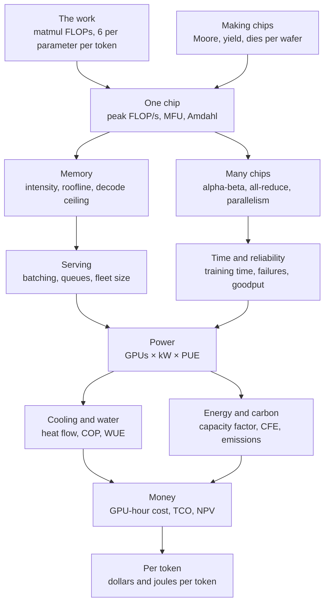
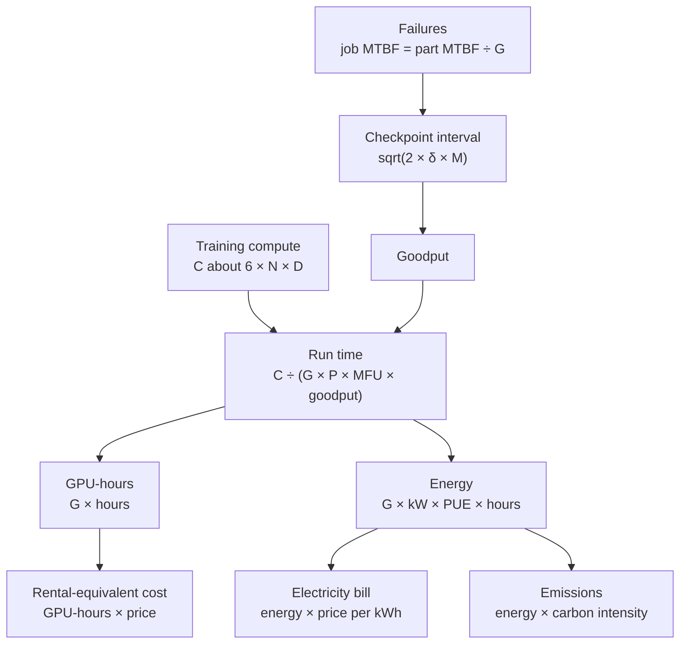

## Compute, chips and data centers

These are the equations of the machine that AI runs on. They count the arithmetic a model needs, say how fast one chip can do it and whether memory or math is the real limit, work out how much memory a model and its conversations take, and price the cost of splitting one job across thousands of chips that must keep talking to each other. They then follow the job into the building: how often parts fail and how often to save progress, how requests queue up, how much electricity the whole site draws and how much is lost on the way to the chips, how the heat is carried away and how much water that takes, and finally what all of it costs per GPU-hour, per million tokens and per prompt. A few quantities tie the family together: FLOPs (the work), FLOP/s and bytes per second (the speeds of math and of moving data), watts (the power that every operation and every byte moved turns into heat) and dollars. The entries run from simplest to most advanced, and each one uses only ideas from entries above it or from the general-math and large-language-model sections of this appendix.

*Figure G.X: How the compute and data-center equations connect, from the arithmetic a model needs, through chips, memory, networks and serving, to power, cooling, energy and the cost of each token.*

### Iron law of processor performance (CPU time)

**What it does:** Splits the time a program takes into how much work it asks for, how many clock ticks each step needs and how long one tick lasts.

`CPU time = instruction count × CPI × clock period = instruction count × CPI ÷ f; speedup = old time ÷ new time`

- **CPU time**: the seconds the processor spends running the program
- **instruction count**: how many machine instructions the program executes
- **CPI**: cycles per instruction, the average number of clock ticks one instruction takes
- **clock period**: the length of one tick, which is 1 ÷ f
- **f**: the clock frequency, in ticks per second (hertz)
- **speedup**: how many times faster the new version runs than the old one

**In plain words:** A program gets faster only if it executes fewer instructions, needs fewer ticks per instruction or ticks faster. Clock speeds stopped rising quickly in the mid-2000s (the Dennard scaling entry below explains why), so modern chips mostly win on the first factor: vector, SIMD and tensor instructions each do many operations, so the same job needs far fewer instructions.

**Tiny example:** 1 billion instructions at CPI 1.5 on a 3 GHz core: 10^9 × 1.5 ÷ (3 × 10^9) = 1.5 × 10^9 ÷ 3 × 10^9 = 0.5 s. Suppose one vector instruction now does the work of 8 ordinary ones at the same CPI: the count falls to 10^9 ÷ 8 = 1.25 × 10^8, the time to 1.25 × 10^8 × 1.5 ÷ (3 × 10^9) = 0.0625 s, a speedup of 0.5 ÷ 0.0625 = 8.

**Where it is used:** Hennessy and Patterson's basic performance equation, used in CPU design and benchmarking. In AI servers it governs the CPU-side work that feeds the accelerators: data loading, tokenization and orchestration. One tensor-core instruction is a whole small matrix multiplication, the extreme case of doing more per instruction.
**In the book:** Chapter 2 (The clock: a metronome for billions of steps; The processor: how a CPU runs a program) and Chapter 32 (The CPU: a few brilliant workers) explain clocks and instructions in words; the formula is only here.

> **Definition — CPI (cycles per instruction):** The average number of clock ticks a processor needs to finish one instruction. Lower is better; together with the instruction count and the clock speed it sets how long a program takes.

### Matrix multiplication cost (FLOPs and bytes of a GEMM)

**What it does:** Counts the arithmetic and the ideal memory traffic of multiplying two matrices, the operation that dominates AI hardware.

`C = A × B, A of shape m × k, B of shape k × n: FLOPs = 2 × m × n × k; bytes moved (ideal) = b × (m × k + k × n + m × n)`

- **A, B**: the two input matrices; **C**: the result, of shape m × n
- **m, k, n**: the matrix sizes; k is the length of each dot product
- **FLOPs**: floating-point operations; one multiply plus one add counts as 2
- **b**: bytes per number (2 for BF16, 1 for FP8)
- **bytes moved**: reading A and B once and writing C once

**In plain words:** Each of the m × n outputs is a dot product of length k, which is k multiplications and about k additions. A matrix–vector product is the case n = 1, which does only 2 FLOPs per weight read; that is why writing one token at a time is limited by memory, as the entries below show.

**Tiny example:** A of shape 2 × 3 times B of shape 3 × 4 in BF16: FLOPs = 2 × 2 × 4 × 3 = 48; bytes = 2 × (6 + 12 + 8) = 52. Two 4,096 × 4,096 matrices: 2 × 4,096^3 ≈ 1.37 × 10^11 FLOPs and 2 × 3 × 4,096^2 ≈ 1.0 × 10^8 bytes, about 1,365 FLOPs per byte.

**Where it is used:** Every FLOP count in AI starts here: model FLOPs, utilization accounting, kernel benchmarks (cuBLAS, CUTLASS, Triton) and accelerator spec sheets, which count multiply-accumulates times 2. A batched product multiplies the count by the batch size; an einsum (a general tensor product written by its index letters) costs 2 × the product of all its distinct index sizes. The definition of matrix multiplication is in the foundations section of this appendix.
**In the book:** Chapter 5 (Matrix multiplication: many dot products at once), Chapter 32 (What a neural network actually computes), Chapter 33 (Tiling: how software reuses data, square case) and Appendix B (Matrix multiplication cost); the general bytes-moved formula is only here.

> **Definition — GEMM (general matrix multiply):** The standard name, from numerical libraries, for multiplying two matrices (optionally adding a third). GEMM kernels are the most heavily optimized code on every AI chip.

### Forward and backward FLOPs of a layer (where the 6 in 6ND comes from)

**What it does:** Shows that training a layer costs three matrix multiplications for every one in the forward pass, which is the hardware origin of "6 FLOPs per parameter per token".

`Y = X × W, X of shape B × d_in, W of shape d_in × d_out: forward = 2 × B × d_in × d_out; backward = 2 × B × d_in × d_out (dX = dY × W^T) + 2 × B × d_in × d_out (dW = X^T × dY); per parameter per token: 2 + 4 = 6 FLOPs (8 with full recomputation)`

- **X**: the layer's input, B token vectors of length d_in
- **W**: the weight matrix; **Y**: the output
- **B**: tokens in the batch; **d_in**, **d_out**: input and output widths
- **dY**: the gradient arriving from the layer above; **dX**: the gradient passed down; **dW**: the gradient for the weights
- **W^T**, **X^T**: the transposes (rows and columns swapped)

**In plain words:** Going backward, a layer must compute two things: how the loss changes with its input (to pass further down) and how it changes with its weights (to learn). Each is a matrix multiplication as big as the forward one, so backward costs about twice forward. Summed over all N parameters that gives 2 × N forward plus 4 × N backward per token. Recomputing activations instead of storing them adds one more forward pass, 8 × N.

**Tiny example:** B = 4 tokens, d_in = 3, d_out = 2 (6 weights): forward = 2 × 4 × 3 × 2 = 48 FLOPs; backward = 48 + 48 = 96; total 144, which equals 6 × 6 weights × 4 tokens = 144.

**Where it is used:** Model-FLOPs accounting in Megatron-LM, NeMo, MaxText and torchtitan. Megatron's fuller count for a GPT model with B sequences of s tokens, L layers, hidden size h and vocabulary V is `72 × B × s × L × h^2 × (1 + s ÷ (6 × h) + V ÷ (12 × h × L))` FLOPs per training step (Narayanan and others, 2021), which adds the attention and output-layer terms; for GPT-3's shape it gives about 1.08 × 10^12 FLOPs per token against 6 × N ≈ 1.05 × 10^12. The headline rule C ≈ 6 × N × D and its examples are in the large language models section of this appendix.
**In the book:** Chapter 37 (Where the 6 comes from), Chapter 19 (Where the 6 comes from) and Appendix B (Cost of a training step); the per-layer split, the 8 × N variant and Megatron's count are only here.

### Peak FLOP/s of a chip (spec-sheet formula, sparsity, TOPS)

**What it does:** Computes the fastest a chip could possibly do arithmetic, the number printed on its spec sheet.

`peak FLOP/s = compute units × FLOPs per unit per clock cycle × f; systolic array: rows × columns × 2 × f; TOPS = peak operations per second ÷ 10^12; H100-equivalents = sum over chips of (chip peak ÷ H100 peak)`

- **compute units**: tensor cores, matrix units or cores working in parallel
- **FLOPs per unit per clock cycle**: fixed by the design and the number format
- **f**: the clock frequency
- **rows × columns**: the size of a systolic array, each cell doing one multiply-add (2 FLOPs) per cycle
- **TOPS**: trillions of operations per second, used for integer math on phone and laptop chips

**In plain words:** Multiply how many workers, how much each does per tick and how many ticks per second. Halving the bits per number roughly doubles the peak. Spec sheets often quote "sparse" figures, twice the dense one, which only apply if two of every four weights are zero; training achieves the dense figure at best.

**Tiny example:** A toy chip with 4 units doing 2 FLOPs per cycle at 1 GHz: 4 × 2 × 10^9 = 8 × 10^9 FLOP/s. NVIDIA V100: 640 tensor cores × 128 FLOPs × 1.53 × 10^9 Hz ≈ 125 × 10^12 FLOP/s. Google TPU v1: 256 × 256 × 2 × 700 × 10^6 ≈ 92 × 10^12 operations per second, 92 TOPS.

**Where it is used:** Reading accelerator spec sheets, chip design, export-control thresholds (the TPP entry below) and fleet comparisons in H100-equivalents (Epoch AI). The book reports Vera Rubin at about 4 PFLOP/s dense BF16, 17.5 FP8 and 35 NVFP4 for training, showing the precision ladder.
**In the book:** Chapter 32 (The peak-speed formula, checked on real chips; Dense versus sparse; How fast is a CPU at AI math?), Chapter 35 (Edge NPUs and TOPS) and Chapter 37 (H100-equivalent, in words).

### Training time, GPU count and GPU-hours from a compute budget

**What it does:** Turns the total FLOPs of a training run into days, chips and GPU-hours.

`cluster speed = G × P × U; time = C ÷ (G × P × U × goodput); GPUs needed = C ÷ (target time × P × U × goodput); GPU-hours = G × hours`

- **G**: the number of chips
- **P**: peak FLOP/s per chip at the precision used
- **U**: the achieved share of peak (MFU, next entry), typically 0.3 to 0.5
- **C**: total training FLOPs, about 6 × N × D
- **goodput**: the share of wall-clock time not lost to failures and restarts (1 in the simple version; its own entry is below)

**In plain words:** Divide the work by the speed the whole cluster really achieves. Rearranged, the same equation tells you how many chips you need for a deadline.

**Tiny example:** C = 10^21 FLOPs on 8 GPUs with P = 10^15 and U = 0.4: cluster speed = 8 × 10^15 × 0.4 = 3.2 × 10^15 FLOP/s; time = 10^21 ÷ 3.2 × 10^15 = 312,500 s ≈ 3.6 days; GPU-hours = 8 × 312,500 ÷ 3,600 ≈ 694. Llama 3.1 405B: 3.8 × 10^25 ÷ (16,384 × 989 × 10^12 × 0.4) ≈ 5.9 × 10^6 s ≈ 68 days and about 26.7 million GPU-hours; at 90% goodput, about 75 days.

**Where it is used:** Planning every pretraining run, compute procurement and Epoch AI's estimates of frontier training compute.
**In the book:** Chapter 37 (From FLOP to days), Chapter 19 (From FLOPs to dollars), Chapter 2 and Appendix B (Cluster speed; Training time; GPU-hours); the goodput factor is only here.

### Model FLOPs utilization and hardware FLOPs utilization (MFU, HFU)

**What it does:** Measures what share of a cluster's peak speed goes into the arithmetic the model actually needs.

`MFU = (model FLOPs per token × tokens per second) ÷ (chips × peak FLOP/s per chip); PaLM model FLOPs per token = 6 × N + 12 × L × H × Q × T; HFU = (FLOPs actually executed per second, including recomputation) ÷ (chips × peak FLOP/s); with selective recomputation HFU ÷ MFU ≈ 1 + s ÷ (6 × h)`

- **model FLOPs per token**: what the math requires, about 6 × N for training
- **N**: parameters
- **L**, **H**, **Q**: layers, attention heads and head size; **T** (or **s**): sequence length
- **h**: hidden size of the model
- **HFU**: like MFU but also counting work done twice (recomputation)

**In plain words:** MFU asks "how much of the hardware's peak did useful math?" and ignores implementation tricks, so it is the honest number for comparing runs. HFU also counts recomputed work, so it is always at least MFU. Large BF16 runs typically reach 35 to 50% MFU.

**Tiny example:** 8 GPUs at 989 × 10^12 FLOP/s train a 7-billion-parameter model at 75,000 tokens per second: useful work = 6 × 7 × 10^9 × 75,000 = 3.15 × 10^15 FLOP/s; peak = 8 × 989 × 10^12 ≈ 7.91 × 10^15; MFU = 3.15 ÷ 7.91 ≈ 40%. With full recomputation the hardware does 8 × N per token, so HFU ≈ 53%.

**Where it is used:** The headline efficiency of every large training run (PaLM, Megatron-LM, Llama 3, MaxText); Llama 3 405B reported 38 to 43% BF16 MFU, about 0.41 × 989 ≈ 400 TFLOP/s of useful work per GPU. The decode-side counterpart, MBU, is in the decode-ceiling entry below.
**In the book:** Chapter 37 (Utilization: MFU, HFU and where the time goes), Chapter 32 (Peak versus achieved) and Appendix B (Cluster speed); the PaLM per-token count and the HFU ÷ MFU ratio are only here.

### Amdahl's law

**What it does:** Gives the best speedup from n workers when part of a job cannot be split.

`speedup(n) = 1 ÷ ((1 − p) + p ÷ n); limit as n grows = 1 ÷ (1 − p)`

- **p**: the fraction of the original run time that can be spread over workers
- **1 − p**: the serial part, which only one worker can do
- **n**: the number of workers

**In plain words:** The parallel part shrinks as you add workers, but the serial part never does, so it caps the speedup. In AI clusters the effectively serial part includes exposed communication, optimizer steps, data loading and waiting for the slowest chip.

**Tiny example:** p = 0.95: n = 10 gives 1 ÷ (0.05 + 0.095) ≈ 6.9; n = 100 gives 1 ÷ (0.05 + 0.0095) ≈ 16.8; n = 1,000 gives about 19.6; never more than 1 ÷ 0.05 = 20.

**Where it is used:** Reasoning about parallel hardware, cluster scaling and pipeline optimization (Amdahl, 1967).
**In the book:** Chapter 32 (Parallelism: SIMD, SIMT and armies of simple workers) works the limit; the finite-n form is only here.

> **Definition — Speedup:** How many times faster a job runs after a change, measured as the old time divided by the new time. A speedup of 4 means a 60-minute job now takes 15 minutes.

### Gustafson's law (scaled speedup)

**What it does:** Gives the speedup when more workers are used to solve a bigger problem in the same time, rather than the same problem faster.

`scaled speedup(n) = (1 − p) + p × n = n − (1 − p) × (n − 1)`

- **n**: the number of workers
- **p**: the fraction of the run time spent in parallel work, measured on the n-worker system
- **1 − p**: the serial fraction on that system

**In plain words:** Amdahl assumes a fixed job. Gustafson (1988) noticed that people with more processors run bigger jobs, so the serial part stays small while the parallel part grows with n, and the speedup grows almost in step with n. This is the regime of AI scaling: more GPUs train bigger models on more tokens, rather than finishing a fixed run sooner.

**Tiny example:** p = 0.95 on 10 workers: 0.05 + 0.95 × 10 = 9.55. On 1,000 workers: 0.05 + 950 = 950.05 (the second form gives 1,000 − 0.05 × 999 = 950.05). Amdahl's law with the same p capped the speedup at 20.

**Where it is used:** Weak-scaling analysis of training clusters and supercomputers.
**In the book:** Only here (Chapter 32 gives Amdahl's law).

> **Definition — Gustafson's law:** The rule that when a bigger computer is used to solve a proportionally bigger problem, the speedup grows almost in step with the number of processors, because the serial part stays small. It complements Amdahl's law, which assumes the problem size is fixed.

### Parallel speedup, scaling efficiency and the Universal Scalability Law

**What it does:** Measures how well extra workers are used, and models why throughput eventually stops rising, or even falls, as more are added.

`S(n) = T(1) ÷ T(n); strong-scaling efficiency = S(n) ÷ n; weak-scaling efficiency = T(1) ÷ T(n) with the work per worker fixed; Universal Scalability Law: C(n) = n ÷ (1 + σ × (n − 1) + κ × n × (n − 1))`

- **T(1)**, **T(n)**: run time on 1 and on n workers
- **S(n)**: the speedup on n workers
- **C(n)**: relative throughput (capacity) with n workers
- **σ**: contention, the share of work that must wait in line (Amdahl's serial part)
- **κ**: coherency, the cost of every pair of workers having to coordinate

**In plain words:** Strong scaling keeps the job fixed; weak scaling grows it with the workers. Gunther's Universal Scalability Law adds a coordination term that grows with n × (n − 1), so beyond some point adding workers lowers throughput; the peak is at n = sqrt((1 − σ) ÷ κ).

**Tiny example:** A job takes 100 hours on 1 machine and 14 hours on 8: S = 100 ÷ 14 ≈ 7.14; efficiency = 7.14 ÷ 8 ≈ 89%. With σ = 0.02 and κ = 0.0001: C(64) = 64 ÷ (1 + 0.02 × 63 + 0.0001 × 64 × 63) = 64 ÷ 2.66 ≈ 24.0; the peak is near n = sqrt(0.98 ÷ 0.0001) ≈ 99 (C ≈ 25.2), and C(200) ≈ 22.3 is lower again.

**Where it is used:** Cluster benchmarking (MLPerf Training results at different scales report throughput per GPU) and capacity planning for serving systems.
**In the book:** Only here (Chapter 37's Watch out notes that scaling is sub-linear).

> **Definition — Strong scaling:** Speeding up a fixed-size job by adding processors; ideally doubling the processors halves the time.

> **Definition — Weak scaling:** Growing the job in proportion to the number of processors so that each one has the same amount of work; ideally the run time stays constant.

> **Definition — Universal Scalability Law:** Neil Gunther's model of throughput versus the number of workers, with one term for waiting in line and one for coordination between every pair of workers, which predicts that throughput peaks and then falls.

### Tile and wave quantization on GPUs

**What it does:** Counts how many tiles and "waves" a GPU matrix multiplication needs, and how much of the chip sits idle because the work does not divide evenly.

`tiles = ceil(M ÷ t_M) × ceil(N ÷ t_N); waves = ceil(tiles ÷ number of SMs); utilization ≈ tiles ÷ (waves × number of SMs)`

- **M**, **N**: the rows and columns of the output matrix
- **t_M**, **t_N**: the tile size each streaming multiprocessor (SM) works on, for example 128 × 128
- **ceil()**: round up to the next whole number
- **number of SMs**: the processor blocks on the GPU (132 on an H100)
- **waves**: rounds in which every SM takes one tile

**In plain words:** The output is cut into tiles and each SM takes one at a time. If the tile count is just over a multiple of the SM count, a last wave runs with most SMs idle (wave quantization). If a matrix size is not a multiple of the tile size, the edge tiles do wasted work (tile quantization).

**Tiny example:** On 132 SMs with 128 × 128 tiles: a 1,536 × 1,408 output has 12 × 11 = 132 tiles, one full wave, 100% busy. A 1,536 × 1,536 output has 12 × 12 = 144 tiles, so ceil(144 ÷ 132) = 2 waves and 144 ÷ 264 ≈ 55% utilization. A dimension of 1,000 needs ceil(1,000 ÷ 128) = 8 tiles covering 1,024 rows, so 1,000 ÷ 1,024 ≈ 98% of that work is useful.

**Where it is used:** NVIDIA's matrix-multiplication performance guidelines and kernel autotuning (CUTLASS, Triton). It is why model widths are chosen as multiples of 64 or 128 and vocabularies are padded.
**In the book:** Only here (Chapter 32, Inside a GPU, gives the H100's 132 SMs).

> **Definition — Wave quantization:** Lost GPU speed when the number of work tiles is slightly more than a multiple of the number of processor blocks, so a final round runs with most blocks idle.

> **Definition — Tile quantization:** Wasted GPU work when a matrix size is not a whole multiple of the tile size, so the tiles at the edges are partly empty but cost as much as full ones.

### Arithmetic intensity (FLOPs per byte)

**What it does:** Measures how much math a job does for each byte it moves between memory and the compute units.

`I = FLOPs ÷ bytes moved; X[B × D] × W[D × F] in 16-bit: I = 2 × B × D × F ÷ (2 × B × D + 2 × D × F + 2 × B × F) ≈ B when B is much smaller than D and F; tiled matmul: I ≈ 2 × b_m × b_n ÷ (b × (b_m + b_n))`

- **I**: arithmetic intensity, in FLOPs per byte
- **B**: tokens processed together (the batch); **D**, **F**: the weight matrix's sizes
- **b_m**, **b_n**: the output tile sizes kept in fast on-chip memory
- **b**: bytes per number

**In plain words:** Each weight byte read from memory is reused once per token in the batch, so intensity grows with batch size. Decoding for one user reads every 2-byte weight to do 2 FLOPs, an intensity of 1. Tiling keeps blocks in on-chip memory so each byte fetched is used many times.

**Tiny example:** Adding two 16-bit vectors (c = a + b): 1 FLOP per element, 6 bytes moved (read 2 + 2, write 2), so I = 1 ÷ 6. A batch of 4 tokens through a 4,096 × 4,096 matrix: 2 × 4 × 4,096^2 ÷ (2 × 4 × 4,096 + 2 × 4,096^2 + 2 × 4 × 4,096) ≈ 3.99. A 128 × 128 tile in BF16: 2 × 128 × 128 ÷ (2 × 256) = 64.

**Where it is used:** Deciding whether a kernel is memory- or compute-bound (FlashAttention, fused kernels, batching policies in vLLM and SGLang).
**In the book:** Chapter 33 (Arithmetic intensity: how much math per byte; Tiling: how software reuses data) and Appendix B (Arithmetic intensity); the tiled formula is only here.

### Step time with overlapped compute and communication

**What it does:** Bounds how long a piece of work takes when it must both compute and move data.

`T_math = FLOPs ÷ FLOP/s; T_comms = bytes ÷ bytes per second; T_lower = max(T_math, T_comms); T_upper = T_math + T_comms`

- **T_math**: time to do the arithmetic
- **T_comms**: time to move the data, from memory or between chips
- **T_lower**: the time if the two overlap perfectly
- **T_upper**: the time if they run one after the other

**In plain words:** If moving and computing happen at the same time, the slower one sets the pace; if not, their times add. Real kernels and training steps land in between, and the part of communication not hidden behind math is called exposed communication.

**Tiny example:** A step does 1.5 × 10^12 FLOPs at an achieved 500 × 10^12 FLOP/s (T_math = 3 ms) and moves 100 MB over a 50 GB/s link (T_comms = 2 ms): at best max(3, 2) = 3 ms, at worst 3 + 2 = 5 ms.

**Where it is used:** Performance modeling in JAX/XLA and PyTorch stacks, reading profiler traces, choosing parallelism layouts. It is the general form behind the roofline (memory) and the communication tests of each parallelism entry below (How to Scale Your Model, Part 1).
**In the book:** Chapter 37 (Ring all-reduce, worked by hand; Finding the lost time: profiling) describes overlap in words; the bounds are only here.

### Roofline model and ridge point

**What it does:** Gives the speed a job can reach on a chip from its arithmetic intensity, and the intensity at which memory stops being the limit.

`attainable FLOP/s = min(peak FLOP/s, I × memory bandwidth); ridge point I* = peak FLOP/s ÷ memory bandwidth; compute-bound if I > I*, memory-bound if I < I*`

- **I**: the job's arithmetic intensity
- **memory bandwidth**: bytes per second the memory can deliver
- **I***: the ridge point, in FLOPs per byte

**In plain words:** Plotted on log-log axes, speed rises along a slanted roof (bandwidth × intensity) until it hits the flat roof of peak compute. Peak compute has grown faster than memory bandwidth, so ridge points keep rising and more jobs are memory-bound.

**Tiny example:** H100: 989 × 10^12 ÷ 3.35 × 10^12 ≈ 295 FLOPs per byte. One-user BF16 decode (I = 1) reaches at most 1 × 3.35 × 10^12 = 3.35 TFLOP/s, about 0.3% of peak. A big matmul with I = 1,000 reaches min(989, 3,350) = 989 TFLOP/s.

**Where it is used:** Kernel optimization (NVIDIA Nsight Compute draws rooflines), chip design and batching decisions (Williams, Waterman and Patterson, 2009). Variants: one roof per memory level (hierarchical roofline) and network rooflines that use link bandwidth. Gholami and others (2024) measured peak compute growing about 3.0 times every two years against about 1.6 for DRAM bandwidth.
**In the book:** Chapter 33 (The roofline model, worked with numbers; Newer chips are even hungrier) and Appendix B (Ridge point).

### HBM stack bandwidth and capacity

**What it does:** Computes the bandwidth and size of high-bandwidth memory from its very wide interface.

`bandwidth per stack (GB/s) = interface width in bits × data rate per pin in Gb/s ÷ 8; chip bandwidth = stacks × bandwidth per stack; capacity per stack = dies per stack × capacity per die`

- **interface width**: the number of data wires from one stack (1,024 for HBM3, 2,048 for HBM4)
- **data rate per pin**: gigabits per second on each wire
- **÷ 8**: 8 bits make a byte
- **stacks**: HBM stacks beside the processor; **dies per stack**: memory chips piled in each

**In plain words:** HBM is fast because it uses a thousand or more wires placed right beside the processor, not because each wire is fast.

**Tiny example:** HBM3: 1,024 × 6.4 ÷ 8 = 819.2 GB/s per stack. HBM4: 2,048 × 8 ÷ 8 = 2,048 GB/s; eight stacks give about 16.4 TB/s. Capacity: 12 dies × 3 GB = 36 GB per stack, × 8 stacks = 288 GB (a B300).

**Where it is used:** Every accelerator's memory spec (H100 3.35 TB/s, Blackwell about 8 TB/s, Rubin about 20 TB/s as reported) and therefore every decode-speed estimate. The same formula with a 64-bit channel gives DDR5 module bandwidth.
**In the book:** Chapter 33 (The arithmetic of a stack; The generations) and Chapter 34 (HBM: memory moved next door).

### Average memory access time (cache hierarchy)

**What it does:** Gives the average time to fetch data from a memory hierarchy where most requests are served by a small fast memory.

`AMAT = hit time + miss rate × miss penalty; two levels: AMAT = t_L1 + m_L1 × (t_L2 + m_L2 × t_memory)`

- **AMAT**: average memory access time
- **hit time**: the time when the data is in the fast memory (the cache)
- **miss rate**: the fraction of requests that are not
- **miss penalty**: the extra time to fetch from the next, slower level
- **t_L1**, **t_L2**, **t_memory**: access times of the first cache, the second cache and main memory; **m_L1**, **m_L2**: miss rates of the two caches

**In plain words:** Most requests hit the nearby cache and are quick; only misses pay for the long trip. Lowering the miss rate is often worth more than speeding up the far memory.

**Tiny example:** 1 ns hit time, 5% misses, 100 ns penalty: 1 + 0.05 × 100 = 6 ns. Two levels with t_L1 = 1 ns, m_L1 = 0.1, t_L2 = 10 ns, m_L2 = 0.2, t_memory = 100 ns: 1 + 0.1 × (10 + 0.2 × 100) = 1 + 0.1 × 30 = 4 ns.

**Where it is used:** Hennessy and Patterson's standard equation for CPU and GPU memory design and cache blocking. In GPUs the levels are registers, shared memory and L1, L2 and HBM, and kernels such as FlashAttention are designed to keep traffic to HBM low.
**In the book:** Only here (Chapter 33, The memory hierarchy: desk, shelf, library, warehouse, explains it in words).

> **Definition — AMAT (average memory access time):** The average time a processor waits for data, counting both the fast case where the data is in a cache and the slow case where it must be fetched from further away.

> **Definition — Miss rate:** The fraction of memory requests that do not find their data in a cache and must go to a slower level of memory.

### Energy of computing versus moving data

**What it does:** Adds up a job's energy as arithmetic plus data movement, which shows that moving data usually costs far more.

`energy ≈ operations × energy per operation + sum over memory levels of (bytes moved × energy per byte); power = FLOP/s × joules per FLOP + bytes per second × joules per byte; efficiency = FLOP/s ÷ watts = FLOPs per joule`

- **energy per operation**: joules for one arithmetic operation
- **energy per byte**: joules to move one byte from a given memory level (registers, on-chip SRAM, off-chip DRAM)
- **power**: energy per second, in watts

**In plain words:** Fetching a number from off-chip memory costs over a hundred times more energy than multiplying it, using Horowitz's widely cited 45 nm figures (ISSCC 2014): about 3.7 picojoules for a 32-bit floating-point multiply and about 640 for a 32-bit DRAM read. Keeping data on chip and using fewer bits cut the second term.

**Tiny example:** 1,000 multiplies, each fetching one 32-bit number from DRAM: 1,000 × 3.7 pJ + 1,000 × 640 pJ = 3.7 nJ + 640 nJ = 643.7 nJ, and 640 ÷ 643.7 ≈ 99.4% of it is data movement. A chip doing 989 × 10^12 FLOP/s at 700 W delivers about 1.4 × 10^12 FLOPs per joule.

**Where it is used:** Accelerator architecture (systolic arrays, large SRAM, near-memory compute) and comparing chips by performance per watt.
**In the book:** Chapter 33 (Moving data costs more than math), Chapter 2 (Moving data costs more than doing math) and Chapter 32 (Why fewer bits mean more speed); the summed formula is only here.

### Memory-bandwidth ceiling on decode speed (and MBU)

**What it does:** Gives the fastest one conversation can generate tokens, because every active weight must be read from memory for each token.

`tokens per second per sequence ≤ memory bandwidth ÷ bytes read per token; bytes read per token ≈ N_active × b + KV-cache bytes of that sequence; MBU = (bytes read per token × tokens per second) ÷ peak memory bandwidth`

- **N_active**: parameters used per token (all of them for a dense model)
- **b**: bytes per weight
- **KV-cache bytes**: the stored keys and values of that conversation (see the large language models section)
- **memory bandwidth**: bytes per second; with weights split over n chips it is n times one chip's
- **MBU**: memory bandwidth utilization, the share of that ceiling actually reached

**In plain words:** At small batch the math per token is tiny, so streaming the weights sets the speed. Halving b roughly doubles the ceiling, which is why FP8 and 4-bit weights speed up chatbots.

**Tiny example:** A 70-billion-parameter model in FP8 (70 GB) on one H200 at 4,800 GB/s: at most 4,800 ÷ 70 ≈ 69 tokens per second; with a 2 GB KV cache, 4,800 ÷ 72 ≈ 67. If it actually runs at 50 tokens per second, MBU = 72 × 50 ÷ 4,800 = 75%. Split over 8 H200s: 8 × 4,800 ÷ 70 ≈ 549.

**Where it is used:** Predicting chatbot typing speed, sizing local models (llama.cpp, MLX) and the case for SRAM-heavy inference chips. MBU was introduced by Databricks (2023) as the decode counterpart of MFU. Speculative decoding beats the ceiling by producing several tokens per weight read (large language models section).
**In the book:** Chapter 33 (Why decode is memory-bound: predicting your chatbot's speed), Chapter 23 (Worked example: how fast can one GPU write?) and Appendix B (Decode speed ceiling; Halving the precision); MBU is only here.

> **Definition — MBU (memory bandwidth utilization):** The share of a chip's peak memory bandwidth that token generation actually uses, computed from the bytes read per token times the tokens per second. It is the decode-side counterpart of MFU.

### Prefill time (compute-bound prompt processing)

**What it does:** Estimates how long reading a prompt takes, which sets most of the wait before the first word appears.

`prefill time ≈ 2 × N_active × P ÷ (F × U) + attention term; TTFT ≈ queueing delay + prefill time`

- **N_active**: parameters used per token
- **P**: prompt tokens
- **F**: peak FLOP/s; **U**: the achieved share of it
- **attention term**: extra work that grows with P^2 (large language models section)
- **TTFT**: time to first token

**In plain words:** All prompt tokens share each read of the weights, so prompt processing has an intensity of about P FLOPs per byte with 16-bit weights and runs near the compute roof, not the memory roof.

**Tiny example:** A 2,000-token prompt on a 70-billion-parameter model: 2 × 70 × 10^9 × 2,000 = 2.8 × 10^14 FLOPs; at an H100's FP8 peak of 1,979 × 10^12 that is 0.14 s, and at U = 0.5 about 0.28 s; with 0.05 s of queueing, TTFT ≈ 0.33 s.

**Where it is used:** Time-to-first-token targets, prompt-caching economics, chunked prefill and disaggregated serving, which puts prefill and decode on separate GPU pools because they hit different roofs (DistServe, NVIDIA Dynamo).
**In the book:** Chapter 23 (Worked example: how long does reading take?), Chapter 33 (Two phases of every answer) and Chapter 37 (Prefill and decode).

### Batched decode step time and the throughput–latency trade-off

**What it does:** Gives the time of one decoding step when B conversations are served together, and from it each user's speed and the server's total throughput.

`T_step ≈ max(2 × N_active × B ÷ F, (N_active × b + B × T × k_kv) ÷ BW); throughput = B ÷ T_step; per-user speed = 1 ÷ T_step; weight reads stop dominating when B > F × b ÷ (2 × BW)`

- **B**: conversations decoded together (the batch)
- **N_active**, **b**: active parameters and bytes per weight
- **F**: peak FLOP/s; **BW**: memory bandwidth
- **T**: context length per conversation; **k_kv**: KV-cache bytes per token

**In plain words:** One read of the weights serves every conversation in the batch, so throughput rises almost in step with B while each user slows only a little, until the step becomes compute-bound. Every conversation's KV cache must still be read separately, so long contexts and memory capacity cap the useful batch.

**Tiny example:** An 8-billion-parameter model in BF16 (16 GB) on an H100 (F = 989 × 10^12, BW = 3.35 × 10^12), 2,000-token contexts, k_kv = 131,072 bytes. B = 1: (16 × 10^9 + 2.6 × 10^8) ÷ 3.35 × 10^12 ≈ 4.9 ms, about 206 tokens per second. B = 32: (16 + 8.4) × 10^9 ÷ 3.35 × 10^12 ≈ 7.3 ms (the math takes only 0.5 ms), so each user gets about 137 tokens per second and the GPU about 4,400. B = 128: 49.6 GB read, 14.8 ms, 68 per user and about 8,650 in total. The crossover batch is 989 × 10^12 × 2 ÷ (2 × 3.35 × 10^12) ≈ 295.

**Where it is used:** Choosing batch sizes and latency targets in vLLM, SGLang, TensorRT-LLM and NVIDIA Dynamo; NVIDIA presents the trade-off as tokens per second per megawatt against tokens per second per user. A simpler fitted form, T_step = t_0 + B × t_1, is common in serving simulators.
**In the book:** Chapter 37 (Batching: the single biggest lever), Chapter 23 (Worked example: batching on one GPU) and Chapter 33 (Worked example: how many users fit on one GPU?); the crossover batch formula is only here.

### Memory capacity: weights, KV cache and chips needed

**What it does:** Works out how much memory a model needs and how many chips it takes to hold it.

`weight bytes = N_total × b; chips needed = ceil((weight bytes + KV-cache bytes + reserve) ÷ (memory per chip × usable fraction)); KV memory left = chips × memory per chip − weight bytes − reserve`

- **N_total**: every parameter that must be stored (all experts of a mixture-of-experts model)
- **b**: bytes per parameter (4 FP32, 2 BF16, 1 FP8, about 0.5 for 4-bit formats)
- **reserve**: memory for activations and the software runtime
- **usable fraction**: the share of a chip's memory available to the model

**In plain words:** The weights must fit first; whatever is left holds conversations' KV caches, which bounds context length times concurrent users. The per-token KV formula and the concurrency limit are in the large language models section.

**Tiny example:** 70 billion × 2 bytes = 140 GB; with 90% of an 80 GB H100 usable, 140 ÷ 72 ≈ 1.94, so 2 chips. In FP8 on one 141 GB H200 with a 2 GB reserve: 141 − 70 − 2 = 69 GB left, which at 327,680 bytes per token holds about 210,000 tokens.

**Where it is used:** Choosing tensor-parallel degree, deciding which GPU or laptop can run a model, and the HBM capacity race.
**In the book:** Chapter 33 (Worked example: how many users fit on one GPU?), Chapter 34 (Why one chip is not enough), Chapter 5 and Appendix B (Weight memory; Chips needed to hold the weights).

### Training memory per parameter (about 16 bytes with Adam)

**What it does:** Counts the memory training needs for each parameter before activations.

`model-state bytes ≈ N × (b_w + b_g + K) = N × (2 + 2 + 12) = 16 × N; total ≈ 16 × N + activation bytes + temporary buffers`

- **N**: parameters
- **b_w**: bytes for the BF16 weights (2); **b_g**: bytes for the BF16 gradients (2)
- **K**: optimizer bytes (12: a 4-byte FP32 master copy plus Adam's two 4-byte moment averages)

**In plain words:** Training stores far more than the model: gradients, a full-precision master copy and the optimizer's running averages. Variants: FP32 gradients make it 18 bytes; 8-bit optimizer states or one-buffer optimizers (Muon, Lion, factored Adafactor) make it smaller.

**Tiny example:** 1 billion parameters × 16 = 16 GB. 70 billion × 16 = 1.12 TB, at least 1.12 TB ÷ 80 GB = 14 chips before any activations.

**Where it is used:** Sizing training clusters and choosing how to shard the state (the ZeRO entry below). DeepSeek-V3's FP8 recipe kept FP32 master weights and gradients but stored Adam's moments in BF16.
**In the book:** Chapter 33 (Training memory: about 16 bytes per parameter), Chapter 37 (The memory wall of training) and Appendix B (Training memory).

### Activation memory of a Transformer layer (Korthikanti formula)

**What it does:** Counts the bytes of intermediate results one Transformer layer must keep for the backward pass.

`bytes per layer = s × b × h × (34 + 5 × a × s ÷ h); with tensor and sequence parallelism over t GPUs: s × b × h × (34 ÷ t + 5 × a × s ÷ (h × t)); selective recomputation: 34 × s × b × h ÷ t; full recomputation: 2 × s × b × h`

- **s**: sequence length in tokens
- **b**: micro-batch size, sequences per GPU per pass
- **h**: hidden size
- **a**: attention heads
- **t**: tensor-parallel size
- **34**, **5**: byte counts per value derived for 16-bit activations of a GPT-style layer

**In plain words:** The 34 term is everything except the attention-score matrices; the 5 × a × s ÷ h term is those matrices, which grow with the square of the sequence. FlashAttention-style kernels never store them, so the 34 term dominates today. Activation memory grows with tokens per micro-batch, not with parameter count, which is what limits long-context training.

**Tiny example:** GPT-3's shape (a = 96, s = 2,048, h = 12,288, b = 1): s × b × h = 25,165,824; 5 × 96 × 2,048 ÷ 12,288 = 80; so 25,165,824 × (34 + 80) ≈ 2.87 GB per layer, about 275 GB for all 96 layers. Selective recomputation keeps 34 × 25,165,824 ≈ 0.86 GB per layer; with t = 8 as well, 2.87 ÷ 8 ≈ 0.36 GB.

**Where it is used:** Memory planners in Megatron-LM and NeMo; choosing micro-batch size, recomputation and context parallelism (Korthikanti and others, 2022). In pipeline-parallel training the first stage holds activations for several micro-batches at once, about L layers' worth in total.
**In the book:** Only here (Chapter 37, The memory wall of training, describes activations in words).

> **Definition — Selective recomputation:** Recomputing only the cheap but memory-hungry parts of a layer, such as attention scores, during the backward pass instead of storing them, which saves most of the activation memory for a few percent more compute.

### Activation checkpointing (recomputation) trade-off

**What it does:** Shows how keeping only some layers' activations and recomputing the rest trades memory for compute.

`keep a checkpoint every k layers: activation memory ∝ L ÷ k + k, smallest at k = sqrt(L), giving ∝ 2 × sqrt(L); cost: one extra forward pass, about 8 × N instead of 6 × N FLOPs per token`

- **L**: layers
- **k**: layers between saved checkpoints
- **∝**: "proportional to"
- **N**: parameters

**In plain words:** Store only the input of every k-th layer (L ÷ k of them) and, during the backward pass, recompute one k-layer segment at a time (k layers' worth of extra memory). Choosing k = sqrt(L) balances the two and cuts memory from proportional to L to proportional to sqrt(L), for about a third more compute (8 ÷ 6 ≈ 1.33).

**Tiny example:** L = 64: k = 8 gives 64 ÷ 8 + 8 = 16 layer-loads of memory instead of 64; k = 4 gives 16 + 4 = 20 and k = 16 gives 4 + 16 = 20, both worse.

**Where it is used:** Standard in PyTorch (torch.utils.checkpoint), JAX (jax.checkpoint), Megatron-LM and DeepSpeed (Chen and others, 2016). Recomputed FLOPs count toward HFU, not MFU; offloading activations to CPU memory is a third option.
**In the book:** Chapter 33 (Training memory, the definition of activation checkpointing) and Chapter 37 (The memory wall of training) in words; the formulas are only here.

### Message transfer time (latency–bandwidth or alpha–beta model)

**What it does:** Gives the time to send one message over a link as a fixed start-up delay plus the time to push its bytes through.

`T = α + n ÷ β; link bandwidth = lanes × rate per lane; bytes per second = bits per second ÷ 8`

- **T**: the time to deliver the message
- **α** (alpha): the fixed latency every message pays (software, switch hops, the distance traveled)
- **n**: the message size in bytes
- **β** (beta): the link bandwidth in bytes per second
- **lanes**: the serial channels that make up one port; **rate per lane**: bits per second on each

**In plain words:** Small messages are dominated by α and large ones by n ÷ β; the crossover is at n = α × β. Network ports are quoted in bits per second and NVLink in bytes per second, often counting both directions, so convert before comparing. Every collective-communication formula below is a sum of such terms.

**Tiny example:** An 800 Gb/s port is 4 lanes × 200 Gb/s = 800 Gb/s, and 800 ÷ 8 = 100 GB/s. Suppose α = 5 µs. A 1 KB message: 5 + 0.01 = 5.01 µs (all latency). A 1 MB message: 5 + 10 = 15 µs. A 1 GB message: 5 µs + 10 ms ≈ 10 ms (all bandwidth). Crossover: 5 × 10^−6 s × 10^11 bytes per second = 500 KB.

**Where it is used:** Communication cost models in NCCL, MPI and parallelism planners (Hockney's model), and reading switch, network-card and NVLink specs: an H100's NVLink is rated 900 GB/s counting both directions, about 450 GB/s each way.
**In the book:** Chapter 34 (The ladder: eight levels from silicon to campus, Table 34.2), Chapter 4 (Latency and bandwidth), Chapter 37 (Ring all-reduce, worked by hand) and Appendix B (Message transfer time).

> **Definition — Alpha–beta model (latency–bandwidth model):** A simple formula for the time to send a message: a fixed start-up delay (alpha) plus the message size divided by the link's bandwidth (beta). It shows why many small messages are slow even on a very fast link.

### Propagation delay and the bandwidth–delay product

**What it does:** Gives the minimum time a signal needs to cross a distance of fiber, and how much data must be in flight to keep a long link busy.

`one-way delay = distance ÷ (c ÷ n_glass) ≈ 5 µs per km of fiber; round-trip time = 2 × one-way delay + processing; data in flight = bandwidth × round-trip time`

- **c**: the speed of light in a vacuum, about 300,000 km per second
- **n_glass**: the refractive index of the fiber, about 1.47 (how much glass slows light)
- **round-trip time**: there and back, plus processing at the ends
- **bandwidth**: bytes per second on the link

**In plain words:** Light in glass travels at about 200,000 km per second, so every kilometer adds about 5 microseconds that no faster chip can remove. To keep a long link full, a sender must have a whole round trip's worth of data on its way before the first acknowledgment returns.

**Tiny example:** 299,792 ÷ 1.47 ≈ 203,900 km/s, about 4.9 µs per km. 100 km: about 0.5 ms one way, 1 ms round trip; at 100 GB/s, 100 GB/s × 0.001 s = 100 MB must be in flight. 1,200 km: 6 ms one way, and at 50 GB/s with a 12 ms round trip, 600 MB in flight.

**Where it is used:** Placing data centers and inference regions, multi-campus training, buffer sizing and TCP and RDMA tuning. The bandwidth–delay product is a form of Little's law (below).
**In the book:** Chapter 38 (The speed of light sets the rules), Chapter 4 (The speed of light sets a floor on delay) and Chapter 34 (Training across campuses); the bandwidth–delay product is only here.

> **Definition — Bandwidth–delay product:** A link's bandwidth multiplied by its round-trip time: the amount of data that must be on its way at once to keep the link fully busy. Long, fast links need large buffers because of it.

### Decibels and the optical link budget

**What it does:** Adds up the gains and losses of a signal in decibels to check that enough light reaches the receiver.

`gain or loss in dB = 10 × log10(P_out ÷ P_in); power in dBm = 10 × log10(P ÷ 1 mW); received power (dBm) = transmit power (dBm) − fiber loss per km × length − connector and splice losses; the link works if received power ≥ receiver sensitivity + margin`

- **dB**: decibels, a ratio of two powers on a logarithmic scale
- **P_in**, **P_out**: power going in and coming out
- **log10**: the base-10 logarithm
- **dBm**: power compared with 1 milliwatt, in decibels
- **receiver sensitivity**: the weakest signal the receiver can still read reliably
- **margin**: extra headroom for aging, dirt and temperature

**In plain words:** Losses along a link multiply, and logarithms turn multiplication into addition, so engineers just subtract each loss in dB. Every 3 dB halves the power; every 10 dB divides it by 10.

**Tiny example:** Halving the power: 10 × log10(0.5) ≈ −3.0 dB; 2 mW is 10 × log10(2) ≈ +3.0 dBm. With assumed figures: transmit at +2 dBm, 2 km of fiber at 0.4 dB per km (0.8 dB) and two connectors at 0.5 dB each (1.0 dB): received = 2 − 0.8 − 1.0 = 0.2 dBm. With a sensitivity of −6 dBm and a 2 dB margin, the link needs −4 dBm and has 4.2 dB to spare.

**Where it is used:** Specifying optical transceivers, cabling plans and data-center interconnects. Part of the case for co-packaged optics is removing lossy, power-hungry electrical paths between the switch chip and the optics.
**In the book:** Only here (Chapter 34, Optics: turning bits into light, explains in words that copper signals fade within meters).

> **Definition — Decibel (dB):** A logarithmic unit for the ratio of two powers: 10 times the base-10 logarithm of the ratio. Plus 3 dB is about double the power and minus 3 dB about half; losses along a path are simply added.

> **Definition — dBm:** Power expressed in decibels relative to one milliwatt: 0 dBm is 1 mW, +3 dBm about 2 mW and −10 dBm 0.1 mW. Optical transceivers state their output and sensitivity this way.

> **Definition — Optical link budget:** The sum of transmitter power minus every loss along a fiber link (fiber length, connectors, splices), compared with the weakest signal the receiver can read; a positive remainder means the link will work.

### Ring all-reduce time

**What it does:** Gives the time for n GPUs to add up their copies of a large array so that every GPU ends with the total.

`T ≈ 2 × (n − 1) ÷ n × S ÷ B + 2 × (n − 1) × α; data each GPU sends = 2 × (n − 1) ÷ n × S; NCCL bus bandwidth = algorithm bandwidth × 2 × (n − 1) ÷ n`

- **n**: GPUs in the ring
- **S**: bytes each GPU holds (for example, a full gradient)
- **B**: per-GPU link bandwidth in one direction
- **α**: the latency of each step
- **algorithm bandwidth**: S ÷ T, as a benchmark reports it

**In plain words:** A reduce-scatter (n − 1 steps) then an all-gather (n − 1 steps), each passing a 1 ÷ n chunk to the next neighbor. Traffic per GPU approaches 2 × S however many GPUs join, which made large data parallelism practical; but the latency term grows with n, so small messages at large n use trees instead.

**Tiny example:** 4 GPUs, S = 1 GB, B = 50 GB/s, α = 10 µs: each sends 2 × 3 ÷ 4 × 1 = 1.5 GB, taking 1.5 ÷ 50 = 30 ms, plus 2 × 3 × 10 µs = 0.06 ms of latency, about 30.06 ms. Algorithm bandwidth ≈ 1 GB ÷ 0.03 s ≈ 33.3 GB/s; bus bandwidth = 33.3 × 1.5 = 50 GB/s, the link speed. A 70-billion-parameter model's 140 GB of BF16 gradients: about 2 × 140 ÷ 50 = 5.6 s over InfiniBand, about 0.62 s over 450 GB/s NVLink.

**Where it is used:** Gradient synchronization in data-parallel training (NCCL, RCCL, Gloo, XLA collectives), popularized for deep learning by Baidu in 2017 and Horovod.
**In the book:** Chapter 37 (Ring all-reduce, worked by hand); the latency term and bus bandwidth are only here.

> **Definition — Bus bandwidth (NCCL):** A figure reported by NVIDIA's NCCL benchmarks that rescales the measured speed of a collective by the amount each GPU must actually send, so results for different numbers of GPUs can be compared with the link's rated speed.

### Costs of the other collectives (all-gather, reduce-scatter, all-to-all, tree all-reduce)

**What it does:** Gives the time of the other group exchanges that parallel training and serving are built from.

`ring all-gather or reduce-scatter: T ≈ (n − 1) ÷ n × S ÷ B + (n − 1) × α; all-reduce = reduce-scatter + all-gather; all-to-all: each GPU sends (n − 1) ÷ n × S_local; tree or recursive-doubling all-reduce latency ≈ 2 × log2(n) × α`

- **n**: GPUs taking part
- **S**: the full gathered size; **S_local**: the data each GPU starts with in an all-to-all
- **B**: per-GPU bandwidth; **α**: per-step latency
- **log2(n)**: how many times n can be halved (10 for 1,024)

**In plain words:** All-gather and reduce-scatter are each half of a ring all-reduce. In an all-to-all every GPU keeps 1 ÷ n of its data and sends the rest; ring tricks do not help, so the network's bisection bandwidth sets its speed. Trees finish small messages in about log2(n) steps instead of n.

**Tiny example:** All-gather over 4 GPUs of a 1 GB result at 50 GB/s: 3 ÷ 4 × 1 ÷ 50 = 15 ms. All-to-all over 8 GPUs with 1 GB each: each sends 7 ÷ 8 = 0.875 GB, 17.5 ms at 50 GB/s. Latency with α = 5 µs over 1,024 GPUs: ring 2 × 1,023 × 5 µs ≈ 10.2 ms; tree 2 × 10 × 5 µs = 0.1 ms.

**Where it is used:** Data parallelism all-reduces gradients; ZeRO-3 and FSDP all-gather weights and reduce-scatter gradients; tensor and sequence parallelism exchange activations; expert parallelism uses all-to-all. On TPU tori a collective spread over several mesh axes uses all their links at once (How to Scale Your Model).
**In the book:** Chapter 37 (Collective communication: how thousands of GPUs agree) and Chapter 34 (Collectives: why the slowest link sets the pace) in words; the cost formulas are only here.

### ZeRO and FSDP sharding: memory and communication per GPU

**What it does:** Gives the memory per GPU when data-parallel copies split their optimizer state, gradients and weights, and the extra traffic that costs.

`plain data parallel = (2 + 2 + K) × Ψ; ZeRO-1 = 2 × Ψ + 2 × Ψ + K × Ψ ÷ N_d; ZeRO-2 = 2 × Ψ + (2 + K) × Ψ ÷ N_d; ZeRO-3 or FSDP = (2 + 2 + K) × Ψ ÷ N_d; values sent per step: 2 × Ψ (plain, ZeRO-1, ZeRO-2), 3 × Ψ (ZeRO-3)`

- **Ψ** (psi): parameters
- **K**: optimizer bytes per parameter (12 for mixed-precision Adam)
- **N_d**: data-parallel GPUs sharing the state
- **2 + 2**: bytes of BF16 weights and gradients per parameter

**In plain words:** Each GPU keeps only its 1 ÷ N_d slice of the optimizer state (stage 1), then of the gradients (stage 2), then of the weights (stage 3), and gathers what it needs just in time. Stage 3 replaces one all-reduce with a reduce-scatter plus two all-gathers, 1.5 times the traffic.

**Tiny example:** The ZeRO paper's case, Ψ = 7.5 billion, N_d = 64: plain 16 × 7.5 = 120 GB; ZeRO-1 4 × 7.5 + 12 × 7.5 ÷ 64 ≈ 31.4 GB; ZeRO-2 2 × 7.5 + 14 × 7.5 ÷ 64 ≈ 16.6 GB; ZeRO-3 120 ÷ 64 ≈ 1.9 GB. Traffic: 15 billion values (30 GB in BF16) per step, 22.5 billion (45 GB) for ZeRO-3.

**Where it is used:** DeepSpeed ZeRO, PyTorch FSDP and FSDP2, JAX fully sharded data parallelism (Rajbhandari and others, 2019); DeepSeek-V3 used ZeRO-1. Hybrid sharding shards inside a node and replicates across nodes to keep the extra traffic on fast links.
**In the book:** Chapter 37 (ZeRO and FSDP: sharding the memory, Table 37.4 for a 70-billion-parameter model); the traffic volumes are only here.

### When data parallelism is communication-bound (tokens per GPU per step)

**What it does:** Tells how many tokens each GPU must process per step for the gradient sync to hide behind the math.

`T_compute = 6 × N × B_local ÷ (F × U); T_comm ≈ 2 × b_g × N ÷ BW; compute-bound when B_local > (2 × b_g ÷ 6) × (F × U ÷ BW); TPU form: B ÷ X > C ÷ W_ici`

- **N**: parameters; **B_local**: tokens per GPU per step
- **F**, **U**: peak FLOP/s and utilization; **BW**: per-GPU network bandwidth
- **b_g**: bytes per gradient value
- **B**, **X**: global batch in tokens and chips along the data-parallel axis (TPU form)
- **C**, **W_ici**: FLOP/s per chip and inter-chip bandwidth (TPU form)

**In plain words:** Compute grows with tokens; the all-reduce does not. N cancels, so the test depends only on hardware ratios and batch size, which is why frontier runs use batches of millions of tokens.

**Tiny example:** An H100 at 400 × 10^12 achieved FLOP/s over 50 GB/s with BF16 gradients: (4 ÷ 6) × (400 × 10^12 ÷ 50 × 10^9) = 0.667 × 8,000 ≈ 5,300 tokens per GPU per step. Llama 3's 16 million-token batch over 16,384 GPUs is only about 1,000, which is why it grouped 128 GPUs per model copy with tensor and pipeline parallelism.

**Where it is used:** Choosing global batch size and parallelism layout; How to Scale Your Model gives about 2,550 tokens per chip for TPU v5p.
**In the book:** Chapter 37 (Worked example: when does the network become the bottleneck?); the TPU form is only here.

### Tensor parallelism communication cost (Megatron-style)

**What it does:** Compares the time a Transformer layer spends computing with the time its tensor-parallel GPUs spend exchanging activations.

`per layer, forward: 2 all-reduces of B × s × h × b bytes (2 more backward); T_comm ≈ 2 × 2 × (t − 1) ÷ t × B × s × h × b ÷ BW; T_compute ≈ 24 × B × s × h^2 ÷ (t × F); ratio T_comm ÷ T_compute = (t − 1) × b × F ÷ (6 × h × BW)`

- **B**, **s**: sequences and tokens per sequence
- **h**: hidden size; **b**: bytes per value
- **t**: GPUs splitting each matrix
- **F**: achieved FLOP/s per GPU; **BW**: link bandwidth

**In plain words:** Megatron-LM splits attention heads and the feed-forward block's inner dimension across t GPUs so each layer needs only two synchronizations forward and two backward. The ratio grows with t and shrinks with h, and needs NVLink-class bandwidth, which is why tensor parallelism stays inside one server or rack.

**Tiny example:** h = 8,192, t = 8, b = 2, F = 400 × 10^12, 1,000 tokens: compute = 24 × 1,000 × 8,192^2 ÷ (8 × 400 × 10^12) ≈ 0.50 ms; communication over 450 GB/s NVLink = 4 × 7 ÷ 8 × 1,000 × 8,192 × 2 ÷ 450 × 10^9 ≈ 0.13 ms, a ratio of 0.25, so it hides. Over 50 GB/s InfiniBand the ratio is about 2.3, communication-bound.

**Where it is used:** Megatron-LM, NeMo, TensorRT-LLM and vLLM (Shoeybi and others, 2019); Llama 3 used a tensor-parallel size of 8. Sequence parallelism swaps each all-reduce for a reduce-scatter plus an all-gather of the same volume while also splitting activations.
**In the book:** Chapter 37 (Tensor parallelism: splitting each matrix) in words; the cost formulas are only here.

### Pipeline bubble fraction

**What it does:** Gives the share of each training step that pipeline stages sit idle while the pipeline fills and drains.

`bubble share of step time = (p − 1) ÷ (m + p − 1); bubble time ÷ ideal time = (p − 1) ÷ m; interleaved with v chunks per GPU: (p − 1) ÷ (v × m)`

- **p**: pipeline stages (groups of layers on different GPUs)
- **m**: micro-batches per step
- **v**: model chunks per GPU in an interleaved schedule

**In plain words:** The first stage starts alone and the last finishes alone, wasting p − 1 micro-batch slots at each end, so m must be much larger than p. Interleaving divides the bubble by v for more communication; zero-bubble schedules and DeepSeek's DualPipe fill the gaps by splitting the backward pass in two.

**Tiny example:** p = 4, m = 4: 3 ÷ 7 ≈ 43% idle. p = 8, m = 32: 7 ÷ 39 ≈ 18%. Interleaved with v = 2: 7 ÷ 64 ≈ 0.109 of the ideal time, so 0.109 ÷ 1.109 ≈ 10% of the step.

**Where it is used:** Pipeline parallelism in Megatron-LM, DeepSpeed, torchtitan and GPipe; 1F1B scheduling keeps the same bubble but caps stored activations. Llama 3 used 16 stages and DeepSeek-V3 used DualPipe.
**In the book:** Chapter 37 (Pipeline parallelism: an assembly line of layers); the interleaved form is only here.

> **Definition — 1F1B schedule (one forward, one backward):** A pipeline-parallel schedule in which each stage, once the pipeline is full, alternates one micro-batch's forward pass with another's backward pass, so it never holds more than a few micro-batches' activations at once.

### Expert parallelism all-to-all traffic

**What it does:** Estimates the bytes a mixture-of-experts layer must send between GPUs for each token.

`bytes per token per MoE layer ≈ 2 × k × d_model × b × f_remote (dispatch plus combine); T_a2a ≈ tokens per GPU × bytes per token ÷ BW`

- **k**: experts chosen per token
- **d_model**: the length of each token's vector
- **b**: bytes per value
- **f_remote**: the share of chosen experts on other GPUs (about 1 − 1 ÷ n_ep with random routing, where n_ep is the number of GPUs holding experts)
- **BW**: per-GPU bandwidth

**In plain words:** Each token's vector travels to the GPUs holding its k experts and the results travel back, so traffic grows with k and d_model but not with the total number of experts. Uneven routing makes the busiest GPU set the pace.

**Tiny example:** k = 2, d_model = 4,096, b = 2, 4 GPUs (f_remote = 0.75): 2 × 2 × 4,096 × 2 × 0.75 = 24,576 bytes per token. With 8,192 tokens per GPU: about 201 MB per layer, 4.0 ms at 50 GB/s or 0.5 ms at 400 GB/s.

**Where it is used:** Training and serving DeepSeek-V3, Kimi K2, Qwen3 and gpt-oss. DeepSeek-V3 limits each token to experts on at most 4 nodes, dispatches in FP8, combines in BF16 and overlaps the exchange with computation (its DeepEP library). Load-balancing losses are in the neural networks and deep learning section.
**In the book:** Chapter 37 (Expert parallelism: spreading out the specialists) in words; the formula is only here.

### Ring attention and context-parallelism overlap condition

**What it does:** Tells how large each GPU's share of a long sequence must be for passing keys and values around a ring to hide behind the attention math.

`each of n devices holds c = S ÷ n tokens; per ring step: compute ≈ 4 × c^2 × d FLOPs, communication ≈ 2 × c × d × b bytes; hidden when c ≥ b × F ÷ (2 × BW)`

- **S**: sequence length; **n**: devices; **c**: tokens per device
- **d**: key and value width per layer
- **b**: bytes per value; **F**: FLOP/s; **BW**: link bandwidth

**In plain words:** Each device computes attention between its own queries and one block of keys and values while passing that block on. Compute grows with c^2 and communication with c, so big enough blocks hide the transfer.

**Tiny example:** F = 400 × 10^12, BW = 50 GB/s, b = 2: c ≥ 2 × 400 × 10^12 ÷ (2 × 50 × 10^9) = 8,000 tokens. A 1-million-token sequence on 16 devices gives c = 62,500, comfortably hidden. Over 450 GB/s NVLink, c ≥ about 890.

**Where it is used:** Long-context training: Ring Attention (Liu and others, 2023), Megatron context parallelism, all-gather-based context parallelism (Llama 3 used 16 for its long-context stage) and DeepSpeed-Ulysses (an all-to-all over heads). Causal masks unbalance the work, so chunks are assigned in zig-zag order.
**In the book:** Chapter 37 (Sequence and context parallelism: splitting long inputs) in words; the condition is only here.

### Parallelism layout arithmetic (3D, 4D and 5D parallelism)

**What it does:** Relates the degrees of each kind of parallelism to the GPU count and the batch size.

`total GPUs = DP × TP × PP × CP; global batch (sequences) = micro-batch size × micro-batches × DP; tokens per step = global batch × sequence length; GPUs per model copy = TP × PP × CP`

- **DP**: data-parallel copies; **TP**: tensor-parallel size; **PP**: pipeline stages; **CP**: context-parallel size
- **micro-batch size**: sequences per GPU per pass; **micro-batches**: passes per step (gradient-accumulation steps)

**In plain words:** The chattiest kind (TP) goes inside a server or rack, CP and PP next, and DP, which talks least often, spans the cluster. Expert parallelism is usually carved out of DP × TP.

**Tiny example:** TP 8 × PP 4 × DP 32 = 1,024 GPUs; micro-batch 2 × 8 micro-batches × DP 32 = 512 sequences of 4,096 tokens, about 2.1 million tokens per step. Llama 3 405B: 8 × 16 × 128 = 16,384 GPUs; 16 million tokens ÷ 128 copies = 125,000 tokens per copy per step.

**Where it is used:** Configuring Megatron-LM, NeMo, torchtitan, DeepSpeed and MaxText runs.
**In the book:** Chapter 37 (Putting it together: 3D, 4D and 5D parallelism); the batch formula is only here.

### Fat-tree and leaf-spine network size, bisection bandwidth and oversubscription

**What it does:** Gives how many hosts a tree of identical switches can connect at full speed, and how to measure when it cannot.

`two-layer leaf-spine of k-port switches: max hosts = k^2 ÷ 2; three-layer fat tree: max hosts = k^3 ÷ 4, using 5 × k^2 ÷ 4 switches; full bisection bandwidth = (hosts ÷ 2) × link bandwidth; oversubscription ratio = downlink bandwidth ÷ uplink bandwidth`

- **k**: ports per switch (the radix)
- **bisection bandwidth**: the total bandwidth across a cut splitting the hosts into two halves
- **downlink**, **uplink**: a switch's ports facing the hosts and facing the next layer up

**In plain words:** In a fat tree (Al-Fares, Loukissas and Vahdat, 2008) every host can talk to every other at full speed when the ratio is 1:1. Doubling k multiplies a three-layer fabric's size by 8.

**Tiny example:** k = 4: 8 hosts in two layers; 16 hosts and 20 switches in three. k = 128: 128^2 ÷ 2 = 8,192 hosts; 128^3 ÷ 4 = 524,288 hosts with 20,480 switches; 8,192 hosts at 100 GB/s have 4,096 × 100 GB/s ≈ 410 TB/s of bisection. A leaf with 32 × 400G down and 16 × 400G up is 2:1 oversubscribed.

**Where it is used:** AI back-end fabrics (NVIDIA Quantum and Spectrum-X, Broadcom Tomahawk-based clusters) are built 1:1 and often rail-optimized; front-end and storage networks are commonly oversubscribed.
**In the book:** Chapter 34 (Switches and the fat tree; Rail-optimized designs); the switch count, bisection and oversubscription formulas are only here.

> **Definition — Oversubscription ratio (network):** The bandwidth a switch layer offers toward its hosts divided by the bandwidth it has toward the rest of the network. At 1:1 every host can send at full speed at once; at 3:1, only a third of them can.

### Little's law

**What it does:** Links how many items are inside a system to how fast they arrive and how long each stays.

`L = λ × W`

- **L**: the average number of items in the system (requests being served, bytes in flight)
- **λ** (lambda): the average arrival rate, items per second
- **W**: the average time each item spends in the system

**In plain words:** It holds for any stable system, whatever the arrival pattern (Little, 1961). Serving: concurrent requests = requests per second × average time each takes. Memory: bytes in flight = bandwidth × latency. Networks: the bandwidth–delay product.

**Tiny example:** A server holds 64 conversations at once and each lasts 20 s: λ = L ÷ W = 64 ÷ 20 = 3.2 new requests per second. Assuming HBM at 3.35 TB/s and a 500 ns access latency: 3.35 × 10^12 × 500 × 10^−9 ≈ 1.7 MB must be requested at once, about 13,000 requests of 128 bytes, which is why GPUs keep thousands of threads in flight.

**Where it is used:** Capacity planning for inference fleets and APIs, GPU latency hiding and buffer sizing.
**In the book:** Only here (Chapter 44's 100,000 ÷ 80 ≈ 1,250 people decoding at once uses it without the name).

> **Definition — Little's law:** The rule that, in any stable system, the average number of things inside equals their arrival rate times the average time each spends inside. Ten customers an hour staying half an hour means five customers in the shop on average.

### Queueing delay for random arrivals (utilization, M/M/1, M/M/c)

**What it does:** Predicts how long requests wait when they arrive at random, and shows the wait exploding as a server nears full use.

`ρ = λ × S = λ ÷ μ; M/M/1: W_q = S × ρ ÷ (1 − ρ), W = S ÷ (1 − ρ) = 1 ÷ (μ − λ); M/M/c: ρ = λ ÷ (c × μ), W_q = P_wait ÷ (c × μ − λ)`

- **ρ** (rho): utilization, the fraction of time the server is busy
- **λ**: arrival rate; **S**: average service time; **μ** (mu) = 1 ÷ S: service rate
- **W_q**: average wait in the queue; **W**: average time in the system
- **c**: identical servers sharing one queue
- **P_wait**: the chance an arrival must wait, from the Erlang C formula: `P_wait = ((c × ρ)^c ÷ c!) × (1 ÷ (1 − ρ)) ÷ (sum over j from 0 to c − 1 of (c × ρ)^j ÷ j! + ((c × ρ)^c ÷ c!) × (1 ÷ (1 − ρ)))`, where **c!** means 1 × 2 × ... × c

**In plain words:** With random (Poisson) arrivals and random service times, waits grow like ρ ÷ (1 − ρ): 1 service time at 50% busy, 4 at 80%, 9 at 90%, 19 at 95%. Pooling servers behind one queue lets a fleet run hotter for the same wait.

**Tiny example:** S = 1 s, λ = 0.8 per second: ρ = 0.8, W_q = 0.8 ÷ 0.2 = 4 s, W = 5 s. Two servers sharing one queue at λ = 1.6: c × ρ = 1.6; top = (1.6^2 ÷ 2) × (1 ÷ 0.2) = 6.4; P_wait = 6.4 ÷ (1 + 1.6 + 6.4) ≈ 0.71; W_q = 0.71 ÷ (2 − 1.6) ≈ 1.8 s, less than half the 4 s of two separate queues.

**Where it is used:** Headroom rules for inference servers and APIs, autoscaling targets and request schedulers.
**In the book:** Chapter 37 (Tail latency: why the slowest server sets your wait) gives busy ÷ (1 − busy); the full M/M/1 and M/M/c forms are only here.

> **Definition — M/M/1 queue:** The textbook model of one server with random arrivals and random service times. Its average wait grows as utilization divided by (1 minus utilization), so waits explode near 100% busy.

> **Definition — Erlang C formula:** A formula from telephone engineering for the probability that a new arrival has to wait when several identical servers share one queue with random arrivals and service times.

### Kingman's formula (waiting time with variable arrivals and service)

**What it does:** Extends the queueing wait to arrivals and service times of any variability.

`W_q ≈ (ρ ÷ (1 − ρ)) × ((c_a^2 + c_s^2) ÷ 2) × S`

- **ρ**: utilization; **S**: average service time
- **c_a**: coefficient of variation of the times between arrivals
- **c_s**: coefficient of variation of the service times

**In plain words:** The wait is the utilization factor times how variable things are times the service time (Kingman, 1961). Language-model requests vary hugely in length, from a few tokens to tens of thousands, which lengthens queues; continuous batching and length-aware scheduling attack c_s. With c_a = c_s = 1 it is the M/M/1 result.

**Tiny example:** ρ = 0.8, S = 1 s: random arrivals and service (c_a = c_s = 1): 4 × 1 × 1 = 4 s. Service twice as variable (c_s = 2): 4 × (1 + 4) ÷ 2 = 10 s. Perfectly regular service (c_s = 0): 4 × 0.5 = 2 s.

**Where it is used:** Latency modeling for language-model serving and shared cluster job queues.
**In the book:** Only here.

> **Definition — Coefficient of variation:** A measure of how spread out a set of values is relative to its average: the standard deviation divided by the mean. It is 0 for identical values and 1 for random (exponential) waiting times.

> **Definition — Kingman's formula:** An approximation for the average wait in a single-server queue: utilization over (1 minus utilization), times the average squared variability of arrivals and service, times the average service time.

### Tail latency under fan-out (and hedged requests)

**What it does:** Gives the chance that a request is slow when it must wait for many servers, each occasionally slow.

`P(request is slow) = 1 − (1 − p)^n; with a hedged backup to a second independent server: P(a sub-request is slow) ≈ p^2`

- **p**: the chance one server is slow
- **n**: servers the request must wait for
- **p^2**: both the original and the backup being slow

**In plain words:** Rare slowness becomes common when a request needs everyone (Dean and Barroso, The Tail at Scale, 2013). Mixture-of-experts steps, synchronous training steps and multi-step agents all have this shape. Sending a backup copy after a short delay makes slowness need two coincidences.

**Tiny example:** p = 0.01, n = 100: 0.99^100 ≈ 0.366, so 1 − 0.366 ≈ 63% of requests are slow. Hedged: p^2 = 0.0001 and 1 − 0.9999^100 ≈ 1%.

**Where it is used:** Large-scale serving and training design and p99 latency targets. In the paper's Google example, a hedged request after 10 ms cut 99.9th-percentile latency from 1,800 ms to 74 ms for 2% more requests.
**In the book:** Chapter 37 (Tail latency: why the slowest server sets your wait); the p^2 form is only here.

### Inference fleet sizing

**What it does:** Turns peak demand into a number of GPUs, including the split between prompt-reading and answer-writing pools.

`GPUs needed = peak tokens per second ÷ (tokens per second per GPU at the latency target × target utilization); with disaggregation: prefill GPUs ÷ decode GPUs ≈ (prompt tokens per second ÷ prefill throughput per GPU) ÷ (output tokens per second ÷ decode throughput per GPU)`

- **peak tokens per second**: demand in the busiest hour
- **tokens per second per GPU at the latency target**: throughput at the largest batch that still meets per-user speed and first-token targets
- **target utilization**: planned headroom below 1 for bursts, queueing and failures

**In plain words:** Size for the busy hour, at the throughput the speed target allows, with headroom. Disaggregated serving sizes the prompt and generation pools separately from the input and output token mix.

**Tiny example:** Peak 1,000,000 tokens per second, 2,000 per GPU at the target, 60% utilization: 1,000,000 ÷ (2,000 × 0.6) ≈ 834 GPUs. Prompts at 3,000,000 tokens per second with 15,000 per prefill GPU need 200; output at 400,000 with 1,000 per decode GPU needs 400; a 1:2 ratio.

**Where it is used:** Capacity planning at API providers, autoscalers such as NVIDIA Dynamo's planner, and cloud capacity reservations.
**In the book:** Chapter 44 (The same numbers from both directions) and Chapter 37 (Disaggregated serving and inference chips) in words; the pool ratio is only here.

### Availability, MTBF, MTTR and the nines

**What it does:** Turns how often something fails and how long repairs take into the share of time it works and its yearly downtime.

`A = MTBF ÷ (MTBF + MTTR); downtime per year = (1 − A) × 8,760 hours; number of nines = −log10(1 − A)`

- **A**: availability, the fraction of time the system is working
- **MTBF**: mean time between failures
- **MTTR**: mean time to repair
- **8,760**: hours in a year
- **log10**: the base-10 logarithm

**In plain words:** Raise availability by failing less often or fixing faster. Each extra "nine" cuts downtime tenfold: 99.9% allows about 8.8 hours a year, 99.99% about 53 minutes, 99.999% about 5 minutes.

**Tiny example:** MTBF 1,000 hours, MTTR 4 hours: A = 1,000 ÷ 1,004 ≈ 0.99602; downtime = 0.00398 × 8,760 ≈ 34.9 hours a year; nines = −log10(0.00398) ≈ 2.4.

**Where it is used:** Data-center tier design (Uptime Institute rule-of-thumb availabilities run from 99.671% for Tier I to 99.995% for Tier IV), cloud and API service-level agreements, reliability engineering.
**In the book:** Chapter 38 (Reliability and redundancy; Tiers and the nines); A = MTBF ÷ (MTBF + MTTR) and the nines formula are only here.

> **Definition — MTTR (mean time to repair):** The average time from a failure until the system is working again, including detecting the fault, replacing or fixing the part and restarting.

### Availability of series, parallel and redundant (N+1, 2N) systems

**What it does:** Combines the availabilities of parts into the availability of the whole, depending on whether all parts are needed or any one will do.

`series (all must work): A = A_1 × A_2 × ... × A_k; parallel (any one suffices): A = 1 − (1 − A_1) × (1 − A_2) × ... × (1 − A_k); k-out-of-n identical units: A = sum over j from k to n of C(n, j) × A^j × (1 − A)^(n − j)`

- **A_1**, **A_2**, ...: the availabilities of the parts
- **k**: how many units must work; **n**: how many are installed
- **C(n, j)**: the number of ways to choose j units out of n

**In plain words:** A chain is less available than its weakest link; duplicates multiply their chances of being down. N+1 (one spare) is the k-out-of-n case and 2N (a full duplicate path) the parallel case. The formulas assume independent failures; a shared cause (one software bug, one utility feed) breaks them.

**Tiny example:** Three parts in series at 99.9%: 0.999^3 ≈ 0.997. Two 99% UPS paths in parallel: 1 − 0.01 × 0.01 = 0.9999. Three 99% units of which 2 are needed (N+1): 0.99^3 + 3 × 0.99^2 × 0.01 = 0.9703 + 0.0294 ≈ 0.9997.

**Where it is used:** Electrical and cooling redundancy design and multi-region deployment of AI services.
**In the book:** Chapter 38 (Reliability and redundancy, What actually takes services down) works the series case; the parallel and k-out-of-n forms are only here.

### Failure probability at cluster scale (exponential failures, FIT, job MTBF)

**What it does:** Shows how a job that needs every one of n parts fails n times as often as one part.

`R(t) = exp(−t ÷ MTBF); λ = 1 ÷ MTBF; λ_job = n × λ_part, so MTBF_job = MTBF_part ÷ n; P(at least one failure in T) = 1 − exp(−n × T ÷ MTBF_part); FIT = failures per 10^9 device-hours, MTBF in hours = 10^9 ÷ FIT; annualized failure rate = 1 − exp(−8,760 ÷ MTBF)`

- **R(t)**: the chance a part survives t hours
- **exp()**: e raised to the power
- **λ** (lambda): the failure rate per hour
- **n**: parts the job needs; **T**: the length of the job
- **FIT**: failures in time, a standard unit for chip and component failure rates

**In plain words:** With constant failure rates (the exponential model; Weibull curves are used when parts wear out), failure rates add up. A part that fails once in years becomes, across 100,000 copies, an interruption every half hour.

**Tiny example:** One part fails every 10,000 hours on average; a job needs 1,000 of them: job MTBF = 10 hours, and P(failure within 1 hour) = 1 − exp(−0.1) ≈ 9.5%. Llama 3 405B: 419 interruptions in 54 days on 16,384 GPUs is one every 54 × 24 ÷ 419 ≈ 3.1 hours, about 3.1 × 16,384 ≈ 50,700 hours per GPU (about 19,700 FIT); at 100,000 GPUs, about every 30 minutes.

**Where it is used:** Planning checkpoints, hot spares and fault-tolerant training at 100,000-GPU scale.
**In the book:** Chapter 37 (Worked example: how often does something break?), Chapter 34 (Failures at scale) and Chapter 44 (Step 2: the pretraining run); the exponential model, FIT and annualized failure rate are only here.

> **Definition — FIT (failures in time):** A unit of failure rate equal to one failure per billion device-hours. A part rated at 1,000 FIT fails, on average, once every million hours.

> **Definition — Annualized failure rate (AFR):** The chance that a part fails at some point during one year of operation, a common way hardware makers and data-center operators report reliability.

### Error-correcting code check bits (Hamming SEC-DED)

**What it does:** Gives how many extra check bits memory needs to fix any single flipped bit and detect any double flip.

`single-error correction needs r check bits with 2^r ≥ m + r + 1; SEC-DED adds one overall parity bit: (72, 64) code = 64 data bits + 8 check bits; overhead = check bits ÷ m`

- **m**: data bits per word
- **r**: check bits for single-error correction
- **SEC-DED**: single-error correction, double-error detection

**In plain words:** Hamming codes (1950) place parity bits so the pattern of failed checks points at the flipped bit; r check bits can name 2^r patterns, enough for "no error" plus every one of the m + r bit positions.

**Tiny example:** m = 4: r = 3 works because 2^3 = 8 ≥ 4 + 3 + 1 = 8 (the Hamming (7, 4) code). m = 64: r = 6 fails (64 < 71) but r = 7 works (128 ≥ 72); one more bit for double-error detection makes 8, an overhead of 8 ÷ 64 = 12.5%.

**Where it is used:** Server DRAM and the HBM on AI accelerators use such codes (and stronger symbol-based ones) to fix the bit flips that become daily events across tens of thousands of chips; HBM3 memory faults caused 17.2% of Llama 3 405B's unexpected training interruptions.
**In the book:** Chapter 37 (When things break: failures, checkpointing and goodput, the ECC definition) in words; the formula is only here.

> **Definition — Hamming code:** An error-correcting code that adds a few parity bits to each block of data so that any single flipped bit can be located and corrected. Adding one more parity bit (SEC-DED) also detects any two flipped bits.

### Optimal checkpoint interval (Young and Daly formulas)

**What it does:** Picks how often to save a training run so that time spent saving and work lost to failures are balanced.

`Young (1974): τ_opt ≈ sqrt(2 × δ × M); Daly (2006), for δ < 2 × M: τ_opt ≈ sqrt(2 × δ × M) × (1 + (1 ÷ 3) × sqrt(δ ÷ (2 × M)) + (1 ÷ 9) × (δ ÷ (2 × M))) − δ`

- **τ_opt** (tau): the best compute time between checkpoints
- **δ** (delta): the time to write one checkpoint
- **M**: the mean time between failures of the whole job
- **sqrt()**: square root

**In plain words:** Saving often wastes time saving; saving rarely wastes work redone after each failure. The square root balances the two. Asynchronous checkpointing makes δ tiny, so saves every few minutes become affordable.

**Tiny example:** δ = 1 minute, M = 180 minutes: Young gives sqrt(2 × 1 × 180) = sqrt(360) ≈ 19.0 minutes; Daly gives 19.0 × (1 + 0.0176 + 0.0003) − 1 ≈ 18.3 minutes.

**Where it is used:** Checkpoint policies in large training runs (PyTorch Distributed Checkpoint, Orbax, Megatron-LM) and supercomputer job scheduling.
**In the book:** Chapter 37 (When things break: failures, checkpointing and goodput) gives Young's formula; Daly's correction is only here.

### Training goodput (effective training time ratio)

**What it does:** Estimates the share of wall-clock time that actually advances training once checkpoints and failures are counted.

`goodput ≈ 1 − δ ÷ τ − (τ ÷ 2 + R) ÷ M; useful compute = peak × MFU × goodput × wall-clock time; ETTR = productive training time ÷ total wall-clock time`

- **δ**: blocking time per checkpoint; **τ**: time between checkpoints
- **R**: restart time (detect, replace, reload)
- **M**: mean time between job failures
- **τ ÷ 2**: on average a failure loses half an interval of work

**In plain words:** Subtract the share spent saving and the share lost to each failure (half an interval redone plus the restart). Multiply the result into the training-time formula to get honest days.

**Tiny example:** δ = 1, τ = 20, R = 10, M = 180 minutes: 1 − 1 ÷ 20 − (10 + 10) ÷ 180 = 1 − 0.05 − 0.111 ≈ 84%. Background checkpoints every 5 minutes (δ ≈ 0) and 2-minute restarts: 1 − (2.5 + 2) ÷ 180 = 97.5%.

**Where it is used:** Tracking frontier runs (Llama 3 reported over 90% effective training time) and Google Cloud's ML goodput metric. Meta calls this share ETTR.
**In the book:** Chapter 37 (When things break: failures, checkpointing and goodput, Table 37.8); the useful-compute product and the name ETTR are only here.

> **Definition — ETTR (effective training time ratio):** The share of a training run's wall-clock time spent making real progress, after subtracting time lost to saving checkpoints, failures, redone work and restarts. Meta's name for training goodput.

### Checkpoint size and save time

**What it does:** Sizes a resumable training checkpoint and the time to save it.

`checkpoint bytes ≈ N × (b_w + b_master + b_opt) ≈ 14 × N; blocking save time ≈ bytes held per GPU ÷ device-to-host bandwidth; full write time ≈ checkpoint bytes ÷ aggregate storage write bandwidth`

- **N**: parameters
- **b_w**: bytes of BF16 weights (2); **b_master**: FP32 master copy (4); **b_opt**: two FP32 Adam moments (8)
- **device-to-host bandwidth**: how fast a GPU can copy to its server's main memory
- **aggregate storage write bandwidth**: the whole storage system's write speed

**In plain words:** To resume, you need the weights, the master copy and the optimizer state, so a checkpoint is several times the downloadable model. Sharded, asynchronous checkpointing pauses training only for the copy to host memory and writes to storage in the background.

**Tiny example:** 1 billion parameters × 14 = 14 GB. A 405-billion-parameter model: 405 × 10^9 × 14 ≈ 5.7 TB; at 1 TB/s of storage about 5.7 s, at 95 GB/s about 60 s. Spread over 1,024 GPUs that is about 5.5 GB each, about 87 ms over a 64 GB/s link.

**Where it is used:** Sizing storage for training clusters; asynchronous checkpointing in PyTorch Distributed Checkpoint, Orbax and NeMo.
**In the book:** Chapter 34 (Worked example: why checkpoints need parallel storage) and Chapter 37 (asynchronous checkpointing in words).

> **Definition — Asynchronous checkpointing:** Saving a training run by first copying its state quickly into the servers' ordinary memory, then writing it to storage in the background while training continues, so the run pauses only for seconds.

### Moore's law and other exponential hardware trends

**What it does:** Describes quantities that double at a steady pace, and converts between doubling times and yearly growth.

`N(t) = N_0 × 2^((t − t_0) ÷ T_d); yearly growth factor = 2^(12 ÷ doubling time in months); doubling time in years = ln(2) ÷ ln(yearly factor)`

- **N(t)**: the quantity at time t (transistors per chip, FLOPs per dollar, training compute)
- **N_0**: its value at the starting time t_0
- **T_d**: the doubling time
- **ln()**: the natural logarithm

**In plain words:** Moore (1965, revised 1975) observed transistors per chip doubling about every two years. The same form fits Koomey's law (computations per kWh), the memory wall (peak compute about 3.0× and DRAM bandwidth about 1.6× every two years), Epoch AI's AI-chip price-performance (about 1.49× a year) and energy efficiency (about 1.34× a year), and frontier training compute (about 4 to 5× a year).

**Tiny example:** N_0 = 1,000, doubling every 2 years, 6 years later: 1,000 × 2^3 = 8,000. Doubling every 24 months: 2^(12 ÷ 24) ≈ 1.41× a year. 1.34× a year: ln 2 ÷ ln 1.34 ≈ 2.4 years per doubling. Doubling every 5.2 months: 2^(12 ÷ 5.2) ≈ 4.95× a year.

**Where it is used:** Hardware roadmaps, compute and cost forecasts and GPU depreciation debates.
**In the book:** Chapter 32 (Moore's law, Dennard scaling and the end of free speed), Chapter 2, Chapter 33 (The memory wall) and Appendix B (Doubling time to yearly factor); N(t) in symbols is only here.

> **Definition — Koomey's law:** The observation that the number of computations done per kilowatt-hour of electricity doubled about every 1.57 years from 1946 to 2009, and more slowly since.

### Electric power, Ohm's law and resistive loss

**What it does:** Relates voltage, current, resistance and power, and shows why power is moved at high voltage.

`P = V × I; V = I × R; P_loss = I^2 × R; R = ρ × L ÷ A; at fixed delivered power I = P ÷ V, so loss = (P ÷ V)^2 × R`

- **P**: power in watts; **V**: voltage in volts; **I**: current in amperes
- **R**: resistance in ohms
- **ρ** (rho): resistivity of the material (copper about 1.68 × 10^−8 ohm-meters)
- **L**: wire length; **A**: wire cross-section area

**In plain words:** Power is voltage times current. Heat lost in a wire grows with the square of the current, so ten times the voltage carries the same power with one-tenth the current and one-hundredth the loss. A chip running near 1 V must draw enormous currents, so the last centimeters of copper are a major design problem.

**Tiny example:** A toaster at 120 V drawing 10 A uses 1,200 W and has R = 120 ÷ 10 = 12 ohms. 100 MW over a 5-ohm line: at 345 kV, I ≈ 290 A and loss = 290^2 × 5 ≈ 0.42 MW (0.4%); at 34.5 kV, I ≈ 2,900 A and the loss is 42 MW. A 1,000 W chip at 1 V draws 1,000 A; through just 0.1 milliohm that wastes 1,000^2 × 0.0001 = 100 W. One meter of 1 mm^2 copper wire: 1.68 × 10^−8 × 1 ÷ 10^−6 ≈ 0.017 ohm.

**Where it is used:** Power-delivery design from the grid to the GPU, busbar and cable sizing, and the move of racks from 54 V toward 800 V DC.
**In the book:** Chapter 39 (Voltage, current and resistance; Power equals voltage times current; Why wires get hot) and Chapter 34 (A kilowatt in your palm; Power at the board); R = ρ × L ÷ A is only here.

> **Definition — Resistivity:** How strongly a material resists electric current, independent of the wire's shape. A wire's resistance equals its material's resistivity times its length divided by its cross-section, so long, thin wires resist most.

### Dynamic and static power of a chip (P = α × C × V^2 × f)

**What it does:** Gives a chip's power from how much of it switches, how much charge each switch moves, the voltage and the clock.

`P_dynamic = α × C × V^2 × f; P_static = V × I_leak; P_total = P_dynamic + P_static; with voltage scaled along with frequency: P_dynamic ∝ f^3 while speed ∝ f`

- **α** (alpha): activity factor, the share of transistors switching each cycle
- **C**: the switched capacitance, the electric charge storage being filled and emptied
- **V**: supply voltage; **f**: clock frequency
- **I_leak**: leakage current that flows even when nothing switches

**In plain words:** Power grows with the square of voltage, and higher clocks need higher voltage, so power rises roughly with the cube of clock speed. Running GPUs slightly below maximum clock (power capping) costs little speed for a large saving, and memory-bound phases lose almost nothing.

**Tiny example:** α = 0.2, C = 100 nF, V = 0.8 V, f = 2 GHz: 0.2 × 10^−7 × 0.64 × 2 × 10^9 = 25.6 W; with 10 A of leakage, static power adds 0.8 × 10 = 8 W. Raising the clock 1.5× when the voltage must rise 1.2×: 1.5 × 1.2^2 = 2.16 times the power. Cutting clock 15% and voltage 10%: 0.85 × 0.9^2 ≈ 0.69, a 31% saving.

**Where it is used:** Chip design, GPU power capping and dynamic voltage and frequency scaling in data centers, and thermal design power ratings.
**In the book:** Chapter 32 (Why the free lunch ended) and Chapter 39 (Power budgets: oversubscription and capping); α and P_static are only here.

> **Definition — Activity factor:** The fraction of a chip's transistors that switch on a typical clock cycle. Dynamic power is proportional to it, so a chip running dense matrix math draws more power than the same chip waiting on memory.

> **Definition — Leakage power (static power):** Power a chip draws even when no transistor is switching, because tiny currents leak through transistors that are supposed to be off. It grows as transistors shrink and as the chip gets hotter.

### Dennard scaling

**What it does:** States how shrinking every transistor dimension and the voltage by the same factor once kept power density constant.

`shrink by κ: lengths, widths, oxide thickness and voltage ÷ κ; capacitance ÷ κ; current ÷ κ; delay ÷ κ (frequency × κ); power per transistor ÷ κ^2; transistors per area × κ^2; power density constant`

- **κ** (kappa): the scaling factor of one manufacturing generation, greater than 1
- **oxide thickness**: the insulating layer inside each transistor
- **power density**: watts per square millimeter of chip

**In plain words:** From the dynamic-power formula, power per transistor = C × V^2 × f falls by κ × κ^2 ÷ κ = κ^2, exactly offsetting κ^2 more transistors per area (Dennard and others, 1974). Around 2005 voltage stopped falling because of leakage, so each shrink raised power density; clock speeds stalled and the industry turned to many cores and specialized accelerators.

**Tiny example:** κ = 2: each transistor uses 1 ÷ 4 the power, 4 times as many fit in each square millimeter, so watts per square millimeter stay the same while the clock doubles. With the voltage stuck: C ÷ 2 × V^2 × 2f leaves power per transistor unchanged, and 4 times as many per area means 4 times the power density.

**Where it is used:** Explains the end of rising clock speeds and the turn to GPUs and AI chips; a staple of Hennessy and Patterson.
**In the book:** Chapter 32 (Moore's law, Dennard scaling and the end of free speed) and Chapter 2 (Moore's law, Dennard scaling and the turn to parallelism) in words; the κ rules are only here.

### Die yield models (Poisson, Murphy, Seeds, negative binomial)

**What it does:** Predicts what fraction of chips on a wafer work, from their area and the density of defects.

`Poisson: Y = exp(−A × D_0); Murphy: Y = ((1 − exp(−A × D_0)) ÷ (A × D_0))^2; Seeds: Y = 1 ÷ (1 + A × D_0); negative binomial: Y = (1 + A × D_0 ÷ α)^(−α)`

- **Y**: yield, the fraction of dies that work
- **A**: die area in cm^2
- **D_0**: fatal defects per cm^2
- **α**: a clustering setting; real defects cluster, so yields beat the Poisson model, and a very large α gives Poisson back

**In plain words:** All the models say yield falls roughly exponentially with area, so giant AI dies are expensive, and designers add spare units and move to chiplets.

**Tiny example:** An H100-size die of 8.14 cm^2 at D_0 = 0.1, so A × D_0 = 0.814: Poisson exp(−0.814) ≈ 44%; Murphy (0.557 ÷ 0.814)^2 ≈ 47%; Seeds 1 ÷ 1.814 ≈ 55%; negative binomial with α = 3: (1.271)^(−3) ≈ 49%. A 1 cm^2 chiplet: exp(−0.1) ≈ 90%.

**Where it is used:** Foundry and chip-company cost models, chiplet versus single-die decisions and binning. Hennessy and Patterson use die yield = wafer yield × 1 ÷ (1 + D_0 × A)^N, with N a fitted process-complexity factor.
**In the book:** Chapter 36 (Yield: why giant dies are expensive) uses the Poisson form; the others are only here.

### Dies per wafer

**What it does:** Estimates how many dies fit on a round wafer.

`dies per wafer ≈ π × (d ÷ 2)^2 ÷ A − π × d ÷ sqrt(2 × A)`

- **d**: wafer diameter (300 mm)
- **A**: die area in mm^2
- **π**: pi, about 3.1416

**In plain words:** Wafer area over die area, minus the partial dies lost around the curved edge. The reticle limit (about 26 × 33 mm ≈ 858 mm^2) caps A for one exposure.

**Tiny example:** H100 (814 mm^2): π × 150^2 ≈ 70,686; 70,686 ÷ 814 ≈ 86.8; π × 300 ÷ sqrt(1,628) ≈ 942.5 ÷ 40.3 ≈ 23.4; 86.8 − 23.4 ≈ 63 dies. A 100 mm^2 chiplet: 706.9 − 66.6 ≈ 640.

**Where it is used:** Chip cost estimates and supply planning for AI accelerators.
**In the book:** Chapter 36 (Worked example: what does the silicon in an H100 cost?).

### Cost per good die and per packaged chip

**What it does:** Spreads the cost of a wafer over the dies that work, then adds testing and packaging.

`cost per good die = wafer cost ÷ (dies per wafer × die yield); chip cost = (die cost + test cost + packaging cost) ÷ final test yield; multi-die package yield ≈ (product of die yields) × bonding yield, unless dies are tested first`

- **wafer cost**: the price of one processed wafer
- **die yield**: from the yield entry above
- **final test yield**: the share of packaged chips that pass
- **bonding yield**: the chance every connection in the package works

**In plain words:** Bad dies raise the cost of good ones. For chiplet and HBM designs every die and every bond must work, so dies are tested before assembly; HBM stacks and advanced packaging (CoWoS) can now cost more than the logic die.

**Tiny example:** 63 dies × 44% ≈ 28 good dies; $17,000 ÷ 28 ≈ $607 of silicon per H100 die. Ten attachments each 99% reliable: 0.99^10 ≈ 90% package yield. With assumed test and packaging costs of $50 and $1,000 and 98% final yield: (607 + 50 + 1,000) ÷ 0.98 ≈ $1,691.

**Where it is used:** Pricing and margin analysis of AI chips and chiplet decisions (AMD Instinct, NVIDIA Blackwell's two-die design); Hennessy and Patterson's cost model.
**In the book:** Chapter 36 (Worked example: what does the silicon in an H100 cost?; Why packaging became the bottleneck); the full chip-cost formula is only here.

> **Definition — Known-good die:** A bare chip that has been fully tested before being packaged together with others, so one bad die does not ruin an expensive multi-chip package.

### Total processing performance (TPP) for export controls

**What it does:** Gives the single performance number US export rules use to decide which AI chips need a license.

`TPP = 2 × MacTOPS × bit length of the operation (at the precision giving the highest value); performance density PD = TPP ÷ die area in mm^2`

- **MacTOPS**: trillions of multiply-accumulate operations per second
- **bit length**: bits per operand (16 for BF16, 8 for FP8)
- **die area**: the chip's silicon area in square millimeters

**In plain words:** Since 2 × MacTOPS is just TOPS, TPP is about dense peak speed times bits, and comes out nearly the same in a chip's 16-bit and 8-bit modes. The October 2023 rule controls chips with TPP ≥ 4,800, or TPP ≥ 1,600 with PD ≥ 5.92.

**Tiny example:** H100: 989 dense BF16 TFLOP/s × 16 ≈ 15,800 (FP8: 1,979 × 8 ≈ 15,800); PD = 15,800 ÷ 814 ≈ 19.4, far above both thresholds.

**Where it is used:** Export licensing under the US Export Administration Regulations (ECCN 3A090) and the design of market-specific chips such as the H20. The January 2026 rule described in the book allows case-by-case review below TPP 21,000 and 6,500 GB/s of memory bandwidth.
**In the book:** Chapter 36 (Geopolitics, part 1: export controls; Worked example: reading a TPP threshold).

> **Definition — Performance density (export controls):** A chip's Total Processing Performance divided by its die area in square millimeters, used in US export rules to catch chips that are fast for their size.

### Energy, power and the electricity bill

**What it does:** Turns power drawn over time into energy used and money spent.

`E = P × t; annual energy = P × 8,760 h × load factor; 1 kWh = 3.6 × 10^6 J; cost = energy × price per kWh (+ demand charge × peak kW)`

- **E**: energy, in watt-hours or joules
- **P**: power, in watts; **t**: time
- **load factor**: the average share of capacity actually used
- **J**: joules; **kWh**: kilowatt-hours
- **demand charge**: a fee some utilities add per kilowatt of peak draw

**In plain words:** Power is a rate; energy is the amount used over time. A data center's grid connection is sized in power (MW) and its bill in energy (MWh).

**Tiny example:** A 1.5 kW server for a year: 1.5 × 8,760 = 13,140 kWh, about $920 at $0.07 per kWh. 1 GW for a year: 8,760 GWh = 8.76 TWh. A 217 MW site at 80% for 90 days: 217 × 0.8 × 2,160 h ≈ 375,000 MWh, about $26 million at 7 cents per kWh.

**Where it is used:** Every energy estimate for AI, from one prompt to national electricity forecasts (IEA, LBNL, EPRI).
**In the book:** Chapter 39 (Power versus energy; Capacity versus consumption; Example 4: the electricity bill of a 100 MW site for a year) and Chapter 2.

### Capacity factor and load factor

**What it does:** Measures how much of its maximum a generator delivers, or a data center uses, on average.

`capacity factor = actual energy ÷ (nameplate power × hours in the period); average power = nameplate × capacity factor`

- **actual energy**: produced (for a plant) or used (for a site) over the period
- **nameplate power**: the rated maximum

**In plain words:** It turns MW of capacity into MWh of energy. Nuclear runs about 90%, solar 20 to 30% and wind about a third; data-center sites typically use 60 to 80% of their connection (Epoch AI, as the book reports).

**Tiny example:** A 100 MW solar farm producing 219,000 MWh a year: 219,000 ÷ (100 × 8,760) = 25%, so matching a steady 100 MW load in energy takes 100 ÷ 0.25 = 400 MW of panels. A 100 MW site at 70%: 613,200 MWh a year.

**Where it is used:** Energy procurement, grid planning and data-center energy forecasts.
**In the book:** Chapter 39 (Capacity versus consumption) and Chapter 41 (Solar, batteries and wind).

### Three-phase AC power and power factor

**What it does:** Relates voltage, current and power on the three-wire alternating-current systems that feed data centers.

`apparent power S = sqrt(3) × V_LL × I; real power P = sqrt(3) × V_LL × I × PF; I = P ÷ (sqrt(3) × V_LL × PF); reactive power Q = sqrt(S^2 − P^2)`

- **V_LL**: voltage between two of the three wires (line to line)
- **I**: current in each wire
- **PF**: power factor, real power ÷ apparent power (close to 1 for modern server power supplies)
- **S**: apparent power, in volt-amperes (VA); **P**: real power, in watts; **Q**: reactive power

**In plain words:** Transformers, UPS units and generators are rated in kVA or MVA (apparent power) while IT load is in kW, and the power factor converts between them.

**Tiny example:** A 130 kW rack on 415 V three-phase at PF 1: 130,000 ÷ (1.732 × 415) ≈ 181 A per wire. At PF 0.95: S = 130 ÷ 0.95 ≈ 136.8 kVA, I ≈ 190 A and Q = sqrt(136.8^2 − 130^2) ≈ 42.7 kvar.

**Where it is used:** Sizing switchgear, transformers, busways and rack feeds.
**In the book:** Chapter 39 (Three-phase power; The current ladder); S, PF and Q in symbols are only here.

> **Definition — Apparent power (kVA):** Voltage times current in an alternating-current circuit, measured in volt-amperes. It is what wires and transformers must be sized for; the real power (in watts) is apparent power times the power factor.

> **Definition — Reactive power:** Power that sloshes back and forth between the grid and equipment such as motors without doing useful work, measured in volt-amperes reactive (var). It loads wires and transformers without being consumed.

```mermaid
flowchart LR
    G["Grid<br/>hundreds of kV"] --> SS["Substation<br/>transformers"]
    SS --> SW["Switchgear<br/>unit substation"]
    SW --> U["UPS<br/>battery ride-through"]
    U --> PD["PDUs and busways"]
    PD --> PS["Rack power shelf<br/>AC to DC"]
    PS --> VR["Voltage regulators<br/>about 1 V"]
    VR --> C["GPUs and servers"]
    C --> H["Heat<br/>flow × c_p × ΔT"]
    H --> CL["Cooling plant<br/>COP, towers, WUE"]
```

*Figure G.X: Power flows from the grid through conversion stages whose efficiencies multiply, and every watt that reaches the servers leaves as heat for the cooling plant to remove; the cooling plant's own power is the main part of PUE.*

### Power-chain efficiency (conversion losses)

**What it does:** Multiplies the efficiencies of every conversion stage between the grid and the chip.

`η_total = η_1 × η_2 × ... × η_k; power drawn = P_IT ÷ η_total; losses = P_IT × (1 ÷ η_total − 1)`

- **η** (eta): efficiency of one stage, output ÷ input
- **k**: the number of stages
- **P_IT**: power that must reach the IT equipment

**In plain words:** Each stage (transformers, UPS, distribution, rack power supplies, on-board regulators) wastes a little, and the losses compound. Removing double conversion, distributing higher-voltage DC (800 V DC) and solid-state transformers all aim to cut stages.

**Tiny example:** Three stages at 0.98, 0.95 and 0.97: 0.98 × 0.95 × 0.97 ≈ 0.903. The book's eight stages: 0.995 × 0.995 × 0.99 × 0.96 × 0.995 × 0.96 × 0.995 × 0.90 ≈ 0.80, so delivering 100 MW to the chips draws 100 ÷ 0.80 ≈ 124 MW, with about 24 MW lost as heat.

**Where it is used:** Power-architecture choices (NVIDIA's 800 V DC plan, Open Compute Project rack power); the losses feed into PUE.
**In the book:** Chapter 39 (What gets lost along the way; New power architectures: 800 V DC and solid-state transformers); power drawn = P_IT ÷ η_total is only here.

### UPS and battery runtime and sizing

**What it does:** Gives how long batteries can carry a load, and how big they must be for a target time.

`runtime (h) ≈ usable battery energy (Wh) × inverter efficiency ÷ load (W); battery energy needed = load × required time ÷ (efficiency × usable depth of discharge); C-rate = discharge power ÷ battery energy; Peukert (lead-acid): t = H × (C ÷ (I × H))^k`

- **inverter efficiency**: the share of stored energy that reaches the load
- **depth of discharge**: the share of the battery's capacity that may be used
- **C-rate**: how fast a battery is drained relative to its size
- **H**: the rated discharge time; **C**: the rated capacity in amp-hours; **I**: the actual current; **k**: Peukert's exponent (about 1.1 to 1.3 for lead-acid, near 1 for lithium-ion)

**In plain words:** UPS batteries only need to carry the load for the seconds to minutes until generators start. Lead-acid batteries deliver less energy when drained fast, which Peukert's law captures.

**Tiny example:** Carrying 120 MW for 5 minutes: 120 × 5 ÷ 60 = 10 MWh; at 95% inverter efficiency and 80% usable depth: 10 ÷ (0.95 × 0.8) ≈ 13.2 MWh of batteries, drained at 120 ÷ 13.2 ≈ 9 C. A 500 kWh battery carrying 400 kW: 500 × 0.95 ÷ 400 ≈ 1.19 h, about 71 minutes. Peukert with H = 20 h, C = 100 Ah, I = 10 A, k = 1.2: 20 × (100 ÷ 200)^1.2 ≈ 8.7 h instead of the naive 10.

**Where it is used:** Backup design (UPS and N+1 generators) and on-site battery storage that smooths the fast power swings of synchronized training jobs.
**In the book:** Chapter 39 (Keeping the power on: backup systems; Power that jumps: GPU spikes and smoothing); efficiency, depth of discharge, C-rate and Peukert are only here.

> **Definition — Depth of discharge:** The share of a battery's stored energy that is actually used before recharging. Batteries last longer if they are not regularly drained to empty, so designs plan to use only part of their capacity.

> **Definition — C-rate:** How fast a battery is charged or drained relative to its capacity: 1 C empties a full battery in one hour, 4 C in 15 minutes.

> **Definition — Peukert's law:** The observation that lead-acid batteries deliver less total energy when drained quickly, described by an exponent a little above 1; lithium-ion batteries are much less affected.

### Power oversubscription and capping

**What it does:** Measures how much more equipment is installed than the power supply could feed if everything peaked at once.

`oversubscription ratio = sum of rated (or allocated) power of installed equipment ÷ provisioned power capacity; coincidence factor = actual peak of the group ÷ sum of individual peaks; safe when P(total draw > capacity) is small enough, enforced by power capping`

- **provisioned power capacity**: what the power infrastructure can deliver
- **coincidence factor**: how much of the members' combined peak the group actually reaches at once
- **P(total draw > capacity)**: the chance demand exceeds supply

**In plain words:** Unrelated servers rarely peak together, so operators install more of them and cap power if needed (Fan, Weber and Barroso, 2007). Synchronized training breaks the bet because every GPU peaks together, so training halls are provisioned near full draw while inference halls can still oversubscribe.

**Tiny example:** 30,000 kW of capacity; servers rated 1 kW that never draw more than 0.75 kW together: 30,000 ÷ 0.75 = 40,000 servers instead of 30,000, a ratio of 40,000 ÷ 30,000 ≈ 1.33. A group of 1,000 servers rated 1 kW peaking at 750 kW together has a coincidence factor of 0.75.

**Where it is used:** Hyperscaler power planning and rack-level power capping (Datacenter as a Computer).
**In the book:** Chapter 39 (Power budgets: oversubscription and capping); the ratio, coincidence factor and probability form are only here.

> **Definition — Coincidence factor:** The highest power a group of machines actually draws at the same moment, divided by the sum of each machine's own highest draw. It is below 1 because machines rarely peak together.

### Power usage effectiveness (PUE) and partial PUE, TUE

**What it does:** Measures how much of a data center's energy is overhead beyond the computing equipment itself.

`PUE = total facility energy ÷ IT equipment energy; overhead = (PUE − 1) × IT energy; share reaching IT = 1 ÷ PUE; partial PUE = (subsystem overhead + IT energy) ÷ IT energy; TUE = ITUE × PUE, ITUE = total IT energy ÷ energy reaching the compute components`

- **total facility energy**: everything the site draws: IT, cooling, power losses, lighting
- **IT equipment energy**: servers, storage and network gear
- **partial PUE**: PUE counting only one subsystem's overhead
- **ITUE**: the same idea inside a server (fans and power supplies as overhead); **TUE**: total-power usage effectiveness

**In plain words:** 1.0 would be no overhead. Leading hyperscale sites run about 1.1 (Google reported a 2025 fleet average of 1.09) while industry surveys average about 1.5 (Uptime Institute 2025: about 1.54). Server fans count as IT, so moving to liquid cooling can raise PUE while cutting total energy, and PUE says nothing about useful work, water or carbon.

**Tiny example:** 12.7 GWh total for 10.0 GWh of IT: PUE = 1.27. A 100 MW IT site for a year (876,000 MWh) at PUE 1.5 instead of 1.1 uses 876,000 × 0.4 = 350,400 MWh more, about $24.5 million at $70 per MWh. At PUE 1.1, 1 ÷ 1.1 ≈ 91% of the power reaches IT. Cooling overhead of 1.5 MW on 10 MW of IT: partial PUE = 11.5 ÷ 10 = 1.15. ITUE 1.1 and PUE 1.2: TUE = 1.32.

**Where it is used:** The headline efficiency metric of every data center (The Green Grid, 2007; standardized as ISO/IEC 30134-2), multiplied into every facility-energy estimate. TUE is from Patterson and others (2013).
**In the book:** Chapter 40 (PUE: how much overhead?; What PUE hides) and Chapter 39 (PUE: the building's overhead in one number); partial PUE, ITUE and TUE are only here.

> **Definition — Partial PUE:** A power usage effectiveness that counts only one subsystem's overhead (for example, one cooling system) on top of the IT energy, so engineers can compare parts of a facility.

> **Definition — TUE (total-power usage effectiveness):** PUE multiplied by ITUE, a similar ratio measured inside the servers (total server power divided by the power reaching processors and memory), so fans and power supplies count as overhead too.

### Cluster power from GPU count (and GPUs per gigawatt)

**What it does:** Turns a number of GPUs into the power the whole facility draws, and back.

`facility power = GPUs × all-in IT power per GPU × PUE; GPUs per facility watt = 1 ÷ (all-in IT power per GPU × PUE); power swing ≈ GPUs × (P_busy − P_idle)`

- **all-in IT power per GPU**: the GPU plus its share of CPUs, memory, networking and storage (about 1.4 kW for H100-era servers and 1.8 kW for GB300 or Rubin-class racks, as the book uses)
- **PUE**: from the entry above
- **P_busy**, **P_idle**: per-GPU power when computing and when waiting

**In plain words:** Multiply chips by power per chip by building overhead. The swing term is what happens when tens of thousands of synchronized GPUs pause together for communication or a checkpoint: tens of megawatts within seconds.

**Tiny example:** 100,000 GPUs × 1.8 kW × 1.2 = 216 MW. 1 GW ÷ (1,800 W × 1.2) ≈ 463,000, about 460,000 GPUs per gigawatt. A swing of 0.6 kW per GPU over 100,000 GPUs: 60 MW.

**Where it is used:** Sizing campuses and grid connections (Stargate, Colossus, Hyperion, Rainier) and translating chip orders into megawatts; Meta reported such swings for Llama 3.
**In the book:** Chapter 34 (Campuses and AI factories), Chapter 39 (Example 3: a 100,000-GPU cluster; Power that jumps) and Chapter 37 (From days to megawatts and dollars).

### Energy proportionality (linear server power model)

**What it does:** Models how a server's power depends on how busy it is, and how much energy idle time wastes.

`P(u) = P_idle + (P_peak − P_idle) × u; energy per unit of work relative to full load = (P(u) ÷ u) ÷ P_peak`

- **u**: utilization, from 0 (idle) to 1 (fully busy)
- **P_idle**: power when idle; **P_peak**: power when fully busy

**In plain words:** Servers spend most of their time partly busy yet draw a large share of peak power even when nearly idle (Barroso and Hölzle, 2007), so lightly loaded machines waste energy per unit of work.

**Tiny example:** P_peak = 1,000 W, P_idle = 500 W, u = 0.3: 500 + 500 × 0.3 = 650 W for 30% of the work; (650 ÷ 0.3) ÷ 1,000 ≈ 2.2 times the energy per unit of work of a fully busy server.

**Where it is used:** Server and GPU power management and fleet scheduling; it is why inference fleets fill quiet hours with batch work.
**In the book:** Chapter 40 (Idle power and energy proportionality).

### Heat carried by a coolant (Q = mass flow × specific heat × temperature rise)

**What it does:** Gives how much heat a flow of water or air carries away, and so how much flow a rack needs.

`Q = ṁ × c_p × ΔT = ρ × V̇ × c_p × ΔT; water flow per kW ≈ 60 ÷ (4.186 × ΔT in °C) liters per minute; US units: GPM = Btu per hour ÷ (500 × ΔT in °F); 1 W = 3.412 Btu per hour; 1 ton of cooling = 12,000 Btu per hour = 3.517 kW`

- **Q**: heat removed, in watts
- **ṁ**: mass flow, kilograms per second
- **c_p**: specific heat (water about 4,186, air about 1,005 joules per kilogram per °C)
- **ρ** (rho): density; **V̇**: volume flow
- **ΔT**: the coolant's temperature rise
- **GPM**: US gallons per minute; **Btu**: British thermal unit

**In plain words:** Essentially all electrical power entering IT equipment leaves as heat. Per cubic meter, water carries about 3,500 times as much heat per degree as air, which is why dense AI racks moved to liquid.

**Tiny example:** A 130 kW rack with a 10 °C rise: ṁ = 130,000 ÷ (4,186 × 10) ≈ 3.1 kg of water per second, about 186 liters per minute (1.43 liters per minute per kW). In US units: 130 × 3,412 ÷ (500 × 18 °F) ≈ 49 GPM, the same flow. 130 kW is 130 ÷ 3.517 ≈ 37 tons of cooling.

**Where it is used:** Sizing cold plates, coolant distribution units, pipes, chillers and air handlers.
**In the book:** Chapter 40 (Measuring heat: BTUs and tons; Why water beats air: the master equation; Worked example: cooling one rack with air, then with water); the GPM rule is only here.

### Airflow needed to cool IT equipment (CFM rule)

**What it does:** Applies the heat equation to air to give the airflow a server or rack needs.

`V̇ (m^3 per s) = P ÷ (ρ_air × c_p,air × ΔT) ≈ P ÷ (1,206 × ΔT in °C); CFM ≈ 1.76 × P (W) ÷ ΔT (°C) ≈ 3.16 × P (W) ÷ ΔT (°F)`

- **V̇**: volume of air per second
- **P**: heat in watts
- **ρ_air × c_p,air**: about 1,206 joules per cubic meter per °C at sea level
- **ΔT**: the air's temperature rise through the equipment
- **CFM**: cubic feet per minute

**In plain words:** Servers warm air by about 10 to 20 °C, so denser racks need proportionally more air, which fans can only supply at steeply rising power (next entry); air cooling tops out around 30 to 50 kW per rack.

**Tiny example:** A 1 kW server at ΔT = 15 °C: 1.76 × 1,000 ÷ 15 ≈ 117 CFM. A 130 kW rack: 130,000 ÷ (1,206 × 15) ≈ 7.2 m^3 per second, about 15,200 CFM.

**Where it is used:** Air-handler and containment design, server fan control and deciding when to move to liquid cooling.
**In the book:** Chapter 40 (Worked example: cooling one rack with air, then with water; Why air hits a wall); the CFM shortcut is only here.

### Fan and pump affinity laws

**What it does:** Relates a fan's or pump's flow, pressure and power to its speed.

`flow ∝ speed; pressure ∝ speed^2; power ∝ speed^3; so for the same system power ∝ flow^3`

- **∝**: "proportional to"
- **speed**: rotations per minute

**In plain words:** Doubling airflow takes about eight times the fan power, while running at 80% speed uses about half the power. This is why variable-speed drives save so much energy and why air cooling hits a wall for dense racks.

**Tiny example:** Twice the flow: 2^3 = 8 times the power. 80% speed: 0.8^3 ≈ 0.51 of the power and 0.8^2 = 0.64 of the pressure.

**Where it is used:** Fan and pump control in servers, air handlers and coolant loops.
**In the book:** Chapter 40 (Why air hits a wall) in words; the symbols and the pressure law are only here.

### Junction temperature and thermal resistance

**What it does:** Gives a chip's temperature from its power and how easily heat flows from the silicon to the coolant.

`T_junction = T_coolant + P × R_th; R_th = R_junction-to-case + R_interface + R_cold-plate-to-fluid; convection: Q = h × A × ΔT, so R = 1 ÷ (h × A); heat flux = P ÷ die area`

- **T_junction**: the temperature of the transistors
- **T_coolant**: the coolant temperature
- **P**: the chip's power in watts
- **R_th**: thermal resistance, in °C per watt; resistances in series add
- **h**: the heat-transfer coefficient (watts per m^2 per °C); **A**: contact area

**In plain words:** Like electrical resistance, thermal resistance turns a flow (watts) into a difference (degrees). A chip must stay below its maximum junction temperature (typically about 85 to 105 °C) or it slows itself down, so more power needs lower resistance or colder coolant.

**Tiny example:** Resistances of 0.02 + 0.01 + 0.02 = 0.05 °C per watt; a 1,000 W chip on 40 °C water: 40 + 1,000 × 0.05 = 90 °C. A cold plate with h = 10,000 over 0.002 m^2: R = 1 ÷ (10,000 × 0.002) = 0.05. Heat flux of 700 W over 8.14 cm^2: about 86 W per cm^2.

**Where it is used:** Cold-plate and heat-sink design and choosing coolant temperatures for direct-to-chip liquid cooling; heat fluxes above 100 W per cm^2 pushed AI chips to liquid.
**In the book:** Chapter 40 (Why chips need to stay cool; Hop 1: from silicon to cold plate) works heat flux; the resistance formulas are only here.

> **Definition — Thermal resistance:** How strongly a material or joint resists the flow of heat, in degrees Celsius per watt. A chip's temperature rise above its coolant equals its power times the total thermal resistance in between.

> **Definition — Heat-transfer coefficient:** How effectively heat passes between a surface and a moving fluid, in watts per square meter per degree. Fast-flowing water has a much higher coefficient than air.

### Coefficient of performance (COP) of chillers and heat pumps

**What it does:** Measures how much heat a chiller or heat pump moves per unit of electricity, and its physical limit.

`COP = heat removed ÷ electrical energy used; Carnot limit: COP_max = T_cold ÷ (T_hot − T_cold), in kelvin; chiller kW per ton = 3.517 ÷ COP`

- **T_cold**: the temperature heat is taken from; **T_hot**: the temperature it is rejected to
- **kelvin**: °C + 273.15
- **kW per ton**: electrical kilowatts per ton (3.517 kW) of cooling

**In plain words:** A chiller with COP 5 removes 5 kW of heat per kW of electricity. The Carnot limit shows why warmer coolant saves energy: the smaller the temperature lift, the higher the possible COP, so warm-water liquid cooling can often skip chillers.

**Tiny example:** 20 MW of heat at COP 5: 20 ÷ 5 = 4 MW of chiller power; 3.517 ÷ 5 ≈ 0.70 kW per ton. Carnot from 15 °C (288.15 K) to 35 °C: 288.15 ÷ 20 ≈ 14.4; from 30 °C water: 303.15 ÷ 5 ≈ 61.

**Where it is used:** Chiller plant design, free-cooling and heat-reuse economics (a heat pump with COP 4 turns 3 units of waste heat plus 1 of electricity into 4 of useful heat).
**In the book:** Chapter 40 (Chillers: refrigerators for water; Heat reuse: turning waste into warmth); the Carnot limit and kW per ton are only here.

> **Definition — Carnot limit:** The highest efficiency any heat engine, refrigerator or heat pump could reach between two temperatures, set by physics. For cooling it is the cold temperature divided by the temperature difference, both in kelvin.

### Evaporative cooling water use (evaporation, blowdown, cycles of concentration)

**What it does:** Gives how much water a cooling tower evaporates and how much more it must drain and replace.

`water evaporated (kg) ≈ heat rejected (kJ) ÷ 2,400 kJ per kg ≈ 1.5 liters per kWh of heat; blowdown = evaporation ÷ (COC − 1); makeup water = evaporation × COC ÷ (COC − 1)`

- **2,400 kJ per kg**: the energy to evaporate one kilogram of water at tower temperatures
- **COC**: cycles of concentration, how many times more concentrated the minerals in the tower water are than in the incoming water
- **blowdown**: water drained to keep minerals from building up
- **makeup water**: the total fresh water added

**In plain words:** Towers reject heat by evaporating water; minerals stay behind, so some water must be drained. Higher COC saves water but needs more treatment.

**Tiny example:** 1 kWh = 3,600 kJ, and 3,600 ÷ 2,400 = 1.5 kg of water. Rejecting 100 MW: 100,000 kWh per hour × 1.5 = 150,000 liters per hour; at COC 4, blowdown = 150,000 ÷ 3 = 50,000 and makeup = 150,000 × 4 ÷ 3 = 200,000 liters per hour.

**Where it is used:** Water planning for evaporatively cooled sites, WUE calculations and siting in water-stressed regions.
**In the book:** Chapter 40 (Cooling towers: cooling by evaporation); cycles of concentration and the blowdown formulas are only here.

> **Definition — Cycles of concentration:** In a cooling tower, how many times more concentrated the dissolved minerals in the circulating water are than in the fresh water fed in. Higher values save water but need more water treatment.

> **Definition — Makeup water:** The fresh water continually added to a cooling tower to replace what evaporates and what is drained off as blowdown.

### Water usage effectiveness (WUE)

**What it does:** Measures a data center's water use per unit of IT energy.

`WUE (site) = annual site water use in liters ÷ IT energy in kWh; source WUE = (site water + IT energy × PUE × water intensity of electricity) ÷ IT energy`

- **site water**: water consumed on site, mostly by cooling
- **water intensity of electricity**: liters consumed at power plants per kWh generated

**In plain words:** Evaporative cooling can reach about 1.5 to 2 liters per kWh, closed-loop dry cooling about 0.1 or less. Much of AI's water footprint is at the power plants, which site WUE leaves out and source WUE adds back.

**Tiny example:** 876 GWh of IT energy at WUE 1.8: 876 × 10^6 × 1.8 ≈ 1.58 billion liters; at 0.15, about 131 million. Source WUE with PUE 1.2 and 2 liters per kWh at the power plant: 1.8 + 1.2 × 2 = 4.2 liters per IT kWh.

**Where it is used:** Siting and cooling design, water disclosures and per-prompt water estimates (The Green Grid; AWS quotes a fleet figure of 0.15).
**In the book:** Chapter 40 (WUE: how much water?; Water, done carefully); the source-WUE formula is only here.

> **Definition — Source WUE:** Water usage effectiveness that also counts the water consumed at power plants to generate the site's electricity, not just the water used on site.

### Operational and embodied carbon emissions

**What it does:** Turns energy use into carbon dioxide, and adds the carbon of making the equipment.

`operational CO2 = energy × carbon intensity; facility form = IT energy × PUE × carbon intensity; per query = energy per query × PUE × carbon intensity; lifetime footprint = operational + embodied (spread over the service life)`

- **carbon intensity**: grams or kilograms of CO2 per kWh of electricity
- **embodied carbon**: emissions from making chips, servers and buildings

**In plain words:** Location-based accounting uses the local grid's average intensity; market-based accounting uses contracted clean power (GHG Protocol Scope 2 guidance). As grids get cleaner, embodied carbon becomes a larger share.

**Tiny example:** 876,000,000 kWh × 1.2 × 0.4 kg ≈ 420,000 tonnes of CO2 a year; on a 0.05 kg per kWh grid about 52,600. A query using 0.3 Wh at PUE 1.2 on a 400 g per kWh grid: 0.0003 × 1.2 × 400 ≈ 0.14 g.

**Where it is used:** Corporate sustainability reports, model cards reporting training emissions and Google's per-prompt Gemini footprint (August 2025).
**In the book:** Chapter 40 (CUE: how much carbon?) and Chapter 41 (Clean-energy accounting); the per-query and lifetime forms are only here.

> **Definition — Location-based and market-based accounting:** Two ways of counting the carbon of electricity use. Location-based uses the average carbon intensity of the local grid; market-based uses the power a company has contracted to buy, such as renewable energy certificates.

### Carbon usage effectiveness (CUE)

**What it does:** Measures carbon emitted per unit of IT energy, the carbon companion to PUE.

`CUE = total CO2 from the facility's energy ÷ IT energy = PUE × carbon intensity of the electricity`

- **PUE**: from its entry above
- **carbon intensity**: kg of CO2 per kWh

**In plain words:** It falls with a cleaner grid or cleaner contracts as well as with lower overhead, and like PUE it leaves out embodied carbon.

**Tiny example:** PUE 1.2 on a 0.4 kg per kWh grid: 1.2 × 0.4 = 0.48 kg of CO2 per kWh of IT energy.

**Where it is used:** Comparing sites' carbon performance and choosing locations (The Green Grid).
**In the book:** Chapter 40 (CUE: how much carbon?).

### Energy reuse effectiveness and energy reuse factor (ERE, ERF)

**What it does:** Credits a site for heat it exports for other uses.

`ERE = (total facility energy − reused energy) ÷ IT energy; ERF = reused energy ÷ total facility energy; ERE = (1 − ERF) × PUE`

- **reused energy**: waste heat sold or used, for example in district heating
- **ERF**: energy reuse factor, the share of the site's energy reused

**In plain words:** Unlike PUE, ERE can fall below 1. Data-center heat is low-grade (about 30 to 60 °C), so heat pumps often raise its temperature before reuse.

**Tiny example:** 1,051 GWh total, 200 GWh of heat sold, 876 GWh of IT: ERE = 851 ÷ 876 ≈ 0.97; ERF = 200 ÷ 1,051 ≈ 0.19; check: (1 − 0.19) × 1.2 ≈ 0.97.

**Where it is used:** Heat-reuse projects in the Nordics and Germany, whose 2023 Energy Efficiency Act sets heat-reuse shares for new data centers.
**In the book:** Chapter 40 (ERE: credit for reusing heat; Heat reuse: turning waste into warmth); ERF is only here.

> **Definition — ERF (energy reuse factor):** The share of a data center's total energy that is reused outside it, usually as heat for buildings or industry.

### Generator heat rate, efficiency and fuel cost

**What it does:** Converts a power plant's heat rate into efficiency, fuel cost and emissions per unit of electricity.

`efficiency = 3,412 ÷ heat rate (Btu per kWh); fuel energy = electricity × heat rate; fuel cost per MWh = heat rate (MMBtu per MWh) × fuel price per MMBtu; CO2 = fuel energy × emission factor`

- **heat rate**: fuel energy burned per kWh of electricity
- **3,412**: Btu in one kWh
- **MMBtu**: one million Btu
- **emission factor**: CO2 per unit of fuel energy (natural gas about 53 kg per MMBtu)

**In plain words:** Lower heat rate means a more efficient plant. Simple-cycle turbines and reciprocating engines have higher heat rates than combined-cycle plants.

**Tiny example:** Heat rate 7,000 Btu per kWh: 3,412 ÷ 7,000 ≈ 49% efficient. That is 7 MMBtu per MWh; at an assumed $3 per MMBtu, fuel costs 7 × 3 = $21 per MWh and emits 7 × 53 = 371 kg of CO2 per MWh.

**Where it is used:** Costing and permitting on-site ("behind-the-meter") gas power, which several AI campuses used in 2025-2026 while waiting for grid connections.
**In the book:** Only here (Chapter 41, Natural gas: the near-term winner, in words).

> **Definition — Heat rate:** The amount of fuel energy a power plant burns to make one kilowatt-hour of electricity, usually in Btu per kWh. Lower is better; 3,412 Btu per kWh would be 100% efficient.

> **Definition — MMBtu:** One million British thermal units, the standard unit in which natural gas is priced in the United States.

### Hourly carbon-free energy (24/7 CFE) score

**What it does:** Scores how much of a site's use is matched by clean energy in the same hour, not just over the year.

`CFE score = (sum over hours h of min(load_h, clean supply_h)) ÷ (sum over hours h of load_h); annual matching = min(1, total clean supply ÷ total load)`

- **load_h**: energy used in hour h
- **clean supply_h**: carbon-free energy available in hour h on the same grid
- **min()**: the smaller of the two

**In plain words:** Annual matching can claim "100% renewable" while the site runs on fossil power at night; hourly matching counts only clean energy that exists when the load runs.

**Tiny example:** A 100 MW load all day (2,400 MWh) and a solar farm making 240 MW for 10 hours (2,400 MWh): annual or daily matching = min(1, 2,400 ÷ 2,400) = 100%; hourly = 10 × 100 ÷ 2,400 ≈ 42%.

**Where it is used:** Google's 24/7 CFE metric (which also credits the grid's own clean share), Microsoft and others, and hourly-accounting debates in the GHG Protocol.
**In the book:** Chapter 41 (Clean-energy accounting: what "100% renewable" really means).

*Figure G.X: How a training run's budget is built from the entries above: compute and the cluster set the time, failures and checkpoints set the goodput, and time turns into GPU-hours, energy, dollars and carbon.*

### Energy and cost of a training run

**What it does:** Turns a training run's length and cluster into megawatt-hours and dollars.

`energy (kWh) = GPUs × all-in kW per GPU × PUE × hours; compute cost = GPU-hours × price per GPU-hour; electricity cost = energy × price per kWh`

- **all-in kW per GPU**: the GPU plus its share of the server and network
- **PUE**: building overhead
- **price per GPU-hour**: a rental-equivalent price

**In plain words:** Rental-equivalent cost leaves out research, failed runs, data and staff, which can exceed the final run's cost; electricity is usually a small share of the total.

**Tiny example:** With assumed figures, 1,000 GPUs × 1.5 kW × 1.3 × 720 hours (30 days) = 1,404 MWh, about $112,000 at $0.08 per kWh; 720,000 GPU-hours at $2 = $1.44 million. 100,000 GPUs × 1.8 kW × 1.2 = 216 MW for 2,160 hours: about 467,000 MWh, about $33 million at $70 per MWh. DeepSeek-V3 reported 2.788 million H800 GPU-hours, $5.576 million at an assumed $2 per GPU-hour.

**Where it is used:** Budgeting runs, model-card energy and emissions disclosures and policy estimates of frontier training cost; Meta's model card gives about 31 million H100 GPU-hours for Llama 3.1 405B.
**In the book:** Chapter 37 (From days to megawatts and dollars), Chapter 39 (Example 3: a 100,000-GPU cluster), Chapter 19 (From FLOPs to dollars) and Appendix B (Rental cost of a run).

### Energy per token and per query

**What it does:** Divides a server's power by its token output to give the energy behind each token and each answer.

`joules per token = power (W) ÷ tokens per second; facility energy per token = IT joules per token × PUE; watt-hours per query = joules per token × tokens per query ÷ 3,600; tokens per second per megawatt = tokens per second per GPU × 1,000 ÷ (all-in kW per GPU × PUE)`

- **power**: watts drawn by the GPU or server
- **tokens per second**: total throughput across all users
- **3,600**: joules in one watt-hour

**In plain words:** Like cost per token, energy per token falls steeply with batch size because the same power serves more users. Reasoning-heavy and long-context requests use many times more.

**Tiny example:** 1,500 W ÷ 2,000 tokens per second = 0.75 J per token; a 500-token answer = 375 J ≈ 0.10 Wh, or 0.125 Wh with PUE 1.2. At 2,000 tokens per second per GPU, 1.8 kW all-in and PUE 1.2: 2,000 × 1,000 ÷ 2.16 ≈ 926,000 tokens per second per megawatt.

**Where it is used:** Energy and carbon disclosures and comparing hardware on tokens per watt. Google measured a median Gemini Apps text prompt at 0.24 Wh (August 2025, counting idle machines and data-center overhead); OpenAI's chief executive gave about 0.34 Wh for an average ChatGPT query (June 2025).
**In the book:** Chapter 44 (The energy budget), Chapter 37 (From dollars per GPU-hour to dollars per million tokens), Chapter 40 (Distinction 4: per prompt versus in total) and Appendix B (Energy per token); tokens per megawatt is only here.

### Depreciation and annualized capital cost

**What it does:** Spreads the cost of a purchase over its useful life, with or without the cost of financing it.

`straight-line yearly depreciation = (cost − salvage value) ÷ useful life; declining balance: depreciation in year t = rate × book value at the start of year t; annualized cost with financing = cost × r ÷ (1 − (1 + r)^(−n))`

- **salvage value**: what the asset is worth at the end (residual value)
- **useful life**, **n**: years of use
- **book value**: cost minus depreciation taken so far
- **rate**: the declining-balance percentage per year
- **r**: the yearly cost of capital; **r ÷ (1 − (1 + r)^(−n))**: the capital recovery factor

**In plain words:** Depreciation is how accounts spread a purchase over its life; the assumed life of AI servers (4, 5 or 6 years) changes reported profits by billions. The capital recovery factor is the equal yearly payment that repays a purchase with interest, like a mortgage.

**Tiny example:** $50,000 with a $5,000 salvage value over 5 years: (50,000 − 5,000) ÷ 5 = $9,000 a year. Declining balance at 40%: $20,000, then 0.4 × 30,000 = $12,000, then 0.4 × 18,000 = $7,200. Financed at 8% over 5 years: 0.08 ÷ (1 − 1.08^(−5)) ≈ 0.2505, so about $12,520 a year.

**Where it is used:** Hyperscaler accounting for AI servers, GPU rental pricing and cost-of-ownership models.
**In the book:** Chapter 43 (Capex and opex; Depreciation: the 4, 5 or 6-year debate) gives straight-line depreciation; salvage value in the formula, declining balance and the capital recovery factor are only here.

> **Definition — Declining-balance depreciation:** An accounting method that writes off a fixed percentage of an asset's remaining value each year, so the deductions are largest in the first years.

> **Definition — Capital recovery factor:** The fraction of a purchase price that must be paid each year, for a given interest rate and number of years, to repay it with interest in equal installments, like a mortgage payment.

### Owner's cost per GPU-hour, break-even price and cost per useful FLOP

**What it does:** Builds the hourly cost of owning a GPU and the rental price needed to break even.

`cost per hour of life = capital cost ÷ (useful life in years × 8,760) + power cost per hour + facility and operating cost per hour; break-even price per sold hour = cost per hour of life ÷ utilization; cost per useful FLOP = price per GPU-hour ÷ (peak FLOP/s × MFU × 3,600)`

- **capital cost**: the price of the GPU and its share of the server
- **power cost per hour**: kW × price per kWh (times PUE if overhead is not counted elsewhere)
- **utilization**: the share of hours actually sold or used
- **3,600**: seconds in an hour

**In plain words:** An idle GPU still costs money, so the price per sold hour must cover the unsold ones too.

**Tiny example:** $50,000 over 5 years: 50,000 ÷ 43,800 ≈ $1.14 per hour, plus $0.16 of power and $0.49 of facility rent ≈ $1.79; at 70% utilization, 1.79 ÷ 0.7 ≈ $2.56 per sold hour. At $2.56 per hour, 989 × 10^12 FLOP/s and 40% MFU: 2.56 ÷ (989 × 10^12 × 0.4 × 3,600) ≈ $1.80 per 10^18 useful FLOPs.

**Where it is used:** GPU cloud pricing (CoreWeave, Lambda, hyperscalers), build-versus-rent decisions and internal chargeback.
**In the book:** Chapter 43 (Renting compute: the price of a GPU-hour; Utilization: the hotel occupancy of AI; Worked example: does a GPU pay for itself?); cost per useful FLOP is only here.

### Total cost of ownership (TCO) of AI infrastructure

**What it does:** Adds up everything an asset costs over its life, minus what it can be sold for.

`TCO = capital expenditure + sum over years of operating expenditure − resale value; TCO per GPU-hour = TCO ÷ (GPUs × lifetime hours); building capital ≈ IT megawatts × cost per MW`

- **capital expenditure**: chips, servers, network and building
- **operating expenditure**: power, staff, maintenance, rent and financing each year
- **resale value**: what the equipment fetches at the end

**In plain words:** Capital costs are spread over each asset's life (servers about 4 to 6 years, buildings 15 to 25) and added to running costs. In AI the IT equipment usually costs several times the building per megawatt, and chip-makers now compete on tokens per dollar of TCO rather than raw speed.

**Tiny example:** One GPU slot: $50,000 + ($0.16 + $0.49) × 43,800 hours = 50,000 + 28,470 = $78,470 over 5 years with no resale; ÷ 43,800 hours ≈ $1.79 per hour, matching the previous entry.

**Where it is used:** Chip purchase decisions (custom chips versus GPUs: Meta MTIA, Google TPU, AWS Trainium, Microsoft Maia) and data-center business plans; the cost model of Datacenter as a Computer.
**In the book:** Chapter 43 (Total cost of ownership; What it costs to build: dollars per megawatt; Putting it together: a 100 MW AI data center).

### Net present value, internal rate of return and payback

**What it does:** Values a stream of future cash in today's money, to decide whether an investment beats the cost of borrowing.

`NPV = sum over years t from 0 to n of CF_t ÷ (1 + r)^t; IRR = the r at which NPV = 0; payback period = upfront cost ÷ yearly net cash flow (for equal yearly flows)`

- **CF_t**: net cash in year t (negative for the purchase in year 0)
- **r**: the discount rate, usually the cost of capital
- **(1 + r)^t**: how much a dollar today grows to in t years, so dividing by it discounts future cash
- **IRR**: internal rate of return

**In plain words:** A dollar next year is worth less than a dollar today because today's dollar could earn interest. An investment is worthwhile if NPV > 0, or equivalently if its IRR beats the cost of capital.

**Tiny example:** Pay $100 now and receive $60 in each of the next two years, at r = 10%: −100 + 60 ÷ 1.1 + 60 ÷ 1.21 = −100 + 54.55 + 49.59 ≈ +4.13, worth doing; the IRR is about 13.1%. Chapter 43's GPU slot (−$50,000, then $12,670 a year for 5 years): payback 50,000 ÷ 12,670 ≈ 3.9 years, NPV at 8% ≈ +$590 and IRR about 8.4 to 8.5%, a thin margin.

**Where it is used:** Evaluating GPU purchases, data-center projects and their financing (bonds, private credit, GPU-backed loans).
**In the book:** Chapter 43 (Worked example: does a GPU pay for itself?; Financing the buildout) gives payback and IRR in words; the NPV formula is only here.

> **Definition — NPV (net present value):** The value today of all of an investment's future cash flows, each shrunk by the interest it could have earned elsewhere, minus what it costs. A positive NPV means the investment beats the cost of capital. (Not to be confused with negative predictive value in statistics.)

> **Definition — Discount rate:** The yearly rate used to convert future money into today's money, usually the investor's cost of capital. At 10%, $110 a year from now is worth $100 today.

### Levelized cost of energy (LCOE)

**What it does:** Gives the constant price per MWh at which a power plant exactly recovers all its costs over its life.

`LCOE = (sum over years t of (I_t + M_t + F_t) ÷ (1 + r)^t) ÷ (sum over years t of E_t ÷ (1 + r)^t)`

- **I_t**: investment in year t; **M_t**: operations and maintenance; **F_t**: fuel
- **E_t**: electricity generated in year t
- **r**: the discount rate

**In plain words:** Discounted lifetime costs divided by discounted lifetime energy, used to compare solar, wind, gas, nuclear and storage. It ignores when the energy arrives, which matters for a round-the-clock AI load.

**Tiny example:** $1,000 up front, $20 a year to run, 10 MWh a year for 3 years, r = 5%: the discount sum 1 ÷ 1.05 + 1 ÷ 1.05^2 + 1 ÷ 1.05^3 ≈ 2.723; LCOE = (1,000 + 20 × 2.723) ÷ (10 × 2.723) ≈ 1,054.5 ÷ 27.23 ≈ $38.7 per MWh (undiscounted it would be 1,060 ÷ 30 ≈ $35.3).

**Where it is used:** Power-purchase-agreement pricing and energy-source comparisons for AI campuses (Lazard and government studies).
**In the book:** Chapter 41 (Every energy source, compared) defines LCOE in words; the formula is only here.

### Cost per million tokens from GPU cost (and tokens per dollar)

**What it does:** Turns an hourly GPU price and a throughput into the cost of a million tokens.

`cost per million tokens = cost per GPU-hour ÷ (tokens per second per GPU × 3,600) × 10^6; tokens per dollar = tokens per second per GPU × 3,600 ÷ cost per GPU-hour; gross margin = (price − cost) ÷ price`

- **tokens per second per GPU**: total throughput across all users at the batch actually served
- **3,600**: seconds per hour
- **price**: what the customer pays per million tokens

**In plain words:** Batching, quantization and speculative decoding raise throughput and so cut cost. Input tokens are much cheaper to produce than output tokens. Customer prices, including caching discounts, are in the large language models section.

**Tiny example:** $3 per GPU-hour at 1,000 tokens per second: 3 ÷ 3,600,000 × 10^6 ≈ $0.83 per million, or 1,000 × 3,600 ÷ 3 = 1.2 million tokens per dollar; at 5,000 tokens per second, about $0.17. Selling at $2 per million: (2 − 0.83) ÷ 2 ≈ 58% gross margin.

**Where it is used:** Pricing APIs and comparing serving stacks and chips on tokens per dollar.
**In the book:** Chapter 37 (From dollars per GPU-hour to dollars per million tokens), Chapter 43 (From GPU-hours to the price of a token) and Appendix B (Cost per million tokens from GPU rent).

### Wright's law (experience curve)

**What it does:** Predicts that a product's unit cost falls by a fixed share every time cumulative production doubles.

`cost of the x-th unit = C_1 × x^(−b); learning rate = 1 − 2^(−b); b = log2(1 ÷ (1 − learning rate))`

- **C_1**: the cost of the first unit
- **x**: cumulative units produced so far
- **b**: the experience exponent
- **learning rate**: here, the fractional cost drop per doubling (not the training setting of the same name)

**In plain words:** Wright (1936) found that each doubling of cumulative aircraft production cut unit cost by a roughly constant percentage. The same pattern describes solar panels and batteries and is used for chips and inference prices.

**Tiny example:** A 20% learning rate: b = log2(1 ÷ 0.8) ≈ 0.322. Quadrupling cumulative volume (two doublings) cuts cost to 0.8 × 0.8 = 0.64. With C_1 = $100, the 1,000th unit costs 100 × 1,000^(−0.322) ≈ $10.8.

**Where it is used:** Forecasting the costs of solar, batteries and hardware for AI energy and compute planning.
**In the book:** Only here (Chapter 43 cites cost trends over time).

> **Definition — Wright's law (experience curve):** The observation that every doubling of the total number of units ever produced cuts the cost of making each unit by a roughly fixed percentage, as factories and suppliers learn.

### Rebound effect (Jevons paradox) condition

**What it does:** States when making something more efficient raises, rather than lowers, total resource use.

`total use = demand × resource per unit of service; with demand ∝ price^(−ε) and price ∝ resource per unit e: total use ∝ e^(1 − ε); efficiency gains raise total use when ε > 1`

- **e**: resource (energy or cost) per unit of service, such as joules per token
- **ε** (epsilon): the price elasticity of demand, how strongly demand responds to price
- **∝**: "proportional to"

**In plain words:** If a 10 times drop in energy or cost per token brings more than a 10 times rise in tokens used (ε > 1), total energy or spending rises (Jevons, 1865, about coal). Whether AI demand is that elastic is a central question in forecasting AI's electricity use.

**Tiny example:** Efficiency improves 10 times (e falls to 1 ÷ 10). With ε = 1.5: total use ∝ (1 ÷ 10)^(1 − 1.5) = 10^0.5 ≈ 3.16 times more. With ε = 0.5: (1 ÷ 10)^0.5 ≈ 0.32, a fall. Chapter 37's version: chips 1.34^5 ≈ 4.3 times more efficient while compute grows 5^5 = 3,125 times, so energy rises about 3,125 ÷ 4.3 ≈ 700 times.

**Where it is used:** Forecasting data-center energy demand and compute spending as efficiency improves.
**In the book:** Chapter 37 (Efficiency and the Jevons paradox), Chapter 41 (Forecasts: why they disagree) and Chapter 43; the elasticity condition is only here.

> **Definition — Price elasticity of demand:** How strongly the amount people buy responds to price: an elasticity of 2 means a 1% price cut raises purchases by about 2%. Above 1, cheaper goods bring in more total spending.
