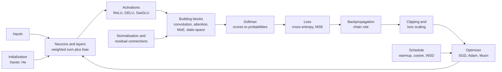
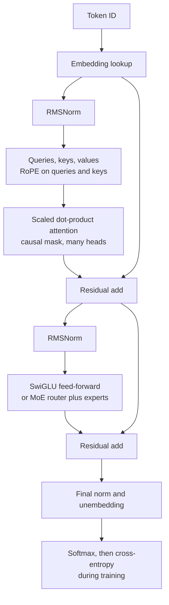
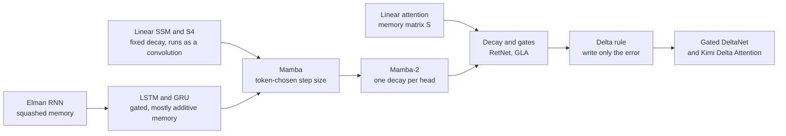

## Neural networks and deep learning

These are the equations that turn a pile of random numbers into a trained network, and they fit together in one loop. A neuron takes a weighted sum and bends it with an activation function; layers of neurons produce scores; a softmax turns scores into probabilities; a loss measures how wrong they are; backpropagation finds every weight's share of the blame; and an optimizer, steered by a learning-rate schedule, nudges every weight a little. Around that loop sit the equations that keep the numbers in a healthy range across hundreds of layers: initialization, clipping, loss scaling, normalization, residual connections and regularization. The second half of the section covers the building blocks that architectures are made of: convolutions for images, recurrent cells for sequences, embeddings for words, and the attention, feed-forward, mixture-of-experts and state-space layers inside 2026's frontier language models. Entries run from simplest to most advanced, and each one uses only ideas from entries above it. General math (dot products, derivatives, logarithms, probability) is in the foundations section of this appendix, and the formulas specific to large language models that are built from these blocks (scaling laws, KV-cache size, sampling, quantization, fine-tuning) are in the large-language-model section.

*Figure G.X: One training step, as a loop of equations. The forward pass runs from the inputs to the loss, backpropagation runs back, and the optimizer updates the weights for the next step.*

*Figure G.X: Which equations in this section make up a 2026 decoder-only Transformer. The middle part, from the first RMSNorm to the second residual add, repeats once per layer.*

### Artificial neuron (weighted sum plus bias)

**What it does:** Combines several inputs into one number and passes it through an activation function; it is the basic unit of every neural network.

`z = w_1 × x_1 + w_2 × x_2 + ... + w_n × x_n + b = w · x + b`

`y = f(z)`

- **x_1 ... x_n**: the inputs (together, the vector x)
- **w_1 ... w_n**: the weights, one per input (the vector w), learned in training
- **b**: the bias, a learned number added at the end
- **w · x**: the dot product of the weights and the inputs
- **z**: the weighted sum, before the activation
- **f**: the activation function (the entries below)
- **y**: the neuron's output

**In plain words:** Multiply each input by how much the neuron cares about it, add the products, shift by the bias, then bend. With no bend this is linear regression; with a sigmoid bend it is logistic regression.

**Tiny example:** Chapter 12's beach decision: inputs [1, 0.8, 1], weights [2, 1, −3], bias 0.5. z = 2 × 1 + 1 × 0.8 + (−3) × 1 + 0.5 = 0.3, and sigmoid(0.3) = 0.574, a slight yes.

**Where it is used:** Every neural network, from the 1943 McCulloch-Pitts unit to each hidden unit in a frontier LLM's feed-forward blocks.
**In the book:** Chapter 12 (The artificial neuron; Should I go to the beach?); Appendix B (Weighted sum).

### Dense layer and multilayer perceptron (fully connected layer)

**What it does:** Runs many neurons on the same inputs at once as one matrix multiplication, and stacks such layers into a network.

`h = f(W × x + b)`, with W of shape m × n

`batched: H = f(X × Wᵀ + b)`

`multilayer perceptron: y = f_L(... f_2(f_1(x)))`

`parameters = m × n + m`

- **x**: the input vector, n numbers
- **W**: the weight matrix, m rows (one per neuron) by n columns (one per input)
- **b**: the bias vector, one number per neuron
- **f**: the activation, applied to each entry separately
- **h**: the layer's output, m numbers
- **X**: a batch of B inputs stacked as rows (shape B × n)
- **Wᵀ**: W transposed, so the shapes line up
- **H**: the batch of outputs (shape B × m)
- **f_1 ... f_L**: the L layers in order, each with its own weights, biases and activation
- **m × n + m**: the weights plus the biases

**In plain words:** Each row of W holds one neuron's weights, so one matrix multiplication computes every neuron's sum at once. Without a bend between layers, a stack collapses into a single straight-line step (Appendix B, Linear steps collapse).

**Tiny example:** Chapter 12's ice-cream network: W has rows [0.5, 0.25] and [−0.5, 0.5], x = [1, 2], b = [0, 0]. W × x = [0.5 × 1 + 0.25 × 2, −0.5 × 1 + 0.5 × 2] = [1.0, 0.5], and ReLU keeps both. The whole 2 → 2 → 1 network has (2 × 2 + 2) + (2 × 1 + 1) = 6 + 3 = 9 parameters.

**Where it is used:** Multilayer perceptrons, classifier heads and every projection inside a Transformer; it is why AI hardware is built around matrix multiplication.
**In the book:** Chapter 12 (Layers, width and depth; Counting parameters; The forward pass: a layer is one matrix multiplication); Appendix B (One layer; Parameters in a dense layer).

> **Definition — Transpose (ᵀ):** Flipping a matrix so that its rows become columns and its columns become rows; a 2 × 3 matrix becomes 3 × 2. It is written with a small raised T, as in Wᵀ.

### Step activation and the perceptron learning rule

**What it does:** Gives a hard yes-or-no answer, and nudges the weights whenever that answer is wrong.

`step(z) = 1 if z ≥ 0, else 0`

`w ← w + η × (y − ŷ) × x`

`b ← b + η × (y − ŷ)`

- **z**: the neuron's weighted sum
- **ŷ** (y-hat): the perceptron's answer, step(z)
- **y**: the correct answer, 0 or 1
- **η** (eta): the learning rate, the size of each nudge
- **x, w, b**: the inputs, weights and bias
- **←**: "is replaced by"

**In plain words:** A right answer changes nothing; a wrong one pushes every weight on an active input toward the correct side. Rosenblatt's 1958 rule finds a separating line whenever one exists but cannot learn XOR, and the step's zero slope is why gradient training needed smooth activations. The ±1 form of the rule and its bound on how many mistakes it can make are in the classical-machine-learning section.

**Tiny example:** w = [0.5, 0.5], b = −0.2, η = 0.5, input x = [1, 0] whose correct answer is 0. z = 0.5 − 0.2 = 0.3, so ŷ = 1: wrong, and y − ŷ = −1. New w = [0.5 + 0.5 × (−1) × 1, 0.5 + 0.5 × (−1) × 0] = [0, 0.5]; new b = −0.2 − 0.5 = −0.7. Now z = 0 − 0.7 = −0.7, so ŷ = 0: fixed.

**Where it is used:** The historical origin of neural networks, still taught in AIMA and Goodfellow; the threshold-plus-surrogate-gradient idea survives in binarized networks and spiking networks.
**In the book:** Chapter 7 (The perceptron: a machine that learns, worked by hand); Chapter 12 (A little history: from logic units to the perceptron; What one neuron can and cannot do).

> **Definition — Binarized neural network:** A network whose weights and activations are restricted to two values, such as −1 and +1, so it can run with very cheap arithmetic. It is trained by pretending, in the backward pass only, that its step functions have a smooth slope.

> **Definition — Surrogate gradient:** A made-up smooth slope used in the backward pass in place of the true slope of a step-like function, which is zero almost everywhere, so that gradient descent can still train the network.

### Sigmoid (logistic function)

**What it does:** Squeezes any number into the range 0 to 1.

`sigmoid(z) = 1 ÷ (1 + exp(−z))`

`slope = sigmoid(z) × (1 − sigmoid(z))`, largest (0.25) at z = 0

- **z**: the input
- **exp(−z)**: e (about 2.718) raised to the power −z
- **slope**: the derivative, how much the output changes per unit change in z

**In plain words:** Big positive inputs give nearly 1, big negative ones nearly 0, and 0 gives exactly 0.5, so the output reads as a probability or as a valve setting. Its slope is never more than 0.25 and almost zero in the flat tails, which is the root of the vanishing-gradient problem in deep sigmoid stacks.

**Tiny example:** sigmoid(2) = 1 ÷ (1 + exp(−2)) = 1 ÷ (1 + 0.135) = 0.881. The slope there is 0.881 × (1 − 0.881) = 0.881 × 0.119 = 0.105, well under the 0.25 maximum.

**Where it is used:** Yes/no output layers, the gates of LSTMs and GRUs, the output gate in Qwen's gated attention, DeepSeek-V3's router scores, and inside SiLU and SwiGLU.
**In the book:** Chapter 12 (Should I go to the beach?; The activation function gallery); Chapter 13 (Vanishing and exploding gradients); Chapter 14 (Gate definition); Appendix B (Sigmoid; derivative table).

### Tanh (hyperbolic tangent)

**What it does:** Squeezes any number into the range −1 to 1, centered on zero.

`tanh(z) = (exp(z) − exp(−z)) ÷ (exp(z) + exp(−z)) = 2 × sigmoid(2 × z) − 1`

`slope = 1 − tanh(z)^2`, largest (1) at z = 0

- **z**: the input
- **exp(z), exp(−z)**: e raised to the power z and to the power −z
- **sigmoid**: the function in the previous entry

**In plain words:** Tanh is a sigmoid stretched to run from −1 to 1, so its outputs average around zero and the next layer gets balanced inputs. Its slope reaches 1 at the center, four times the sigmoid's best, but it still flattens out in the tails.

**Tiny example:** tanh(1) = (2.718 − 0.368) ÷ (2.718 + 0.368) = 2.350 ÷ 3.086 = 0.762. The sigmoid form agrees: 2 × sigmoid(2) − 1 = 2 × 0.881 − 1 = 0.762. The slope is 1 − 0.762^2 = 1 − 0.580 = 0.420.

**Where it is used:** Plain RNN updates and the candidate memory and output of LSTMs; the fast approximation of GELU; logit soft-capping (Gemma 2) and Dynamic Tanh (DyT) reuse it as a smooth limiter.
**In the book:** Chapter 12 (The activation function gallery) and Chapter 14 (Recurrent neural networks) give its shape and values in words; the formula is only here.

### ReLU and its variants (leaky ReLU, PReLU, ELU, squared ReLU)

**What it does:** Passes positive numbers through and blocks negative ones, with variants that let a little negative signal through or curve smoothly.

`ReLU(z) = max(0, z)`, with slope 0 for z < 0 and 1 for z > 0

`LeakyReLU(z) = max(α × z, z)`, with α ≈ 0.01

`ELU(z) = z if z > 0, else α × (exp(z) − 1)`

`ReLU²(z) = max(0, z)^2`

- **z**: the input
- **max(a, b)**: the larger of a and b
- **α** (alpha): the small negative-side slope (fixed in leaky ReLU, learned in PReLU) or, in ELU, the depth of the negative curve (often 1)
- **exp(z)**: e raised to the power z

**In plain words:** ReLU is the cheapest possible bend, and it never flattens for positive inputs, so learning signals pass through active units at full strength. A unit whose sum is always negative outputs 0 forever and stops learning (a dead ReLU), so leaky ReLU and PReLU keep a small slope for negatives and ELU curves smoothly down to −α. Squared ReLU (from the 2021 Primer paper) squares the positive part.

**Tiny example:** At z = −2: ReLU gives 0, leaky ReLU gives max(−0.02, −2) = −0.02, and ELU with α = 1 gives exp(−2) − 1 = 0.135 − 1 = −0.865. At z = 3: ReLU gives 3 and squared ReLU gives 9.

**Where it is used:** The default in CNNs from AlexNet (2012) through ResNet, and in the original Transformer's feed-forward block; leaky ReLU in GAN discriminators and graph attention networks; squared ReLU in NVIDIA's Nemotron-4 and the NanoGPT speedrun.
**In the book:** Chapter 12 (Solving XOR with two bent neurons; The activation function gallery; the worked backpropagation through ReLU gates); Chapter 14 (ReLU definition); Appendix B (ReLU; derivative table). ELU, PReLU and squared ReLU are only here.

> **Definition — ELU (Exponential Linear Unit):** A ReLU variant that keeps positive inputs unchanged but curves negative inputs smoothly down toward a floor of −α instead of cutting them to zero.

> **Definition — PReLU (Parametric ReLU):** A leaky ReLU whose small negative-side slope is learned during training instead of being fixed in advance.

> **Definition — Squared ReLU:** An activation that applies ReLU and then squares the result, giving zero for negative inputs and a parabola for positive ones.

> **Definition — Dead neuron (dead ReLU):** A ReLU unit whose weighted sum has become negative for every input, so it always outputs 0, receives zero gradient and stops learning.

### Softplus (smooth, always-positive ReLU)

**What it does:** Turns any number into a positive number, smoothly.

`softplus(z) = ln(1 + exp(z))`

`slope = sigmoid(z)`

`sharpened form: (1 ÷ β) × ln(1 + exp(β × z))`

- **z**: the input
- **ln**: the natural logarithm
- **exp(z)**: e raised to the power z
- **β** (beta): a sharpness setting; a larger β brings the curve closer to ReLU

**In plain words:** For large positive z, softplus is almost exactly z; for large negative z it is a tiny positive number. It never reaches zero and has no kink, which makes it the standard way to turn an unconstrained network output into something that must be positive, such as a step size, a rate or a standard deviation. Its slope is exactly the sigmoid.

**Tiny example:** softplus(0) = ln(2) = 0.693. softplus(2) = ln(1 + 7.389) = ln(8.389) = 2.127, a little above 2. softplus(−2) = ln(1 + 0.135) = 0.127, small but positive. The slope at 2 is sigmoid(2) = 0.881.

**Where it is used:** Mamba's input-dependent step size (Δ = softplus of a projection of the token), decay settings in Mamba-2 and Gated DeltaNet layers, positive variance outputs in probabilistic heads, and inside the Mish activation.
**In the book:** Only here.

> **Definition — Softplus:** The activation ln(1 + exp(z)), a smooth version of ReLU whose output is always positive. Networks use it to produce numbers that must stay above zero, such as step sizes.

### GELU (Gaussian error linear unit)

**What it does:** A smooth version of ReLU that scales each input by how likely a bell-curve value is to fall below it.

`GELU(z) = z × Φ(z) = 0.5 × z × (1 + erf(z ÷ sqrt(2)))`

`fast approximation: 0.5 × z × (1 + tanh(sqrt(2 ÷ π) × (z + 0.044715 × z^3)))`

- **z**: the input
- **Φ(z)** (capital phi): the probability that a standard bell-curve random number is less than z
- **erf**: the Gaussian error function, a standard library function; Φ(z) = 0.5 × (1 + erf(z ÷ sqrt(2)))
- **π** (pi): about 3.14159
- **tanh**: the hyperbolic tangent (above)

**In plain words:** Big positive inputs pass through almost unchanged (Φ is near 1), big negative ones are nearly zeroed (Φ is near 0), and in between the input is scaled down smoothly, so the curve dips slightly below zero, to about −0.17. The tanh form is a cheaper approximation, the one GPT-2's code used.

**Tiny example:** Φ(1) = 0.841, so GELU(1) = 1 × 0.841 = 0.841, and GELU(−1) = −1 × Φ(−1) = −1 × 0.159 = −0.159. The fast form for z = 1: sqrt(2 ÷ π) = 0.798; 0.798 × (1 + 0.044715) = 0.834; tanh(0.834) = 0.682; 0.5 × 1 × (1 + 0.682) = 0.841, matching to three decimals.

**Where it is used:** BERT, GPT-2 and GPT-3, ViT and many vision Transformers; its gated form, GEGLU, is used in Google's Gemma models.
**In the book:** Chapter 12 (The activation function gallery) gives its shape and two values; the formula is only here.

> **Definition — Standard normal cumulative distribution (Φ):** The function that gives, for a number z, the probability that a random draw from the standard bell curve (mean 0, standard deviation 1) is less than z. Φ(0) = 0.5 and Φ(1) ≈ 0.841.

> **Definition — Error function (erf):** A standard mathematical function tied to the bell curve and available in every math library; the bell-curve probability Φ(z) equals 0.5 × (1 + erf(z ÷ sqrt(2))).

### SiLU / Swish (with hard-swish and Mish)

**What it does:** Multiplies the input by its own sigmoid, giving a smooth ReLU-like curve.

`SiLU(z) = z × sigmoid(z)`

`Swish_β(z) = z × sigmoid(β × z)`

`slope of SiLU = sigmoid(z) × (1 + z × (1 − sigmoid(z)))`

`hard-swish(z) = z × ReLU6(z + 3) ÷ 6` and `Mish(z) = z × tanh(softplus(z))`

- **z**: the input
- **sigmoid, tanh, softplus**: the functions above
- **β** (beta): a sharpness setting; β = 1 gives SiLU
- **ReLU6(u)**: min(max(0, u), 6), a ReLU capped at 6

**In plain words:** The sigmoid acts as a soft switch that the input sets for itself: large positive inputs switch it fully on, large negative ones switch it off, and in between the curve dips slightly below zero, to about −0.28. Hard-swish replaces the sigmoid with straight-line pieces that are cheap on phones; Mish is a slightly smoother cousin.

**Tiny example:** SiLU(2) = 2 × 0.881 = 1.762 and SiLU(−2) = −2 × 0.119 = −0.238. The slope at 0 is 0.5 × (1 + 0) = 0.5. Hard-swish(1) = 1 × ReLU6(4) ÷ 6 = 4 ÷ 6 = 0.667. Mish(1) = 1 × tanh(softplus(1)) = tanh(1.313) = 0.865.

**Where it is used:** The gate inside SwiGLU in Llama, Qwen, DeepSeek, Mistral and Kimi models; EfficientNet; the activation in Mamba blocks; hard-swish in MobileNetV3 and Mish in YOLOv4.
**In the book:** Chapter 12 (The activation function gallery); Chapter 15 (Step 6: the worked SwiGLU unit, Swish(2) = 1.762). Swish with β, hard-swish and Mish are only here.

> **Definition — Hard-swish:** A cheap stand-in for SiLU built from straight-line pieces, z × ReLU6(z + 3) ÷ 6, used in phone-sized networks such as MobileNetV3.

> **Definition — Mish:** A smooth activation, z × tanh(softplus(z)), similar in shape to SiLU; the YOLOv4 object detector used it.

### Gated linear units (GLU, ReGLU, GEGLU, SwiGLU)

**What it does:** Projects the input two ways and lets one projection act as a learned volume knob on the other.

`GLU(x) = (x × W + b) ⊙ sigmoid(x × V + c)`

`SwiGLU(x) = SiLU(x × W) ⊙ (x × V)`

`GEGLU(x) = GELU(x × W) ⊙ (x × V)` and `ReGLU(x) = ReLU(x × W) ⊙ (x × V)`

- **x**: the input vector, written as a row
- **W, V**: two learned weight matrices of the same shape
- **b, c**: learned bias vectors (the modern variants drop them)
- **⊙**: element-wise product, multiplying matching entries
- **sigmoid, SiLU, GELU, ReLU**: the activations above

**In plain words:** One branch goes through an activation and becomes a gate; the other is a plain projection; multiplying them entry by entry lets each hidden unit decide how much of its signal to let through. Dauphin and colleagues introduced GLU in 2017, and Shazeer (2020) tested the variants and found SwiGLU and GEGLU worked best inside Transformers.

**Tiny example:** For one hidden unit, let the activation branch give 2 and the plain branch give 0.5. SwiGLU: SiLU(2) × 0.5 = 1.762 × 0.5 = 0.881. GEGLU: GELU(2) × 0.5 = 1.954 × 0.5 = 0.977. ReGLU: 2 × 0.5 = 1.0. The original GLU, with 0.5 as its plain branch and 2 inside its sigmoid gate: 0.5 × 0.881 = 0.440.

**Where it is used:** SwiGLU is the feed-forward non-linearity of Llama 1 to 4, Qwen, DeepSeek, Mistral, Kimi and gpt-oss models and the activation inside each mixture-of-experts expert; GEGLU is used in Gemma.
**In the book:** Chapter 15 (Step 6: SwiGLU definition and worked unit); Chapter 12 (SiLU definition). GLU, ReGLU and GEGLU by name are only here.

> **Definition — Element-wise product (⊙):** Multiplying two vectors or matrices of the same shape entry by entry, so [1, 2] ⊙ [3, 4] = [3, 8]. It is also called the Hadamard product.

> **Definition — GLU (gated linear unit):** A layer that computes two projections of its input and multiplies them entry by entry, with one of them passed through an activation so that it acts as a gate. SwiGLU and GEGLU are GLUs whose gates use SiLU and GELU.

### Softmax (with the stable form, log-softmax and its slopes)

**What it does:** Turns a list of scores into probabilities that are positive and add up to 1.

`p_i = exp(z_i) ÷ (sum over j of exp(z_j))`

`stable form: p_i = exp(z_i − max(z)) ÷ (sum over j of exp(z_j − max(z)))`

`log-softmax: ln(p_i) = z_i − logsumexp(z)`, where `logsumexp(z) = max(z) + ln(sum over j of exp(z_j − max(z)))`

`slopes: ∂p_i ÷ ∂z_j = p_i × (δ_ij − p_j)`

- **z_i**: the score (logit) for option i; z is the whole list
- **p_i**: the probability given to option i
- **j**: runs over all the options
- **max(z)**: the largest score
- **logsumexp(z)**: the log of the sum of the exponentials, computed safely
- **∂p_i ÷ ∂z_j**: the slope of p_i when score z_j alone is nudged (a partial derivative)
- **δ_ij** (Kronecker delta): 1 when i = j, otherwise 0

**In plain words:** Raising e to each score makes everything positive and exaggerates the differences, and dividing by the total makes the results add up to 1. Subtracting the largest score first changes nothing mathematically but stops exp() from overflowing. Raising one score raises its own probability and lowers all the others, which is what the slope formula says. (Sampling temperature is in the large-language-model section.)

**Tiny example:** Scores [2, 1, 0.1]. Subtract the largest: [0, −1, −1.9]; the exponentials are 1, 0.368 and 0.150, total 1.517; the probabilities are 0.659, 0.242 and 0.099, the same as without the shift. logsumexp = 2 + ln(1.517) = 2.417, so ln(p_1) = 2 − 2.417 = −0.417, which is ln(0.659). Slopes: ∂p_1 ÷ ∂z_1 = 0.659 × (1 − 0.659) = 0.225 and ∂p_1 ÷ ∂z_2 = 0.659 × (0 − 0.242) = −0.160.

**Where it is used:** The output of every classifier and LLM, the attention weights in every Transformer, and mixture-of-experts routers.
**In the book:** Chapter 12 (Softmax: turning scores into probabilities); Chapter 15 (Step D: softmax; Step 9: From vectors back to words); Appendix B (Softmax; Shift makes no difference). Log-softmax and the slope formula are only here.

> **Definition — Logsumexp:** The log of a sum of exponentials, ln(exp(z_1) + exp(z_2) + ...), computed safely by pulling the largest value out first. It is the softmax's normalizing total, written as a log.

> **Definition — Log-softmax:** The natural log of softmax probabilities, computed directly as each score minus the logsumexp of all the scores, which avoids taking the log of a probability that has rounded to zero.

> **Definition — Kronecker delta (δ_ij):** A shorthand that equals 1 when its two indices are the same and 0 when they differ.

### Mean squared error (MSE)

**What it does:** Measures how far numeric predictions are from their targets, punishing big misses most.

`MSE = (1 ÷ n) × sum over i of (ŷ_i − y_i)^2`

`slope for ŷ_i = 2 × (ŷ_i − y_i) ÷ n`

- **ŷ_i** (y-hat): the prediction for example i
- **y_i**: the target for example i
- **n**: the number of examples

**In plain words:** Square every error so that it is positive and big errors count extra, then average. Minimizing it is the same as maximum likelihood when the noise is bell-shaped. Many texts use 0.5 × error^2 for a single example so that the slope is simply the error, as Chapter 12 does.

**Tiny example:** Predictions [3, 5, 2], targets [2, 5, 4]. Errors 1, 0 and −2; squares 1, 0 and 4; MSE = 5 ÷ 3 = 1.667. The slope for the first prediction is 2 × 1 ÷ 3 = 0.667, so lowering that prediction lowers the loss.

**Where it is used:** Regression heads, value-function training, the noise-prediction loss of diffusion models, feature and hidden-state distillation, and autoencoders.
**In the book:** Chapter 12 (Squared error, for predicting numbers); Chapters 8 and 9; Appendix B (Mean squared error; Squared-error slope).

### Mean absolute error and Huber loss (smooth L1)

**What it does:** Measures numeric error in ways that let outliers pull less than squared error does.

`MAE = (1 ÷ n) × sum over i of |ŷ_i − y_i|`

`Huber_δ(a) = 0.5 × a^2 if |a| ≤ δ, else δ × (|a| − 0.5 × δ)`, with `a = ŷ − y`

- **ŷ_i, y_i, n**: prediction, target and number of examples, as for MSE
- **|a|**: the absolute value of a (drop any minus sign)
- **a**: one example's error
- **δ** (delta): the threshold where Huber loss switches from squared growth to straight-line growth

**In plain words:** MAE grows in a straight line with the error, so one wild example cannot dominate the average. Huber loss behaves like squared error for small errors, giving smooth, gentle slopes near zero, and like absolute error for big ones, which keeps it robust to outliers. Smooth L1 is Huber loss with δ = 1 (some libraries also divide by δ).

**Tiny example:** Errors [1, 0, −2, 10], the last one an outlier. MAE = (1 + 0 + 2 + 10) ÷ 4 = 3.25. MSE = (1 + 0 + 4 + 100) ÷ 4 = 26.25, dominated by the outlier. Huber with δ = 1 gives 0.5, 0, 1 × (2 − 0.5) = 1.5 and 1 × (10 − 0.5) = 9.5, an average of 11.5 ÷ 4 = 2.875.

**Where it is used:** Bounding-box regression in Fast and Faster R-CNN (smooth L1), the clipped temporal-difference loss in DQN, robust regression and some image-restoration models (L1).
**In the book:** Chapter 8 (Measuring wrongness: the loss function) and Chapter 9 (Measuring models that predict numbers) work MAE through; Huber loss is only here.

> **Definition — Huber loss (smooth L1 loss):** A loss that is squared for small errors and grows in a straight line for large ones, combining smooth training with resistance to outliers.

### Cross-entropy loss for classification (negative log-likelihood)

**What it does:** Measures how surprised a classifier is by the correct answer.

`L = −sum over k of y_k × ln(p_k)`

`with one correct class: L = −ln(p_correct) = −z_correct + logsumexp(z)`

`batch loss = the mean of L over the examples`

- **k**: runs over the classes
- **y_k**: the target probability for class k (1 for the right class and 0 elsewhere, unless smoothed)
- **p_k**: the model's softmax probability for class k
- **z**: the logits fed into the softmax; z_correct is the right class's logit
- **logsumexp**: defined in the softmax entry

**In plain words:** With a one-hot target only the correct class's term survives, so the loss is minus the log of the probability the model gave the truth: near 0 if it was confident and right, large if it was confident and wrong. Libraries compute it straight from the logits with logsumexp, which never takes the log of a probability that has rounded to zero. (Its language-model form and perplexity are in the large-language-model section.)

**Tiny example:** Logits Paris 5, Lyon 2, "the" 1, and the right answer is Paris. logsumexp = 5 + ln(1 + exp(−3) + exp(−4)) = 5 + ln(1.068) = 5.066, so the loss is −5 + 5.066 = 0.066, the same as −ln(0.936).

**Where it is used:** Image classifiers and every LLM's next-token pretraining and fine-tuning loss.
**In the book:** Chapter 12 (Cross-entropy, for choosing between options); Chapter 19 (Measuring surprise: the loss); Appendix B (Cross-entropy, one token and whole text). The logsumexp form is only here.

### Binary cross-entropy (log loss) from a logit

**What it does:** The cross-entropy loss for a single yes-or-no prediction.

`L = −(y × ln(p) + (1 − y) × ln(1 − p))`, with `p = sigmoid(z)`

`stable form, straight from the logit: L = max(z, 0) − z × y + ln(1 + exp(−|z|))`

`class-weighted form: L = −(w_pos × y × ln(p) + (1 − y) × ln(1 − p))`

- **y**: the target, 0 or 1
- **p**: the predicted probability of "yes"
- **z**: the logit, the raw score before the sigmoid
- **|z|**: the absolute value of z
- **w_pos**: an extra weight on the positive class, often the ratio of negative to positive examples (PyTorch calls it pos_weight)

**In plain words:** If the true answer is yes, the loss is −ln(p); if no, it is −ln(1 − p). The stable form gives the same number without ever computing a probability that might round to exactly 0 or 1. For multi-label problems (several independent yes/no questions at once) it is applied to each label and summed, and a weight on the positive class handles imbalance.

**Tiny example:** z = 2, so p = 0.881. If y = 1: L = −ln(0.881) = 0.127, and the stable form gives 2 − 2 × 1 + ln(1 + exp(−2)) = 0 + 0.127 = 0.127. If y = 0: L = −ln(0.119) = 2.127, and the stable form gives 2 − 0 + 0.127 = 2.127. With w_pos = 3, the y = 1 loss triples to 3 × 0.127 = 0.381.

**Where it is used:** Yes/no and multi-label classifiers, click-through prediction heads, GAN discriminators, and the per-pair sigmoid loss of SigLIP-style image-text models.
**In the book:** Chapter 8 (Cross-entropy: the loss for categories, the spam case) and Chapter 12 (Exercise 10's code); the stable form is only here.

> **Definition — Binary cross-entropy:** The loss for a yes-or-no prediction: minus the log of the probability the model gave to what actually happened. Multi-label models apply it once per label.

### Label smoothing

**What it does:** Softens the answer key so a classifier is never trained toward 100% certainty.

`y_smooth_k = (1 − ε) × y_k + ε ÷ K`

- **y_k**: the original target for class k (1 for the right class, 0 for the others)
- **ε** (epsilon): the smoothing amount, typically 0.1
- **K**: the number of classes
- **y_smooth_k**: the softened target used in the cross-entropy loss

**In plain words:** The one-hot answer is blended with an even spread over all K classes. The model can then never drive its loss to zero by pushing one probability to exactly 1, which curbs overconfidence and often helps it generalize.

**Tiny example:** K = 10 and ε = 0.1. The right class gets 0.9 × 1 + 0.1 ÷ 10 = 0.91, and each of the other nine gets 0.9 × 0 + 0.01 = 0.01. Check: 0.91 + 9 × 0.01 = 1.

**Where it is used:** Inception-v3 (2016), the original Transformer (ε = 0.1) and most modern image-classification recipes; it is rarely used in LLM pretraining.
**In the book:** Chapter 13 (The regularization toolkit) works this example in words; the general formula is only here.

### Focal loss

**What it does:** Down-weights examples the model already gets right, so training concentrates on the hard ones.

`FL = −α_t × (1 − p_t)^γ × ln(p_t)`, where `p_t = p if y = 1, else 1 − p`

- **p**: the predicted probability of the positive class
- **y**: the target, 0 or 1
- **p_t**: the probability the model gave to the true answer
- **γ** (gamma): the focusing power; γ = 0 gives back weighted cross-entropy
- **α_t** (alpha): a class-balancing weight, α for positives and 1 − α for negatives

**In plain words:** This is cross-entropy multiplied by (1 − p_t)^γ, a factor that is tiny when the model is already confident and right. In object detection, where almost every candidate box is easy background, this stops the easy examples from drowning out the rare hard ones. RetinaNet used γ = 2 and α = 0.25.

**Tiny example:** γ = 2 and α_t = 0.25, for two positive examples. An easy one with p_t = 0.9: cross-entropy 0.105, factor (0.1)^2 = 0.01, focal loss 0.25 × 0.01 × 0.105 = 0.00026. A hard one with p_t = 0.1: cross-entropy 2.303, factor 0.9^2 = 0.81, focal loss 0.25 × 0.81 × 2.303 = 0.466. The easy example's loss falls from about 1/22 of the hard one's to about 1/1,800.

**Where it is used:** Dense object detectors (RetinaNet, 2017, and many later detectors), class-imbalanced segmentation and medical imaging.
**In the book:** Appendix F (Focal loss) works the (1 − p)^2 factor; the α_t weight is only here.

### Dice loss (soft Dice) for segmentation

**What it does:** Scores how well a predicted mask overlaps the true mask, in a way that is not swamped by the background.

`Dice = (2 × sum over i of p_i × g_i + ε) ÷ (sum over i of p_i + sum over i of g_i + ε)`

`L_Dice = 1 − Dice`

- **i**: runs over the pixels (or the voxels of a 3-D scan)
- **p_i**: the predicted probability that pixel i belongs to the object
- **g_i**: the true mask, 1 inside the object and 0 outside
- **ε** (epsilon): a small constant that avoids dividing by zero on empty masks
- **Dice**: the overlap score, 1 for a perfect match and 0 for none

**In plain words:** Twice the overlap, divided by the total size of both masks: a soft version of the Dice coefficient, which is the F1 score computed over pixels. It looks only at the object and the prediction, so a tiny tumor in a huge scan counts as much as a large one, whereas per-pixel cross-entropy is dominated by the easy background. V-Net (Milletari and colleagues, 2016) introduced it with squared terms in the denominator, and it is usually added to cross-entropy or focal loss.

**Tiny example:** Four pixels with predictions [0.9, 0.8, 0.1, 0.2] and truth [1, 1, 0, 0]: the overlap is 0.9 + 0.8 = 1.7 and the totals are 2.0 and 2, so Dice = 3.4 ÷ 4 = 0.85 and the loss is 0.15. Now a 100-pixel image whose object is a single pixel, and a model that predicts 0.01 everywhere: the average binary cross-entropy is only 0.056, which looks fine, but Dice = (2 × 0.01) ÷ (1 + 1) = 0.01, a loss of 0.99 that shows the object was missed.

**Where it is used:** Medical-image segmentation (nnU-Net trains with Dice plus cross-entropy) and Meta's Segment Anything models, which supervise their masks with a mix of focal loss and Dice loss.
**In the book:** Chapter 45 (Segmentation: "which pixels?"; Segment Anything: one model that cuts out anything) describes segmentation in words; the loss is only here.

> **Definition — Dice coefficient (Dice loss):** A measure of overlap between two masks: twice their shared area divided by their total area. One minus a soft version of it is a common training loss for segmentation.

### Contrastive pair loss and triplet loss (margin-based metric learning)

**What it does:** Trains an embedding network so that similar things land close together and different things land far apart.

`pair loss: L = y × d^2 + (1 − y) × max(0, m − d)^2`, with `d = distance(f(x_1), f(x_2))`

`triplet loss: L = max(0, distance(f(a), f(p))^2 − distance(f(a), f(n))^2 + margin)`

- **f**: the embedding network, which turns an input into a vector
- **x_1, x_2**: a pair of inputs
- **y**: 1 if the pair is similar (for example the same person), 0 if not
- **d**: the distance between the two embeddings
- **m**: the margin, how far apart a dissimilar pair must be
- **a, p, n**: an anchor, a positive (same identity as the anchor) and a negative (a different identity)
- **margin**: the required gap in the triplet loss (FaceNet used 0.2)
- **max(0, ...)**: zero once the condition is met, so finished cases stop costing anything

**In plain words:** The pair loss (Hadsell, Chopra and LeCun, 2006, often written with an extra factor of 0.5) pulls similar pairs together and pushes dissimilar pairs apart until they are at least m apart, then stops caring about them. The triplet loss only asks that the anchor sit closer to the positive than to the negative by the margin; some versions, such as Sentence-BERT's, use plain rather than squared distances. Batch-wide contrastive losses such as InfoNCE and CLIP's are in the generative and contrastive section.

**Tiny example:** Triplet: anchor-to-positive distance 0.5, anchor-to-negative 0.6, margin 0.2: max(0, 0.25 − 0.36 + 0.2) = 0.09, a small push. Had the negative been 1.0 away: max(0, 0.25 − 1.0 + 0.2) = 0, nothing to do. Pair loss with m = 1: a similar pair 0.5 apart costs 0.5^2 = 0.25; a dissimilar pair 0.5 apart costs (1 − 0.5)^2 = 0.25; a dissimilar pair 1.5 apart costs 0.

**Where it is used:** Face recognition (FaceNet, 2015), Siamese verification networks, image retrieval, and sentence-embedding training (Sentence-BERT's triplet objective).
**In the book:** Chapter 45 (face embedding definition) and Chapter 16 (Contrastive learning and CLIP) describe the pull-together, push-apart idea in words; the formulas are only here.

> **Definition — Metric learning:** Training an embedding so that distances between vectors mean something, with similar items close together and different items far apart, for example two photos of the same face.

> **Definition — Triplet loss:** A metric-learning loss on groups of three: it is zero once an anchor is closer to a matching example than to a non-matching one by a set margin, and positive otherwise.

> **Definition — Siamese network:** Two copies of the same network with shared weights that embed two inputs, so their outputs can be compared, as in face verification ("are these the same person?").

### Backpropagation (the chain rule through layers)

**What it does:** Computes the slope of the loss for every weight in the network in one backward sweep.

`forward: z_l = W_l × a_(l−1) + b_l` and `a_l = f(z_l)`

`at the last layer N: δ_N = (∂L ÷ ∂a_N) ⊙ f'(z_N)`

`each earlier layer: δ_l = (W_(l+1)ᵀ × δ_(l+1)) ⊙ f'(z_l)`

`slopes: ∂L ÷ ∂W_l = δ_l × a_(l−1)ᵀ` and `∂L ÷ ∂b_l = δ_l`

- **l**: the layer number, from 1 up to the last layer N
- **a_l**: layer l's output; a_0 is the input x
- **z_l**: layer l's weighted sums
- **W_l, b_l**: layer l's weights and biases
- **f, f'**: the activation and its slope
- **L**: the loss
- **δ_l** (delta): the blame (error signal) at layer l's sums, the slope ∂L ÷ ∂z_l
- **ᵀ**: transpose
- **⊙**: element-wise product
- **∂L ÷ ∂W_l**: the slope of the loss for every weight in layer l, a matrix the same shape as W_l

**In plain words:** Blame starts at the loss and flows backward. Each layer passes it back through its transposed weights and multiplies it by its activation's slope, and each weight's slope is its neuron's blame times the input that flowed along that weight. This is reverse-mode automatic differentiation, and one backward pass yields every gradient for about twice the cost of the forward pass.

**Tiny example:** Chapter 12's ice-cream network predicts 1.0 for a target of 2 with loss 0.5 × (ŷ − y)^2, so the output blame is δ_2 = 1.0 − 2 = −1 (the output has no activation, slope 1). Back through the output weights [0.5, 1.0]: [0.5 × (−1), 1.0 × (−1)] = [−0.5, −1.0], and both ReLUs are open (slope 1), so δ_1 = [−0.5, −1.0]. The first layer's weight slopes are δ_1 × xᵀ with x = [1, 2]: rows [−0.5, −1.0] and [−1.0, −2.0], exactly Chapter 12's Step 6.

**Where it is used:** Training every neural network; it is implemented by autograd in PyTorch and JAX.
**In the book:** Chapter 12 (Backpropagation: passing the blame backward; The chain rule as gears; The worked example: one complete forward and backward pass; Checking backpropagation by nudging); Appendix B (Chain rule; Cost of a training step). The layer-by-layer matrix form is only here.

### Gradients of a linear layer (matrix form)

**What it does:** Gives the batched backward pass of one dense layer as three matrix operations.

For `Y = X × W + b`, with X of shape B × n and W of shape n × m:

`∂L ÷ ∂W = Xᵀ × (∂L ÷ ∂Y)`

`∂L ÷ ∂b = sum over the B rows of (∂L ÷ ∂Y)`

`∂L ÷ ∂X = (∂L ÷ ∂Y) × Wᵀ`

- **X**: a batch of B inputs as rows, n numbers each
- **W**: the weights, n × m
- **b**: the bias, m numbers added to every row
- **Y**: the outputs, B × m
- **∂L ÷ ∂Y**: the blame arriving from the layer above, the same shape as Y
- **ᵀ**: transpose

**In plain words:** The weight slopes and the blame passed down to the previous layer are each one matrix multiplication the same size as the forward one. So a training step costs about three forward-sized multiplications per layer: one forward and two backward. That is where "2N forward plus 4N backward", 6N per token, comes from; the compute section works out the FLOP count and the large-language-model section gives the 6 × N × D training-compute estimate.

**Tiny example:** X has rows [1, 2] and [3, 0]; W is the column [2, −1]; the blame from above is 0.5 for row 1 and −1 for row 2. ∂L ÷ ∂W = [1 × 0.5 + 3 × (−1), 2 × 0.5 + 0 × (−1)] = [−2.5, 1.0]. ∂L ÷ ∂b = 0.5 + (−1) = −0.5. ∂L ÷ ∂X: row 1 is 0.5 × [2, −1] = [1.0, −0.5] and row 2 is −1 × [2, −1] = [−2, 1].

**Where it is used:** The backward pass of every dense layer, attention projection and expert, and the basis of the 6 × N × D training-compute estimate.
**In the book:** Chapter 12 (the worked example, Steps 3 and 6; Exercise 10's code); Appendix B (Cost of a training step).

### Gradient of softmax plus cross-entropy (p − y)

**What it does:** Gives the error signal on each logit when a softmax is trained with cross-entropy: simply predicted probability minus target.

`∂L ÷ ∂z_k = p_k − y_k`

`likewise for a sigmoid with binary cross-entropy: ∂L ÷ ∂z = p − y`

- **z_k**: the logit for class k
- **p_k**: the softmax probability for class k
- **y_k**: the target (1 for the correct class, 0 otherwise)
- **L**: the cross-entropy loss

**In plain words:** When softmax and cross-entropy are combined, the messy softmax slopes cancel and the blame on each score is the probability given minus the probability deserved. Too much probability on a wrong class pushes its score down; too little on the right class pushes its score up. The same clean form holds for a sigmoid with binary cross-entropy, and for squared error with a plain linear output (ŷ − y).

**Tiny example:** Scores [2, 1, 0.1] give probabilities [0.659, 0.242, 0.099], and the first class is correct. Gradient: [0.659 − 1, 0.242, 0.099] = [−0.341, 0.242, 0.099]. Check by nudging: raising the first score by 0.001 moves the loss from 0.41703 to 0.41669, a change of −0.00034, a slope of −0.341.

**Where it is used:** The first step of the backward pass in every classifier and LLM; fused cross-entropy kernels compute it directly from the logits to save memory on vocabularies of 100,000 tokens or more.
**In the book:** Chapter 12 (Exercise 10's code uses the binary form, dz2 = (p − y) ÷ len(X)); the softmax form is only here.

### Xavier (Glorot) and LeCun initialization

**What it does:** Picks the spread of a layer's random starting weights so signals keep roughly the same size from layer to layer.

`Xavier: Var(W) = 2 ÷ (n_in + n_out)`

`uniform version: W drawn from U(−sqrt(6 ÷ (n_in + n_out)), +sqrt(6 ÷ (n_in + n_out)))`

`LeCun: Var(W) = 1 ÷ n_in`

- **W**: a layer's starting weights, drawn at random
- **Var(W)**: their variance, the standard deviation squared
- **n_in**: the fan-in, the number of inputs each neuron adds up
- **n_out**: the fan-out, the number of outputs of the layer
- **U(a, b)**: the uniform distribution, every value between a and b equally likely

**In plain words:** The more numbers a neuron adds up, the smaller each starting weight must be, so that the sum stays about the size of one input. Xavier initialization balances the forward pass (fan-in) and the backward pass (fan-out) for tanh and sigmoid networks; LeCun initialization uses the fan-in only. Orthogonal initialization is a common alternative for RNNs.

**Tiny example:** The book's case, 512 inputs and 512 outputs: std = sqrt(2 ÷ 1,024) = 0.044. A GPT-2-small feed-forward layer, 768 in and 3,072 out: Xavier std = sqrt(2 ÷ 3,840) = 0.0228, uniform limit sqrt(6 ÷ 3,840) = 0.0395; LeCun std = sqrt(1 ÷ 768) = 0.0361.

**Where it is used:** Keras's default (glorot_uniform); PyTorch's nn.Linear default draws from U(−1 ÷ sqrt(n_in), +1 ÷ sqrt(n_in)), a LeCun-style rule; many LLM configurations instead use a fixed bell-curve spread such as 0.02 (the initializer_range setting).
**In the book:** Chapter 13 (Why the size of the random numbers matters); the uniform version and LeCun initialization are only here.

> **Definition — Fan-in and fan-out:** A layer's fan-in is the number of inputs each of its neurons adds together; its fan-out is the number of outputs it produces. Initialization rules use them to size the random starting weights.

> **Definition — LeCun initialization:** Drawing a layer's random starting weights with variance 1 ÷ fan-in, so that the sum each neuron computes keeps about the same size as its inputs.

> **Definition — Uniform distribution:** A way of drawing random numbers in which every value between a lower and an upper limit is equally likely.

### He (Kaiming) initialization

**What it does:** Sizes random starting weights for ReLU networks, whose activations throw away about half of each signal.

`Var(W) = 2 ÷ n_in`, so `std = sqrt(2 ÷ n_in)`

`general form: std = gain ÷ sqrt(fan)`, with `gain = sqrt(2)` for ReLU and `gain = sqrt(2 ÷ (1 + α^2))` for leaky ReLU

- **W, Var(W), n_in**: as in the previous entry
- **std**: the standard deviation of the starting weights
- **gain**: a factor matched to the activation function
- **fan**: the fan-in (or, in a backward-pass variant, the fan-out)
- **α** (alpha): the leaky ReLU's negative-side slope

**In plain words:** ReLU zeroes about half of its inputs, which halves the size of the signal at every layer. Doubling the LeCun variance makes up for it, so the signal stays steady through deep ReLU stacks (He and colleagues, 2015).

**Tiny example:** 512 inputs: sqrt(2 ÷ 512) = 0.0625. For leaky ReLU with α = 0.01, gain = sqrt(2 ÷ 1.0001) = 1.4141, so std = 1.4141 ÷ sqrt(512) = 1.4141 ÷ 22.63 = 0.0625, practically the same.

**Where it is used:** ResNets and most CNNs (torchvision's convolution initialization) and ReLU multilayer perceptrons.
**In the book:** Chapter 13 (Why the size of the random numbers matters; He initialization definition).

### Mini-batch stochastic gradient descent (SGD)

**What it does:** Estimates the downhill direction from a small random batch of examples and steps every parameter against it.

`g = (1 ÷ B) × sum over i in the batch of ∇_θ ℓ(x_i, y_i; θ)`

`θ ← θ − η × g`

- **θ** (theta): all the parameters, as one long list
- **B**: the batch size, the number of examples per step
- **x_i, y_i**: one example and its target
- **ℓ**: the loss on one example
- **∇_θ**: the gradient, the list of slopes for every parameter
- **g**: the gradient averaged over the batch
- **η** (eta): the learning rate

**In plain words:** Average the slope over a random handful of examples instead of the whole dataset, then step: noisy but cheap. A batch of the whole dataset is plain gradient descent (foundations section), a batch of one is pure SGD, and one pass through the data is an epoch. Gradient accumulation (adding up several small batches' gradients before one step) and the global-batch arithmetic are in the compute section.

**Tiny example:** A batch of two examples gives slopes 4 and 2 for one weight, so g = (4 + 2) ÷ 2 = 3. With θ = 1 and η = 0.1, the new value is 1 − 0.1 × 3 = 0.7.

**Where it is used:** The inner loop of all neural-network training; plain SGD still trains many small models, and every adaptive optimizer below modifies this step.
**In the book:** Chapter 12 (Gradient descent: walking downhill in fog; The training loop: batches, steps and epochs); Chapter 13 (The trouble with plain SGD); Appendix B (Gradient descent step).

### Momentum (heavy ball) and Nesterov momentum

**What it does:** Steps along a running velocity of past gradients, so progress speeds up along consistent slopes and zig-zags cancel.

`v ← μ × v + g`

`θ ← θ − η × v`

`Nesterov, in the form PyTorch uses: θ ← θ − η × (g + μ × v)`, with v already updated

- **v**: the velocity, a decaying running sum of gradients (starts at 0)
- **μ** (mu): the momentum coefficient, typically 0.9
- **g**: the current gradient
- **θ, η**: the parameters and the learning rate

**In plain words:** Keeping 90% of the old velocity each step means a steady slope builds up speed, up to 1 ÷ (1 − μ) = 10 times the plain step, while gradients that flip back and forth mostly cancel. Nesterov's version uses the slope at the point where momentum is about to carry you, which corrects overshoot one step earlier. An equivalent way to write plain momentum is v ← μ × v − η × g, then θ ← θ + v.

**Tiny example:** A constant gradient of 1 with μ = 0.9: the velocity goes 1, 1.9, 2.71, 3.439 and keeps climbing toward 10. With Nesterov, at the second step v = 1.9 but the step uses 1 + 0.9 × 1.9 = 2.71, the velocity plain momentum only reaches one step later.

**Where it is used:** SGD with momentum trained the 2010s image networks (ResNet on ImageNet); momentum is built into Adam, Lion and Muon, and Muon uses the Nesterov form by default (μ = 0.95 in PyTorch).
**In the book:** Chapter 13 (Momentum: a rolling ball); Appendix F (Optimizer variants) describes Nesterov momentum in words, and its formula is only here.

### AdaGrad

**What it does:** Gives each parameter its own step size, shrinking it for parameters that have already had large or frequent gradients.

`G ← G + g^2`

`θ ← θ − η × g ÷ (sqrt(G) + ε)`

- **G**: the running total of squared gradients, one per parameter (starts at 0)
- **g^2**: the gradient squared, entry by entry
- **ε** (epsilon): a tiny number such as 10^-8 that prevents division by zero
- **θ, η**: the parameters and the learning rate

**In plain words:** Each parameter divides its step by the square root of all its past squared gradients. Busy parameters slow down, while rarely updated ones, such as the embedding of an uncommon word, keep bigger steps. Because G only ever grows, every step size shrinks forever, which RMSProp fixes.

**Tiny example:** The gradient is 2 three steps in a row, with η = 0.1. G goes 4, 8, 12, and the steps are 0.1 × 2 ÷ 2 = 0.1, then 0.1 × 2 ÷ 2.828 = 0.071, then 0.1 × 2 ÷ 3.464 = 0.058: shrinking even though the slope has not changed.

**Where it is used:** Sparse features and embedding tables (GloVe was trained with AdaGrad, and a row-wise AdaGrad is common for large recommender embeddings).
**In the book:** Chapter 13 (Adam: a separate stride for every knob) describes it in words; the formula is only here.

> **Definition — AdaGrad:** A 2011 optimizer that divides each parameter's step by the square root of the running total of its squared gradients, so frequently updated parameters slow down. Its steps only ever shrink.

### RMSProp (and Adadelta)

**What it does:** Divides each parameter's step by a fading average of its recent gradient sizes.

`v ← ρ × v + (1 − ρ) × g^2`

`θ ← θ − η × g ÷ (sqrt(v) + ε)`

`Adadelta: Δθ = −(sqrt(u + ε) ÷ sqrt(v + ε)) × g`, then `θ ← θ + Δθ` and `u ← ρ × u + (1 − ρ) × Δθ^2`

- **v**: the moving average of squared gradients, one per parameter (starts at 0)
- **ρ** (rho): the decay rate, 0.9 in Hinton's 2012 lecture and 0.99 by default in PyTorch
- **g, η, ε, θ**: gradient, learning rate, tiny constant and parameters, as before
- **u**: Adadelta's moving average of squared updates (starts at 0)
- **Δθ** (delta theta): Adadelta's update

**In plain words:** RMSProp is AdaGrad with a fading memory: old gradients count less and less, so the step size adapts to the current terrain instead of shrinking to zero. Adam's second running average is exactly this. Adadelta (Zeiler, 2012) keeps the same average but replaces the learning rate with the size of recent updates, sqrt(u + ε), so there is no learning rate to tune; its first steps are tiny, about sqrt(ε) in size.

**Tiny example:** A steady gradient of 2, ρ = 0.9, η = 0.1. v goes 0.4, 0.76, 1.084 on its way to 4, and the steps are 0.316, 0.229 and 0.192, settling toward 0.1 × 2 ÷ 2 = 0.1. The oversized early steps come from v starting at 0, the problem Adam's bias correction fixes. Adadelta with ρ = 0.9, ε = 10^-6 and the same gradient: v = 0.4 and u = 0, so the first update is −(0.001 ÷ 0.632) × 2 = −0.0032.

**Where it is used:** Early deep reinforcement learning (DQN) and RNN training; the direct ancestor of Adam's second moment.
**In the book:** Chapter 13 (Adam: a separate stride for every knob; Figure 13.2, the optimizer family tree) in words; Appendix F (Optimizer variants) describes Adadelta in words; the formulas are only here.

> **Definition — RMSProp:** An optimizer (Geoffrey Hinton, 2012) that divides each parameter's step by the square root of a fading average of its recent squared gradients, so step sizes adapt without shrinking forever.

### Adam (with bias correction)

**What it does:** Combines momentum with a separate, self-adjusting step size for every parameter.

`m ← β_1 × m + (1 − β_1) × g`

`v ← β_2 × v + (1 − β_2) × g^2`

`m̂ = m ÷ (1 − β_1^t)` and `v̂ = v ÷ (1 − β_2^t)`

`θ ← θ − η × m̂ ÷ (sqrt(v̂) + ε)`

- **m**: the moving average of gradients, the momentum (starts at 0)
- **v**: the moving average of squared gradients (starts at 0)
- **β_1, β_2** (beta): their decay rates, by default 0.9 and 0.999 (LLM runs usually use β_2 = 0.95)
- **t**: the step number, counting from 1
- **m̂, v̂** (m-hat, v-hat): the bias-corrected averages
- **ε** (epsilon): a tiny constant, 10^-8 by default
- **g, θ, η**: gradient, parameters and learning rate

**In plain words:** m says which way a parameter has been pushed and v says how hard; dividing one by the square root of the other gives a step of about ±η for any parameter with a steady gradient, whatever its raw size. Both averages start at zero and are too small at first, so dividing by 1 − β^t scales them back up; at step 1 this makes m̂ exactly the gradient. AMSGrad, Adamax and NAdam are small variants.

**Tiny example:** A gradient of 0.5 at step 1: m = 0.1 × 0.5 = 0.05 and v = 0.001 × 0.25 = 0.00025. Corrected: m̂ = 0.05 ÷ 0.1 = 0.5 and v̂ = 0.00025 ÷ 0.001 = 0.25. The step is η × 0.5 ÷ 0.5 = η, so with η = 0.001 the parameter moves exactly 0.001. At step 2 with the same gradient, m = 0.095 and m̂ = 0.095 ÷ 0.19 = 0.5 again.

**Where it is used:** The default deep-learning optimizer from 2014 for about a decade; its two stored numbers per parameter drive the 16-bytes-per-parameter training-memory rule.
**In the book:** Chapter 13 (Adam: a separate stride for every knob); Appendix B (Training memory). The bias-correction formula is only here.

> **Definition — Bias correction:** In Adam, dividing the running averages by 1 − β^t during the early steps, because averages that start at zero underestimate the true values until enough steps have been averaged in.

### Weight decay and L2 (and L1) regularization

**What it does:** Shrinks every weight a little at each step, so weights stay large only if the data keeps pushing them up.

`L2 penalty: L_total = L + (λ ÷ 2) × sum over i of θ_i^2`, which adds `λ × θ` to the gradient

`decay step: θ ← (1 − η × λ) × θ − η × g`

`L1 penalty: λ × sum over i of |θ_i|`

- **L**: the original loss; **L_total** the loss with the penalty added
- **λ** (lambda): the decay strength
- **θ_i**: one weight
- **|θ_i|**: its absolute value
- **η, g**: learning rate and gradient

**In plain words:** A small tax on large weights discourages the network from leaning on a few huge ones, which tends to help it generalize. For plain SGD the L2 penalty and the decay step are identical. For Adam they are not, because Adam rescales the penalty's gradient, which is why AdamW applies the decay separately. An L1 penalty pushes many weights to exactly zero. Biases and normalization gains are usually exempt.

**Tiny example:** θ = 2 and λ = 0.1: the L2 penalty adds (0.1 ÷ 2) × 4 = 0.2 to the loss and 0.1 × 2 = 0.2 to the gradient. As a decay step with η = 0.001, each step multiplies the weight by 1 − 0.001 × 0.1 = 0.9999; after 10,000 steps that is 0.9999^10,000 = 0.368, so an undefended 2 shrinks to 0.736.

**Where it is used:** Almost all training; LLMs typically use λ = 0.1 with AdamW or Muon.
**In the book:** Chapter 9 (Regularization: keeping models simple on purpose); Chapter 13 (The regularization toolkit; AdamW: weight decay done right).

### AdamW (Adam with decoupled weight decay)

**What it does:** Takes Adam's step and, separately, shrinks every weight by the same small fraction.

`θ ← θ − η × (m̂ ÷ (sqrt(v̂) + ε) + λ × θ)`

- **m̂, v̂, ε**: Adam's corrected averages and tiny constant (previous entries)
- **λ** (lambda): the weight decay
- **θ, η**: parameters and learning rate

**In plain words:** The decay term λ × θ is added after Adam's division, not before, so it is not distorted by Adam's per-parameter scaling and every weight shrinks by the fraction η × λ each step (Loshchilov and Hutter, 2017). As a result a weight's memory of past updates fades over roughly 1 ÷ (η × λ) steps. LLM runs typically use λ = 0.1; PyTorch's AdamW default is 0.01.

**Tiny example:** θ = 2, η = 0.001, λ = 0.1, and Adam's direction m̂ ÷ sqrt(v̂) = 1: θ = 2 − 0.001 × (1 + 0.1 × 2) = 2 − 0.0012 = 1.9988. With these settings, old updates fade over about 1 ÷ (0.001 × 0.1) = 10,000 steps.

**Where it is used:** The standard optimizer for Transformers and fine-tuning (GPT-3, Llama 3, DeepSeek-V3); in 2026 frontier recipes it handles the embeddings, output heads and 1-D parameters alongside Muon.
**In the book:** Chapter 13 (AdamW: weight decay done right; the training script). The single combined update line is only here.

### Lion (evolved sign momentum)

**What it does:** Moves every parameter by the same fixed amount each step, in the direction of the sign of a momentum.

`c = β_1 × m + (1 − β_1) × g`

`θ ← θ − η × (sign(c) + λ × θ)`

`m ← β_2 × m + (1 − β_2) × g`, with defaults `β_1 = 0.9` and `β_2 = 0.99`

- **m**: the momentum, one number per parameter
- **c**: a blend of momentum and gradient used only to pick this step's direction
- **sign(c)**: +1 if c is positive, −1 if negative (0 if zero)
- **β_1, β_2**: the two blending rates
- **λ, η, θ, g**: weight decay, learning rate, parameters and gradient

**In plain words:** Only the direction of the blend counts, never its size, so every parameter moves by exactly η (plus decay) each step, and only one state number per parameter is stored instead of Adam's two. Lion was found partly by an automated search over update rules (Chen and colleagues, Google, 2023); it needs a learning rate about 3 to 10 times smaller and a weight decay 3 to 10 times larger than AdamW.

**Tiny example:** m = 0.2 and g = −1: c = 0.9 × 0.2 + 0.1 × (−1) = 0.08, so sign(c) = +1. With θ = 0.5, η = 0.0001 and λ = 1.0: θ = 0.5 − 0.0001 × (1 + 0.5) = 0.49985. Then m = 0.99 × 0.2 + 0.01 × (−1) = 0.188. The gradient's size never entered the step, only the sign of c.

**Where it is used:** A lower-memory alternative to AdamW in some Google vision, language and diffusion training.
**In the book:** Chapter 13 (Beyond Adam: Lion, Shampoo and SOAP) in words; the formula is only here.

### Newton-Schulz orthogonalization iteration

**What it does:** Pushes all of a matrix's stretch factors toward 1 using only matrix multiplications.

`start: X_0 = M ÷ (sqrt(sum of all M_ij^2) + ε)`

`repeat 5 times: A = X × Xᵀ, then X ← a × X + (b × A + c × A × A) × X`, with `(a, b, c) = (3.4445, −4.7750, 2.0315)`

`classic cubic form: X ← 1.5 × X − 0.5 × X × Xᵀ × X`

- **M**: the matrix to orthogonalize (in Muon, a momentum matrix)
- **M_ij**: its entries; sqrt(sum of all M_ij^2) is its Frobenius norm
- **ε**: a tiny constant
- **X**: the current approximation; **A**: X × Xᵀ
- **a, b, c**: tuned coefficients
- **ᵀ**: transpose

**In plain words:** Any matrix stretches space by different amounts in different directions, its singular values. Dividing by the Frobenius norm puts every stretch at 1 or below; each round then maps a stretch s to a × s + b × s^3 + c × s^5, which drags small and large stretches toward 1 without the slow singular value decomposition. The tuned coefficients take every stretch that starts between about 0.02 and 1 into roughly 0.68 to 1.13 in five rounds, run in bfloat16: not exactly 1, but close enough and fast. A matrix with more rows than columns is transposed first. The classic cubic iteration and the polar decomposition it approximates are in the foundations section.

**Tiny example:** Chapter 13's Muon matrix with stretches 3 and 0.1. Dividing by sqrt(9 + 0.01) = 3.002 gives 0.999 and 0.033. Five tuned rounds: 0.999 → 0.701 → 1.113 → 0.720 → 1.091 → 0.697, and 0.033 → 0.115 → 0.388 → 1.075 → 0.687 → 1.129. A 30-to-1 imbalance becomes about 1.6 to 1. The classic cubic sends 0.999 to 1.000 at once but lifts 0.033 only to 0.249 in five rounds, which is why tuned coefficients are used.

**Where it is used:** The inner loop of Muon and its 2025-26 variants; PyTorch's Muon defaults are ns_coefficients (3.4445, −4.775, 2.0315) and ns_steps 5.
**In the book:** Chapter 13 (Muon: balance the whole matrix; Newton-Schulz iteration definition) in words; the iteration is only here.

> **Definition — Frobenius norm:** The overall size of a matrix: square every entry, add them up, and take the square root, as if the matrix were one long vector.

### Muon (momentum orthogonalized by Newton-Schulz)

**What it does:** Updates each weight matrix with an orthogonalized momentum, so every direction of change gets equal strength.

`B ← μ × B + G`

`M = G + μ × B` (Nesterov) or `M = B`

`O = NewtonSchulz5(M)`

`W ← W − η × (s × O + λ × W)`, with `s = sqrt(max(1, rows ÷ cols))` (original) or `s = 0.2 × sqrt(max(rows, cols))` (Moonshot, matching AdamW's update size)

- **W**: a 2-D weight matrix of a hidden layer
- **G**: its gradient
- **B**: its momentum buffer, a matrix the same shape
- **μ** (mu): the momentum coefficient (0.95 by default)
- **M**: the matrix to be orthogonalized
- **NewtonSchulz5**: five rounds of the previous entry
- **O**: the orthogonalized update, with all stretch factors near 1
- **s**: a scale factor set by the matrix's shape
- **rows, cols**: the shape of W
- **η, λ**: learning rate and weight decay

**In plain words:** If the momentum matrix is M = U × S × Vᵀ (directions U and V, strengths S), Muon replaces it by about U × Vᵀ: the same directions with all strengths equal, so neglected directions learn too. It then scales the result, adds decoupled weight decay and steps. Embeddings, the output head and 1-D parameters stay on AdamW.

**Tiny example:** Chapter 13's toy: a momentum with stretches 3 and 0.1 becomes, approximately, the identity matrix, giving both directions the same push. For one entry of a 2 × 2 weight matrix equal to 0.5, with η = 0.02, Moonshot's s = 0.2 × sqrt(2) = 0.283, λ = 0.1 and an update entry of 1: 0.5 − 0.02 × (0.283 × 1 + 0.1 × 0.5) = 0.5 − 0.02 × 0.333 = 0.493. For a 4,096 × 1,024 matrix the original scale is sqrt(4) = 2 and Moonshot's is 0.2 × sqrt(4,096) = 12.8.

**Where it is used:** Keller Jordan's NanoGPT-speedrun and CIFAR-10 records (December 2024), Moonlight (February 2025), Kimi K2 (as MuonClip), GLM-4.5 and DeepSeek V4; torch.optim.Muon since PyTorch 2.9 (defaults: learning rate 0.001, momentum 0.95, Nesterov on, weight decay 0.1).
**In the book:** Chapter 13 (Muon: balance the whole matrix) explains it in words with the toy example; the update rule is only here.

### Adafactor (factored second moments)

**What it does:** Approximates Adam's per-weight squared-gradient averages from just one number per row and one per column of each weight matrix.

For an n × m gradient G:

`R ← β_2t × R + (1 − β_2t) × (row sums of G^2)` and `C ← β_2t × C + (1 − β_2t) × (column sums of G^2)`

`V̂ = (R × C) ÷ (sum of R)`, an outer product

`U = G ÷ sqrt(V̂)`, then `U ← U ÷ max(1, RMS(U) ÷ d)` with `d = 1`

`β_2t = 1 − t^(−0.8)` and step size `η_t = max(ε_2, RMS(θ)) × min(10^-2, 1 ÷ sqrt(t))`

- **G**: the gradient of an n × m weight matrix; G^2 squares it entry by entry
- **R**: n running row totals; **C**: m running column totals
- **R × C (outer product)**: the n × m grid whose entry (i, j) is R_i × C_j
- **V̂**: the rebuilt estimate of the squared-gradient averages
- **U**: the update before the step size
- **RMS(U)**: the root-mean-square of U's entries; **d**: the clipping threshold
- **t**: the step number; **β_2t**: a decay that rises toward 1 as t grows
- **η_t**: the step size, proportional to the RMS of the weights θ, with a small floor ε_2

**In plain words:** Adam stores one squared-gradient average for every weight. Adafactor stores only row and column totals, n + m numbers instead of n × m, and rebuilds an approximate grid as their outer product. It also caps the update's root-mean-square size and, by default, keeps no momentum at all (Shazeer and Stern, 2018).

**Tiny example:** G has rows [1, 2, 0] and [0, 1, 1]. At t = 1, β_2t = 1 − 1 = 0, so R and C are just the sums of G^2 (rows [1, 4, 0] and [0, 1, 1]): R = [5, 2], C = [1, 5, 1], and the sum of R is 7. V̂ has rows [5, 25, 5] ÷ 7 = [0.714, 3.571, 0.714] and [2, 10, 2] ÷ 7 = [0.286, 1.429, 0.286], built from 5 stored numbers instead of 6. The top-middle update is 2 ÷ sqrt(3.571) = 1.058. For a 4,096 × 4,096 matrix the saving is 8,192 numbers instead of 16.8 million.

**Where it is used:** T5 and other Google TPU training (T5X), PaLM (in an unfactored form), and memory-light fine-tuning.
**In the book:** Only here.

> **Definition — Adafactor:** A memory-saving optimizer (2018) that stores only row and column averages of each weight matrix's squared gradients instead of one average per weight, and by default keeps no momentum.

> **Definition — Outer product:** Multiplying a column of n numbers by a row of m numbers to get an n × m grid, where entry (i, j) is the i-th number times the j-th number.

### Shampoo and SOAP (Kronecker-factored preconditioning)

**What it does:** Reshapes each weight matrix's gradient using left and right summaries of how its gradients vary, so steps are better aimed.

`Shampoo: L ← L + G × Gᵀ` and `R ← R + Gᵀ × G`

`W ← W − η × L^(−1/4) × G × R^(−1/4)`

`SOAP: Q_L, Q_R = the eigenvectors of L and R (refreshed every f steps); G' = Q_Lᵀ × G × Q_R; run an Adam step on G' to get U'; update with Q_L × U' × Q_Rᵀ`

`K-FAC: W ← W − η × S_out^(−1) × G × S_in^(−1)`, with `S_in = the average of a × aᵀ` over the layer's input vectors a and `S_out = the average of δ × δᵀ` over the blame vectors δ at its outputs (each plus a small multiple of the identity)

- **W, G**: a weight matrix and its gradient
- **L**: the left summary (rows × rows) and **R** the right summary (columns × columns), both starting as a small multiple of the identity matrix
- **L^(−1/4)**: the matrix raised to the power −1/4 (each of its eigenvalues raised to −1/4)
- **Q_L, Q_R**: matrices whose columns are the eigenvectors of L and R
- **f**: how often the eigenvectors are recomputed
- **G', U'**: the gradient and the Adam update in the rotated coordinates
- **a, δ**: in K-FAC, one example's input to the layer and the blame at the layer's outputs (as in backpropagation); **S_in, S_out**: their averaged outer products
- **η, ᵀ**: learning rate and transpose

**In plain words:** Shampoo (Gupta, Koren and Singer, 2018) preconditions the gradient from both sides, which approximates the much more expensive full-matrix AdaGrad: directions that have seen big gradients get damped and quiet ones get amplified. SOAP (Vyas and colleagues, 2024) rotates the gradient into Shampoo's natural axes, runs ordinary Adam there and rotates back. K-FAC is a related Kronecker-factored method, and Muon can be read as Shampoo without the running sums.

**Tiny example:** A gradient that stretches 4 along one axis and 1 along the other (rows [4, 0] and [0, 1]). At the first step L = R = rows [16, 0] and [0, 1], so L^(−1/4) = R^(−1/4) = rows [0.5, 0] and [0, 1]. The preconditioned gradient is rows [0.5 × 4 × 0.5, 0] and [0, 1 × 1 × 1] = rows [1, 0] and [0, 1]: both directions equalized, exactly what Muon's orthogonalization would produce.

**Where it is used:** Distributed Shampoo won the external-tuning track of the MLCommons AlgoPerf training-speed benchmark (2024); SOAP is used in research and some large runs.
**In the book:** Chapter 13 (Beyond Adam: Lion, Shampoo and SOAP) in words; the formulas are only here.

> **Definition — Preconditioning:** Multiplying a gradient by a matrix built from past gradients or curvature before stepping, so directions where the loss changes quickly get smaller steps and flat directions get larger ones.

> **Definition — K-FAC (Kronecker-factored approximate curvature):** A second-order optimizer that approximates each layer's curvature as the combination of two small matrices, one for its inputs and one for its outputs, which makes curvature-aware steps affordable.

### Exponential moving average of weights (Polyak averaging, checkpoint averaging)

**What it does:** Keeps a slowly moving, averaged copy of the weights that is steadier than the raw weights.

`θ_EMA ← β × θ_EMA + (1 − β) × θ`, with `β ≈ 0.999 to 0.9999`

`uniform average of K checkpoints: θ_avg = (1 ÷ K) × sum over k of θ_k`

- **θ**: the weights being trained
- **θ_EMA**: the averaged copy
- **β** (beta): how much of the old average is kept each step
- **K**: the number of saved checkpoints averaged; **θ_k**: checkpoint k's weights

**In plain words:** Every step, the averaged copy moves a small fraction of the way toward the current weights, smoothing out step-to-step noise; it is the averaged copy, not the raw one, that is evaluated or released. It remembers roughly the last 1 ÷ (1 − β) steps. Stochastic weight averaging and model soups are uniform-average relatives; merging separately fine-tuned models and task arithmetic are in the large-language-model section.

**Tiny example:** With β = 0.9 (small, to watch it move) and θ_EMA = 1.0, the raw weight jumps to 2.0 and stays there: the copy goes 0.9 × 1.0 + 0.1 × 2.0 = 1.1, then 1.19. With β = 0.999 the memory is about 1 ÷ 0.001 = 1,000 steps. Three checkpoints at 1.0, 1.2 and 1.4 average to 1.2.

**Where it is used:** Diffusion and image generators (an EMA copy is standard in Stable Diffusion-style training), DeepSeek-V3's EMA of its parameters during pretraining for early quality estimates, self-distillation teachers, and checkpoint averaging before release.
**In the book:** Appendix F (Optimizer variants) describes Polyak averaging in words, and Chapter 20 averages separately fine-tuned models; the EMA update is only here.

> **Definition — Exponential moving average (of weights):** A running average that moves a fixed small fraction of the way toward each new value, so recent values count most and old ones fade gradually. Applied to weights, it gives a smoother copy for evaluation.

> **Definition — Stochastic weight averaging (SWA):** Averaging the weights from several points late in a training run, with equal weight, to land in a flatter and often better spot than any single checkpoint.

> **Definition — Model soup:** A model made by averaging the weights of several models fine-tuned from the same starting point, which often beats each of them alone.

### Linear learning-rate warmup

**What it does:** Raises the learning rate from near zero to its peak in a straight line at the start of training.

`η_t = η_max × t ÷ T_warmup`, for `t < T_warmup`

- **η_t** (eta): the learning rate at step t
- **η_max**: the peak learning rate
- **t**: the step number
- **T_warmup**: the number of warmup steps

**In plain words:** The first steps are the most chaotic, because the weights are random and Adam's running averages are not yet reliable, so they are kept small and the rate is ramped up gradually. The book's training script uses (t + 1) ÷ T_warmup so that step 0 is not exactly zero.

**Tiny example:** Peak 0.001 and 1,000 warmup steps: at step 500 the rate is 0.001 × 500 ÷ 1,000 = 0.0005.

**Where it is used:** Nearly every Transformer run (Llama 3 405B used 8,000 warmup steps), and batch-size warmup in some runs.
**In the book:** Chapter 13 (Schedules: the learning rate changes during training; the training script).

### Cosine learning-rate decay (cosine annealing)

**What it does:** Lowers the learning rate from its peak to a floor along half a cosine wave.

`η_t = η_min + 0.5 × (η_max − η_min) × (1 + cos(π × (t − T_w) ÷ (T − T_w)))`, for `T_w ≤ t ≤ T`

- **η_t**: the learning rate at step t
- **η_max, η_min**: the peak and the final floor
- **T_w**: the number of warmup steps; **T**: the total number of steps
- **cos**: the cosine function, with its angle in radians
- **π** (pi): about 3.14159, so the angle runs from 0 to π

**In plain words:** The cosine of an angle sweeping from 0 to π falls from 1 to −1, so the bracket falls from 2 to 0: the rate drops slowly at first, fastest in the middle and gently at the end. Warm restarts (SGDR) repeat the curve several times.

**Tiny example:** The book's run: T = 10,000, T_w = 1,000, η_max = 0.001, η_min = 0. Step 5,500 is halfway through the decay, cos(π × 0.5) = 0, so the rate is 0.5 × 0.001 × 1 = 0.0005. At step 7,750, cos(0.75 × π) = −0.707, so the rate is 0.5 × 0.001 × 0.293 = 0.000146. With a floor of 10% of the peak (η_min = 0.0001, as in GPT-3), step 5,500 gives 0.0001 + 0.5 × 0.0009 × 1 = 0.00055.

**Where it is used:** GPT-3 (decay to 10% of peak), Llama 1 to 3, Chinchilla and most vision recipes.
**In the book:** Chapter 13 (Schedules; Figure 13.3; the training script's code). The floor η_min is only here.

> **Definition — SGDR (warm restarts):** A schedule that runs cosine decay several times in a row, jumping the learning rate back up to its peak at the start of each cycle.

### Linear, step and exponential learning-rate decay

**What it does:** Three older, simpler ways to lower the learning rate over training.

`linear: η_t = η_max × (1 − t ÷ T)`

`step: η = η_0 × γ^floor(epoch ÷ s)`

`exponential: η_t = η_0 × γ^t`

`polynomial: η_t = η_end + (η_max − η_end) × (1 − t ÷ T)^power`, where power 1 is linear decay to η_end

`reduce on plateau: η ← γ × η whenever the validation loss stops improving`

- **η_t, η_max, t, T**: as in the previous entries
- **η_0**: the starting learning rate
- **γ** (gamma): a factor below 1
- **epoch**: the number of passes through the data so far
- **s**: the number of epochs between drops
- **floor()**: round down to a whole number
- **η_end**: the final rate of a polynomial decay; **power**: how sharply it bends

**In plain words:** Linear decay draws a straight line to zero; step decay divides the rate by a fixed factor every few epochs; exponential decay shrinks it by the same small fraction every step; reduce-on-plateau waits until progress stalls before cutting.

**Tiny example:** Linear over 10,000 steps from 0.001: at step 2,500 the rate is 0.001 × (1 − 0.25) = 0.00075. Step decay from 0.1, dividing by 10 every 30 epochs: at epoch 65, floor(65 ÷ 30) = 2 drops, so 0.1 × 0.1^2 = 0.001. Exponential with γ = 0.999 per step from 0.1: after 1,000 steps, 0.1 × 0.999^1,000 = 0.0368. Polynomial with power 2 from 0.001 to 0: at step 5,000 of 10,000, 0.001 × 0.5^2 = 0.00025.

**Where it is used:** BERT and the Hugging Face Trainer default (linear decay; the library also offers polynomial decay), 2010s ImageNet CNN recipes such as ResNet (step decay), and many fine-tuning scripts.
**In the book:** Chapter 13 (The 2026 recipe at a glance) mentions the 2015 habit of dividing by 10 when progress stalls; the formulas are only here.

> **Definition — Step decay:** A learning-rate schedule that holds the rate constant and then divides it by a fixed factor, such as 10, at set points in training.

> **Definition — Linear decay:** A learning-rate schedule that lowers the rate along a straight line from its peak to zero by the last step.

> **Definition — Reduce on plateau:** A schedule rule that cuts the learning rate by a fixed factor whenever the validation loss has stopped improving for a while.

> **Definition — Polynomial decay:** A learning-rate schedule that lowers the rate from its peak toward a final value along the curve (1 − progress)^power; a power of 1 gives a straight line.

> **Definition — Floor function:** Rounding a number down to the nearest whole number: floor(2.7) = 2. Its partner, the ceiling function, rounds up: ceiling(2.1) = 3.

### Warmup-stable-decay (WSD, trapezoidal) schedule

**What it does:** Warms up, holds the peak learning rate for most of training, then decays it quickly at the end.

`warmup: η_t = η_max × t ÷ T_w`, for `t < T_w`

`stable: η_t = η_max`, for `T_w ≤ t < T_d`

`decay, linear: η_t = η_max × (T − t) ÷ (T − T_d)`, or `decay, 1 − sqrt: η_t = η_max × (1 − sqrt((t − T_d) ÷ (T − T_d)))`

- **η_max, t, T_w, T**: as in the previous entries
- **T_d**: the step where the final decay begins

**In plain words:** Because the rate stays flat until a short final phase (often the last 10 to 20% of training), a run can be extended, or branched off into a finished checkpoint, at any time without knowing its total length in advance. MiniCPM used an exponential decay phase; Hägele and colleagues (2024) recommend the 1 − sqrt shape.

**Tiny example:** The book's run: T = 10,000, T_w = 1,000 and decay from T_d = 9,000. Step 5,500 is still at 0.001. At step 9,500 the linear decay gives 0.001 × 500 ÷ 1,000 = 0.0005, and the 1 − sqrt decay gives 0.001 × (1 − sqrt(0.5)) = 0.001 × 0.293 = 0.000293.

**Where it is used:** MiniCPM (2024), DeepSeek-V3 (a constant phase, then cosine decay), Kimi K2 and many 2025-26 open runs; the decay phase is where mid-training and annealing data are fed in.
**In the book:** Chapter 13 (Schedules: the WSD worked table); Chapter 19 (Mid-training and annealing). The formula is only here.

### Inverse square-root ("Noam") schedule

**What it does:** Warms up linearly, then decays the learning rate in proportion to 1 ÷ sqrt(step), with no total length to set.

`η = d_model^(−0.5) × min(step^(−0.5), step × warmup^(−1.5))`, with `warmup = 4,000`

`T5 variant: η = 1 ÷ sqrt(max(step, k))`, with `k = 10,000`

- **d_model**: the width of the model's vectors
- **step**: the step number, counting from 1
- **warmup**: the number of warmup steps
- **min(a, b)**: the smaller of a and b; **max(a, b)**: the larger
- **k**: the step until which the T5 variant holds its rate constant

**In plain words:** Early on the second term is smaller, so the rate climbs in a straight line; after the warmup the first term is smaller, so the rate falls as 1 ÷ sqrt(step). The two meet exactly at step = warmup. Wider models get a smaller peak.

**Tiny example:** d_model = 512 and warmup 4,000, as in the original Transformer. At step 1,000: 512^(−0.5) × 1,000 × 4,000^(−1.5) = 0.0442 × 0.00395 = 0.000175. The peak, at step 4,000: 0.0442 × 4,000^(−0.5) = 0.0442 × 0.0158 = 0.000699. At step 16,000 it is 0.000349, half the peak. The T5 variant holds 0.01 until step 10,000 and gives 1 ÷ sqrt(40,000) = 0.005 at step 40,000.

**Where it is used:** The original 2017 Transformer, fairseq translation models and T5 pretraining; still a default in some sequence-to-sequence toolkits.
**In the book:** Only here.

> **Definition — Inverse square-root schedule (Noam schedule):** A learning-rate schedule that rises linearly during warmup and then falls in proportion to one over the square root of the step number. It was introduced with the original 2017 Transformer.

### Learning-rate scaling with batch size (linear and square-root rules)

**What it does:** Says how much to raise the learning rate when the batch gets bigger.

`SGD, linear rule: η = η_base × B ÷ B_base` (for ResNet-50: `0.1 × B ÷ 256`)

`Adam, square-root rule: η = η_base × sqrt(B ÷ B_base)`

- **η**: the new learning rate
- **η_base**: a learning rate known to work at batch size B_base
- **B**: the new batch size

**In plain words:** A bigger batch averages more examples, so its gradient is less noisy and bigger steps are safe: in proportion for SGD (with a warmup), and roughly with the square root for adaptive optimizers such as Adam. Both rules break down above a critical batch size, which the large-language-model and compute sections cover.

**Tiny example:** Goyal and colleagues' rule at batch 8,192: 0.1 × 8,192 ÷ 256 = 3.2. An Adam rate of 0.0003 tuned at batch 256, moved to batch 1,024: 0.0003 × sqrt(4) = 0.0006.

**Where it is used:** Training ImageNet in one hour at batch 8,192 (2017), retuning when adding GPUs, and batch-size ramps such as Llama 3 doubling its batch during training.
**In the book:** Chapter 13 (Batch size and the learning rate) in words; the rules are only here.

> **Definition — Linear scaling rule:** The guideline that when the batch size is multiplied by k, the SGD learning rate should also be multiplied by k, usually together with a warmup.

> **Definition — Square-root scaling rule:** The guideline that when the batch size is multiplied by k, an adaptive optimizer's learning rate should be multiplied by about sqrt(k).

### LARS and LAMB (layer-wise trust ratio for large batches)

**What it does:** Gives every layer its own step size, set by how large its weights are compared with its update, so training with huge batches stays stable.

`LARS: η_l = trust × length(w_l) ÷ (length(g_l) + λ × length(w_l))`, then momentum SGD on that layer: `b_l ← μ × b_l + η × η_l × (g_l + λ × w_l)` and `w_l ← w_l − b_l`

`LAMB: r_l = m̂_l ÷ (sqrt(v̂_l) + ε)`, Adam's direction for the layer, then `w_l ← w_l − η × (length(w_l) ÷ length(r_l + λ × w_l)) × (r_l + λ × w_l)`

- **l**: one layer, with its weight matrix treated as one long list
- **w_l, g_l**: the layer's weights and gradient
- **length()**: the Frobenius norm, the square root of the sum of the squares of all the entries
- **trust**: LARS's trust coefficient, 0.001 in the original paper
- **η_l**: the layer's own learning rate; **η**: the global learning rate
- **λ** (lambda): the weight decay
- **b_l, μ**: the layer's momentum buffer and the momentum coefficient
- **m̂_l, v̂_l, ε**: Adam's corrected averages and tiny constant, for this layer's weights
- **r_l**: Adam's step direction for the layer
- **length(w_l) ÷ length(r_l + λ × w_l)**: the trust ratio

**In plain words:** A huge batch needs a big learning rate, but one global rate that suits some layers blows up others, because the layers' gradients differ in size relative to their weights. The trust ratio ties the length of each layer's update to the length of that layer's weights: in LAMB every layer's step has length η × length(w_l), the same fraction of its weights everywhere. LARS (You, Gitman and Ginsburg, 2017) applies the idea to SGD with momentum and LAMB (You and colleagues, 2020) to Adam.

**Tiny example:** A layer whose weights have length 2 and whose gradient has length 0.5, with no weight decay: LARS gives it the local rate 0.001 × 2 ÷ 0.5 = 0.004. In LAMB with η = 0.01, whatever the length of Adam's direction for this layer, it is rescaled into a step of length 0.01 × 2 = 0.02, 1% of the weights' length; a layer whose weights have length 50 moves 0.5.

**Where it is used:** LARS trained ResNet-50 on ImageNet with batches of 32K images and is the optimizer in the SimCLR and BYOL self-supervised recipes; LAMB cut BERT pretraining to 76 minutes with very large batches.
**In the book:** Chapter 13 (Batch size and the learning rate) discusses large batches in words; the formulas are only here.

> **Definition — LARS (layer-wise adaptive rate scaling):** A 2017 optimizer for very large batches that gives each layer its own learning rate, proportional to the size of its weights divided by the size of its gradient, on top of SGD with momentum.

> **Definition — LAMB (layer-wise adaptive moments for batch training):** A 2020 large-batch optimizer that rescales Adam's update for each layer so the step's size is a fixed fraction of that layer's weights; it was used to pretrain BERT in 76 minutes.

> **Definition — Trust ratio:** In LARS and LAMB, a layer's weight size divided by its update size, used to set how far that layer may move in one step.

### Gradient clipping by global norm

**What it does:** Caps the overall size of the gradient, keeping its direction, so one bad batch cannot throw the weights far away.

`length(g) = sqrt(sum over all parameters i of g_i^2)`

`g ← g × min(1, c ÷ length(g))`

`clipping by value instead: g_i ← max(−c, min(c, g_i))`

`adaptive gradient clipping, for each row i of a weight matrix: G_i ← G_i × min(1, λ_AGC × max(length(W_i), ε) ÷ length(G_i))`

- **g**: the whole gradient, every parameter's slope in one list
- **g_i**: one parameter's slope
- **length(g)**: the global gradient norm
- **c**: the threshold, 1.0 being typical
- **W_i, G_i**: one row of a weight matrix (one unit's weights) and its gradient
- **λ_AGC**: the largest allowed ratio of gradient length to weight length, a small number such as 0.01
- **ε**: a small floor (0.001 in NFNets) so that weights starting at zero can still move

**In plain words:** If the combined gradient is longer than c, shrink all of it by the same factor until it has length c; otherwise leave it alone. Clipping each entry separately (by value) is cruder because it changes the direction. Adaptive gradient clipping, used in NFNets, clips relative to each weight's own size.

**Tiny example:** Chapter 13's gradient [30, 40] has length sqrt(900 + 1,600) = 50. With c = 1 it becomes [30, 40] × (1 ÷ 50) = [0.6, 0.8], same direction. Clipping by value with c = 1 would give [1, 1], a different direction. Adaptive clipping with λ_AGC = 0.01 lets a weight row of length 2 have a gradient of length at most 0.02, so a row gradient of length 0.1 is scaled by 0.2.

**Where it is used:** RNN training (Pascanu and colleagues, 2013) and almost every LLM run (GPT-3, Llama 2 and DeepSeek-V3 clip at 1.0); PyTorch's torch.nn.utils.clip_grad_norm_.
**In the book:** Chapter 13 (Vanishing and exploding gradients; the training script). Clipping by value and the adaptive rule are only here.

> **Definition — Adaptive gradient clipping:** Clipping each weight matrix's gradient according to how large it is compared with the weights themselves, rather than with one fixed threshold for the whole network.

### Loss scaling for 16-bit mixed-precision training

**What it does:** Multiplies the loss by a large number before backpropagation so tiny gradients survive 16-bit arithmetic, then divides it back out.

`L_scaled = S × L`

`g = (gradient of L_scaled) ÷ S`

`dynamic rule: if any gradient is inf or NaN, skip the step and set S ← 0.5 × S; after N clean steps, set S ← 2 × S`

- **L**: the loss
- **S**: the scale factor
- **g**: the true gradient, recovered in 32-bit arithmetic
- **inf, NaN**: "infinity" and "not a number", what overflowed arithmetic produces
- **N**: the number of clean steps before the scale is raised again

**In plain words:** FP16 cannot represent positive numbers smaller than about 6 × 10^-8, so very small gradients underflow to exactly zero. Scaling the loss by S makes every gradient S times bigger (by the chain rule), keeping them in range; they are divided by S in 32-bit before the update. If S is so large that something overflows, the step is skipped and S is halved. PyTorch's GradScaler starts at S = 65,536 and doubles it every 2,000 clean steps; BF16 has a much wider range and usually needs no scaling. Per-tensor and per-block scaling for FP8 and FP4 belong with number formats and quantization.

**Tiny example:** A gradient of 1 × 10^-8 stored in FP16 becomes 0. Scaled by 65,536 it is 0.000655, which FP16 stores without trouble; divided by 65,536 in 32-bit it is 1.0 × 10^-8 again, saved.

**Where it is used:** FP16 mixed-precision training (Micikevicius and colleagues, 2018; NVIDIA Apex; torch.amp).
**In the book:** Chapter 13 (Numbers on hardware: precision in brief) and Chapter 32 (FP16 definition) mention it in words; the rule is only here.

> **Definition — Loss scaling:** Multiplying the loss by a large factor before the backward pass, and dividing the gradients by the same factor afterwards, so that small gradients do not round to zero in 16-bit arithmetic.

> **Definition — Underflow:** When a number is too small for its number format to represent and gets rounded to zero.

> **Definition — Overflow:** When a number is too large for its number format to represent and becomes infinity, which then usually turns into NaN.

### Batch normalization

**What it does:** Rescales each feature to mean 0 and spread 1 using the statistics of the current batch, then applies a learned scale and shift.

`μ_B = (1 ÷ m) × sum over i of x_i`

`σ_B^2 = (1 ÷ m) × sum over i of (x_i − μ_B)^2`

`x̂_i = (x_i − μ_B) ÷ sqrt(σ_B^2 + ε)` and `y_i = γ × x̂_i + β`

`for inference: μ_run ← (1 − a) × μ_run + a × μ_B`, and the same for the variance (PyTorch uses a = 0.1)

`folded into the layer before it: W' = W × γ ÷ sqrt(σ_run^2 + ε)` and `b' = (b − μ_run) × γ ÷ sqrt(σ_run^2 + ε) + β`

- **x_i**: one feature's value for example i of the batch (in a CNN, one channel, pooled over all positions)
- **m**: the number of values in the batch
- **μ_B** (mu): the batch mean; **σ_B^2** (sigma squared): the batch variance
- **ε** (epsilon): a tiny constant that prevents division by zero
- **x̂_i**: the normalized value
- **γ, β** (gamma, beta): the learned scale and shift
- **μ_run**: the running average used at inference; **a**: its update rate
- **σ_run^2**: the running variance
- **W, b**: the weight and bias of the convolution or dense layer just before; **W', b'**: their folded versions

**In plain words:** Each feature is centered and scaled using the other examples in the batch, which keeps every layer's inputs in a steady range during training. At inference there may be only one example, so running averages collected during training replace the batch statistics, and the whole operation can then be folded into the weights of the convolution before it.

**Tiny example:** One feature across a batch of four: [1, 3, 5, 7]. Mean 4; variance (9 + 1 + 1 + 9) ÷ 4 = 5; normalized [−1.342, −0.447, 0.447, 1.342]. With γ = 2 and β = 1: [−1.683, 0.106, 1.894, 3.683]. A running mean that started at 0 moves to 0.9 × 0 + 0.1 × 4 = 0.4. Folding a finished layer with running mean 4 and variance 5 (and the same γ and β) into a weight W = 3 with bias b = 1: γ ÷ sqrt(5) = 0.894, so W' = 2.683 and b' = (1 − 4) × 0.894 + 1 = −1.683. For an input of 1, the original pair gives 3 + 1 = 4, then (4 − 4) ÷ 2.236 × 2 + 1 = 1.0, and the folded layer gives 2.683 − 1.683 = 1.0.

**Where it is used:** ResNets, EfficientNet and most CNNs since Ioffe and Szegedy (2015).
**In the book:** Chapter 13 (The family of normalizations) in words; the formula is only here.

> **Definition — Batch-norm folding:** Merging a trained batch-normalization layer's fixed scale and shift into the weights and bias of the layer before it, so inference skips the normalization step entirely.

### Layer normalization (with group and instance normalization)

**What it does:** Rescales the features of one example to mean 0 and spread 1, independent of the rest of the batch.

`μ = (1 ÷ d) × sum over i of x_i`

`σ^2 = (1 ÷ d) × sum over i of (x_i − μ)^2`

`y_i = γ_i × (x_i − μ) ÷ sqrt(σ^2 + ε) + β_i`

- **x_i**: feature i of one example (one token's vector)
- **d**: the number of features
- **μ, σ^2**: the mean and variance over those d features
- **ε**: a tiny constant
- **γ_i, β_i**: a learned gain and shift for each feature

**In plain words:** The same centering and scaling as batch normalization, but computed across one token's own numbers, so it works with any batch size and any text length (Ba, Kiros and Hinton, 2016). Group normalization computes the statistics over groups of channels: a single group is layer normalization over channels and positions, and one channel per group is instance normalization.

**Tiny example:** Chapter 13's vector [2, 4, 6, 8]: mean 5, variance (9 + 1 + 1 + 9) ÷ 4 = 5, spread sqrt(5) = 2.236, giving [−1.342, −0.447, 0.447, 1.342]. With gains of 1 and shifts of 0, that is the output.

**Where it is used:** The original Transformer, BERT, GPT-2 and GPT-3, and ViT; group normalization in diffusion U-Nets; instance normalization in style transfer.
**In the book:** Chapter 13 (Layer normalization, worked by hand; The family of normalizations). Group and instance normalization are only here.

> **Definition — Group normalization:** A normalization that splits a layer's channels into groups and rescales each group, for one example at a time, to mean 0 and spread 1. It suits small batches, as in image-generation networks.

> **Definition — Instance normalization:** Normalizing each channel of each example separately over its positions, which removes image-wide contrast and color statistics; it is used in style transfer.

### RMSNorm

**What it does:** Divides a vector by its root-mean-square and applies a learned gain, without subtracting the mean.

`RMS(x) = sqrt((1 ÷ d) × sum over i of x_i^2 + ε)`

`y_i = g_i × x_i ÷ RMS(x)`

- **x_i**: feature i of one token's vector
- **d**: the number of features
- **ε**: a tiny constant
- **RMS(x)**: the root-mean-square, the square root of the average square
- **g_i**: a learned gain for each feature

**In plain words:** Layer normalization without the mean subtraction or the shift (Zhang and Sennrich, 2019): cheaper, and in practice just as effective. Gemma writes the gain as (1 + g) so that it starts at 1.

**Tiny example:** [2, 4, 6, 8]: the squares are 4, 16, 36 and 64, their mean is 30, and sqrt(30) = 5.477. Dividing gives [0.365, 0.730, 1.095, 1.461].

**Where it is used:** Llama 1 to 4, Qwen, DeepSeek, Mistral, Gemma and Kimi models; also inside QK-norm and mHC.
**In the book:** Chapter 13 (Layer normalization, worked by hand; RMSNorm definition); Chapter 15 (Step 7; The 2017 Transformer versus a 2026 frontier model).

### Dynamic Tanh (DyT), a normalization-free replacement

**What it does:** Replaces a normalization layer with a learned, element-wise squash that tames extreme values.

`DyT(x) = γ ⊙ tanh(α × x) + β`

- **x**: the input vector
- **α** (alpha): one learned number, initialized around 0.5
- **tanh**: the hyperbolic tangent
- **γ, β**: a learned gain and shift for each feature
- **⊙**: element-wise product

**In plain words:** Ordinary values are scaled almost in a straight line by α, while outliers are squashed toward ±1, which is much of what normalization achieves, without computing any statistics (Zhu, Chen, He, LeCun and Liu, CVPR 2025).

**Tiny example:** α = 0.5, γ = 1, β = 0: an input of 0.2 becomes tanh(0.1) = 0.0997; 4 becomes tanh(2) = 0.964; an outlier of −10 becomes tanh(−5) = −0.9999.

**Where it is used:** Research: it matched normalized Transformers in tests on ViTs, Llama-style language models and diffusion Transformers; there is no confirmed frontier production use.
**In the book:** Chapter 13 (The family of normalizations); Chapter 17 (Keeping giants stable).

### Weight normalization

**What it does:** Splits each weight vector into a direction and a separately learned length.

`w = g × v ÷ length(v)`

- **w**: the weight vector a neuron actually uses
- **v**: a learned vector that sets only the direction
- **length(v)**: its length, the square root of the sum of its squared entries
- **g**: a learned number that sets the length

**In plain words:** The network learns where each neuron's weights point (v) separately from how large they are (g), which makes gradient descent better behaved without depending on the batch the way batch normalization does (Salimans and Kingma, 2016). Unlike the layer and RMS normalizations above, it rescales the weights, not the activations.

**Tiny example:** v = [3, 4] has length 5 and g = 2, so w = 2 × [0.6, 0.8] = [1.2, 1.6], a vector of length exactly 2. Doubling v to [6, 8] gives the same w: only g sets the size.

**Where it is used:** Convolutional audio generators and codecs, such as the HiFi-GAN vocoder and Descript's DAC audio codec; PyTorch provides it as torch.nn.utils.parametrizations.weight_norm.
**In the book:** Only here.

> **Definition — Weight normalization:** Rewriting each weight vector as a learned length times a learned direction, so the two are trained separately; it is common in audio-generation networks.

### Residual (skip) connection

**What it does:** Adds a block's input to its output, so the block only has to learn a correction.

`y = x + F(x)`

`when the shape changes: y = W_s × x + F(x)`

`DenseNet: x_l = H_l([x_0, x_1, ..., x_(l−1)])`, so after l layers there are `k_0 + k × l` channels

`slope: ∂y ÷ ∂x = I + ∂F ÷ ∂x`

- **x**: the block's input
- **F(x)**: what the block computes (a couple of layers, attention or a feed-forward network)
- **W_s**: a projection matrix used when F changes the vector's size
- **I**: the identity matrix, which passes everything through unchanged
- **∂F ÷ ∂x**: the block's own slopes
- **H_l**: layer l of a DenseNet block; **[x_0, ..., x_(l−1)]**: all earlier outputs joined end to end (concatenation)
- **k_0**: the channels entering a DenseNet block; **k**: its growth rate, the channels each layer adds

**In plain words:** If the block has nothing useful to add, it only needs to learn F ≈ 0, which is easy. On the way back, the identity term I hands the blame straight through, so in a stack of a hundred blocks there is always a path made entirely of shortcuts, with a slope of 1 × 1 × ... × 1 = 1 (He and colleagues, 2015). DenseNet (Huang and colleagues, 2017) joins every earlier output end to end instead of adding, so each layer reads all the layers before it.

**Tiny example:** x = [1, 2] and the block outputs F(x) = [0.1, −0.3], so y = [1.1, 1.7]. Backward, in one dimension: if each block's own slope is 0.01, ten plain blocks pass on 0.01^10 = 10^-20 of the blame, while ten residual blocks pass on (1 + 0.01)^10 = 1.105. A DenseNet block with 64 input channels, growth rate 32 and 6 layers ends with 64 + 32 × 6 = 256 channels.

**Where it is used:** ResNet, U-Net, every Transformer's residual stream, and Mamba and other sequence blocks; DenseNet (2017) for concatenated shortcuts.
**In the book:** Chapter 13 (Residual connections: the express elevator; The residual stream in your chatbot); Chapter 14 (ResNet, 2015; After ResNet: smaller, faster CNNs names DenseNet); Chapter 15 (Step 7). The DenseNet formula is only here.

> **Definition — DenseNet:** A 2017 CNN design in which every layer receives the outputs of all earlier layers in its block, joined end to end, instead of only the previous layer's output added to a shortcut.

### Small initialization for residual branches (scaled init, zero init, LayerScale)

**What it does:** Starts each residual branch small, so a very deep stack begins close to doing nothing at all.

`GPT-2: residual output projections scaled by 1 ÷ sqrt(N_residual)`, in practice `std = 0.02 ÷ sqrt(2 × n_layers)`

`zero init: the last normalization gain γ = 0 in each ResNet block`; `ReZero: y = x + α × F(x)`, with `α = 0` at the start

`LayerScale: y = x + diag(γ) × F(x)`, with γ starting small: 0.1 for up to 18 layers, 10^-5 at 24 and 10^-6 deeper in CaiT

`DeepNet: y = Norm(α × x + F(x))`, with `α = (2N)^(1/4)`, and the branches' starting weights multiplied by `β = (8N)^(−1/4)` (decoder-only form)

- **N_residual**: the number of residual branches, two per layer (attention and feed-forward)
- **n_layers**: the number of layers
- **std**: the standard deviation of the starting weights
- **γ** (gamma): a learned gain (one number per feature in LayerScale)
- **α** (alpha): a learned scalar in ReZero, or a fixed up-weighting of the shortcut in DeepNet
- **β** (beta): DeepNet's shrink factor for the branches' starting weights
- **diag(γ)**: multiply each entry of F(x) by its own γ
- **Norm**: a layer normalization placed after the addition (post-norm)
- **N**: the number of layers in DeepNet's rule
- **F(x), x, y**: the branch, its input and the output

**In plain words:** Every branch adds into the same stream, so with many branches the stream's size grows with depth unless each branch starts small. These rules make the whole network start close to the identity map, so a deep stack begins calm and learns its corrections gradually.

**Tiny example:** GPT-2 small, 12 layers: 0.02 ÷ sqrt(24) = 0.0041. LayerScale with γ = 10^-5 and a branch output of [2, −1] adds only [0.00002, −0.00001] at the start. DeepNet with 50 layers: α = (100)^(1/4) = 3.16 and β = (400)^(−1/4) = 0.224.

**Where it is used:** GPT-2, GPT-3, nanoGPT and Megatron-LM (scaled init); ResNet training at large batch (zero gamma); CaiT, DINOv2 and other ViTs (LayerScale); very deep post-norm Transformers (DeepNet).
**In the book:** Chapter 13 (Why the size of the random numbers matters) mentions GPT-2's scaling in words; the formulas are only here.

> **Definition — LayerScale:** Multiplying each residual branch's output by small learned per-feature factors, starting at a small value such as 0.00001, so that a deep Transformer begins close to passing its input straight through.

> **Definition — ReZero:** A residual design, y = x + α × F(x), where the single learned number α starts at zero, so each block begins as an exact identity.

> **Definition — DeepNet (DeepNorm):** A recipe for training very deep post-norm Transformers by up-weighting the shortcut before the normalization and shrinking the branches' starting weights.

### Hyper-connections and manifold-constrained hyper-connections (mHC)

**What it does:** Widens the residual stream into several parallel streams with learned mixing, and, in mHC, constrains the mixing so it can only blend.

`x_(l+1) = H_res × x_l + H_postᵀ × F(H_pre × x_l)`, with n parallel streams x_l of shape n × C

`mHC: H_pre = sigmoid(H̃_pre)`, `H_post = 2 × sigmoid(H̃_post)`, `H_res = SinkhornKnopp(H̃_res)`

`SinkhornKnopp: M = exp(H̃_res), then alternately divide every row and every column by its sum, 20 rounds`

- **n**: the number of streams (4 in DeepSeek's experiments)
- **C**: the width of each stream
- **x_l**: the n streams entering layer l
- **F**: the layer's attention or feed-forward block
- **H_pre** (1 × n): how the streams are blended into the layer's single input
- **H_post** (1 × n): how the layer's output is written back to each stream
- **H_res** (n × n): how the streams mix with each other
- **H̃**: the raw values before the constraints, computed from an RMSNorm of the input
- **exp**: e raised to each entry; **ᵀ**: transpose; **sigmoid**: as above

**In plain words:** Hyper-connections (Zhu and colleagues, 2024) give the layers several residual streams to read from and write to, with learned mixing. Unconstrained mixing can amplify the signal a little at every layer, and that compounds: 1.1^60 ≈ 304. mHC (DeepSeek, arXiv 2512.24880, December 2025) forces H_res to be approximately doubly stochastic, with every row and every column summing to 1, so each mixed stream is a weighted average of the others, the total is preserved and nothing can blow up across many layers.

**Tiny example:** Two streams with raw H̃_res = rows [1, 0] and [0, 0]. exp gives rows [2.718, 1] and [1, 1]. Dividing each row by its sum: [0.731, 0.269] and [0.5, 0.5]. Dividing each column by its sum (1.231 and 0.769): [0.594, 0.350] and [0.406, 0.650]. After 20 rounds: rows [0.622, 0.378] and [0.378, 0.622], whose rows and columns all sum to 1. Mixing streams holding 1 and 3 gives 1.755 and 2.245: the total is still 4.

**Where it is used:** DeepSeek V4 (2026).
**In the book:** Chapter 13 (The residual stream in your chatbot) and Chapter 17 (Keeping giants stable) in words; the equations are only here.

> **Definition — Sinkhorn-Knopp algorithm:** A simple procedure that turns a grid of positive numbers into one whose rows and columns each add up to 1, by repeatedly dividing every row by its sum and then every column by its sum.

> **Definition — Doubly stochastic matrix:** A square grid of non-negative numbers in which every row and every column adds up to 1. Multiplying by it blends values without changing their total.

### Dropout with inverted scaling (and stochastic depth)

**What it does:** Randomly switches off units during training and scales up the survivors, so the network cannot rely on any single unit.

`training: m_i drawn from Bernoulli(1 − p)`, and `y_i = m_i × x_i ÷ (1 − p)`

`inference: y = x`

`stochastic depth (DropPath): y = x + (m ÷ (1 − p)) × F(x)`, with one m per example

`linear decay rule for stochastic depth: p_l = (l ÷ L) × p_L`

- **x_i**: one unit's output
- **p**: the drop probability
- **m_i**: a random mask, 1 (keep) with probability 1 − p and 0 (drop) otherwise
- **Bernoulli(q)**: a weighted coin that gives 1 with probability q
- **y_i**: the output after dropout
- **F(x)**: a residual branch, in stochastic depth
- **l, L**: a block's position and the number of blocks; **p_l**: block l's drop probability; **p_L**: the last block's

**In plain words:** Dividing the survivors by 1 − p keeps the expected output unchanged, so nothing has to be rescaled when dropout is switched off for inference. Stochastic depth drops whole residual branches, one coin flip per example, instead of single units, usually more often for deeper blocks (Huang and colleagues, 2016).

**Tiny example:** Chapter 13's case: [4, 2, 6, 8] with p = 0.5, keeping the first and third, gives [8, 0, 12, 0]; the average is 5 before and after. Stochastic depth with x = 5, F(x) = 1 and p = 0.2: kept (80% of the time) it gives 5 + 1 ÷ 0.8 = 6.25, dropped it gives 5, and the average is 0.8 × 6.25 + 0.2 × 5 = 6 = x + F(x). With 12 blocks and p_L = 0.1, block 6 is dropped with probability 6 ÷ 12 × 0.1 = 0.05.

**Where it is used:** AlexNet, the original Transformer (p = 0.1) and BERT; dropout in LoRA fine-tuning; DropPath in ViT, DeiT and ConvNeXt; it is usually turned off in single-epoch LLM pretraining.
**In the book:** Chapter 13 (The regularization toolkit). The 1 ÷ (1 − p) factor as a symbol and stochastic depth are only here.

> **Definition — Bernoulli distribution:** The probability rule of a single weighted coin flip: the result is 1 with probability q and 0 with probability 1 − q.

> **Definition — Stochastic depth (DropPath):** A regularizer that, during training, randomly skips entire residual branches for each example and scales up the kept ones, so a deep network learns not to depend on any one block.

### Early stopping

**What it does:** Chooses how long to train by watching the loss on held-out data.

`θ* = the parameters at the evaluation with the lowest validation loss`

`stop when the validation loss has not improved by more than δ for "patience" evaluations in a row`

- **θ*** (theta-star): the weights that are kept
- **validation loss**: the loss on held-out examples the model does not train on
- **δ** (delta): the smallest change that counts as an improvement
- **patience**: how many evaluations without improvement to tolerate

**In plain words:** Treat the number of training steps as a setting chosen on held-out data: keep the best checkpoint and stop once progress has clearly ended. For gradient descent on a simple bowl-shaped loss, stopping early acts like L2 regularization with a strength of about 1 ÷ (η × t), where η is the learning rate and t the number of steps (Goodfellow and colleagues, section 7.8).

**Tiny example:** Validation losses at evaluations 1 to 7: 2.0, 1.6, 1.4, 1.38, 1.39, 1.41, 1.45, with δ = 0 and patience 3. The best is evaluation 4 (1.38); evaluations 5, 6 and 7 fail to beat it, so training stops after evaluation 7 and keeps the weights from evaluation 4.

**Where it is used:** Small and medium supervised models, fine-tuning runs and checkpoint selection.
**In the book:** Chapter 13 (The regularization toolkit; Figure 13.5); Chapter 12 (Keeping score honestly: training, validation and test data). The stopping rule is only here.

> **Definition — Patience (early stopping):** The number of evaluations in a row without improvement that training tolerates before stopping.

### Mixup and CutMix augmentation

**What it does:** Trains on blends of two examples, with their labels blended in the same proportion.

`Mixup: x̃ = λ × x_i + (1 − λ) × x_j` and `ỹ = λ × y_i + (1 − λ) × y_j`, with `λ drawn from Beta(α, α)`

`CutMix: x̃ = M ⊙ x_A + (1 − M) ⊙ x_B`, with `λ = the fraction of the area kept from x_A`, and the labels mixed with that λ

- **x_i, x_j** (or **x_A, x_B**): two training examples, such as two images
- **y_i, y_j**: their one-hot labels
- **x̃, ỹ** (x-tilde, y-tilde): the blended example and label
- **λ** (lambda): the share of the first example, between 0 and 1
- **Beta(α, α)**: a distribution of random numbers between 0 and 1; α (around 0.2 to 1) controls how strong the mixing tends to be
- **M**: a mask that is 1 inside a rectangle and 0 outside
- **⊙**: element-wise product

**In plain words:** Mixup overlays two images like a double exposure and asks for a matching blend of labels; CutMix pastes a rectangle of one image into another. Both regularize the classifier and calibrate its confidence, because it cannot be 100% sure of a picture that is 30% dog.

**Tiny example:** Mixup with λ = 0.7, a cat image (label [1, 0]) and a dog image (label [0, 1]): a pixel worth 200 in the cat and 100 in the dog becomes 0.7 × 200 + 0.3 × 100 = 170, and the label becomes [0.7, 0.3]. CutMix: pasting a 112 × 112 patch of the dog into a 224 × 224 cat covers 25% of the area, so λ = 0.75 and the label is [0.75, 0.25].

**Where it is used:** Image-classifier training recipes (DeiT, ConvNeXt, the timm library) and audio classification.
**In the book:** Only here (Chapter 13 covers data augmentation in words).

> **Definition — Mixup:** A data-augmentation method that trains on weighted blends of two examples, using the same blend of their labels.

> **Definition — CutMix:** A data-augmentation method that pastes a rectangle cut from one training image into another and mixes their labels in proportion to the pasted area.

> **Definition — Beta distribution:** A family of probability distributions for random numbers between 0 and 1, whose shape is set by two settings; Mixup draws its blend amount from one.

### Convolution layer (cross-correlation of an input with learned filters)

**What it does:** Slides small learned filters across an image (or a sequence) and records a weighted sum at every position.

`Y[o, i, j] = b_o + sum over input channels c, and over u and v from 0 to k − 1, of X[c, i × s + u, j × s + v] × K[o, c, u, v]`

- **X**: the input, indexed as X[channel, row, column]
- **Y**: the output feature maps, one per output channel
- **o**: the output channel, one per filter
- **i, j**: the output row and column
- **c**: an input channel (for a color image: red, green, blue)
- **u, v**: the row and column inside the filter
- **k**: the filter size (k × k)
- **s**: the stride, how far the filter jumps between positions
- **K**: the filters' weights; **b_o**: one bias per output channel

**In plain words:** Each output channel slides its own filter, which looks through all the input channels at once; reusing the same weights everywhere gives translation equivariance with very few parameters. Deep-learning "convolution" does not flip the filter, so strictly it is cross-correlation; 1-D versions handle audio and text, and 3-D versions handle video.

**Tiny example:** Chapter 14's 6 × 6 image (left half 9, right half 0), one channel, a filter whose three rows are [1, 0, −1], stride 1, no padding. For output position (0, 1), each filter row covers the pixels 9, 9, 0: 9 × 1 + 9 × 0 + 0 × (−1) = 9, and three rows give 27. The whole 4 × 4 map has every row equal to [0, 27, 27, 0].

**Where it is used:** CNNs from LeNet and AlexNet to ResNet, U-Net, YOLO and ConvNeXt; the patch embedding of Vision Transformers (with stride equal to the kernel size); the short causal 1-D convolutions inside Mamba and Gated DeltaNet layers.
**In the book:** Chapter 14 (Convolution: a small flashlight sliding over the picture; Working one convolution by hand; Channels in, channels out; Beyond flat pictures). The indexed sum is only here.

> **Definition — Cross-correlation:** Sliding a filter over an input and taking a weighted sum at each position without flipping the filter first. It is what deep-learning libraries actually compute under the name convolution.

> **Definition — Translation equivariance:** The property that shifting the input shifts the output by the same amount. Convolutions have it because they apply the same filter at every position.

### Convolution and pooling output size (padding, stride, dilation, transposed convolution)

**What it does:** Gives the width (or height) of a convolution's output from its input size and settings.

`n_out = floor((n_in + 2 × p − d × (k − 1) − 1) ÷ s) + 1`

`without dilation (d = 1): n_out = floor((n_in + 2 × p − k) ÷ s) + 1`

`"same" padding for an odd k and s = 1: p = (k − 1) ÷ 2`

`transposed convolution: n_out = (n_in − 1) × s − 2 × p + d × (k − 1) + output_padding + 1`

`causal 1-D convolution: pad d × (k − 1) zeros on the left only`, so `n_out = n_in` (with s = 1) and no output sees a later input

- **n_in, n_out**: the input and output size along one direction
- **k**: the kernel (filter) size
- **p**: the padding added on each side
- **s**: the stride
- **d**: the dilation, the spacing between the filter's taps (1 means no gaps)
- **output_padding**: an extra row or column some libraries add to hit an exact size
- **floor()**: round down

**In plain words:** The filter must fit inside the padded input, and every stride skips positions. Dilation spreads a filter's taps apart so it covers d × (k − 1) + 1 pixels with the same number of weights. Transposed (up-sampling) convolutions run the formula in reverse, growing a map instead of shrinking it.

**Tiny example:** A 224-wide image, k = 3, p = 1, s = 2: (224 + 2 − 3) ÷ 2 = 111.5, rounded down to 111, plus 1 gives 112. Chapter 14's 6-wide image with a 3-wide filter dilated by 2 (covering 5 pixels): (6 − 2 × 2 − 1) ÷ 1 + 1 = 2. Back up from 112 to 224 with a transposed convolution, k = 3, s = 2, p = 1, output_padding = 1: 111 × 2 − 2 + 2 + 1 + 1 = 224. Mamba's short causal convolution has k = 4, so it pads 3 zeros on the left of the sequence.

**Where it is used:** Designing every CNN, U-Net decoder and ViT patchifier; the same formula sizes pooling layers; causal padding in WaveNet and in the short convolutions of Mamba-style layers.
**In the book:** Chapter 14 (Stride and padding: how the flashlight moves). Dilation, transposed and causal convolution are only here.

> **Definition — Dilation (dilated convolution):** Spacing out a filter's taps with gaps, so a 3 × 3 filter with dilation 2 covers a 5 × 5 area using only 9 weights. It widens what each output sees cheaply.

> **Definition — Causal convolution:** A 1-D convolution padded only on the past side, so each output depends on the current and earlier inputs but never on later ones, as text generation and audio generation require.

> **Definition — Transposed convolution:** A layer that runs the arithmetic of a convolution in reverse to make a feature map larger, used in decoders that rebuild full-size images or masks.

### Convolution parameter count and cost (including depthwise separable)

**What it does:** Counts a convolution layer's weights and the multiply-adds it performs.

`parameters = (k_h × k_w × C_in ÷ groups + 1) × C_out`

`multiply-adds = H_out × W_out × k_h × k_w × (C_in ÷ groups) × C_out`

`depthwise separable: k^2 × C_in + C_in × C_out weights, versus k^2 × C_in × C_out for a standard convolution`

- **k_h, k_w** (or **k**): the filter's height and width
- **C_in, C_out**: the numbers of input and output channels
- **groups**: how many separate channel groups the layer is split into (1 for a standard convolution)
- **+ 1**: one bias per filter
- **H_out, W_out**: the output height and width

**In plain words:** Because a filter is shared across every position, the weight count depends on the filter size and the channels, not on the image size; the compute, though, grows with the output area. Splitting a convolution into a per-channel (depthwise) step and a 1 × 1 (pointwise) step cuts weights and compute to about 1 ÷ C_out + 1 ÷ k^2 of the original.

**Tiny example:** A first layer with 64 filters of 3 × 3 on a color image: (3 × 3 × 3 + 1) × 64 = 1,792 parameters. With stride 2 and padding 1 on a 224 × 224 image the output is 112 × 112, so it does 112 × 112 × 27 × 64 = 21.7 million multiply-adds. Chapter 14's depthwise separable case: 3 × 3 × 256 + 256 × 256 = 67,840 weights instead of 589,824, a ratio of 0.115 = 1 ÷ 256 + 1 ÷ 9.

**Where it is used:** Sizing CNNs; MobileNet, Xception and EfficientNet are built on depthwise separable convolutions.
**In the book:** Chapter 14 (The big trick: the same filter everywhere; Channels in, channels out; After ResNet: smaller, faster CNNs). The multiply-add count is only here.

### Receptive field of stacked convolutions

**What it does:** Tracks how many input pixels one unit deep in a CNN can see.

`r_l = r_(l−1) + (k_l − 1) × j_(l−1)`

`j_l = j_(l−1) × s_l`, starting from `r_0 = 1` and `j_0 = 1`

- **r_l**: the receptive field of layer l, in input pixels per side
- **k_l**: layer l's kernel size (for a dilated layer, use d × (k − 1) + 1)
- **s_l**: layer l's stride
- **j_l**: the jump, how many input pixels apart two neighboring units of layer l are (the product of all strides so far)

**In plain words:** Each layer widens the view by (kernel size − 1) steps of the current jump. Stride-1 layers grow it slowly; strides and pooling multiply the jump, so later layers' views grow much faster.

**Tiny example:** Three 3 × 3 layers with stride 1: r = 3, then 3 + 2 × 1 = 5, then 7, as Chapter 14 says. Make the first one stride 2: r_1 = 3 and j_1 = 2; then r_2 = 3 + 2 × 2 = 7 and r_3 = 7 + 2 × 2 = 11.

**Where it is used:** Designing detection and segmentation networks, WaveNet-style dilated stacks, and explaining the feature hierarchy of CNNs.
**In the book:** Chapter 14 (Receptive fields and the feature hierarchy) in words; the recurrence is only here.

### Max, average and global average pooling

**What it does:** Shrinks a feature map by summarizing each small window with one number.

`max pooling: Y[i, j] = max over (u, v) in the window of X[i × s + u, j × s + v]`

`average pooling: the mean over the same window`

`global average pooling: y_c = (1 ÷ (H × W)) × sum over i, j of X[c, i, j]`

`squeeze-and-excitation: s = sigmoid(W_2 × ReLU(W_1 × z))`, then each channel X_c is multiplied by its gate s_c

- **X, Y**: the input and output maps
- **i, j**: output positions; **u, v**: positions inside the window
- **s**: the stride (usually equal to the window size)
- **c**: a channel; **H, W**: the map's height and width
- **z**: the vector of global averages, one per channel
- **W_1, W_2**: two small learned matrices; W_1 shrinks C channels to C ÷ r (r = 16 in SENet) and W_2 expands back
- **s, s_c**: the gates, one per channel, each between 0 and 1

**In plain words:** Pooling keeps the strongest (max) or typical (average) response in each window, which makes the map smaller and adds tolerance to small shifts. In backpropagation, max pooling sends the gradient only to the winning position. Global average pooling collapses each channel to a single number; squeeze-and-excitation blocks use it to compute per-channel gates.

**Tiny example:** Chapter 14's top-left 2 × 2 block holds 1, 3, 4 and 6: max pooling keeps 6 and average pooling gives 14 ÷ 4 = 3.5. Global average pooling of that whole 4 × 4 map: its 16 numbers add up to 43, so 43 ÷ 16 = 2.6875. A two-channel squeeze-and-excitation block with averages z = [2, 0.5], W_1 = the row [1, −1] and W_2 = the column [2, −2]: ReLU(2 − 0.5) = 1.5, the gates are sigmoid(3) = 0.953 and sigmoid(−3) = 0.047, so the first channel is kept and the second nearly muted.

**Where it is used:** Down-sampling in LeNet, VGG and ResNet stems; global average pooling before the classifier heads of ResNet and EfficientNet; mean pooling of token vectors for sentence embeddings; squeeze-and-excitation in SENet (the 2017 ImageNet winner), MobileNetV3 and EfficientNet.
**In the book:** Chapter 14 (Pooling: making a thumbnail). Global average pooling and squeeze-and-excitation are only here.

> **Definition — Global average pooling:** Averaging each channel of a feature map over all its positions, turning a stack of maps into one number per channel, usually just before a classifier.

> **Definition — Squeeze-and-excitation block:** A CNN add-on that summarizes each channel by global average pooling, passes those numbers through a small network ending in a sigmoid, and multiplies each channel by its resulting gate.

### Recurrent neural network update (Elman RNN)

**What it does:** Reads a sequence one step at a time, updating a fixed-size memory vector with the same weights at every step.

`h_t = tanh(W_hh × h_(t−1) + W_xh × x_t + b_h)`

`y_t = W_hy × h_t + b_y`

- **x_t**: the input at step t (for example one word's vector)
- **h_t**: the hidden state (memory) after step t; h_0 is usually zeros
- **W_hh**: the memory-to-memory weights; **W_xh**: the input-to-memory weights
- **b_h, b_y**: biases
- **W_hy**: the memory-to-output weights; **y_t**: the output at step t
- **tanh**: the squashing activation

**In plain words:** The new memory mixes the old memory with the current input and squashes the result. Unrolling the loop over the sequence gives a deep network whose layers all share the same weights. Bidirectional RNNs run a second pass backward over the sequence and join the two memories at each step.

**Tiny example:** Chapter 14's one-number RNN: input weight 0.5, memory weight 0.8, bias 0, fed a 1 and then zeros. The memory goes tanh(0.5) = 0.462, then tanh(0.8 × 0.462) = 0.354, then 0.276, 0.217, 0.172, and 0.055 at step 10. With an output weight W_hy = 2 and b_y = 0, the first output is y_1 = 2 × 0.462 = 0.924.

**Where it is used:** Pre-2017 language models, speech recognition and translation encoders; the ancestor of state-space models and linear attention.
**In the book:** Chapter 14 (Recurrent neural networks: reading with a running memory; Unrolling the loop; A worked example: watching memory fade). The output line is only here.

### Vanishing and exploding gradients, and backpropagation through time

**What it does:** Shows why the learning signal reaching early layers, or early time steps, is a long product that can shrink to nothing or blow up.

`∂L ÷ ∂h_1 = (∂L ÷ ∂h_N) × product over l = 2 to N of (∂h_l ÷ ∂h_(l−1))`

`one RNN step: ∂h_t ÷ ∂h_(t−1) = diag(f'(z_t)) × W_hh`

`BPTT: ∂L ÷ ∂W = sum over t of sum over k ≤ t of (∂L_t ÷ ∂h_t) × (product over i = k + 1 to t of ∂h_i ÷ ∂h_(i−1)) × (∂h_k ÷ ∂W)`

`through N sigmoid layers the factor is at most 0.25^N`

- **h_l**: the output of layer l (or the hidden state at step l); **N**: the number of layers or steps
- **L**: the loss; **L_t**: the part of the loss produced at step t
- **f'**: the activation's slope; **z_t**: the pre-activation sums at step t
- **diag(f'(z_t))**: a matrix with these slopes on its diagonal, which multiplies each entry by its own slope
- **W_hh**: the RNN's memory weights; **W**: any weight
- **k, i**: earlier steps

**In plain words:** Each layer or step multiplies the blame by its own factor. If the factors are mostly below 1 the product shrinks toward zero (vanishing), and if above 1 it explodes. Backpropagation through time (BPTT) adds up, for every step's loss and every earlier step, the chain of factors linking the two; truncated BPTT only follows the chain a fixed number of steps back.

**Tiny example:** Ten sigmoid layers, at best: 0.25^10 = 0.00000095. In Chapter 14's RNN, the factor at step 2 is the tanh slope 1 − 0.354^2 = 0.875 times the memory weight 0.8, which is 0.70. At roughly 0.8 per step, 20 steps leave 0.8^20 = 0.0115 of the signal; at 1.2 per step, 50 steps multiply it by about 9,100.

**Where it is used:** It explains why deep sigmoid networks and plain RNNs were hard to train, and motivates ReLU, careful initialization, normalization, residual connections, LSTM gating and gradient clipping.
**In the book:** Chapter 13 (Vanishing and exploding gradients); Chapter 14 (Backpropagation through time, and why gradients vanish). The product-of-slopes form is only here.

> **Definition — Truncated backpropagation through time:** Training a recurrent network by sending the error signal back only a fixed number of steps instead of to the start of the sequence, which saves memory and time.

### LSTM gates and cell update

**What it does:** Gives a recurrent network a protected memory lane that changes mainly by gated addition, so information and gradients survive long sequences.

`f_t = sigmoid(W_f × [h_(t−1), x_t] + b_f)` (forget gate)

`i_t = sigmoid(W_i × [h_(t−1), x_t] + b_i)` (input gate)

`o_t = sigmoid(W_o × [h_(t−1), x_t] + b_o)` (output gate)

`c̃_t = tanh(W_c × [h_(t−1), x_t] + b_c)` (candidate memory)

`c_t = f_t ⊙ c_(t−1) + i_t ⊙ c̃_t` and `h_t = o_t ⊙ tanh(c_t)`

`parameters = 4 × (d_h × (d_h + d_x) + d_h)`; a GRU (next entry) has 3 sets instead of 4

- **x_t**: the input at step t
- **h_t**: the hidden state (what the cell shows); **c_t**: the cell state (its long-term memory)
- **[h_(t−1), x_t]**: the two vectors joined end to end
- **W_f, W_i, W_o, W_c** and **b_f, b_i, b_o, b_c**: four sets of learned weights and biases
- **f_t, i_t, o_t**: the gates, valves between 0 and 1 made by sigmoids
- **c̃_t** (c-tilde): the candidate new memory, between −1 and 1
- **⊙**: element-wise product
- **d_x, d_h**: the input size and the hidden size

**In plain words:** The forget gate decides how much old memory to keep, the input gate how much of the candidate to write, and the output gate how much of the memory to reveal. Because the memory is updated by addition rather than squashed and re-multiplied at every step, its gradient can survive hundreds of steps (Hochreiter and Schmidhuber, 1997; the forget gate came from Gers and colleagues, 2000). The forget-gate bias is often initialized to 1 so the cell starts out remembering. xLSTM (Beck and colleagues, 2024) adds exponential input gates and a matrix memory; its mLSTM layer is written out in the linear-attention entry below.

**Tiny example:** Chapter 14's plural flag: old cell 1.0, forget 0.98, input 0.05, candidate −0.2. New cell = 0.98 × 1.0 + 0.05 × (−0.2) = 0.97. With an output gate of 0.9, h = 0.9 × tanh(0.97) = 0.9 × 0.749 = 0.674. A forget gate of 0.99 held for 50 steps keeps 0.99^50 = 0.605 of the memory. With 100 inputs and 256 hidden units, an LSTM layer has 4 × (256 × 356 + 256) = 365,568 parameters (PyTorch keeps two bias vectors, giving 366,592), and a GRU with one bias per gate has 3 × 91,392 = 274,176.

**Where it is used:** Google's neural machine translation (2016), 2015-2019 speech recognition, ELMo and AlphaStar; xLSTM 7B (2025).
**In the book:** Chapter 14 (LSTM and GRU: memory with valves; A worked example with the gates); Chapter 17 (RWKV and xLSTM). The gates are described in words there; their equations and the parameter count are only here.

> **Definition — Concatenation:** Joining vectors end to end into one longer vector: joining [1, 2] and [3] gives [1, 2, 3]. It is often written with square brackets, as in [h, x].

### GRU (gated recurrent unit)

**What it does:** A lighter LSTM with two gates and no separate cell state.

`z_t = sigmoid(W_z × x_t + U_z × h_(t−1) + b_z)` (update gate)

`r_t = sigmoid(W_r × x_t + U_r × h_(t−1) + b_r)` (reset gate)

`h̃_t = tanh(W_h × x_t + U_h × (r_t ⊙ h_(t−1)) + b_h)` (candidate)

`h_t = (1 − z_t) ⊙ h_(t−1) + z_t ⊙ h̃_t`

- **x_t, h_t**: the input and the hidden state at step t
- **W_z, W_r, W_h**: weights applied to the input; **U_z, U_r, U_h**: weights applied to the old state
- **b_z, b_r, b_h**: biases
- **z_t, r_t**: the update and reset gates, between 0 and 1
- **h̃_t** (h-tilde): the candidate new state
- **⊙**: element-wise product

**In plain words:** The update gate blends the old state and the candidate, playing the forget and input gates' roles at once; the reset gate decides how much of the old state the candidate may look at (Cho and colleagues, 2014). The original paper writes the last line with z and 1 − z swapped, and libraries differ, so check the convention.

**Tiny example:** One number: old state 1.0, update gate 0.1, candidate −0.5. The new state is 0.9 × 1.0 + 0.1 × (−0.5) = 0.85, mostly kept. With a reset gate of 0, the candidate ignores the old state completely and depends only on the current input.

**Where it is used:** Speech, time-series and on-device sequence models, and research revivals such as minGRU (2024).
**In the book:** Chapter 14 (LSTM and GRU: memory with valves) in words; the equations are only here.

### Embedding lookup (one-hot times a table)

**What it does:** Turns a token or category ID into a learned vector by picking one row of a table.

`e = E[id] = one_hot(id)ᵀ × E`, with E of shape V × d

`optional scaling: e × sqrt(d)`

- **id**: the token's number in the vocabulary
- **E**: the embedding table, V rows (one per token) by d columns
- **V**: the vocabulary size; **d**: the vector size
- **one_hot(id)**: a vector of V zeros with a single 1 in position id
- **e**: the token's vector

**In plain words:** Looking up a row is mathematically the same as multiplying a one-hot vector by the table, which is why the table can be trained like any other weight matrix; only the rows actually looked up receive gradient. The original Transformer and Gemma multiply the result by sqrt(d).

**Tiny example:** A 3-token table with rows [0.1, 0.2], [0.5, −0.3] and [0.9, 0.0]. Token 1 (counting from 0): [0, 1, 0] × E = [0.5, −0.3], the second row. GPT-2 small's table holds 50,257 × 768 = 38,597,376 numbers.

**Where it is used:** The first layer of every LLM (vocabularies of about 100,000 to 260,000 tokens), ID embeddings in recommenders, and categorical features.
**In the book:** Chapter 14 (One-hot vectors: numbers with no meaning; Dense embeddings: similar words, nearby points); Chapter 15 (Step 2: Token embeddings); Appendix B (Embedding table size).

### word2vec skip-gram (softmax and negative sampling)

**What it does:** Learns word vectors by training each word to predict the words that appear near it.

`P(o given c) = exp(u_o · v_c) ÷ (sum over all words w of exp(u_w · v_c))`

`negative sampling: L = −ln(sigmoid(u_o · v_c)) − sum over k = 1 to K of ln(sigmoid(−u_(n_k) · v_c))`

`noise distribution: P_n(w) proportional to count(w)^(3/4)`

`subsampling: P(discard w) = 1 − sqrt(t ÷ f(w))`, with `t ≈ 10^-5`

`hierarchical softmax: P(w given c) = product over the nodes n on the tree path to w of sigmoid(±u_n · v_c)`, about log2(V) factors

`fastText: v_word = sum over the word's character n-grams g (and the whole word) of z_g`

- **c**: the center word; **o**: a real context word near it
- **v_c**: the center word's vector; **u_o**: the context word's vector (every word has one of each)
- **w**: any word in the vocabulary
- **K**: the number of noise words per real pair (5 to 20 for small data, 2 to 5 for large)
- **n_k**: the k-th noise word, drawn from P_n
- **count(w)**: how often w appears; **f(w)**: its share of all words
- **t**: the subsampling threshold
- **u_n**: a learned vector for tree node n; the sign is + for one branch and − for the other
- **V**: the vocabulary size
- **z_g**: the learned vector of character n-gram g

**In plain words:** The full softmax over every word in the vocabulary is too expensive, so negative sampling turns the task into yes/no questions: push the dot product up for a real neighbor and down for K random noise words. Raising counts to the 3/4 power draws rare words as noise a bit more often than their raw share, and very common words are randomly skipped. CBOW flips the task, predicting the center from the averaged context (Mikolov and colleagues, 2013). Hierarchical softmax instead arranges the vocabulary as a binary tree of yes/no turns, and fastText (Bojanowski and colleagues, 2017) builds each word's vector from its character pieces, so even unseen words get one.

**Tiny example:** v_c = [1, 0.5] and a real neighbor u_o = [2, 1]: the dot product is 2.5, sigmoid(2.5) = 0.924 and −ln(0.924) = 0.079. One noise word u_n = [−1, 1]: the dot product is −0.5, sigmoid(0.5) = 0.622 and −ln(0.622) = 0.474. Total L = 0.553. For the noise draw, counts of 100 and 1 become 31.6 and 1, so the rare word is drawn about three times more often than raw counts suggest. A word that makes up 1% of all text is discarded with probability 1 − sqrt(0.001) = 0.968. With a million-word vocabulary, hierarchical softmax needs about log2(1,000,000) ≈ 20 sigmoids per prediction instead of a million exponentials. fastText splits "where", with boundary marks < and > and n = 3, into <wh, whe, her, ere and re>, and adds their vectors to the vector of the whole word <where>.

**Where it is used:** word2vec and fastText embeddings; node2vec and DeepWalk graph embeddings; item2vec-style recommender embeddings; the negative-sampling idea recurs throughout contrastive training.
**In the book:** Chapter 14 (word2vec: learning meaning from neighbors); Appendix F (Negative sampling and hierarchical softmax) in words; the formulas are only here.

> **Definition — Skip-gram:** The word2vec training task in which each word is used to predict the words that appear within a few positions of it.

> **Definition — CBOW (continuous bag of words):** The word2vec training task in which the averaged vectors of the surrounding words are used to predict the word in the middle.

> **Definition — fastText:** A 2016-17 extension of word2vec from Facebook AI Research that represents each word as the sum of vectors for its character n-grams, so it can build vectors for misspelled or never-seen words.

> **Definition — Character n-gram:** A run of n consecutive characters taken from a word, such as "whe" and "her" from "where" for n = 3.

> **Definition — Subsampling (of frequent words):** Randomly skipping very common words such as "the" during training, with a probability that grows with their frequency, which speeds up word2vec and improves the rarer words' vectors.

### GloVe objective

**What it does:** Fits word vectors whose dot products match the logarithm of how often word pairs appear together.

`J = sum over i, j of f(X_ij) × (w_i · w̃_j + b_i + b̃_j − ln(X_ij))^2`

`f(x) = (x ÷ x_max)^(3/4) if x < x_max, else 1`, with `x_max = 100`

- **X_ij**: the co-occurrence count, how often words i and j appear near each other in the corpus
- **w_i**: word i's vector; **w̃_j** (w-tilde): word j's context vector
- **b_i, b̃_j**: one learned bias per word and per context word
- **f**: a weight that grows with the count but is capped at 1
- **J**: the total loss to minimize

**In plain words:** It is weighted least squares: for every pair of words that ever co-occur, the dot product plus biases should equal the log of their count. The weight f lets frequent pairs count more, without letting the most common pairs dominate (Pennington, Socher and Manning, 2014).

**Tiny example:** A pair seen together X_ij = 20 times: f = (20 ÷ 100)^(3/4) = 0.299 and ln(20) = 2.996. If the current w_i · w̃_j + b_i + b̃_j is 2.5, the error is 2.5 − 2.996 = −0.496, squared 0.246, weighted 0.299 × 0.246 = 0.0735.

**Where it is used:** The GloVe pretrained vectors (Stanford, 2014), widely used before contextual embeddings; a standard CS224n topic.
**In the book:** Chapter 14 (word2vec: learning meaning from neighbors, which names GloVe; Exercise 8 loads GloVe vectors); the objective is only here.

> **Definition — GloVe (Global Vectors):** A 2014 method from Stanford that learns word vectors by making each pair's dot product match the logarithm of how often the two words appear near each other in a large corpus.

> **Definition — Co-occurrence count:** How many times two words appear within a few positions of each other across a body of text.

### Additive (Bahdanau) and multiplicative (Luong) attention

**What it does:** Lets a decoder score every encoder state, turn the scores into weights, and blend the states into a fresh context vector.

`e_ij = v_aᵀ × tanh(W_a × s_(i−1) + U_a × h_j)`

`α_ij = exp(e_ij) ÷ (sum over k of exp(e_ik))`

`c_i = sum over j of α_ij × h_j`

`Luong scores: s_iᵀ × h_j (dot) or s_iᵀ × W_a × h_j (general)`

- **h_j**: the encoder's state for input word j
- **s_(i−1)**: the decoder's state just before writing output word i (Luong uses the current state s_i)
- **W_a, U_a, v_a**: the small scoring network's learned weights
- **e_ij**: the relevance score of input j for output i
- **α_ij** (alpha): the attention weight, the softmax of the scores
- **k**: runs over all the input words
- **c_i**: the context vector for output word i
- **ᵀ**: transpose, which turns v_a and s_i into rows for the dot product

**In plain words:** Instead of squeezing a whole sentence into one fixed vector, the decoder builds a new, focused summary for every word it writes (Bahdanau, Cho and Bengio, 2014). Additive attention scores with a tiny one-layer network; Luong and colleagues (2015) showed a plain or weighted dot product works as well and is cheaper, which led straight to the Transformer.

**Tiny example:** Everything one number long: v_a = 2, W_a = U_a = 1, decoder state 0.5 and encoder states [1.0, −0.5, 0.2]. tanh(1.5) = 0.905, tanh(0) = 0 and tanh(0.7) = 0.604, so the scores are [1.810, 0, 1.209], the weights [0.584, 0.096, 0.320], and the context is 0.584 × 1.0 + 0.096 × (−0.5) + 0.320 × 0.2 = 0.600. Luong's dot scores would be 0.5 × [1.0, −0.5, 0.2] = [0.5, −0.25, 0.1], giving weights [0.467, 0.220, 0.313].

**Where it is used:** Neural machine translation from 2015 to 2017 (including Google's 2016 system) and Listen-Attend-Spell speech recognition; the direct ancestor of Transformer attention.
**In the book:** Chapter 14 (Sequence to sequence: translation and its bottleneck; The birth of attention, Table 14.2) in words; the score formulas are only here.

> **Definition — Additive attention (Bahdanau attention):** The 2014 form of attention in which a small neural network with a tanh layer scores how relevant each encoder state is to the decoder's current state.

> **Definition — Multiplicative attention (Luong attention):** A 2015 form of attention that scores relevance with a dot product, plain or through a learned matrix, between the decoder's state and each encoder state.

### Scaled dot-product attention

**What it does:** Lets every token gather information from other tokens, weighted by how well its query matches their keys.

`Q = X × W_Q`, `K = X × W_K`, `V = X × W_V`

`Attention(Q, K, V) = softmax(Q × Kᵀ ÷ sqrt(d_k) + M) × V`, with the softmax taken along each row

- **X**: the token vectors, one row per token
- **W_Q, W_K, W_V**: learned matrices that make queries, keys and values
- **Q, K, V**: the queries, keys and values, one row per token
- **Kᵀ**: the keys transposed, so Q × Kᵀ holds every query-key dot product
- **d_k**: the length of each query and key
- **M**: the mask (next entry), 0 where attention is allowed
- **softmax**: as above, applied to each row separately

**In plain words:** Compare each query with every key, scale, mask, softmax and average the values; Chapter 15 works every step by hand. Dividing by sqrt(d_k) keeps the scores near unit size, because a dot product of d_k unit-size numbers has a spread of about sqrt(d_k). In cross-attention, Q comes from one sequence and K and V from another.

**Tiny example:** Chapter 15's three tokens. For "it": scores 13, 6 and 11 against "cat", "sat" and "it"; ÷ sqrt(2) gives 9.19, 4.24 and 7.78; softmax gives 0.800, 0.006 and 0.194; the output is 0.800 × [2, 0] + 0.006 × [0, 2] + 0.194 × [1, 0] = [1.79, 0.01], dominated by the cat.

**Where it is used:** Every Transformer (GPT, Claude, Gemini, Llama, ViT, Whisper, diffusion Transformers) and PyTorch's scaled_dot_product_attention; FlashAttention computes it exactly in tiles (large-language-model section).
**In the book:** Chapter 15 (Step 4: Self-attention, worked by hand, Steps A to E); Chapter 17 (Two bills every Transformer pays).

### Attention masks (causal, padding, sliding-window, chunked, document and prefix)

**What it does:** Decides which tokens each token is allowed to look at, by adding minus infinity to forbidden scores.

`M_ij = 0 if token i may attend to token j, else −∞` (added to the scores before softmax)

`causal: allowed if j ≤ i`

`sliding window of W tokens: allowed if i − W < j ≤ i`

`chunked, with chunk size C: allowed if j ≤ i and floor(i ÷ C) = floor(j ÷ C)`

`document mask for packed sequences: allowed if j ≤ i and i and j are in the same document`

`prefix LM: every token may also see the whole prefix`

- **i**: the position of the token doing the looking; **j**: the position being looked at
- **M_ij**: the mask value for that pair
- **−∞**: minus infinity
- **W**: the window size; **C**: the chunk size
- **floor()**: round down to a whole number

**In plain words:** Because exp(−∞) = 0, a masked pair gets exactly zero weight. The causal mask makes a model predict each token from earlier ones only; padding masks hide filler tokens added to even out a batch; sliding windows cap how far back a layer looks, so its cache stops growing; chunked attention splits the text into fixed blocks and lets each token see only earlier tokens in its own block; document masks stop unrelated texts packed into one training sequence from seeing each other.

**Tiny example:** Chapter 15's "sat" row: raw scores 6 (cat), 4 (sat) and 6 (it), but "it" is in the future. Scaled: 4.24, 2.83 and −∞; softmax: 0.804, 0.196 and exactly 0. With a sliding window of W = 2, token 4 may see only tokens 3 and 4 (4 − 2 < j ≤ 4). With chunks of C = 4 and positions counted from 0, token 6 may see only tokens 4, 5 and 6.

**Where it is used:** The causal mask in every decoder-only LLM; BERT's two-way attention with a padding mask; sliding windows in Mistral 7B (4,096 tokens), Gemma 3 (five 1,024-token local layers per global layer) and gpt-oss (alternating 128-token banded and full layers); chunked attention in Llama 4's local layers (chunks of 8,192 tokens in its released configuration); document masking in Llama 3 pretraining.
**In the book:** Chapter 15 (The whole attention matrix, with the mask; Step 8: Encoders, decoders and the causal mask; Making attention cheaper); Appendix F (Batching text: padding, attention masks and truncation). Chunked, document and prefix masks are only here.

> **Definition — Chunked attention:** An attention pattern that cuts the text into fixed-size blocks and lets each token attend only to earlier tokens inside its own block, which bounds the memory a layer needs.

> **Definition — Sequence packing:** Filling each fixed-length training sequence with several shorter documents placed end to end, so no compute is wasted on padding.

> **Definition — Document masking:** An attention mask for packed sequences that lets each token see only earlier tokens from its own document, not from the unrelated documents packed beside it.

> **Definition — Prefix LM:** A language model whose tokens may all look in both directions within a given prefix (such as the prompt) while the text after it is generated with the usual causal mask.

### Multi-head attention with output projection

**What it does:** Runs several smaller attention calculations side by side and mixes their results.

`head_h = Attention(X × W_Q^h, X × W_K^h, X × W_V^h)`, for h = 1 to H, each of size `d_head = d_model ÷ H`

`MHA(X) = Concat(head_1, ..., head_H) × W_O`

`parameters ≈ 4 × d_model^2`

- **H**: the number of heads
- **W_Q^h, W_K^h, W_V^h**: head h's own query, key and value matrices
- **d_model**: the model's vector size; **d_head**: each head's size
- **Concat**: join the heads' outputs end to end (back to d_model numbers)
- **W_O**: the output projection, which mixes the heads

**In plain words:** Each head can track a different relationship, and the output matrix combines their findings; splitting d_model across the heads keeps the cost about that of one big head.

**Tiny example:** GPT-2 small: 768 ÷ 12 = 64 numbers per head. The four matrices W_Q, W_K, W_V and W_O are each 768 × 768, so 4 × 768 × 768 = 2,359,296 attention weights per layer.

**Where it is used:** Every Transformer layer; the head is the unit studied in interpretability (induction heads).
**In the book:** Chapter 15 (Step 5: Many heads, and how to save their memory).

### Absolute position encodings (sinusoidal and learned)

**What it does:** Adds a position signal to each token's vector so attention knows the word order.

`PE(pos, 2i) = sin(pos ÷ 10000^(2i ÷ d))` and `PE(pos, 2i + 1) = cos(pos ÷ 10000^(2i ÷ d))`

`input: x = E[token] + PE(pos)`; learned version: `x = E[token] + P[pos]`

- **pos**: the token's position, counting from 0
- **i**: which pair of vector entries, from 0 to d ÷ 2 − 1
- **d**: the vector size
- **sin, cos**: the sine and cosine, with angles in radians
- **E[token]**: the token's embedding
- **P[pos]**: a learned vector for each position, up to a fixed maximum length

**In plain words:** Every position gets a unique pattern of waves of geometrically spaced speeds, like a barcode, added to its embedding; the first pair of entries spins fast and the last ones barely move. The learned version uses a trainable table instead, so the model cannot handle positions past the end of that table.

**Tiny example:** d = 4. Position 0: [sin 0, cos 0, sin 0, cos 0] = [0, 1, 0, 1]. Position 1: [sin 1, cos 1, sin 0.01, cos 0.01] = [0.841, 0.540, 0.010, 1.000], because the second pair divides by 10000^(2 ÷ 4) = 100. Position 2: [0.909, −0.416, 0.020, 1.000]. The fast pair changes a lot from position to position; the slow pair hardly changes at all.

**Where it is used:** The original 2017 Transformer (sinusoidal); BERT (512 learned positions), GPT-2 (1,024) and ViT (learned); sinusoidal timestep embeddings in diffusion models.
**In the book:** Chapter 15 (Step 3: Telling the model about word order; Table 15.2) in words; the sine and cosine formula is only here.

> **Definition — Sinusoidal position encoding:** The original Transformer's position signal: a fixed pattern of sine and cosine waves at many different speeds, added to each token's embedding so every position looks different.

### Rotary position embedding (RoPE)

**What it does:** Rotates each query and key by an angle proportional to its position, so attention scores depend only on how far apart two tokens are.

`θ_i = base^(−2i ÷ d)`

`for each pair (x_2i, x_2i+1) of a query or key at position m:`

`x'_2i = x_2i × cos(m × θ_i) − x_2i+1 × sin(m × θ_i)`

`x'_2i+1 = x_2i × sin(m × θ_i) + x_2i+1 × cos(m × θ_i)`

`property: RoPE(q, m) · RoPE(k, n) depends only on m − n`

- **θ_i** (theta): the rotation speed of pair i, in radians per position
- **base**: 10,000 originally (Su and colleagues, 2021); 500,000 in Llama 3
- **i**: the pair number; **d**: the head's vector size
- **x_2i, x_2i+1**: the two entries of pair i; **x'**: the rotated values
- **m, n**: the positions of a query and a key
- **q, k**: a query and a key

**In plain words:** Each pair of numbers is treated as an arrow and turned by m × θ_i; when a query and a key are compared, their absolute turns cancel and only the difference in positions remains. Fast pairs track nearby words and slow pairs track distant ones. Variants pair entry i with entry i + d ÷ 2 instead of its neighbor (the GPT-NeoX style), rotate only some entries (partial RoPE), use a separate rotary key (in MLA, below), or skip position entirely in some layers (NoPE layers, interleaved in Llama 4); multimodal models such as Qwen2-VL split the pairs among time, height and width (M-RoPE) so image and video tokens carry 2-D and 3-D positions. Stretching RoPE for longer contexts (position interpolation, NTK scaling, YaRN) is in the large-language-model section.

**Tiny example:** Chapter 15's toy, 10 degrees per position: a query at position 5 becomes [cos 50°, sin 50°] = [0.643, 0.766] and a key at position 3 becomes [0.866, 0.500]; their dot product is 0.940 = cos 20°, and positions 105 and 103 give exactly the same. With base 10,000 and d = 128 the fastest pair turns θ_0 = 1 radian per position and the slowest θ_63 = 10,000^(−126 ÷ 128) = 0.000115; how many tokens a full turn takes, and what raising the base does, are in the large-language-model section.

**Where it is used:** Nearly every major open model: Llama, Qwen, DeepSeek, Mistral, Gemma, gpt-oss and Kimi.
**In the book:** Chapter 15 (RoPE: rotating the arrows; Stretching the context window). The rotation formulas are only here; the large-language-model section adds wavelengths and changes of base.

> **Definition — M-RoPE (multimodal rotary position embedding):** A version of RoPE that divides the rotating pairs into groups for time, height and width, so tokens from images and video carry their position along each of those directions.

> **Definition — NoPE (no positional encoding):** An attention layer that receives no position signal at all, relying on the causal mask and on other layers for order. Llama 4 interleaves such layers with RoPE layers.

### ALiBi and relative position biases

**What it does:** Encodes position by subtracting a distance-based penalty from each attention score.

`score_ij = q_i · k_j ÷ sqrt(d_k) − m_h × (i − j)`

`head slopes: m_h = 2^(−8 × h ÷ H)`, for h = 1 to H

`T5: score_ij + b_h(bucket(i − j))`

- **q_i, k_j**: the query of token i and the key of token j; **d_k**: their length
- **i − j**: how far back token j is
- **m_h**: head h's penalty slope
- **H**: the number of heads
- **b_h(bucket(...))**: in T5, a learned number per head for each range ("bucket") of distances

**In plain words:** Nearby tokens are favored, in proportion to distance, with a different steepness for each head: some heads look locally and others broadly. Because nothing is tied to absolute positions, models can run on somewhat longer texts than they were trained on (Press and colleagues, 2022). T5 learns its penalties instead of fixing them.

**Tiny example:** With 8 heads the slopes are 1/2, 1/4, 1/8, ..., 1/256. In head 1 (slope 0.5), a token 4 positions back loses 0.5 × 4 = 2, so a score of 3.0 becomes 1.0; in head 8 the same token loses only 4 ÷ 256 = 0.016.

**Where it is used:** BLOOM (176B) and MPT; T5 and its descendants (bucketed relative bias).
**In the book:** Chapter 15 (Step 3; ALiBi definition) in words; the formula is only here.

> **Definition — T5 relative position bias:** T5's way of encoding order: each attention head learns one number for each range of distances between two tokens and adds it to their attention score.

### Multi-query and grouped-query attention (MQA, GQA)

**What it does:** Lets several query heads share one set of keys and values, shrinking the memory needed during generation.

`H query heads share G key-value heads: query head h (counting from 0) uses key-value head g = floor(h ÷ (H ÷ G))`

`G = H is ordinary multi-head attention; G = 1 is multi-query attention`

`key-value storage shrinks by the factor H ÷ G`

- **H**: the number of query heads
- **G**: the number of key-value heads (groups)
- **h, g**: a query head and its key-value head
- **floor()**: round down

**In plain words:** Queries stay separate, so each head still asks its own question, but neighboring heads read from the same keys and values. That cuts the KV cache and memory traffic during generation with little quality loss (MQA: Shazeer, 2019; GQA: Ainslie and colleagues, 2023). The KV-cache size formula itself is in the large-language-model section.

**Tiny example:** H = 64 query heads and G = 8 key-value heads: groups of 64 ÷ 8 = 8. Query head 13 uses key-value head floor(13 ÷ 8) = 1, the second one, and the cache is 8 times smaller than with 64 key-value heads.

**Where it is used:** PaLM (MQA); Llama 2 70B and Llama 3 (8 KV heads), Mistral, Qwen, Gemma and gpt-oss; about 65% of the 111 models in Sebastian Raschka's 2026 architecture survey.
**In the book:** Chapter 15 (Step 5; The KV cache and its memory bill); Chapter 23; Chapter 33. The head-to-group mapping is given there in words and a diagram.

### Multi-head latent attention (MLA)

**What it does:** Compresses each token's keys and values into one small latent vector, which is all that gets cached.

`c_KV = W_DKV × h_t`, then `k_C = W_UK × c_KV` and `v_C = W_UV × c_KV`

`k_R = RoPE(W_KR × h_t)`, one rotary key shared by all heads; head i's key is `[k_C,i ; k_R]`

`queries: c_Q = W_DQ × h_t`, `q_C = W_UQ × c_Q`, `q_R = RoPE(W_QR × c_Q)`

`cache only c_KV and k_R, per token per layer`

- **h_t**: token t's vector entering the layer
- **c_KV**: the compressed latent for keys and values; **c_Q**: a compressed latent for queries
- **W_DKV, W_DQ**: down-projections (make the latents small)
- **W_UK, W_UV, W_UQ**: up-projections (rebuild per-head keys, values and queries)
- **k_C, v_C, q_C**: the content parts of the keys, values and queries; **k_C,i** is head i's part
- **W_KR, W_QR**: projections for the small rotary part; **k_R, q_R**: the rotary key and queries
- **[a ; b]**: a and b joined end to end

**In plain words:** Rather than storing full keys and values for every head, MLA stores one small latent per token and rebuilds what each head needs on the fly. RoPE would block a useful shortcut, folding W_UK into the query side (and W_UV into the output matrix) at inference, so position travels in a separate small rotary key shared by all heads; this is "decoupled RoPE".

**Tiny example:** A toy with 2-number token vectors: h = [1, 2] and W_DKV = the row [0.5, 0.5] give c_KV = 1.5, the single cached number; W_UK = the column [1, −1] rebuilds the key [1.5, −1.5], and W_UV = the column [2, 0] rebuilds the value [3, 0]. DeepSeek-V3 caches 512 + 64 = 576 numbers per token per layer instead of 2 × 128 × 128 = 32,768 for full keys and values over its 128 heads of 128 numbers, about 57 times less: 61 layers × 576 × 2 bytes ≈ 70 KB per token.

**Where it is used:** DeepSeek-V2, V3 and R1; Kimi K2 and Kimi K3 (gated MLA, per the book); the full-attention layers of Kimi Linear; about 23% of the models in Raschka's 2026 survey.
**In the book:** Chapter 15 (Step 5); Chapter 17; Chapter 23 (MLA definition; Table 23.1); Chapter 33. The projection equations and decoupled RoPE are only here.

> **Definition — Decoupled RoPE:** In multi-head latent attention, carrying position information in a small separate rotary key and query instead of rotating the compressed keys, so the compression's matrix shortcuts still work at inference.

### Transformer feed-forward block and its width (classic and SwiGLU)

**What it does:** Applies a small two-layer network to each token separately: expand, bend, shrink back.

`classic: FFN(x) = W_2 × f(W_1 × x + b_1) + b_2`, with `d_ff = 4 × d_model`, about `8 × d_model^2` weights

`SwiGLU: FFN(x) = W_2 × (SiLU(W_1 × x) ⊙ (W_3 × x))`, with `d_ff ≈ (8 ÷ 3) × d_model` (rounded), keeping about `8 × d_model^2` weights

- **x**: one token's vector (d_model numbers)
- **W_1, W_3**: the expanding matrices (d_ff × d_model); **W_2**: the shrinking one (d_model × d_ff)
- **b_1, b_2**: biases (modern models drop them)
- **f**: the activation (ReLU in 2017, GELU in GPT-2)
- **d_ff**: the hidden width; **d_model**: the model width
- **SiLU, ⊙**: as above

**In plain words:** Attention moves information between tokens; the feed-forward block then lets each token think on its own, and interpretability work suggests it stores many factual associations. The gated version has three matrices instead of two, so its hidden width is cut to about two-thirds to keep the same parameter count.

**Tiny example:** GPT-2 small expands 768 to 3,072: 2 × 768 × 3,072 = 4,718,592 weights per layer. A SwiGLU block with d_ff = (8 ÷ 3) × 768 = 2,048 has 3 × 768 × 2,048 = 4,718,592, exactly the same.

**Where it is used:** Every Transformer layer, holding roughly two-thirds of a dense model's parameters; replaced by mixture-of-experts layers in most 2026 frontier models.
**In the book:** Chapter 15 (Step 6: The feed-forward block, where each token thinks alone; Step 7).

### Pre-norm Transformer block (with post-norm, sandwich and parallel variants)

**What it does:** Defines one repeating layer of a Transformer: normalize, attend, add back; normalize, feed forward, add back.

`pre-norm: h = x + Attention(Norm(x))`, then `y = h + FFN(Norm(h))`

`post-norm (2017): h = LayerNorm(x + Attention(x))`, then `y = LayerNorm(h + FFN(h))`

`sandwich: h = x + Norm(Attention(Norm(x)))`

`parallel: y = x + Attention(Norm(x)) + FFN(Norm(x))`

- **x**: the residual stream entering the block (one vector per token)
- **Norm**: RMSNorm or LayerNorm
- **Attention**: masked multi-head attention
- **FFN**: the feed-forward block (or a mixture of experts)
- **h**: the stream after the attention half; **y**: the stream leaving the block

**In plain words:** Each sub-layer reads a normalized copy of the stream and adds its result back, so the stream itself is never squashed. Pre-norm trains stably in deep stacks; post-norm needs careful warmup. Gemma 2 and 3 normalize both before and after each sub-layer (sandwich), OLMo 2 normalizes only the sub-layer outputs, and GPT-J and PaLM run attention and the feed-forward block in parallel. A final norm comes before the unembedding.

**Tiny example:** A toy 2-number stream x = [1, 3]. RMSNorm (gain 1) divides by sqrt((1 + 9) ÷ 2) = 2.236, giving [0.447, 1.342] for attention to read. If attention returns [0.2, −0.1], then h = [1.2, 2.9]. If the feed-forward block, reading a normalized h, returns [−0.3, 0.4], then y = [0.9, 3.3]. The sub-layer outputs here are made up; the point is that each only adds a correction.

**Where it is used:** GPT-2 onward; nearly every 2026 LLM is a pre-norm RMSNorm stack.
**In the book:** Chapter 13 (Pre-norm and post-norm definition; Figure 13.8); Chapter 15 (Step 7: The residual stream and one full block). Sandwich and parallel blocks are only here.

> **Definition — Sandwich normalization:** Normalizing both the input and the output of each attention and feed-forward sub-layer before adding the result back to the residual stream, as Gemma 2 and Gemma 3 do.

> **Definition — Parallel block:** A Transformer layer that computes attention and the feed-forward block side by side from the same normalized input and adds both results to the stream at once, as GPT-J and PaLM do.

### Tied input and output embeddings (weight tying)

**What it does:** Reuses the input embedding table as the final layer that scores every vocabulary token.

`logits = h_final × Eᵀ`

- **h_final**: the last token's vector after the final normalization (d numbers)
- **E**: the embedding table (V × d); **Eᵀ** is its transpose (d × V)
- **logits**: one score per vocabulary token

**In plain words:** The score for each token is the dot product of the final vector with that token's own embedding, so "reading" and "writing" a token share one learned vector (Press and Wolf, 2017). It saves V × d parameters, a large share in small models.

**Tiny example:** A 3-token table with rows [1, 0], [0, 1] and [1, 1], and h_final = [2, −1]: logits = [2 × 1 + (−1) × 0, 2 × 0 + (−1) × 1, 2 × 1 + (−1) × 1] = [2, −1, 1]. For a 100,000-token vocabulary and 4,096-number vectors, tying saves 100,000 × 4,096 = 409.6 million parameters.

**Where it is used:** The original Transformer, GPT-2, the Gemma family and small models such as Llama 3.2 1B and 3B; most large frontier models keep separate input and output tables.
**In the book:** Chapter 15 (Step 9: From vectors back to words; unembedding definition) in words; the formula is only here.

> **Definition — Weight tying:** Using the same matrix for a model's input embeddings and its output layer, so each token's vector is used both to read it and to score it as the next token.

### QK-norm (normalized queries and keys)

**What it does:** Normalizes every query and key before the dot product so attention scores cannot grow without bound.

`q ← RMSNorm(q)` and `k ← RMSNorm(k)`, per head, before RoPE

`then score = q · k ÷ sqrt(d_k)`, or a learned scale in place of 1 ÷ sqrt(d_k)

- **q, k**: a query and a key vector
- **RMSNorm**: the normalization above, with its learned gain
- **d_k**: their length

**In plain words:** If the weights drift larger during training, raw scores can explode, softmax becomes a hard switch, and training can spike or collapse. After normalization each score is bounded by the vectors' fixed size and the learned gain, which removes a main source of loss spikes and attention-entropy collapse (Henry and colleagues, 2020; Dehghani and colleagues, ViT-22B, 2023).

**Tiny example:** Query [10, 10] against keys A = [10, 10] and B = [10, 0], d_k = 2. Raw: 200 ÷ 1.414 = 141.4 and 100 ÷ 1.414 = 70.7, a softmax of about [1, 2 × 10^-31]. With RMSNorm: q = [1, 1], A = [1, 1], B = [1.414, 0]; scores 2 ÷ 1.414 = 1.414 and 1.414 ÷ 1.414 = 1.0; softmax [0.602, 0.398], and the learned gain sets how sharp it may become. Chapter 17 does the same with length-1 vectors and a scale of 10: scores 10 and 7.07, a 95% to 5% split.

**Where it is used:** ViT-22B, OLMo 2, Chameleon, Qwen3, and Gemma 3, which replaced Gemma 2's attention soft-capping with QK-norm.
**In the book:** Chapter 13 (Loss spikes); Chapter 17 (Keeping giants stable).

### Attention with a learned sink logit (off-by-one softmax)

**What it does:** Adds an extra term to the softmax's denominator so a head's attention weights may add up to less than 1.

`a_ij = exp(s_ij) ÷ (exp(s_sink,h) + sum over k of exp(s_ik))`

`with s_sink = 0: the off-by-one softmax, exp(s_ij) ÷ (1 + sum over k of exp(s_ik))`

- **s_ij**: the attention score of token i for token j
- **a_ij**: the resulting weight
- **s_sink,h**: a learned score for head h that belongs to no token
- **k**: runs over the tokens token i may see

**In plain words:** Plain softmax forces every head to spend all of its attention somewhere, so trained models learn to dump spare attention on the first token, the attention-sink effect. A sink term lets a head attend to nothing when nothing is relevant. StreamingLLM's alternative is to keep the first few tokens' keys and values in the cache permanently.

**Tiny example:** Scores [2, 1, 0]: plain softmax gives [0.665, 0.245, 0.090], summing to 1. The off-by-one version divides by 1 + 11.107 = 12.107 instead: [0.610, 0.225, 0.083], summing to 0.917. When nothing is relevant, scores [−5, −5, −5]: plain softmax is forced to [0.333, 0.333, 0.333], while the off-by-one version gives 0.0066 each, 0.02 in total.

**Where it is used:** OpenAI's gpt-oss models (August 2025) use a learned per-head sink; StreamingLLM (Xiao and colleagues, 2023) for unbounded streaming generation.
**In the book:** Chapter 15 (Making attention cheaper: attention sink definition); Chapter 17 (Keeping giants stable) in words; the formula is only here.

> **Definition — Off-by-one softmax:** A softmax with an extra 1 (or a learned extra term) added to its denominator, so the outputs can add up to less than 1 and an attention head can choose to attend to almost nothing.

> **Definition — StreamingLLM:** A 2023 technique for generating text indefinitely with a fixed memory: keep the first few tokens' keys and values (the attention sinks) plus a sliding window of recent ones.

### Gated attention (per-head sigmoid output gate)

**What it does:** Multiplies each attention head's output by a learned valve between 0 and 1.

`Y' = Y ⊙ sigmoid(X × W_θ)`

- **Y**: a head's attention output, before the output projection W_O
- **X**: the normalized hidden state the layer read
- **W_θ** (theta): learned gate weights, specific to each head
- **sigmoid, ⊙**: as above
- **Y'**: the gated output

**In plain words:** The gate, computed from the token itself, can turn any head's contribution down entry by entry, adding a little non-linearity and sparsity. It removes attention sinks and massive activations and makes training more stable (Qiu and colleagues, Qwen team, arXiv 2505.06708, NeurIPS 2025 Best Paper).

**Tiny example:** A head's output [0.8, −0.4] with gate scores [3, −3]: sigmoid gives [0.953, 0.047], so the gated output is [0.762, −0.019]. The second channel is nearly switched off.

**Where it is used:** The full-attention layers of Qwen3-Next (September 2025) and Qwen3.5 (February 2026); gated MLA in Kimi K3 (per the book).
**In the book:** Chapter 15 (Making attention cheaper: gated attention definition); Chapter 17 (Hybrid architectures; Keeping giants stable) in words; the formula is only here.

> **Definition — Massive activations:** A few hidden values, at specific positions such as the first token, that grow far larger than all the others inside a trained Transformer; they are tied to attention sinks and can hurt numerical stability.

### Top-k sparse attention with a lightning indexer (DeepSeek Sparse Attention)

**What it does:** Uses a tiny, cheap scorer to pick the most relevant earlier tokens, then runs full attention only over those.

`I_(t,s) = sum over j = 1 to H_I of w_(t,j) × ReLU(q_(t,j) · k_s)`

`u_t = Attention(h_t, {c_s : I_(t,s) is among the top-k of I_(t,:)})`, with `k = 2,048`

- **t**: the current (query) token; **s**: an earlier token
- **H_I**: the number of small indexer heads
- **w_(t,j)**: a weight for indexer head j, computed from token t
- **q_(t,j)**: indexer head j's small query for token t; **k_s**: the small indexer key of token s
- **I_(t,s)**: the index score of token s for token t
- **c_s**: token s's stored key-value entry
- **h_t, u_t**: token t's input and attention output
- **top-k**: the k highest scores

**In plain words:** The indexer still glances at every earlier token, but with so few and such small heads that this is cheap; the expensive attention then touches only 2,048 entries, so its cost per token stops growing with context length. Native Sparse Attention (DeepSeek, 2025) is a related block-selection design.

**Tiny example:** Two indexer heads with weights 0.5 and 1.0, four earlier tokens. Head 1's dot products are [1, −2, 3, 0.5] and head 2's are [0.2, 1, −1, 2]. Index scores: token 1: 0.5 × 1 + 1.0 × 0.2 = 0.7; token 2: 0 + 1.0 = 1.0; token 3: 1.5 + 0 = 1.5; token 4: 0.25 + 2.0 = 2.25. With k = 2, full attention runs over tokens 4 and 3 only.

**Where it is used:** DeepSeek-V3.2-Exp (September 2025) and DeepSeek-V3.2 (arXiv 2512.02556); DeepSeek V4's Compressed Sparse Attention builds on compressed and sparse selection (V4-Pro reports 27% of V3.2's per-token compute and 10% of its KV cache at 1 million tokens).
**In the book:** Chapter 15 (Making attention cheaper: sparse attention definition); Chapter 17 (The memory problem) in words; the formula is only here.

> **Definition — Lightning indexer:** DeepSeek's small, fast scoring module that rates every earlier token's relevance to the current one, so that full attention can be run on only the top-scoring few thousand.

### Output z-loss

**What it does:** Adds a tiny penalty that keeps the softmax's normalizing total near 1, so the output logits cannot drift to huge values.

`L_z = c × (ln(Z))^2`, with `Z = sum over the vocabulary of exp(z_j)` and `c = 10^-4`

- **z_j**: the logit for vocabulary token j
- **Z**: the softmax's normalizing total
- **ln(Z)**: its natural log, the logsumexp of the logits
- **c**: the penalty's strength
- **L_z**: the extra loss, added to the cross-entropy

**In plain words:** Adding the same number to every logit leaves the probabilities unchanged, so nothing in the ordinary loss stops all the logits from drifting upward together until they break low-precision arithmetic. The z-loss pins ln(Z) near 0 without changing which token is most likely.

**Tiny example:** Logits [5, 2, 1]: Z = 148.41 + 7.39 + 2.72 = 158.52, ln(Z) = 5.066, squared 25.66, times 10^-4 gives 0.00257. Shift them to [0, −3, −4]: the probabilities are the same (0.936, 0.047, 0.017), but now Z = 1.068, ln(Z) = 0.066 and the penalty is only 4.3 × 10^-7.

**Where it is used:** PaLM (2022), Chameleon and OLMo 2.
**In the book:** Appendix F (Stability tricks: z-loss and logit soft-capping) in words; the formula is only here.

### Logit soft-capping

**What it does:** Smoothly limits scores to a range of plus or minus a cap.

`capped = cap × tanh(logits ÷ cap)`

- **logits**: the raw scores (attention scores or final output logits)
- **cap**: the largest size allowed
- **tanh**: the hyperbolic tangent, which never goes past ±1

**In plain words:** Values well below the cap pass almost unchanged, large values saturate near ±cap, and the slope stays defined everywhere, unlike a hard clip.

**Tiny example:** cap = 30: a logit of 1 becomes 0.9996; 10 becomes 30 × tanh(0.333) = 9.65; 100 becomes 30 × tanh(3.333) = 29.92; 1,000 becomes 30.00.

**Where it is used:** Gemma 2 (2024; cap 50 for attention scores and 30 for the final logits) and Grok-1 (open weights, 2024, attention logits capped at 30); Gemma 3 dropped the attention soft-cap in favor of QK-norm.
**In the book:** Appendix F (Stability tricks: z-loss and logit soft-capping); no chapter shows it.

### QK-Clip (the "clip" in MuonClip)

**What it does:** After each optimizer step, shrinks the query and key weights of any attention head whose largest score passed a threshold.

`S_max^h = (1 ÷ sqrt(d)) × max over the batch's tokens i, j of q_i^h · k_j^h`

`γ_h = min(1, τ ÷ S_max^h)`, with `τ = 100`

`if S_max^h > τ: W_q^h ← sqrt(γ_h) × W_q^h and W_k^h ← sqrt(γ_h) × W_k^h`

`for MLA: content query and key weights × sqrt(γ_h), the head's own rotary query × γ_h, the shared rotary key untouched`

- **h**: an attention head
- **q_i^h, k_j^h**: head h's query for token i and key for token j
- **d**: the head's query and key length
- **S_max^h**: head h's largest scaled score in the batch
- **τ** (tau): the threshold
- **γ_h** (gamma): the shrink factor
- **W_q^h, W_k^h**: head h's query and key weight matrices

**In plain words:** Scores are query times key, so multiplying both weight matrices by sqrt(γ) multiplies every score of that head by γ, which brings its largest score back to exactly τ. It rescales weights rather than clipping logits, and it leaves every other head alone.

**Tiny example:** τ = 100 and a head's largest score is 125: γ = 0.8. Both W_q and W_k are multiplied by sqrt(0.8) = 0.894, so all that head's scores are multiplied by 0.894 × 0.894 = 0.8, and the largest becomes 100.

**Where it is used:** Kimi K2 (July 2025; Moonshot report arXiv 2507.20534), pretrained on 15.5 trillion tokens with Muon plus QK-Clip, with zero loss spikes reported.
**In the book:** Chapter 13 (Muon: balance the whole matrix; Loss spikes); Chapter 17 (Keeping giants stable) in words; the rule is only here.

### Maximal update parametrization (μP) width-scaling rules

**What it does:** Rescales initialization, learning rates and a few multipliers with model width, so the best settings found on a small model still work on a large one.

`width multiplier: m = width ÷ base_width`

`hidden-weight starting variance proportional to 1 ÷ fan_in`

`Adam learning rate of hidden matrices = η_base ÷ m`; embeddings, biases and normalization gains keep η_base

`output logits multiplied by 1 ÷ m`

`attention scores scaled by 1 ÷ d_head instead of 1 ÷ sqrt(d_head)`

- **width, base_width**: the model's width and the width of the small proxy it was tuned on
- **m**: the width multiplier
- **fan_in**: the number of inputs to a layer
- **η_base**: the learning rate tuned on the proxy
- **d_head**: the attention head size

**In plain words:** In a standard setup the best learning rate shifts as models get wider, so settings tuned on a cheap model are wrong for an expensive one. μP chooses these scalings so that every layer keeps learning at the same rate as width grows, which lets hyperparameters transfer from a small proxy (μTransfer, Yang and colleagues, 2022).

**Tiny example:** A proxy of width 256 scaled to 4,096: m = 16. A hidden-matrix Adam rate of 0.01 on the proxy becomes 0.01 ÷ 16 = 0.000625. Starting spreads follow 1 ÷ sqrt(fan_in): 0.0625 at 256 and 0.0156 at 4,096. The output logits are multiplied by 1 ÷ 16. A 128-number head's scores are scaled by 1 ÷ 128 = 0.0078 instead of 1 ÷ sqrt(128) = 0.088.

**Where it is used:** Hyperparameter transfer for large runs, publicly in Cerebras-GPT, MiniCPM and Microsoft research models.
**In the book:** Chapter 19 (The settings: μP definition) in words; the rules are only here.

### Mixture-of-experts router, top-k gating and layer output (with shared experts)

**What it does:** Scores every expert for a token, runs only the top few, and blends their outputs.

`s = softmax(W_r × x)`, or `s_i = sigmoid(x · e_i)` in DeepSeek-V3

`T = the indices of the k largest s_i`

`g_i = s_i ÷ (sum over j in T of s_j)` for i in T, else 0

`MoE(x) = sum over shared experts j of E_j(x) + sum over i in T of g_i × E_i(x)`

- **x**: the token's vector
- **W_r**: the router's weights, one row per expert; **e_i**: expert i's router vector
- **s_i**: expert i's router score
- **k**: how many experts each token uses
- **T**: the chosen experts
- **g_i**: the gating weights, renormalized over the chosen experts (some models skip the renormalization)
- **E_i(x)**: expert i's output, a small feed-forward network
- **shared experts**: experts every token always uses

**In plain words:** Most experts do nothing for a given token, so the model holds many parameters but spends little compute per token; the result is added to the residual stream. Expert-choice routing flips the roles: each expert picks its top tokens.

**Tiny example:** Chapter 17's token "bank": router scores 0.2, −1.0, 2.6, 0.9, 1.9, −0.3, 0.4 and 1.1 for experts 1 to 8; the softmax total is 29.44, so expert 3 gets 0.457 and expert 5 gets 0.227. Renormalized: 0.457 ÷ 0.684 = 0.668 and 0.332. Blending the two experts' outputs gives [0.60, 0.07, 0.13, 0.83], and adding the shared expert's [0.1, 0.1, 0, −0.2] gives [0.70, 0.17, 0.13, 0.63].

**Where it is used:** Switch Transformer (k = 1), Mixtral (8 experts, k = 2), DeepSeek-V3 (256 routed plus 1 shared, k = 8), Kimi K2 (384 experts, 8 active plus 1 shared), Qwen3 and Qwen3.5, gpt-oss, Llama 4, Mistral Large 3, and Kimi K3 (896 experts, 16 routed plus 2 shared, per the book).
**In the book:** Chapter 17 (Worked example: routing one token; Shared experts and fine-grained experts); Chapter 15 (Step 6); Appendix B (Mixture of experts). DeepSeek-V3's sigmoid scores are only here.

> **Definition — Expert-choice routing:** A mixture-of-experts scheme in which each expert selects the tokens it will process, up to a fixed number, instead of each token selecting its experts, which balances the load automatically.

### MoE load-balancing auxiliary loss

**What it does:** Adds a penalty that is smallest when every expert gets an equal share of tokens and router probability.

`L_aux = α × N × sum over i = 1 to N of f_i × P_i`

`f_i = the fraction of the batch's tokens sent to expert i`

`P_i = (1 ÷ T) × sum over the T tokens of s_i(x)`

- **N**: the number of experts
- **α** (alpha): the penalty's strength
- **f_i**: expert i's actual share of the tokens
- **P_i**: expert i's average router probability
- **T**: the number of tokens in the batch
- **s_i(x)**: the router probability of expert i for token x

**In plain words:** Multiplying each expert's token share by its average router probability, and summing, gives a number that is smallest, equal to α overall, when both are uniform at 1 ÷ N. The penalty therefore nudges the router toward even use and prevents routing collapse.

**Tiny example:** N = 4 experts and α = 0.01. Balanced: every f_i = P_i = 0.25, the sum is 4 × 0.0625 = 0.25, and L_aux = 0.01 × 4 × 0.25 = 0.01. Lopsided: f = [0.7, 0.1, 0.1, 0.1] and P = [0.6, 0.2, 0.1, 0.1], the sum is 0.42 + 0.02 + 0.01 + 0.01 = 0.46, and L_aux = 0.01 × 4 × 0.46 = 0.0184.

**Where it is used:** GShard, Switch Transformer (α = 0.01), Mixtral-era MoEs, DeepSeek-V2 and Qwen MoEs; DeepSeek-V3 keeps only a tiny per-sequence version (α = 0.0001), and Qwen3 computes it over the global batch.
**In the book:** Chapter 17 (Load balancing: keeping every expert busy) in words; the formula is only here.

### Router z-loss

**What it does:** Penalizes large router logits so the router's arithmetic stays stable in 16-bit formats.

`L_z = c_z × (1 ÷ B) × sum over the B tokens of (ln(sum over j of exp(r_j)))^2`, with `c_z = 0.001`

- **r_j**: the router logit for expert j
- **B**: the number of tokens
- **ln(sum of exp)**: the logsumexp of a token's router logits
- **c_z**: the penalty's strength

**In plain words:** This is the output z-loss applied to the router: it keeps the router's logits small enough for stable bfloat16 arithmetic without hurting quality (Zoph and colleagues, ST-MoE, 2022).

**Tiny example:** One token with router logits [2.6, 1.9, 1.1]: the exponentials add to 23.15, ln(23.15) = 3.142, squared 9.873, times 0.001 gives 0.0099. Logits ten times larger, [26, 19, 11], give ln of the total = 26.0, squared 676, and a penalty of 0.676, about 68 times larger.

**Where it is used:** ST-MoE, OLMoE and many open MoE training recipes.
**In the book:** Only here.

> **Definition — Router z-loss:** A small extra loss on a mixture-of-experts router that penalizes the squared log of the sum of exponentials of its scores, keeping those scores small and numerically stable.

### Auxiliary-loss-free bias balancing

**What it does:** Balances the experts' load by nudging a per-expert bias that is used only for choosing experts.

`T = the indices of the k largest (s_i + b_i)`

`the gating weights still use s_i: g_i = s_i ÷ (sum over j in T of s_j)`

`after each step: b_i ← b_i + γ × sign(mean load − load_i)`

- **s_i**: expert i's router score; **b_i**: its balancing bias
- **T, k, g_i**: the chosen experts, how many, and their gating weights
- **γ** (gamma): the bias update speed
- **load_i**: how many tokens expert i received; **mean load**: the average over experts
- **sign()**: +1 or −1

**In plain words:** Overloaded experts have their bias lowered by γ and underused ones raised, which changes who gets picked, but the mixing still uses the original scores, so no loss term fights the language-modeling objective (Wang and colleagues, 2024). DeepSeek-V3 used γ = 0.001 for its first 14.3 trillion tokens and 0 afterwards.

**Tiny example:** Chapter 17's token scores expert 3 at 2.0, expert 5 at 1.3 and expert 8 at 1.1, with biases −0.5, 0 and +0.5. Selection scores: 1.5, 1.3 and 1.6, so experts 8 and 3 are chosen. The chapter mixes them with a softmax over the original 2.0 and 1.1, giving 0.711 and 0.289 (DeepSeek-V3 itself divides its sigmoid scores by their sum). After the step, overloaded expert 3's bias moves to −0.5 − 0.001 = −0.501.

**Where it is used:** DeepSeek-V3, R1 and V3.2 and other 2025-26 MoEs.
**In the book:** Chapter 17 (Load balancing: keeping every expert busy). The bias update rule is only here.

### Expert capacity (capacity factor)

**What it does:** Sets the most tokens one expert accepts per batch.

`capacity = ceiling(capacity_factor × tokens_per_batch × k ÷ N_experts)`

- **ceiling()**: round up to a whole number
- **capacity_factor**: headroom above a perfectly even share (1.0 to 1.25 in Switch Transformer training)
- **tokens_per_batch**: the tokens in the batch
- **k**: the experts per token
- **N_experts**: the number of experts

**In plain words:** An even split would give each expert tokens × k ÷ N slots; the capacity factor adds headroom. Tokens beyond an expert's capacity are dropped from it and pass through on the residual stream. Dropless implementations, such as MegaBlocks, avoid the cap.

**Tiny example:** Chapter 17's case: 16 tokens × top-2 ÷ 8 experts = 4 slots each; × 1.25 = 5.

**Where it is used:** GShard, Switch Transformer and other static-shape TPU MoEs, and expert-parallel serving systems.
**In the book:** Chapter 17 (Load balancing: keeping every expert busy; Figure 17.4).

### Linear state-space model layer (continuous, discrete and convolution forms)

**What it does:** Updates a fixed-size state with a linear rule from control engineering, which can be run either step by step or as one long convolution.

`continuous: h'(t) = A × h(t) + B × x(t)`, `y(t) = C × h(t) + D × x(t)`

`discrete recurrence: h_t = Ā × h_(t−1) + B̄ × x_t`, `y_t = C × h_t + D × x_t`

`convolution form (S4): K̄ = (C × B̄, C × Ā × B̄, C × Ā^2 × B̄, ..., C × Ā^(L−1) × B̄)` and `y = K̄ * x`

- **x**: the input sequence; **y**: the output sequence
- **h**: the state, a fixed-size memory; **h'(t)**: its rate of change
- **A, B, C, D**: the learned matrices (D is a skip term from input to output)
- **Ā, B̄** (A-bar, B-bar): the step-by-step versions of A and B (next entry)
- **K̄**: the convolution kernel; **L**: the sequence length
- **\***: causal convolution, each output a weighted sum of the current and earlier inputs

**In plain words:** When A, B and C are the same for every token, unrolling the recurrence shows that each output is a fixed weighted sum of past inputs, so the whole layer equals one long causal convolution. Training can then be done in parallel (with fast Fourier transforms), while generation runs as a cheap constant-memory recurrence. The classical linear-Gaussian state-space model and the Kalman filter are in the generative and classical-AI section.

**Tiny example:** Chapter 17's toy: Ā = 0.9, B̄ = 1, C = 1, D = 0, input 5, 0, 0, 0. The recurrence gives 5, 4.5, 4.05 and 3.645. The kernel is K̄ = [1, 0.9, 0.81, 0.729], and the convolution gives the fourth output as 5 × 0.729 = 3.645, the same. For input [1, 2, 0, 0]: the recurrence gives 1, 2.9, 2.61, 2.349, and the convolution gives 1 × 0.729 + 2 × 0.81 = 2.349.

**Where it is used:** S4 (2021), H3 and other pre-Mamba long-sequence models; the base of the Mamba family.
**In the book:** Chapter 17 (Back to recurrence, done right; From S4 to Mamba-3) in words with the toy; the equations are only here.

> **Definition — S4 (structured state space sequence model):** A 2021 sequence layer that used a carefully structured linear state-space model, trainable in parallel as a long convolution, and was strong on very long sequences.

### SSM discretization (zero-order hold, bilinear, Euler, exponential-trapezoidal)

**What it does:** Converts a state-space model's continuous-time equations into a per-token update with step size Δ.

`zero-order hold: Ā = exp(Δ × A)` and `B̄ = (Δ × A)^(−1) × (exp(Δ × A) − I) × Δ × B`

`bilinear (used by the original S4): Ā = (I − (Δ ÷ 2) × A)^(−1) × (I + (Δ ÷ 2) × A)` and `B̄ = (I − (Δ ÷ 2) × A)^(−1) × Δ × B`

`Mamba's simplification: B̄ ≈ Δ × B`

`Mamba-3: h_t = α_t × h_(t−1) + β_t × B_(t−1) × x_(t−1) + γ_t × B_t × x_t`, with `α_t = exp(Δ_t × A_t)`, `β_t = (1 − λ_t) × Δ_t × α_t` and `γ_t = λ_t × Δ_t`

- **Δ** (delta): the step size, how much time one token represents
- **A, B**: the continuous-time matrices; **Ā, B̄**: their per-token versions
- **exp(Δ × A)**: the matrix exponential (for a diagonal A, e raised to each diagonal entry)
- **(Δ × A)^(−1)**: the matrix inverse; **I**: the identity matrix
- **α_t, β_t, γ_t**: Mamba-3's keep, previous-input and current-input weights at step t
- **λ_t** (lambda): a data-dependent blend between 0 and 1
- **x_t, h_t**: the input and state at step t

**In plain words:** A large Δ means "a lot of time passed": the old state decays more and the new input counts more. Zero-order hold assumes the input stays constant during the step, and the bilinear rule averages the start and end of the step; Mamba's shortcut keeps the exact decay but simplifies the input weight. Mamba-3's exponential-trapezoidal rule blends the previous and current inputs: λ_t = 1/2 is the classical trapezoid rule, and λ_t = 1 gives back Mamba-2's Euler-style update.

**Tiny example:** A = −1, B = 1, Δ = 0.1. Ā = exp(−0.1) = 0.905. Zero-order hold: B̄ = (−0.1)^(−1) × (0.905 − 1) × 0.1 = (−10) × (−0.0952) × 0.1 = 0.0952, while Mamba's shortcut gives 0.1. The bilinear rule gives Ā = 0.95 ÷ 1.05 = 0.905 and B̄ = 0.1 ÷ 1.05 = 0.095, almost the same. Mamba-3 with λ = 0.5: β = 0.5 × 0.1 × 0.905 = 0.0452 on the previous input and γ = 0.5 × 0.1 = 0.05 on the current one.

**Where it is used:** The original S4 (bilinear), Mamba (zero-order hold), Mamba-2 (Euler-style), and Mamba-3 (Lahoti and colleagues, arXiv 2603.15569, March 2026; ICLR 2026).
**In the book:** Only here.

> **Definition — Discretization:** Turning an equation that describes smooth change over continuous time into a rule that updates the state in separate steps, one per token.

> **Definition — Bilinear transform (trapezoidal discretization):** A discretization that averages a state-space model's rate of change at the start and end of each step; the original S4 layer used it.

> **Definition — Zero-order hold:** A discretization that assumes the input stays constant throughout each step, which gives exact per-step decay and input weights for a linear state-space model.

### Mamba selective scan

**What it does:** Makes a state-space layer's step size and its write and read vectors depend on the current token, so the layer chooses what to keep and what to forget.

`Δ_t = softplus(W_Δ × x_t + b_Δ)`, `B_t = W_B × x_t`, `C_t = W_C × x_t`

`h_t = exp(Δ_t × A) ⊙ h_(t−1) + Δ_t × B_t × x_t`

`y_t = C_t · h_t + D × x_t`

- **x_t**: the current token's input
- **Δ_t**: the token's own step size, made positive by softplus
- **W_Δ, b_Δ, W_B, W_C**: learned projections
- **B_t, C_t**: the token's write and read vectors
- **A**: a learned diagonal decay matrix (negative entries); **D**: a skip weight
- **h_t**: the state; **y_t**: the output
- **⊙, ·**: element-wise product and dot product

**In plain words:** A large Δ_t means "reset and write this down": the old state decays strongly and the new input is written with a big weight. A small Δ_t means "skip this": the state is kept almost unchanged. Because the update now changes from token to token it is no longer a fixed convolution, so training uses a hardware-aware parallel scan. A full Mamba block wraps the scan with an input projection, a short causal convolution, SiLU and a SiLU-gated output (Gu and Dao, December 2023).

**Tiny example:** One state number with A = −1 and B = 1. Reading a digit of Chapter 17's access code, the projection gives 2: Δ = softplus(2) = 2.127, the keep factor is exp(−2.127) = 0.119 and the write weight 2.127, so from an empty state with input 1 the state becomes 2.127. Reading filler, the projection gives −4: Δ = softplus(−4) = 0.018 and the keep factor is 0.982; if the filler's B is 0, the state becomes 0.982 × 2.127 = 2.089, and the code survives.

**Where it is used:** Mamba, Jamba (AI21) and Falcon Mamba.
**In the book:** Chapter 17 (Back to recurrence, done right; From S4 to Mamba-3; Mamba definition) in words; the equations are only here.

> **Definition — Parallel scan:** An algorithm that computes all the running results of a step-by-step update, such as a recurrence over a whole sequence, in a logarithmic number of parallel rounds instead of one step at a time.

### Mamba-2 state-space duality (scalar-decay SSM as masked attention)

**What it does:** Shows that a state-space layer whose decay is a single number per head is the same thing as attention without softmax under a decaying causal mask.

`h_t = a_t × h_(t−1) + B_t × x_tᵀ` and `y_t = h_tᵀ × C_t`, with a scalar `a_t = exp(Δ_t × A)` per head

`matrix form: y = (L ⊙ (C × Bᵀ)) × x`, where `L_ij = a_i × a_(i−1) × ... × a_(j+1)` for i ≥ j, and 0 otherwise

- **a_t**: the scalar decay at step t (between 0 and 1)
- **B_t, C_t**: the token's write and read vectors (they play the roles of keys and queries)
- **x_t**: the input; **h_t**: the state, now a matrix
- **L**: the causal decay mask, with L_ii = 1
- **C × Bᵀ**: every read vector dotted with every write vector, like the query-key scores of attention
- **⊙, ᵀ**: element-wise product and transpose

**In plain words:** Unrolled, each output is a sum of past inputs weighted by (read · write) times the product of the decays in between, which is exactly a masked, softmax-free attention. Computing it chunk by chunk turns most of the work into matrix multiplications, which made training several times faster (Dao and Gu, 2024).

**Tiny example:** One state number, B = C = 1, decays a_2 = 0.9 and a_3 = 0.8, inputs [1, 2, 3]. The recurrence gives 1, then 0.9 × 1 + 2 = 2.9, then 0.8 × 2.9 + 3 = 5.32. The mask L has rows [1, 0, 0], [0.9, 1, 0] and [0.72, 0.8, 1], and L × [1, 2, 3] = [1, 2.9, 5.32], the same.

**Where it is used:** The Mamba-2 layers in NVIDIA's Nemotron-H and Nemotron 3 Nano and Super, IBM Granite 4.0 and Falcon-H1 hybrids, and Mistral's Codestral Mamba (2024).
**In the book:** Chapter 17 (From S4 to Mamba-3; Hybrid architectures) in words; the equations are only here.

> **Definition — State-space duality:** The Mamba-2 result that a state-space layer with a single decay number per head computes the same thing as a masked, softmax-free attention, so it can be run either as a recurrence or as matrix multiplications.

### Linear attention and its recurrent form (with decay gates)

**What it does:** Replaces softmax attention with a form whose whole past folds into one fixed-size memory matrix.

`o_i = (φ(q_i)ᵀ × sum over j ≤ i of φ(k_j) × v_jᵀ) ÷ (φ(q_i)ᵀ × sum over j ≤ i of φ(k_j))`

`recurrent form: S_t = S_(t−1) + v_t × φ(k_t)ᵀ` and `o_t = S_t × φ(q_t)`

`with decay: S_t = γ × S_(t−1) + v_t × k_tᵀ` (RetNet); with a data-dependent gate: `S_t = G_t ⊙ S_(t−1) + v_t × k_tᵀ` (GLA)

`xLSTM's mLSTM: S_t = f_t × S_(t−1) + i_t × v_t × k_tᵀ` and `n_t = f_t × n_(t−1) + i_t × k_t`, read out as `o_t = (S_t × q_t) ÷ max(|n_tᵀ × q_t|, 1)`, with `i_t = exp(ĩ_t)`

- **q, k, v**: queries, keys and values, as in attention
- **φ** (phi): a feature map applied to queries and keys, for example elu(x) + 1 (Katharopoulos and colleagues, 2020)
- **S_t**: the memory matrix after token t
- **v_t × k_tᵀ**: the outer product that writes token t into the memory
- **o_t**: the output for token t
- **γ** (gamma): a fixed decay between 0 and 1
- **G_t**: a learned, input-dependent gate matrix; **⊙**: element-wise product
- **f_t, i_t**: mLSTM's forget and input gates, one number per head; **ĩ_t**: the input gate's raw score, exponentiated instead of squashed by a sigmoid
- **n_t**: mLSTM's normalizer vector, a running gated sum of the keys that keeps the read-out in range

**In plain words:** Without softmax, the sum over the past can be computed once and updated, so each new token costs the same no matter how long the text is. Many modern versions drop the normalizing denominator. A decay γ, or a learned gate G_t, lets old memories fade; Mamba-2 is the case of one scalar gate per head, and xLSTM's mLSTM adds an exponential input gate and the normalizer back.

**Tiny example:** Write k_1 = [1, 0] with v_1 = [3, 1], then k_2 = [0, 1] with v_2 = [−1, 2] (taking φ as the identity and no normalizer): S = v_1 × k_1ᵀ + v_2 × k_2ᵀ has rows [3, −1] and [1, 2]. Reading with q = [1, 0] gives [3, 1]; reading with q = [0.5, 0.5] gives [1, 1.5]. With a decay γ = 0.9 applied before the second write, reading with [1, 0] gives [2.7, 0.9].

**Where it is used:** MiniMax-01's lightning attention (seven linear layers per softmax layer), RetNet and RWKV-style models, and the mLSTM layers of xLSTM 7B (2025); the base of the delta-rule layers.
**In the book:** Chapter 17 (Linear attention and the delta rule); Chapter 15 (Making attention cheaper). The normalizer, the feature map, the decay gates and the mLSTM form are only here.

> **Definition — RetNet (retentive network):** A 2023 linear-attention architecture whose memory matrix decays by a fixed factor at every token, so it can be trained in parallel and run as a constant-memory recurrence.

> **Definition — Gated linear attention (GLA):** A linear-attention layer whose memory is multiplied at every token by a learned, input-dependent gate, so the model decides how quickly to forget.

> **Definition — Kernel feature map (φ):** In linear attention, a simple function applied to queries and keys in place of softmax, chosen so that the attention sum can be regrouped into a fixed-size running memory.

### Delta rule, Gated DeltaNet and Kimi Delta Attention

**What it does:** Writes into a memory matrix only the difference between the new value and what the memory already returns, so outdated facts are overwritten instead of blurred.

`DeltaNet: S_t = S_(t−1) − β_t × (S_(t−1) × k_t − v_t) × k_tᵀ = S_(t−1) × (I − β_t × k_t × k_tᵀ) + β_t × v_t × k_tᵀ`

`Gated DeltaNet: S_t = α_t × S_(t−1) × (I − β_t × k_t × k_tᵀ) + β_t × v_t × k_tᵀ`

`Kimi Delta Attention: S_t = S_(t−1) × Diag(α_t) × (I − β_t × k_t × k_tᵀ) + β_t × v_t × k_tᵀ`

`read-out: o_t = S_t × q_t`

- **S_t**: the memory matrix; **k_t, v_t, q_t**: the key, value and query of token t (keys are scaled to length 1)
- **S_(t−1) × k_t**: what the memory currently returns for this key
- **β_t** (beta): the write strength, between 0 and 1
- **I**: the identity matrix
- **α_t** (alpha): a forget gate between 0 and 1, one number (Gated DeltaNet) or one per key channel, placed on a diagonal by Diag (KDA)
- **o_t**: the output

**In plain words:** Before writing, the layer asks the memory what it says for this key and writes only the error, scaled by β_t; this is one step of online least squares, the Widrow-Hoff rule. Gated DeltaNet adds a forget gate α_t (Yang and colleagues, ICLR 2025), and Kimi Delta Attention gives every key channel its own gate (the Kimi Linear paper, arXiv 2510.26692, writes it with the matrices transposed).

**Tiny example:** Chapter 17's case, key k = [1, 0] and β = 1: store [3, 1] (reading gives [3, 1]), then store [2, 2]. The memory returns [3, 1], the error is [−1, 1], and afterwards reading gives exactly [2, 2]. With β = 0.5 the second write corrects halfway: reading gives [2.5, 1.5]. Gated, with α = 0.9 and β = 0.5: 0.9 × [1.5, 0.5] + 0.5 × [2, 2] = [2.35, 1.45].

**Where it is used:** Qwen3-Next (September 2025, 3 Gated DeltaNet layers per gated-attention layer) and Qwen3.5 (February 2026); Kimi Linear (October 2025, 3 KDA layers per MLA layer) and Kimi K3 (69 KDA and 24 gated MLA layers, per the book); RWKV-7 (2025) uses a generalized form of the same delta-rule update.
**In the book:** Chapter 17 (Linear attention and the delta rule; Gated DeltaNet and Kimi Delta Attention definitions; Hybrid architectures). The write strength β and the gate factors are only here.

*Figure G.X: How the fixed-memory sequence layers in this section relate. Each step adds a way for the token itself to decide what to keep, what to forget and what to overwrite.*

### Graph neural network message passing (GCN and GAT)

**What it does:** Updates each node of a graph from its neighbors' vectors, round after round.

`general: h_v^(l+1) = UPDATE(h_v^(l), AGGREGATE({h_u^(l) : u a neighbor of v}))`

`GCN: H^(l+1) = σ(D̃^(−1/2) × Ã × D̃^(−1/2) × H^(l) × W^(l))`, with `Ã = A + I`

`GAT: α_vu = softmax over the neighbors u of LeakyReLU(aᵀ × [W × h_v, W × h_u])`, and `h_v' = σ(sum over u of α_vu × W × h_u)`

- **v, u**: nodes; **h_v^(l)**: node v's vector after round l
- **UPDATE, AGGREGATE**: learned functions that combine a node's own vector with its neighbors'
- **H^(l)**: all node vectors as rows of a matrix
- **A**: the adjacency matrix (1 where two nodes are connected); **I**: the identity, adding each node to its own neighborhood
- **D̃**: the diagonal degree matrix of Ã; D̃^(−1/2) divides by the square root of each node's degree
- **W^(l), W**: learned weights; **σ** (sigma): an activation
- **a**: learned attention weights; **[ , ]**: concatenation
- **α_vu**: how much node v attends to neighbor u

**In plain words:** Each round, every node gathers messages from the nodes it is connected to and updates itself, so after several rounds information has traveled several hops. The GCN (Kipf and Welling) uses a degree-normalized average that includes the node itself; the graph attention network (GAT) learns how much to weight each neighbor. Self-attention is message passing on a fully connected graph.

**Tiny example:** Chapter 17's jazz scores: Ana 9, Ben 3, Cal 6, Dee 0, with Ana-Ben, Ana-Cal, Ben-Cal and Cal-Dee friendships. A plain average with oneself gives Dee (0 + 6) ÷ 2 = 3 after round 1. The GCN normalization (with W = 1 and no activation) counts degrees including oneself (Ana 3, Ben 3, Cal 4, Dee 2) and weights each link by 1 ÷ sqrt(degree × degree): Dee = 0 ÷ 2 + 6 ÷ sqrt(4 × 2) = 2.121, and Ana = 9 ÷ 3 + 3 ÷ sqrt(9) + 6 ÷ sqrt(12) = 5.732.

**Where it is used:** GraphCast weather forecasting (Google DeepMind, 2023), GNoME materials discovery (2023), molecule and drug models, travel-time prediction in Google Maps, and recommendation graphs (PinSage).
**In the book:** Chapter 17 (Graph neural networks: when data is a web, not a line). The learned GCN formula with its normalized adjacency matrix, and GAT, are only here.

> **Definition — Adjacency matrix:** A square grid describing a graph, with a 1 in row i, column j when nodes i and j are connected and 0 otherwise.

> **Definition — Degree matrix:** A diagonal matrix listing how many connections each node of a graph has, used to normalize sums over neighbors.

> **Definition — Graph attention network (GAT):** A graph neural network that learns attention weights over each node's neighbors, so more relevant neighbors contribute more to the node's update.
