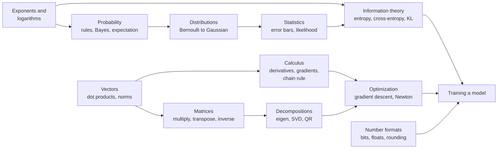
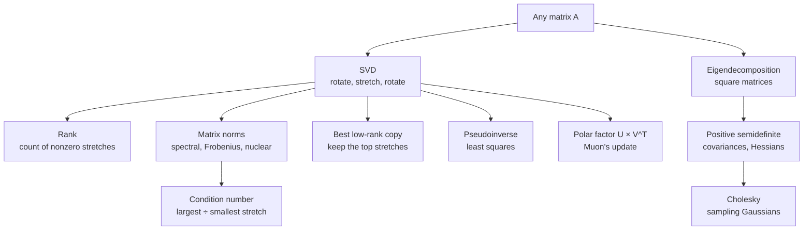
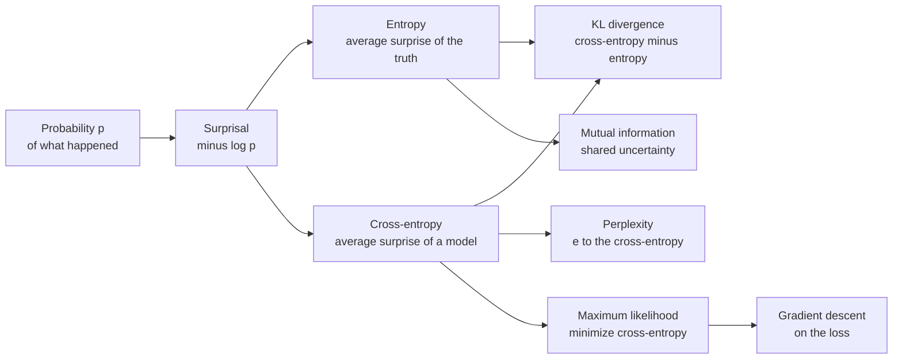

## Foundations: linear algebra, calculus, probability, statistics and information

These are the equations underneath all the others in this appendix. Linear algebra stores a model's numbers as vectors and matrices and says how to combine them; nearly all of the work a chip does is the matrix multiplication defined here. Calculus measures how an output changes when an input is nudged, and the chain rule turns that into gradients for billions of parameters at once. Probability describes uncertainty, so a model's output can be a distribution over possible next tokens, and statistics says how far to trust a number measured on a sample, such as a benchmark score. Information theory turns probabilities into the losses that training minimizes (surprisal, entropy, cross-entropy, KL divergence), optimization theory says how to walk downhill on those losses and how fast, and the number-format equations say how every one of these numbers is actually stored in bits on a chip and what rounding does to it. Entries run from simplest to most advanced, and each one uses only ideas from entries above it. Where a chapter already works a formula through, the entry here is short and points to it. The equations that are specific to one family of models, built from these pieces, are in the later sections of this appendix: deep learning, large language models, reinforcement learning and alignment, generative models and classical AI, classical machine learning, and compute.

*Figure G.X: How the families of foundation equations feed one another. Training a model needs all of them: a loss from information theory, gradients from calculus, steps from optimization, and numbers stored in a format a chip can use.*

*Figure G.X: The matrix decompositions in this section and what each one is used for. The singular value decomposition sits at the center: rank, norms, low-rank compression, least squares and the Muon optimizer all read it off.*

*Figure G.X: From probabilities to training losses. Surprisal is the building block; cross-entropy is the loss language models are trained on, and KL divergence is the gap between a model and the truth.*

### Exponent and logarithm rules

**What it does:** Turns repeated multiplication into counting, and multiplication into addition.

`a^m × a^n = a^(m + n)`, `(a^m)^n = a^(m × n)`, `a^(−n) = 1 ÷ a^n`

`ln(a × b) = ln(a) + ln(b)`, `ln(a ÷ b) = ln(a) − ln(b)`, `ln(a^k) = k × ln(a)`, `exp(ln(x)) = x`, `log2(x) = ln(x) ÷ ln(2)`

- **a, b, x**: positive numbers
- **m, n, k**: exponents (powers)
- **ln**: the natural logarithm, whose base is e ≈ 2.718
- **exp(x)**: e raised to the power x; exp and ln undo each other
- **log2**: the base-2 logarithm, which counts doublings

**In plain words:** An exponent counts how many times a number is multiplied by itself, and a logarithm runs that backward. Because logs turn products into sums, AI software adds log-probabilities instead of multiplying thousands of tiny probabilities that would round to zero.

**Tiny example:** 2^3 × 2^4 = 2^(3 + 4) = 2^7 = 128. ln(2 × 8) = ln(2) + ln(8) = 0.693 + 2.079 = 2.773, which is ln(16). log2(1,024) = 6.931 ÷ 0.693 = 10.

**Where it is used:** Log-probabilities in every training loss, likelihood and beam-search score; log-scale charts of compute, data and scaling laws.
**In the book:** Chapter 6 (Exponentials; Logarithms: Logs turn multiplying into adding); Appendix B (Growth, exponentials and logarithms).

### Growth rates and Big-O notation

**What it does:** Describes how fast a cost (time, memory, operations) grows as the input gets bigger, ignoring constant factors.

`f(n) = O(g(n))` means there are constants c and n_0 with `f(n) ≤ c × g(n)` for every `n ≥ n_0`

`O(1) < O(log n) < O(n) < O(n × log n) < O(n^2) < O(n^3) < O(2^n)` (slowest-growing to fastest-growing)

- **n**: the size of the input, such as the number of tokens in a context
- **f(n)**: the actual cost for an input of size n
- **g(n)**: a simple comparison function, such as n^2
- **c**: a fixed multiplier that is allowed to be large
- **n_0**: the size from which the bound must hold
- **O(...)**: read "order of" or "big O of"

**In plain words:** Big-O keeps only the part of a cost that dominates for large inputs. What matters is what happens when n doubles: an O(n) cost doubles, an O(n^2) cost quadruples, an O(n^3) cost grows eightfold, and an O(2^n) cost squares. Constant factors still matter in practice, but no constant can rescue a fast-growing cost at large enough n.

**Tiny example:** f(n) = 3 × n^2 + 100 × n is O(n^2): with c = 4 and n_0 = 100, 3 × n^2 + 100 × n ≤ 4 × n^2 whenever 100 × n ≤ n^2, that is, n ≥ 100. Doubling from 1,024 to 2,048 items multiplies an n × log2(n) cost by (2,048 × 11) ÷ (1,024 × 10) = 22,528 ÷ 10,240 = 2.2, and an n^2 cost by 4.

**Where it is used:** Comparing architectures: full attention costs O(n^2) in the context length n, while state-space models and linear attention cost O(n) (deep-learning section); the KV cache grows as O(n) per sequence (large-language-model section); multiplying two n × n matrices the schoolbook way is O(n^3) (Strassen's method is about O(n^2.81)); search trees grow as O(b^d) for branching factor b and depth d (classical-AI entries in the generative-models section).
**In the book:** Only here as notation (Chapter 15, The catch: attention costs grow with the square of length, and Chapter 5, Exercise 10 on the cubic cost of matrix multiplication, show the growth in words).

> **Definition — Big-O notation:** A way of describing how fast a cost grows with the size of the input while ignoring constant factors. O(n^2) means that, for large inputs, doubling n roughly quadruples the cost.

### Vector addition, scaling and linear combinations

**What it does:** Adds vectors entry by entry, stretches them by a number, and blends several of them into one.

`a + b = [a_1 + b_1, a_2 + b_2, ..., a_n + b_n]`

`k × a = [k × a_1, k × a_2, ..., k × a_n]`

`linear combination = c_1 × v_1 + c_2 × v_2 + ... + c_m × v_m`

- **a, b**: two vectors of the same length n
- **a_1 ... a_n**: the entries of a (and likewise for b)
- **k**: an ordinary number (a scalar)
- **v_1 ... v_m**: m vectors of the same length
- **c_1 ... c_m**: the weight given to each of those vectors

**In plain words:** Vectors add position by position, and multiplying by k scales every entry. A linear combination is a weighted sum of whole vectors. Subtraction is adding −1 times a vector, and the average of several vectors (their sum divided by their count) is their center point, the centroid.

**Tiny example:** [1, 2] + [3, 1] = [4, 3]. 2 × [1, 0] + 3 × [0, 1] = [2, 3]. The centroid of [1, 2], [3, 4] and [5, 0] is [(1 + 3 + 5) ÷ 3, (2 + 4 + 0) ÷ 3] = [3, 2].

**Where it is used:** Every layer's output is a linear combination of its weight columns; residual connections add vectors (x + f(x)); embedding arithmetic (king − man + woman); averaging token embeddings into one sentence vector; model merging and "task vectors" add and scale whole sets of weights.
**In the book:** Chapter 5 (Vector arithmetic; Embeddings); Chapter 17 (the mixture-of-experts blend 0.67 × Expert 3 + 0.33 × Expert 5); Appendix B (Add vectors; Scale a vector).

> **Definition — Linear combination:** A weighted sum of vectors, such as 2 × [1, 0] + 3 × [0, 1] = [2, 3]. Each output of a neural-network layer is a linear combination of the layer's weight columns.

### Dot product (inner product)

**What it does:** Turns two vectors into one number that measures how much they agree.

`a · b = sum over i of (a_i × b_i) = a_1 × b_1 + a_2 × b_2 + ... + a_n × b_n`

`a · b = ||a|| × ||b|| × cos(θ)`; Cauchy–Schwarz inequality `|a · b| ≤ ||a|| × ||b||`

- **a, b**: two vectors of length n
- **a_i, b_i**: their entries at position i
- **||a||, ||b||**: their lengths (next entry)
- **θ** (theta): the angle between the two vectors
- **cos(θ)**: the cosine of that angle: 1 for the same direction, 0 for perpendicular, −1 for opposite
- **|a · b|**: the size of the dot product, ignoring its sign

**In plain words:** Multiply matching entries and add. The second form says the same number is the two lengths times how well the directions line up, so the sign tells you whether the vectors point roughly the same way. Because a cosine is never bigger than 1 in size, a dot product can never exceed the product of the lengths (Cauchy–Schwarz), which is why cosine similarity always lands between −1 and 1. In matrix notation the dot product is written `a^T × b`.

**Tiny example:** [2, 1, 3] · [1.5, 4, 0.5] = 3 + 4 + 1.5 = 8.5, well under the Cauchy–Schwarz limit sqrt(14) × sqrt(18.5) ≈ 3.742 × 4.301 ≈ 16.09. Geometric check: [1, 0] · [1, 1] = 1, and ||[1, 0]|| × ||[1, 1]|| × cos(45°) = 1 × 1.414 × 0.7071 = 1.

**Where it is used:** Every artificial neuron (weights · inputs + bias); attention scores (query · key); retrieval scores between embeddings; output logits (final hidden state · each vocabulary row).
**In the book:** Chapter 5 (The dot product: Multiply matching entries, then add; What the sign of a dot product tells you); Appendix B (Dot product).

> **Definition — Cauchy–Schwarz inequality:** The rule that the dot product of two vectors is never larger in size than the product of their lengths, |a · b| ≤ ||a|| × ||b||, with equality only when they point along the same line.

### Vector norms and distances (L1, L2, L-infinity, Lp; Euclidean distance)

**What it does:** Measures the size of a vector, or the distance between two vectors, in several useful ways.

`||x||_2 = sqrt(sum over i of x_i^2)`, `||x||_1 = sum over i of |x_i|`, `||x||_inf = max over i of |x_i|`

`||x||_p = (sum over i of |x_i|^p)^(1 ÷ p)`, `d(a, b) = ||a − b||_2`

`||a − b||^2 = ||a||^2 + ||b||^2 − 2 × (a · b)`, and every norm obeys `||a + b|| ≤ ||a|| + ||b||`

- **x**: a vector with entries x_i
- **||x||**: "the norm of x", its size
- **|x_i|**: the absolute value of x_i (drop any minus sign)
- **||x||_2**: the ordinary length (L2 norm)
- **||x||_1**: the sum of absolute values (L1 norm, the taxicab or Manhattan size)
- **||x||_inf**: the largest single entry in size (L-infinity norm)
- **p**: any number 1 or larger, which picks a member of the family
- **d(a, b)**: the Euclidean distance between vectors a and b

**In plain words:** L2 is the length a ruler would measure; L1 adds the steps along each axis; L-infinity looks only at the biggest entry. The squared-distance identity lets a vector database turn distances into dot products, and the last rule (the triangle inequality) says a detour is never shorter. A distance rescaled by a covariance matrix, the Mahalanobis distance, is covered in the classical-machine-learning section.

**Tiny example:** For x = [3, −4]: L2 = sqrt(9 + 16) = 5, L1 = 3 + 4 = 7, L-infinity = 4. Identity check with a = [1, 2], b = [4, 6]: ||a − b||^2 = 9 + 16 = 25, and 5 + 52 − 2 × 16 = 25.

**Where it is used:** L2: gradient-norm clipping, weight decay, embedding normalization and RMSNorm (deep-learning section); L1: lasso and the sparsity penalty of sparse autoencoders; L-infinity: the size budget of adversarial attacks and the absolute-maximum scale used in quantization (large-language-model section); Euclidean distance: nearest-neighbor search and vector databases.
**In the book:** Chapter 5 (Length and distance); Chapter 13 (Vanishing and exploding gradients, gradient norm); Chapter 9 (L1 and L2 regularization); Appendix B (Length; Distance).

> **Definition — Norm (vector norm):** A rule that gives every vector a size: zero only for the all-zero vector, scaled by k when the vector is scaled by k, and obeying the triangle inequality. The L2 norm (ordinary length), the L1 norm (sum of absolute values) and the L-infinity norm (largest entry) are the common ones.

> **Definition — Triangle inequality:** The rule that the size of a sum is never more than the sum of the sizes, ||a + b|| ≤ ||a|| + ||b||; in distance terms, going from A to C directly is never longer than going through B. Every norm obeys it.

### Cosine similarity and unit normalization

**What it does:** Compares the directions of two vectors while ignoring their lengths.

`cos_sim(a, b) = (a · b) ÷ (||a|| × ||b||)`, `a_hat = a ÷ ||a||`, `cosine distance = 1 − cos_sim(a, b)`

- **a, b**: two vectors
- **a · b**: their dot product
- **||a||, ||b||**: their L2 lengths
- **cos_sim**: a number from −1 (opposite) through 0 (unrelated) to 1 (same direction)
- **a_hat**: a rescaled to length 1 (a unit vector)

**In plain words:** Divide the dot product by both lengths and only the angle is left, so stretching either vector changes nothing. After normalizing every vector to length 1, the dot product is the cosine. For unit vectors, ranking by largest cosine or by smallest distance gives the same order, which is why vector databases can use either; that identity, which follows from the squared-distance rule in the previous entry, is worked in the classical-machine-learning section.

**Tiny example:** a = [1, 2, 2] and b = [2, 0, 1]: a · b = 2 + 0 + 2 = 4, ||a|| = 3 and ||b|| = sqrt(5) ≈ 2.236, so cos_sim = 4 ÷ 6.708 ≈ 0.596, a cosine distance of 0.404. Doubling a to [2, 4, 4] doubles both the dot product (8) and the length (6), and 8 ÷ 13.416 is still 0.596. The unit vector a_hat is [0.333, 0.667, 0.667].

**Where it is used:** Semantic search and retrieval-augmented generation compare text embeddings by cosine (ranking metrics are in the classical-machine-learning section); CLIP-style models normalize image and text embeddings before the dot product; near-duplicate detection; interpretability compares feature directions by cosine.
**In the book:** Chapter 5 (Cosine similarity: Worked by hand); Chapter 14 (Dense embeddings: cat and dog, 0.994); Chapter 27 (Measuring closeness); Appendix B (Cosine similarity; Normalize).

> **Definition — Cosine distance:** One minus the cosine similarity of two vectors: 0 for vectors pointing the same way, 1 for perpendicular ones and 2 for opposite ones. It is a common way to turn "how similar" into "how far apart".

### Element-wise product (Hadamard product)

**What it does:** Multiplies two vectors or matrices position by position and keeps the shape.

`(a ⊙ b)_i = a_i × b_i`; for matrices `(A ⊙ B)[i, j] = A[i, j] × B[i, j]`

- **a, b**: two vectors of the same length
- **A, B**: two matrices of the same shape
- **⊙**: "element-wise times" (also written `*` in code)
- **i, j**: the row and column positions
- **[i, j]**: the entry in row i, column j

**In plain words:** Unlike the dot product, nothing is added up: each position is multiplied by its partner and stays where it is. Element-wise division, square roots and powers work the same way, which is how optimizers give every parameter its own step size.

**Tiny example:** [1, 2, 3] ⊙ [4, 0, 0.5] = [4, 0, 1.5]. As a gate: values [5, −2, 8] ⊙ gate [1, 0, 0.5] = [5, 0, 4], so the middle value is shut off and the last one halved.

**Where it is used:** The gates of LSTMs, GRUs and the SwiGLU and GeGLU feed-forward blocks of modern language models (deep-learning section); dropout masks and attention masks; the per-channel gain of LayerNorm and RMSNorm; Adam's per-parameter step size.
**In the book:** Chapter 5 (Vector arithmetic); Chapter 15 (Step 6: The feed-forward block, SwiGLU in words); Appendix B (Element-wise (Hadamard) product).

### Matrix multiplication (and the matrix-vector product)

**What it does:** Combines two matrices so that each entry of the result is a row of the first dotted with a column of the second.

`C[i, k] = sum over j of (A[i, j] × B[j, k])`; shapes `(m × n) times (n × p) gives (m × p)`

`y = W × x`, that is `y_i = sum over j of (W[i, j] × x_j)`

`(A × B) × C = A × (B × C)`, `A × (B + C) = A × B + A × C`, but in general `A × B ≠ B × A`

- **A, B, C**: matrices; A is m × n and B is n × p
- **C[i, k]**: the entry in row i, column k of the result
- **j**: the shared inner index that is summed over
- **W**: a weight matrix; **x**: an input vector; **y**: the output vector

**In plain words:** The inner sizes must match because each output entry is a dot product of length n. A matrix times a vector turns a length-n vector into a length-m vector, and stacking many input vectors as rows lets one product handle a whole batch. Grouping does not matter (associativity) but order does. Its cost, about 2 × m × n × p operations, is counted in the compute section.

**Tiny example:** Rows [1, 2], [3, 4] times rows [5, 6], [7, 8] give rows [19, 22], [43, 50]; swapping the order gives rows [23, 34], [31, 46].

**Where it is used:** Every dense layer; attention's Q × K^T and its weighted sum of V; an embedding lookup equals a one-hot vector times the embedding matrix; GPU tensor cores and TPU systolic arrays exist to do this one operation fast.
**In the book:** Chapter 5 (A matrix as a machine; Matrix multiplication: The rule: row times column; The shape rule; Order matters); Chapter 32 (What a neural network actually computes); Appendix B (Matrix times vector; Matrix times matrix).

### Transpose

**What it does:** Flips a matrix over its diagonal so that its rows become its columns.

`(A^T)[i, j] = A[j, i]`; `(A × B)^T = B^T × A^T`; `(A^T)^T = A`; `a · b = a^T × b`

- **A, B**: matrices; an m × n matrix A gives an n × m matrix A^T
- **A^T**: "A transposed"
- **[i, j]**: the entry in row i, column j
- **a, b**: vectors written as single columns

**In plain words:** Whatever sat in row j, column i moves to row i, column j. Transposing a product reverses the order of the factors. A matrix equal to its own transpose is called symmetric; covariance matrices and Hessians are.

**Tiny example:** Rows [1, 2, 3] and [4, 5, 6] (2 × 3) become rows [1, 4], [2, 5], [3, 6] (3 × 2). With A rows [1, 2], [3, 4] and B rows [5, 6], [7, 8]: (A × B)^T has rows [19, 43], [22, 50], and B^T × A^T gives the same, starting 5 × 1 + 7 × 2 = 19.

**Where it is used:** Attention's Q × K^T lines every query up against every key; backpropagation through y = W × x sends the gradient back as W^T × (gradient at y); models with tied embeddings use one matrix E for input and E^T for output.
**In the book:** Chapter 5 (Flipping a matrix: the transpose); Chapter 15 (Step 4: Self-attention); Chapter 17 (Linear attention and the delta rule); Appendix B (Transpose).

### Outer product (rank-one matrix)

**What it does:** Multiplies every entry of one vector by every entry of another to make a grid.

`(a ⊗ b)[i, j] = a_i × b_j`, also written `a × b^T`

- **a**: a vector of length m (treated as a column)
- **b**: a vector of length n (b^T is b laid on its side as a row)
- **⊗**: the outer product (the same symbol is also used for the Kronecker product later in this section; context tells which)
- **[i, j]**: the entry in row i, column j of the m × n result

**In plain words:** The result has rank 1 (see the rank entry below): every row is a multiple of b. Any matrix can be written as a sum of such column-times-row pieces, which the singular value decomposition makes exact.

**Tiny example:** Chapter 30's LoRA example: column [1, 2, 3] times row [1, 0, 2] gives rows [1, 0, 2], [2, 0, 4], [3, 0, 6], nine numbers from six.

**Where it is used:** A linear layer's weight gradient is an outer product, (gradient at y) × x^T, summed over the batch; linear-attention and delta-rule states add key-value outer products (deep-learning section); a LoRA update is a sum of r outer products (large-language-model section); rank-one model edits such as ROME (Meng et al. 2022).
**In the book:** Chapter 30 (LoRA: The idea in a 3 × 3 example); Chapter 17 (Linear attention and the delta rule).

### Tensor contraction (einsum and named-axis notation)

**What it does:** Gives one rule that covers dot products, matrix products, outer products, traces and batched products: multiply, then sum over every index that does not appear in the output.

`C[i, k] = sum over j of (A[i, j] × B[j, k])`, written `einsum("ij,jk->ik", A, B)`

`C[b, i, k] = sum over j of (A[b, i, j] × B[b, j, k])`, written `einsum("bij,bjk->bik", A, B)`

- **A, B**: the input tensors (a tensor is a stack of matrices with more than two indices)
- **i, j, k**: index letters naming each axis
- **b**: a batch index that is kept, not summed
- **"ij,jk->ik"**: the recipe: the letters before the arrow label each input's axes, the letters after it label the output's
- **C**: the result

**In plain words:** An index letter that appears in the inputs but not in the output is summed over; letters in the output are kept. So "i,i->" is a dot product, "i,j->ij" an outer product, "ij,jk->ik" matrix multiplication and "ii->" a trace.

**Tiny example:** einsum("ij,j->i") of rows [1, 2], [3, 4] with [5, 6] gives [1 × 5 + 2 × 6, 3 × 5 + 4 × 6] = [17, 39], the matrix-vector product. einsum("i,i->") of [1, 2] and [3, 4] gives 3 + 8 = 11.

**Where it is used:** torch.einsum and jnp.einsum express attention, multi-head projections and mixture-of-experts dispatch compactly; the "How to Scale Your Model" guide writes sharded matrix multiplications in a named-axis variant, such as A[I_X, J] × B[J, K], to reason about which axes are split across chips (communication costs are in the compute section).
**In the book:** Only here (tensor shapes in Chapter 5, Tensors: stacks of matrices).

> **Definition — Einsum (Einstein summation):** A compact notation, and a function in PyTorch and JAX, that describes a tensor operation by labeling each axis with a letter: letters that disappear from the output are summed over. "ij,jk->ik" is matrix multiplication.

### Block matrix multiplication (tiling and splitting across chips)

**What it does:** Shows that a big matrix product can be cut into smaller pieces, multiplied piece by piece and reassembled, which is how chips and clusters actually compute it.

`C[I, J] = sum over K of (A[I, K] × B[K, J])`, where I, J and K now number blocks (tiles) and each term is a small matrix product

`column split: X × [W_1, W_2] = [X × W_1, X × W_2]`; `row split: [X_1, X_2] × [[W_1], [W_2]] = X_1 × W_1 + X_2 × W_2`

- **A, B, C**: matrices cut into a grid of smaller blocks; **A[I, K]** is the block in block-row I and block-column K
- **X**: a batch of inputs, one row per token
- **W**: a weight matrix
- **[W_1, W_2]**: W cut into a left and a right block of columns
- **[[W_1], [W_2]]**: W cut into a top and a bottom block of rows, with **X_1, X_2** the matching left and right column blocks of X

**In plain words:** Matrix multiplication works on blocks exactly as it does on single numbers, so a product too big for a chip's fast memory is computed tile by tile, and a product too big for one chip is split across several. Cutting the output columns needs no adding up: each chip produces its own columns. Cutting the shared inner dimension leaves each chip with a partial result that must be added across chips (an all-reduce). Megatron-style tensor parallelism splits the first feed-forward matrix by columns and the second by rows, so the whole block needs only one all-reduce on the way forward.

**Tiny example:** x = [1, 2, 3, 4] times W with rows [1, 0], [0, 1], [1, 1], [2, 0] is [1 + 0 + 3 + 8, 0 + 2 + 3 + 0] = [12, 5]. Row split across two chips: chip 1 multiplies [1, 2] by the first two rows and gets [1, 2]; chip 2 multiplies [3, 4] by the last two rows and gets [11, 3]; adding gives [12, 5]. Tiling: two 4,096 × 4,096 matrices cut into 128 × 128 tiles give 32 × 32 = 1,024 output tiles, each the sum of 32 tile products.

**Where it is used:** Every GPU matrix-multiplication kernel (cuBLAS, CUTLASS, Triton) tiles its inputs so each tile fits in on-chip memory; FlashAttention processes queries, keys and values block by block (large-language-model section); TPU systolic arrays work through 128 × 128 or 256 × 256 tiles; Megatron-LM's tensor parallelism (Shoeybi et al. 2019) uses the column-then-row split, and its communication cost is in the compute section; the "How to Scale Your Model" guide derives its rules for sharded matrix multiplications from this identity.
**In the book:** Chapter 37 (Tensor parallelism: splitting each matrix, a column split worked by hand); Chapter 32 (Why this scales so well: matrices cut into 256 × 256 tiles). The block formula is only here.

> **Definition — Block matrix (tiling):** A matrix viewed as a grid of smaller matrices, called blocks or tiles. Matrices multiply block by block exactly as they multiply number by number, which lets software split a huge product into pieces that fit in a chip's memory or spread across many chips.

### Identity matrix and matrix inverse

**What it does:** Defines the matrix that changes nothing, and the matrix that undoes a given matrix.

`I × A = A × I = A`; `A × A^-1 = A^-1 × A = I`

`[[a, b], [c, d]]^-1 = (1 ÷ (a × d − b × c)) × [[d, −b], [−c, a]]`

`(A × B)^-1 = B^-1 × A^-1`; solving `A × x = b` gives `x = A^-1 × b`

- **I**: the identity matrix, 1s on the diagonal and 0s elsewhere
- **A**: a square matrix
- **A^-1**: the inverse of A
- **[[a, b], [c, d]]**: a 2 × 2 matrix written as a list of rows, with entries a, b, c, d
- **x, b**: vectors (in the last line, b is the known right-hand side and x the unknown)

**In plain words:** The inverse is to matrices what dividing is to numbers. It exists only when the determinant (next entry) is not zero; a matrix with no inverse is called singular. In practice software solves A × x = b directly, by factoring A, instead of forming A^-1.

**Tiny example:** A with rows [4, 7], [2, 6]: a × d − b × c = 24 − 14 = 10, so A^-1 = (1 ÷ 10) × rows [6, −7], [−2, 4] = rows [0.6, −0.7], [−0.2, 0.4]. Solving A × x = [1, 2]: x = [0.6 − 1.4, −0.2 + 0.8] = [−0.8, 0.6]; check 4 × (−0.8) + 7 × 0.6 = 1.

**Where it is used:** Closed-form linear and ridge regression (classical-machine-learning section); Gaussian posteriors and Kalman gains (generative-models and classical-AI section); second-order optimizers apply inverse or inverse-root preconditioners, Shampoo using inverse fourth roots (deep-learning section); GPTQ quantization uses an inverse Hessian (large-language-model section).
**In the book:** Appendix F (Matrix machinery: identity, inverse, determinant and friends); Chapter 5 (Matrices as transformations: the matrix that leaves [3, 2] unchanged).

> **Definition — Singular matrix:** A square matrix that has no inverse because it squashes space flat, so some different inputs land on the same output and cannot be told apart. Its determinant is zero.

### Determinant

**What it does:** Gives the factor by which a square matrix scales area (in 2-D) or volume (in more dimensions).

`det([[a, b], [c, d]]) = a × d − b × c`; `det(A × B) = det(A) × det(B)`; `det(A) = product over i of λ_i`; `det(A^-1) = 1 ÷ det(A)`

- **[[a, b], [c, d]]**: a 2 × 2 matrix as a list of rows
- **A, B**: square matrices of the same size
- **λ_i** (lambda): the eigenvalues of A (see the eigenvalue entry below)
- **product over i**: multiply together all the λ_i

**In plain words:** A negative determinant means the matrix also flips orientation, like a mirror; zero means it squashes space onto a line or plane and cannot be undone. Software usually works with ln(det(A)) to avoid overflow.

**Tiny example:** Rows [2, 0], [0, 3] stretch one way by 2 and the other by 3: det = 6, so a unit square becomes area 6. Rows [1, 2], [2, 4] have det 4 − 4 = 0: the second row is twice the first, so the plane collapses to a line. For Chapter 5's A and B, det(A) × det(B) = (−2) × (−2) = 4 = det(A × B).

**Where it is used:** The normalizing constant of the multivariate Gaussian; the log-determinant term of normalizing flows (generative-models and classical-AI section); testing whether a matrix can be inverted.
**In the book:** Appendix F (Matrix machinery: determinant definition).

### Trace

**What it does:** Adds up the diagonal of a square matrix.

`tr(A) = sum over i of A[i, i]`; `tr(A × B) = tr(B × A)`; `tr(A) = sum over i of λ_i`; `||A||_F^2 = tr(A^T × A)`

`tr(A) ≈ E[z^T × A × z]` for random z with independent entries of mean 0 and variance 1 (Hutchinson's estimator)

- **A, B**: matrices (A × B and B × A must both be square)
- **A[i, i]**: the i-th diagonal entry
- **λ_i**: the eigenvalues of A
- **||A||_F**: the Frobenius norm of A (see matrix norms below)
- **z**: a random vector, for example each entry +1 or −1 with equal chance
- **E[...]**: the average over many random draws (expected value)

**In plain words:** The trace equals the sum of the eigenvalues, and products can be rotated inside it, which simplifies many derivations. Hutchinson's trick gets a trace from matrix-vector products alone, so it works on matrices too big to write down.

**Tiny example:** Rows [2, 1], [1, 3]: trace 5, and the eigenvalues 3.618 + 1.382 = 5. For Chapter 5's A and B, tr(A × B) = 19 + 50 = 69 and tr(B × A) = 23 + 46 = 69. Hutchinson with z = [1, 1], [1, −1], [−1, 1], [−1, −1] gives 7, 3, 3, 7, averaging 5.

**Where it is used:** Matrix-calculus derivations of gradients; Hessian-trace estimates in curvature studies; continuous normalizing flows estimate a Jacobian trace with Hutchinson's trick (generative-models and classical-AI section); closed-form KL divergence between Gaussians.
**In the book:** Appendix F (Matrix machinery: Trace of a matrix).

> **Definition — Hutchinson's estimator:** A way to estimate the trace of a huge matrix without writing it down: multiply it by random plus-or-minus-one vectors z, compute z^T × A × z, and average. On average the answer equals the trace.

### Rank, linear independence and low-rank factorization

**What it does:** Counts how many genuinely different directions a matrix can produce, and stores a big matrix as two thin ones.

`rank(A) = number of linearly independent columns = number of nonzero singular values`

`rank(A × B) ≤ min(rank(A), rank(B))`; rank–nullity: `rank(A) + dim(null space of A) = n` for A with n columns

`W ≈ B × A`, with B of shape m × r and A of shape r × n: rank at most r, storing `r × (m + n)` numbers instead of `m × n`

- **A, B, W**: matrices
- **linearly independent**: no column can be built as a linear combination of the others
- **singular values**: the stretch factors from the SVD (below)
- **min**: the smaller of the two
- **null space of A**: every vector x with A × x = 0, the input directions A wipes out; **dim** counts how many independent directions it has
- **m, n**: the big matrix's rows and columns
- **r**: the chosen rank, usually small

**In plain words:** Rank is how many directions really carry information, and every input direction a matrix does not use lands in its null space. A low-rank factorization says "this big change is made of only r basic patterns", which is the bet behind LoRA.

**Tiny example:** Rows [1, 2], [2, 4] have rank 1: the second row is twice the first, and [2, −1] is in the null space (1 × 2 + 2 × (−1) = 0), so 1 + 1 = 2 columns. Chapter 20's numbers: a rank-8 change to a 4,096 × 4,096 matrix stores 8 × (4,096 + 4,096) = 65,536 numbers instead of 16,777,216, about 0.39%.

**Where it is used:** LoRA fine-tuning adds a rank-r product to frozen weights (large-language-model section); DeepSeek's multi-head latent attention passes keys and values through a low-rank latent; GaLore projects gradients to low rank to save optimizer memory (Zhao et al. 2024); low-rank compression of weights; AlphaEdit edits a fact in a language model by projecting the weight change onto the null space of the inputs that encode knowledge to be kept, so those outputs do not move (Fang et al., ICLR 2025).
**In the book:** Chapter 30 (LoRA: The idea in a 3 × 3 example; Rank definition); Chapter 20 (Fine-tuning for everyone); Appendix F (Span; Linear dependence).

> **Definition — Matrix rank:** The number of genuinely different directions a matrix's columns (or rows) point in, that is, how many of them are left once every column that can be built from the others is removed. A rank-1 matrix is one column times one row.

> **Definition — Null space:** All the input vectors that a matrix sends to zero. A change to the weights that only acts on directions in the null space of some inputs leaves the outputs for those inputs untouched.

### Orthogonal matrices, rotations and Euler's formula

**What it does:** Describes the matrices that turn or mirror vectors without stretching them.

`Q^T × Q = Q × Q^T = I`, so `Q^-1 = Q^T`, and `||Q × x|| = ||x||`

`R(θ) = [[cos θ, −sin θ], [sin θ, cos θ]]`; `R(α) × R(β) = R(α + β)`

`e^(i × θ) = cos θ + i × sin θ`

- **Q**: an orthogonal matrix: its columns have length 1 and are mutually perpendicular
- **I**: the identity matrix
- **x**: any vector
- **R(θ)**: the 2-D rotation by angle θ, written as two rows
- **α, β**: two angles
- **i**: the imaginary unit, the square root of −1
- **e^(i × θ)**: Euler's formula, a point on the unit circle at angle θ

**In plain words:** An orthogonal matrix keeps lengths and dot products unchanged, and its transpose undoes it. Rotations combine by adding angles. With complex numbers a rotation is just multiplication by e^(i × θ), which is how rotary position embeddings are often written.

**Tiny example:** R(30°) × [1, 0] = [0.866, 0.5], still length 1; R(30°) × [3, 4] still has length 5. R(30°) × R(60°) = R(90°), the quarter turn [[0, −1], [1, 0]] from Chapter 5. e^(i × 90°) = cos 90° + i × sin 90° = i.

**Where it is used:** RoPE rotates pairs of query and key entries by position-dependent angles so their dot product depends only on relative position (formula in the deep-learning section); orthogonal weight initialization (Saxe et al. 2014; PyTorch's orthogonal_ initializer); rotating weights and activations to spread outliers before 4-bit quantization (QuaRot and SpinQuant, 2024); Muon orthogonalizes its updates.
**In the book:** Chapter 5 (Matrices as transformations: the quarter turn); Chapter 15 (RoPE: rotating the arrows); Chapter 13 (Muon); Appendix F (Orthogonal matrix).

> **Definition — Complex number:** A number of the form a + b × i, where i is the square root of −1; it can be pictured as the point (a, b) on a flat plane. Multiplying by a complex number of length 1 rotates that point around the origin.

> **Definition — Euler's formula:** The identity e^(i × θ) = cos θ + i × sin θ, which ties exponentials to rotation: raising e to an imaginary power gives the point at angle θ on a circle of radius 1.

### Orthogonal projection, Gram–Schmidt and QR decomposition

**What it does:** Finds the closest point to a vector along a direction, removes a direction from a vector, and builds perpendicular unit vectors from any independent set.

`proj_a(b) = ((a · b) ÷ (a · a)) × a`; leftover `b − proj_a(b)`, which is perpendicular to a

`P = A × (A^T × A)^-1 × A^T`, with `P × P = P` (projection onto the columns of A)

`q_k = normalize(a_k − sum over j < k of ((q_j · a_k) × q_j))`; `A = Q × R`

- **a, b**: vectors; proj_a(b) is the shadow of b on the line through a
- **A**: a matrix whose columns a_1, a_2, ... span the space being projected onto
- **P**: the projection matrix; applying it twice changes nothing more
- **q_k**: the k-th perpendicular unit vector produced by Gram–Schmidt
- **normalize**: divide a vector by its length
- **Q**: the matrix whose columns are the q_k (orthonormal columns)
- **R**: an upper-triangular matrix (zeros below the diagonal) recording the dot products

**In plain words:** Projecting finds the part of b that points along a; subtracting it leaves the part with nothing in common with a. Gram–Schmidt repeats that subtraction to turn any independent vectors into perpendicular unit vectors, and QR stores the result as Q times R.

**Tiny example:** Project b = [2, 0] onto a = [1, 1]: (2 ÷ 2) × [1, 1] = [1, 1]; the leftover [1, −1] has dot product 0 with a. Gram–Schmidt on [3, 4] and [1, 0]: q_1 = [0.6, 0.8]; [1, 0] − 0.6 × [0.6, 0.8] = [0.64, −0.48], length 0.8, so q_2 = [0.8, −0.6], and R has rows [5, 0.6], [0, 0.8].

**Where it is used:** Least squares is a projection onto a column space; interpretability removes a concept direction from activations, as in directional ablation of a "refusal direction" (Arditi et al. 2024) and LEACE concept erasure (Belrose et al. 2023), covered in the alignment section; orthogonal initialization takes the Q of a random matrix; PCA projects data onto its top components.
**In the book:** Only here (PCA keeps "the first few" directions in words in Chapter 10).

> **Definition — Orthogonal projection:** The closest point to a vector along a given direction or inside a given subspace, found by dropping a perpendicular. What is left over is perpendicular to that direction.

> **Definition — Gram–Schmidt process:** A step-by-step recipe that turns a set of independent vectors into perpendicular vectors of length 1, by subtracting from each vector its projections onto the ones already made.

> **Definition — QR decomposition:** Writing a matrix as Q × R, where Q has perpendicular unit-length columns and R is upper triangular. It is the record of a Gram–Schmidt run and a stable way to solve least-squares problems.

### Eigenvalues, eigenvectors, eigendecomposition and spectral radius

**What it does:** Finds the directions a square matrix only stretches, and by how much.

`A × v = λ × v`; characteristic equation `det(A − λ × I) = 0`

`A = Q × Λ × Q^-1`; symmetric A: `A = Q × Λ × Q^T` with real λ; powers `A^t = Q × Λ^t × Q^-1`

`ρ(A) = max over i of |λ_i|`, and `A^t` shrinks to zero as t grows exactly when `ρ(A) < 1`

- **A**: a square matrix
- **v**: an eigenvector, a direction A does not turn
- **λ** (lambda): its eigenvalue, the stretch factor
- **I**: the identity matrix
- **Q**: the matrix with the eigenvectors as columns
- **Λ** (capital lambda): the diagonal matrix of eigenvalues
- **t**: a whole number of repeated multiplications
- **ρ(A)** (rho): the spectral radius, the largest eigenvalue in size

**In plain words:** Along an eigenvector, a matrix acts like plain multiplication by λ. Multiplying again and again grows the directions whose λ is bigger than 1 in size and kills those below 1, which is why the spectral radius decides whether repeated steps explode or fade.

**Tiny example:** Rows [2, 1], [1, 2]: A × [1, 1] = [3, 3] = 3 × [1, 1] and A × [1, −1] = [1, −1], so the eigenvalues are 3 and 1, and det(A − λ × I) = (2 − λ)^2 − 1 = 0 gives the same. A recurrent weight of 0.9 applied 50 times leaves 0.9^50 ≈ 0.005; a weight of 1.1 gives 1.1^50 ≈ 117.

**Where it is used:** PCA's directions are eigenvectors of the covariance matrix (classical-machine-learning section); the largest Hessian eigenvalue measures sharpness, which settles near 2 ÷ learning rate during training (Cohen et al., ICLR 2021); SOAP runs Adam in the eigenbasis of Shampoo's preconditioner (Vyas et al. 2024); exploding and vanishing gradients in recurrent networks and the stability of state-space models depend on the spectral radius; PageRank.
**In the book:** Chapter 10 (PCA, t-SNE and UMAP: Eigenvector definition); Appendix B (PCA directions and share kept).

> **Definition — Eigendecomposition:** Writing a square matrix as Q × Λ × Q^-1, where the columns of Q are its eigenvectors and Λ is a diagonal matrix of its eigenvalues, so the matrix acts as pure stretching once you look along those directions.

> **Definition — Spectral radius:** The largest absolute value among a square matrix's eigenvalues. If it is below 1, multiplying by the matrix over and over shrinks every vector toward zero; above 1, some vectors blow up.

### Singular value decomposition (SVD)

**What it does:** Writes any matrix, square or not, as a rotation, then a stretch along each axis, then another rotation.

`A = U × Σ × V^T = sum over i of (σ_i × u_i × v_i^T)`

`σ_1 ≥ σ_2 ≥ ... ≥ 0`, with `σ_i = sqrt(λ_i(A^T × A))`

- **A**: any m × n matrix
- **U**: an m × m orthogonal matrix with columns u_i (the output directions)
- **Σ** (capital sigma): an m × n matrix with the singular values on its diagonal and zeros elsewhere
- **V**: an n × n orthogonal matrix with columns v_i (the input directions)
- **σ_i** (sigma): the i-th singular value, a stretch factor, largest first
- **λ_i(A^T × A)**: the i-th eigenvalue of the matrix A^T × A

**In plain words:** Every matrix stretches some input directions more than others; the SVD names those directions and the stretches. The number of nonzero singular values is the rank, the largest one is the spectral norm, and the thin (economy) version keeps only min(m, n) columns.

**Tiny example:** A with rows [3, 0], [4, 5]: A^T × A has rows [25, 20], [20, 25] with eigenvalues 45 and 5, so σ_1 = sqrt(45) ≈ 6.708 and σ_2 = sqrt(5) ≈ 2.236 (their product, 15, is |det A|). The input directions are v_1 = [0.707, 0.707] and v_2 = [0.707, −0.707]; the output directions are u_1 = [0.316, 0.949] and u_2 = [0.949, −0.316].

**Where it is used:** Muon's update is the orthogonal factor U × V^T of the momentum matrix, every singular value set to 1 (deep-learning section); PiSSA initializes LoRA adapters from the top singular vectors; analysis of the effective rank of weights and updates; PCA is usually computed by SVD.
**In the book:** Chapter 10 (PCA, t-SNE and UMAP: SVD definition); Chapter 13 (Muon).

> **Definition — Singular value:** One of the stretch factors in a matrix's singular value decomposition: how much the matrix lengthens a vector along one of its special input directions. The largest singular value is the most the matrix can stretch any vector.

### Best low-rank approximation (Eckart–Young theorem)

**What it does:** Says that keeping the k largest pieces of the SVD gives the closest possible rank-k copy of a matrix, and exactly how close.

`A_k = sum over i = 1 to k of (σ_i × u_i × v_i^T)`

`||A − A_k||_F = sqrt(σ_(k+1)^2 + σ_(k+2)^2 + ...)`, `||A − A_k||_2 = σ_(k+1)`

`share of energy kept = (sum of the top k σ_i^2) ÷ (sum of all σ_i^2)`

- **A**: the original matrix
- **A_k**: its rank-k approximation
- **σ_i, u_i, v_i**: the singular values and directions from the SVD
- **k**: how many pieces are kept
- **||...||_F**: the Frobenius norm, the square root of the sum of all squared entries
- **||...||_2**: the spectral norm, the largest stretch

**In plain words:** Throw away the small singular values and the error is exactly what you threw away; no other rank-k matrix does better in either norm.

**Tiny example:** For A with rows [3, 0], [4, 5] (σ = 6.708, 2.236): A_1 = 6.708 × [0.316, 0.949] × [0.707, 0.707]^T, rows [1.5, 1.5], [4.5, 4.5]. The error has rows [1.5, −1.5], [−0.5, 0.5], whose Frobenius norm is sqrt(2.25 + 2.25 + 0.25 + 0.25) = 2.236 = σ_2. Energy kept: 45 ÷ 50 = 90%.

**Where it is used:** Justifies compressing weight matrices to low rank; truncated PCA; LoRA's working assumption that fine-tuning updates are close to low rank (large-language-model section); matrix-factorization recommenders (classical-machine-learning section).
**In the book:** Chapter 10 (PCA, t-SNE and UMAP: keeping the first few components).

> **Definition — Eckart–Young theorem:** The result that cutting a matrix's singular value decomposition down to its k largest singular values gives the closest possible rank-k matrix, with an error equal to the singular values that were dropped.

### Matrix norms (Frobenius, spectral, nuclear)

**What it does:** Measures the size of a whole matrix in three useful ways.

`||A||_F = sqrt(sum over i, j of A[i, j]^2) = sqrt(sum over i of σ_i^2)`

`||A||_2 = max over x ≠ 0 of (||A × x|| ÷ ||x||) = σ_1`, `||A||_* = sum over i of σ_i`

`||A × x|| ≤ ||A||_2 × ||x||`; `||A||_2 ≤ ||A||_F ≤ sqrt(rank(A)) × ||A||_2`

- **A**: a matrix with entries A[i, j]
- **σ_i**: its singular values, σ_1 the largest
- **||A||_F**: the Frobenius norm (the matrix treated as one long vector)
- **||A||_2**: the spectral (operator) norm, the most A can stretch any vector x
- **`||A||_*`**: the nuclear norm, the sum of all the stretches
- **x**: any nonzero vector

**In plain words:** Frobenius is the plain length of all the entries; spectral is the worst-case stretch; nuclear adds up all the stretches and acts as a smooth stand-in for rank.

**Tiny example:** A with rows [3, 0], [4, 5]: Frobenius sqrt(9 + 0 + 16 + 25) = sqrt(50) ≈ 7.071 = sqrt(45 + 5); spectral 6.708; nuclear 6.708 + 2.236 = 8.944. Check: 6.708 ≤ 7.071 ≤ sqrt(2) × 6.708 = 9.487.

**Where it is used:** Spectral normalization divides each GAN discriminator layer by its spectral norm (Miyato et al. 2018); Muon is steepest descent under the spectral norm (Bernstein and Newhouse 2024); Frobenius norms in weight decay, reconstruction errors and matrix distillation; nuclear-norm matrix completion.
**In the book:** Only here.

> **Definition — Spectral norm:** The largest factor by which a matrix can stretch any vector, equal to its largest singular value. A layer whose spectral norm is at most 1 can never make an input longer.

> **Definition — Nuclear norm:** The sum of a matrix's singular values. Making it small pushes a matrix toward low rank, so it serves as a smooth stand-in for "use few patterns".

### Condition number

**What it does:** Measures how lopsided a matrix's stretching is.

`κ(A) = ||A||_2 × ||A^-1||_2 = σ_max ÷ σ_min`; for a symmetric positive definite Hessian `κ = λ_max ÷ λ_min`

- **κ** (kappa): the condition number, 1 or more
- **A**: a square, invertible matrix
- **σ_max, σ_min**: its largest and smallest singular values
- **λ_max, λ_min**: the largest and smallest eigenvalues of a Hessian (the curvatures of a loss)

**In plain words:** A large κ means small errors in the input can become large errors in the output, and that gradient descent zig-zags down long narrow valleys: on a quadratic it needs on the order of κ steps for each constant-factor improvement.

**Tiny example:** A with rows [3, 0], [4, 5]: κ = 6.708 ÷ 2.236 = 3. A loss whose curvatures are 10 in one direction and 0.1 in another has κ = 100: a step size safe for the steep direction crawls along the flat one.

**Where it is used:** Explains why preconditioned optimizers (Adam, Shampoo, SOAP) and normalization layers speed up training (deep-learning section); numerical stability of solving systems in low precision; GPTQ adds a small damping term to its Hessian's diagonal before inverting it (large-language-model section).
**In the book:** Appendix F (Jacobians, Hessians and conditioning: Condition number).

### Positive semidefinite matrices, quadratic forms, Gram matrices and Cholesky factorization

**What it does:** Identifies the symmetric matrices that describe bowls rather than saddles, and gives them a square root.

`x^T × A × x = sum over i, j of (A[i, j] × x_i × x_j)` (a quadratic form)

`positive semidefinite (PSD): x^T × A × x ≥ 0 for every x`, equivalently every eigenvalue ≥ 0

`G = X × X^T`, with `G[i, j] = x_i · x_j`, is always PSD; Cholesky `A = L × L^T` for positive definite A

- **A**: a symmetric square matrix
- **x**: any vector, with entries x_i
- **G**: a Gram matrix of all pairwise dot products
- **X**: a matrix whose rows are the vectors x_1, x_2, ...
- **L**: a lower-triangular matrix (zeros above the diagonal)
- **positive definite**: the strict version, x^T × A × x > 0 for every nonzero x

**In plain words:** A quadratic form is a bowl- or saddle-shaped function of x, and PSD matrices give bowls with no downhill direction. Covariance matrices, Gram (kernel) matrices and the Hessians of convex functions are PSD. Cholesky is a fast, stable square root of a positive definite matrix, used for example to sample correlated Gaussian noise as x = μ + L × z.

**Tiny example:** A with rows [4, 2], [2, 3] and x = [1, −1]: 4 − 2 − 2 + 3 = 3 ≥ 0; its eigenvalues 5.56 and 1.44 are both positive. Cholesky: L with rows [2, 0], [1, 1.414] gives L × L^T = rows [4, 2], [2, 3]. Gram matrix of [1, 2] and [3, 0]: rows [5, 3], [3, 9].

**Where it is used:** Covariance matrices and Gaussian sampling; kernel methods and Gaussian processes (classical-machine-learning section); Shampoo's statistics G × G^T (deep-learning section); the second-order term of Taylor expansions; GPTQ uses a Cholesky factorization of the inverse Hessian for numerical stability (Frantar et al. 2023).
**In the book:** Only here (covariance and symmetric matrices in Appendix F).

> **Definition — Quadratic form:** A number computed from a vector x and a symmetric matrix A as x^T × A × x, the sum of every A[i, j] × x_i × x_j. Plotted against x it is a bowl, a dome or a saddle.

> **Definition — Positive semidefinite matrix (PSD):** A symmetric matrix A for which x^T × A × x is never negative, so all its eigenvalues are zero or positive. Covariance matrices are always positive semidefinite.

> **Definition — Cholesky factorization:** Writing a positive definite matrix as L × L^T with L lower triangular, a kind of matrix square root. It is the fast, stable way to solve such systems and to draw correlated random numbers.

### Graph Laplacian (adjacency, degree and smoothness on a graph)

**What it does:** Turns a network of connections into a matrix whose quadratic form measures how much a quantity jumps across connections, and whose eigenvectors reveal clusters.

`L = D − A`, with `D[i, i] = sum over j of A[i, j]` (zeros off the diagonal)

`x^T × L × x = sum over connected pairs (i, j) of A[i, j] × (x_i − x_j)^2`; normalized `L_sym = I − D^(−1 ÷ 2) × A × D^(−1 ÷ 2)`

- **A**: the adjacency matrix: A[i, j] is 1 (or a weight) when nodes i and j are connected, and 0 otherwise
- **D**: the degree matrix: each node's number (or total weight) of connections on the diagonal
- **L**: the graph Laplacian
- **x**: one number per node, such as a feature or a cluster score
- **D^(−1 ÷ 2)**: the diagonal matrix of 1 ÷ sqrt(degree); **I**: the identity matrix

**In plain words:** The quadratic form adds up the squared differences across every connection, so it is small when connected nodes have similar values. L is positive semidefinite, its smallest eigenvalue is 0 (every node equal), and it has one zero eigenvalue per separate piece of the graph. The eigenvectors with the next-smallest eigenvalues vary as smoothly as possible over the graph, which is how spectral methods find clusters.

**Tiny example:** A path of three nodes, 1–2–3: D is diag(1, 2, 1) and L has rows [1, −1, 0], [−1, 2, −1], [0, −1, 1]. For x = [1, 2, 4]: x^T × L × x = (1 − 2)^2 + (2 − 4)^2 = 1 + 4 = 5. L's eigenvalues are 0, 1 and 3; the eigenvector [1, 0, −1] for eigenvalue 1 puts node 1 and node 3 on opposite sides, splitting the path in the middle.

**Where it is used:** Spectral clustering (scikit-learn's SpectralClustering; Shi and Malik 2000, Ng, Jordan and Weiss 2001) groups points using the Laplacian's eigenvectors; UMAP's default starting layout is a spectral embedding of its neighbor graph; the graph convolutional network of Kipf and Welling (2017) comes from a simplified spectral filter on the normalized Laplacian, which is where its D^(−1 ÷ 2) × (A + I) × D^(−1 ÷ 2) form comes from (deep-learning section, with the adjacency and degree matrices defined there).
**In the book:** Only here (Chapter 17, Graph neural networks: when data is a web, not a line, and Chapter 10, Shrinking many columns into a few: UMAP, describe the methods in words).

> **Definition — Graph Laplacian:** The matrix L = D − A built from a graph's degree and adjacency matrices. Multiplied on both sides by a vector of node values, it adds up the squared differences across all connections, and its eigenvectors with small eigenvalues reveal the graph's clusters.

### Least-squares solution and the Moore–Penrose pseudoinverse

**What it does:** Finds the best approximate solution of a linear system that has no exact one.

`minimize ||A × x − b||^2`; normal equations `A^T × A × x = A^T × b`, so `x = (A^T × A)^-1 × A^T × b`

`x = A^+ × b` in general, with `A^+ = V × Σ^+ × U^T`; ridge variant `x = (A^T × A + λ × I)^-1 × A^T × b`

- **A**: an m × n matrix (often more rows than columns: more equations than unknowns)
- **x**: the unknown vector
- **b**: the target vector
- **A^+**: the pseudoinverse of A
- **U, Σ, V**: the SVD of A; **Σ^+** inverts each nonzero singular value and leaves zeros as zeros
- **λ**: the ridge penalty strength; **I**: the identity matrix

**In plain words:** When no x hits b exactly, least squares picks the x whose results miss by the smallest total squared amount. The pseudoinverse extends the inverse to non-square or singular matrices and returns the smallest such x. Linear regression is this formula applied to data.

**Tiny example:** Three measurements of one unknown disagree: x = 1, x = 2 and x = 6. As A × x = b, A is the column [1, 1, 1] and b = [1, 2, 6]; A^T × A = 3 and A^T × b = 9, so x = 9 ÷ 3 = 3, the average. The misses b − A × x = [−2, −1, 3] add to 0, so they are perpendicular to the column [1, 1, 1]: least squares is a projection. For the singular A with rows [1, 0], [0, 0] and b = [2, 3], A^+ has the same rows and gives x = [2, 0]: the second unknown has no effect, so the pseudoinverse picks the smallest choice, 0.

**Where it is used:** Linear and ridge regression, with the line of best fit for Appendix B's quiz data worked through the normal equations (classical-machine-learning section); linear probes and closed-form readouts on frozen features; closed-form model edits that rewrite one stored association with a rank-one update (ROME, Meng et al. 2022); layer-by-layer calibration solves in quantization and pruning.
**In the book:** Chapter 8 (Doing it in a spreadsheet: least squares); Appendix B (Line of best fit); Appendix F (Normal equations; Pseudoinverse).

> **Definition — Least squares:** Choosing the unknowns so that the sum of the squared misses between predictions and targets is as small as possible. It is the method behind the line of best fit and linear regression.

### Power iteration

**What it does:** Finds a matrix's top eigenvector (or top singular direction) using nothing but repeated multiplication.

`v_(k+1) = (A × v_k) ÷ ||A × v_k||`; `λ_max ≈ v_k^T × A × v_k` (symmetric A); `σ_1 ≈ ||A × v_k||` when iterating with `A^T × A`

- **A**: a square matrix (or A^T × A for singular values)
- **v_k**: the current guess after k steps, kept at length 1
- **λ_max**: the largest eigenvalue; **v_k^T × A × v_k** is called the Rayleigh quotient
- **σ_1**: the largest singular value

**In plain words:** Multiply a random vector by the matrix again and again, rescaling each time; the fastest-growing direction takes over. Because it needs only matrix-vector products, it works on matrices that are never written out, such as a Hessian reached through Hessian-vector products.

**Tiny example:** Rows [2, 1], [1, 2] starting from [1, 0]: after one step [0.894, 0.447] with estimate 2.8; then [0.781, 0.625] (2.976); then [0.733, 0.680] (2.997), closing in on the eigenvalue 3 and the direction [0.707, 0.707].

**Where it is used:** Spectral normalization runs one power-iteration step per training step to track each layer's largest singular value (Miyato et al. 2018); measuring sharpness, the top Hessian eigenvalue, in edge-of-stability studies; PageRank.
**In the book:** Only here.

> **Definition — Power iteration:** Finding a matrix's dominant direction by multiplying a starting vector by the matrix over and over and rescaling it each time, until it stops changing direction.

> **Definition — Rayleigh quotient:** For a symmetric matrix A and a vector v of length 1, the number v^T × A × v: the stretch A applies along v. It equals an eigenvalue exactly when v is the matching eigenvector, so it turns an approximate eigenvector into an eigenvalue estimate.

### Polar decomposition and Newton–Schulz orthogonalization

**What it does:** Splits a matrix into a pure rotation part and a pure stretch part, and finds the rotation part with matrix multiplications only.

`A = U_p × P`, with `U_p = U × V^T` (the nearest orthogonal matrix to A) and `P = V × Σ × V^T`

`X_(k+1) = 1.5 × X_k − 0.5 × X_k × X_k^T × X_k`, starting from `X_0 = A ÷ ||A||_F`, converges to `U × V^T`

- **A**: a matrix with SVD U × Σ × V^T
- **U_p**: the orthogonal (rotation) factor
- **P**: the symmetric stretch factor
- **X_k**: the k-th Newton–Schulz iterate
- **||A||_F**: the Frobenius norm, used to scale every singular value below 1 at the start

**In plain words:** Like writing a number as its sign times its size. Each Newton–Schulz step pushes every singular value toward 1 while leaving the singular directions alone (it converges for singular values between 0 and sqrt(3)), so the result is U × V^T without ever computing an SVD.

**Tiny example:** On one singular value s the step is s → 1.5 × s − 0.5 × s^3: 0.5 → 0.688 → 0.869 → 0.975 → 0.999. For Chapter 13's toy matrix with singular values 3 and 0.1, scaling by the Frobenius norm 3.002 gives 0.999 and 0.033; the small one needs about 12 cubic steps to reach 1, which is why Muon uses a tuned quintic polynomial and only about five steps.

**Where it is used:** Muon (Keller Jordan, December 2024) orthogonalizes each weight matrix's momentum with about five steps of a tuned quintic Newton–Schulz polynomial, whose coefficients are in the deep-learning section; Moonshot's MuonClip for Kimi K2 builds on it.
**In the book:** Chapter 13 (Optimizers: Muon: balance the whole matrix; Newton–Schulz iteration definition).

> **Definition — Polar decomposition:** Writing a matrix as an orthogonal (rotation) matrix times a symmetric stretch matrix, the matrix version of writing a number as its sign times its size. The rotation part is the closest orthogonal matrix to the original.

### Kronecker product

**What it does:** Builds a big block matrix in which every entry of one matrix multiplies the whole of another.

`A ⊗ B = [[A[1,1] × B, A[1,2] × B, ...], [A[2,1] × B, A[2,2] × B, ...], ...]`

`(A ⊗ B) × vec(X) = vec(B × X × A^T)`; `(A ⊗ B)^-1 = A^-1 ⊗ B^-1`

- **A**: an m × n matrix; **B**: a p × q matrix
- **A ⊗ B**: an (m × p) by (n × q) block matrix
- **A[1,1] × B**: the block made by scaling all of B by one entry of A
- **X**: a matrix, and **vec(X)** stacks its columns into one long vector

**In plain words:** The identities let a huge matrix that acts on a whole weight matrix be stored, applied and inverted as two small ones, never built in full.

**Tiny example:** A with rows [1, 2], [3, 4] and B with rows [0, 1], [1, 0] give the 4 × 4 matrix with rows [0, 1, 0, 2], [1, 0, 2, 0], [0, 3, 0, 4], [3, 0, 4, 0]. For a 1,000 × 1,000 weight matrix, a full curvature matrix would hold 10^12 numbers; two 1,000 × 1,000 Kronecker factors hold 2 million.

**Where it is used:** K-FAC approximates each layer's Fisher matrix as a Kronecker product of two small matrices (Martens and Grosse 2015); Shampoo preconditions each weight matrix with a left and a right factor, a Kronecker-factored approximation of full-matrix AdaGrad; a Distributed Shampoo submission won the external-tuning track of the AlgoPerf training-speed benchmark (MLCommons; analysis published February 2025).
**In the book:** Only here (Shampoo and SOAP in words in Chapter 13).

> **Definition — Kronecker product:** A way of combining two matrices into a much larger block matrix by multiplying every entry of the first by the whole second matrix. It lets optimizers such as Shampoo and K-FAC handle huge curvature matrices as two small factors.

### Sherman–Morrison and Woodbury identities (and the matrix determinant lemma)

**What it does:** Updates an inverse, or a determinant, cheaply when the matrix gets a low-rank change, instead of starting again from scratch.

`(A + u × v^T)^-1 = A^-1 − (A^-1 × u × v^T × A^-1) ÷ (1 + v^T × A^-1 × u)`

`(A + U × C × V)^-1 = A^-1 − A^-1 × U × (C^-1 + V × A^-1 × U)^-1 × V × A^-1`; `det(A + u × v^T) = (1 + v^T × A^-1 × u) × det(A)`

- **A**: an invertible n × n matrix whose inverse is already known
- **u, v**: vectors; u × v^T is a rank-one change
- **U, C, V**: matrices of compatible shapes making a rank-k change (here not the SVD factors); C is k × k
- **det**: the determinant

**In plain words:** A rank-one change costs a few matrix-vector products; a rank-k change costs only a k × k inverse. That is how online models update after each new data point. The determinant lemma does the same for the determinant: a rank-one change multiplies it by a single number.

**Tiny example:** A = I (2 × 2), u = v = [1, 1]: (I + u × v^T)^-1 = I − u × v^T ÷ (1 + 2), rows [0.667, −0.333], [−0.333, 0.667], which is exactly the inverse of rows [2, 1], [1, 2]. The determinant lemma gives det = (1 + 2) × 1 = 3, and directly 2 × 2 − 1 × 1 = 3.

**Where it is used:** Recursive least squares and online linear models; Gaussian-process and Kalman-filter updates (classical-machine-learning and generative-models sections); cheap inverse updates in influence-function and natural-gradient approximations; deriving closed-form rank-one model edits; planar normalizing flows get their log-determinant from the determinant lemma (Rezende and Mohamed 2015).
**In the book:** Only here.

> **Definition — Woodbury identity:** A formula for the inverse of a matrix after a low-rank change, written in terms of the old inverse and a small k × k inverse. Its rank-one special case is the Sherman–Morrison formula.

> **Definition — Matrix determinant lemma:** The rule det(A + u × v^T) = (1 + v^T × A^-1 × u) × det(A): after a rank-one change, the new determinant is the old one times a single easily computed number.

### Matrix exponential

**What it does:** Extends e^x to square matrices, turning a continuous-time rule for change into the exact jump over a time step.

`exp(A) = I + A + A^2 ÷ 2! + A^3 ÷ 3! + ... = sum over k ≥ 0 of (A^k ÷ k!)`

`exp(Q × Λ × Q^-1) = Q × exp(Λ) × Q^-1`; the solution of `dx/dt = A × x` is `x(t) = exp(t × A) × x(0)`

- **A**: a square matrix
- **I**: the identity matrix
- **k!**: k factorial, 1 × 2 × ... × k
- **Q, Λ**: A's eigenvectors and diagonal eigenvalue matrix; for a diagonal matrix, exp just exponentiates each diagonal entry
- **dx/dt**: how fast the vector x changes per unit of time
- **x(0), x(t)**: the state at time 0 and at time t

**In plain words:** If a state changes continuously at a rate set by A, exp(t × A) tells you exactly where it is after time t. The generator of rotation, rows [0, −1], [1, 0], exponentiates to a rotation matrix.

**Tiny example:** One variable with A = −1 and a step of 0.1: exp(−0.1) = 0.9048, and the series 1 − 0.1 + 0.005 − 0.000167 = 0.9048. With t × A = 0.5236 × rows [0, −1], [1, 0] (0.5236 radians is 30°), exp gives rows [0.866, −0.5], [0.5, 0.866], the 30° rotation.

**Where it is used:** Discretizing continuous-time state-space models such as S4 and Mamba (their zero-order-hold step is in the deep-learning section); rotations and rigid motions in robotics and 3-D vision; continuous-time Markov chains.
**In the book:** Only here (Chapter 17's state-space models show only the step-by-step recurrence).

> **Definition — Matrix exponential:** The matrix version of e^x, defined by the same never-ending sum I + A + A^2 ÷ 2! + .... It converts a rule for how fast a state changes into the exact change over a stretch of time.

### Walsh–Hadamard matrix and the fast Hadamard transform

**What it does:** Mixes every entry of a vector with every other one using only additions and subtractions, and is its own undo.

`H_1 = [1]`; `H_(2n) = (1 ÷ sqrt(2)) × [[H_n, H_n], [H_n, −H_n]]`; `H^T × H = I` and `H × H = I`

`cost of applying H to a length-n vector ≈ n × log2(n)` additions

- **H_n**: the n × n Hadamard matrix (n a power of 2), entries ±1 times a scale
- **[[H_n, H_n], [H_n, −H_n]]**: the doubling step, written as a 2 × 2 grid of blocks
- **I**: the identity matrix
- **n**: the vector length

**In plain words:** A Hadamard rotation spreads one large outlier evenly across all entries, so a shared quantization scale is no longer wrecked by it, and applying it again brings the original back.

**Tiny example:** H_4 = (1 ÷ 2) × rows [1, 1, 1, 1], [1, −1, 1, −1], [1, 1, −1, −1], [1, −1, −1, 1]. H_4 × [8, 0, 0, 0] = [4, 4, 4, 4]: the biggest entry drops from 8 to 4. Applying H_4 again gives [8, 0, 0, 0] back. For n = 4,096 the fast transform needs 4,096 × 12 = 49,152 additions, against about 16.8 million for a general matrix-vector product.

**Where it is used:** Rotating weights and activations before 4-bit quantization so outliers do not wreck a shared scale (QuaRot, SpinQuant; method in the large-language-model section); NVIDIA's NVFP4 pretraining recipe applies random Hadamard transforms to bound block-level outliers (arXiv 2509.25149, 2025).
**In the book:** Only here.

> **Definition — Fast Walsh–Hadamard transform:** A quick way, using only additions and subtractions, to multiply a vector by a Hadamard matrix, a square matrix of plus and minus ones that mixes every entry with every other. It costs about n × log2(n) steps instead of n^2.

### Johnson–Lindenstrauss lemma (random projections)

**What it does:** Guarantees that a random linear map into far fewer dimensions keeps every distance between many points nearly unchanged.

`(1 − ε) × ||u − v||^2 ≤ ||f(u) − f(v)||^2 ≤ (1 + ε) × ||u − v||^2` with high probability for every pair of the n points, provided `k ≥ 4 × ln(n) ÷ (ε^2 ÷ 2 − ε^3 ÷ 3)`

- **n**: the number of points
- **u, v**: any two of the points (vectors in a huge space)
- **f**: a random linear map, for example a matrix of random Gaussian numbers, suitably scaled
- **k**: the number of dimensions after the map
- **ε** (epsilon): the allowed relative distortion, such as 0.1 for 10%
- **ln**: the natural logarithm

**In plain words:** The dimension needed grows only with the logarithm of the number of points and does not depend on the original dimension at all. A corollary: a space of d dimensions holds exponentially many almost-perpendicular directions.

**Tiny example:** A million points with 10% distortion: k ≥ 4 × 13.8 ÷ (0.005 − 0.00033) ≈ 11,842 dimensions, whether the points started in 100,000 or 10 million dimensions. Allowing 20% cuts that to about 3,188.

**Where it is used:** Random projections and sketches for fast similarity search and locality-sensitive hashing (classical-machine-learning section); TRAK data attribution compresses per-example gradients with random projections (Park et al. 2023); the near-orthogonality argument behind superposition, how networks store more features than they have dimensions (alignment section).
**In the book:** Only here (Chapter 57's superposition notes that random high-dimensional arrows are nearly perpendicular).

> **Definition — Johnson–Lindenstrauss lemma:** A result guaranteeing that n points in any number of dimensions can be mapped by a random matrix into a number of dimensions on the order of ln(n) ÷ ε^2 while every pairwise squared distance changes by at most a factor of 1 ± ε.

> **Definition — Random projection:** Shrinking high-dimensional vectors to fewer dimensions by multiplying them by a random matrix. Thanks to the Johnson–Lindenstrauss lemma, distances between the vectors are roughly preserved.

### Discrete Fourier transform and the convolution theorem

**What it does:** Rewrites N samples of a signal as a sum of N waves of different frequencies, which turns convolution into element-wise multiplication.

`X_k = sum over n = 0 to N − 1 of (x_n × exp(−2 × π × i × k × n ÷ N))`

`x_n = (1 ÷ N) × sum over k of (X_k × exp(2 × π × i × k × n ÷ N))`

`DFT(x circularly convolved with y) = DFT(x) ⊙ DFT(y)`; the fast Fourier transform (FFT) costs about `N × log2(N)`

- **x_n**: the n-th of N samples of the signal
- **X_k**: a complex number giving the strength and phase of frequency k
- **i**: the square root of −1; **π**: 3.14159...
- **exp(2 × π × i × ...)**: a point turning around the unit circle (Euler's formula, above)
- **circular convolution**: sliding one signal along the other, wrapping around at the end
- **⊙**: element-wise multiplication

**In plain words:** The transform asks "how much of each frequency is in this signal?" by comparing it with waves of every frequency. Convolution in time becomes plain multiplication frequency by frequency, and the FFT makes the transform itself cheap.

**Tiny example:** x = [1, 0, −1, 0] is one wave per 4 samples: X = [0, 2, 0, 2], energy only at frequency 1 (and its mirror, frequency 3), and the inverse gives [1, 0, −1, 0] back. For N = 1,024 the FFT takes about 10,240 steps instead of about a million.

**Where it is used:** Spectrograms for speech and audio models (the short-time Fourier transform and mel scale are in the generative-models and classical-AI section); FFT-based long convolutions in Hyena-style models and Fourier token mixing in FNet (deep-learning section); frequency analysis of positional encodings; classic image processing.
**In the book:** Chapter 46 (Spectrograms: a picture of sound: Fourier transform definition); Appendix F (Fast convolution: FFT and Winograd).

> **Definition — Discrete Fourier transform (DFT):** The calculation that turns N evenly spaced samples of a signal into N numbers saying how strongly each frequency is present. The fast Fourier transform (FFT) computes it quickly.

> **Definition — Convolution theorem:** The fact that sliding one signal across another (convolution) becomes simple frequency-by-frequency multiplication after a Fourier transform, which makes long convolutions fast.

### Derivative (limit definition and finite differences)

**What it does:** Gives the slope of a function at a point: how much the output changes per tiny change in the input.

`f'(x) = lim as h → 0 of (f(x + h) − f(x)) ÷ h`

`forward difference: f'(x) ≈ (f(x + h) − f(x)) ÷ h`; `central difference: f'(x) ≈ (f(x + h) − f(x − h)) ÷ (2 × h)`

- **f**: a function of one number x
- **f'(x)**: "f prime of x", the derivative (slope) at x
- **h**: a small nudge to the input
- **lim as h → 0**: the value the ratio settles toward as h shrinks to zero

**In plain words:** Nudge the input, see how far the output moves, divide. The central difference nudges both ways and is much more accurate: its error shrinks like h^2 instead of h.

**Tiny example:** f(x) = x^3 at x = 2 (true slope 3 × 2^2 = 12), with h = 0.01: forward (8.1206 − 8) ÷ 0.01 = 12.06; central (8.1206 − 7.8806) ÷ 0.02 = 12.0001.

**Where it is used:** Gradient checking compares automatic-differentiation results against finite differences (for example torch.autograd.gradcheck); zeroth-order optimizers estimate gradients from forward passes alone (MeZO fine-tuning, Malladi et al. 2023).
**In the book:** Chapter 6 (Slopes and derivatives: Finding a slope by nudging); Chapter 12 (Checking backpropagation by nudging); Appendix B (Slope by nudging).

> **Definition — Central difference:** Estimating a slope by nudging the input both up and down by h and dividing the change in output by 2 × h. It is far more accurate than nudging in one direction only.

### Derivative rules

**What it does:** Gives the short table that, with the chain rule, differentiates any formula built from simple pieces.

`(c)' = 0`, `(x^n)' = n × x^(n − 1)`, `(e^x)' = e^x`, `(ln x)' = 1 ÷ x`

`(f + g)' = f' + g'`, `(c × f)' = c × f'`, `(f × g)' = f' × g + f × g'`, `(f ÷ g)' = (f' × g − f × g') ÷ g^2`

- **c**: a constant number
- **n**: a fixed power
- **f, g**: functions of x
- **'** (prime): "the derivative of"

**In plain words:** Constants have no slope; powers drop by one; e^x is its own slope; sums split; constants factor out. For a product, take turns differentiating each factor; for a quotient, use the last rule. The slopes of activation functions (ReLU, sigmoid, GELU) all follow and are listed in the deep-learning section.

**Tiny example:** Product rule for x^2 × (x + 1) at x = 2: f' × g + f × g' = (2 × 2) × 3 + 4 × 1 = 16; check by expanding to x^3 + x^2, whose slope 3 × 4 + 2 × 2 = 16. Quotient rule for x ÷ (x + 1) at x = 1: (1 × 2 − 1 × 1) ÷ 2^2 = 0.25.

**Where it is used:** Every automatic-differentiation library implements one backward rule per primitive operation, built from this table; hand-derived gradients in courses such as CS229 and CS231n.
**In the book:** Chapter 6 (Finding a slope by nudging: derivative table); Appendix B (Calculus and learning: derivative table).

### Partial derivative

**What it does:** Gives the slope of a many-input function along one input while the others are held still.

`∂f/∂x_i = lim as h → 0 of (f(x_1, ..., x_i + h, ..., x_n) − f(x_1, ..., x_n)) ÷ h`

- **f**: a function of n inputs x_1 to x_n
- **∂** (read "partial"): marks a slope along one input only
- **x_i**: the one input being nudged
- **h**: the nudge

**In plain words:** Turn one knob, freeze the rest, measure the slope. In training, every parameter gets one partial derivative of the loss: billions per step for a large model.

**Tiny example:** Chapter 6's loss (2 × w + b − 5)^2 at w = b = 1: ∂/∂w = 2 × (−2) × 2 = −8 and ∂/∂b = 2 × (−2) × 1 = −4. Nudging w by 0.001 changes the loss by about −0.008, a slope of −8.

**Where it is used:** Every training step of every neural network.
**In the book:** Chapter 6 (Gradients: One knob at a time); Appendix B (Partial derivative).

### Gradient and directional derivative

**What it does:** Collects all the partial derivatives into one vector that points uphill, and gives the slope in any chosen direction.

`∇f(x) = [∂f/∂x_1, ∂f/∂x_2, ..., ∂f/∂x_n]`

`D_u f(x) = ∇f(x) · u` for a unit vector u; steepest ascent along `∇f(x) ÷ ||∇f(x)||`

- **∇f(x)** (∇ is read "nabla" or "grad"): the gradient of f at the point x
- **u**: a direction, as a vector of length 1
- **D_u f(x)**: the slope of f when moving in direction u
- **||∇f(x)||**: the length of the gradient, which is the steepest slope available

**In plain words:** The slope in any direction is a dot product with the gradient, so the gradient points the way of fastest increase and minus the gradient the way of fastest decrease (when step size is measured by ordinary length; other choices are in the steepest-descent entry later in this section).

**Tiny example:** Gradient [−8, −4]: moving in direction [0.6, 0.8] gives slope −8 × 0.6 + (−4) × 0.8 = −8; moving along minus the gradient, [0.894, 0.447], gives the steepest slope, −sqrt(64 + 16) = −8.944.

**Where it is used:** Gradient descent and every optimizer; gradient norms watched for loss spikes and used for clipping (deep-learning section); input-gradient saliency and integrated-gradients attribution (alignment section); the fast gradient-sign adversarial attack moves an input along the sign of the gradient.
**In the book:** Chapter 6 (Gradients: The gradient points uphill); Chapter 12 (nine slopes form the complete gradient); Appendix B (Gradient).

> **Definition — Directional derivative:** The slope of a function when you move in one chosen direction, equal to the dot product of the gradient with that direction (as a vector of length 1).

### Chain rule (single-variable and multivariable)

**What it does:** Gives the slope through a chain of steps as the product of the steps' slopes, adding over every path.

`dy/dx = (dy/du) × (du/dx)`

`∂L/∂x_i = sum over j of ((∂L/∂u_j) × (∂u_j/∂x_i))`; vector form `∂L/∂x = J^T × ∂L/∂u`, with `J = ∂u/∂x`

- **x**: the input; **u** (with entries u_j): an intermediate result; **y** or **L**: the final output, such as a loss
- **dy/du, du/dx**: the slopes of each step
- **J**: the Jacobian, the table of every ∂u_j/∂x_i (next entry)
- **J^T**: its transpose

**In plain words:** Gears turning gears: if u moves 3 times as fast as x and y moves 6 times as fast as u, y moves 18 times as fast as x. When x reaches the output by several routes, add up the contribution of each route. Backpropagation (deep-learning section) is this rule applied layer by layer from the loss backward.

**Tiny example:** u = 3 × x and y = u^2 at x = 1: 6 × 3 = 18. Two paths: L = u_1 × u_2 with u_1 = 2 × x and u_2 = x^2, at x = 1: (∂L/∂u_1)(∂u_1/∂x) + (∂L/∂u_2)(∂u_2/∂x) = 1 × 2 + 2 × 2 = 6, matching L = 2 × x^3, whose slope at 1 is 6.

**Where it is used:** Backpropagation in every neural network; reverse-mode automatic differentiation in PyTorch, JAX and TensorFlow.
**In the book:** Chapter 6 (The chain rule: gears turning gears; Backpropagation); Chapter 12 (Backpropagation: the worked example); Appendix B (Chain rule).

### Jacobian matrix and Jacobian-vector products (forward and reverse mode)

**What it does:** Collects every partial derivative of a function with many inputs and many outputs, and gives the two cheap ways to use it without building it.

`J[i, j] = ∂f_i/∂x_j`, an m × n matrix for f with n inputs and m outputs

`forward mode: J × v` (a JVP); `reverse mode: v^T × J` (a VJP); `chain: J_(g of f)(x) = J_g(f(x)) × J_f(x)`

- **f**: a function from n inputs to m outputs; **f_i** is its i-th output
- **x_j**: its j-th input
- **J**: the Jacobian matrix, row i for output i and column j for input j
- **v**: a vector (a direction to push forward, or a gradient to pull back)
- **g of f**: the composition, g applied after f

**In plain words:** Automatic differentiation never builds J. Forward mode pushes one input direction through the computation; reverse mode pulls one output vector back through it; each costs a small multiple of one forward pass. With billions of inputs and one output (the loss), one reverse pass gives the whole gradient, which is why training uses reverse mode.

**Tiny example:** f(x_1, x_2) = [x_1 × x_2, x_1 + x_2] at (2, 3): J has rows [3, 2] and [1, 1]. JVP with v = [1, 0]: [3, 1], how both outputs move when x_1 is nudged. VJP with v = [1, 1]: [4, 3], the gradient of the sum of the outputs.

**Where it is used:** torch.func.jvp and vjp, jax.jvp and vjp; backpropagation is a chain of VJPs; JVPs appear in forward-mode tricks and in some consistency-model training (generative-models section); Jacobian regularization; the Jacobian determinant of normalizing flows.
**In the book:** Appendix F (Jacobians, Hessians and conditioning: Jacobian definition); Chapter 12 (Why backpropagation is such a big deal: reverse-mode differentiation).

> **Definition — Jacobian-vector product (JVP):** The product of a function's Jacobian with a direction vector, computed without building the Jacobian by pushing that direction forward through the calculation. It answers "how do all the outputs move if I nudge the inputs this way?".

> **Definition — Vector-Jacobian product (VJP):** The product of a row vector with a function's Jacobian, computed by pulling the vector backward through the calculation. Backpropagation is a chain of VJPs, starting from the loss.

### Hessian matrix and Hessian-vector products

**What it does:** Collects all second derivatives, which describe how the slope itself changes (curvature).

`H[i, j] = ∂^2 f ÷ (∂x_i × ∂x_j)` (symmetric, n × n)

`H × v = ∇(∇f(x) · v)` (Pearlmutter's trick, about two gradient evaluations); squared error of a linear layer on inputs X: `H = 2 × X × X^T`

- **f**: a function of n inputs (a loss)
- **H**: the Hessian matrix
- **∂^2 f ÷ (∂x_i × ∂x_j)**: the slope, along x_j, of the slope along x_i
- **v**: any vector
- **X**: a matrix of calibration inputs to a linear layer, one input vector per column

**In plain words:** If all of H's eigenvalues are positive the surface is a bowl; mixed signs mean a saddle. For billions of parameters H has too many entries to store, so methods only ever multiply it by vectors.

**Tiny example:** f(x, y) = x^2 + 3 × x × y + 5 × y^2: H has rows [2, 3] and [3, 10], eigenvalues 11 and 1, a bowl. H × [1, 0] = [2, 3]. For x^2 − y^2, H = rows [2, 0], [0, −2]: a saddle.

**Where it is used:** Sharpness and edge-of-stability analysis; second-order optimizers approximate it (Newton, Shampoo, K-FAC, Sophia's diagonal estimate); Optimal Brain Surgeon pruning and GPTQ quantization use the layer Hessian 2 × X × X^T (large-language-model section); influence functions; sharpness-aware minimization.
**In the book:** Appendix F (Jacobians, Hessians and conditioning; Newton's method: a 70-billion-parameter Hessian has about 4.9 × 10^21 entries); Chapter 13 (Beyond Adam, curvature in words).

> **Definition — Hessian-vector product:** The result of multiplying a function's matrix of second derivatives by a vector, computed for about the cost of two gradients without ever building the matrix. It lets methods probe the curvature of a loss with billions of parameters.

> **Definition — Sharpness (of a loss):** How steeply a loss curves around the current parameters in its most curved direction, usually measured as the largest eigenvalue of the Hessian. Sharp regions punish large learning rates; flat ones tolerate them.

### Matrix calculus identities

**What it does:** Gives shortcuts for differentiating expressions written in vectors and matrices directly.

`∂(a^T × x)/∂x = a`; `∂(x^T × A × x)/∂x = (A + A^T) × x` (= `2 × A × x` for symmetric A); `∂(||x||^2)/∂x = 2 × x`

`∂L/∂W = (∂L/∂y) × x^T` and `∂L/∂x = W^T × (∂L/∂y)`, for `y = W × x` and a loss L

`∂ tr(A × X)/∂X = A^T`; `∂ ln(det(X))/∂X = (X^-1)^T`

- **a, x**: vectors; **A, X**: matrices
- **W**: a layer's weight matrix; **y**: its output
- **∂L/∂y**: the gradient arriving from later layers
- **tr**: the trace; **det**: the determinant

**In plain words:** The gradient of one number with respect to a matrix has the same shape as the matrix. For a linear layer: the weight gradient is the incoming gradient times the input (an outer product), and the gradient passed back is the weight matrix transposed times the incoming gradient.

**Tiny example:** A with rows [2, 1], [1, 3] at x = [1, 1]: 2 × A × x = 2 × [3, 4] = [6, 8], which matches differentiating 2 × x_1^2 + 2 × x_1 × x_2 + 3 × x_2^2 by hand. Linear layer with ∂L/∂y = [1, −1], x = [2, 3], W rows [1, 2], [3, 4]: ∂L/∂W = rows [2, 3], [−2, −3], and ∂L/∂x = W^T × [1, −1] = [−2, −2].

**Where it is used:** Deriving backward passes for linear layers and attention; closed-form solutions such as least squares and Gaussian maximum likelihood; course derivations of backpropagation (CS229, CS231n).
**In the book:** Chapter 12 (Backpropagation: The worked example, slope for each weight = blame × its input; Exercise 10 code); Appendix B (MSE slopes for a line).

### Taylor approximation

**What it does:** Approximates any smooth function near a point by a line or a parabola.

`f(x + Δ) ≈ f(x) + f'(x) × Δ + (1 ÷ 2) × f''(x) × Δ^2`

`f(x) = sum over n ≥ 0 of (f^(n)(a) × (x − a)^n ÷ n!)`; many variables `f(x + Δ) ≈ f(x) + ∇f(x) · Δ + (1 ÷ 2) × Δ^T × H × Δ`

- **x**: the point you know; **Δ** (delta): a small change
- **f', f''**: the first and second derivatives
- **f^(n)(a)**: the n-th derivative at the point a; **n!**: n factorial
- **∇f(x)**: the gradient; **H**: the Hessian

**In plain words:** Zoom in close enough and every smooth curve looks like a straight line (first order) or a bowl (second order). Gradient descent minimizes the first-order picture plus a step penalty; Newton's method jumps to the bottom of the second-order bowl.

**Tiny example:** e^0.1 ≈ 1 + 0.1 + 0.005 = 1.105 (true value 1.10517); ln(1.05) ≈ 0.05 (true 0.0488). x^3 near 2 with Δ = 0.1: 8 + 12 × 0.1 + 0.5 × 12 × 0.01 = 9.26 (true 9.261).

**Where it is used:** Derives gradient descent and Newton's method; predicts the loss change from pruning or quantizing weights (Optimal Brain Surgeon, GPTQ); linearized networks and the neural tangent kernel; first-order Taylor importance scores for pruning.
**In the book:** Only here (the first-order idea is in Chapter 6, Finding a slope by nudging; the second-order idea in Appendix F, Newton's method).

> **Definition — Taylor approximation:** Approximating a smooth function near a point by a simple polynomial built from its derivatives there: a straight line from the first derivative, a parabola if the second is added.

### Integral and the fundamental theorem of calculus

**What it does:** Adds up the area under a curve, and links that area to derivatives.

`integral from a to b of f(x) dx ≈ sum over slices of (f(x_k) × Δx)`; trapezoidal rule `≈ sum over k of (x_(k+1) − x_k) × (f(x_k) + f(x_(k+1))) ÷ 2`

`integral from a to b of f(x) dx = F(b) − F(a)` whenever `F'(x) = f(x)`; `integral from −∞ to ∞ of exp(−x^2 ÷ 2) dx = sqrt(2 × π)`

- **f**: the curve's height at x
- **a, b**: where the area starts and ends
- **Δx**: the width of each thin slice; **x_k**: a point in slice k (in the trapezoidal rule, the slice edges)
- **F**: any function whose slope is f (an antiderivative)
- **∞**: infinity

**In plain words:** Slice the area into thin strips and add them; thinner strips give the exact area. The trapezoidal rule joins neighboring points with straight lines, which is all you can do when the curve is known only at a list of points. Integration and differentiation undo each other. The last formula, the Gaussian integral, is why sqrt(2 × π) appears in the bell curve's formula.

**Tiny example:** Area under x^2 from 0 to 1: four slices at midpoints 0.125, 0.375, 0.625, 0.875 give (0.0156 + 0.1406 + 0.3906 + 0.7656) × 0.25 = 0.328; four trapezoids on the edges 0, 0.25, 0.5, 0.75, 1 give 0.25 × (0 ÷ 2 + 0.0625 + 0.25 + 0.5625 + 1 ÷ 2) = 0.344; the exact answer, from F(x) = x^3 ÷ 3, is 1 ÷ 3 = 0.333. sqrt(2 × π) = 2.507.

**Where it is used:** Continuous probabilities and expectations (the probability entries below); AUC is the area under a ROC curve (classical-machine-learning section), and scikit-learn's auc function computes such areas with the trapezoidal rule; diffusion and flow-matching samplers integrate an equation over time (generative-models section); integrated-gradients attribution averages gradients along a path.
**In the book:** Chapter 6 (The normal distribution: Smooth quantities: densities and areas; Integral definition).

> **Definition — Fundamental theorem of calculus:** The fact that integrating and differentiating undo each other: the area under f from a to b equals F(b) − F(a) for any function F whose slope is f.

> **Definition — Trapezoidal rule:** Estimating the area under a curve known only at a list of points by joining neighboring points with straight lines and adding up the areas of the resulting trapezoids.

### Log-sum-exp and the max-subtraction trick

**What it does:** Computes a smooth version of the maximum without overflowing.

`LSE(x) = ln(sum over i of exp(x_i)) = m + ln(sum over i of exp(x_i − m))`, with `m = max over i of x_i`

`max(x) ≤ LSE(x) ≤ max(x) + ln(n)`; `∂LSE/∂x_i = exp(x_i) ÷ sum over j of exp(x_j)` (the softmax)

- **x**: a list of n scores x_1 to x_n
- **m**: the largest score
- **exp, ln**: e to a power, and the natural log
- **∂LSE/∂x_i**: the slope of LSE with respect to score i

**In plain words:** Subtracting the largest score first gives exactly the same answer but keeps every exp() at 1 or below, so nothing overflows (in FP32, exp(89) already exceeds the largest number, about 3.4 × 10^38). Its gradient is the softmax (deep-learning section).

**Tiny example:** Scores [1,000, 999, 998]: exp(1,000) overflows, but 1,000 + ln(1 + e^−1 + e^−2) = 1,000 + ln(1.503) = 1,000.408, between the bounds 1,000 and 1,000 + ln(3) = 1,001.099. Its gradient is the softmax [0.665, 0.245, 0.090].

**Where it is used:** Numerically stable softmax and cross-entropy in every framework; the running maximum and running sum of the online softmax inside FlashAttention (large-language-model section); log-likelihoods of mixtures; the log-normalizer of exponential families; PaLM's z-loss penalizes the square of the output LSE to keep logits from drifting.
**In the book:** Chapter 15 (Step D: softmax, subtract the largest score first); Chapter 6 (Worked with three numbers); Appendix B (Shift makes no difference).

### Geometric and arithmetic series

**What it does:** Adds up a quantity that shrinks by a fixed factor each step, or one that grows by a fixed amount each step.

`sum over k = 0 to n − 1 of r^k = (1 − r^n) ÷ (1 − r)`; for `|r| < 1`: `sum over k ≥ 0 of r^k = 1 ÷ (1 − r)`

`sum over k ≥ 0 of (k × r^k) = r ÷ (1 − r)^2`; arithmetic series `1 + 2 + ... + n = n × (n + 1) ÷ 2`

- **r**: the factor applied each step
- **n**: the number of terms
- **k**: the step number, starting at 0
- **|r|**: the size of r, ignoring its sign

**In plain words:** When each term is a fixed fraction of the one before, the never-ending sum is finite, and 1 ÷ (1 − r) acts as an "effective number of terms". When each term is one more than the last, the sum is about half of n^2, the area of a triangle.

**Tiny example:** r = 0.9: four terms give (1 − 0.6561) ÷ 0.1 = 3.439 (Chapter 13's momentum climbing 1, 1.9, 2.71, 3.44), and forever gives 1 ÷ 0.1 = 10. Adam's β2 = 0.999 averages over about 1 ÷ 0.001 = 1,000 steps. With a causal mask, 1,000 tokens make 1 + 2 + ... + 1,000 = 1,000 × 1,001 ÷ 2 = 500,500 query-key scores, about half of the full 1,000,000.

**Where it is used:** The memory of an exponential moving average with decay β spans about 1 ÷ (1 − β) steps (deep-learning section); discounted returns in reinforcement learning; the expected number of tokens per step in speculative decoding (large-language-model section); the arithmetic series counts the scores of causal (masked) attention and the total KV-cache reads over a generation.
**In the book:** Chapter 13 (Momentum: a rolling ball; Check your understanding 2); Chapter 48 (Discount factor).

> **Definition — Geometric series:** A sum in which each term is the previous one times the same factor r, such as 1 + 0.9 + 0.81 + .... When r is between −1 and 1 the endless sum equals 1 ÷ (1 − r).

> **Definition — Arithmetic series:** A sum in which each term is the previous one plus the same amount, such as 1 + 2 + 3 + ... + n, which equals n × (n + 1) ÷ 2.

### Euler's method for differential equations (and gradient flow)

**What it does:** Follows a rule for how fast something changes by taking small straight steps.

`Euler step: x_(t + h) = x_t + h × f(x_t, t)`, for `dx/dt = f(x, t)`

`Heun step: x_(t + h) = x_t + (h ÷ 2) × (f(x_t, t) + f(x_t + h × f(x_t, t), t + h))`; `gradient flow: dθ/dt = −∇L(θ)`

- **x_t**: the state at time t
- **dx/dt = f(x, t)**: an ordinary differential equation, a rule giving the rate of change
- **h**: the step size in time
- **θ**: parameters; **∇L(θ)**: the gradient of the loss

**In plain words:** Look at the current direction, take a straight step, repeat. Smaller steps are more accurate; Heun (a second-order method) takes a trial step, looks at the slope there too, and averages, for much less error per step. One Euler step of gradient flow is exactly a gradient descent step with learning rate h.

**Tiny example:** dx/dt = −x from x = 1, with h = 0.5 (true answer e^−0.5 = 0.607): Euler gives 1 − 0.5 = 0.5; Heun's trial step lands at 0.5 with slope −0.5, so it averages the slopes −1 and −0.5 to −0.75 and gives 1 − 0.375 = 0.625.

**Where it is used:** Sampling from diffusion and flow-matching models integrates an ordinary differential equation with Euler or Heun steps (the EDM sampler of Karras et al. 2022 uses Heun; samplers are in the generative-models section); neural ODEs; physics simulators for robots; gradient descent seen as Euler steps on gradient flow.
**In the book:** Chapter 16 (Flow matching and rectified flow: one step of size 0.5; Samplers and step counts).

> **Definition — Ordinary differential equation (ODE):** A rule that says how fast a quantity changes given its current value, such as dx/dt = −x. Solving it means finding the path the quantity follows over time.

> **Definition — Gradient flow:** The idealized path parameters would follow if gradient descent took infinitely small steps, always moving straight downhill on the loss. Ordinary gradient descent is one Euler step of it at a time.

### Linear and spherical interpolation (lerp and slerp)

**What it does:** Walks between two points, either in a straight line or along a circular arc.

`lerp(a, b, t) = (1 − t) × a + t × b`, for t from 0 to 1

`slerp(a, b, t) = (sin((1 − t) × Ω) ÷ sin(Ω)) × a + (sin(t × Ω) ÷ sin(Ω)) × b`, with `cos(Ω) = (a · b) ÷ (||a|| × ||b||)`

- **a, b**: the two endpoints (vectors)
- **t**: how far along, from 0 (at a) to 1 (at b)
- **Ω** (omega): the angle between a and b
- **sin, cos**: the sine and cosine

**In plain words:** lerp cuts straight across; slerp follows the arc at constant speed, so vectors of length 1 stay length 1 all the way, which matters when direction carries the meaning.

**Tiny example:** lerp([0, 0], [4, 2], 0.25) = [1, 0.5]. Between [1, 0] and [0, 1] (Ω = 90°) at t = 0.5, slerp gives 0.707 × [1, 0] + 0.707 × [0, 1] = [0.707, 0.707], length 1, while lerp gives [0.5, 0.5], length 0.707.

**Where it is used:** Model merging by interpolating weights (weight averaging and model soups; SLERP merges in tools such as mergekit); straight-line noise-to-data paths in flow matching and rectified flow (generative-models section); latent-space interpolation in image generators; an exponential moving average of weights is a repeated lerp.
**In the book:** Chapter 16 (Flow matching and rectified flow: x(t) = (1 − t) × noise + t × data); Chapter 20 (Model merging: weight soup).

> **Definition — Spherical linear interpolation (slerp):** Moving between two vectors along the arc of a circle rather than the straight chord, at constant angular speed, so that unit-length vectors stay unit length along the way.

### Basic rules of probability

**What it does:** States the rules every probability obeys.

`0 ≤ P(A) ≤ 1`; `sum over all outcomes x of P(x) = 1`; `P(not A) = 1 − P(A)`

`P(A or B) = P(A) + P(B) − P(A and B)`; equally likely outcomes `P(A) = favorable ÷ total`

- **A, B**: events (things that can happen)
- **P(A)**: the probability of A
- **x**: one possible outcome
- **favorable, total**: counts of outcomes where A happens, and of all equally likely outcomes

**In plain words:** Probabilities run from 0 (impossible) to 1 (certain), a full distribution adds to 1, "not" is one minus, and "or" adds but subtracts the overlap so it is not counted twice (zero overlap for events that cannot happen together).

**Tiny example:** A heart or a king from a 52-card deck: 13/52 + 4/52 − 1/52 = 16/52 ≈ 0.31. Not rolling a 6: 1 − 1/6 = 5/6.

**Where it is used:** Every output distribution of a classifier or language model must add to 1; the complement trick for "at least one" success or failure.
**In the book:** Chapter 6 (Probability: Counting outcomes; The three rules you need); Appendix B (Probability).

### Conditional, joint and marginal probability (product rule)

**What it does:** Narrows the world to the cases where something is known, and relates two-variable probabilities to one-variable ones.

`P(A given B) = P(A and B) ÷ P(B)`; product rule `P(A and B) = P(A given B) × P(B)`

`marginal: P(A) = sum over b of P(A and B = b)`

- **P(A given B)**: the probability of A when B is known to be true (often written with a vertical bar)
- **P(A and B)**: the joint probability, both together
- **b**: each possible value of the variable B
- **P(A)** in the last line: the marginal probability, with B added away

**In plain words:** Conditioning keeps only the cases where B holds and asks how often A holds among them. A marginal probability is a row or column total of a table of joint probabilities.

**Tiny example:** Chapter 6's emails: P(spam and "free") = 0.20 and P("free") = 0.25, so P(spam given "free") = 0.20 ÷ 0.25 = 0.8; back again with the product rule, 0.8 × 0.25 = 0.20.

**Where it is used:** Every language model outputs P(next token given everything so far); classifiers output P(class given input); conditional image and audio generation.
**In the book:** Chapter 6 (Random variables, joint tables and marginals; Conditional probability: Narrowing the room); Appendix B (Conditional probability).

### Chain rule of probability

**What it does:** Builds the probability of a whole sequence one piece at a time.

`P(x_1, x_2, ..., x_n) = P(x_1) × P(x_2 given x_1) × ... = product over t of P(x_t given x_1, ..., x_(t − 1))`

`ln P(x_1, ..., x_n) = sum over t of ln P(x_t given x_1, ..., x_(t − 1))`

- **x_1 ... x_n**: the items of a sequence, such as tokens
- **t**: the position in the sequence
- **product over t**: multiply the terms for every position
- **ln**: the natural logarithm, which turns the product into a sum

**In plain words:** Any joint probability equals the probability of the first item, times the second given the first, and so on. It is exact, for any ordering, with no assumptions, which is why "predict the next token" is enough to define a full probability for any text.

**Tiny example:** Three cards dealt from a 52-card deck all being hearts: 13/52 × 12/51 × 11/50 = 0.25 × 0.2353 × 0.22 = 0.0129, each factor conditioned on the cards already dealt. In logs: −1.386 − 1.447 − 1.514 = −4.347 = ln(0.0129). (Chapter 6's sentence, 0.05 × 0.01 × 0.2 = 0.0001, is worked token by token in the large-language-model section.)

**Where it is used:** The foundation of autoregressive language models (their factorization, likelihood and loss are in the large-language-model section); autoregressive image and audio token models; Bayesian networks factor it using independence (generative-models and classical-AI section).
**In the book:** Chapter 6 (Chaining probabilities for a whole sentence; A language model you can build by counting); Appendix B (Sentence probability; Log-probability).

### Independence and conditional independence

**What it does:** Says when probabilities can simply be multiplied.

`P(A and B) = P(A) × P(B)` (equivalently `P(A given B) = P(A)`)

`P(A and B given C) = P(A given C) × P(B given C)`; at least one success in k independent tries `1 − (1 − p)^k`

- **A, B, C**: events
- **p**: the chance that a single try succeeds
- **k**: the number of tries

**In plain words:** Independent events carry no information about each other. Conditional independence means they become independent once C is known. "At least one" is easiest as one minus the chance that every try fails.

**Tiny example:** Two heads: 0.5 × 0.5 = 0.25. Chapter 47's image keepers: if 1 in 5 generations is good, at least one good one in 4 tries is 1 − 0.8^4 = 0.59.

**Where it is used:** The i.i.d. assumption behind training data, minibatches and eval error bars; naive Bayes (classical-machine-learning section) and Bayesian networks; best-of-k intuition (exact pass@k estimators are in the classical-machine-learning and large-language-model sections); reliability of systems built from many parts (compute section).
**In the book:** Chapter 6 (The three rules you need; Independence definition); Chapter 47 (Seeds, randomness and iteration); Chapter 54 (Conditional independence); Appendix B (And, for independent events).

> **Definition — i.i.d. (independent and identically distributed):** Describes data points that are each drawn from the same distribution without influencing one another, like repeated fair coin flips. Most of the statistics used to train and evaluate models assumes it.

### Law of total probability, marginalization and mixtures

**What it does:** Adds up every route to an outcome, each weighted by how likely that route is.

`P(B) = sum over i of P(B given A_i) × P(A_i)`, for cases A_1, A_2, ... that cover everything without overlap

`continuous: p(x) = integral of p(x given z) × p(z) dz`; `mixture: p(x) = sum over k of π_k × p_k(x)`, with `sum over k of π_k = 1`

- **A_i**: one of the cases
- **z**: a hidden (latent) variable, added away by the integral
- **p(...)**: a probability or a density
- **π_k**: the weight of mixture component k (a weight, not 3.14)
- **p_k(x)**: component k's own distribution

**In plain words:** To find the chance of B, consider each way B can come about. A mixture first picks a component with probability π_k and then draws from it; latent-variable models integrate out the hidden choice the same way.

**Tiny example:** A positive test: 0.9 × 0.01 + 0.09 × 0.99 = 0.0981. A mixture of two coins, picked 70% and 30% of the time, with heads chances 0.5 and 0.9: P(heads) = 0.7 × 0.5 + 0.3 × 0.9 = 0.62.

**Where it is used:** The denominator of Bayes' rule; Gaussian mixture models (classical-machine-learning section); VAEs and diffusion models (generative-models section); mixture-of-experts outputs as weighted sums (deep-learning section); pretraining data mixtures.
**In the book:** Chapter 6 (Bayes' rule: The rule itself); Chapter 54 (A Bayesian network, worked by hand); Appendix B (Total probability).

> **Definition — Mixture distribution:** A distribution made by first choosing one of several component distributions at random, with fixed weights, and then drawing from the chosen one. A Gaussian mixture is a blend of several bell curves.

### Bayes' rule

**What it does:** Turns the probability of the evidence given a hypothesis into the probability of the hypothesis given the evidence.

`P(A given B) = P(B given A) × P(A) ÷ P(B)`

`p(θ given D) ∝ p(D given θ) × p(θ)` (posterior ∝ likelihood × prior)

`posterior odds = prior odds × P(B given A) ÷ P(B given not A)`, where `odds = P ÷ (1 − P)`

- **A**: a hypothesis; **B**: the evidence
- **P(A)**: the prior, belief before the evidence
- **P(A given B)**: the posterior, belief after it
- **θ**: model parameters; **D**: data
- **∝**: "proportional to", equal up to a constant that makes everything add to 1
- **odds**: the chance something happens divided by the chance it does not

**In plain words:** Weigh how well each hypothesis explains the evidence by how plausible it was to begin with. In odds form, each piece of evidence multiplies the odds by its likelihood ratio.

**Tiny example:** Chapter 6's test: 0.9 × 0.01 ÷ 0.0981 = 0.092. In odds: prior odds 0.01 ÷ 0.99 = 0.0101, likelihood ratio 0.9 ÷ 0.09 = 10, posterior odds 0.101, which is a probability of 0.101 ÷ 1.101 = 0.092.

**Where it is used:** Naive Bayes spam filters (classical-machine-learning section); Bayesian networks and filtering (generative-models and classical-AI section); MAP estimation and regularization; classifier guidance in diffusion is derived from Bayes' rule on scores; Bayesian optimization of hyperparameters; correcting detector alarms for base rates.
**In the book:** Chapter 6 (Bayes' rule: The medical test, with 1,000 people; The rule itself; Updating again); Chapter 54 (Bayesian network questions); Appendix B (Bayes' rule).

### Expected value (linearity and LOTUS)

**What it does:** Gives the probability-weighted average outcome of something random.

`discrete: E[X] = sum over x of (x × P(x))`; `continuous: E[X] = integral of x × p(x) dx`

`E[g(X)] = sum over x of (g(x) × P(x))`; `E[a × X + b × Y + c] = a × E[X] + b × E[Y] + c`; independent X, Y: `E[X × Y] = E[X] × E[Y]`

- **X, Y**: random variables; **x**: one possible value
- **P(x), p(x)**: the probability (or density) of x
- **g**: any function
- **a, b, c**: ordinary numbers

**In plain words:** Multiply each outcome by its probability and add. Averages of sums are sums of averages, always, even for dependent quantities (linearity). To average g(X) you can use X's own distribution directly, the "law of the unconscious statistician" (LOTUS).

**Tiny example:** A fair die: 3.5. Two dice: 3.5 + 3.5 = 7. E[2 × X + 1] = 2 × 3.5 + 1 = 8. E[X^2] = (1 + 4 + 9 + 16 + 25 + 36) ÷ 6 = 15.17.

**Where it is used:** Every training loss is an expected loss over the data, estimated by a minibatch average; expected reward in reinforcement learning; expected cost and latency; inverted dropout rescales kept units so expected activations are unchanged (deep-learning section).
**In the book:** Chapter 6 (Probability: Expected value); Chapter 20 (Worked toy example, expected reward 1.58); Appendix B (Expected value).

> **Definition — Linearity of expectation:** The rule that the average of a sum equals the sum of the averages, E[X + Y] = E[X] + E[Y], and that constants factor out. It holds even when X and Y depend on each other.

### Variance and standard deviation

**What it does:** Measures how spread out a random quantity is around its mean.

`Var(X) = E[(X − μ)^2] = E[X^2] − (E[X])^2`, with `μ = E[X]`; `sd(X) = sqrt(Var(X))`; `Var(a × X + b) = a^2 × Var(X)`

`sample variance: s^2 = sum over i of (x_i − x_bar)^2 ÷ (n − 1)`

- **X**: a random variable; **μ** (mu): its mean
- **sd**: the standard deviation, in the original units
- **a, b**: numbers; shifting by b changes nothing, scaling by a multiplies the variance by a^2
- **x_i**: the n data values; **x_bar**: their average
- **n − 1**: Bessel's correction (divide by n for the population formula)

**In plain words:** The average squared distance from the mean, and its square root. Dividing a sample's squared deviations by n − 1 rather than n corrects the slight underestimate that comes from measuring spread around the sample's own mean.

**Tiny example:** 2, 4, 4, 4, 5, 5, 7, 9: variance 32 ÷ 8 = 4, standard deviation 2. Check with E[X^2] − E[X]^2 = 232 ÷ 8 − 5^2 = 29 − 25 = 4. The sample version is 32 ÷ 7 = 4.57. Var(3 × X + 2) = 9 × 4 = 36.

**Where it is used:** Normalization layers divide by a standard deviation (LayerNorm; RMSNorm uses the root mean square; deep-learning section); variance-preserving initialization; Adam's second moment tracks squared gradients; eval error bars; GRPO divides each group's rewards by their standard deviation (alignment section).
**In the book:** Chapter 6 (Spread: variance and standard deviation); Appendix B (Variance; Standard deviation).

> **Definition — Bessel's correction:** Dividing by n − 1 instead of n when estimating a variance from a sample, to make up for the fact that deviations measured from the sample's own mean come out slightly too small.

### Variance of sums and of averages

**What it does:** Says how the spread of a total or an average depends on the spreads of its parts.

`Var(X + Y) = Var(X) + Var(Y) + 2 × Cov(X, Y)`; independent values `Var(sum over i of X_i) = sum over i of Var(X_i)`

`Var(x_bar) = σ^2 ÷ n` for the mean of n i.i.d. values, so `sd(x_bar) = σ ÷ sqrt(n)`

- **X, Y, X_i**: random quantities
- **Cov(X, Y)**: their covariance (next entry), 0 when they are independent
- **x_bar**: the average of n values
- **σ^2**: the variance of a single value; **σ** its standard deviation

**In plain words:** For independent quantities variances add, but standard deviations do not, so averaging n noisy measurements shrinks the noise by sqrt(n), not by n. Halving an error bar takes four times as much data.

**Tiny example:** Two independent dice: each has variance 35 ÷ 12 = 2.92, so their sum has 5.83. Chapter 9's two margins of 1.5 points combine as sqrt(1.5^2 + 1.5^2) ≈ 2.1, not 3. One email graded at 90% accuracy has σ = 0.3, so 100 emails give 0.3 ÷ 10 = 0.03.

**Where it is used:** Gradient noise falls as 1 ÷ batch size, the basis of gradient-noise-scale and critical-batch-size analyses (deep-learning and large-language-model sections); Xavier and He initialization keep the variance of a sum of fan-in terms constant; standard errors of benchmark scores.
**In the book:** Chapter 9 (How sure is the score?); Chapter 57 (Dangerous capability evaluations, four times the participants halves the range); Appendix B (Variance of a sum).

### Covariance, covariance matrix and correlation (Pearson and Spearman)

**What it does:** Measures whether two quantities rise and fall together, and how strongly.

`Cov(X, Y) = E[(X − μ_X) × (Y − μ_Y)] = E[X × Y] − E[X] × E[Y]`; Pearson `ρ = Cov(X, Y) ÷ (σ_X × σ_Y)`

`sample: r = sum((x − x_bar) × (y − y_bar)) ÷ sqrt(sum((x − x_bar)^2) × sum((y − y_bar)^2))`

`Σ = E[(x − μ) × (x − μ)^T]`; Spearman (no ties) `ρ_s = 1 − 6 × sum over i of d_i^2 ÷ (n × (n^2 − 1))`

- **X, Y**: random quantities with means μ_X, μ_Y and standard deviations σ_X, σ_Y
- **ρ** (rho), **r**: the correlation, from −1 to 1
- **x_bar, y_bar**: sample averages
- **Σ**: the covariance matrix of a random vector x with mean vector μ
- **d_i**: the difference between item i's two ranks; **n**: the number of items

**In plain words:** Covariance is positive when the two tend to be above their means together. Correlation rescales it to −1 to 1. The covariance matrix holds every pairwise covariance, with variances on the diagonal. Spearman is Pearson computed on ranks, so it catches any steadily increasing relationship.

**Tiny example:** Quiz data (1, 3), (2, 5), (3, 8), (4, 9): covariance 10.5 ÷ 4 = 2.625 and r = 10.5 ÷ sqrt(5 × 22.75) ≈ 0.98. For x = 1, 2, 3, 4 and y = x^2 = 1, 4, 9, 16, Pearson's r = 25 ÷ sqrt(5 × 129) ≈ 0.984 because the points curve, but the two rankings agree exactly (every d_i = 0), so Spearman's ρ_s = 1.

**Where it is used:** PCA and whitening (classical-machine-learning section); activation covariance in GPTQ-style quantization and concept erasure; Shampoo and K-FAC statistics; rank correlation between leaderboards or between an LLM judge and human ratings (Kendall's τ and the leaderboard setting are in the classical-machine-learning section); paired model comparisons gain precision from positive covariance between models' per-question scores (Miller 2024).
**In the book:** Chapter 6 (Correlation, causation and honest testing); Chapter 9 (How sure is the score?, covariance); Appendix F (Covariance and the covariance matrix); Appendix B (Correlation).

> **Definition — Spearman rank correlation:** A correlation measured on rankings rather than raw values: replace each value by its rank and compute the ordinary correlation. It is 1 whenever one quantity always increases with the other, straight line or not.

### Law of total expectation and law of total variance

**What it does:** Splits an average, and a spread, into parts within groups and between groups.

`E[X] = E[E[X given Y]]`; `Var(X) = E[Var(X given Y)] + Var(E[X given Y])`

- **X**: a random quantity (such as whether a model passes a question)
- **Y**: a grouping variable (such as which question or which kind of question)
- **E[X given Y]**: the average of X within each group
- **Var(X given Y)**: the spread of X within each group

**In plain words:** Average within each group, then average the group averages. Total spread equals the average spread within groups plus the spread between group averages.

**Tiny example:** 60% easy questions passed 90% of the time, 40% hard ones passed 40%: E[X] = 0.6 × 0.9 + 0.4 × 0.4 = 0.70. Within: 0.6 × 0.09 + 0.4 × 0.24 = 0.150. Between: 0.6 × 0.2^2 + 0.4 × 0.3^2 = 0.060. Total 0.210 = 0.7 × 0.3.

**Where it is used:** Miller's "Adding Error Bars to Evals" (2024) splits a score's variance into question-to-question variance plus within-question sampling variance, which is why resampling each question several times, or scoring with next-token probabilities, narrows error bars; Bellman equations are conditional expectations (reinforcement-learning section); variance-reduced gradient estimators.
**In the book:** Only here.

> **Definition — Law of total variance:** The rule that the total variance of a quantity equals the average variance within groups plus the variance of the group averages. It shows how much of a score's noise comes from which questions were asked versus luck on each question.

### Jensen's inequality

**What it does:** Compares averaging first and then applying a curved function with applying it first and then averaging.

`f(E[X]) ≤ E[f(X)]` for convex f; `ln(E[X]) ≥ E[ln(X)]` for concave f such as ln

- **f**: a function; convex means bowl-shaped (curving up), concave means dome-shaped
- **X**: a random quantity
- **E[...]**: the average

**In plain words:** For a bowl, the function of the average is no more than the average of the function; for a dome it is the other way round. Equality holds only when X never varies or f is a straight line.

**Tiny example:** X is 1 or 3, equally likely. With f(x) = x^2: f(E[X]) = 2^2 = 4 ≤ E[X^2] = (1 + 9) ÷ 2 = 5. With ln: ln(2) = 0.693 ≥ (ln 1 + ln 3) ÷ 2 = 0.549.

**Where it is used:** Proves KL divergence is never negative (Gibbs' inequality); the evidence lower bound (ELBO) of VAEs and diffusion models follows from ln E ≥ E ln (generative-models section); explains why an average of perplexities differs from the perplexity of the average loss.
**In the book:** Only here (Appendix F states that the ELBO is never above the log-probability).

> **Definition — Jensen's inequality:** The rule that for a bowl-shaped (convex) function, the function of an average is at most the average of the function, with the inequality reversed for dome-shaped (concave) functions such as the logarithm.

> **Definition — Concave function:** A dome-shaped function, the opposite of convex: the straight line between any two points of its graph never passes above the graph. The logarithm is concave.

### Odds and log-odds (logit)

**What it does:** Puts probabilities on a scale where evidence simply adds.

`odds = p ÷ (1 − p)`; `logit(p) = ln(p ÷ (1 − p))`; inverse `p = 1 ÷ (1 + exp(−logit(p)))`

`posterior logit = prior logit + ln(likelihood ratio)`

- **p**: a probability
- **odds**: yes compared with no
- **logit(p)**: the log-odds, any number from minus to plus infinity; 0 means 50-50
- **likelihood ratio**: how much more likely the evidence is if the hypothesis is true than if it is false

**In plain words:** The inverse of the logit is the sigmoid (deep-learning section). On the log-odds scale each piece of evidence adds a fixed amount, which is why a model's raw scores before a sigmoid or softmax are called logits.

**Tiny example:** p = 0.8: odds 0.8 ÷ 0.2 = 4, logit ln(4) = 1.386, and sigmoid(1.386) = 0.8. Bayes in log-odds: prior 0.01 has logit −4.595; a test with likelihood ratio 10 adds ln(10) = 2.303, giving −2.293, which is a probability of 0.092.

**Where it is used:** Logistic regression (classical-machine-learning section); Bradley–Terry reward models score a preference as a sigmoid of a reward difference (alignment section); the logit lens in interpretability; Platt scaling for calibration; Elo ratings.
**In the book:** Chapter 10 (Linear and logistic regression, revisited: odds); Chapter 6 and Chapter 12 (logits as raw scores).

> **Definition — Log-odds:** The natural logarithm of the odds, ln(p ÷ (1 − p)). It turns a probability between 0 and 1 into a number on an unlimited scale where 0 means 50-50 and independent pieces of evidence add.

### Probability density, CDF, quantiles and inverse-transform sampling

**What it does:** Describes continuous quantities, where probabilities are areas, and turns uniform random numbers into samples from any distribution.

`P(a ≤ X ≤ b) = integral from a to b of p(x) dx`; `integral over all x of p(x) dx = 1`

`F(x) = P(X ≤ x)`, with `p(x) = F'(x)`; `Q(u) = smallest x with F(x) ≥ u`; `F_n(x) = (number of x_i ≤ x) ÷ n`; `X = Q(U)` with `U ~ Uniform(0, 1)`

- **X**: a continuous random quantity
- **p(x)**: its density, the height of its curve
- **F(x)**: the cumulative distribution function (CDF), the area to the left of x
- **Q(u)**: the quantile function, the inverse of F
- **F_n**: the empirical CDF of n data values x_i
- **U**: a uniform random number between 0 and 1; **~** means "is distributed as"

**In plain words:** For a smooth quantity, a single exact value has probability zero; only ranges have probability. Feeding a uniform random number through the inverse CDF gives a sample with the desired distribution; for a list of tokens this is "lay the probabilities end to end and see where the random number lands".

**Tiny example:** Density 2 × x on [0, 1] has CDF F(x) = x^2 and quantile Q(u) = sqrt(u), so the uniform draw u = 0.25 becomes the sample 0.5. Data 1, 3, 3, 7: F_n(3) = 3 ÷ 4.

**Where it is used:** Sampling the next token with one uniform random number (large-language-model section); percentiles such as p99 latency; NF4 quantization levels are quantiles of a normal distribution; Kolmogorov–Smirnov drift checks.
**In the book:** Chapter 6 (Smooth quantities: densities and areas; Drawing from the bag; Percentiles); Appendix B (Sampling with a random number).

> **Definition — Cumulative distribution function (CDF):** For a random quantity X, the function F(x) giving the probability that X is at most x. It climbs from 0 to 1, and its slope is the probability density.

> **Definition — Inverse-transform sampling:** Drawing a sample from any distribution by taking a uniform random number between 0 and 1 and finding where the cumulative distribution reaches that number.

### Change of variables for probability densities

**What it does:** Says how a density stretches or squeezes when a random quantity is transformed.

`p_Y(y) = p_X(x) × |dx ÷ dy|` for one variable, with y = g(x) invertible

`p_Y(y) = p_X(g^-1(y)) × |det(J_(g^-1)(y))|` for many variables

- **x, y**: the quantity before and after the transformation g
- **p_X, p_Y**: their densities
- **dx ÷ dy**: how much x changes per unit change of y
- **g^-1**: the inverse transformation
- **J**: the Jacobian; **det**: the determinant; **|...|**: absolute value

**In plain words:** If a transformation spreads values out, the probability per unit gets thinner, so the total still adds to 1. In many dimensions the stretch factor is the absolute Jacobian determinant.

**Tiny example:** X uniform on [0, 1] (density 1) and Y = 2 × X: Y is spread over [0, 2], so its density is 1 × 0.5 = 0.5. Appendix F's temperatures: the density per degree Fahrenheit is the density per degree Celsius ÷ 1.8.

**Where it is used:** Normalizing flows compute exact likelihoods this way (generative-models section); tanh-squashed Gaussian policies in soft actor-critic (reinforcement-learning section); log-normal and other derived distributions.
**In the book:** Appendix F (Measure theory and change of variables); Chapter 16 (Normalizing flows).

### Counting rules (factorials, permutations, combinations, Stirling)

**What it does:** Counts the ways things can be arranged or chosen.

`n! = 1 × 2 × ... × n`; ordered choices of k from n `n! ÷ (n − k)!`; unordered `C(n, k) = n! ÷ (k! × (n − k)!)`

`sequences of length L from V symbols: V^L`; `Stirling: ln(n!) ≈ n × ln(n) − n`

- **n!**: "n factorial"
- **n, k**: how many items there are, and how many are chosen
- **C(n, k)**: "n choose k", the binomial coefficient
- **V**: the number of symbols (such as a vocabulary size); **L**: the sequence length
- **ln**: the natural logarithm

**In plain words:** Order matters for permutations and not for combinations. V^L is astronomically large, which is why a language model must generalize rather than memorize every sequence. Stirling's formula estimates huge factorials.

**Tiny example:** 5! = 120; ordered choices of 3 from 5: 5 × 4 × 3 = 60; C(5, 3) = 10. A 100,000-token vocabulary and 10 tokens: 10^50 sequences. Chapter 17: C(64, 16) ≈ 4.9 × 10^14; DeepSeek-V3's 8 of 256 routed experts: C(256, 8) ≈ 4.1 × 10^14. Stirling: ln(100!) ≈ 460.5 − 100 = 360.5 (true 363.7).

**Where it is used:** Binomial coefficients in pass@k estimators (classical-machine-learning and large-language-model sections); counting expert combinations in fine-grained mixture-of-experts routing (deep-learning section); sizes of game trees and search spaces; Shapley-value weights for feature attribution.
**In the book:** Chapter 10 (Random forests: ways to choose); Chapter 17 (Shared experts and fine-grained experts); Chapter 2 (Bits: n bits give 2^n patterns).

> **Definition — Factorial:** The product of all whole numbers from 1 up to n, written n!. It counts the ways to put n different things in order: 3! = 6.

> **Definition — Permutation:** One particular ordering of items. The number of ordered ways to pick k items from n is n! ÷ (n − k)!, for example 5 × 4 × 3 = 60 ways to fill gold, silver and bronze from 5 runners.

> **Definition — Binomial coefficient (n choose k):** The number of ways to choose k items from n when order does not matter, written C(n, k) and equal to n! ÷ (k! × (n − k)!); C(5, 3) = 10.

> **Definition — Stirling's approximation:** A shortcut for huge factorials, ln(n!) ≈ n × ln(n) − n, accurate to within a fraction of a percent once n is in the hundreds.

### Bernoulli distribution

**What it does:** Describes a single yes-or-no trial.

`P(X = 1) = p`, `P(X = 0) = 1 − p`; compactly `P(x) = p^x × (1 − p)^(1 − x)` for x in {0, 1}

`E[X] = p`, `Var(X) = p × (1 − p)`

- **X**: the outcome, 1 for yes and 0 for no
- **p**: the chance of yes
- **x**: an observed value, 0 or 1 (the compact form picks p when x = 1 and 1 − p when x = 0)
- **E[X], Var(X)**: the mean and the variance

**In plain words:** One coin flip, one benchmark question passed or failed, one click. Its variance is largest at p = 0.5 and zero when the outcome is certain; that p × (1 − p) is the quantity inside every accuracy error bar.

**Tiny example:** p = 0.8: P(1) = 0.8^1 × 0.2^0 = 0.8, mean 0.8, variance 0.8 × 0.2 = 0.16, standard deviation 0.4.

**Where it is used:** Binary classification and the binary cross-entropy loss (deep-learning section); dropout masks keep each unit with probability 1 − drop rate; pass/fail scoring of eval items; pairwise preference labels.
**In the book:** Chapter 6 (Random variables, joint tables and marginals; Spread: variance and standard deviation); Appendix B (Bernoulli (yes/no) variable).

### Binomial distribution and the binomial coefficient

**What it does:** Gives the chance of exactly k successes in n independent yes/no trials.

`P(K = k) = C(n, k) × p^k × (1 − p)^(n − k)`, with `C(n, k) = n! ÷ (k! × (n − k)!)`; `E[K] = n × p`; `Var(K) = n × p × (1 − p)`

- **K**: the number of successes
- **n**: the number of trials; **k**: a particular count
- **p**: each trial's chance of success
- **C(n, k)**: the number of ways to choose which k trials succeed

**In plain words:** Each particular pattern of k successes has probability p^k × (1 − p)^(n − k), and there are C(n, k) such patterns.

**Tiny example:** Chapter 10's five trees, each right 70% of the time: a majority (3 or more) is right with 10 × 0.7^3 × 0.3^2 + 5 × 0.7^4 × 0.3 + 0.7^5 = 0.309 + 0.360 + 0.168 = 0.837. Mean 5 × 0.7 = 3.5 correct, variance 5 × 0.7 × 0.3 = 1.05.

**Where it is used:** The number of correct answers on an n-question benchmark; exact binomial tests and intervals for small eval sets; the unbiased pass@k estimator for code generation is built from binomial coefficients (Chen et al. 2021; the estimator is in the classical-machine-learning and large-language-model sections).
**In the book:** Chapter 10 (Random forests: a crowd of trees); Chapter 21 (Self-consistency).

> **Definition — Binomial distribution:** The distribution of the number of successes in a fixed number of independent yes/no trials that all have the same success chance, such as the number of questions a model gets right on a test.

### Categorical and multinomial distributions

**What it does:** Describes one draw from K options, and the counts from n such draws.

`P(X = i) = p_i`, with `p_i ≥ 0` and `sum over i of p_i = 1`; one-hot form `P(x) = product over i of p_i^(x_i)`

`P(x_1, ..., x_K) = (n! ÷ (x_1! × ... × x_K!)) × product over i of p_i^(x_i)`; `E[X_i] = n × p_i`

- **p_i**: the probability of option i
- **K**: the number of options
- **x**: a one-hot vector, all 0s except a single 1 marking the outcome
- **x_1 ... x_K** (second line): how many times each option came up in n draws

**In plain words:** A loaded die with K faces. The multinomial counts faces over many rolls. Every next-token prediction is a categorical distribution over the vocabulary.

**Tiny example:** Three draws from options with probabilities 0.5, 0.3, 0.2 giving counts (2, 1, 0): 3! ÷ (2! × 1! × 0!) × 0.5^2 × 0.3 = 3 × 0.075 = 0.225.

**Where it is used:** Next-token prediction; multi-class classification; mixture-of-experts router probabilities (deep-learning section); sampling training documents across data sources.
**In the book:** Chapter 6 (Probability distributions: the shape of uncertainty); Chapter 18 (logits, softmax and sampling); Appendix B (Distribution).

> **Definition — Categorical distribution:** The distribution of a single draw from a fixed list of options, each with its own probability, like one roll of a loaded die. A language model's next-token output is a categorical distribution.

> **Definition — Multinomial distribution:** The distribution of how many times each option comes up in n independent draws from the same categorical distribution.

### Uniform distribution

**What it does:** Makes every outcome, or every point of an interval, equally likely.

`P(x) = 1 ÷ K` for K discrete outcomes; `p(x) = 1 ÷ (b − a)` on [a, b], with `E[X] = (a + b) ÷ 2`, `Var(X) = (b − a)^2 ÷ 12`

- **K**: the number of outcomes
- **a, b**: the ends of the interval
- **p(x)**: the flat density

**In plain words:** All random sampling in software starts from Uniform(0, 1) numbers. A rounding error is often modeled as uniform over one rounding step, which gives it variance step^2 ÷ 12.

**Tiny example:** Uniform(0, 1): mean 0.5, variance 1 ÷ 12 = 0.083. Rounding to steps of 0.1: error variance 0.01 ÷ 12 = 0.00083, standard deviation 0.029.

**Where it is used:** Uniform initialization ranges such as Xavier-uniform (deep-learning section); the random numbers behind token sampling and dropout; modeling rounding error as uniform noise in quantization (large-language-model section); random hyperparameter search; the maximum-entropy baseline of ln(K) nats.
**In the book:** Chapter 6 (Probability distributions: a fair die is uniform); Appendix B (Random number from 0 to 1).

### Gaussian (normal) distribution

**What it does:** Gives the bell curve.

`p(x) = (1 ÷ sqrt(2 × π × σ^2)) × exp(−(x − μ)^2 ÷ (2 × σ^2))`; `Z = (X − μ) ÷ σ ~ N(0, 1)`

`a × X + b ~ N(a × μ + b, a^2 × σ^2)`; independent `N(μ_1, σ_1^2) + N(μ_2, σ_2^2) = N(μ_1 + μ_2, σ_1^2 + σ_2^2)`

- **μ** (mu): the center (mean); **σ** (sigma): the width (standard deviation)
- **N(μ, σ^2)**: "normal with mean μ and variance σ^2"; **~**: "is distributed as"
- **Z**: the standardized value, a standard normal N(0, 1)
- **a, b**: numbers

**In plain words:** Shifting, scaling or adding independent Gaussians gives another Gaussian, which is what makes "x = μ + σ × noise" sampling work. About 68%, 95% and 99.7% of values fall within 1, 2 and 3 standard deviations.

**Tiny example:** Heights N(170, 7^2): the density at 170 is 1 ÷ (2.507 × 7) = 0.057 per cm; at 184 cm (z = 2) it is 0.057 × e^−2 = 0.0077. N(1, 4) + N(2, 9) = N(3, 13).

**Where it is used:** Random weight initialization; the noise of diffusion models (generative-models section); Gaussian noise in DP-SGD for differential privacy; the Gaussian likelihood behind mean squared error; error bars from the central limit theorem; Gaussian policies in continuous-control reinforcement learning.
**In the book:** Chapter 6 (The normal distribution: The bell curve); Chapter 10 (Clustering: the Gaussian mixture paragraph); Appendix B (z-score; 68–95–99.7 rule).

### Generating Gaussian random numbers (Box–Muller transform)

**What it does:** Turns two uniform random numbers into two independent bell-curve random numbers, which is how software makes Gaussian noise.

`Z_1 = sqrt(−2 × ln(U_1)) × cos(2 × π × U_2)`, `Z_2 = sqrt(−2 × ln(U_1)) × sin(2 × π × U_2)`; then `X = μ + σ × Z`

- **U_1, U_2**: independent uniform random numbers between 0 and 1 (U_1 never exactly 0)
- **Z_1, Z_2**: independent standard normal numbers, N(0, 1)
- **ln**: the natural logarithm; **cos, sin**: cosine and sine; **π**: 3.14159...
- **μ, σ**: the desired mean and standard deviation; **X**: the final sample

**In plain words:** Pick a random direction (the angle 2 × π × U_2) and a random distance from the center whose distribution, sqrt(−2 × ln(U_1)), is exactly the distance of a two-dimensional bell-curve point from its center. The point's two coordinates are then two independent standard normal numbers. Shifting and scaling gives any mean and spread.

**Tiny example:** U_1 = 0.5 and U_2 = 0.125: sqrt(−2 × ln(0.5)) = sqrt(1.386) = 1.177, and the angle is 45°, whose cosine and sine are both 0.7071, so Z_1 = Z_2 = 0.833. As a height with μ = 170 cm and σ = 7 cm: 170 + 7 × 0.833 = 175.8 cm.

**Where it is used:** Every source of Gaussian noise in AI starts from uniform random bits: the noise added in diffusion training and sampling, random weight initialization, the reparameterization trick of VAEs (generative-models section) and DP-SGD's privacy noise. NVIDIA's cuRAND library generates normal random numbers in pairs with the Box–Muller transform (its documentation for curand_normal2); inverse-transform sampling, above, is the other common route.
**In the book:** Only here (Chapter 6, Why model weights start as random numbers, and Chapter 16, diffusion's forward process, use Gaussian noise without saying how it is made).

> **Definition — Box–Muller transform:** A recipe that turns two independent uniform random numbers into two independent standard normal (bell-curve) random numbers, using a logarithm, a square root, a sine and a cosine.

### Multivariate Gaussian distribution

**What it does:** Gives the bell curve in d dimensions, with a mean vector and a covariance matrix.

`p(x) = (2 × π)^(−d ÷ 2) × det(Σ)^(−1 ÷ 2) × exp(−(1 ÷ 2) × (x − μ)^T × Σ^-1 × (x − μ))`

`sampling: x = μ + L × z`, with `Σ = L × L^T` and `z ~ N(0, I)`; `isotropic case: Σ = σ^2 × I`

- **x**: a point in d dimensions; **μ**: the mean vector
- **Σ**: the covariance matrix (its spread and tilt); **det**: its determinant; **Σ^-1**: its inverse
- **(x − μ)^T × Σ^-1 × (x − μ)**: the squared Mahalanobis distance
- **L**: a Cholesky factor of Σ; **z**: a vector of independent standard normals; **I**: identity

**In plain words:** The contours are ellipses. With Σ = σ^2 × I every direction is independent with the same spread, the case used for diffusion noise.

**Tiny example:** d = 2, μ = [0, 0], Σ with rows [4, 0], [0, 1], at x = [2, 1]: squared Mahalanobis distance 4 ÷ 4 + 1 = 2, so p = (1 ÷ (2π)) × (1 ÷ 2) × e^−1 = 0.029. Sampling: L has rows [2, 0], [0, 1], and z = [0.5, −1] gives x = [1, −1].

**Where it is used:** Diffusion forward processes and VAE latents (generative-models section); Gaussian processes and Bayesian optimization (classical-machine-learning section); Kalman filters for tracking in self-driving; Mahalanobis-distance out-of-distribution detection; the closed-form KL between Gaussians.
**In the book:** Appendix F (Gaussian discriminant analysis: Multivariate normal distribution); Chapter 16 (diffusion adds Gaussian noise).

### Poisson distribution

**What it does:** Gives the chance of k events in a window when events happen independently at a steady average rate.

`P(K = k) = λ^k × exp(−λ) ÷ k!` for k = 0, 1, 2, ...; `E[K] = Var(K) = λ`

- **K**: the number of events in the window
- **λ** (lambda): rate × window length, the expected count
- **k!**: k factorial

**In plain words:** Rare, independent events counted over time or space. Its mean equals its variance.

**Tiny example:** λ = 2 requests per second: P(0) = e^−2 = 0.135, P(1) = P(2) = 0.271, P(5) = 32 × 0.135 ÷ 120 = 0.036.

**Where it is used:** Load tests for LLM serving: given a request rate, vLLM's serving benchmark spaces requests as a Poisson process unless told to make them burstier (queueing analysis is in the compute section); Poisson regression for count data (classical-machine-learning section); counting rare hardware failures in large clusters.
**In the book:** Appendix F (Exponential families: Poisson distribution); Chapter 50 (How to read a "% fewer crashes" claim); Chapter 10 (Poisson regression).

### Exponential distribution

**What it does:** Gives the waiting time between events that arrive at a steady random rate.

`p(x) = λ × exp(−λ × x)` for x ≥ 0; `F(x) = 1 − exp(−λ × x)`; `E[X] = 1 ÷ λ`; `Var(X) = 1 ÷ λ^2`

`memoryless: P(X > s + t given X > s) = P(X > t)`

- **X**: the waiting time
- **λ**: the rate of events
- **F(x)**: the chance the wait is at most x
- **s, t**: amounts of time

**In plain words:** The gaps of a Poisson process. It is memoryless: having already waited does not change how much longer you expect to wait, which is how steady random failure rates behave.

**Tiny example:** Two requests per second: the average gap is 0.5 s and P(gap > 1 s) = e^−2 = 0.135. Having waited 1 s already, the chance of waiting at least 1 s more is still 0.135.

**Where it is used:** Inter-arrival times of simulated serving traffic; time-to-failure and mean time between failures of GPUs and nodes (compute section); vLLM's sampler draws exponential noise q and picks the token maximizing p ÷ q, which samples exactly from p (the exponential-race form of the Gumbel-max trick below).
**In the book:** Only here (Chapter 37, When things break, treats failures as a steady rate).

> **Definition — Exponential distribution:** The distribution of the waiting time until the next event when events occur at random at a steady average rate λ. Its average is 1 ÷ λ, and it is memoryless.

> **Definition — Memoryless property:** The property that the time still to wait does not depend on how long you have already waited. Among continuous waiting times, only the exponential distribution has it.

### Geometric distribution

**What it does:** Gives the number of independent tries up to and including the first success.

`P(K = k) = (1 − p)^(k − 1) × p` for k = 1, 2, ...; `E[K] = 1 ÷ p`; `Var(K) = (1 − p) ÷ p^2`; `P(K > k) = (1 − p)^k`

- **K**: the try on which the first success happens
- **p**: each try's chance of success
- **k**: a particular number of tries

**In plain words:** k − 1 failures and then a success. On average you need 1 ÷ p tries, but the spread is wide.

**Tiny example:** Chapter 47's 1-in-5 keepers: expected tries 1 ÷ 0.2 = 5, variance 0.8 ÷ 0.04 = 20 (a standard deviation of about 4.5), and P(no keeper in 4 tries) = 0.8^4 = 0.41.

**Where it is used:** Expected attempts in retry loops and rejection sampling; the number of draft tokens accepted per step in speculative decoding is a capped geometric under an independent-acceptance assumption (Leviathan et al. 2023; formula in the large-language-model section); expected samples until a verifier accepts an answer.
**In the book:** Chapter 47 (Seeds, randomness and iteration).

> **Definition — Geometric distribution:** The distribution of how many independent tries it takes to get the first success, when each try succeeds with the same probability p. On average it takes 1 ÷ p tries.

### Beta distribution, the Beta–Bernoulli update and add-one smoothing

**What it does:** Describes uncertainty about an unknown probability, and updates it by simple counting.

`p(x) = x^(α − 1) × (1 − x)^(β − 1) ÷ B(α, β)` for x in [0, 1], with `B(α, β) = Γ(α) × Γ(β) ÷ Γ(α + β)`; mean `α ÷ (α + β)`

`posterior after k successes in n trials: Beta(α + k, β + n − k)`; `add-one smoothing: (k + 1) ÷ (n + 2)`, or `(count + 1) ÷ (n + K)` for K categories

- **x**: the unknown probability, such as a model's true pass rate
- **α, β** (alpha, beta): act like prior counts of successes and failures
- **B(α, β)**: the constant that makes the area 1
- **Γ** (gamma): the gamma function, with Γ(n) = (n − 1)! for whole numbers
- **k, n**: successes and trials observed; **K**: the number of categories

**In plain words:** Updating is just adding the observed counts to α and β. Laplace's add-one smoothing is the posterior mean under the flat prior Beta(1, 1), so no outcome is ever given probability zero.

**Tiny example:** Start from Beta(1, 1); see 7 passes in 10: the posterior is Beta(8, 4), with mean 8 ÷ 12 = 0.667 = (7 + 1) ÷ (10 + 2), pulled slightly from the raw 0.7 toward 0.5.

**Where it is used:** Thompson sampling for bandits and A/B tests (reinforcement-learning section); Bayesian estimates of pass rates on small eval sets; add-one smoothing in n-gram models and naive Bayes; Mixup draws its blending weight from a Beta(α, α) distribution (deep-learning section); Physical Intelligence's π0 robot policies sample their flow-matching time from a shifted Beta distribution that favors the noisiest steps.
**In the book:** Only here (add-one smoothing in Chapter 6, A language model you can build by counting, and Chapter 10, Naive Bayes).

> **Definition — Conjugate prior:** A prior distribution that, after seeing data, gives a posterior of the same family, so updating is just changing a few numbers. The Beta distribution is conjugate to yes/no data: add the successes and failures to its two parameters.

> **Definition — Gamma function:** The extension of the factorial to non-whole numbers, written Γ, with Γ(n) = (n − 1)! for whole numbers n. It appears in the normalizing constants of the Beta and Dirichlet distributions.

### Dirichlet distribution

**What it does:** Describes uncertainty about a whole probability vector, the many-option version of the Beta.

`p(p_1, ..., p_K) = (Γ(sum over i of α_i) ÷ product over i of Γ(α_i)) × product over i of p_i^(α_i − 1)`, for `p_i ≥ 0` with `sum of p_i = 1`

`E[p_i] = α_i ÷ sum over j of α_j`; `posterior after counts c_i: Dirichlet(α_1 + c_1, ..., α_K + c_K)`

- **p_1 ... p_K**: a probability vector over K options
- **α_i**: concentration values, like prior counts
- **Γ**: the gamma function
- **c_i**: observed counts of option i

**In plain words:** Small α values (below 1) favor spiky vectors with a few large entries; large α values favor nearly even vectors. Updating adds counts, exactly as for the Beta.

**Tiny example:** Prior Dirichlet(1, 1, 1) (every probability vector equally likely); counts (5, 2, 0) give Dirichlet(6, 3, 1), whose mean is [6, 3, 1] ÷ 10 = [0.6, 0.3, 0.1]: the unseen option keeps 10%.

**Where it is used:** AlphaZero adds Dirichlet noise to the move priors at the root of its search to force exploration (α = 0.3 for chess; search math in the reinforcement-learning and generative-models sections); topic models (LDA); Bayesian smoothing of categorical counts; drawing random data-mixture weights.
**In the book:** Only here.

> **Definition — Dirichlet distribution:** A distribution over probability vectors (lists of non-negative numbers that add to 1), controlled by one concentration number per option. It is the many-option version of the Beta distribution.

### Gamma distribution

**What it does:** Gives the waiting time until the k-th event of a steady random process, and more generally a flexible distribution for positive quantities.

`p(x) = λ^k × x^(k − 1) × exp(−λ × x) ÷ Γ(k)` for x > 0; `E[X] = k ÷ λ`; `Var(X) = k ÷ λ^2`

`sum of k independent Exponential(λ) waits ~ Gamma(k, λ)`; Dirichlet sample: `G_i ~ Gamma(α_i, 1)`, then `p_i = G_i ÷ sum over j of G_j`

- **X**: a positive random quantity, such as a waiting time
- **k**: the shape (any positive number; a whole number counts events)
- **λ**: the rate; 1 ÷ λ is called the scale
- **Γ(k)**: the gamma function from the Beta entry, (k − 1)! for whole numbers
- **G_i, α_i, p_i**: independent gamma draws, the Dirichlet's concentration values and the resulting probabilities

**In plain words:** With shape 1 it is the exponential distribution. Larger shapes give more regular, bell-like waits; shapes below 1 give bursty behavior, many very short gaps broken by a few long ones. Normalizing a set of gamma draws is the standard way to sample a Dirichlet probability vector.

**Tiny example:** Requests arrive at 2 per second. The wait for the third one is Gamma(3, 2): mean 3 ÷ 2 = 1.5 s, standard deviation sqrt(3) ÷ 2 = 0.87 s. Keeping the average gap at 0.5 s but using shape 0.5 (scale 1) raises the standard deviation of the gaps from 0.5 s (shape 1, a Poisson process) to sqrt(0.5 × 1^2) = 0.71 s: burstier traffic at the same average rate.

**Where it is used:** vLLM's serving benchmark draws the gaps between requests from a gamma distribution whose shape is its "burstiness" setting, with 1 (the default) giving a Poisson process (queueing in the compute section); sampling Dirichlet noise, such as AlphaZero's root exploration noise, by normalizing gamma draws; gamma priors on the precision (1 ÷ variance) of Gaussian noise in Bayesian models.
**In the book:** Only here.

> **Definition — Gamma distribution:** A distribution for positive quantities, such as the waiting time until a set number of random events have happened, controlled by a shape and a rate. With shape 1 it is the exponential distribution.

### Laplace distribution

**What it does:** Gives a sharp-peaked, heavy-tailed cousin of the bell curve based on absolute distance.

`p(x) = (1 ÷ (2 × b)) × exp(−|x − μ| ÷ b)`; `Var(X) = 2 × b^2`

- **μ**: the center
- **b**: the width (scale)
- **|x − μ|**: the absolute distance from the center

**In plain words:** Minus its log is |x − μ| ÷ b plus a constant, so maximum likelihood under Laplace noise gives the mean-absolute-error (L1) loss, and a Laplace prior on weights gives L1 regularization.

**Tiny example:** b = 1 (variance 2) against a Gaussian with the same variance: at x = 5 the Laplace density is 0.5 × e^−5 = 0.0034, while the Gaussian's is 0.282 × e^−6.25 = 0.00054, about six times less: the Laplace tail is heavier.

**Where it is used:** The L1 loss and lasso penalty (via MAP estimation); the Laplace mechanism of differential privacy adds Laplace noise scaled to a query's sensitivity (Dwork et al. 2006).
**In the book:** Only here (Chapter 11, Privacy, describes calibrated noise in words).

> **Definition — Laplace distribution:** A symmetric distribution whose density falls off with the absolute distance from its center rather than the squared distance, giving a sharper peak and heavier tails than the bell curve. It is the noise used by the Laplace mechanism of differential privacy.

### Gumbel distribution and the Gumbel-max trick

**What it does:** Turns sampling from a categorical distribution into taking the largest of some noisy scores.

`G = −ln(−ln(U))` with `U ~ Uniform(0, 1)`; `argmax over i of (ln(p_i) + G_i)` is distributed as Categorical(p)

`exponential race: argmax over i of (p_i ÷ E_i)`, with `E_i ~ Exponential(1)`

- **U**: a uniform random number; **G**: a Gumbel random number made from it
- **p_i**: the probability of option i
- **argmax over i**: the option with the largest value
- **E_i**: independent exponential random numbers with rate 1

**In plain words:** Add independent Gumbel noise to each log-probability and pick the biggest: each option wins exactly as often as its probability. Taking the top k instead samples k options without replacement. The same trick applied to a model's logits with a temperature, as serving engines use it, is in the large-language-model section.

**Tiny example:** p = [0.5, 0.3, 0.2] (logs −0.693, −1.204, −1.609) with U = [0.2, 0.9, 0.6]: G = [−0.476, 2.250, 0.672], totals [−1.169, 1.046, −0.938], so option 2 wins. The race form agrees: p ÷ (−ln U) = [0.311, 2.847, 0.392].

**Where it is used:** vLLM implements token sampling as exponential noise followed by an argmax (vllm/v1/sample/ops/topk_topp_sampler.py); Gumbel-softmax relaxations for differentiable discrete choices (deep-learning and generative-models sections); Gumbel AlphaZero and MuZero planning (Danihelka et al. 2022); sampling diverse candidates without replacement.
**In the book:** Only here (Chapter 6, Drawing from the bag, shows the cumulative method instead).

> **Definition — Gumbel distribution:** The distribution of the largest of many random values, generated in software as −ln(−ln(U)) from a uniform U. Adding Gumbel noise to log-probabilities and taking the largest gives an exact random sample.

### Power laws and Zipf's law

**What it does:** Describes quantities that vary as another raised to a fixed power, a straight line on log-log axes.

`y = c × x^k`, so `ln(y) = ln(c) + k × ln(x)`; Zipf `frequency(r) ∝ 1 ÷ r^s` with s ≈ 1; Pareto tail `P(X > x) = (x_min ÷ x)^α`

- **x, y**: two quantities; **c**: a constant; **k**: the power (the slope on a log-log plot)
- **r**: a word's rank (1 for the most common); **s**: Zipf's exponent
- **∝**: proportional to
- **x_min**: the smallest value in the tail; **α** (alpha): how fast the tail thins

**In plain words:** In language, the second most common word appears about half as often as the first and the tenth about a tenth as often, so a few tokens are very common and a long tail is rare. Heavy tails like Pareto's put real probability on huge values.

**Tiny example:** Area = side^2 has slope 2 on a log-log plot. Under Zipf with s = 1, if the top word is 6% of text, the 2nd is about 3% and the 10th about 0.6%. A Pareto tail with x_min = 1 and α = 2 gives P(X > 10) = 0.1^2 = 0.01.

**Where it is used:** Token and word frequencies (why vocabularies and BPE merges look as they do, and why rare facts are hard to learn); heavy-tailed data and activation outliers; neural scaling laws for loss against compute, data and parameters are power laws (fitted forms in the large-language-model section).
**In the book:** Chapter 6 (Log-log plots and scaling laws; Power law definition); Chapter 19 (scaling laws); Appendix B (Power law).

> **Definition — Zipf's law:** The pattern that the frequency of a word is roughly inversely proportional to its rank: the second most common word appears about half as often as the most common, the third about a third as often, and so on.

> **Definition — Heavy tail:** A distribution whose extreme values are far more likely than a bell curve would allow, so rare huge outliers matter. Power-law distributions are the classic example.

### Exponential family

**What it does:** Gives one template that covers the Bernoulli, categorical, Gaussian, Poisson, exponential, Beta, Dirichlet and others.

`p(x given η) = h(x) × exp(η · T(x) − A(η))`; `A(η) = ln(sum or integral over x of h(x) × exp(η · T(x)))`; `∇A(η) = E[T(X)]`

- **η** (eta): the natural parameters
- **T(x)**: the sufficient statistics, the summaries of x the distribution depends on
- **h(x)**: a base function that does not depend on η
- **A(η)**: the log-normalizer (a log-sum-exp) that makes the total 1
- **∇A(η)**: its gradient, which equals the expected statistics

**In plain words:** Because the gradient of A is the expected statistics, maximum likelihood amounts to matching the model's expected statistics to the data's. It explains why sigmoid and softmax are the natural output layers and why the cross-entropy gradient is "prediction minus target".

**Tiny example:** A Bernoulli with p = 0.8: η = logit(0.8) = 1.386, T(x) = x, h = 1, A(η) = ln(1 + e^η) = ln(5) = 1.609. Then P(x = 1) = exp(1.386 − 1.609) = 0.8, and ∇A = sigmoid(1.386) = 0.8 = E[X].

**Where it is used:** Softmax (categorical) and sigmoid (Bernoulli) output layers and their gradients (deep-learning section); generalized linear models (classical-machine-learning section, CS229); energy-based and maximum-entropy models.
**In the book:** Appendix F (Exponential families).

> **Definition — Sufficient statistic:** A summary of the data that captures everything the data can tell you about a model's parameters. For coin flips, the number of heads (with the number of flips) is sufficient; the order does not matter.

### Norms and dot products of random high-dimensional vectors

**What it does:** Says how large dot products of random vectors get as the dimension grows.

`E[q · k] = 0`, `Var(q · k) = d`, `sd(q · k) = sqrt(d)`, if q and k have d independent entries with mean 0 and variance 1

`E[||q||^2] = d`, so `||q|| ≈ sqrt(d)`; independent random unit vectors have `cos_sim` approximately `N(0, 1 ÷ d)`

- **q, k**: random vectors (for example a query and a key)
- **d**: the number of entries
- **E, Var, sd**: mean, variance and standard deviation
- **cos_sim**: cosine similarity; **N(0, 1 ÷ d)**: a bell curve centered at 0 with variance 1 ÷ d

**In plain words:** A sum of d independent products has a spread that grows like sqrt(d), so raw dot products get bigger as vectors get longer; dividing by sqrt(d) keeps them near size 1. Random directions in high dimensions are almost perpendicular.

**Tiny example:** d = 128: dot products of random queries and keys have standard deviation sqrt(128) ≈ 11.3, and dividing by 11.3 brings that to 1 (Chapter 15's √128 step). In 4,096 dimensions random unit vectors have cosine similarity of about ±1 ÷ 64 = ±0.016.

**Where it is used:** The 1 ÷ sqrt(d_k) scaling in scaled dot-product attention (the original Transformer paper's footnote derives Var(q · k) = d_k; the attention formula is in the deep-learning section); variance-preserving initializations such as Xavier and He; why cosine similarity between unrelated embeddings sits near 0.
**In the book:** Chapter 15 (Step C: scale); Chapter 57 (Superposition: random arrows are nearly perpendicular).

### Markov chains and stationary distributions

**What it does:** Describes a random process whose next step depends only on where it is now.

`P(x_(t+1) given x_1, ..., x_t) = P(x_(t+1) given x_t)`; `T[i, j] = P(next = j given now = i)`

`π_(t+1) = π_t × T`; stationary distribution `π = π × T`

- **x_t**: the state at step t
- **T**: the transition matrix; each row adds to 1
- **π_t**: the probability of each state at step t, as a row vector (π here is not 3.14)

**In plain words:** Multiply the current distribution by the transition matrix to get the next one. For well-behaved chains, repeating this settles into a stationary distribution that no longer changes, whatever the starting point.

**Tiny example:** Chapter 54's weather: stay with 0.7, switch with 0.3. From [0.82, 0.18], one step gives [0.82 × 0.7 + 0.18 × 0.3, ...] = [0.628, 0.372]; after ten steps it is [0.500, 0.500], the stationary distribution, since [0.5, 0.5] × T = [0.5, 0.5].

**Where it is used:** n-gram language models are Markov chains over tokens (large-language-model section); MCMC samplers are built so the target is their stationary distribution; hidden Markov models and Markov decision processes extend the idea (generative-models and reinforcement-learning sections); PageRank is the stationary distribution of a random surfer.
**In the book:** Chapter 54 (Reasoning over time: hidden states and filters; Markov chain definition); Chapter 48 (Markov property); Chapter 6 (A language model you can build by counting).

> **Definition — Stationary distribution:** The probabilities over the states of a Markov chain that stay the same after one more step. A well-behaved chain settles into it in the long run, whatever its starting state.

> **Definition — Transition matrix:** A table whose entry in row i, column j is the probability of moving from state i to state j in one step; each row adds to 1.

### Monte Carlo estimation (and control variates)

**What it does:** Estimates an average by sampling and averaging.

`E[f(X)] ≈ (1 ÷ n) × sum over i of f(x_i)`, each x_i drawn from p; standard error about `sd(f(X)) ÷ sqrt(n)`

`control variate: f(X) − c × (g(X) − E[g(X)])` has the same mean and can have much less variance

- **X**: a random quantity with distribution p; **x_i**: n samples of it
- **f**: the quantity to average
- **sd(f(X))**: the standard deviation of a single sample's f
- **g**: a related quantity whose mean E[g(X)] is known exactly; **c**: a chosen multiplier

**In plain words:** The error shrinks like 1 ÷ sqrt(n) regardless of dimension, so 100 times more samples give 10 times less error. Subtracting a correlated quantity with known mean (a baseline) removes noise without adding bias.

**Tiny example:** Estimate E[X^2] = 1 ÷ 3 for X uniform on [0, 1] with n = 10,000: sd(X^2) = 0.298, so the error is about 0.003. Using g(X) = X (mean 0.5) and c = 1 cuts the variance per sample from 0.089 to 0.0056, sixteen times less.

**Where it is used:** A minibatch gradient is a Monte Carlo estimate of the full gradient; estimating pass rates by repeated sampling; policy gradients with baselines (reinforcement-learning section); rollouts in Monte Carlo tree search; Monte Carlo dropout for uncertainty.
**In the book:** Chapter 54 (A Bayesian network, worked by hand: simulate 100,000 mornings; Monte Carlo inference); Chapter 6 (The law of large numbers; Exercise 7).

> **Definition — Control variate:** A related quantity with a known average that is subtracted from a random estimate to cancel part of its noise while leaving its average unchanged. A baseline in policy-gradient training is one.

### Importance sampling

**What it does:** Estimates an average under one distribution using samples drawn from another.

`E_p[f(X)] = E_q[f(X) × p(X) ÷ q(X)] ≈ (1 ÷ n) × sum over i of (w_i × f(x_i))`, with `x_i ~ q` and `w_i = p(x_i) ÷ q(x_i)`

`self-normalized: sum(w_i × f(x_i)) ÷ sum(w_i)`; `effective sample size: ESS = (sum of w_i)^2 ÷ (sum of w_i^2)`

- **p**: the distribution you care about; **q**: the one you sampled from
- **x_i**: n samples from q
- **w_i**: the importance weight of sample i
- **f**: the quantity being averaged

**In plain words:** Weight each sample by how much more (or less) likely p makes it than q did. Wildly varying weights leave few effective samples and high variance.

**Tiny example:** Estimate P(roll a 6) under a fair die using a loaded die that rolls 6 half the time: each 6 gets weight (1 ÷ 6) ÷ 0.5 = 0.333, so on average the estimate is 0.5 × 0.333 = 1 ÷ 6. Weights [1, 1, 1, 1] give ESS 4; weights [4, 0, 0, 0] give ESS 16 ÷ 16 = 1.

**Where it is used:** The new-to-old probability ratio in PPO, GRPO and their relatives is an importance weight that lets one batch of generations serve several updates (objectives in the alignment section); correcting the mismatch between the inference engine that generated RL samples and the trainer's own probabilities; off-policy evaluation; rare-event estimation.
**In the book:** Appendix F (Gibbs sampling and importance sampling); Chapter 21 (Importance ratio); Chapter 20 (What PPO adds: ratio 0.45 ÷ 0.30 = 1.5).

### Rejection sampling

**What it does:** Samples exactly from a hard distribution by proposing from an easy one and keeping some proposals.

`draw x ~ q and u ~ Uniform(0, 1); accept x if u ≤ p(x) ÷ (M × q(x))`, where `p(x) ≤ M × q(x)` for all x; `acceptance rate = 1 ÷ M`

- **p**: the target distribution; **q**: the proposal distribution
- **M**: a constant making M × q lie above p everywhere
- **u**: a uniform random number

**In plain words:** Keep each proposal with probability proportional to how much p wants it relative to q. The kept samples follow p exactly; the price is throwing away a share 1 − 1 ÷ M of the proposals.

**Tiny example:** Target [0.8, 0.2] over two options, proposal [0.5, 0.5], M = 1.6: option 1 is always kept (0.8 ÷ 0.8 = 1), option 2 a quarter of the time (0.2 ÷ 0.8). Acceptance 0.5 + 0.125 = 0.625 = 1 ÷ 1.6, and option 1 makes up 0.5 ÷ 0.625 = 0.8 of the kept samples.

**Where it is used:** Speculative decoding's accept/reject step is a modified rejection sampler that keeps the large model's output distribution exact (Leviathan et al. 2023; large-language-model section); "rejection sampling" fine-tuning keeps only generations that a reward model or checker accepts (alignment section); sampling from truncated distributions.
**In the book:** Chapter 54 (A Bayesian network, worked by hand: keep only the wet mornings); Chapter 20 (Synthetic data and self-improvement: Rejection sampling).

### Markov chain Monte Carlo (Metropolis–Hastings)

**What it does:** Builds a random walk whose long-run distribution is a target you can only evaluate up to a constant.

`propose x' ~ q(x' given x)`; `accept with probability A = min(1, (p(x') × q(x given x')) ÷ (p(x) × q(x' given x)))`, otherwise stay at x

- **x**: the current state; **x'**: the proposed next state
- **q(x' given x)**: the proposal distribution
- **p**: the target, possibly without its normalizing constant
- **A**: the acceptance probability; **min(1, ...)**: never more than 1

**In plain words:** Only the ratio p(x') ÷ p(x) is needed, so an unknown normalizing constant cancels. Moves to more likely states are always accepted; moves to less likely states sometimes are, so the walk explores in proportion to p.

**Tiny example:** Two states with unnormalized weights 8 and 2 and a symmetric proposal: from the first state a move to the second is accepted with probability min(1, 2 ÷ 8) = 0.25, and the reverse move always. In the long run the walk spends 80% of its time in the first state.

**Where it is used:** Bayesian posterior sampling in probabilistic programming (Stan, PyMC); Karan and Du (October 2025) used Metropolis–Hastings to sample from a sharpened distribution p^α of a base language model, with single-shot reasoning gains that nearly match and sometimes beat RL training on tasks including MATH500, HumanEval and GPQA; energy-based models; Langevin dynamics in score-based generation (generative-models section).
**In the book:** Chapter 54 (Monte Carlo inference: Markov chain Monte Carlo); Appendix F (Gibbs sampling).

> **Definition — Metropolis–Hastings algorithm:** An MCMC method that proposes a random move and accepts it with a probability based on how much more or less likely the new state is, so the walk ends up visiting states in proportion to a target distribution.

### Log-derivative trick (score-function gradient)

**What it does:** Takes the gradient of an average over a distribution you sample from, even when the thing averaged cannot be differentiated.

`∇_θ p_θ(x) = p_θ(x) × ∇_θ ln p_θ(x)`, so `∇_θ E_(x ~ p_θ)[f(x)] = E_(x ~ p_θ)[f(x) × ∇_θ ln p_θ(x)]`

`E[(f(x) − b) × ∇_θ ln p_θ(x)]` has the same mean for any constant baseline b

- **θ**: the parameters being trained
- **p_θ(x)**: the probability the model gives to outcome x
- **∇_θ ln p_θ(x)**: the score, the direction that makes x more likely
- **f(x)**: a reward or checker result, which need not be differentiable
- **b**: a baseline, such as an average reward

**In plain words:** Push up the log-probability of each sampled outcome in proportion to how good it was. Subtracting a baseline keeps the average gradient the same but removes much of the noise.

**Tiny example:** A yes/no outcome with P(yes) = p = 0.25, worth f = 10 for yes and 2 for no, so E[f] = 2 + 8 × p and the true slope with respect to p is 8. The scores are ∂ ln(p) ÷ ∂p = 1 ÷ p = 4 for yes and ∂ ln(1 − p) ÷ ∂p = −1 ÷ (1 − p) = −1.333 for no, and 0.25 × 10 × 4 + 0.75 × 2 × (−1.333) = 10 − 2 = 8. With baseline 6, a single sample gives 4 × 4 = 16 or (−4) × (−1.333) = 5.33 instead of 40 or −2.67: the average is still 8, but the variance falls from about 341 to about 21. (The same calculation for a sigmoid policy is worked in the reinforcement-learning section.)

**Where it is used:** REINFORCE and every policy-gradient method used in LLM post-training (the specific objectives, PPO, GRPO and others, are in the reinforcement-learning and alignment section); black-box variational inference; gradient estimators for discrete latent variables.
**In the book:** Chapter 48 (Policy gradients and actor-critic methods); Chapter 20 (Stage 3: RLHF, why compare against a baseline); Appendix B (Policy gradient theorem).

### Information content (surprisal), bits and nats

**What it does:** Measures how surprising, and so how informative, a single outcome is.

`I(x) = −log2(P(x))` bits, or `−ln(P(x))` nats; `1 nat = 1 ÷ ln(2) ≈ 1.443 bits`; indexing K equally likely items takes `log2(K)` bits

- **x**: an outcome
- **P(x)**: its probability
- **I(x)**: its information content (surprisal)
- **log2, ln**: base-2 and natural logarithms, giving bits and nats
- **K**: the number of equally likely items

**In plain words:** Rarer events carry more information. Probability 1/2 is 1 bit, 1/4 is 2 bits, 1/1,024 is 10 bits. Training losses usually use natural logs, so they are measured in nats.

**Tiny example:** −log2(1 ÷ 1,024) = 10 bits. A 100,000-token vocabulary needs log2(100,000) ≈ 16.6, so 17 bits per token ID. A loss of 0.693 nats is 0.693 × 1.443 = 1 bit.

**Where it is used:** The per-token training loss is the surprisal of the correct token in nats; bits-per-byte and bits-per-character reporting of language-model quality; compression and watermark-detection scores.
**In the book:** Chapter 6 (Cross-entropy: how surprised was the model?); Appendix B (Bits of surprise).

> **Definition — Surprisal (information content):** How surprising an outcome is, measured as minus the logarithm of its probability: an event with probability 1/8 carries 3 bits. A language model's loss on a token is its surprisal at the correct token.

### Entropy

**What it does:** Measures how unpredictable a distribution is: its average surprise.

`H(X) = −sum over x of P(x) × log P(x) = E[−log P(X)]`; binary `H(p) = −p × log(p) − (1 − p) × log(1 − p)`

`0 ≤ H(X) ≤ log(K)`, the maximum reached by the uniform distribution; Gaussian (differential entropy) `(1 ÷ 2) × ln(2 × π × e × σ^2)`

- **X**: a random outcome with distribution P
- **log**: base 2 for bits, natural log for nats
- **p**: the chance of yes in the binary case
- **K**: the number of possible outcomes
- **σ**: the standard deviation of a Gaussian

**In plain words:** A certain outcome has entropy 0; a fair coin has 1 bit. Entropy is the lowest average loss any model can reach on data from that distribution, which is why a language model's loss never reaches zero.

**Tiny example:** Fair coin: 1 bit (0.693 nats). A 90/10 coin: −0.9 × log2(0.9) − 0.1 × log2(0.1) = 0.469 bits. Four equally likely options: log2(4) = 2 bits. A standard Gaussian: 0.5 × ln(2 × π × e) = 1.419 nats.

**Where it is used:** The entropy of the next-token distribution as an uncertainty signal and in decoding methods (large-language-model section); entropy bonuses and watching for entropy collapse during RL fine-tuning (alignment section); semantic entropy over clusters of sampled answers to detect confabulations (Farquhar et al., Nature 2024); decision-tree information gain (classical-machine-learning section); the maximum-entropy derivation of softmax.
**In the book:** Chapter 6 (Maximum likelihood, entropy and KL divergence; Entropy definition); Chapter 21 (Entropy collapse).

### Cross-entropy

**What it does:** Measures the average surprise when reality follows one distribution but you predict with another.

`H(p, q) = −sum over x of p(x) × log q(x)`; `H(p, q) = H(p) + KL(p || q) ≥ H(p)`; one observed outcome y (p one-hot): `H = −log q(y)`

- **p**: the true distribution (or the one-hot target)
- **q**: the model's predicted distribution
- **H(p)**: the entropy of p
- **KL(p || q)**: the KL divergence (next entry), the excess surprise
- **y**: the outcome that actually happened

**In plain words:** Cross-entropy can never beat the true entropy; the gap is the KL divergence. With a single observed answer it is minus the log probability of the correct answer, the standard training loss (label smoothing and other training forms are in the deep-learning section). Minimizing it is maximum likelihood (statistics entries below). Raising e to the average cross-entropy gives the perplexity, the inverse of the geometric mean of the probabilities given to what actually happened, and spreading the total over the bytes of raw text gives bits per byte; both are in the large-language-model section.

**Tiny example:** Chapter 6's fair coin under a model that believes 90/10: 0.5 × (−ln 0.9) + 0.5 × (−ln 0.1) = 0.5 × 0.105 + 0.5 × 2.303 = 1.204 nats, above the true entropy of 0.693.

**Where it is used:** The standard loss for classification and next-token prediction; knowledge distillation with soft teacher targets (large-language-model section); contrastive objectives (generative-models section).
**In the book:** Chapter 6 (Cross-entropy: how surprised was the model?; Perplexity); Chapter 8 (Cross-entropy: the loss for categories); Chapter 12 (Cross-entropy, for choosing between options); Chapter 19 (Measuring surprise: the loss); Appendix B (Cross-entropy, one token and whole text; Perplexity).

### Kullback–Leibler (KL) divergence

**What it does:** Measures the extra surprise from believing one distribution when the truth is another.

`KL(p || q) = sum over x of p(x) × log(p(x) ÷ q(x)) = H(p, q) − H(p)`; `KL ≥ 0`, zero only when p = q; in general `KL(p || q) ≠ KL(q || p)`

`Gaussians: KL(N(μ_1, σ_1^2) || N(μ_2, σ_2^2)) = ln(σ_2 ÷ σ_1) + (σ_1^2 + (μ_1 − μ_2)^2) ÷ (2 × σ_2^2) − 1 ÷ 2`

- **p, q**: two distributions over the same outcomes x
- **||**: separates the two arguments; order matters
- **H(p, q), H(p)**: cross-entropy and entropy
- **μ_1, σ_1, μ_2, σ_2**: means and standard deviations of two Gaussians

**In plain words:** It is never negative (Jensen's inequality, above). Minimizing forward KL(p || q) makes q cover everything p does (mass-covering); minimizing reverse KL(q || p) makes q lock onto one peak of p (mode-seeking).

**Tiny example:** Fair coin p against the 90/10 model q: KL(p || q) = 1.204 − 0.693 = 0.511 nats, but KL(q || p) = 0.9 × ln(1.8) + 0.1 × ln(0.2) = 0.368: not symmetric. Two Gaussians N(0, 1) and N(1, 1): 0 + (1 + 1) ÷ 2 − 0.5 = 0.5.

**Where it is used:** The KL penalty that keeps an RLHF- or RL-tuned model close to its reference model, and its sample estimators (alignment section); the VAE regularizer (generative-models section); forward- or reverse-KL distillation losses (large-language-model section); trust regions in PPO and TRPO; measuring drift between model versions.
**In the book:** Chapter 6 (Maximum likelihood, entropy and KL divergence); Chapter 20 (The KL leash); Appendix B (ELBO).

### Joint entropy, conditional entropy and the entropy chain rule

**What it does:** Measures the uncertainty of two variables together, and what is left in one once the other is known.

`H(X, Y) = −sum over x, y of P(x, y) × log P(x, y)`; `H(Y given X) = −sum over x, y of P(x, y) × log P(y given x) = H(X, Y) − H(X)`

`H(X_1, ..., X_n) = sum over t of H(X_t given X_1, ..., X_(t − 1))`; `H(Y given X) ≤ H(Y)`

- **X, Y**: two random variables with joint distribution P(x, y)
- **H(X, Y)**: the joint entropy
- **H(Y given X)**: the conditional entropy, the uncertainty left in Y once X is known
- **X_1 ... X_n**: a sequence, such as tokens

**In plain words:** On average, knowing more never increases uncertainty. The chain rule mirrors the chain rule of probability: a sequence's total entropy is the sum of the per-step conditional entropies, which is what a language model's per-token loss estimates (a model's loss can only overestimate it).

**Tiny example:** Chapter 6's emails: H(spam) = 0.881 bits. Among emails with "free" (25%), spam is 80%: 0.722 bits; without "free" (75%), spam is 13.3%: 0.567 bits. H(spam given "free") = 0.25 × 0.722 + 0.75 × 0.567 = 0.605 bits, less than 0.881.

**Where it is used:** A language model's average per-token loss is an estimate, never below the true value, of the conditional entropy of the next token given its context; information gain in decision trees (classical-machine-learning section); measuring how much extra context helps prediction.
**In the book:** Only here.

> **Definition — Conditional entropy:** The average uncertainty that remains about one variable after another is known, written H(Y given X). It is never more than the uncertainty of Y on its own.

### Mutual information (and the data-processing inequality)

**What it does:** Measures how much knowing one variable reduces uncertainty about another.

`I(X; Y) = H(X) − H(X given Y) = H(X) + H(Y) − H(X, Y) = sum over x, y of P(x, y) × log(P(x, y) ÷ (P(x) × P(y)))`

`I(X; Y) = KL(P(x, y) || P(x) × P(y))`; if X → Y → Z form a Markov chain, `I(X; Z) ≤ I(X; Y)`

`pointwise mutual information: PMI(x, y) = log(P(x, y) ÷ (P(x) × P(y)))`, so `I(X; Y) = E[PMI(X, Y)]`

- **X, Y**: two random variables
- **H**: entropy, joint entropy and conditional entropy (previous entries)
- **P(x) × P(y)**: what the joint distribution would be if they were independent
- **X → Y → Z**: Z is computed from Y alone, which is computed from X
- **PMI(x, y)**: how much more often one particular pair of values occurs together than chance would predict

**In plain words:** Zero exactly when the two are independent. The data-processing inequality says that processing data can never create new information about its source. Pointwise mutual information scores a single pair, such as two words; mutual information is its average over all pairs.

**Tiny example:** For the spam table: I(spam; "free") = 0.881 − 0.605 = 0.276 bits. Computing the sum directly over the four cells gives the same 0.276. The single pair (spam, "free") has PMI = log2(0.20 ÷ (0.30 × 0.25)) = log2(2.667) = 1.415 bits: spam and "free" meet 2.67 times as often as chance would predict.

**Where it is used:** Contrastive objectives such as InfoNCE maximize a lower bound on the mutual information between two views (generative-models section); word2vec's skip-gram with negative sampling implicitly factorizes a matrix of word-context PMI values, shifted by a constant (Levy and Goldberg 2014); finding collocations and building word-association features; feature selection (classical-machine-learning section); the information-bottleneck view of representations; measuring how much a probe or a watermark reveals.
**In the book:** Only here.

> **Definition — Mutual information:** The amount by which knowing one variable reduces uncertainty about another, measured in bits or nats. It is zero exactly when the two are independent.

> **Definition — Data-processing inequality:** The rule that no processing of data, however clever, can increase the information it carries about its original source.

> **Definition — Pointwise mutual information (PMI):** For one pair of values, the logarithm of how much more often they occur together than they would if they were independent. Positive means they attract, negative means they avoid each other; its average over all pairs is the mutual information.

### Jensen–Shannon divergence

**What it does:** Gives a symmetric, always finite way to compare two distributions.

`JS(p, q) = (1 ÷ 2) × KL(p || m) + (1 ÷ 2) × KL(q || m)`, with `m = (p + q) ÷ 2`; `0 ≤ JS ≤ ln(2)`

- **p, q**: two distributions
- **m**: their average
- **KL**: the KL divergence

**In plain words:** Compare each distribution with their average, and average the two answers. Unlike KL, swapping p and q changes nothing, and its square root is a true distance.

**Tiny example:** p = [0.5, 0.5], q = [0.9, 0.1], m = [0.7, 0.3]: KL(p || m) = 0.087 and KL(q || m) = 0.116, so JS = 0.102 nats, well under the maximum ln(2) = 0.693.

**Where it is used:** With an optimal discriminator, the original GAN objective equals 2 × JS − 2 × ln(2) (Goodfellow et al. 2014; generative-models section); comparing token or topic distributions between datasets; measuring diversity and agreement among model outputs.
**In the book:** Only here (Chapter 16 describes GANs without the divergence they minimize).

> **Definition — Jensen–Shannon divergence:** A symmetric measure of the difference between two distributions: the average KL divergence of each from their midpoint. It ranges from 0 (identical) to ln(2) (no overlap).

### f-divergences and total variation distance

**What it does:** Gives one family that contains most ways of measuring how different two distributions are.

`D_f(p || q) = sum over x of q(x) × f(p(x) ÷ q(x))`, for convex f with f(1) = 0 (KL uses `f(t) = t × ln(t)`)

`TV(p, q) = (1 ÷ 2) × sum over x of |p(x) − q(x)|`; Pinsker `TV(p, q) ≤ sqrt(KL(p || q) ÷ 2)`

- **p, q**: two distributions
- **f**: a convex function that picks the family member
- **t**: the ratio p(x) ÷ q(x)
- **TV**: the total variation distance
- **|...|**: absolute value

**In plain words:** KL, reverse KL, Jensen–Shannon, chi-squared and total variation are all members. Total variation is the largest difference in probability the two distributions can give any single event; Pinsker's inequality turns a KL number into a guarantee about it.

**Tiny example:** p = [0.5, 0.5], q = [0.9, 0.1]: TV = 0.5 × (0.4 + 0.4) = 0.4, and Pinsker's bound sqrt(0.511 ÷ 2) = 0.505 holds. If q were a draft model and p the target in speculative decoding, a draft token would be accepted with probability 1 − 0.4 = 0.6.

**Where it is used:** Speculative decoding accepts a draft token with overall probability 1 − TV between the draft and target distributions (Leviathan et al. 2023; large-language-model section); f-GANs (generative-models section); Pinsker's inequality turns KL bounds into probability bounds in RL and safety analyses; alternative divergences for distillation.
**In the book:** Only here.

> **Definition — f-divergence:** Any member of a family of measures of difference between two distributions built from a convex function f of their probability ratio. KL divergence, Jensen–Shannon divergence and total variation distance are all f-divergences.

> **Definition — Pinsker's inequality:** The guarantee that the total variation distance between two distributions is at most the square root of half their KL divergence, so a small KL divergence means the two give nearly the same probability to every event.

### Source coding bound (compression equals prediction)

**What it does:** Says no lossless code can beat the entropy, and that a good predictor yields a code that nearly reaches it.

`average code length: L ≥ H(X)` bits per symbol; `ideal code length of x ≈ −log2 q(x)` bits, so a text costs about `sum over t of −log2 q(x_t given x_<t)` bits

- **L**: the average number of bits per symbol
- **H(X)**: the entropy of the source
- **q**: the model's predicted probabilities
- **`x_t`, `x_<t`**: symbol t and everything before it

**In plain words:** Each bit of cross-entropy loss is a bit of compressed file size, so better prediction means better compression. Arithmetic coding turns any probability model into a code that achieves this almost exactly.

**Tiny example:** Symbols A, B, C, D with probabilities 0.5, 0.25, 0.125, 0.125 have entropy 1.75 bits; the code 0, 10, 110, 111 averages 0.5 × 1 + 0.25 × 2 + 0.125 × 3 + 0.125 × 3 = 1.75 bits. A model that wrongly predicts 0.25 for each pays 2 bits per symbol, its cross-entropy.

**Where it is used:** "Language Modeling Is Compression" (Delétang et al., ICLR 2024) used Chinchilla 70B with arithmetic coding to compress ImageNet patches to 43.4% and LibriSpeech audio to 16.4% of raw size, beating PNG (58.5%) and FLAC (30.3%); bits-per-byte evaluation; the compression view of pretraining loss.
**In the book:** Chapter 3 (Compression: Is a language model a compressed copy?); Appendix F (Bits per byte).

> **Definition — Source coding theorem:** Shannon's result that no lossless code can use fewer bits per symbol, on average, than the entropy of the source, and that codes can come arbitrarily close to it.

> **Definition — Arithmetic coding:** A compression method that turns a sequence of predicted probabilities into a single compact number, spending about minus log2 of each symbol's probability in bits. With a language model as the predictor, it turns prediction directly into compression.

### Descriptive statistics (mean, median, mode, percentiles; weighted, geometric and harmonic means)

**What it does:** Summarizes a pile of data with single numbers.

`x_bar = (1 ÷ n) × sum over i of x_i`; weighted mean `sum(w_i × x_i) ÷ sum(w_i)`; median = middle of the sorted values; mode = most frequent value; p-th percentile = the value below which p% of the data falls

`geometric mean = (product of x_i)^(1 ÷ n) = exp(mean of ln(x_i))`; `harmonic mean = n ÷ sum over i of (1 ÷ x_i)`

- **x_i**: the n data values; **x_bar**: their mean
- **w_i**: a weight for each value
- **product of x_i**: all values multiplied together

**In plain words:** The median and percentiles resist outliers. The geometric mean is the right average for ratios and growth factors; the harmonic mean is the right average for rates (F1 is the harmonic mean of precision and recall, classical-machine-learning section).

**Tiny example:** Chapter 6's salaries: mean 515 ÷ 9 ≈ 57.2, median 55, mode 50. Pooling 80% on 100 questions with 60% on 300: (80 × 100 + 60 × 300) ÷ 400 = 65%. Speedups of 2 and 8: geometric mean sqrt(16) = 4. Precision 0.5 and recall 0.25: harmonic mean 2 × 0.5 × 0.25 ÷ 0.75 = 0.33.

**Where it is used:** Benchmark averages and aggregate indices; p50 and p99 latency (compute section); token-weighted versus example-weighted loss averages; geometric means of speedups; perplexity is a geometric mean of inverse token probabilities (large-language-model section); BLEU combines its n-gram precisions with a geometric mean.
**In the book:** Chapter 6 (Mean, median and mode; Percentiles); Chapter 9 (F1 score); Chapter 54 (Measuring translation: BLEU's geometric mean); Appendix B (Statistics).

> **Definition — Harmonic mean:** The number of values divided by the sum of their reciprocals, n ÷ (1 ÷ x_1 + ... + 1 ÷ x_n). It is the right average for rates and is dragged down by any small value; the F1 score is the harmonic mean of precision and recall.

### Standardization (z-score) and whitening

**What it does:** Measures how many standard deviations a value sits from the mean, and rescales data to a standard spread.

`z = (x − μ) ÷ σ`; standardize data `x' = (x − mean) ÷ sd`; whitening `x' = Σ^(−1 ÷ 2) × (x − μ)`

- **x**: a value (or a data vector); **x'**: its rescaled version
- **μ, σ**: the mean and standard deviation
- **Σ**: the covariance matrix of the data
- **Σ^(−1 ÷ 2)**: the inverse square root of Σ

**In plain words:** Standardized data has mean 0 and standard deviation 1 in every feature. Whitening also removes the correlations between features, so the cloud of points becomes round.

**Tiny example:** 184 cm with mean 170 and sd 7: z = 2. Standardizing [2, 4, 6] (mean 4, sd 1.633) gives [−1.22, 0, 1.22]. With Σ having rows [4, 0], [0, 1], whitening multiplies the first feature by 0.5 and leaves the second alone.

**Where it is used:** Feature scaling for classical models (classical-machine-learning section); normalization layers apply the same idea per token or per batch (deep-learning section); GRPO's advantage is each answer's reward standardized within its group (alignment section); anomaly detection by z-score.
**In the book:** Chapter 10 (Anomaly detection: Z-score); Appendix B (z-score).

> **Definition — Data whitening:** Transforming data so that every feature has mean 0 and variance 1 and no two features are correlated, by multiplying by the inverse square root of the covariance matrix.

### Higher moments (skewness and kurtosis)

**What it does:** Measures how lopsided a distribution is and how heavy its tails are.

`skewness = E[((X − μ) ÷ σ)^3]`; `kurtosis = E[((X − μ) ÷ σ)^4]` (3 for a Gaussian); `excess kurtosis = kurtosis − 3`

- **X**: a random quantity with mean μ and standard deviation σ
- **(X − μ) ÷ σ**: its z-score
- **E[...]**: the average

**In plain words:** Skewness is positive when a long tail stretches to the right. Kurtosis counts how often extreme outliers occur compared with a bell curve; values far above 3 mean heavy tails.

**Tiny example:** Ten activations [1, −1, 1, −1, 1, −1, 1, −1, 1, 20]: mean 2.1, sd 6.04, skewness 2.54 and kurtosis 7.74. Without the outlier (alternating ±1) the kurtosis is 1.

**Where it is used:** Diagnosing outlier features and very large activations in Transformers, whose heavy tails make low-bit quantization hard; rotation methods (Hadamard, QuaRot, SpinQuant; large-language-model section) spread outliers so distributions become less heavy-tailed; monitoring weight and gradient distributions during training.
**In the book:** Only here.

> **Definition — Skewness:** A measure of how lopsided a distribution is: positive when a long tail stretches toward large values, negative when it stretches toward small ones, and 0 for a symmetric shape.

> **Definition — Kurtosis:** A measure of how heavy a distribution's tails are, the average fourth power of the z-score. A bell curve scores 3; much higher values mean extreme outliers are common.

### Law of large numbers

**What it does:** Says that the average of many independent repeats closes in on the true expected value.

`x_bar_n = (1 ÷ n) × sum over i of X_i → μ` as `n → ∞`, for i.i.d. X_i with mean μ

- **X_i**: the result of repeat i
- **n**: the number of repeats
- **x_bar_n**: their average
- **μ**: the expected value
- **→**: "gets closer and closer to"; **∞**: infinity

**In plain words:** One random result tells you little; the average of thousands is very stable. The variance-of-averages entry above says how fast: the spread of x_bar_n shrinks like 1 ÷ sqrt(n).

**Tiny example:** A fair coin, heads = 1: 7 heads in 10 flips averages 0.7; a typical 5,030 heads in 10,000 averages 0.503, close to μ = 0.5.

**Where it is used:** Why minibatch losses and gradients estimate the true ones; why eval scores over thousands of questions are stable; why per-token serving costs are predictable even though each response is random.
**In the book:** Chapter 6 (Probability: The law of large numbers; Exercise 7); Appendix B (Law of large numbers).

### Central limit theorem

**What it does:** Says that averages of many independent values are approximately bell-shaped, whatever each value's own distribution looks like.

`sqrt(n) × (x_bar_n − μ) ÷ σ` approaches `N(0, 1)` as n grows; in practice `x_bar_n ≈ N(μ, σ^2 ÷ n)`

- **x_bar_n**: the average of n independent values
- **μ, σ**: the mean and standard deviation of a single value
- **N(0, 1)**: the standard bell curve

**In plain words:** This is what lets "estimate ± 1.96 standard errors" serve as a 95% interval for an average or a pass rate, even though each single answer is just right or wrong.

**Tiny example:** One die roll has mean 3.5 and variance 2.92. The average of 100 rolls is close to N(3.5, 0.0292), a standard deviation of 0.171, so 95% of such averages land within 3.5 ± 0.335.

**Where it is used:** Error bars on benchmark scores: Miller (2024) derives eval standard errors from the central limit theorem; Gaussian models of SGD noise in optimization theory; A/B tests on product metrics.
**In the book:** Chapter 6 (The bell curve: many small independent effects add up to a bell curve); Chapter 24 (How precise is a score?).

> **Definition — Central limit theorem:** The result that the average (or sum) of many independent random values follows an approximately normal bell curve, whatever the distribution of the individual values, with a spread that shrinks like 1 ÷ sqrt(n).

### Standard error of a mean or proportion

**What it does:** Measures how much an average or a pass rate would wobble if it were measured again on a fresh sample.

`SE = σ ÷ sqrt(n)`, estimated as `s ÷ sqrt(n)`; proportion `SE = sqrt(p × (1 − p) ÷ n)`; difference of two independent estimates `SE_diff = sqrt(SE_1^2 + SE_2^2)`

- **σ**: the standard deviation of one value; **s**: its estimate from the sample
- **n**: the sample size
- **p**: a measured pass rate
- **SE_1, SE_2**: the standard errors of two separate estimates

**In plain words:** Quadrupling n halves the standard error. Clustered and paired standard errors for benchmarks are in the classical-machine-learning section.

**Tiny example:** Chapter 24's 80% on 500 questions: sqrt(0.16 ÷ 500) = 0.0179, about 1.8 points. Two independent such scores: sqrt(2) × 1.79 = 2.5 points for their difference.

**Where it is used:** Error bars on eval scores and leaderboards; deciding whether two models' scores really differ; sizing eval sets.
**In the book:** Chapter 9 (How sure is the score?); Chapter 24 (How precise is a score? Error bars by hand); Appendix B (Error bar on an accuracy score).

### Delta method (error bars for a function of an estimate)

**What it does:** Carries an error bar through a formula: if an estimate wobbles a little, a smooth function of it wobbles by about its slope times as much.

`sd(g(X)) ≈ |g'(μ)| × sd(X)`, that is `Var(g(X)) ≈ g'(μ)^2 × Var(X)`; several estimates at once: `Var(g(X)) ≈ ∇g(μ)^T × Σ × ∇g(μ)`

- **X**: an estimate with mean μ and a small spread, such as a measured pass rate
- **g**: a smooth function of it, such as a ratio, a logarithm or the log-odds
- **g'(μ)**: the slope of g at μ; **|...|**: the size, ignoring the sign
- **∇g(μ)**: the gradient of g when it depends on several estimates; **Σ**: their covariance matrix

**In plain words:** Near μ a smooth function looks like a straight line (first-order Taylor approximation), and a straight line with slope g' stretches every wobble by g'. It needs only the slope and the original error bar, so it works for ratios of averages and transformed scores where no direct formula exists.

**Tiny example:** Chapter 24's 80% on 500 questions has SE 0.0179. Its log-odds, logit(p) = ln(p ÷ (1 − p)), has slope 1 ÷ (p × (1 − p)) = 6.25 at p = 0.8, so the log-odds 1.386 carries an error bar of about 6.25 × 0.0179 = 0.112. For X with mean 10 and sd 0.5, X^2 has sd ≈ 2 × 10 × 0.5 = 10 (the exact value for a bell-shaped X is 10.006).

**Where it is used:** Error bars for ratio metrics in online experiments, such as clicks per page view when users are randomized but page views are counted (Deng, Knoblich and Lu, KDD 2018, at Microsoft); error bars for relative lift and for scores reported on a log or log-odds scale; the standard errors statistics packages report for derived quantities. A/B-test formulas are in the classical-machine-learning section.
**In the book:** Only here.

> **Definition — Delta method:** A way to get an approximate error bar for a quantity computed from an estimate, by multiplying the estimate's error bar by the slope of the formula at that point.

### Confidence intervals (normal, t and Wilson) and sample size

**What it does:** Builds a range that, over many repeats, contains the true value a stated share of the time.

`estimate ± z × SE`, with z = 1.96 for 95% (1.645 for 90%, 2.576 for 99%); small samples `x_bar ± t_(n − 1) × s ÷ sqrt(n)`

`Wilson: (p_hat + z^2 ÷ (2 × n) ± z × sqrt(p_hat × (1 − p_hat) ÷ n + z^2 ÷ (4 × n^2))) ÷ (1 + z^2 ÷ n)`; `items needed for margin E: n ≈ z^2 × p × (1 − p) ÷ E^2`

- **SE**: the standard error
- **z**: the multiplier from the bell curve
- **t_(n − 1)**: a slightly larger multiplier from Student's t distribution for n values
- **s**: the sample standard deviation
- **p_hat**: the measured proportion; **n**: the number of items
- **E**: the desired margin of error

**In plain words:** The plain formula breaks down near 0% or 100% and with few items; the Wilson interval behaves sensibly there. The last formula plans how big an eval set must be to pin one score down; the sample size needed to detect a difference between two models (power analysis) is in the classical-machine-learning section.

**Tiny example:** 80% on 500: ±1.96 × 1.79 = ±3.5 points. With 10 values, t_9 = 2.262 replaces 1.96. A model that passes 10 of 10: the plain formula gives the useless [100%, 100%], while Wilson gives about [72%, 100%]. For ±2 points at p = 0.5: n ≈ 3.84 × 0.25 ÷ 0.0004 ≈ 2,401 items.

**Where it is used:** Reporting benchmark scores with uncertainty (METR's time-horizon estimates and arena-style leaderboards publish intervals); planning how many eval items are needed; A/B tests.
**In the book:** Chapter 24 (How precise is a score? Error bars by hand; Confidence interval); Chapter 9 (Margin of error); Chapter 50 (How to read a "% fewer crashes" claim).

> **Definition — Student's t-distribution:** A bell-shaped distribution with heavier tails than the normal, used in place of it when a standard deviation is estimated from only a few values. It makes confidence intervals from small samples slightly wider.

### Hypothesis tests and p-values (z-test and t-test)

**What it does:** Asks how surprising an observed result would be if there were really no effect.

`z = (estimate − null value) ÷ SE`; two proportions `z = (p_hat_1 − p_hat_2) ÷ sqrt(p_hat_1 × (1 − p_hat_1) ÷ n_1 + p_hat_2 × (1 − p_hat_2) ÷ n_2)`

`t = (x_bar − μ_0) ÷ (s ÷ sqrt(n))`; two-sided `p = 2 × (1 − Φ(|z|))`; reject the null hypothesis if `p < α` (often 0.05)

- **estimate, null value**: what you measured, and what "no effect" predicts
- **p_hat_1, p_hat_2**: two measured pass rates on n_1 and n_2 items
- **μ_0**: the mean under the null hypothesis
- **Φ** (phi): the standard normal CDF; **|z|**: z without its sign
- **α** (alpha): the chosen cutoff

**In plain words:** Count how many standard errors the result lies from "no effect", then convert that into the chance of a result at least that extreme by luck alone. `|z| > 1.96` corresponds to `p < 0.05`.

**Tiny example:** Chapter 9's models: 91.0% and 91.8% on separate sets of 1,500 emails. SE = sqrt(0.91 × 0.09 ÷ 1,500 + 0.918 × 0.082 ÷ 1,500) = 0.0102, z = 0.008 ÷ 0.0102 = 0.78, p = 2 × (1 − Φ(0.78)) = 0.43: not significant.

**Where it is used:** Comparing two models on a benchmark (paired tests and McNemar's test are in the classical-machine-learning section); A/B tests of prompts and product changes; checking whether an ablation's effect is real.
**In the book:** Chapter 9 (How sure is the score?: p-value; Statistical significance); Chapter 31 (Worked example: grading two prompts, an exact sign test); Chapter 54 (The gold standard: randomize).

> **Definition — Null hypothesis:** The default assumption in a statistical test that there is no real effect or difference, so any observed gap is due to chance. A small p-value is evidence against it.

> **Definition — Test statistic:** A single number computed from data, such as a z-score, that measures how far the result lies from what the null hypothesis predicts, in units of its expected noise.

### Multiple-comparison corrections (Bonferroni and Benjamini–Hochberg)

**What it does:** Keeps false alarms in check when many tests are run at once.

`Bonferroni: test each of m hypotheses at level α ÷ m`, since `P(any false positive) ≤ m × α_per_test`

`Benjamini–Hochberg: sort p_(1) ≤ ... ≤ p_(m); find the largest k with p_(k) ≤ (k ÷ m) × α; reject hypotheses 1 to k`

- **m**: the number of tests
- **α**: the overall error rate you want
- **α_per_test**: the cutoff used for each single test
- **p_(k)**: the k-th smallest p-value

**In plain words:** Run enough tests and some look significant by luck. Bonferroni controls the chance of even one false positive; Benjamini–Hochberg controls the expected share of false discoveries among those you report and is less strict. Holm's step-down version and the eval-suite setting are in the classical-machine-learning section.

**Tiny example:** 20 independent tests at 0.05 with no real effects: P(at least one false alarm) = 1 − 0.95^20 = 0.64; Bonferroni uses 0.05 ÷ 20 = 0.0025 each. Five p-values 0.001, 0.012, 0.03, 0.04, 0.2 against Benjamini–Hochberg cutoffs 0.01, 0.02, 0.03, 0.04, 0.05: the first four pass, so four are reported; Bonferroni (0.01 each) keeps only the first.

**Where it is used:** Comparing a model across dozens of benchmarks or data slices; picking the best of many hyperparameter runs; interpretability and red-teaming studies that test many features or prompts at once.
**In the book:** Only here (Chapter 9, Check your understanding 1, warns that the best of 50 models has an optimistic test score).

> **Definition — Benjamini–Hochberg procedure:** A way to decide which of many test results to report as discoveries so that, on average, only a chosen small share of them are false. It is less strict than requiring every test to pass a tiny cutoff.

### Bootstrap resampling

**What it does:** Estimates the uncertainty of any statistic by recomputing it on many simulated datasets made from the one you have.

`SE_boot = sd(θ_hat*_1, ..., θ_hat*_B)` over B resamples of size n drawn with replacement; `95% interval = 2.5th to 97.5th percentile of the θ_hat*_b`

- **n**: the size of the original data
- **B**: the number of resamples (often 1,000 or more)
- **`θ_hat*_b`**: the statistic (a median, a win rate, a rating) computed on resample b
- **sd**: standard deviation

**In plain words:** Drawing with replacement mimics drawing a fresh sample from the world. It works for statistics with no simple error formula. Interval variants for evals (cluster and paired bootstraps) are in the classical-machine-learning section.

**Tiny example:** Data [1, 0, 1, 1] (three passes, one fail). Over all 256 equally likely resamples, the resample means average 0.75 with standard deviation 0.217, exactly sqrt(0.75 × 0.25 ÷ 4), the formula's standard error.

**Where it is used:** Confidence intervals for leaderboard ratings and win rates computed from pairwise votes; uncertainty of eval metrics with no closed-form standard error; bagging and random forests reuse the same resampling to train models (classical-machine-learning section).
**In the book:** Chapter 10 (Random forests: a crowd of trees: bootstrap sample; Bagging).

> **Definition — Bootstrap (statistics):** Estimating how uncertain a result is by resampling the data with replacement many times, recomputing the result on each resample, and looking at how much the answers vary.

### Concentration inequalities (Markov, Chebyshev, Hoeffding) and the union bound

**What it does:** Gives guaranteed, not approximate, limits on how far a random quantity can stray from its mean.

`Markov: P(X ≥ a) ≤ E[X] ÷ a` for X ≥ 0; `Chebyshev: P(|X − μ| ≥ k × σ) ≤ 1 ÷ k^2`

`Hoeffding: P(|x_bar − μ| ≥ t) ≤ 2 × exp(−2 × n × t^2 ÷ (b − a)^2)` for the mean of n independent values in [a, b]; `union bound: P(A_1 or ... or A_m) ≤ sum over i of P(A_i)`

- **X**: a random quantity with mean μ and standard deviation σ
- **a** (Markov): a threshold; **k**: a number of standard deviations
- **x_bar**: an average of n values, each between a and b
- **t**: an allowed error
- **A_1 ... A_m**: any events

**In plain words:** Markov and Chebyshev hold for any distribution but are loose; Hoeffding says averages of bounded values concentrate exponentially fast; the union bound handles many events at once.

**Tiny example:** Average latency 1 s: at most 10% of requests take 10 s or more (Markov). Chebyshev allows up to 25% beyond 2 standard deviations, where a bell curve has 4.6%. How many pass/fail items guarantee a pass rate within 3 points of the truth 95% of the time? Hoeffding: 2 × exp(−2 × n × 0.03^2) = 0.05 gives n = ln(40) ÷ 0.0018 ≈ 2,050, about twice the 1,068 the bell-curve formula asks for, the price of assuming nothing. For 10 benchmarks to hold at once, the union bound gives each 0.005, so n = ln(400) ÷ 0.0018 ≈ 3,330.

**Where it is used:** Distribution-free guarantees on how many eval items pin down a pass rate; PAC and generalization bounds, including the test-set bound (classical-machine-learning section); the exploration bonus of upper-confidence-bound bandits comes from Hoeffding (reinforcement-learning section); proofs about sampling and sketching algorithms.
**In the book:** Only here (PAC learning in Chapter 9; generalization bounds in words in Appendix F).

> **Definition — Concentration inequality:** A guaranteed upper limit on the chance that a random quantity, such as an average, lands far from its expected value. Markov's, Chebyshev's and Hoeffding's inequalities are the standard ones.

> **Definition — Chebyshev's inequality:** The rule that, for any distribution, at most 1 ÷ k^2 of the probability lies k or more standard deviations from the mean; at most 25% lies beyond 2 standard deviations.

> **Definition — Markov's inequality:** The rule that a quantity that is never negative exceeds a threshold a with probability at most its average divided by a.

### Maximum likelihood estimation (MLE)

**What it does:** Chooses the parameters under which the observed data is most probable.

`θ_MLE = argmax over θ of product over i of p(x_i given θ) = argmin over θ of (−sum over i of ln p(x_i given θ))`

`Bernoulli: p_hat = successes ÷ n`; `Gaussian: μ_hat = x_bar`, `σ_hat^2 = (1 ÷ n) × sum over i of (x_i − x_bar)^2`

- **θ**: the model's parameters
- **x_i**: the n observations
- **p(x_i given θ)**: the probability the model gives observation i
- **argmax, argmin**: the input that makes what follows largest or smallest
- **−sum of ln p**: the negative log-likelihood (NLL)
- **p_hat, μ_hat, σ_hat^2**: the estimated probability, mean and variance

**In plain words:** Taking minus the log turns the product into a sum. For a categorical model, minimizing the average cross-entropy is the same instruction, and with Gaussian noise of fixed σ, maximum likelihood of a prediction function is least squares.

**Tiny example:** 7 heads in 10 flips: p^7 × (1 − p)^3 is 0.00098 at p = 0.5 and peaks at p = 0.7 (0.00222), the observed share. For 2, 4, 4, 4, 5, 5, 7, 9: μ_hat = 5 and σ_hat^2 = 4.

**Where it is used:** Pretraining of every language model is maximum likelihood on next tokens (the language-model loss is in the large-language-model section); fitting classifiers, Gaussian mixtures and n-gram counts; mean-squared-error regression; fitting Bradley–Terry and Elo ratings.
**In the book:** Chapter 6 (Maximum likelihood, entropy and KL divergence); Appendix B (Maximum likelihood; Bigram estimate).

> **Definition — Negative log-likelihood (NLL):** Minus the sum of the logs of the probabilities a model gives to the observed data. Minimizing it is the same as maximizing the likelihood; for a language model it is the total cross-entropy loss.

### Maximum a posteriori (MAP) estimation and priors as regularizers

**What it does:** Chooses the most probable parameters after combining the data with a prior belief, which turns the prior into a penalty in the loss.

`θ_MAP = argmax over θ of (ln p(D given θ) + ln p(θ))`

`Gaussian prior p(θ) ∝ exp(−||θ||^2 ÷ (2 × τ^2))` adds the penalty `||θ||^2 ÷ (2 × τ^2)` (L2, weight decay); `Laplace prior` adds `||θ||_1 ÷ b` (L1)

- **D**: the data; **θ**: the parameters
- **p(D given θ)**: the likelihood; **p(θ)**: the prior
- **τ^2** (tau squared): the prior variance; smaller means a stronger pull toward 0
- **||θ||^2, ||θ||_1**: the squared L2 norm and the L1 norm of the parameters
- **b**: the Laplace prior's width

**In plain words:** Like maximum likelihood, but parameters the prior finds implausible are penalized. A belief that weights are probably small is exactly L2 regularization.

**Tiny example:** With τ^2 = 1, weights [2, −1] cost an extra (4 + 1) ÷ 2 = 2.5 in the loss. A coin with prior Beta(2, 2) and 7 heads in 10: the MAP estimate is (7 + 1) ÷ (10 + 2) = 0.667 instead of 0.7.

**Where it is used:** Explains L2 penalties and weight decay (deep-learning section) and L1 sparsity (lasso, classical-machine-learning section); add-one smoothing of counts; priors in Bayesian optimization.
**In the book:** Appendix F (The ELBO, MAP inference and wake-sleep); Chapter 9 (Regularization: L2 penalty worked).

### Fisher information and the Cramér–Rao bound

**What it does:** Measures how much one observation tells you about a parameter, and sets the best precision any unbiased estimate can reach.

`I(θ) = E[(∂ ln p(x given θ) ÷ ∂θ)^2] = −E[∂^2 ln p(x given θ) ÷ ∂θ^2]`; matrix form `F = E[∇_θ ln p × (∇_θ ln p)^T]`

`Cramér–Rao: Var(θ_hat) ≥ 1 ÷ (n × I(θ))`; `KL(p_θ || p_(θ + δ)) ≈ (1 ÷ 2) × δ^T × F × δ`

- **θ**: a parameter; **p(x given θ)**: the model
- **I(θ)**: the Fisher information, the expected squared slope of the log-likelihood (equal to its expected curvature)
- **F**: the Fisher information matrix for many parameters
- **θ_hat**: an unbiased estimate from n observations
- **δ** (delta): a small change of the parameters
- **KL**: the KL divergence (earlier in this section)

**In plain words:** More information means a sharper peak in the likelihood and a tighter best-possible estimate. The Fisher matrix also measures how much a small parameter change alters the model's predictions, which is why it shows up in natural-gradient methods.

**Tiny example:** A yes/no rate p = 0.8: I = 1 ÷ (0.8 × 0.2) = 6.25. With n = 100 the best possible variance is 1 ÷ 625 = 0.0016, a standard deviation of 0.04, exactly sqrt(0.8 × 0.2 ÷ 100). Moving p to 0.81: KL ≈ 0.5 × 0.01^2 × 6.25 = 0.00031 (exact 0.00032).

**Where it is used:** Natural-gradient and K-FAC optimizers; TRPO's trust region (reinforcement-learning section); elastic weight consolidation against catastrophic forgetting weights each parameter by its Fisher value (Kirkpatrick et al. 2017); Fisher-weighted model merging; Laplace approximations for uncertainty.
**In the book:** Only here.

> **Definition — Cramér–Rao bound:** A lower limit on the variance of any unbiased estimate of a parameter: one divided by the number of observations times the Fisher information. No method can be more precise on average.

### Gradient descent update (and the minibatch gradient)

**What it does:** Moves every parameter a small step against its slope, using a cheap noisy estimate of the slope.

`θ_(t+1) = θ_t − η × ∇L(θ_t)`

`minibatch: g = (1 ÷ B) × sum over i in the batch of ∇ℓ_i(θ)`, with `E[g] = ∇L(θ)` and variance falling as `1 ÷ B`

- **θ_t**: all the parameters at step t
- **η** (eta): the learning rate, the step size
- **∇L(θ_t)**: the gradient of the loss over all the data
- **B**: the batch size
- **ℓ_i**: example i's own loss
- **g**: the minibatch gradient

**In plain words:** In stochastic gradient descent the gradient comes from a random batch of B examples: right on average (unbiased) but noisy, with the noise variance shrinking as 1 ÷ B. Momentum, Adam, Muon and learning-rate schedules are in the deep-learning section.

**Tiny example:** Chapter 6's knob: w = 1 − 0.05 × (−8) = 1.4. Four examples with gradients 1, 3, −1, 5 have an average of 2 and a variance of 5; a random batch of 2 (drawn with replacement) averages 2 too, with variance 5 ÷ 2 = 2.5.

**Where it is used:** The core of training every neural network, from a small classifier to a frontier language model.
**In the book:** Chapter 6 (Gradient descent: walking downhill in fog; The training loop); Chapter 12; Chapter 13; Appendix B (Gradient descent step).

### Optimality conditions (stationary points, minima and saddle points)

**What it does:** Says what the bottom of a valley looks like in terms of slope and curvature.

`first order: ∇f(x*) = 0`; `second order: H(x*) positive semidefinite` at a minimum, and positive definite is enough for a strict local minimum

`saddle point: ∇f = 0` with H having both positive and negative eigenvalues

- **f**: the function being minimized (a loss)
- **`x*`**: a candidate point
- **∇f**: the gradient; **H**: the Hessian (matrix of second derivatives)
- **positive semidefinite / definite**: curving up (or flat) in every direction / strictly up

**In plain words:** At the bottom the slope is zero in every direction and the surface curves upward. A flat point that curves up in some directions and down in others is a saddle; in very high dimensions most flat points are saddles rather than poor local minima.

**Tiny example:** x^2 + y^2 at (0, 0): gradient [0, 0], Hessian rows [2, 0], [0, 2], a minimum. x^2 − y^2 at (0, 0): gradient [0, 0] but Hessian rows [2, 0], [0, −2], a saddle.

**Where it is used:** Explains plateaus and saddle escapes in deep-network training, helped by SGD noise; using the gradient norm to judge convergence; closed-form solutions found by setting the gradient to zero (least squares, maximum likelihood).
**In the book:** Chapter 6 (Slopes and derivatives; Valleys, plateaus and smarter walkers; Local minimum); Chapter 13 (The trouble with plain SGD: Saddle point).

> **Definition — Stationary point:** A point where a function's gradient is zero, so it is flat in every direction: a minimum, a maximum or a saddle point.

### Convexity (strong convexity and subgradients)

**What it does:** Identifies bowl-shaped functions, where every local minimum is the global one.

`f(λ × x + (1 − λ) × y) ≤ λ × f(x) + (1 − λ) × f(y)` for λ in [0, 1]; `f(y) ≥ f(x) + ∇f(x) · (y − x)`; Hessian PSD everywhere

`μ-strongly convex: f(y) ≥ f(x) + ∇f(x) · (y − x) + (μ ÷ 2) × ||y − x||^2`; `subgradient g at x: f(y) ≥ f(x) + g · (y − x)` for all y

- **f**: a function; **x, y**: any two points
- **λ**: a mixing weight between 0 and 1 (not an eigenvalue here)
- **∇f(x)**: the gradient at x
- **μ** (mu): the least curvature of a strongly convex function
- **g**: a subgradient, a slope that works at a kink

**In plain words:** The chord between two points of the graph lies on or above it, and every tangent lies below. Strong convexity means the bowl curves up at least as fast as a parabola of curvature μ. Subgradients extend slopes to kinks such as |x| or ReLU at 0.

**Tiny example:** f(x) = x^2 between x = 0 and y = 2 with λ = 0.5: f(1) = 1 ≤ 0.5 × 0 + 0.5 × 4 = 2. For |x| at 0, any g between −1 and 1 is a subgradient.

**Where it is used:** Linear and logistic regression, SVMs and linear probes have convex losses with guaranteed global solutions (classical-machine-learning section); deep networks are not convex, so convex theory guides choices such as learning-rate rules and optimizer derivations without guaranteeing them; subgradients define what frameworks return at non-differentiable points.
**In the book:** Chapter 6 (Valleys, plateaus and smarter walkers: Convex function definition).

> **Definition — Strong convexity:** The property of a function that curves upward at least as fast as a parabola everywhere, so it has exactly one minimum and gradient descent approaches it at a steady geometric rate.

> **Definition — Subgradient:** A slope that stands in for the derivative at a kink of a convex function: any line through that point that stays below the graph. For |x| at 0, every slope between −1 and 1 qualifies.

### Lipschitz continuity, L-smoothness and convergence rates

**What it does:** Bounds how fast a function or its slope can change, and turns those bounds into how many steps gradient descent needs.

`Lipschitz: |f(x) − f(y)| ≤ K × ||x − y||`; `L-smooth: ||∇f(x) − ∇f(y)|| ≤ L × ||x − y||`; `descent lemma: f(x − (1 ÷ L) × ∇f(x)) ≤ f(x) − ||∇f(x)||^2 ÷ (2 × L)`

`f(x_t) − f* ≤ L × ||x_0 − x*||^2 ÷ (2 × t)` with η = 1 ÷ L on convex f; `error factor per step ≈ 1 − μ ÷ L` if μ-strongly convex; `SGD error ≈ 1 ÷ sqrt(t)` on convex problems

- **K**: a Lipschitz constant, the most f can change per unit distance
- **L**: a smoothness constant, the most the slope can change (all Hessian eigenvalues at most L)
- **`f*`**: the minimum value; **`x*`**: a minimizer; **x_0**: the start; **t**: the step count
- **μ**: the strong-convexity constant; **L ÷ μ**: the condition number

**In plain words:** Smoothness sets the largest safe step at about 1 ÷ L, and a step of that size is guaranteed to lower the loss. The ratio L ÷ μ decides how many steps are needed.

**Tiny example:** f = 5 × x^2 has L = 10, so the safe step is 0.1; from x = 1 (slope 10) one step lands at 0, and the lemma's bound 5 − 100 ÷ 20 = 0 is met exactly. With curvatures 1 and 10 (μ = 1, L = 10) the error shrinks by about 0.9 per step, so cutting it tenfold takes about 22 steps (0.9^22 = 0.098).

**Where it is used:** Theory behind learning-rate choices; spectral normalization enforces a Lipschitz bound on GAN discriminators and WGAN critics (generative-models section); certified-robustness bounds; the modular-norm and Muon line of work picks per-layer step sizes from such bounds.
**In the book:** Only here.

> **Definition — Lipschitz continuity:** A limit on how fast a function can change: its output never moves by more than K times the distance its input moves. A network with a small Lipschitz constant cannot be flipped by a tiny change to its input.

> **Definition — L-smoothness:** A limit on how fast a function's slope can change, with constant L. It sets the largest safe gradient-descent step at about 1 ÷ L.

> **Definition — Convergence rate:** How quickly an optimization method's error shrinks as it takes more steps, for example "halves every few steps" or "falls like 1 ÷ t".

### Step-size stability on a quadratic (edge of stability)

**What it does:** Gives the largest learning rate that does not blow up.

`x_(t+1) = (1 − η × λ) × x_t` on `f(x) = (λ ÷ 2) × x^2`, which converges only if `η < 2 ÷ λ`; in many dimensions only if `η < 2 ÷ λ_max(H)`

- **λ**: the curvature of the bowl (its second derivative)
- **η**: the learning rate
- **x_t**: the distance from the bottom at step t
- **λ_max(H)**: the largest eigenvalue of the Hessian, the sharpest direction

**In plain words:** Each step multiplies the distance to the bottom by (1 − η × λ); past η = 2 ÷ λ that factor drops below −1 and the steps bounce outward and explode. Appendix B's bowl (x − c)^2 has λ = 2, which gives its factor 1 − 2 × learning rate.

**Tiny example:** λ = 2: η = 0.1 multiplies the distance by 0.8 each step; η = 1.0 by −1 (bouncing forever); η = 1.1 by −1.2 (explodes). If the sharpest direction has λ_max = 100, the learning rate must stay below 0.02.

**Where it is used:** Explains learning-rate blow-ups and loss spikes; Cohen et al. (ICLR 2021) found that full-batch gradient descent on neural networks pushes the top Hessian eigenvalue up until it hovers just above 2 ÷ η (the "edge of stability"); motivates warmup and sharpness-aware methods.
**In the book:** Chapter 6 (Choosing the step size; Worked: rolling down a parabola); Appendix B (Learning rate on a simple bowl).

> **Definition — Edge of stability:** The regime, observed in neural-network training, in which the sharpest curvature of the loss rises until it sits just above the limit 2 ÷ learning rate, and training keeps making progress while oscillating along that direction.

### Lagrange multipliers and KKT conditions

**What it does:** Finds the best point subject to constraints, and prices each constraint.

`L(x, λ) = f(x) + λ × g(x)` to minimize f(x) subject to g(x) = 0: solve `∇f(x) + λ × ∇g(x) = 0` and `g(x) = 0`

`∇f + sum over j of λ_j × ∇g_j + sum over i of μ_i × ∇h_i = 0`, `μ_i ≥ 0`, `h_i(x) ≤ 0`, `μ_i × h_i(x) = 0` (Karush–Kuhn–Tucker, with constraints h_i(x) ≤ 0)

- **f**: the objective; **g, g_j**: equality constraints; **h_i**: inequality constraints
- **L(x, λ)**: the Lagrangian
- **λ, λ_j, μ_i**: the multipliers, one per constraint

**In plain words:** At a constrained optimum the objective's gradient is balanced by the constraints' gradients. Each multiplier is the "price" of its constraint: how much the optimum would improve per unit of loosening. The last KKT condition (complementary slackness) says a constraint that is not tight has price zero.

**Tiny example:** Appendix F's fence: maximize x × y with 2 × x + 2 × y = 100. Setting [y, x] = λ × [2, 2] gives x = y = 25 (area 625) and λ = 12.5. Check the price: 101 m of fence encloses 25.25^2 = 637.6, about 12.5 more.

**Where it is used:** Deriving softmax as the maximum-entropy distribution with a fixed expected score; the closed-form optimal policy of KL-regularized RL that DPO builds on (alignment section); the SVM dual and its support vectors (classical-machine-learning section); constrained RLHF such as Safe RLHF's Lagrangian trade-off between helpfulness and harmlessness (Dai et al. 2023).
**In the book:** Appendix F (Constrained optimization: Lagrange multipliers and KKT conditions).

> **Definition — Complementary slackness:** The KKT condition that each inequality constraint either holds exactly (is tight) or has a multiplier of zero: a limit you are not pressing against costs nothing.

### Newton's method

**What it does:** Jumps to the bottom of the local parabola, or to where the local line crosses zero.

`optimization: x_(t+1) = x_t − H(x_t)^-1 × ∇f(x_t)` (one variable: `x − f'(x) ÷ f''(x)`); `root finding: x_(t+1) = x_t − f(x_t) ÷ f'(x_t)`; `damped: x − (H + λ × I)^-1 × ∇f(x)`

- **x_t**: the current point
- **H**: the Hessian; **H^-1**: its inverse
- **∇f, f', f''**: the gradient, slope and curvature
- **λ × I**: a damping term that keeps steps safe far from the answer

**In plain words:** Fit a parabola (the second-order Taylor model) and jump to its bottom. Near the answer the number of correct digits roughly doubles each step, but the Hessian has N^2 entries for N parameters, so huge networks only approximate it.

**Tiny example:** Root of x^2 − 2 from x = 1: 1.5, then 1.41667, then 1.414216, then 1.41421356 (√2 = 1.41421356). Minimizing (x − 3)^2 from x = 10: 10 − 14 ÷ 2 = 3 in one step.

**Where it is used:** Iteratively reweighted least squares for logistic regression (classical-machine-learning section); the Newton–Schulz iterations used by Muon are Newton-type iterations for a matrix function; second-order optimizers (Shampoo, SOAP, K-FAC, Sophia) approximate H^-1; Levenberg–Marquardt fitting in robotics and vision (next entry).
**In the book:** Appendix F (Newton's method, BFGS and second-order optimization); Chapter 13 (Newton–Schulz iteration).

### Gauss–Newton matrix and Levenberg–Marquardt

**What it does:** Replaces the Hessian of a squared-error (or other) loss by a version built from first derivatives only, which is never negative and much easier to approximate.

`for L(w) = (1 ÷ 2) × sum over i of r_i(w)^2: ∇L = J^T × r`, `H = J^T × J + sum over i of (r_i × ∇^2 r_i) ≈ J^T × J`

`Levenberg–Marquardt step: w ← w − (J^T × J + λ × I)^-1 × J^T × r`; general loss: `G = J^T × H_ℓ × J` (generalized Gauss–Newton)

- **w**: the parameters
- **r_i(w)**: the residuals (misses) that the loss squares; **r**: all of them as a vector
- **J**: the Jacobian of the residuals (or of the network's outputs) with respect to w
- **∇^2 r_i**: the second derivatives of residual i, the part that is dropped
- **λ**: a damping number: λ = 0 gives the pure Gauss–Newton step, large λ gives a short gradient step
- **H_ℓ**: the Hessian of the loss with respect to the model's outputs (for cross-entropy, the curvature of the softmax loss)
- **I**: the identity matrix

**In plain words:** The dropped term is small when the residuals are small or nearly linear, and J^T × J is always positive semidefinite, so the step never heads uphill the way Newton's method can where the true curvature is negative. Levenberg–Marquardt adds λ × I and adjusts λ: shrink it when steps succeed, grow it when they fail.

**Tiny example:** Fit w so that w^2 = 4, starting at w = 1: r = −3 and J = 2w = 2. The true Hessian there is 2^2 + (−3) × 2 = −2, negative, so plain Newton's method would treat the point as near a hilltop; J^T × J = 4 can never be negative. Gauss–Newton steps: 1 − (2 × (−3)) ÷ 4 = 2.5, then 2.05, then 2.0006, homing in on 2. With λ = 1 the first step is shorter: 1 + 6 ÷ 5 = 2.2.

**Where it is used:** Levenberg–Marquardt solvers for bundle adjustment and pose estimation in robotics and 3-D vision (generative-models and classical-AI section); for cross-entropy and squared-error losses the Fisher information equals the generalized Gauss–Newton matrix, which is what K-FAC approximates (Martens 2020); Sophia estimates a diagonal Gauss–Newton curvature (Liu et al. 2023); Anthropic's study of influence functions in large language models approximated the Gauss–Newton Hessian with EK-FAC, a Kronecker-factored approximation (Grosse et al. 2023); GPTQ's layer Hessian 2 × X × X^T is the Gauss–Newton matrix of a squared reconstruction error.
**In the book:** Only here (Chapter 13 describes curvature-aware optimizers in words; Appendix F covers Newton's method).

> **Definition — Gauss–Newton matrix:** An approximation of a loss's Hessian built only from first derivatives, J^T × J for a squared error, that is never negative in any direction. Its generalized form, J^T × H × J, works for other losses.

> **Definition — Levenberg–Marquardt algorithm:** A method for least-squares fitting that blends Gauss–Newton steps with cautious gradient steps by adding an adjustable damping term, the standard way to fit camera and robot models.

### Quasi-Newton methods (BFGS and L-BFGS) and line search

**What it does:** Builds an approximate inverse Hessian from how the gradient changes, and picks a step length that lowers the loss enough.

`BFGS: H_(k+1) = (I − ρ × s × y^T) × H_k × (I − ρ × y × s^T) + ρ × s × s^T`, with `s = x_(k+1) − x_k`, `y = ∇f(x_(k+1)) − ∇f(x_k)`, `ρ = 1 ÷ (y^T × s)`

`Armijo: accept step α along direction d if f(x + α × d) ≤ f(x) + c × α × ∇f(x) · d`

- **H_k**: the current inverse-Hessian estimate
- **s**: the last step; **y**: the change in gradient over that step
- **ρ** (rho): a scaling number
- **α**: the trial step length; **d**: the search direction
- **c**: a small constant such as 0.0001

**In plain words:** If the gradient changed a lot over a short step, the curvature is high. L-BFGS keeps only the last few (s, y) pairs, so memory stays small. The line search shrinks α until the loss drops by at least a small fraction of what the slope promised.

**Tiny example:** In one dimension BFGS reduces to the secant rule, curvature ≈ y ÷ s. For (x − 3)^2, stepping from x = 10 (slope 14) to x = 9 (slope 12) gives (14 − 12) ÷ (10 − 9) = 2, the exact curvature, so the next step 9 − 12 ÷ 2 = 3 lands on the minimum.

**Where it is used:** L-BFGS is scikit-learn's default solver for logistic regression (classical-machine-learning section); full-batch problems such as physics-informed networks, neural style transfer and fitting scaling-law curves (the Chinchilla paper fit its parametric loss with L-BFGS); rarely used for large stochastic training.
**In the book:** Appendix F (Newton's method, BFGS and second-order optimization: BFGS and L-BFGS).

> **Definition — Line search:** Choosing how far to move along a chosen direction, by trying a step and shrinking it until the loss decreases enough.

### Conjugate gradient method

**What it does:** Solves A × x = b for a symmetric positive definite A using only matrix-vector products, reaching the exact answer in at most n steps.

`r_0 = b − A × x_0`, `p_0 = r_0`; repeat: `α_k = (r_k · r_k) ÷ (p_k · (A × p_k))`, `x_(k+1) = x_k + α_k × p_k`, `r_(k+1) = r_k − α_k × A × p_k`, `β_k = (r_(k+1) · r_(k+1)) ÷ (r_k · r_k)`, `p_(k+1) = r_(k+1) + β_k × p_k`

- **A**: an n × n symmetric positive definite matrix (a Hessian, a Fisher matrix or a kernel matrix), only ever multiplied by vectors
- **b**: the right-hand side; **x_k**: the current guess
- **r_k**: the residual b − A × x_k, which is also minus the gradient of (1 ÷ 2) × x^T × A × x − b · x
- **p_k**: the search direction
- **α_k**: the step length; **β_k**: how much of the old direction to keep

**In plain words:** Each new direction is chosen so it does not undo the progress of earlier ones (the directions are "conjugate" with respect to A), so the error disappears one direction at a time. In practice a few dozen steps give a good answer; the error shrinks by about (sqrt(κ) − 1) ÷ (sqrt(κ) + 1) per step, far better than gradient descent's (κ − 1) ÷ (κ + 1).

**Tiny example:** A with rows [4, 1], [1, 3] and b = [1, 2], from x_0 = [0, 0]: r_0 = p_0 = [1, 2], A × p_0 = [6, 7], α_0 = 5 ÷ 20 = 0.25, x_1 = [0.25, 0.5], r_1 = [−0.5, 0.25]. Then β_0 = 0.3125 ÷ 5 = 0.0625, p_1 = [−0.4375, 0.375], α_1 = 0.3125 ÷ 0.859 = 0.364 and x_2 = [0.0909, 0.6364], which is exactly A^-1 × b = [1 ÷ 11, 7 ÷ 11] after n = 2 steps.

**Where it is used:** TRPO computes its natural-gradient step F^-1 × g with conjugate gradient and Fisher-vector products (Schulman et al. 2015; reinforcement-learning section); Hessian-free optimization (Martens 2010); influence functions solve with the Hessian this way or with the stochastic LiSSA method (Koh and Liang 2017); GPyTorch runs Gaussian-process inference with batched conjugate gradients on GPUs (Gardner et al. 2018).
**In the book:** Only here.

> **Definition — Conjugate gradient method:** An iterative way to solve a symmetric positive definite system A × x = b using only matrix-vector products, choosing each search direction so it does not undo earlier progress. It is exact after at most n steps and usually good long before.

### Natural gradient

**What it does:** Measures step size by how much the model's predictions change, not by how much the raw parameter numbers change.

`θ_(t+1) = θ_t − η × F^-1 × ∇L(θ_t)`

- **θ_t**: the parameters at step t
- **η**: the learning rate
- **F**: the Fisher information matrix (statistics entries above); **F^-1**: its inverse
- **∇L(θ_t)**: the ordinary gradient of the loss

**In plain words:** Because the local curvature of the KL divergence is F, dividing by F makes each step move the model's output distribution by a controlled amount, so the step does not depend on how the model happens to be parameterized.

**Tiny example:** Fit a yes/no rate p to data that says yes 90% of the time, starting at p = 0.5. The gradient of the average loss is −0.9 ÷ 0.5 + 0.1 ÷ 0.5 = −1.6 and F = 1 ÷ (0.5 × 0.5) = 4, so the natural gradient is −0.4; a step with η = 1 moves p to 0.9, exactly the answer.

**Where it is used:** K-FAC approximates F^-1 with Kronecker factors (Martens and Grosse 2015); TRPO and natural policy gradient in reinforcement learning (reinforcement-learning section); a common motivation for Adam-style and Shampoo-style preconditioning.
**In the book:** Only here.

### Projected and proximal gradient methods (soft-thresholding)

**What it does:** Handles constraints and non-smooth penalties by taking a normal gradient step and then a simple correction.

`projected: x_(t+1) = Proj_C(x_t − η × ∇f(x_t))`, with `Proj_C(z) = argmin over x in C of ||x − z||` (for an L-infinity ball of radius ε around x_0: clip each entry to [x_0 − ε, x_0 + ε])

`proximal: x_(t+1) = prox_(η × λ × g)(x_t − η × ∇f(x_t))`; for the L1 penalty `prox(z)_i = sign(z_i) × max(|z_i| − η × λ, 0)`

- **C**: the allowed set; **Proj_C**: snap to the nearest allowed point
- **f**: the smooth part of the loss; **g**: a non-smooth penalty, such as the L1 norm
- **η**: the learning rate; **λ**: the penalty strength
- **z**: the point after the plain gradient step
- **sign(z_i)**: +1 or −1 by the sign of z_i

**In plain words:** Projected descent steps, then snaps back inside the allowed region. Proximal descent handles the penalty exactly: for L1, soft-thresholding shrinks every entry toward zero by η × λ and sets small ones exactly to zero, which is how sparsity arises.

**Tiny example:** An adversarial perturbation must stay within 0.1 of x_0 = [0.5, 0.5]; after a step to [0.7, 0.45], clipping gives [0.6, 0.45]. Soft-thresholding [0.25, −0.05, −0.3] with η × λ = 0.1 gives [0.15, 0, −0.2].

**Where it is used:** PGD adversarial attacks and adversarial training (Madry et al. 2018; robustness in the alignment section); keeping weights nonnegative, unit-norm or on the probability simplex; lasso and elastic-net solvers apply soft-thresholding (scikit-learn's coordinate descent; classical-machine-learning section); sparse coding (ISTA).
**In the book:** Only here (Chapter 9 says L1 pushes unhelpful weights to exactly zero).

> **Definition — Projected gradient descent:** Gradient descent that, after each step, moves the parameters back to the nearest point inside an allowed region. It is the standard way to search for adversarial inputs within a small budget.

> **Definition — Soft-thresholding:** Shrinking each number toward zero by a fixed amount and setting any number smaller than that amount to exactly zero. It is the step that makes L1-penalized models sparse.

### Steepest descent under a chosen norm

**What it does:** Shows that "the most downhill step" depends on how step size is measured, which explains sign-based and orthogonalized optimizers.

`Δ = argmin over ||Δ|| ≤ η of (∇L · Δ)`; L2: `Δ = −η × g ÷ ||g||_2`; L-infinity: `Δ = −η × sign(g)`

`spectral norm: Δ = −η × U × V^T`, for a weight matrix whose gradient is `G = U × Σ × V^T`

- **Δ**: the step
- **η**: the step size budget
- **g**: the gradient vector; **G**: the gradient of a weight matrix, with SVD U × Σ × V^T
- **sign(g)**: each entry replaced by +1 or −1

**In plain words:** Measured by ordinary length, the best step follows the gradient. Measured by the largest single entry, every parameter moves the same amount in the sign direction. Measured by a matrix's largest stretch, every singular direction moves equally.

**Tiny example:** g = [3, −4], η = 0.1: the L2 step is −0.1 × [0.6, −0.8] = [−0.06, 0.08]; the L-infinity step is [−0.1, 0.1]. Chapter 13's gradient matrix with singular values 3 and 0.1 gets a spectral step with both strengths set to the same size.

**Where it is used:** Bernstein and Newhouse (2024) showed that Adam, Shampoo and Prodigy, with their moving averages switched off, are each steepest descent under a particular norm; sign-based optimizers (signSGD, Lion) and Muon's orthogonalized updates are the L-infinity and spectral cases (deep-learning section); the fast gradient-sign adversarial attack (FGSM).
**In the book:** Chapter 13 (Beyond Adam: Lion; Muon: balance the whole matrix; Gradient clipping).

> **Definition — Steepest descent (under a norm):** The step of a given size that lowers a loss the most, where "size" is measured by a chosen norm. Different norms give gradient descent, sign descent or Muon-style orthogonalized steps.

### Mirror descent and exponentiated gradient (multiplicative weights)

**What it does:** Runs gradient descent in a transformed space that suits a constraint, such as weights that must stay positive and add to 1.

`exponentiated gradient: w_i ← w_i × exp(−η × g_i) ÷ sum over j of (w_j × exp(−η × g_j))`

`mirror descent: ∇ψ(x_(t+1)) = ∇ψ(x_t) − η × ∇f(x_t)`, for a mirror map ψ (negative entropy gives the exponentiated form)

`Bregman divergence: D_ψ(x, y) = ψ(x) − ψ(y) − ∇ψ(y) · (x − y)`; each mirror step minimizes `η × ∇f(x_t) · x + D_ψ(x, x_t)`

- **w_i**: the weight (probability) of option i
- **g_i**: the gradient (or loss) for option i; use +η to climb a reward
- **η**: the step size
- **ψ** (psi): the mirror map that defines the transformed space
- **f**: the function being minimized
- **D_ψ(x, y)**: how far ψ(x) lies above the tangent of ψ drawn at y, a distance-like measure that need not be symmetric

**In plain words:** Multiply each weight by an exponential of its negative gradient and renormalize, so weights stay positive and add to 1. Good options grow multiplicatively. Each step trades off going downhill against moving far, with "far" measured by the Bregman divergence: with ψ = (1 ÷ 2) × ||x||^2 it is half the squared distance and the step is ordinary gradient descent; with ψ = negative entropy (sum of x_i × ln(x_i)) on probability vectors it is the KL divergence.

**Tiny example:** Chapter 20's three replies with probabilities 0.50, 0.30, 0.20 and step × advantage of 0.21, 0.51 and −1.29: multiply by e^0.21 = 1.234, e^0.51 = 1.665 and e^−1.29 = 0.275 to get 0.617, 0.500, 0.055 (total 1.172), so the new probabilities are 0.53, 0.43 and 0.05. With ψ = negative entropy, the Bregman divergence between the fair coin [0.5, 0.5] and [0.9, 0.1] is 0.511, the KL divergence worked in the information-theory entries.

**Where it is used:** DoReMi tunes pretraining data-mixture weights with exponentiated-gradient ascent on per-domain excess loss (Xie et al. 2023); Hedge and multiplicative weights for online learning and solving games (game theory in the alignment section); softmax policy updates in natural policy gradient.
**In the book:** Chapter 20 (Stage 3: RLHF: Worked toy example, Step 3).

> **Definition — Exponentiated gradient (multiplicative weights):** An update for a set of probability weights that multiplies each weight by e raised to minus the step size times its loss, then rescales so they add to 1. Options that do well grow quickly and every weight stays positive.

> **Definition — Mirror descent:** A generalization of gradient descent that takes its steps in a transformed space suited to the constraints, then maps back. With probabilities and an entropy-based transform it becomes the exponentiated-gradient update.

> **Definition — Bregman divergence:** A distance-like measure built from a convex function ψ: how far ψ at one point lies above the tangent line drawn at another. Half the squared distance and the KL divergence are both Bregman divergences.

### Binary integers and two's complement

**What it does:** Writes whole numbers, including negative ones, in base 2.

`unsigned: value = sum over i of (b_i × 2^i)`; `two's complement: value = −b_(n−1) × 2^(n−1) + sum over i < n − 1 of (b_i × 2^i)`

`signed n-bit range: −2^(n−1) to 2^(n−1) − 1` (INT8: −128 to 127; INT4: −8 to 7); `bits to index K items = ceiling(log2(K))`

- **b_i**: the bit (0 or 1) in position i, counting from 0 at the right
- **n**: the number of bits
- **K**: how many items need distinct codes
- **ceiling**: round up to a whole number

**In plain words:** Each bit is worth a power of 2. Two's complement gives the top bit a negative weight, so the same adder circuits handle negative numbers.

**Tiny example:** 1101 = 8 + 4 + 0 + 1 = 13. As 8-bit two's complement, 11111111 = −128 + 127 = −1; as 4-bit, 1000 = −8 and 0111 = 7. A 200,000-token vocabulary needs ceiling(17.6) = 18 bits per ID.

**Where it is used:** INT8 and INT4 weights in quantized models (the scale-and-round step is in the large-language-model section); token IDs, stored as 32-bit or 64-bit integers; packing two 4-bit weights into one byte.
**In the book:** Chapter 2 (Counting in binary; Bytes and file sizes); Chapter 32 (The ladder, INT8 and INT4).

> **Definition — Two's complement:** The standard way computers store signed whole numbers: the top bit counts as minus its usual value, so 8 bits cover −128 to 127 and ordinary addition circuits work for negative numbers too.

### Floating-point value formula

**What it does:** Gives the number that a pattern of sign, exponent and mantissa bits stands for.

`normal: value = (−1)^s × (1 + m ÷ 2^M) × 2^(e − bias)`, with `bias = 2^(E − 1) − 1`; `subnormal (e = 0): value = (−1)^s × (m ÷ 2^M) × 2^(1 − bias)`

`(E, M)`: FP32 (8, 23), BF16 (8, 7), FP16 (5, 10), FP8 E4M3 (4, 3), FP8 E5M2 (5, 2), FP6 E2M3 and E3M2, FP4 E2M1 (2, 1)

- **s**: the sign bit (0 positive, 1 negative)
- **e**: the stored exponent, an E-bit whole number
- **m**: the stored mantissa, an M-bit whole number: the digits after an implicit leading 1
- **bias**: the offset that lets the exponent be negative

**In plain words:** Scientific notation in base 2. Exponent bits buy range; mantissa bits buy precision. Subnormal numbers fill the gap near zero. Several 8-bit and smaller formats drop or repurpose the infinity and NaN codes to gain range.

**Tiny example:** 6.5 = 110.1 in binary = 1.101 × 2^2. In FP32: s = 0, e = 2 + 127 = 129, and the mantissa bits 101 give (1 + 0.625) × 2^2 = 6.5. FP4 E2M1 (bias 1) can only express 0, 0.5, 1, 1.5, 2, 3, 4 and 6, with a sign.

**Where it is used:** Every number in training and inference: FP32 master weights and accumulators, BF16 training, FP8 training and serving on Hopper and Blackwell GPUs (DeepSeek-V3 used E4M3 for all FP8 tensors), FP4 serving and the first FP4 pretraining runs.
**In the book:** Chapter 32 (The precision ladder: How a computer stores a decimal number); Chapter 5 (Floating point; The precision ladder).

> **Definition — Exponent bias:** A fixed number subtracted from a floating-point number's stored exponent, so that an exponent field of only positive whole numbers can stand for both large and tiny values. FP32's bias is 127.

> **Definition — Subnormal number:** A floating-point number smaller than the smallest normal one, stored without the implicit leading 1 so that values can fade gradually to zero instead of dropping straight to it.

### Range of a floating-point format (overflow and underflow)

**What it does:** Gives the largest and smallest numbers a format can hold before overflowing to infinity or underflowing to zero.

`largest normal = (2 − 2^(−M)) × 2^(e_max − bias)` for IEEE-style formats (`e_max = 2^E − 2`); `smallest normal = 2^(1 − bias)`; `smallest subnormal = 2^(1 − bias − M)`

`FP16 max = (2 − 2^−10) × 2^15 = 65,504`; BF16 and FP32 max ≈ 3.4 × 10^38; E5M2 max 57,344; FP8 E4M3 max 448 (`1.75 × 2^8`) and FP4 E2M1 max 6 (`1.5 × 2^2`) are exceptions to the IEEE-style rule (see below)

- **M, E**: mantissa and exponent bit counts
- **e_max**: the largest exponent code used for ordinary numbers (in IEEE-style formats the top code is reserved for infinity and NaN)
- **bias**: the exponent bias

**In plain words:** Exponent bits set how far a format reaches. E4M3 has no infinity and keeps only the all-ones pattern for NaN, and FP6 and FP4 reserve no codes at all, so their top exponent code holds ordinary numbers and reaches further. FP16 overflows past 65,504 and turns gradients smaller than about 6 × 10^−8 into zero, which is why FP16 training needs loss scaling (deep-learning section); BF16 copies FP32's 8 exponent bits, so it rarely overflows or underflows, one reason it became the default for training.

**Tiny example:** FP16 (E = 5, M = 10, bias 15): largest (2 − 0.000977) × 32,768 = 65,504; smallest normal 2^−14 ≈ 0.000061; smallest subnormal 2^−24 ≈ 0.0000000596. E5M2: 1.75 × 2^15 = 57,344.

**Where it is used:** Choosing BF16 over FP16 for large-model training; the E4M3 (more precision) versus E5M2 (more range) choice in FP8; loss scaling for FP16 training, and the per-tensor and per-block scale factors of FP8 and FP4, whose ranges are tiny (deep-learning and large-language-model sections).
**In the book:** Chapter 5 (The precision ladder table); Chapter 32 (FP16, BF16 and FP8 definitions, the FP16 one naming loss scaling; Check your understanding 5); Chapter 13 (Numbers on hardware: precision in brief).

### Machine epsilon, unit roundoff and ULP

**What it does:** Measures the relative precision of a format and the gap between neighboring numbers.

`ε_mach = 2^(−M)`; `u = 2^(−M − 1)`; `ulp(x) = 2^(floor(log2(|x|)) − M)`

`FP32: ε ≈ 1.19 × 10^−7`; `FP16: ε ≈ 9.77 × 10^−4`; `BF16: ε = 2^−7 = 0.0078125`

- **ε_mach**: machine epsilon, the gap between 1 and the next representable number
- **u**: the unit roundoff, the worst relative error of rounding to nearest
- **ulp(x)**: the "unit in the last place", the gap between neighbors near x
- **M**: the number of mantissa bits; **floor**: round down

**In plain words:** A format keeps roughly −log10(ε) significant decimal digits. The absolute gap between neighbors grows with the number's size, so a large running total cannot absorb small additions.

**Tiny example:** Near 256, FP16's gap is 2^(8 − 10) = 0.25; adding 0.1 (less than half a gap) rounds straight back to 256, which is Chapter 5's stuck running total. In BF16, 1 + 0.003 rounds to 1, because the gap above 1 is 0.0078.

**Where it is used:** Explains why BF16 keeps only 2 to 3 significant digits and why optimizer states and sums stay in FP32; the small constant added inside Adam and normalization layers (also called epsilon, deep-learning section) must be representable in the working format.
**In the book:** Chapter 5 (Why AI tolerates rough numbers: Watch out on FP16 sums; The precision ladder); Chapter 32 (Try it: storing 0.1).

> **Definition — Machine epsilon:** The gap between 1 and the next larger number a floating-point format can store, a measure of its relative precision: about 0.001 for FP16 and 0.0078 for BF16.

> **Definition — ULP (unit in the last place):** The gap between a floating-point number and its nearest neighbor. It grows with the size of the number, so big numbers are stored with coarser steps.

### Rounding error model and catastrophic cancellation

**What it does:** Describes the error every stored number and every arithmetic step picks up, and when that error explodes.

`fl(x) = x × (1 + δ)` with `|δ| ≤ u`; each operation `fl(a op b) = (a op b) × (1 + δ)`; fused multiply-add `fl(a × b + c) = (a × b + c) × (1 + δ)`, one rounding instead of two

`relative error of a computed a − b ≈ u × (|a| + |b|) ÷ |a − b|` at worst

- **fl(x)**: the stored (rounded) version of x
- **δ** (delta): the tiny relative error
- **u**: the unit roundoff
- **op**: any of +, −, ×, ÷

**In plain words:** Every result is off by a tiny relative amount. A fused multiply-add, the basic step of every dot product on modern chips, rounds only once. Subtracting two nearly equal numbers cancels their shared leading digits and leaves mostly rounding error: catastrophic cancellation.

**Tiny example:** In FP32, the values 10,000.1 and 10,000.3 have variance 0.01. Computed as E[x^2] − (E[x])^2, the two terms are each about 100,004,000, and their difference comes out as 16.0; subtracting the mean first gives 0.0100.

**Where it is used:** Why variance is computed with stable methods (subtract the mean first, or Welford's method, which updates a running mean and a running sum of squared deviations one value at a time) rather than E[x^2] − E[x]^2 in low precision; GPU tensor cores and CPUs compute dot products with fused multiply-adds; why softmax subtracts the maximum; why tiny logit differences vary across hardware (deep-learning and large-language-model sections).
**In the book:** Chapter 5 (Why AI tolerates rough numbers); Chapter 32 (Worked example: rounding to FP4).

> **Definition — Catastrophic cancellation:** The large loss of accuracy when two nearly equal rounded numbers are subtracted: their matching leading digits cancel, and what remains is mostly rounding error.

### Floating-point addition is not associative

**What it does:** Shows that the order in which numbers are added changes the rounded result.

`(a + b) + c ≠ a + (b + c)` in general in floating point; in double precision `(0.1 + 10^20) − 10^20 = 0` but `0.1 + (10^20 − 10^20) = 0.1`

- **a, b, c**: floating-point numbers
- **double precision**: the 64-bit format

**In plain words:** Every addition rounds, so grouping matters. Parallel hardware adds in different orders depending on how the work is split, which is why results can differ in the last digits from run to run.

**Tiny example:** In FP16, (1,024 + 0.4) + 0.4 = 1,024, because each 0.4 rounds away, but 1,024 + (0.4 + 0.4) = 1,025.

**Where it is used:** Thinking Machines Lab (Horace He and colleagues, September 2025) traced nondeterministic LLM outputs mainly to kernels that are not batch-invariant: the reduction order, and so the rounding, changes with batch size, which varies with server load; batch-invariant kernels restore reproducible results. Also why results differ across GPU counts and parallelism layouts.
**In the book:** Chapter 18 (Why "temperature 0" is still not perfectly repeatable); Chapter 23 (Serving many people at once: batching).

> **Definition — Batch invariance:** The property of a computation whose result for one request does not depend on which other requests are batched with it. Without it, the same prompt at temperature 0 can give slightly different answers under different server loads.

### Accumulation error in long sums (swamping, pairwise and Kahan summation)

**What it does:** Bounds how rounding errors pile up when many numbers are added, and gives two ways to keep them small.

`naive error ≤ about (n − 1) × u × sum over i of |x_i|`; `pairwise (tree) error ≤ about log2(n) × u × sum over i of |x_i|`

`Kahan: y = x_i − c; t = s + y; c = (t − s) − y; s = t`, with running sum s and correction c

- **x_i**: the n numbers being added
- **u**: the unit roundoff
- **s**: the running total; **c**: the low-order bits lost so far
- **y, t**: temporary values

**In plain words:** Once the running total is large, small additions are rounded away entirely (swamping). Adding in a tree keeps partial sums of similar size; Kahan carries the lost bits along and adds them back.

**Tiny example:** Adding FP16 0.1 ten thousand times: one at a time sticks at 256; pairwise and Kahan both give about 1,000 (the exact total of the stored values is 999.76).

**Where it is used:** Matrix-multiply hardware accumulates low-precision products at higher precision: DeepSeek-V3 found FP8 GEMM accumulation on H800 tensor cores keeps only about 14 bits, so it copies partial sums into FP32 every 128 elements (arXiv 2412.19437); FP32 gradient accumulation and all-reduce; Kahan summation and stochastic rounding for BF16-only weight updates (Zamirai et al., "Revisiting BFloat16 Training", 2020).
**In the book:** Chapter 5 (Why AI tolerates rough numbers: Watch out; Exercise 11); Chapter 32 (Mixed precision and quantization).

> **Definition — Swamping:** Losing small numbers entirely when they are added to a much larger running total, because each addition is smaller than half the gap between the total's neighboring representable values.

> **Definition — Kahan summation:** A way of adding many floating-point numbers that keeps a second variable holding the low-order bits lost in each addition and feeds them back in, so the total stays accurate.

### Round-to-nearest-even and stochastic rounding

**What it does:** Defines the two rounding rules used in low-precision training.

`round to nearest: pick the closer of x_low ≤ x ≤ x_high`, breaking ties toward the neighbor whose last bit is even

`stochastic rounding: SR(x) = x_high` with probability `(x − x_low) ÷ (x_high − x_low)`, otherwise `x_low`, so `E[SR(x)] = x`

- **x**: the exact value
- **x_low, x_high**: the representable neighbors just below and above it
- **SR(x)**: the randomly rounded result
- **E[...]**: the average over many roundings

**In plain words:** Ordinary rounding always moves the same input the same way, so tiny updates can be lost every single time. Stochastic rounding rounds up or down at random in proportion to closeness, so its error averages to zero and small updates survive on average.

**Tiny example:** 2.3 rounds to 2 under round-to-nearest, but to 3 with probability 0.3 under stochastic rounding, an average of 2.3. Ties: 2.5 → 2 and 3.5 → 4. An FP16 weight at 256 (gap 0.25) receiving +0.1 never moves under round-to-nearest, but under stochastic rounding moves to 256.25 with probability 0.4, gaining 0.1 on average.

**Where it is used:** NVIDIA's NVFP4 pretraining recipe (a 12-billion-parameter model on 10 trillion tokens) uses stochastic rounding for gradients and round-to-nearest-even for weights and activations (arXiv 2509.25149, 2025); low-precision training since Gupta et al. 2015; the OCP MX specification requires hardware to support round-to-nearest-even when converting values to FP6 and FP4, leaving other rounding modes optional.
**In the book:** Only here (plain round-to-nearest in Chapter 32, Worked example: rounding to FP4, and Chapter 23).

> **Definition — Round-to-nearest-even:** The standard rounding rule: go to the nearest representable value, and on an exact tie pick the neighbor whose last digit is even, so that ties do not always push the same way.

> **Definition — Stochastic rounding:** Rounding up or down at random, with the chance of rounding up equal to how close the value is to the upper neighbor, so the rounding error averages to zero and tiny updates are not always lost.

### Block-scaled (microscaling) formats: MXFP8, MXFP6, MXFP4 and NVFP4

**What it does:** Gives each small block of low-precision numbers its own shared scale factor.

`v_i = X × P_i` for a block of k elements P_1 to P_k sharing one scale X; `bits per value = d + w ÷ k`

`MXFP4 (OCP MX, 2023): k = 32, X = 2^(stored − 127) (E8M0), bits = 4 + 8 ÷ 32 = 4.25`; `NVFP4: k = 16, FP8 E4M3 block scale plus one FP32 scale per tensor, bits ≈ 4 + 8 ÷ 16 = 4.5`

- **v_i**: the value represented
- **P_i**: the stored low-precision element (such as FP4)
- **X**: the shared block scale
- **k**: the block size
- **d**: bits per element; **w**: bits per scale
- **E8M0**: an 8-bit scale that is a pure power of two

**In plain words:** FP4 holds only a handful of values, so each small block gets its own multiplier; one outlier then distorts only its own block. Smaller blocks and finer scales (NVFP4) follow the data more closely for a little extra storage. How each scale is chosen, worked block by block for MXFP4 and NVFP4, is part of quantization (large-language-model section).

**Tiny example:** Two blocks of a tensor, one whose largest value is 0.30 and one holding an outlier of 30. A single scale for both must be 30 ÷ 6 = 5 (6 is FP4's largest value), and then 0.30 ÷ 5 = 0.06 rounds to 0, because FP4's smallest nonzero size is 0.5: the quiet block is wiped out. Separate scales of 0.05 and 5 keep 0.30 exactly (0.30 ÷ 0.05 = 6). These are NVFP4-style scales; MXFP4 would round each scale to a power of two. Storage: MXFP4 4 + 8 ÷ 32 = 4.25 bits per value; NVFP4 4 + 8 ÷ 16 = 4.5 bits.

**Where it is used:** OpenAI's gpt-oss stores its mixture-of-experts weights in MXFP4 so gpt-oss-120b runs on a single 80 GB GPU (model card, August 2025); NVIDIA Blackwell and Rubin tensor cores run NVFP4 and MXFP4 natively; NVFP4 pretraining (NVIDIA 2025) and Nemotron 3 Super, pretrained in NVFP4 (March 2026); DeepSeek-V3's FP8 training used fine-grained scales per 1 × 128 activation tile and per 128 × 128 weight block.
**In the book:** Chapter 32 (Worked example: rounding to FP4, and how block scaling saves it); Chapter 23 (Quantization: Block scaling); Chapter 5 (At the frontier); Appendix B (Memory math).

> **Definition — E8M0 scale:** An 8-bit number with 8 exponent bits and no mantissa, so it can only be a power of two. The OCP microscaling formats use one per block of 32 values as the shared scale.
