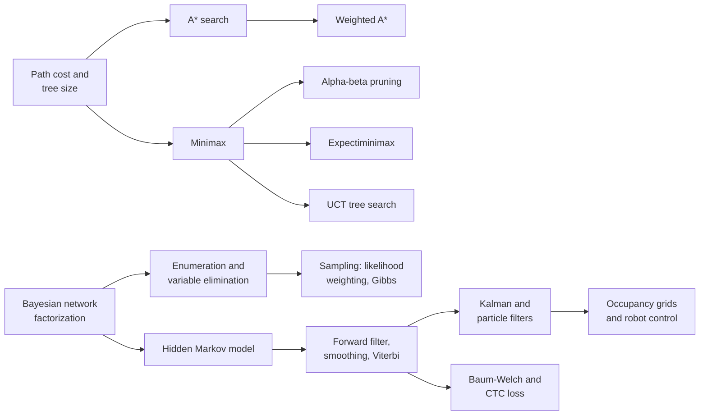
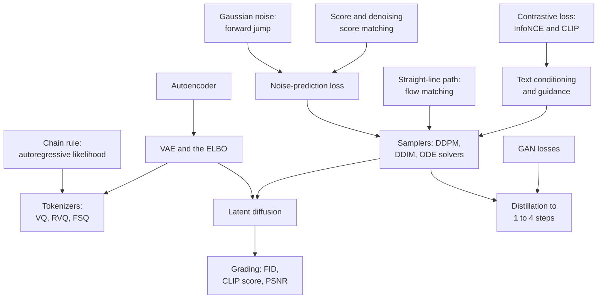

## Generative models and classical AI

This family holds two traditions that meet in the middle. Classical AI is the older one: equations for searching through possibilities (A*, minimax, Monte Carlo tree search), for reasoning with logic and with uncertainty (Bayesian networks, hidden Markov models, Kalman and particle filters), and for acting in the physical world (filters, kinematics and dynamics, PID, LQR and model predictive control). Decision theory and planning with a known model (expected utility, the value of information, value iteration, policy iteration and AlphaZero's PUCT rule) live in the reinforcement-learning section, which they share with learning by trial and error. Generative models are the newer one: the equations that let a network turn random numbers into images, audio and video (VAEs, GANs, normalizing flows, diffusion, flow matching), plus the contrastive losses such as CLIP that connect pictures to words and the scores used to grade generators. Between them sit the image and audio formulas (camera projection and multi-view geometry, optical flow, detection losses, image-quality scores, spectrograms, μ-law, the CTC and transducer losses) that every perception and generation system relies on. The two halves share more than it seems: the forward–backward dynamic program of hidden Markov models is the same machinery as the CTC loss of speech recognizers, the partition function of energy-based models is the normalizer in Bayesian networks and Markov random fields, Langevin sampling is a Markov chain Monte Carlo method, and the "mean plus spread times noise" of the reparameterization trick is the diffusion forward jump in disguise. The entries run from the simplest (adding up path costs) to the most involved (diffusion and flow samplers), so each one only needs those before it.

*Figure G.X: How the classical-AI equations build on each other: search and game trees at the top, probabilistic reasoning and filtering over time below.*

*Figure G.X: How the generative-model equations connect. Tokenizers feed autoregressive generators, VAEs feed latent diffusion, and every sampler runs on a network trained with the noise-prediction or flow-matching loss.*

### Path cost and search-tree size (uniform-cost search)

**What it does:** Adds up the cost of a route and counts how many possibilities a blind search must look at.

`g(n) = sum of step costs c(s, a, s') along the path to n`; when uniform-cost search expands n it updates each neighbor n' with `g(n') ← min(g(n'), g(n) + c(n, a, n'))`; `nodes to depth d = 1 + b + b^2 + ... + b^d = (b^(d+1) − 1) ÷ (b − 1)`; iterative deepening generates `d × b + (d − 1) × b^2 + ... + 1 × b^d` nodes; bidirectional search needs about `2 × b^(d/2)`

- **n**: a search node, meaning a state plus the path that reached it; **n'**: a neighbor of n
- **g(n)**: the total cost already paid to reach n
- **c(s, a, s')**: the cost of taking action a in state s and landing in state s'
- **←**: "is replaced by"; **min**: the smaller of the two
- **b**: the branching factor, the average number of next moves from each state
- **d**: the depth (number of steps) of the shallowest goal

**In plain words:** The cost of a route is just the sum of its steps, and uniform-cost search (Dijkstra's algorithm) always extends the cheapest route found so far, lowering a neighbor's cost whenever it finds a cheaper way in (this update is called relaxation). The tree-size formula shows the problem: each extra level multiplies the work by b, so the count grows like b^d. Most of the nodes sit in the deepest level, which is why iterative deepening, which re-searches the shallow levels again and again, costs only a little more than one breadth-first pass.

**Tiny example:** A route with steps costing 2, 3 and 1 has g = 2 + 3 + 1 = 6. If a neighbor was already reached for 9 and a step from here costs 2, its cost drops to min(9, 6 + 2) = 8. A tree with b = 3 down to depth d = 4 has (3^5 − 1) ÷ (3 − 1) = (243 − 1) ÷ 2 = 121 nodes. With b = 10 and d = 5, iterative deepening generates 5 × 10 + 4 × 100 + 3 × 1,000 + 2 × 10,000 + 1 × 100,000 = 123,450 nodes, against 10 + 100 + 1,000 + 10,000 + 100,000 = 111,110 for one breadth-first pass: only about 11% more. Bidirectional search with b = 10 and d = 6 meets in the middle after about 2 × 10^3 = 2,000 nodes instead of 10^6.

**Where it is used:** Route planning, puzzle solving, game AI and robot grid planning; the b^d growth is the "combinatorial explosion" that sank early search-only AI, and it is why robot arms need sampling planners (100 settings for each of 7 joints is 100^7 = 10^14 cells).
**In the book:** Chapter 48 (Blind search: breadth-first and depth-first), which works the same bidirectional example; Chapter 7 (Combinatorial explosion and the Lighthill report (1973)); the general formulas are only here.

### A* evaluation function (and greedy best-first search)

**What it does:** Scores each place a search could explore next by cost so far plus estimated cost remaining.

`f(n) = g(n) + h(n)`; expand the frontier node with the smallest f; greedy best-first search uses `f(n) = h(n)`

- **n**: a node (a place or state) on the search frontier
- **g(n)**: the cost already paid to reach n
- **h(n)**: the heuristic, a guess of the cheapest remaining cost from n to a goal
- **f(n)**: the estimated cost of the best complete solution passing through n

**In plain words:** A* combines what it knows (the distance already traveled) with a good guess (the distance left). If the guess never overestimates, the first route A* completes is a shortest one. Dropping g gives greedy best-first search, which is fast but can be lured into dead ends.

**Tiny example:** Chapter 48's grid: the square to the right of the start has g = 1 and Manhattan distance h = 0 + 6 = 6, so f = 1 + 6 = 7; the squares above and below have f = 1 + 8 = 9, so A* goes right first.

**Where it is used:** Game pathfinding, map routing, robot navigation on grids, puzzle solvers and heuristic-search planners such as Fast Downward and LAMA.
**In the book:** Chapter 48 (A*: search with a sense of direction), with Table 48.2 and the full grid walk-through.

### Admissible and consistent heuristics, and the effective branching factor

**What it does:** States when a heuristic guarantees that A* finds the best answer, and measures how much a heuristic helps.

admissible: `h(n) ≤ h*(n)` for every n; consistent: `h(n) ≤ c(n, a, n') + h(n')` and `h(goal) = 0`; Manhattan distance `|x1 − x2| + |y1 − y2|`; straight-line distance `sqrt((x1 − x2)^2 + (y1 − y2)^2)`; `max(h1, h2)` of admissible heuristics is admissible; effective branching factor b* solves `N + 1 = 1 + b* + (b*)^2 + ... + (b*)^d`

- **h(n)**: the heuristic estimate at node n
- **h*(n)**: the true cheapest remaining cost from n
- **c(n, a, n')**: the cost of the step from n to its neighbor n' by action a
- **x1, y1, x2, y2**: grid or map coordinates of two points; |·| means "size without sign"
- **h1, h2**: two different heuristics
- **N**: the number of nodes A* generated to find a solution
- **d**: the depth of that solution
- **b***: the effective branching factor, the branching factor a uniform tree would need to contain N + 1 nodes at depth d

**In plain words:** Admissible means the guess is never pessimistic: it never claims more cost remains than really does, so A* never wrongly skips the best route. Consistent is a stronger "triangle" rule: the guess at one square is never more than one step's cost plus the guess at the next square; it implies admissibility. Taking the larger of two admissible guesses is still admissible and usually better. A lower b* (closer to 1) means a sharper heuristic.

**Tiny example:** From (2, 0) to (2, 7) on a grid, Manhattan distance is 0 + 7 = 7. Consistency check across one step: 7 ≤ 1 + 6 holds. Straight-line distance from (0, 0) to (3, 4) is sqrt(9 + 16) = 5. If A* generates N = 52 nodes to find a solution at depth 5, b* solves 53 = 1 + b* + ... + (b*)^5, which gives b* ≈ 1.92.

**Where it is used:** Guaranteeing optimal A* in routing, games and planning; admissible heuristics come from relaxed problems and pattern databases.
**In the book:** Chapter 48 (A*: search with a sense of direction) covers admissibility and Manhattan distance; consistency, the max rule and b* are only here.

> **Definition — Consistent heuristic:** A heuristic whose estimate at any state is never more than the cost of one step plus its estimate at the next state, and is zero at the goal. Consistency implies admissibility and lets A* expand each state at most once.

> **Definition — Effective branching factor:** The branching factor a perfectly uniform search tree would need in order to contain as many nodes as a search actually generated; values near 1 mean the heuristic is guiding the search well.

### Weighted A* (bounded-suboptimal search)

**What it does:** Trusts the heuristic more to search faster, with a guaranteed limit on how much worse the answer can be.

`f(n) = g(n) + W × h(n)`, with `W > 1`; solution cost `≤ W × C*` when h is admissible

- **g(n)**, **h(n)**: cost so far and heuristic, as in A*
- **W**: the weight on the heuristic, often 1.5 to 5
- **C***: the cost of the optimal solution

**In plain words:** Multiplying the guess makes the search lean harder toward the goal, so it examines far fewer squares, and the path it returns costs at most W times the best. As W grows very large it becomes greedy best-first search.

**Tiny example:** With W = 2, the square right of the start in Chapter 48 scores 1 + 2 × 6 = 13. If the best path costs 9, weighted A* with W = 2 returns a path of cost at most 2 × 9 = 18, and usually much closer to 9.

**Where it is used:** Game AI and robot planners that need fast answers, anytime repairing A* (ARA*) in motion planning, and the LAMA planner.
**In the book:** Chapter 48 (A*: search with a sense of direction), which uses g + 2 × h.

### Simulated annealing acceptance rule

**What it does:** Decides whether a local search should accept a move that makes things worse.

`ΔE = value(next) − value(current)`; if `ΔE > 0` accept; otherwise accept with probability `exp(ΔE ÷ T)`; cool over time, for example `T_k = T_0 × r^k`

- **value(·)**: the score being maximized (for a cost to minimize, use `exp(−Δcost ÷ T)`)
- **ΔE**: the change in score caused by the move (negative means worse)
- **T**: the temperature; high T accepts many bad moves, low T almost none
- **T_0**: the starting temperature
- **r**: the cooling rate, such as 0.95
- **k**: the iteration number

**In plain words:** Good moves are always taken. Bad moves are sometimes taken, more often when the temperature is high and when the move is only slightly bad. Early on this lets the search walk down off a small hill to find a taller one; as T cools it settles into plain hill climbing. It is the Metropolis rule from statistical physics.

**Tiny example:** Chapter 48's trail: stepping from 7 down to 6 gives ΔE = −1. At T = 2 the move is accepted with probability exp(−1 ÷ 2) ≈ 0.61; at T = 0.5, exp(−2) ≈ 0.14. Starting at T_0 = 10 with r = 0.95, after k = 10 rounds T = 10 × 0.95^10 ≈ 5.99.

**Where it is used:** Chip placement and routing since the 1980s, scheduling, combinatorial optimization and hyperparameter search.
**In the book:** Chapter 48 (Local search: improving one solution at a time) in words; the formula is only here.

### Genetic algorithm selection, crossover and mutation

**What it does:** Breeds better candidate solutions by fitness-weighted selection, mixing and random change.

`P(select i) = f_i ÷ sum over j of f_j`; one-point crossover `child = parent1[1..c] + parent2[c+1..n]`; mutation flips each gene independently with probability `p_m` (often `1 ÷ n`)

- **f_i**: the fitness score of individual i
- **sum over j of f_j**: the total fitness of the population
- **c**: a random cut point
- **n**: the genome length (number of genes)
- **p_m**: the mutation probability per gene

**In plain words:** Fitter candidates get bigger slices of a roulette wheel, children take the front of one parent and the back of another, and occasional random flips add new variety. Repeating this for many generations drifts the population toward high fitness.

**Tiny example:** From Chapter 54: fitness 17 out of a total of 48 gives a selection chance of 17 ÷ 48 ≈ 0.35. Crossing 01011 with 10110 after the second bit gives 01|110 = 01110. With n = 5 and p_m = 1 ÷ 5 = 0.2, a child gets on average 5 × 0.2 = 1 flipped bit.

**Where it is used:** Design optimization (NASA's evolved antenna, 2006), neural architecture search, evolution strategies such as CMA-ES; DeepMind's FunSearch (2023) and AlphaEvolve (2025) evolve programs with a language model as the mutation operator.
**In the book:** Chapter 54 (One generation, worked by hand), with Exercises 5 and 6.

### Minimax value of a game tree

**What it does:** Computes the best guaranteed outcome in a two-player game where the opponent plays perfectly.

`MINIMAX(s) = UTILITY(s)` if s is terminal; `max over a of MINIMAX(RESULT(s, a))` if MAX moves; `min over a of MINIMAX(RESULT(s, a))` if MIN moves; a depth-limited search uses `EVAL(s)` at the cutoff

- **s**: a game state
- **a**: a legal move (action)
- **RESULT(s, a)**: the state after playing a in s
- **UTILITY(s)**: the final score of a finished game from MAX's point of view (for example +1 win, 0 draw, −1 loss)
- **EVAL(s)**: an estimate of the score of an unfinished position
- **MAX**, **MIN**: the two players, who alternate

**In plain words:** Work backward from the end of the game. At your turn take the best child; at the opponent's turn assume they take the child that is worst for you. A full search costs about b^m positions for branching factor b and depth m, so real programs cut off early and estimate.

**Tiny example:** MAX chooses among three moves; MIN then picks a leaf. Move A leads to leaves 3, 12, 8, so MIN gives min = 3; move B to 2, 4, 6, giving 2; move C to 14, 5, 2, giving 2. MAX takes max(3, 2, 2) = 3, so move A is best.

**Where it is used:** Chess and checkers engines and classic game AI (zero-sum game theory itself is in the reinforcement-learning section).
**In the book:** Chapter 48 (Minimax, worked by hand), with a tic-tac-toe tree in Figure 48.3.

### Alpha–beta pruning bounds

**What it does:** Skips branches that cannot change the minimax decision.

keep `α` = best value MAX can already guarantee and `β` = best value MIN can already guarantee (start `α = −∞`, `β = +∞`); at a MAX node `α = max(α, child value)`; at a MIN node `β = min(β, child value)`; stop searching a node's remaining children once `α ≥ β`; nodes examined: best case about `b^(m/2)`, random order about `b^(3m/4)`

- **α** (alpha): the best score MAX is already sure of on the current path
- **β** (beta): the best (lowest) score MIN is already sure of on the current path
- **∞**: infinity, used as a starting value
- **b**: branching factor; **m**: search depth

**In plain words:** Once MIN has found a reply that is worse for MAX than something MAX already has elsewhere, MAX will never go down this branch, so its other replies need not be examined. The answer at the root is exactly the minimax value; only work is saved. With good move ordering the same time searches about twice as deep.

**Tiny example:** In the minimax tree above, after move A, α = 3. Under move B the first leaf is 2, so β = 2; now α = 3 ≥ β = 2 and the leaves 4 and 6 are skipped. Move C must be searched fully (14, 5, then 2). Two of nine leaves are pruned and the answer is still 3. With b = 10 and m = 6, perfect ordering needs about 10^3 positions instead of 10^6.

**Where it is used:** Deep Blue (1997), Chinook checkers and Stockfish (alpha–beta search with an NNUE neural evaluation), together with iterative deepening and transposition tables.
**In the book:** Chapter 48 (Alpha-beta pruning and evaluation functions) shows a cut in words; the α and β bookkeeping is only here.

### Weighted linear evaluation function

**What it does:** Scores an unfinished game position as a weighted sum of features.

`EVAL(s) = w_1 × f_1(s) + w_2 × f_2(s) + ... + w_n × f_n(s)`

- **s**: a game position
- **f_i(s)**: feature i of the position, such as material balance, mobility or king safety
- **w_i**: the weight saying how much feature i matters
- **n**: the number of features

**In plain words:** When the search must stop before the game ends, it needs a number for "how good is this position". The classic answer adds up features with weights, such as the chess material values pawn 1, knight 3, bishop 3, rook 5, queen 9. Samuel's checkers program (1959) learned the weights; TD-Gammon and AlphaZero replaced the whole sum with a neural network.

**Tiny example:** White is a knight up (material difference +3) but has 5 fewer legal moves (mobility difference −5). With weights 1.0 and 0.1: EVAL = 1.0 × 3 + 0.1 × (−5) = 3 − 0.5 = 2.5 in White's favor.

**Where it is used:** Depth-limited game search; Stockfish's NNUE network is its learned successor.
**In the book:** Chapter 48 (Alpha-beta pruning and evaluation functions) in words; the weighted sum is only here.

### Expectiminimax (games with chance)

**What it does:** Extends minimax to games with dice or cards by averaging over chance outcomes.

chance node: `value(s) = sum over outcomes r of P(r) × value(RESULT(s, r))`; MAX and MIN nodes as in minimax

- **s**: a state where chance moves next
- **r**: one chance outcome, such as a dice roll
- **P(r)**: its probability
- **RESULT(s, r)**: the state after that outcome

**In plain words:** Between the players' turns sits a layer of chance, where the value is the probability-weighted average of what follows. Because averages are taken, the scale of the evaluation function matters, not just its ordering.

**Tiny example:** Move A leads to a coin flip worth 4 or −2: value 0.5 × 4 + 0.5 × (−2) = 1. Move B leads to 1 with probability 0.9 and 0 with 0.1: value 0.9 × 1 + 0.1 × 0 = 0.9. MAX picks A, since 1 > 0.9.

**Where it is used:** Backgammon programs (TD-Gammon searched shallow expectiminimax trees) and other card and dice games.
**In the book:** Chapter 48 (Games with dice: chance nodes), worked with dice probabilities 1/36 and 11/36.

### UCT selection rule for Monte Carlo tree search

**What it does:** Chooses which move to explore next in Monte Carlo tree search, balancing proven moves against untried ones.

`UCT(n) = U(n) ÷ N(n) + C × sqrt(ln(N(parent(n))) ÷ N(n))`; select the child with the largest UCT; after a playout with result r, back up along the path: `N(n) ← N(n) + 1` and `U(n) ← U(n) + r` for every node n on it

- **n**: a child node (a move) in the search tree
- **U(n)**: the total reward (for example wins) from playouts through n
- **N(n)**: the number of playouts through n
- **N(parent(n))**: the number of playouts through n's parent
- **C**: an exploration constant (sqrt(2) in theory, tuned in practice)
- **r**: the playout's result (1 for a win, 0 for a loss, judged from the point of view of the player choosing at that node)

**In plain words:** The first term is the win rate, which favors moves that have done well. The second is an exploration bonus that grows for moves tried only a few times. Each round of MCTS selects down the tree with this rule, expands a new node, plays a random game to the end and passes the result back up by adding to the counts.

**Tiny example:** Chapter 48: after 12 playouts, ln(12) ≈ 2.48. Move A (win rate 0.6, 10 visits) scores 0.6 + 1.4 × sqrt(2.48 ÷ 10) ≈ 1.30; move B (win rate 0.5, 2 visits) scores 0.5 + 1.4 × sqrt(2.48 ÷ 2) ≈ 2.06, so B is explored next. If that playout is a win, B goes from 1 win in 2 to 2 wins in 3 (win rate 0.67).

**Where it is used:** Computer Go before AlphaGo (MoGo, Crazy Stone), general game playing and planning under uncertainty; it applies the UCB1 bandit formula (in the reinforcement-learning section) at every node. Its neural-network-guided successor, PUCT, and the AlphaZero training loss are also in the reinforcement-learning section.
**In the book:** Chapter 48 (Monte Carlo tree search).

### Constraint satisfaction problem (definition and counts)

**What it does:** Defines a puzzle of variables, allowed values and rules, and counts how hard brute force would be.

`CSP = (X, D, C)`; a solution gives every `X_i` a value from `D_i` that satisfies every constraint; brute-force search space `d^n`; `X_i` is arc-consistent with `X_j` if every value in `D_i` has some value in `D_j` that satisfies their constraint (AC-3 runs in about `c × d^3` steps)

- **X = {X_1, ..., X_n}**: the variables (for example, meeting times)
- **D_i**: the domain, the allowed values of X_i
- **C**: the constraints (rules such as "these two meetings differ")
- **n**: the number of variables; **d**: the domain size; **c**: the number of two-variable constraints

**In plain words:** Many scheduling and puzzle problems are just "pick a value for each variable without breaking any rule". Trying every combination costs d^n, so solvers prune: arc consistency deletes values that have no compatible partner, and heuristics such as "fill the most constrained variable first" order the search.

**Tiny example:** Four variables with domains of size 3 have 3^4 = 81 combinations. If X has domain {1} and Y has {1, 2} with the rule X ≠ Y, arc consistency deletes 1 from Y's domain, leaving {2}. Chapter 48's four meetings shrink brute force to 3 × 3 × 3 × 1 = 27.

**Where it is used:** Scheduling, timetabling, product configuration, Sudoku and SAT-based hardware verification; grammar-constrained decoding of LLM output applies the same idea to tokens.
**In the book:** Chapter 48 (Constraint satisfaction: puzzles, timetables and schedules).

### Truth tables, entailment and model checking

**What it does:** Defines the logical connectives and tests whether facts logically force a conclusion by checking every possible world.

`¬A` is true iff A is false; `A ∧ B` iff both are true; `A ∨ B` iff at least one is true; `A ⇒ B ≡ ¬A ∨ B`; `A ⇔ B ≡ (A ⇒ B) ∧ (B ⇒ A)`; De Morgan `¬(A ∧ B) ≡ ¬A ∨ ¬B`; n symbols give `2^n` rows; `KB ⊨ α` iff α is true in every row where KB is true

- **A**, **B**: propositions (statements that are true or false)
- **¬**: not; **∧**: and; **∨**: or; **⇒**: implies; **⇔**: if and only if
- **≡**: "is logically equivalent to"; **iff**: if and only if
- **n**: the number of proposition symbols
- **KB**: the knowledge base (the facts you believe); **α** (alpha): the sentence being tested
- **⊨**: "entails" (logically forces)

**In plain words:** Each row of a truth table is one possible world. A conclusion follows from your facts if it is true in every world where all your facts are true. Checking all 2^n rows is model checking; SAT solvers avoid most of them.

**Tiny example:** With 3 symbols there are 2^3 = 8 rows. If A is true and B is false, A ⇒ B is false, and so is ¬A ∨ B = false ∨ false = false, confirming the equivalence. De Morgan: with A true and B false, ¬(A ∧ B) = ¬false = true and ¬A ∨ ¬B = false ∨ true = true.

**Where it is used:** SAT and SMT solvers for chip and software verification, planning as satisfiability, package-dependency solving and rule engines.
**In the book:** Chapter 54 (Logic: the mathematics underneath the rules), which checks 2 × 2 × 2 = 8 situations by brute force.

> **Definition — Model checking:** Deciding whether a conclusion follows from a set of facts by listing every possible assignment of true and false (every "model") and checking that the conclusion holds in all of those where the facts hold.

### Resolution and modus ponens

**What it does:** Gives mechanical rules that derive new true sentences from old ones, and a way to prove a conclusion by contradiction.

resolution: from `(A ∨ B)` and `(¬B ∨ C)` infer `(A ∨ C)`; modus ponens: from `A` and `A ⇒ B` infer `B`; refutation: `KB ⊨ α` iff `KB ∧ ¬α` resolves to the empty clause

- **A**, **B**, **C**: propositions; ¬, ∨, ∧, ⇒ as in the truth-table entry
- **clause**: an OR of literals (symbols or their negations)
- **KB**, **α**, **⊨**: knowledge base, query and entailment, as above
- **empty clause**: a clause with nothing left in it, which can never be true, so reaching it means a contradiction

**In plain words:** Resolution cancels a symbol that appears plain in one clause and negated in another and keeps everything else. To prove α, add "not α" to your facts and resolve; if you reach the empty clause, "not α" was impossible, so α must follow. Every formula can be rewritten as an AND of clauses (conjunctive normal form), so this one rule suffices.

**Tiny example:** Facts: (A ∨ B) and ¬B. Query: A. Add ¬A. Resolve (A ∨ B) with ¬B to get A; resolve A with ¬A to get the empty clause. So the facts entail A. Modus ponens: from "alarm" and "alarm ⇒ locked", infer "locked" (Chapter 54's alarm example, which reaches the same conclusion by resolution).

**Where it is used:** Automated theorem provers (Vampire, E), Prolog's resolution, clause learning in CDCL SAT solvers, expert-system inference engines and Datalog.
**In the book:** Chapter 54 (Logic: the mathematics underneath the rules; A tiny expert system, worked by hand); refutation is only here.

> **Definition — Modus ponens:** The inference rule "from A, and from 'if A then B', conclude B." Forward chaining in rule engines applies it over and over.

> **Definition — Conjunctive normal form (CNF):** A way of writing any logical formula as an AND of clauses, where each clause is an OR of simple statements or their negations. SAT solvers and resolution provers require their input in this form.

### First-order logic: quantifiers, unification and generalized modus ponens

**What it does:** Lets logic talk about objects and "all" or "some", and finds the variable bindings that make a rule apply.

`∀x P(x)` is true iff P holds for every object; `∃x P(x)` iff for at least one; `¬∀x P(x) ≡ ∃x ¬P(x)`; `UNIFY(p, q) = θ` such that `SUBST(θ, p) = SUBST(θ, q)`; generalized modus ponens: from `p1', ..., pn'` and `(p1 ∧ ... ∧ pn ⇒ q)` infer `SUBST(θ, q)`, where `SUBST(θ, pi') = SUBST(θ, pi)` for every i

- **∀**: "for all"; **∃**: "there exists"
- **x**: a variable standing for any object
- **P**: a predicate (a property or relation, such as OwnsCar)
- **p**, **q**, **pi**, **pi'**: logical sentences
- **θ** (theta): a substitution, a list of variable bindings such as {x/Maria}
- **SUBST(θ, p)**: p with the bindings of θ filled in
- **UNIFY**: the procedure that finds θ

**In plain words:** Rules in first-order logic contain variables, so applying one means finding values for its variables that match the facts. Unification finds that match, and generalized modus ponens then fires the rule with those values.

**Tiny example:** Rule: OwnsCar(x) ⇒ NeedsInsurance(x). Fact: OwnsCar(Maria). Unifying OwnsCar(x) with OwnsCar(Maria) gives θ = {x/Maria}, so SUBST(θ, NeedsInsurance(x)) = NeedsInsurance(Maria).

**Where it is used:** Prolog, knowledge representation and ontologies (description logics, OWL), knowledge-graph rule engines and interactive theorem proving.
**In the book:** Chapter 54 (Logic: the mathematics underneath the rules), with the Maria insurance example, in words.

### STRIPS and PDDL action model (classical planning)

**What it does:** Defines when an action can be used and how it changes the world, so a planner can search for a plan.

action a is applicable in state s iff `PRECOND(a) ⊆ s`; `RESULT(s, a) = (s − DEL(a)) ∪ ADD(a)`; a plan is a sequence of actions from the initial state to a state satisfying the goal

- **s**: a state, written as the set of facts currently true
- **a**: an action
- **PRECOND(a)**: the facts a needs before it can run
- **ADD(a)**: the facts a makes true; **DEL(a)**: the facts a makes false
- **⊆**: "is contained in"; **−**: remove these facts; **∪**: add these facts

**In plain words:** A state is a list of true facts. An action can run when all its preconditions are on the list, and running it crosses some facts off and writes new ones on. Planners search over these lists; their heuristics come from relaxed versions that ignore the crossing-off.

**Tiny example:** State s = {kettle empty, have teabag}. Action Fill: PRECOND = {kettle empty}, DEL = {kettle empty}, ADD = {kettle has water}. Since {kettle empty} ⊆ s, Fill applies, and RESULT = ({kettle empty, have teabag} − {kettle empty}) ∪ {kettle has water} = {have teabag, kettle has water}.

**Where it is used:** Shakey (1972), PDDL planners such as Fast Downward and LAMA, space-mission and logistics planning, and systems in which an LLM translates goals into PDDL for a classical planner.
**In the book:** Chapter 48 (Planning with actions: from Shakey to PDDL), with the tea plan of Table 48.3; the set formula is only here.

### Fuzzy membership, fuzzy operators and defuzzification

**What it does:** Lets statements be partly true and turns partly-true rules into one crisp output.

ramp membership `μ_A(x) = max(0, min(1, (x − a) ÷ (b − a)))`; `μ_(A AND B) = min(μ_A, μ_B)`; `μ_(A OR B) = max(μ_A, μ_B)`; `μ_(NOT A) = 1 − μ_A`; output `= (sum over rules r of μ_r × y_r) ÷ (sum over rules r of μ_r)`

- **x**: an input value, such as a temperature
- **μ_A(x)** (mu): how strongly x belongs to the vague category A, from 0 to 1
- **a**, **b**: where the ramp starts and ends
- **μ_r**: how strongly rule r fires
- **y_r**: the output rule r asks for, such as a fan speed

**In plain words:** "Warm" and "hot" are matters of degree. AND takes the smaller degree, OR the larger, NOT the remainder, and the final command is a weighted average of what each rule wants. These degrees are not probabilities.

**Tiny example:** Chapter 54's fan at 27 °C: warm = 0.2 and hot = 0.5. Then warm AND hot = min(0.2, 0.5) = 0.2, warm OR hot = 0.5, NOT warm = 0.8. Rules "warm → 40%" and "hot → 100%" give (0.2 × 40 + 0.5 × 100) ÷ (0.2 + 0.5) = 58 ÷ 0.7 ≈ 83% fan speed.

**Where it is used:** Appliance and vehicle control, such as the Sendai subway (1987), washing machines, rice cookers, camera autofocus and industrial controllers.
**In the book:** Chapter 54 (Fuzzy logic: degrees of truth), with the worked fan; the min, max and 1 − μ operators are only here.

> **Definition — Defuzzification:** The last step of a fuzzy controller, which combines several partly-true rules into one crisp output number, usually by a weighted average of what each rule asks for.

### Utility of money, certainty equivalent and multiattribute utility

**What it does:** Describes risk attitude with a curved utility and combines several criteria into one score.

risk aversion: `U(E[X]) > E[U(X)]` for a concave U (such as `U(w) = ln(w)`); certainty equivalent CE solves `U(CE) = E[U(X)]`; `risk premium = E[X] − CE`; additive `U(x_1, ..., x_n) = sum over i of w_i × u_i(x_i)`

- **X**: an uncertain amount of money; **E[X]**: its average
- **U**: the utility function; **w**: wealth
- **concave**: curving downward, so each extra dollar adds less utility
- **CE**: the sure amount you value exactly as much as the gamble
- **x_i**: the level of attribute i (price, speed, safety); **u_i**: its own utility; **w_i**: its weight

**In plain words:** Expected utility, the probability-weighted average of utilities (its entry, with the value of information, is in the reinforcement-learning section), depends on the shape of the utility curve. If utility curves downward, a gamble is worth less to you than its average, and the gap is the risk premium, which is what insurance sells. When a choice has several attributes that do not interact, a weighted sum of per-attribute utilities ranks the options.

**Tiny example:** With U(w) = ln(w), a 50/50 gamble between $1,000 and $3,000 has E[X] = $2,000 but E[U] = 0.5 × ln(1,000) + 0.5 × ln(3,000) = 0.5 × 6.908 + 0.5 × 8.006 = 7.457, so CE = exp(7.457) ≈ $1,732 and the risk premium is about $268. Two attributes with weights 0.6 and 0.4 and utilities 0.8 and 0.5 give 0.6 × 0.8 + 0.4 × 0.5 = 0.68.

**Where it is used:** Decision support, preference elicitation, and multi-objective agent and reward design.
**In the book:** Chapter 48 (Deciding when you are not sure: expected utility) describes risk aversion in words; the formulas are only here.

> **Definition — Certainty equivalent:** The sure amount a person values exactly as much as a given gamble. For a risk-averse person it is below the gamble's average, and the difference is the risk premium.

### Bayesian network joint factorization

**What it does:** Writes the probability of a whole situation as a product of small local tables.

`P(x_1, ..., x_n) = product over i of P(x_i | parents(X_i))`; numbers needed `= sum over i of (k_i − 1) × (product of its parents' sizes)`, versus `(product of all k_i) − 1` for the full joint table

- **X_i**: the i-th variable; **x_i**: a value it takes
- **parents(X_i)**: the variables with arrows into X_i (its direct causes)
- **P(x_i | parents(X_i))**: an entry of X_i's conditional probability table
- **k_i**: how many values X_i can take
- **n**: the number of variables

**In plain words:** Once you know a variable's direct causes, nothing else upstream matters, so the giant table of every combination factors into one small table per variable. The saving grows exponentially with the number of variables.

**Tiny example:** Chapter 54's network: P(rain, sprinkler, wet) = P(rain) × P(sprinkler) × P(wet | rain, sprinkler) = 0.2 × 0.3 × 0.99 = 0.0594. It needs 1 + 1 + 4 = 6 numbers instead of 2^3 − 1 = 7.

**Where it is used:** Medical diagnosis (Pathfinder), troubleshooting wizards, risk and reliability models and causal modeling; naive Bayes (in the classical-ML section) is the simplest case.
**In the book:** Chapter 54 (A Bayesian network, worked by hand).

### Inference by enumeration (normalization constant α)

**What it does:** Answers a question about one variable given evidence by summing the joint probability over everything unobserved.

`P(X | e) = α × P(X, e) = α × sum over y of P(X, e, y)`, with `α = 1 ÷ P(e)`

- **X**: the query variable
- **e**: the observed evidence
- **y**: every combination of the hidden (unobserved, unasked) variables
- **α** (alpha): the normalizing constant that makes the answers add to 1

**In plain words:** Compute the joint probability of each answer together with the evidence, summing over everything you do not know, then rescale so the answers add to 1. Explaining away falls out automatically. Exact inference is NP-hard in general, which motivates the faster methods below.

**Tiny example:** P(rain, wet) = 0.0594 + 0.126 = 0.1854 and P(no rain, wet) = 0.192 + 0.028 = 0.22, summing over the sprinkler. α = 1 ÷ (0.1854 + 0.22) = 1 ÷ 0.4054, so P(rain | wet) = 0.1854 ÷ 0.4054 ≈ 0.46.

**Where it is used:** Exact queries on small Bayesian networks, and the reference answer every faster algorithm must match.
**In the book:** Chapter 54 (A Bayesian network, worked by hand), as 185.4 ÷ 405.4 ≈ 0.46 in natural frequencies.

### Noisy-OR conditional distribution

**What it does:** Builds the probability of an effect with many possible causes from one number per cause.

`P(no effect | present causes T) = product over j in T of q_j`; `P(effect | T) = 1 − product over j in T of q_j` (with a leak cause, also multiply by `q_0`)

- **T**: the set of causes that are present
- **q_j**: the probability that cause j, acting alone, fails to produce the effect
- **q_0**: the leak term, the chance that all the causes the model does not list fail to produce the effect (so 1 − q_0 is the chance of the effect when no listed cause is present)

**In plain words:** Each present cause independently gets a chance to trigger the effect; the effect is missing only if every cause fails. k causes need k numbers instead of a 2^k-row table.

**Tiny example:** Appendix F's fever: two causes with failure chances 0.6 and 0.2 give no fever with probability 0.6 × 0.2 = 0.12, so fever 0.88. With a leak q_0 = 0.95: 0.12 × 0.95 = 0.114, so fever 0.886.

**Where it is used:** Large diagnostic networks such as the QMR-DT medical network, and fault diagnosis.
**In the book:** Appendix F (Noisy-OR and continuous variables) works the leak-free case; the formula with the leak is only here.

### Variable elimination and belief propagation

**What it does:** Speeds up exact inference by summing out hidden variables one at a time instead of enumerating every combination.

factor product `f(X, Y, Z) = f_1(X, Y) × f_2(Y, Z)` (entry by entry); summing out `f'(X, Z) = sum over y of f(X, y, Z)`; `P(X | e) = α × (sum over hidden variables, one at a time, of the product of factors)`; sum-product message on a tree `m_(i→j)(x_j) = sum over x_i of φ_i(x_i) × ψ(x_i, x_j) × product over k ≠ j of m_(k→i)(x_i)`; belief `P(x_i | e) = α × φ_i(x_i) × product over all neighbors k of m_(k→i)(x_i)`

- **f, f_1, f_2**: factors, small tables over a few variables
- **X, Y, Z**: variables; **y**: a value of Y
- **α**: the normalizing constant
- **m_(i→j)**: the message node i sends to its neighbor j, a table over x_j
- **φ_i(x_i)** (phi): node i's own table, which holds its evidence (all 1s if it has none)
- **ψ(x_i, x_j)** (psi): the compatibility table linking i and j
- **k**: the other neighbors of i

**In plain words:** Pushing each sum inside the product means shared pieces are computed once and reused. The cost depends on the largest table created along the way, not on the total number of combinations. Belief propagation passes the same partial sums between neighbors as messages; the HMM forward algorithm is a special case.

**Tiny example:** P(wet) in the sprinkler network. Sum out the sprinkler first: f(rain) = 0.3 × 0.99 + 0.7 × 0.90 = 0.927; f(no rain) = 0.3 × 0.80 + 0.7 × 0.05 = 0.275. Then sum out rain: 0.2 × 0.927 + 0.8 × 0.275 = 0.1854 + 0.22 = 0.4054, the same total as enumeration.

**Where it is used:** Exact Bayesian-network engines and the junction-tree algorithm; belief-propagation decoding of LDPC error-correcting codes in Wi-Fi and 5G.
**In the book:** Only here.

> **Definition — Variable elimination:** An exact inference method for probabilistic graphical models that removes hidden variables one at a time by multiplying the tables that mention a variable and summing it out, reusing shared partial results.

> **Definition — Belief propagation:** An inference method in which nodes of a graphical model repeatedly send each other messages summarizing what they know; on tree-shaped graphs it gives exact probabilities, and on graphs with loops it is used as an approximation.

### Approximate inference by sampling (likelihood weighting and Gibbs sampling)

**What it does:** Estimates probabilities in big networks by generating weighted or wandering random samples.

rejection sampling: `P(x | e) ≈ (number of samples with X = x and E = e) ÷ (number of samples with E = e)`; likelihood weighting: sample non-evidence variables parent-first and weight each sample `w = product over evidence variables E_i of P(e_i | parents(E_i))`; estimate `P(x | e) ≈ (sum of w over samples with X = x) ÷ (sum of all w)`; Gibbs: resample `X_i` from `P(X_i | mb(X_i)) = α × P(x_i | parents(X_i)) × product over children Y_j of P(y_j | parents(Y_j))`

- **E_i**, **e_i**: an evidence variable and its observed value
- **w**: a sample's weight
- **X**, **x**: the query variable and one of its values
- **mb(X_i)**: X_i's Markov blanket (parents, children and the children's other parents)
- **Y_j**, **y_j**: the children of X_i and their current values
- **α**: a normalizing constant

**In plain words:** Rejection sampling simulates the network many times and throws away every sample that disagrees with the evidence, which wastes most samples when the evidence is rare. Likelihood weighting never throws samples away: it fixes the evidence and weights each sample by how well it explains it. Gibbs sampling is Markov chain Monte Carlo: it wanders from state to state, resampling one variable at a time given its Markov blanket, so that the long-run share of time in each state equals its probability. Its general form, Metropolis–Hastings, is in the foundations section.

**Tiny example:** Evidence: wet grass. Three samples (rain, no sprinkler), (no rain, sprinkler), (no rain, no sprinkler) get weights 0.90, 0.80 and 0.05, so P(rain | wet) ≈ 0.90 ÷ (0.90 + 0.80 + 0.05) ≈ 0.51 (a crude estimate of the exact 0.46 from just 3 samples). Gibbs step for rain given sprinkler on and grass wet: 0.2 × 0.99 = 0.198 versus 0.8 × 0.80 = 0.64, so P(rain) = 0.198 ÷ 0.838 ≈ 0.24.

**Where it is used:** Probabilistic programming (Stan, PyMC), Bayesian statistics, inference in large Bayesian networks and Markov random fields, and sampling energy-based models.
**In the book:** Chapter 54 (A Bayesian network, worked by hand) describes rejection sampling in words ("keep only the ones where the grass is wet") and defines MCMC; likelihood weighting and the Gibbs formula are only here.

> **Definition — Likelihood weighting:** A sampling method for Bayesian networks that fixes the evidence variables to their observed values, samples the rest, and weights each sample by how probable the evidence is under it, so no samples are wasted.

### Causal effect by back-door adjustment (the do-operator)

**What it does:** Computes what would happen if you set X yourself, from purely observational data, by averaging over confounders.

`P(y | do(x)) = sum over z of P(y | x, z) × P(z)`, where Z blocks every back-door path from X to Y

- **do(x)**: X is set by intervention, not merely observed
- **y**: an outcome value
- **Z**, **z**: the confounders (common causes) and their values
- **back-door path**: a non-causal route between X and Y that enters X through an arrow pointing into it

**In plain words:** Observed P(y | x) mixes the effect of x with whatever else differs between those who had x and those who did not. Adjusting means computing the effect within each confounder group and averaging with the groups' overall shares.

**Tiny example:** Chapter 54's worked confounder: 0.5 × 28% + 0.5 × 8% = 18% with the feature, versus 0.5 × 30% + 0.5 × 10% = 20% without it.

**Where it is used:** Causal Bayesian networks, uplift and policy evaluation in advertising and medicine, and debiasing observational data.
**In the book:** Chapter 54 (A worked confounder; Pearl's ladder of causation); the back-door criterion is only here.

> **Definition — Back-door criterion:** Judea Pearl's test for which variables to adjust for: a set of variables qualifies if controlling for it blocks every non-causal path from the cause to the effect without blocking the causal path itself.

### Markov random fields and conditional random fields

**What it does:** Defines probabilities over variables linked without arrows, by multiplying compatibility scores and normalizing.

`P(x) = (1 ÷ Z) × product over cliques c of ψ_c(x_c)`, `Z = sum over all x of product over c of ψ_c(x_c)`; CRF: `P(y | x) = (1 ÷ Z(x)) × exp(sum over k of w_k × f_k(y, x))`

- **x**: an assignment of all variables
- **c**: a clique, a group of variables that are all directly linked
- **x_c**: the values of the variables in clique c
- **ψ_c** (psi): a non-negative compatibility score for those values
- **Z**: the partition function (the normalizing total)
- **y**: output labels; **x** in the CRF: the observed input
- **f_k**: feature functions; **w_k**: their weights; **Z(x)**: the normalizer for input x

**In plain words:** Neighboring pixels tend to agree, so give agreeing pairs a high score and normalize. A conditional random field does the same for labels given an input, which suits tagging words or cleaning up segmentation maps. Writing ψ = exp(−energy) shows it is an energy-based model.

**Tiny example:** Two pixels, each light or dark, with ψ = 3 when they match and 1 when they differ: Z = 3 + 1 + 1 + 3 = 8, so P(they match) = (3 + 3) ÷ 8 = 0.75. CRF with score 2 for label A and 0 for label B: P(A | x) = e^2 ÷ (e^2 + e^0) = 7.389 ÷ 8.389 ≈ 0.88.

**Where it is used:** Image-segmentation smoothing (DeepLab's CRF post-processing, 2015-2017), CRF taggers for named entities, factor-graph SLAM and sensor fusion (GTSAM) and Ising-type models.
**In the book:** Chapter 54 (A Bayesian network, worked by hand) defines Markov random fields in words; the formulas and CRFs are only here.

> **Definition — Conditional random field (CRF):** A probabilistic model that scores whole sequences or grids of labels given an input, using weighted features of neighboring labels and the input, and normalizes over all possible labelings. It was the standard tool for tagging words and smoothing image segmentations.

### Hidden Markov model joint probability

**What it does:** Gives the probability of a hidden state sequence together with the observations it produced.

`P(x_0, ..., x_T, e_1, ..., e_T) = P(x_0) × product over t = 1..T of P(x_t | x_(t−1)) × P(e_t | x_t)`; transition `A_ij = P(x_t = j | x_(t−1) = i)`; emission `B_j(e) = P(e | x_t = j)`

- **x_t**: the hidden state at time t (raining or dry)
- **e_t**: the observation at time t (umbrella or not)
- **T**: the number of time steps
- **A_ij**: the probability of moving from state i to state j
- **B_j(e)**: the probability that state j produces observation e

**In plain words:** The hidden state changes step by step depending only on the previous state, and each observation depends only on the current state. Multiply the start probability, every transition and every emission to score one complete story.

**Tiny example:** Chapter 54's umbrella world: start 50/50, rain stays rain with 0.7, an umbrella appears on rainy days with 0.9. The story "rain on days 0, 1 and 2" with umbrellas on days 1 and 2 (day 0 has no observation) has probability 0.5 × 0.7 × 0.9 × 0.7 × 0.9 ≈ 0.198.

**Where it is used:** Speech recognition from the 1980s to the early 2010s, part-of-speech tagging, gene finding and profile HMMs in bioinformatics; Kalman and particle filters share the structure.
**In the book:** Chapter 54 (Reasoning over time: hidden states and filters) and Chapter 46 define HMMs; the product formula is only here.

### Bayes filter and the HMM forward algorithm (filtering)

**What it does:** Keeps an up-to-date probability of a hidden state by alternating predict and correct.

predict `P(x_(t+1) | e_(1:t)) = sum over x_t of P(x_(t+1) | x_t) × P(x_t | e_(1:t))`; update `P(x_(t+1) | e_(1:t+1)) = η × P(e_(t+1) | x_(t+1)) × P(x_(t+1) | e_(1:t))`; forward variable `α_t(j) = B_j(e_t) × sum over i of α_(t−1)(i) × A_ij`, `P(e_(1:T)) = sum over j of α_T(j)`

- **e_(1:t)**: all observations from time 1 to t
- **η** (eta): a normalizing constant that makes probabilities add to 1
- **α_t(j)**: the forward variable, the probability of the observations so far and being in state j now
- **A_ij**, **B_j**: transition and emission tables, as in the HMM entry
- **S**: the number of hidden states

**In plain words:** Predict how the hidden state has probably moved, then reweight by how well each state explains the new clue, and normalize. The forward variable is the same thing without normalizing, which also gives the probability of the whole observation sequence. The POMDP belief update in the reinforcement-learning section is this same recursion run after each action. Each step costs about S^2 for S states.

**Tiny example:** Umbrella on day 1: α_1(rain) = 0.9 × (0.5 × 0.7 + 0.5 × 0.3) = 0.45 and α_1(dry) = 0.2 × 0.5 = 0.10, so P(e_1) = 0.55 and P(rain) = 0.45 ÷ 0.55 ≈ 0.82. Day 2: α_2(rain) = 0.9 × (0.45 × 0.7 + 0.10 × 0.3) = 0.3105, α_2(dry) = 0.2 × (0.45 × 0.3 + 0.10 × 0.7) = 0.041, so P(rain) = 0.3105 ÷ 0.3515 ≈ 0.88, matching Chapter 54.

**Where it is used:** Robot localization and tracking, HMM speech decoding and belief tracking in POMDP planners and dialogue systems.
**In the book:** Chapter 54 (Reasoning over time: hidden states and filters), with the umbrella filter; the forward-variable notation is only here.

> **Definition — Forward algorithm:** The dynamic program for hidden Markov models that sweeps forward through time, combining the previous step's probabilities with the transition and emission tables, to get the probability of the observations so far and of each current hidden state.

### Forward–backward smoothing

**What it does:** Revises the probability of a past hidden state using evidence that arrived later.

`β_t(i) = sum over j of A_ij × B_j(e_(t+1)) × β_(t+1)(j)`, with `β_T(i) = 1`; `γ_t(i) = P(x_t = i | e_(1:T)) = α_t(i) × β_t(i) ÷ P(e_(1:T))`

- **β_t(i)** (beta): the backward variable, the probability of all later observations given state i at time t
- **α_t(i)**: the forward variable from the filtering entry
- **γ_t(i)** (gamma): the smoothed probability of state i at time t given all the evidence
- **A_ij**, **B_j**, **e**, **T**: as in the HMM entry

**In plain words:** The forward pass carries evidence from the past, a backward pass carries evidence from the future, and multiplying the two gives the best estimate of each past moment. It costs about T × S^2.

**Tiny example:** Umbrellas on days 1 and 2. Backward from day 2: β_1(rain) = 0.7 × 0.9 + 0.3 × 0.2 = 0.69 and β_1(dry) = 0.3 × 0.9 + 0.7 × 0.2 = 0.41. Then γ_1(rain) = 0.45 × 0.69 ÷ (0.45 × 0.69 + 0.10 × 0.41) = 0.3105 ÷ 0.3515 ≈ 0.88, up from the filtered 0.82 because day 2's umbrella makes a wet day 1 more likely.

**Where it is used:** Offline tracking and annotation, Baum–Welch training, gene annotation, and the same dynamic program as the CTC loss of speech recognizers.
**In the book:** Chapter 54 (Reasoning over time: hidden states and filters) in one sentence; the formulas are only here.

> **Definition — Forward–backward algorithm:** The method for hidden Markov models that combines a forward pass (evidence up to each moment) with a backward pass (evidence after it) to give the probability of every hidden state at every time, given the whole sequence.

### Viterbi algorithm (most likely hidden-state sequence)

**What it does:** Finds the single most probable sequence of hidden states.

start `δ_1(j) = P(x_1 = j) × B_j(e_1)`; then `δ_t(j) = B_j(e_t) × max over i of (δ_(t−1)(i) × A_ij)`; backpointer `ψ_t(j) = argmax over i of (δ_(t−1)(i) × A_ij)`; end at `argmax over j of δ_T(j)` and follow the backpointers; log form `ln δ_t(j) = ln B_j(e_t) + max over i of (ln δ_(t−1)(i) + ln A_ij)`

- **δ_t(j)** (delta): the probability of the best path that ends in state j at time t
- **ψ_t(j)** (psi): which previous state that best path came from
- **A_ij**, **B_j(e_t)**: transition and emission probabilities
- **argmax over i**: "the i that gives the largest value"

**In plain words:** It is the forward algorithm with "add up the routes" replaced by "keep only the best route", plus a note of where each best route came from so it can be traced back. Using logs avoids numbers too small for a computer.

**Tiny example:** Umbrellas on days 1 and 2, with day 1 starting 50/50: δ_1 = (0.5 × 0.9, 0.5 × 0.2) = (0.45, 0.10) for (rain, dry). δ_2(rain) = 0.9 × max(0.45 × 0.7, 0.10 × 0.3) = 0.9 × 0.315 = 0.2835 (from rain); δ_2(dry) = 0.2 × max(0.45 × 0.3, 0.10 × 0.7) = 0.2 × 0.135 = 0.027 (from rain). The best ending is rain, and its backpointer is rain, so the best story is rain, rain.

**Where it is used:** HMM speech recognizers, decoding convolutional error-correcting codes in phones and Wi-Fi, part-of-speech tagging, CRF decoding and gene finding.
**In the book:** Chapter 54 (Reasoning over time: hidden states and filters) in one sentence; the recursion is only here.

> **Definition — Viterbi algorithm:** A dynamic-programming method that finds the single most likely sequence of hidden states in a hidden Markov model by keeping, for each state at each time, only the best path that reaches it.

### Baum–Welch algorithm (EM for hidden Markov models)

**What it does:** Learns an HMM's transition and emission tables from observations alone.

`ξ_t(i, j) = α_t(i) × A_ij × B_j(e_(t+1)) × β_(t+1)(j) ÷ P(e_(1:T))`; `A_ij ← (sum over t = 1..T−1 of ξ_t(i, j)) ÷ (sum over t = 1..T−1 of γ_t(i))`; `B_j(k) ← (sum over t with e_t = k of γ_t(j)) ÷ (sum over t = 1..T of γ_t(j))`

- **ξ_t(i, j)** (xi): the expected probability of moving from state i to j between times t and t + 1
- **γ_t(i)**: the smoothed probability of state i at time t (forward–backward entry)
- **α**, **β**: forward and backward variables
- **k**: one possible observation value
- **←**: "is replaced by"

**In plain words:** Use the current tables to guess, softly, which hidden states and transitions happened (the E step), then re-estimate each table as expected counts divided by expected totals (the M step). Each round never lowers the likelihood; it is expectation–maximization, whose general form is in the classical-ML section.

**Tiny example:** Umbrellas on days 1 and 2 with the starting tables: ξ_1(rain, rain) = 0.45 × 0.7 × 0.9 × 1 ÷ 0.3515 ≈ 0.81, and γ_1(rain) ≈ 0.88, so the new "rain stays rain" estimate is 0.81 ÷ 0.88 ≈ 0.91, up from 0.7 (with only one transition observed, the estimate jumps a lot).

**Where it is used:** Training HMM speech recognizers before about 2012, and profile HMMs in bioinformatics (HMMER).
**In the book:** Chapter 10 (Clustering: finding groups without answers) explains EM and says it trained classic speech HMMs; Baum–Welch itself is only here.

> **Definition — Baum–Welch algorithm:** The expectation–maximization method for training a hidden Markov model: it uses forward–backward to estimate how often each transition and emission probably happened, then resets the tables to those expected frequencies, and repeats.

### Kalman filter predict step

**What it does:** Moves a state estimate forward in time with a motion model and grows its uncertainty.

`x̂⁻_t = F × x̂_(t−1) + B × u_t`; `P⁻_t = F × P_(t−1) × F^T + Q`; one-dimensional version `μ⁻ = μ + motion`, `P⁻ = P + Q`

- **x̂_(t−1)**: the previous state estimate (for example position and velocity)
- **x̂⁻_t**: the predicted estimate before this step's measurement (the ⁻ mark means "before measuring")
- **F**: the state-transition (motion) matrix; **F^T**: its transpose
- **u_t**: a control input, such as a commanded acceleration; **B**: how it affects the state
- **P**: the covariance, the estimate's uncertainty
- **Q**: the process-noise covariance, the uncertainty the motion itself adds
- **μ** (mu): the one-dimensional estimate

**In plain words:** Push the estimate forward using the physics, and make the uncertainty bigger, because motion is never exactly predictable.

**Tiny example:** A car believed at 10 m moving 2 m per second; after 1 second the prediction is 10 + 2 × 1 = 12 m. If the position variance was P = 4 and the motion adds Q = 1, the predicted variance is P⁻ = 4 + 1 = 5.

**Where it is used:** GPS and inertial navigation, the Apollo guidance computer, object tracking in self-driving perception, robot localization and EKF-SLAM, and multi-object trackers in computer vision (SORT, ByteTrack).
**In the book:** Chapter 54 (Reasoning over time: hidden states and filters) in words; Chapter 50 (Localization: where exactly am I?; Perception: what is around me?) describes the GPS-and-IMU blending and object tracking it performs, without naming it; the equations are only here.

### Kalman filter update step (Kalman gain)

**What it does:** Blends a prediction with a noisy measurement in the statistically best proportion.

`K_t = P⁻_t × H^T × (H × P⁻_t × H^T + R)^(−1)`; `x̂_t = x̂⁻_t + K_t × (z_t − H × x̂⁻_t)`; `P_t = (I − K_t × H) × P⁻_t`; one-dimensional `K = P⁻ ÷ (P⁻ + R)`, `x̂ = x̂⁻ + K × (z − x̂⁻)`, `P = (1 − K) × P⁻`; extended Kalman filter (EKF) for curved models `x_t = f(x_(t−1), u_t)` and `z_t = h(x_t)`: predict with `x̂⁻_t = f(x̂_(t−1), u_t)`, compare with `z_t − h(x̂⁻_t)`, and use the Jacobians `F_t = ∂f ÷ ∂x` and `H_t = ∂h ÷ ∂x` at the current estimate in place of F and H

- **z_t**: the measurement
- **H**: maps a state to the reading it should produce
- **R**: the sensor-noise covariance
- **K_t**: the Kalman gain (0 = ignore the sensor, 1 = trust it fully)
- **z_t − H × x̂⁻_t**: the innovation, the surprise in the measurement
- **(·)^(−1)**: the matrix inverse (division, for matrices); **I**: the identity matrix
- **x̂⁻_t**, **P⁻_t**: the predicted estimate and covariance from the predict step
- **f**, **h**: curved (nonlinear) motion and measurement models; **∂f ÷ ∂x**, **∂h ÷ ∂x**: their Jacobians, the tables of how each output changes with each state number, which act as the local straight-line versions of f and h

**In plain words:** The gain compares how unsure the prediction is with how noisy the sensor is, and moves the estimate that share of the way toward the measurement. The uncertainty always shrinks after a measurement. For linear motion and bell-shaped noise this is the best possible estimate. The extended Kalman filter handles curved models by treating them as straight lines near the current estimate; the unscented Kalman filter instead pushes a few sample points through the curve.

**Tiny example:** Prediction 12 m with P⁻ = 5; the GPS reads z = 13 m with R = 5. Then K = 5 ÷ (5 + 5) = 0.5, the estimate becomes 12 + 0.5 × (13 − 12) = 12.5 m, and the variance becomes (1 − 0.5) × 5 = 2.5. EKF: a sensor measures the straight-line distance to a beacon 3 m to the side of the road, h(x) = sqrt(x^2 + 9). At the estimate x = 4 it expects sqrt(16 + 9) = 5 m, and its slope there is H = x ÷ sqrt(x^2 + 9) = 4 ÷ 5 = 0.8, which then plays the role of H in the gain.

**Where it is used:** The same systems as the predict step: navigation, tracking, localization and sensor fusion; EKFs run the state estimators of the open-source drone autopilots PX4 and ArduPilot, and EKF-SLAM.
**In the book:** Chapter 54 (Reasoning over time: hidden states and filters) defines the Kalman filter; the gain and update equations are only here.

> **Definition — Kalman gain:** The number (or matrix) in a Kalman filter that says how far to move the predicted estimate toward a new measurement, large when the prediction is uncertain and the sensor precise, small in the opposite case.

> **Definition — Extended Kalman filter (EKF):** A Kalman filter for curved (nonlinear) motion or sensor models that, at each step, replaces the curve with its straight-line approximation around the current estimate and then applies the ordinary Kalman equations.

### Particle filter (sequential importance resampling)

**What it does:** Tracks a belief of any shape with a cloud of weighted guesses.

move each particle `x_t^(i) ~ P(x_t | x_(t−1)^(i), u_t)`; weight `w^(i) ∝ P(z_t | x_t^(i))`; normalize `w^(i) ← w^(i) ÷ sum over j of w^(j)`; effective sample size `N_eff = 1 ÷ sum over i of (w^(i))^2`; resample N particles with probabilities `w^(i)` (typically when `N_eff < N ÷ 2`)

- **x_t^(i)**: the i-th particle, one guess of the state at time t
- **~**: "is drawn from"
- **u_t**: the control or motion command
- **z_t**: the measurement
- **w^(i)**: particle i's weight; **∝**: "proportional to"
- **N**: the number of particles; **N_eff**: how many particles are effectively contributing

**In plain words:** Move every guess the way the robot moved (with some randomness), weight each guess by how well it explains the sensor reading, and when a few guesses hold almost all the weight, copy the good ones and drop the poor ones. Unlike a Kalman filter it can hold several separate hypotheses at once.

**Tiny example:** Three particles at 1, 2 and 3 m; the sensor model gives likelihoods 0.1, 1.8 and 0.1. Normalized weights are 0.05, 0.9 and 0.05, so N_eff = 1 ÷ (0.05^2 + 0.9^2 + 0.05^2) = 1 ÷ 0.815 ≈ 1.23, below N ÷ 2 = 1.5, so the filter resamples and most copies land at 2 m.

**Where it is used:** Monte Carlo localization in mobile robots and robot vacuums, FastSLAM and visual tracking.
**In the book:** Chapter 54 (Reasoning over time: hidden states and filters) in words; the weights and resampling rule are only here.

> **Definition — Effective sample size:** In weighted sampling, the number of equally weighted samples that would carry the same information, computed as 1 divided by the sum of squared normalized weights; a small value means a few samples dominate.

### Occupancy-grid log-odds update

**What it does:** Updates the probability that each map cell is occupied by adding evidence in log-odds form.

`l_(t, i) = l_(t−1, i) + ln(p(m_i | z_t, x_t) ÷ (1 − p(m_i | z_t, x_t))) − l_0`; `P(cell i occupied) = 1 − 1 ÷ (1 + exp(l_(t, i)))`

- **l_(t, i)**: the log-odds, ln(p ÷ (1 − p)), that cell i is occupied after reading t (log-odds are in the foundations section)
- **m_i**: "cell i is occupied"
- **p(m_i | z_t, x_t)**: the inverse sensor model, the chance cell i is occupied given reading z_t taken from robot pose x_t
- **l_0**: the prior log-odds (0 for a 50% prior)

**In plain words:** Odds multiply under Bayes' rule, so their logarithms add. Each sensor sweep adds a little positive evidence to cells it hit and negative evidence to cells it saw through, and the running total converts back to a probability.

**Tiny example:** Prior 50% (l_0 = 0). A lidar hit says "occupied with probability 0.7", worth ln(0.7 ÷ 0.3) ≈ 0.847. Two such hits give l = 1.695, so P = 1 − 1 ÷ (1 + e^1.695) ≈ 0.84.

**Where it is used:** Robot vacuums and warehouse robots, lidar mapping and SLAM, and self-driving occupancy grids (increasingly predicted directly by networks).
**In the book:** Chapter 50 (Perception: what is around me?) defines occupancy grids; the update is only here.

### Forward kinematics and transform chains

**What it does:** Computes where a robot's hand is from its joint angles.

two-link planar arm `x = l_1 × cos(θ_1) + l_2 × cos(θ_1 + θ_2)`, `y = l_1 × sin(θ_1) + l_2 × sin(θ_1 + θ_2)`; general chain `T_(base→hand) = T_1(θ_1) × T_2(θ_2) × ... × T_n(θ_n)`; numerical inverse kinematics `Δθ = J^+ × Δx`

- **l_1**, **l_2**: the link lengths
- **θ_1**, **θ_2** (theta): the joint angles
- **x**, **y**: the hand position
- **T_i(θ_i)**: joint i's 4 × 4 "rotate, then shift" transform
- **J**: the Jacobian, how the hand position changes with each joint angle; **J^+**: its pseudo-inverse
- **Δx**: a small desired hand motion; **Δθ**: the joint changes that produce it

**In plain words:** Each joint rotates everything after it, so the hand's position is the chain of all the joints' rotate-and-shift steps multiplied together. Going backward, from a desired hand position to joint angles (inverse kinematics), may have many answers or none, and is usually solved by small Jacobian steps.

**Tiny example:** Links of length 1 with θ_1 = 30° and θ_2 = 60°: x = cos(30°) + cos(90°) = 0.866 + 0 = 0.866 and y = sin(30°) + sin(90°) = 0.5 + 1 = 1.5.

**Where it is used:** Robot arms and humanoids and animation rigs; robot foundation models that output hand poses rely on inverse kinematics to turn them into joint commands.
**In the book:** Chapter 49 (From "go there" to motor commands: the classic toolkit) in words; the formulas are only here.

### Rigid-body dynamics (the manipulator equation) and a physics-simulator step

**What it does:** Says how motor torques, gravity and the robot's own motion make its joints speed up, and how a simulator steps that motion forward in time.

`M(q) × q̈ + C(q, q̇) × q̇ + G(q) = τ`; one link with its mass at the end (a pendulum): `m × l^2 × θ̈ + m × g_0 × l × sin(θ) = τ`; one simulator step (semi-implicit Euler): `q̇_(k+1) = q̇_k + Δt × q̈_k`, then `q_(k+1) = q_k + Δt × q̇_(k+1)`

- **q**: the joint angles, one number per joint; **q̇** ("q dot"): the joint speeds; **q̈** ("q double dot"): the joint accelerations
- **M(q)**: the mass (inertia) matrix, how hard each joint is to accelerate in the current pose
- **C(q, q̇) × q̇**: the Coriolis and centrifugal effects, extra forces that appear because other joints are moving
- **G(q)**: the torques that gravity applies in the current pose
- **τ** (tau): the motor torques, the twisting forces the motors apply
- **m**, **l**: the mass and length of a one-link arm; **θ** (theta): its angle measured from hanging straight down; **θ̈**: its angular acceleration
- **g_0**: gravity's acceleration, about 9.81 meters per second squared
- **Δt**: the simulator's time step; **k**: the step number

**In plain words:** This is Newton's "force equals mass times acceleration" written for a chain of rotating links: motor torque, minus what gravity and the motion itself use up, divided by the inertia, gives the acceleration. A physics simulator solves it, together with contact forces, thousands of times per simulated second, updating speeds first and then positions. Controllers can also run it backward ("computed torque"): choose the acceleration you want and the equation says which torques produce it.

**Tiny example:** A 1 kg mass on a 0.5 m link held out horizontally (θ = 90°, so sin θ = 1). Gravity's torque is 1 × 9.81 × 0.5 × 1 = 4.905 N·m (newton-meters, the unit of torque). A motor torque of 6 N·m leaves 6 − 4.905 = 1.095, and the inertia is 1 × 0.5^2 = 0.25, so θ̈ = 1.095 ÷ 0.25 = 4.38 radians per second squared. One 0.002-second simulator step from rest gives a speed of 0.002 × 4.38 ≈ 0.0088 radians per second; the angle barely changes in 2 milliseconds, which is why simulators take so many steps.

**Where it is used:** Physics simulators that train robot policies by reinforcement learning before transfer to real machines (MuJoCo, whose default time step is 0.002 seconds, and NVIDIA Isaac Sim and Isaac Lab), model-based controllers for arms and humanoids, and the dynamics model inside model predictive control.
**In the book:** Chapter 49 (From "go there" to motor commands: the classic toolkit) defines dynamics in words; the equation is only here.

> **Definition — Manipulator equation:** The standard equation of robot dynamics, which says that the motor torques equal the inertia times the joint accelerations plus the torques used up by motion effects and by gravity. Simulators solve it forward to predict motion, and controllers solve it backward to choose torques.

### PID controller

**What it does:** Sets a motor command from the current error, its accumulated history and its rate of change.

`u(t) = K_p × e(t) + K_i × (integral from 0 to t of e(τ) dτ) + K_d × de(t) ÷ dt`, with `e = target − measured`; discrete form `u_k = K_p × e_k + K_i × (sum over j ≤ k of e_j × Δt) + K_d × (e_k − e_(k−1)) ÷ Δt`

- **u**: the control output (for example motor torque)
- **e**: the error, target minus measured
- **K_p**, **K_i**, **K_d**: the proportional, integral and derivative gains
- **τ** (tau): a dummy time variable inside the integral
- **de ÷ dt**: how fast the error is changing
- **Δt**: the control period; **k**: the step number

**In plain words:** Push in proportion to the error, add a push that grows while an error persists (removing steady offsets such as an arm sagging under gravity), and brake according to how fast the error is shrinking (avoiding overshoot).

**Tiny example:** Chapter 49: error 10 with K_p = 0.5 gives 5; the error is shrinking 4 per step, so with K_d = 0.5 the D term is 0.5 × (−4) = −2, net 3. Adding K_i = 0.1, with the errors so far 18, 14 and 10 (shrinking 4 per step, Δt = 1), adds 0.1 × (18 + 14 + 10) = 4.2.

**Where it is used:** Low-level joint control underneath learned robot policies, drones, cruise control and industrial process control.
**In the book:** Chapter 49 (From "go there" to motor commands: the classic toolkit), with the P and D terms worked.

### Model predictive control (MPC) objective

**What it does:** Repeatedly plans the best short sequence of commands with a model, applies the first, and replans.

at each step solve `min over u_0, ..., u_(H−1) of sum over k = 0..H−1 of (||x_k − x_ref,k||_Q^2 + ||u_k||_R^2)` subject to `x_(k+1) = f(x_k, u_k)` and limits on x and u; apply only `u_0`, measure, and solve again

- **u_k**: the command at future step k
- **x_k**: the predicted state at step k; **x_ref,k**: the desired state
- **H**: the planning horizon (number of steps looked ahead)
- **f**: the dynamics model, hand-derived or learned
- **||v||_Q^2 = v^T × Q × v**: a weighted squared size; Q weights tracking errors and R weights command effort

**In plain words:** Look a few steps ahead, choose the commands that best balance staying on track against using too much effort, obey the limits, but only carry out the first command, because the world will surprise you; then plan again with fresh measurements.

**Tiny example:** One-dimensional robot, x_(k+1) = x_k + u_k, starting at 0, target 1, H = 2, Q = 1, R = 0.1. Plan (1, 0): (0 − 1)^2 + 0.1 × 1 + (1 − 1)^2 + 0 = 1.1. Plan (0.5, 0.5): 1 + 0.025 + (0.5 − 1)^2 + 0.025 = 1.3. MPC picks (1, 0) and applies only u_0 = 1.

**Where it is used:** Legged robots, self-driving planning and control and process control; sampling versions (MPPI, the cross-entropy method) plan in learned world models, as V-JEPA 2-AC (2025) does by minimizing the distance between predicted and goal embeddings. The reinforcement-learning section shows the same receding-horizon idea with a learned reward model.
**In the book:** Chapter 49 (From "go there" to motor commands: the classic toolkit) defines MPC; the cost function is only here.

### Linear-quadratic regulator (LQR) and the Riccati equation

**What it does:** Gives the best feedback rule, in closed form, for a system that responds in proportion to its inputs when errors and effort are penalized by their squares.

dynamics `x_(k+1) = A × x_k + B × u_k`; cost `sum over k of (x_k^T × Q × x_k + u_k^T × R × u_k)`; best rule `u_k = −K × x_k`, with `K = (R + B^T × P × B)^(−1) × B^T × P × A`, where P solves the Riccati equation `P = Q + A^T × P × A − A^T × P × B × (R + B^T × P × B)^(−1) × B^T × P × A`; one-dimensional version `P = Q + a^2 × P − (a × b × P)^2 ÷ (R + b^2 × P)`, `K = a × b × P ÷ (R + b^2 × P)`

- **x_k**: the state at step k, measured as the error from the target (0 means on target)
- **u_k**: the command at step k
- **A**, **B**: the linear dynamics, how the current state and command produce the next state (**a**, **b** in one dimension)
- **Q**, **R**: the weights on state error and on command effort, as in the MPC entry
- **K**: the feedback gain; **P**: the cost-to-go, how much future cost each state implies
- **^T**: transpose; **(·)^(−1)**: matrix inverse

**In plain words:** When the dynamics are linear and the costs are squares, the best command is always the current error times a fixed gain, so the controller is one multiplication. The gain is computed once, offline, by repeating the Riccati equation until P stops changing. MPC can be seen as LQR with limits and a curved model, re-solved at every step; pairing LQR with a Kalman filter gives LQG control.

**Tiny example:** The one-dimensional robot of the MPC entry: a = 1, b = 1, Q = 1, R = 0.1. Repeating P ← 1 + P − P^2 ÷ (0.1 + P) settles at P ≈ 1.092 (the solution of P^2 = P + 0.1), so K = 1.092 ÷ 1.192 ≈ 0.916. One unit away from the target, the command is u = −0.916, which leaves an error of only 1 − 0.916 = 0.084 after one step.

**Where it is used:** Balance and hover controllers (inverted pendulums, quadrotors, legged-robot balance), the inner step of iterative LQR (iLQR) trajectory optimization, and a standard baseline in control and model-based reinforcement learning.
**In the book:** Appendix F (Optimal control: LQR, DDP and LQG) in words; the formulas are only here.

> **Definition — Riccati equation:** The equation whose solution gives the cost-to-go of a linear system with squared costs; solving it once yields the fixed feedback gain of the linear-quadratic regulator.

### RRT extension step (sampling-based motion planning)

**What it does:** Grows a tree of collision-free poses toward random samples to find a path in a high-dimensional space.

sample `x_rand`; `x_near = argmin over tree nodes x of ||x − x_rand||`; `x_new = x_near + η × (x_rand − x_near) ÷ ||x_rand − x_near||`; add `x_new` if the segment from `x_near` is collision-free; RRT* rewires neighbors within radius `r ∝ (ln(n) ÷ n)^(1/d)`

- **x_rand**: a random point in configuration space (joint angles or vehicle poses)
- **x_near**: the tree node closest to it; **||·||**: distance
- **η** (eta): the step size
- **x_new**: the new node, one step from x_near toward x_rand
- **n**: the number of nodes; **d**: the dimension of the space; **∝**: proportional to

**In plain words:** Throw a dart, find the closest point already in the tree, take one short step toward the dart, and keep the step if it does not hit anything. The tree spreads quickly into unexplored space; RRT* also rewires connections so the path keeps getting shorter.

**Tiny example:** x_near = (0, 0), x_rand = (3, 4), η = 1: the direction is (3, 4) ÷ 5 = (0.6, 0.8), so x_new = (0.6, 0.8).

**Where it is used:** Robot-arm motion planning (MoveIt and OMPL), automated parking and drones.
**In the book:** Chapter 49 (From "go there" to motor commands: the classic toolkit) defines RRT; the step formula is only here.

### Pinhole camera projection, rigid transforms and stereo depth

**What it does:** Maps a 3D point in the world to a pixel in a camera image, and recovers depth from two cameras.

camera frame `X_c = R × X_w + t`; projection `u = f_x × X_c ÷ Z_c + c_x`, `v = f_y × Y_c ÷ Z_c + c_y` (matrix form `s × [u, v, 1] = K × [R | t] × [X, Y, Z, 1]`); stereo depth `Z = f × B ÷ d`

- **X_w**: a 3D point in world coordinates
- **R**: a 3 × 3 rotation matrix; **t**: a translation (together, the camera's pose or "extrinsics")
- **(X_c, Y_c, Z_c)**: the point in camera coordinates; **Z_c** is its depth
- **f_x**, **f_y**, **f**: focal lengths measured in pixels
- **(c_x, c_y)**: the pixel at the image center
- **K**: the intrinsic matrix holding the focal lengths and center
- **(u, v)**: the resulting pixel; **s**: a scale factor
- **B**: the baseline, the distance between two cameras
- **d**: the disparity, how many pixels the point shifts between the left and right images

**In plain words:** First move the world into the camera's point of view (rotate, then shift), then divide by depth, which is why far things look small, then scale by the focal length and shift to the image center. With two cameras side by side, a near point shifts a lot between the images and a far point hardly at all, so depth is focal length times baseline divided by the shift. Depth error grows with the square of the distance.

**Tiny example:** A point at (0.2, 0.1, 2) m in camera coordinates, with f = 500 pixels and center (320, 240): u = 500 × 0.2 ÷ 2 + 320 = 370 and v = 500 × 0.1 ÷ 2 + 240 = 265. Two cameras 0.1 m apart that see a 25-pixel disparity put the point at Z = 500 × 0.1 ÷ 25 = 2 m.

**Where it is used:** Ray generation for NeRF and Gaussian splatting, structure-from-motion (COLMAP), camera–lidar fusion in self-driving, robot hand–eye calibration, AR headsets and stereo depth on phones.
**In the book:** Chapter 45 (Seeing in 3D) and Appendix F (Image formation: cameras, lenses and light) in words; Chapter 49 (From "go there" to motor commands: the classic toolkit) for coordinate frames; the formulas are only here.

> **Definition — Disparity:** In stereo vision, how far the same point appears to shift between the left and right camera images, measured in pixels. Nearby objects have large disparity and distant ones small, which is how depth is computed.

### Epipolar constraint, bundle adjustment and pose-graph optimization

**What it does:** Ties together two views of the same point, then finds the camera positions and 3D points that best explain every photo of a scene (or every step of a robot's trip).

epipolar constraint `x'^T × F × x = 0`, and for calibrated cameras `E = [t]_× × R` with `x'^T × E × x = 0`; bundle adjustment `min over camera poses (R_i, t_i) and points X_j of sum over observations (i, j) of ||u_ij − π(K, R_i, t_i, X_j)||^2`; pose-graph optimization `min over poses of sum over constraints (i, j) of e_ij^T × Ω_ij × e_ij`

- **x**, **x'**: the same point's position in two images, written as [u, v, 1]
- **F**: the fundamental matrix (3 × 3), which encodes how the two cameras sit relative to each other
- **E**: the essential matrix, the same idea for cameras whose intrinsics are known; **R**, **t**: the rotation and shift from one camera to the other; **[t]_×**: the 3 × 3 matrix that multiplies like "t cross product"
- **u_ij**: the pixel where point j was actually seen in image i
- **π(K, R_i, t_i, X_j)**: the pinhole projection of 3D point X_j into camera i (previous entry)
- **e_ij**: the mismatch between where poses i and j are and where a measurement (wheel odometry, a recognized place) says they should be relative to each other
- **Ω_ij** (omega): the confidence in that measurement (the inverse of its covariance)

**In plain words:** A point seen in one image must appear somewhere along one particular line in the other image, the epipolar line; for two cameras side by side, that line is simply the same pixel row, which is why stereo matching only searches along rows. Bundle adjustment then adjusts all cameras and all 3D points at once so that projecting each point lands as close as possible to where it was actually seen. Pose-graph SLAM does the same for a robot's path, so that a loop closure ("I am back at the door") pulls the whole trajectory into agreement.

**Tiny example:** The pinhole entry's point appears at pixel (370, 265) in the left image. With the right camera 0.1 m to the side, the epipolar constraint says its match lies on row 265; finding it at (345, 265) gives a disparity of 25 pixels and a depth of 500 × 0.1 ÷ 25 = 2 m. If a later estimate of the scene projects that point to (372, 262) instead of the observed (370, 265), it adds (370 − 372)^2 + (265 − 262)^2 = 4 + 9 = 13 to the bundle-adjustment total that the solver drives down.

**Where it is used:** COLMAP structure-from-motion, which computes the camera poses that NeRF and Gaussian-splatting training start from; visual SLAM in AR headsets, phones, drones and robots (ORB-SLAM); factor-graph back ends such as GTSAM; feed-forward 3D networks of 2024-2025 such as DUSt3R and VGGT predict poses directly and are often refined with bundle adjustment.
**In the book:** Chapter 45 (Seeing in 3D) defines SLAM and photogrammetry ("working out where each camera was") in words; the formulas are only here.

> **Definition — Epipolar constraint:** The rule that a point seen in one camera image must appear along one specific line (the epipolar line) in a second camera's image, set by how the two cameras are placed; it reduces stereo matching to a one-dimensional search.

> **Definition — Bundle adjustment:** Jointly refining all camera positions and all 3D points of a scene so that the points, projected back into every photo, land as close as possible to where they were actually observed.

### Bilinear interpolation (image resizing and sampling)

**What it does:** Estimates an image's value between pixel centers by blending the four nearest pixels.

`f(x, y) ≈ (1 − a) × (1 − b) × f_00 + a × (1 − b) × f_10 + (1 − a) × b × f_01 + a × b × f_11`, with `a = x − x_0` and `b = y − y_0`

- **(x, y)**: the position to sample, which can fall between pixel centers
- **(x_0, y_0)**: the nearest pixel up and to the left
- **f_00**, **f_10**, **f_01**, **f_11**: the values of the four surrounding pixels (top-left, top-right, bottom-left, bottom-right)
- **a**, **b**: how far the position lies across the gap, from 0 to 1, horizontally and vertically

**In plain words:** Each of the four neighbors gets a weight that grows the closer the sample point is to it, and the four weights add to 1. Bicubic interpolation does the same with 16 neighbors and smoother weights; nearest-neighbor simply copies the closest pixel.

**Tiny example:** Neighbors 10 (top-left), 20 (top-right), 30 (bottom-left) and 40 (bottom-right), sampled a quarter of the way across and halfway down (a = 0.25, b = 0.5): 0.75 × 0.5 × 10 + 0.25 × 0.5 × 20 + 0.75 × 0.5 × 30 + 0.25 × 0.5 × 40 = 3.75 + 2.5 + 11.25 + 5 = 22.5.

**Where it is used:** Resizing every image to a model's input size; sampling features at fractional positions (RoIAlign in Mask R-CNN, deformable attention, warping one video frame onto another with optical flow); upsampling segmentation and depth maps; and stretching a Vision Transformer's position embeddings when it runs at a new resolution (often bicubic).
**In the book:** Only here.

> **Definition — Bilinear interpolation:** Estimating a value between grid points by blending the four nearest grid values, each weighted by how close it is; it is the standard way to resize images and to sample them at fractional positions.

### Optical flow: brightness constancy and endpoint error

**What it does:** Estimates how far each pixel moved between two video frames, and scores such estimates.

brightness constancy `I(x + u, y + v, t + 1) = I(x, y, t)`; its small-motion form `I_x × u + I_y × v + I_t = 0`; Lucas–Kanade `(u, v) = argmin over (u, v) of sum over a small window of (I_x × u + I_y × v + I_t)^2`; endpoint error `EPE = sqrt((u − u_gt)^2 + (v − v_gt)^2)`, averaged over pixels

- **I(x, y, t)**: the brightness at pixel (x, y) in frame t
- **(u, v)**: the flow, how many pixels the point moves right and down by the next frame
- **I_x**, **I_y**, **I_t**: how fast the brightness changes moving right, moving down and from one frame to the next
- **(u_gt, v_gt)**: the true flow (ground truth)

**In plain words:** Assume a point keeps its brightness as it moves; then any brightness change at a fixed pixel must come from motion. That gives one equation per pixel for two unknowns, so motion along an edge cannot be pinned down from one pixel alone (the aperture problem). Lucas–Kanade solves it by assuming a small window moves together; Horn–Schunck adds a smoothness penalty; modern networks such as RAFT predict flow directly and are trained and graded by endpoint error.

**Tiny example:** At a pixel where brightness rises 2 units per pixel to the right (I_x = 2), does not change vertically (I_y = 0) and drops 4 units between frames (I_t = −4), the constraint 2 × u + 0 × v − 4 = 0 gives u = 2 pixels to the right, while v stays unknown. A prediction of (2.5, 1) against a true flow of (2, 0) has EPE = sqrt(0.25 + 1) ≈ 1.12 pixels.

**Where it is used:** Video stabilization, frame interpolation, tracking and drone navigation; flow networks (RAFT, 2020, and successors) with EPE as the standard benchmark score; Stable Video Diffusion (2023) used optical-flow scores to filter nearly static clips out of its training data.
**In the book:** Chapter 45 (Following things through time: tracking, action and video) defines optical flow in words; the equations are only here.

> **Definition — Aperture problem:** The fact that, seen through a small window, the motion of a straight edge along its own length is invisible, so local brightness changes reveal only the part of the motion across the edge.

### Monocular depth losses (scale-and-shift-invariant and scale-invariant log)

**What it does:** Trains a network to predict depth from a single photo even when its training datasets measure depth on different scales.

affine-invariant: `(s, t) = argmin over s, t of sum over pixels i of (s × d_i + t − d*_i)^2`, then `L = (1 ÷ n) × sum over i of |s × d_i + t − d*_i|`; scale-invariant log: `g_i = ln(d_i) − ln(d*_i)`, `L = (1 ÷ n) × sum over i of g_i^2 − (λ ÷ n^2) × (sum over i of g_i)^2`

- **d_i**: the predicted depth (or inverse depth) at pixel i; **d*_i**: the true value
- **s**, **t**: the best scale and shift lining the prediction up with the truth, found by least squares
- **n**: the number of pixels
- **g_i**: the log-ratio between predicted and true depth
- **λ** (lambda): how much an overall scale error is forgiven (1 = fully, 0 = not at all; 0.5 and 0.85 are common)

**In plain words:** One photo cannot say whether a scene is a dollhouse up close or a real house far away, and datasets record depth in different units, so these losses first remove what cannot be known. The affine-invariant loss lines the prediction up with the truth using the best scale and shift and then scores what is left. The scale-invariant log loss scores errors in ratios and subtracts the part explained by a single overall scale.

**Tiny example:** Predictions (1, 2, 3) against true depths (2.2, 3.8, 6.1): least squares gives s = 1.95 and t ≈ 0.133, the aligned prediction is about (2.08, 4.03, 5.98), and the loss is the mean of 0.117, 0.233 and 0.117 ≈ 0.156. Against true depths (2, 4, 6), exactly twice the prediction, every g_i = ln(0.5) ≈ −0.693; with λ = 1 the loss is 0.480 − 0.480 = 0 (a pure scale error is forgiven), and with λ = 0.5 it is 0.480 − 0.240 = 0.240.

**Where it is used:** MiDaS and Depth Anything (2024) and Depth Anything V2 (affine-invariant losses on mixed datasets), whose depth maps feed depth-conditioned image generation, robotics and AR; the scale-invariant log loss (Eigen et al. 2014) in metric-depth models such as ZoeDepth.
**In the book:** Chapter 45 (Seeing in 3D) defines depth estimation; the losses are only here.

> **Definition — Affine-invariant depth loss:** A training loss for single-image depth that first rescales and shifts the prediction to best match the true depth map and then measures the remaining error, so that datasets recorded on different depth scales can be mixed.

### Object-detection box encoding and non-maximum suppression (NMS)

**What it does:** Describes a predicted box as small adjustments to a reference box, and removes duplicate detections.

`t_x = (x − x_a) ÷ w_a`, `t_y = (y − y_a) ÷ h_a`, `t_w = ln(w ÷ w_a)`, `t_h = ln(h ÷ h_a)`; NMS: sort boxes by score, keep the best, delete every other box with `IoU(best, other) > threshold` (for example 0.5), repeat

- **(x, y, w, h)**: a box's center, width and height
- **(x_a, y_a, w_a, h_a)**: the anchor box (or grid cell) it is predicted relative to
- **t_x, t_y, t_w, t_h**: the four numbers the network actually outputs
- **IoU**: intersection over union, the overlap of two boxes divided by their combined area (its formula is with the evaluation metrics in the classical-ML section)
- **threshold**: how much overlap counts as a duplicate

**In plain words:** Networks find it easier to predict "shift a little right, make it 50% wider" than raw pixel coordinates, and the logarithm makes "twice as wide" and "half as wide" symmetric. Several cells usually fire on the same object, so NMS keeps the most confident box and deletes heavy overlaps.

**Tiny example:** Anchor at (50, 50) with size 20 × 40; true box at (54, 46) with size 30 × 40. Then t_x = 4 ÷ 20 = 0.2, t_y = −4 ÷ 40 = −0.1, t_w = ln(30 ÷ 20) ≈ 0.405 and t_h = ln(1) = 0. NMS on boxes scored 0.9, 0.8 and 0.7: if box 2 overlaps box 1 with IoU 0.7 it is deleted; box 3 overlaps with IoU 0.1 and is kept.

**Where it is used:** Faster R-CNN, SSD, the YOLO family and detection heads in self-driving and robot perception; DETR-style detectors replace NMS with one-to-one matching during training.
**In the book:** Chapter 45 (How a one-stage detector works) and Appendix F (ResNeXt, RegNet and anchor boxes) in words; the offset formulas and the NMS loop are only here.

### DETR set-prediction loss (Hungarian matching and the GIoU box loss)

**What it does:** Trains a detector that outputs a fixed-size set of boxes by first pairing each prediction with at most one real object, so no duplicate cleanup is needed.

matching `σ̂ = argmin over one-to-one pairings σ of sum over i of cost(y_i, ŷ_σ(i))`, with `cost = −p̂_σ(i)(c_i) + L_box(b_i, b̂_σ(i))` for real objects; loss `sum over i of (−ln p̂_σ̂(i)(c_i) + [c_i ≠ ∅] × L_box(b_i, b̂_σ̂(i)))`; `L_box = 5 × ||b − b̂||_1 + 2 × (1 − GIoU(b, b̂))`; `GIoU(A, B) = IoU(A, B) − (area(C) − area(A ∪ B)) ÷ area(C)`

- **y_i = (c_i, b_i)**: the i-th real object, its class c_i and box b_i; predictions left over are paired with "no object" (∅)
- **ŷ_σ(i)**: the prediction that pairing σ assigns to object i; **p̂(c)**: its predicted probability for class c; **b̂**: its box
- **σ̂**: the cheapest pairing, found by the Hungarian algorithm
- **[c_i ≠ ∅]**: 1 for real objects, 0 for "no object" (no box loss for empty slots)
- **||b − b̂||_1**: the sum of absolute differences of the four box numbers
- **IoU**: intersection over union (in the classical-ML section); **A ∪ B**: the area covered by either box; **C**: the smallest box enclosing both

**In plain words:** The network proposes, say, 100 boxes at once. Before scoring, the loss finds the best one-to-one pairing between proposals and real objects; each real object then trains exactly one proposal, and the rest learn to say "nothing here". Because only one proposal is rewarded per object, the model learns not to produce duplicates. GIoU fixes a weakness of IoU as a loss: two boxes that do not touch all have IoU 0, but GIoU still says how far apart they are.

**Tiny example:** Two objects, two proposals, with pairing costs 0.2 and 0.9 for object 1 and 0.8 and 0.3 for object 2: the straight pairing costs 0.2 + 0.3 = 0.5 and the crossed one 0.9 + 0.8 = 1.7, so the Hungarian algorithm keeps the straight one. Boxes from (0, 0) to (2, 2) and from (1, 1) to (3, 3) overlap in 1 unit of area out of 7 covered, so IoU = 1 ÷ 7 ≈ 0.143; the enclosing box is 3 × 3 = 9, so GIoU = 0.143 − (9 − 7) ÷ 9 ≈ −0.079 and the GIoU loss is about 1.079. Two separate unit boxes with a 1-unit gap have IoU 0 but GIoU = 0 − (3 − 2) ÷ 3 ≈ −0.333.

**Where it is used:** DETR (2020), Deformable DETR, RT-DETR and other real-time Transformer detectors, and open-vocabulary detectors such as Grounding DINO; GIoU and its variants (DIoU, CIoU) are the standard box losses, with CIoU in the YOLO family.
**In the book:** Chapter 45 (How a one-stage detector works) says DETR outputs a set of boxes with no duplicate cleanup; the matching and losses are only here.

> **Definition — Hungarian algorithm:** A classic method (1955) that finds the cheapest one-to-one pairing between two equal-sized lists given the cost of every possible pair, without trying every pairing.

> **Definition — GIoU (generalized intersection over union):** A box-overlap score that subtracts from IoU the share of the smallest enclosing box left empty by the two boxes, so it still measures how far apart boxes are when they do not overlap; 1 minus GIoU is a common box loss.

### Peak signal-to-noise ratio (PSNR)

**What it does:** Scores how close a reconstructed image is to the original, in decibels.

`MSE = mean over pixels of (x − y)^2`; `PSNR = 10 × log10(MAX^2 ÷ MSE) = 20 × log10(MAX) − 10 × log10(MSE)`

- **x**: the reference image's pixel values; **y**: the reconstruction's
- **MSE**: the mean squared error
- **MAX**: the largest possible pixel value (255 for 8-bit images, 1 for values from 0 to 1)
- **log10**: the base-10 logarithm

**In plain words:** It is the mean squared error turned upside down and put on a log scale, so higher is better. About 30 to 40 dB is typical of good reconstructions, and halving the error's size (quartering the MSE) adds about 6 dB.

**Tiny example:** An 8-bit image with MSE = 100: PSNR = 10 × log10(255^2 ÷ 100) = 10 × log10(650.25) ≈ 28.1 dB. Cut the MSE to 25 and it rises to about 34.2 dB.

**Where it is used:** Reconstruction quality of VAEs and image and video tokenizers (reported for the SD3, FLUX and Cosmos tokenizers), super-resolution, compression, and novel views from NeRFs and Gaussian splats.
**In the book:** Only here.

> **Definition — PSNR (peak signal-to-noise ratio):** A measure of how faithfully an image or signal was reconstructed, computed from the mean squared error and expressed in decibels; higher means closer to the original.

### Structural similarity index (SSIM)

**What it does:** Compares two images by local brightness, contrast and structure rather than raw pixel errors.

`SSIM(x, y) = ((2 × μ_x × μ_y + C1) × (2 × σ_xy + C2)) ÷ ((μ_x^2 + μ_y^2 + C1) × (σ_x^2 + σ_y^2 + C2))`, with `C1 = (0.01 × L)^2`, `C2 = (0.03 × L)^2`

- **x**, **y**: two small image patches (usually 11 × 11 windows), compared and then averaged over the image
- **μ_x**, **μ_y** (mu): their mean brightness
- **σ_x^2**, **σ_y^2** (sigma squared): their variances (contrast)
- **σ_xy**: their covariance (whether they rise and fall together)
- **L**: the dynamic range, 255 for 8-bit images
- **C1**, **C2**: small constants that avoid dividing by zero

**In plain words:** The first bracket checks that the patches have similar brightness, the second that their patterns of light and dark line up. A score of 1 means identical; it tracks what people notice better than PSNR does.

**Tiny example:** Patches x = [100, 120, 140, 160] and y = [110, 120, 130, 150]: μ_x = 130, μ_y = 127.5, σ_x^2 = 500, σ_y^2 = 218.75, σ_xy = 325, C1 ≈ 6.50, C2 ≈ 58.52. The brightness part is (2 × 130 × 127.5 + 6.50) ÷ (130^2 + 127.5^2 + 6.50) ≈ 0.9998 and the structure part (2 × 325 + 58.52) ÷ (500 + 218.75 + 58.52) ≈ 0.912, so SSIM ≈ 0.911.

**Where it is used:** Tokenizer and VAE evaluation, novel-view synthesis tables (PSNR, SSIM and LPIPS together), compression and medical imaging; Gaussian splatting trains on 0.8 × L1 + 0.2 × (1 − SSIM).
**In the book:** Only here.

> **Definition — SSIM (structural similarity index):** An image-quality score between two images that compares local brightness, contrast and structure, with 1 meaning identical; it matches human judgments of similarity better than plain pixel error.

### NeRF volume rendering

**What it does:** Computes a pixel's color by adding up light from points along its camera ray, each weighted by how much light reaches it.

`Ĉ(r) = sum over i = 1..N of T_i × (1 − exp(−σ_i × δ_i)) × c_i`, with `T_i = exp(−sum over j < i of σ_j × δ_j)`; `loss = sum over rays of ||Ĉ(r) − C(r)||^2`; positional encoding `γ(p) = (sin(2^0 × π × p), cos(2^0 × π × p), ..., sin(2^(L−1) × π × p), cos(2^(L−1) × π × p))`

- **r**: the camera ray through one pixel
- **i**: one of N sample points along the ray
- **σ_i** (sigma): the density at point i (how much it blocks light), from the network
- **c_i**: the color at point i, from the network
- **δ_i** (delta): the distance between neighboring samples
- **T_i**: the transmittance, the share of light that survives to point i
- **1 − exp(−σ_i × δ_i)**: the opacity of the little segment at point i
- **Ĉ(r)**: the rendered color; **C(r)**: the photo's true color
- **γ(p)**: the positional encoding of a coordinate p with L frequencies (10 for positions)

**In plain words:** Walk along the line of sight. Each point absorbs some light and adds its own color, and points behind dense stuff are hidden. Training compares rendered pixels with real photos. The sine-and-cosine encoding lets a small network represent fine detail.

**Tiny example:** Three samples with σ × δ = 0.5, 1.0 and 2.0 and red values 1.0, 0.5 and 0.0. Opacities are 1 − e^(−0.5) ≈ 0.393, 1 − e^(−1) ≈ 0.632 and 1 − e^(−2) ≈ 0.865; transmittances are 1, e^(−0.5) ≈ 0.607 and e^(−1.5) ≈ 0.223; weights are 0.393, 0.607 × 0.632 ≈ 0.383 and 0.223 × 0.865 ≈ 0.193. Red = 0.393 × 1.0 + 0.383 × 0.5 + 0.193 × 0 ≈ 0.585.

**Where it is used:** NeRF (2020) novel-view synthesis, Instant-NGP, DreamFusion text-to-3D and 3D capture apps.
**In the book:** Chapter 45 (Seeing in 3D) defines NeRF; the rendering sum is only here.

> **Definition — Volume rendering:** Computing a pixel's color by stepping along its line of sight through a semi-transparent 3D scene, adding each point's color weighted by its opacity and by how much light survives to reach it.

### 3D Gaussian splatting (alpha compositing of Gaussians)

**What it does:** Renders a scene made of millions of soft colored blobs by blending them front to back.

pixel color `C = sum over i of c_i × α_i × product over j < i of (1 − α_j)`; Gaussian `G(x) = exp(−0.5 × (x − μ)^T × Σ^(−1) × (x − μ))`, `Σ = R × S × S^T × R^T`; projected 2D covariance `Σ' = J × W × Σ × W^T × J^T`; loss `(1 − λ) × L1 + λ × (1 − SSIM)`, `λ = 0.2`

- **i**: the Gaussians covering the pixel, sorted nearest first
- **c_i**: a Gaussian's color (it can depend on viewing direction)
- **α_i** (alpha): its opacity at the pixel, learned opacity times its 2D Gaussian value there
- **x**: a point; **μ** (mu): the Gaussian's center
- **Σ** (sigma): its covariance (shape and size), built from a rotation R and a scale S; **Σ^(−1)** its inverse
- **W**: the viewing transform; **J**: the Jacobian of the camera projection
- **L1**: mean absolute pixel error; **SSIM**: the structural similarity score; **λ** (lambda): their mix

**In plain words:** It is NeRF's front-to-back blending, but with explicit blobs that can be drawn by fast rasterizing instead of querying a network at many points, so it renders in real time. Each blob is an ellipsoid whose shape is kept valid by building it from a rotation and a stretch.

**Tiny example:** Two blobs over one pixel: the front one has α = 0.6 and brightness 1.0, the one behind has α = 0.5 and brightness 0.2. C = 0.6 × 1.0 + 0.5 × (1 − 0.6) × 0.2 = 0.6 + 0.04 = 0.64. A one-dimensional Gaussian one standard deviation from its center has G = exp(−0.5) ≈ 0.61. With L1 = 0.1 and SSIM = 0.9, the loss is 0.8 × 0.1 + 0.2 × 0.1 = 0.1.

**Where it is used:** 3D Gaussian splatting (Kerbl et al. 2023): real-time captured scenes, 3D generation pipelines, digital twins, robot simulation and explorable world generation.
**In the book:** Chapter 45 (Seeing in 3D) and Chapter 47 (3D and avatars) in words; the formulas are only here.

> **Definition — Alpha compositing:** Combining semi-transparent layers into one image by blending them front to back, where each layer's opacity (alpha) decides how much of it shows and how much of what lies behind shows through.

### Gram-matrix style loss (neural style transfer)

**What it does:** Measures "style" as which feature channels fire together, and matches it between two images.

`G^l_ij = sum over k of F^l_ik × F^l_jk`; style loss `= sum over layers l of w_l × (1 ÷ (4 × N_l^2 × M_l^2)) × sum over i, j of (G^l_ij − A^l_ij)^2`; content loss `= 0.5 × sum of (F^l − P^l)^2`

- **F^l**: layer l's feature map for the generated image, reshaped to N_l channels × M_l positions
- **F^l_ik**: channel i's value at position k
- **G^l**: its Gram matrix; **G^l_ij**: how strongly channels i and j fire together
- **A^l**: the Gram matrix of the style image
- **P^l**: the content image's features
- **w_l**: the weight of layer l

**In plain words:** Multiplying channels together and summing over positions throws away where things are and keeps which textures co-occur, which is what we perceive as style. Matching Gram matrices transfers brushwork; matching raw features keeps the layout.

**Tiny example:** Two channels at three positions: F_1 = [1, 0, 2] and F_2 = [0, 1, 1]. G_11 = 1 + 0 + 4 = 5, G_12 = 0 + 0 + 2 = 2, G_22 = 0 + 1 + 1 = 2. If the style image has A_11 = 4 and the rest equal, the layer's style loss is (5 − 4)^2 ÷ (4 × 2^2 × 3^2) = 1 ÷ 144 ≈ 0.0069.

**Where it is used:** Neural style transfer (Gatys et al. 2015) and texture synthesis; Gram-matrix regularization returns in DINOv3's Gram anchoring (2025).
**In the book:** Chapter 14 (Looking inside a trained CNN) defines neural style transfer; the Gram matrix is only here.

> **Definition — Gram matrix:** A table of the dot products between every pair of feature channels, summed over all positions; it records which features occur together while ignoring where, and is used as a description of texture or style.

### LPIPS perceptual distance (and perceptual loss)

**What it does:** Measures how different two images look to people, using a pretrained network's features.

`LPIPS(x, x_0) = sum over layers l of (1 ÷ (H_l × W_l)) × sum over positions h, w of ||w_l ⊙ (ŷ^l_hw − ŷ^l_0hw)||^2`

- **x**, **x_0**: the two images
- **ŷ^l_hw**, **ŷ^l_0hw**: the unit-length feature vectors of layer l at position (h, w) of a pretrained network (AlexNet or VGG)
- **w_l**: learned per-channel weights fitted to human similarity judgments
- **⊙**: multiply entry by entry
- **H_l × W_l**: the layer's height and width

**In plain words:** Two images can differ a lot pixel by pixel yet look the same (a one-pixel shift), or differ little yet look wrong (a blur). Comparing deep features, weighted to agree with people, captures that. Lower is better; used as a training loss it is called a perceptual loss.

**Tiny example:** One layer, one position, two channels: features (0.6, 0.8) and (0.8, 0.6), weights (1, 0.5). The weighted difference is (1 × (−0.2), 0.5 × 0.2) = (−0.2, 0.1), whose squared length is 0.04 + 0.01 = 0.05.

**Where it is used:** Training the autoencoders of latent diffusion (Stable Diffusion's uses reconstruction, LPIPS and GAN losses together), VQGAN, consistency models (as their distance) and reconstruction benchmarks.
**In the book:** Only here.

> **Definition — LPIPS (learned perceptual image patch similarity):** A distance between two images computed from the internal features of a pretrained image network, weighted to match human judgments of how different the images look; lower means more alike.

### Sampling rate, Nyquist limit and raw audio size

**What it does:** Says which frequencies a digital recording can hold, how big it is, and where too-high frequencies end up.

`f_max = f_s ÷ 2`; `bits per second = f_s × bit depth × channels`; dynamic range `≈ 6.02 × bit depth` dB; aliasing: a tone at f above `f_s ÷ 2` appears at `|f − k × f_s|` for the whole number k that brings it below `f_s ÷ 2`

- **f_s**: the sampling rate in samples per second
- **f_max**: the highest frequency that can be captured
- **bit depth**: bits per sample (16 for CDs, giving 65,536 levels)
- **channels**: 1 for mono, 2 for stereo
- **k**: a whole number

**In plain words:** You need at least two samples per wave to capture it, so the highest frequency is half the sampling rate. Frequencies above that do not vanish; they fold back as false lower tones (aliasing), which is why recorders filter them out first. Each extra bit of depth adds about 6 dB of range between the quietest and loudest sounds.

**Tiny example:** CD audio: 44,100 × 16 × 2 = 1,411,200 bits per second, with dynamic range 6.02 × 16 ≈ 96 dB. Sampling at 16 kHz captures up to 8 kHz; a 10 kHz tone would appear at |10 − 16| = 6 kHz.

**Where it is used:** Every audio pipeline: Whisper resamples input to 16 kHz, Mimi works at 24 kHz, music generators at 44.1 or 48 kHz.
**In the book:** Chapter 46 (Sound as numbers); aliasing and the 6.02 dB rule are only here.

> **Definition — Aliasing:** The distortion that happens when a signal contains frequencies above half the sampling rate: they cannot be represented and show up instead as false, lower frequencies.

### μ-law companding (8-bit audio for WaveNet and telephony)

**What it does:** Squeezes audio samples onto a logarithmic scale so 256 levels are enough.

`f(x) = sign(x) × ln(1 + μ × |x|) ÷ ln(1 + μ)`, with `μ = 255` and `−1 ≤ x ≤ 1`, then quantized to 256 levels; inverse `x = sign(y) × ((1 + μ)^|y| − 1) ÷ μ`

- **x**: an audio sample scaled to the range −1 to 1
- **|x|**: its size without sign; **sign(x)**: +1 or −1
- **μ** (mu): how much extra resolution quiet sounds get (255 is the standard)
- **y = f(x)**: the companded value, also between −1 and 1

**In plain words:** Our hearing is roughly logarithmic: a small change matters in a quiet passage but not in a loud one. μ-law spends many of its 256 levels on quiet sounds and few on loud ones, so each sample becomes a choice among 256 values. That is why WaveNet could predict audio with a 256-way softmax instead of 65,536 classes.

**Tiny example:** A quiet sample x = 0.01 becomes ln(1 + 2.55) ÷ ln(256) = 1.267 ÷ 5.545 ≈ 0.228, about a quarter of the way up the scale; a loud x = 0.5 becomes ln(128.5) ÷ 5.545 ≈ 0.876. Mapping −1..1 onto 0..255 puts them at levels 157 and 239. The inverse turns 0.228 back into 0.01.

**Where it is used:** WaveNet's 256-way output (2016) and G.711 telephone codecs (8-bit μ-law at 8 kHz).
**In the book:** Only here (Chapter 46, Teaching machines to speak: text-to-speech, discusses WaveNet).

> **Definition — μ-law companding:** A way of encoding audio samples on a logarithmic scale, giving quiet sounds finer steps than loud ones, so that 8 bits (256 levels) sound nearly as good as many more; used in telephones and in WaveNet.

### Short-time Fourier transform (STFT) and the spectrogram

**What it does:** Splits a stretch of audio into the strengths of its frequencies, window by window, to make a picture of sound.

STFT `X[m, k] = sum over n = 0..N−1 of x[n + m × H] × w[n] × exp(−2π × i × k × n ÷ N)`; power spectrogram `S[m, k] = |X[m, k]|^2`, in decibels `10 × log10(S[m, k] + ε)`; bin spacing `Δf = f_s ÷ N`; frames `≈ 1 + floor((L − N) ÷ H)`

- **x[n]**: the audio samples
- **N**: the window (FFT) length in samples
- **k**: the frequency bin, standing for frequency k × f_s ÷ N
- **i**: the imaginary unit sqrt(−1); exp(−2π × i × ...) is a rotating "probe" wave
- **w[n]**: a tapering window, usually the Hann window
- **H**: the hop between windows; **m**: the frame number
- **|·|**: the magnitude of a complex number
- **ε** (epsilon): a tiny constant that avoids log(0)
- **f_s**: the sampling rate; **L**: the signal length; **floor**: round down

**In plain words:** The discrete Fourier transform (in the foundations section) asks "how much of each frequency is in this snippet?" by comparing the snippet with waves of every frequency. The STFT does that for overlapping snippets along the recording, and stacking the answers side by side gives the spectrogram. Decibels are 10 × log10 of a power ratio (20 × log10 of an amplitude ratio). The fast Fourier transform computes it in about N × log2(N) steps.

**Tiny example:** Take one frame (m = 0) with N = 4 and no tapering (w = 1): x = [1, 0, −1, 0] is one full wave in 4 samples. X[0, 0] = 1 + 0 − 1 + 0 = 0; X[0, 1] = 1 × 1 + (−1) × exp(−iπ) = 1 + 1 = 2; X[0, 2] = 1 + (−1) × 1 = 0; X[0, 3] = 2. All the power, |2|^2 = 4, sits in bin 1 (and its mirror, bin 3). Speech front ends at 16 kHz use N = 400 and H = 160: bins every 16,000 ÷ 400 = 40 Hz, and one second gives 1 + floor(15,600 ÷ 160) = 98 frames (about 100 per second once the edges are padded). A power ratio of 100 is 10 × log10(100) = 20 dB.

**Where it is used:** Speech front ends (25 ms windows every 10 ms), text-to-speech targets, multi-resolution STFT losses for vocoders and codecs, and music source separation.
**In the book:** Chapter 46 (Spectrograms: a picture of sound) and Appendix F (Fast convolution) in words; the formulas are only here.

> **Definition — STFT (short-time Fourier transform):** Cutting a signal into short overlapping windows and taking the Fourier transform of each, giving how strong every frequency is at every moment; its squared magnitudes form a spectrogram.

### Mel scale, log-mel spectrogram and MFCCs (with musical pitch)

**What it does:** Warps frequency to match human hearing and compresses each spectrogram column into a few dozen numbers.

`mel(f) = 2595 × log10(1 + f ÷ 700)`, inverse `f = 700 × (10^(mel ÷ 2595) − 1)`; log-mel `M[m, b] = ln(sum over k of F_b[k] × |X[m, k]|^2 + ε)`; MFCC = discrete cosine transform of each log-mel frame; musical pitch `f = 440 × 2^((n − 69) ÷ 12)` Hz for MIDI note n

- **f**: frequency in hertz (Hz)
- **mel**: the perceived-pitch scale
- **F_b[k]**: the b-th triangular filter, spaced evenly on the mel scale (80 or 128 filters)
- **|X[m, k]|^2**: the power spectrogram from the STFT entry
- **ε**: a tiny constant avoiding ln(0)
- **MFCC**: mel-frequency cepstral coefficients, the first ~13 cosine-transform values
- **n**: a MIDI note number (69 is the A above middle C)

**In plain words:** We hear the difference between 100 and 200 Hz far more clearly than between 8,000 and 8,100 Hz, so the mel scale stretches low frequencies and squeezes high ones. Pooling the spectrogram into mel bands and taking logs (loudness is also heard logarithmically) gives the log-mel spectrogram that speech models read. Music's own log scale has 12 semitones per doubling of frequency.

**Tiny example:** mel(1,000 Hz) = 2595 × log10(2.4286) ≈ 2595 × 0.3854 ≈ 1,000; mel(4,000 Hz) = 2595 × log10(6.714) ≈ 2,146, so four times the frequency is only about twice the mel value. MIDI note 81 is 440 × 2^(12 ÷ 12) = 880 Hz; middle C (60) is 440 × 2^(−9 ÷ 12) ≈ 261.6 Hz.

**Where it is used:** Whisper (80 log-mel bands, 128 in large-v3; 30 seconds become 3,000 frames), text-to-speech acoustic targets (Tacotron, VITS), audio classifiers and bioacoustics (BirdNET); MIDI pitch in symbolic music models and pitch conditioning in voice models.
**In the book:** Chapter 46 (Spectrograms: a picture of sound) defines the mel scale and log-mel spectrogram; the formulas and MFCCs are only here.

> **Definition — MFCC (mel-frequency cepstral coefficients):** A compact summary of each short slice of audio, made by taking a log-mel spectrogram column and applying a cosine transform, keeping about 13 numbers. They were the standard speech features of the HMM era.

### Audio frame and token rates

**What it does:** Converts seconds of audio into the number of frames or tokens a model must process.

`frames per second = f_s ÷ H`; `encoder positions per second = frames per second ÷ encoder stride`; `codec tokens per second = frame rate × number of codebooks`

- **f_s**: the sampling rate; **H**: the hop between frames, in samples
- **encoder stride**: any further downsampling inside the model
- **codebooks**: the number of token streams a neural codec produces per frame

**In plain words:** Audio becomes a sequence much like text, and these rates say how long that sequence is, which sets cost and latency inside a multimodal model's context window.

**Tiny example:** Whisper: 16,000 ÷ 160 = 100 frames per second, halved by a stride-2 layer to 50, so a 30-second window is 30 × 50 = 1,500 positions. Kyutai's Mimi: 12.5 frames per second × 8 codebooks = 100 tokens per second.

**Where it is used:** Budgeting audio inside multimodal LLM context windows and latency planning for speech-to-speech agents (Gemini, Moshi).
**In the book:** Chapter 22 (Hearing: how sound becomes tokens) and Chapter 46 (Spectrograms: a picture of sound).

### Scale-invariant signal-to-distortion ratio (SI-SDR)

**What it does:** Scores how cleanly a separated or enhanced audio signal matches the true source, in decibels, ignoring overall volume.

`s_target = ((ŝ · s) ÷ ||s||^2) × s`; `e = ŝ − s_target`; `SI-SDR = 10 × log10(||s_target||^2 ÷ ||e||^2)`; as a training loss, `L = −SI-SDR`

- **s**: the clean reference signal, a list of samples; **ŝ**: the estimate (the model's output)
- **ŝ · s**: the dot product, the sum of sample-by-sample products
- **||s||^2**: the energy of s, the sum of its squared samples
- **s_target**: the part of the estimate that is a scaled copy of the reference
- **e**: everything else in the estimate (leftover noise, other voices, distortion)

**In plain words:** Find how much of the reference, at the best volume, is inside the estimate; call the rest error; compare the two energies on the decibel scale. Higher is better, and turning the estimate up or down does not change the score, so a model cannot game it with loudness. Separation networks are trained by maximizing it directly.

**Tiny example:** Reference s = (1, 2, −1, 0) and estimate ŝ = (2, 3, −2, 1). ŝ · s = 2 + 6 + 2 + 0 = 10 and ||s||^2 = 6, so s_target = (10 ÷ 6) × s ≈ (1.667, 3.333, −1.667, 0), with energy 16.67. The error is ŝ − s_target ≈ (0.333, −0.333, −0.333, 1), with energy 1.333. SI-SDR = 10 × log10(16.67 ÷ 1.333) = 10 × log10(12.5) ≈ 11.0 dB; doubling the estimate gives the same 11.0 dB.

**Where it is used:** Training and scoring speech separation and enhancement (Conv-TasNet trains on SI-SNR, the same quantity), and the closely related SDR reported for music stem separation (Demucs).
**In the book:** Chapter 46 (Tools musicians actually use; Hearing aids, captions and accessibility) defines stem separation and the cocktail party problem; the formula is only here.

> **Definition — SI-SDR (scale-invariant signal-to-distortion ratio):** A decibel score for separated or cleaned-up audio that compares the energy of the part matching the true source, at its best volume, with the energy of everything else; higher is better and loudness does not affect it.

### Connectionist temporal classification (CTC) loss

**What it does:** Trains a speech recognizer from audio and its transcript without knowing which frame matches which letter.

`p(y | x) = sum over alignments a in B^(−1)(y) of product over t = 1..T of p(a_t | x)`; `loss = −ln p(y | x)`, computed with a forward–backward dynamic program

- **x**: the sequence of T audio frames
- **y**: the target label sequence (characters or subword tokens, no longer than T)
- **a**: an alignment, one label or a special "blank" for every frame
- **a_t**: the alignment's label at frame t; **p(a_t | x)**: the network's probability for it
- **B**: the collapse rule (merge repeats, then delete blanks: "hh-e-ll-l-oo" becomes "hello")
- **B^(−1)(y)**: every alignment that collapses to y

**In plain words:** The network outputs a probability for every label at every frame. Many frame-by-frame paths spell the same word, so the loss adds up all of them, using the same forward–backward trick as hidden Markov models to avoid listing them one by one. Transducers (RNN-T, TDT) extend it with a model of previous labels.

**Tiny example:** Two frames, target "a", labels {a, blank}, with p(a) = 0.6 and p(blank) = 0.4 at both frames. The paths that collapse to "a" are "a a", "a blank" and "blank a": 0.6 × 0.6 + 0.6 × 0.4 + 0.4 × 0.6 = 0.36 + 0.24 + 0.24 = 0.84, so the loss is −ln(0.84) ≈ 0.17.

**Where it is used:** DeepSpeech, wav2vec 2.0 fine-tuning, NVIDIA's Parakeet CTC and TDT recognizers, streaming on-device recognition (RNN-T), and handwriting and OCR line recognition.
**In the book:** Only here (Chapter 46, The deep learning turn, describes end-to-end recognition in words).

> **Definition — CTC (connectionist temporal classification):** A training loss for sequence models whose input is much longer than their output, such as audio frames versus letters; it sums the probability of every frame-by-frame labeling (with a "blank" symbol) that collapses to the correct transcript.

### RNN-Transducer (RNN-T) loss

**What it does:** Trains a streaming speech recognizer whose next output depends both on the audio and on the words it has already written.

`P(k | t, u) = softmax(W × tanh(f_t + g_u))`; lattice recursion `α(t, u) = α(t − 1, u) × ∅(t − 1, u) + α(t, u − 1) × y(t, u − 1)`, with `α(1, 0) = 1`; `p(y | x) = α(T, U) × ∅(T, U)`; `loss = −ln p(y | x)`

- **t**: the audio frame, 1 to T; **u**: how many labels have been written so far, 0 to U (U is the transcript length)
- **f_t**: the encoder's output for frame t (the acoustic model)
- **g_u**: the prediction network's output given the first u labels (a small language model over the transcript so far)
- **W**, **tanh**: the joint network that combines the two; **P(k | t, u)**: its probability for each label k, including blank
- **∅(t, u)**: the probability of blank at (t, u), meaning "nothing more for this frame, move to the next one"
- **y(t, u)**: the probability of emitting the next correct label at (t, u)
- **α(t, u)**: the total probability of all paths that reach frame t having written u labels

**In plain words:** Picture a grid with frames across and transcript positions down. Every path from the top-left to the bottom-right corner is one way of lining up the audio with the words: blank steps right to the next frame, a label steps down. As with CTC, the loss adds up every path with a dynamic program instead of listing them, but unlike CTC each output also sees the words already written, so the model can use language context while still running live. Token-and-duration transducers (TDT) also predict how many frames to skip.

**Tiny example:** Two frames, target "a" (T = 2, U = 1), with blank probability 0.4 and "a" probability 0.6 everywhere. α(2, 0) = 1 × 0.4 = 0.4 and α(1, 1) = 1 × 0.6 = 0.6, so α(2, 1) = 0.6 × 0.4 + 0.4 × 0.6 = 0.48. A final blank gives p = 0.48 × 0.4 = 0.192, and the loss is −ln(0.192) ≈ 1.65.

**Where it is used:** Streaming on-device recognition (Google's all-neural on-device recognizer, 2019), NVIDIA's Parakeet RNN-T and TDT models, and live captioning and voice-assistant front ends.
**In the book:** Only here (Chapter 46, The deep learning turn, describes end-to-end recognition in words).

> **Definition — RNN-T (recurrent neural network transducer):** A speech-recognition model and training loss that combines an audio encoder with a small network that tracks the words written so far, so it can transcribe live while using language context; the loss sums over every way of aligning the audio with the transcript.

### Autoregressive likelihood for images and audio (PixelCNN, WaveNet, image-token models)

**What it does:** Scores an image or sound clip as a chain of next-piece predictions, the same way a language model scores a sentence.

`p(x) = p(x_1) × p(x_2 | x_1) × ... × p(x_n | x_1, ..., x_(n−1)) = product over i of p(x_i | x_<i)`; `training loss = −ln p(x) = sum over i of −ln p(x_i | x_<i)`; `bits per dimension = −ln p(x) ÷ (D × ln(2))`

- **x**: the whole image or clip
- **x_i**: its i-th piece (a pixel value, an audio sample, or an image or audio token) in a fixed order
- **x_<i**: all the pieces before it
- **p(x_i | x_<i)**: the model's probability for piece i given everything before it, a softmax over the possible values (256 per pixel channel in PixelCNN)
- **n**: the number of pieces; **D**: the number of dimensions (3,072 for a 32 × 32 × 3 image)

**In plain words:** Any probability can be split into "first piece, then the next piece given the first, and so on" (the chain rule). Training adds up the surprise, −ln p, of each true piece. Dividing by the number of dimensions and by ln(2) gives bits per dimension, the standard likelihood score for image generators (lower is better). The text-LLM version of the same chain rule is in the LLM section.

**Tiny example:** Three pixels predicted with probabilities 0.5, 0.25 and 0.8: p(x) = 0.5 × 0.25 × 0.8 = 0.1, the loss is −ln(0.1) ≈ 2.303, and bits per dimension = 2.303 ÷ (3 × 0.693) ≈ 1.11 (that is, 1 + 2 + 0.32 bits spread over 3 pixels).

**Where it is used:** PixelCNN and WaveNet (2016); token-based image generators such as Parti, LlamaGen and VAR (next-scale prediction, a NeurIPS 2024 best paper, which multiplies probabilities over scales instead of pixels); codec-token speech models such as VALL-E (2023) and Kyutai's Moshi (2024).
**In the book:** Chapter 16 (Autoregressive image generation: painting by tokens) and Chapter 46 (Teaching machines to speak: text-to-speech) in words; Appendix B (Sentence probability) for text; the image and audio forms are only here.

> **Definition — Bits per dimension:** A generative model's average negative log-likelihood per pixel channel (or per audio sample), measured in bits; it says how many bits the model would need to compress each number, so lower is better.

### ArcFace and margin-based face-recognition losses

**What it does:** Trains face embeddings with a softmax in which the correct identity must win by an extra angular margin.

`L = −ln(exp(s × cos(θ_y + m)) ÷ (exp(s × cos(θ_y + m)) + sum over j ≠ y of exp(s × cos(θ_j))))`

- **θ_j** (theta): the angle between a face's embedding and identity j's weight vector (both scaled to length 1)
- **y**: the true identity; **j**: any other identity
- **m**: the angular margin (0.5 radians in ArcFace)
- **s**: a scale (64), which sharpens the softmax
- **cos**: cosine, so cos(θ_j) is the cosine similarity between the face and identity j

**In plain words:** Each identity in the training set gets a direction, and a face's embedding should point close to its own identity's direction. Adding the margin m to the correct angle makes the task harder during training, so the network must be right with room to spare, which leaves clear gaps between different people. The older triplet loss (an anchor must be closer to a matching example than to a non-matching one by a margin) is in the deep-learning section; ArcFace builds the same margin idea into a softmax over all identities.

**Tiny example:** cos θ_y = 0.8, so θ_y ≈ 0.644 radians, and cos(0.644 + 0.5) ≈ 0.414: the true-identity logit is 64 × 0.414 ≈ 26.5. One other identity at cosine 0.3 gives 64 × 0.3 = 19.2. L = −ln(e^26.5 ÷ (e^26.5 + e^19.2)) ≈ 0.0007. Without the margin the true logit would be 64 × 0.8 = 51.2 and the loss about 10^−14, so the margin keeps the network learning from faces it already gets right.

**Where it is used:** ArcFace (2019) face recognition, person re-identification, speaker verification and image retrieval; FaceNet (Google 2015) used the triplet loss with margin 0.2.
**In the book:** Chapter 45 (Faces: the most personal kind of vision) and Chapter 46 (Who spoke when: diarization and voice biometrics) describe face and speaker embeddings in words; the formula is only here.

> **Definition — ArcFace:** A 2019 training loss for face recognition that adds an angular margin to the correct identity inside a softmax over all identities, forcing the embeddings of different people to sit clearly apart.

### InfoNCE contrastive loss

**What it does:** Trains embeddings by making each item pick out its true partner from a lineup of decoys.

`L = −ln(exp(sim(q, k+) ÷ τ) ÷ sum over j = 0..K of exp(sim(q, k_j) ÷ τ))`; mutual-information bound `I(x; y) ≥ ln(K + 1) − L`; MoCo momentum encoder `θ_k ← m × θ_k + (1 − m) × θ_q`, `m = 0.999`

- **q**: a query embedding (for example a photo)
- **k+**: its positive, the matching item (another view of the same photo, or its caption)
- **k_0, ..., k_K**: the positive plus K negatives (non-matching items)
- **sim**: a similarity score, usually cosine similarity
- **τ** (tau): the temperature (0.05 to 0.1 is common), which sharpens the softmax
- **I(x; y)**: the mutual information between the two views (defined in the foundations section)
- **θ_q**, **θ_k**: the weights of the query encoder and of a slowly updated key encoder; **m**: the momentum

**In plain words:** It is ordinary softmax cross-entropy where the "correct class" is the true partner. Dividing similarities by a small τ makes small differences in similarity count for a lot. More negatives make the task harder and the bound on shared information tighter. MoCo keeps a queue of negatives from a slowly moving copy of the encoder.

**Tiny example:** The dog-photo row of Chapter 16's Figure 16.2 has similarities 0.31 (true caption), 0.02 and 0.05. With τ = 0.07 the scores become 4.43, 0.29 and 0.71; e to those is 83.8, 1.33 and 2.04; the true caption gets 83.8 ÷ 87.2 ≈ 0.96, and L = −ln(0.96) ≈ 0.04. Without the temperature (τ = 1) it would get only 1.363 ÷ 3.435 ≈ 0.40, and L ≈ 0.92.

**Where it is used:** CPC (2018), MoCo, SimCLR, CLIP, wav2vec 2.0 speech pretraining, and the text-embedding models behind retrieval (whose metrics are in the classical-ML section).
**In the book:** Chapter 16 (Contrastive learning and CLIP), which shows this formula and example.

### SimCLR NT-Xent loss (normalized temperature-scaled cross-entropy)

**What it does:** Learns image features without labels by making two augmented copies of the same photo find each other in a batch.

for N images, two augmented views each give 2N embeddings; `ℓ(i, j) = −ln(exp(sim(z_i, z_j) ÷ τ) ÷ sum over k ≠ i of exp(sim(z_i, z_k) ÷ τ))`; `L = (1 ÷ 2N) × sum over positive pairs of (ℓ(i, j) + ℓ(j, i))`

- **z = g(f(x))**: an embedding, from encoder f and a small projection head g
- **i**, **j**: the two views of the same image (a positive pair); **k**: any other embedding in the batch
- **sim**: cosine similarity; **τ**: the temperature (about 0.1 to 0.5)
- **N**: the number of images in the batch

**In plain words:** Crop, recolor and blur each photo twice; the two versions should match each other and nothing else. Each embedding has one positive and 2N − 2 negatives from the same batch. The augmentations decide what the network learns to ignore.

**Tiny example:** Two images give four embeddings. For z_1, its partner has similarity 0.9 and the two others 0.1 and 0.2; with τ = 0.5 the scores are 1.8, 0.2 and 0.4, and e to those is 6.05, 1.22 and 1.49. ℓ = −ln(6.05 ÷ 8.76) = −ln(0.69) ≈ 0.37.

**Where it is used:** SimCLR (Chen et al. 2020) and self-supervised pretraining for vision and medical imaging.
**In the book:** Only here (Chapter 16, Self-supervised learning, covers the idea in words).

> **Definition — SimCLR:** A 2020 self-supervised method that learns image features by making two randomly altered copies of each photo match each other while differing from every other photo in the batch.

### CLIP symmetric contrastive loss with learned temperature

**What it does:** Trains an image encoder and a text encoder together so each photo picks out its own caption and each caption its own photo.

`logits = exp(t) × (I_e × T_e^T)`, an N × N matrix of cosine similarities; `L = 0.5 × (CE_rows(logits, diagonal) + CE_columns(logits, diagonal))`; zero-shot `class = argmax over k of cos(image embedding, text embedding of "a photo of a {k}")`

- **I_e**, **T_e**: the image and text embedding matrices, N × d, each row scaled to length 1; **T_e^T** is T_e transposed
- **N**: the batch size; **d**: the embedding length
- **exp(t)**: a learned inverse temperature, started at 1 ÷ 0.07 ≈ 14.3 and capped at 100
- **CE_rows**, **CE_columns**: the softmax cross-entropy along each row (image picks caption) and each column (caption picks image)
- **diagonal**: the correct answers, since image i goes with caption i
- **k**: a candidate class name

**In plain words:** Every image–caption pair in the batch is compared; the true pairs sit on the diagonal. The loss is InfoNCE run twice, once across rows and once down columns, then averaged. Because the temperature is learned, the model decides how sharp its own softmax should be.

**Tiny example:** Figure 16.2's 3 × 3 batch times 14.3: the three row losses are about 0.039, 0.045 and 0.034 (average 0.040) and the column losses 0.039, 0.057 and 0.028 (average 0.041), so L = 0.5 × (0.040 + 0.041) ≈ 0.040. Zero-shot: cosines 0.31, 0.27 and 0.19 with three class prompts pick the first class.

**Where it is used:** CLIP (OpenAI 2021, about 400 million pairs), OpenCLIP and ALIGN; CLIP text encoders condition Stable Diffusion 1.x and SDXL, and CLIP-style vision encoders feed many multimodal LLMs.
**In the book:** Chapter 16 (Contrastive learning and CLIP), which shows this formula; Chapter 45 (Image classification: "what is in this picture?") works zero-shot picking; Chapter 22 (Step 3: a vision encoder learns what the patches mean) describes CLIP-style vision encoders.

### SigLIP pairwise sigmoid loss

**What it does:** Replaces CLIP's batch-wide softmax with an independent yes-or-no question for every image–caption pair.

`L = −(1 ÷ N) × sum over i of sum over j of ln(sigmoid(z_ij × (t' × x_i · y_j + b)))`, with `z_ij = 1` if i = j and −1 otherwise; `t' = exp(t)` learned (t starts at ln(10)), b a learned bias (starts at −10)

- **x_i**, **y_j**: normalized image and text embeddings; **x_i · y_j** their cosine similarity
- **z_ij**: +1 for a true pair, −1 for a mismatched one
- **t'**: a learned scale; **b**: a learned bias
- **sigmoid**: squeezes a score into a probability between 0 and 1
- **N**: the batch size

**In plain words:** Each pair is scored on its own as "match or not?", so no softmax over the whole batch is needed, which is cheaper and works for small and huge batches. The bias starts very negative because almost all pairs in a batch are mismatches.

**Tiny example:** At the starting values t' = 10 and b = −10, the true dog pair (similarity 0.31) scores 10 × 0.31 − 10 = −6.9, so its loss term is −ln(sigmoid(−6.9)) ≈ 6.9; a mismatched pair at 0.02 scores −9.8, and with z = −1 its term is −ln(sigmoid(9.8)) ≈ 0.00006. At first the mismatches cost almost nothing, so learning is driven by pulling true pairs up.

**Where it is used:** SigLIP (Google 2023) and SigLIP 2 (February 2025, which adds captioning, self-distillation and masked-prediction losses); Gemma 3 uses a 400-million-parameter SigLIP vision encoder (256 tokens per image), as does PaliGemma.
**In the book:** Chapter 16 (Contrastive learning and CLIP) defines SigLIP in words; the formula is only here.

### Self-distillation without labels (DINO, BYOL-style EMA teacher)

**What it does:** Learns image features by having a student network match a slowly moving teacher on different crops of the same image.

`P_t(x) = softmax((g_t(x) − c) ÷ τ_t)`; `P_s(x') = softmax(g_s(x') ÷ τ_s)`; `L = −sum over view pairs of sum over k of P_t(x)_k × ln(P_s(x')_k)`; teacher `θ_t ← λ × θ_t + (1 − λ) × θ_s`; center `c ← m × c + (1 − m) × (batch mean of g_t)`; BYOL `L = ||q̄ − z̄'||^2 = 2 − 2 × cos(q, z')`

- **g_s**, **g_t**: the student and teacher networks; **θ_s**, **θ_t**: their weights
- **q**: BYOL's student prediction for one view; **z'**: the teacher's output for the other view; **q̄**, **z̄'**: the same scaled to length 1
- **x**: a large crop for the teacher; **x'**: any crop for the student
- **τ_s ≈ 0.1**, **τ_t ≈ 0.04 to 0.07**: temperatures (the teacher is sharper)
- **c**: a running center subtracted from the teacher's outputs; **m**: its momentum
- **λ** (lambda): the teacher's momentum, rising from about 0.996 toward 1
- **k**: an output dimension

**In plain words:** The teacher is an exponential moving average of the student (weight averaging is in the deep-learning section), so it is a slightly older, steadier version of it. The student is trained to give the same answer on a small crop that the teacher gives on a big one. Centering and sharpening stop both from collapsing to one constant answer. BYOL does the same with a squared-error target and no softmax.

**Tiny example:** A toy two-output case: teacher scores (1, 0) with temperature 0.5 give softmax(2, 0) = (0.881, 0.119); student scores (1, 0) with temperature 1 give (0.731, 0.269). L = −(0.881 × ln(0.731) + 0.119 × ln(0.269)) ≈ 0.276 + 0.156 = 0.43. A teacher weight of 1.0 and student weight of 1.5 with λ = 0.996 update the teacher to 0.996 × 1.0 + 0.004 × 1.5 = 1.002. In BYOL, a student prediction at cosine 0.9 to the teacher's output costs 2 − 2 × 0.9 = 0.2.

**Where it is used:** DINO (2021), DINOv2 (2023) and DINOv3 (Meta, August 2025, which adds Gram anchoring) vision backbones for segmentation, depth, robotics and satellite imagery; SigLIP 2's self-distillation term.
**In the book:** Chapter 45 (A quick recap: the networks that see) names the DINO family; the losses are only here.

### Redundancy-reduction losses (Barlow Twins and VICReg)

**What it does:** Learns image features without labels or negatives by making two views agree while forcing the feature dimensions to stay varied and non-redundant.

Barlow Twins: `C_ij = (sum over b of z^A_(b,i) × z^B_(b,j)) ÷ (sqrt(sum over b of (z^A_(b,i))^2) × sqrt(sum over b of (z^B_(b,j))^2))`, `L = sum over i of (1 − C_ii)^2 + λ × sum over i, j ≠ i of C_ij^2` (λ = 0.005); VICReg: `L = 25 × s(Z, Z') + 25 × (v(Z) + v(Z')) + 1 × (c(Z) + c(Z'))`, with `s = mean of ||z_b − z'_b||^2`, `v(Z) = (1 ÷ d) × sum over j of max(0, 1 − sqrt(Var(z_j) + ε))`, `c(Z) = (1 ÷ d) × sum over i ≠ j of Cov(Z)_ij^2`

- **z^A_(b,i)**, **z^B_(b,j)**: feature i (or j) of image b in the batch, for view A and view B, each feature first centered to mean 0 over the batch
- **C_ij**: the correlation between feature i of view A and feature j of view B across the batch (C is a d × d table)
- **λ** (lambda): the weight on the off-diagonal (redundancy) term
- **Z**, **Z'**: the batch of embeddings for the two views; **z_b**, **z'_b**: one image's pair
- **s**: invariance, how far the two views' embeddings are apart; **v**: variance, a penalty when any feature's spread across the batch falls below 1; **c**: covariance, a penalty on features that move together
- **d**: the number of features; **ε** (epsilon): a tiny constant for numerical safety

**In plain words:** The easy cheat in self-supervised learning is collapse: output the same vector for every image, and every pair of views agrees perfectly. Barlow Twins blocks it by asking the cross-correlation table to be the identity: each feature agrees with itself across views (diagonal 1) and is unrelated to every other feature (off-diagonal 0). VICReg splits the same idea into three explicit terms: agree, keep each feature spread out, and keep features uncorrelated.

**Tiny example:** A two-feature Barlow table C = [[0.9, 0.2], [0.1, 0.8]]: the invariance part is (1 − 0.9)^2 + (1 − 0.8)^2 = 0.01 + 0.04 = 0.05 and the redundancy part 0.005 × (0.2^2 + 0.1^2) = 0.005 × 0.05 = 0.00025, so L ≈ 0.050. In VICReg, a feature whose spread across the batch is 0.6 adds max(0, 1 − 0.6) = 0.4 to the variance sum; one with spread 1.2 adds 0.

**Where it is used:** Barlow Twins (2021) and VICReg (2022), both from Meta AI researchers; non-contrastive self-supervised pretraining, and variance–covariance terms as anti-collapse regularizers in later joint-embedding (JEPA-style) work.
**In the book:** Only here (Chapter 16, Self-supervised learning, covers the idea in words).

> **Definition — Representation collapse:** A failure of self-supervised training in which the network gives (nearly) the same output for every input, which trivially makes all views agree but carries no information; contrastive negatives, teacher tricks and variance penalties exist to prevent it.

### Autoencoder reconstruction loss and compression ratio

**What it does:** Trains a network to squeeze an input into a short code and rebuild it, and measures how much it squeezed.

`z = enc(x)`; `x̂ = dec(z)`; `loss = ||x − x̂||^2` (sum or mean of squared differences); `compression ratio = (numbers in x) ÷ (numbers in z)`

- **x**: the input; **z**: the short code (latent); **x̂**: the reconstruction
- **enc**, **dec**: the encoder and decoder networks
- **||v||^2**: the squared length of a vector, the sum of its squared entries

**In plain words:** The bottleneck forces the network to keep what matters. Denoising autoencoders rebuild a clean x from a corrupted copy, and sparse autoencoders add a penalty λ × (sum of |z|) so few code numbers are active at once (their interpretability use is in the safety section).

**Tiny example:** Chapter 16: a 784-pixel digit squeezed into 32 numbers is compressed 784 ÷ 32 = 24.5 times; a pixel of 0.90 rebuilt as 0.70 adds (0.90 − 0.70)^2 = 0.04 to the error.

**Where it is used:** Compression, anomaly detection and pretraining; the VAEs and tokenizers inside latent diffusion; masked autoencoders.
**In the book:** Chapter 16 (The autoencoder).

### Masked image modeling (MAE) and joint-embedding predictive architectures (JEPA)

**What it does:** Learns from unlabeled images or video by predicting hidden patches, either as pixels (MAE) or as embeddings (JEPA).

MAE `L = (1 ÷ |M|) × sum over masked patches i of ||x̂_i − x_i||^2` (75% of patches masked); JEPA `L = (1 ÷ |M|) × sum over masked targets j of ||P_φ(s_x, position_j) − sg[s̄_(y_j)]||`, squared L2 in I-JEPA and L1 in V-JEPA, with the target encoder an EMA of the context encoder

- **M**: the set of masked patches; **|M|**: how many there are
- **x_i**: a patch's pixels (normalized per patch); **x̂_i**: the reconstruction
- **s_x**: the context encoder's output on the visible part
- **P_φ** (phi): a predictor network; **position_j**: where target j sits
- **s̄_(y_j)**: the target encoder's embedding of masked block j
- **sg[·]**: stop-gradient, "treat as a constant during training"

**In plain words:** MAE hides most of an image and repaints it, scoring only the hidden patches. JEPA hides parts too, but predicts what the hidden part means (its embedding) rather than every pixel, which Yann LeCun argues wastes less effort on unpredictable detail.

**Tiny example:** Two masked patches with squared errors 0.04 and 0.10 give an MAE loss of (0.04 + 0.10) ÷ 2 = 0.07. A JEPA prediction (0.5, 0.2) against a target embedding (0.4, 0.4) has squared L2 error 0.01 + 0.04 = 0.05 and L1 error 0.1 + 0.2 = 0.3.

**Where it is used:** MAE (He et al. 2021) pretraining of Vision Transformers, including the image encoder of Meta's Segment Anything; I-JEPA (2023), V-JEPA (2024) and V-JEPA 2 (June 2025, pretrained on over 1 million hours of video, whose action-conditioned version plans robot pick-and-place toward image goals).
**In the book:** Chapter 16 (Self-supervised learning; Beyond single media: multimodal models and world models) and Chapter 47 (Other approaches: Cosmos, World Labs and JEPA) in words; the losses are only here.

> **Definition — Masked autoencoder (MAE):** A self-supervised image model that hides most of an image's patches (typically 75%) and learns to reconstruct them, producing strong general-purpose visual features.

### VAE encoder, prior and decoder (the VAE's probability model)

**What it does:** States the probability model behind a variational autoencoder: a fuzzy code for each input, a standard bell curve to sample from, and a decoder.

encoder `q_φ(z | x) = N(z; μ_φ(x), diag(σ_φ(x)^2))`; prior `p(z) = N(0, I)`; decoder `p_θ(x | z) = N(x; dec_θ(z), σ_x^2 × I)` or Bernoulli per pixel; to generate: `z ~ N(0, I)`, then `x = dec_θ(z)`

- **x**: an input such as an image; **z**: its latent code
- **q_φ(z | x)**: the encoder with weights φ (phi), a bell curve over codes for this input
- **μ_φ(x)**, **σ_φ(x)**: the mean and spread vectors the encoder outputs
- **N(m, s^2)**: a normal (bell-curve) distribution with mean m and variance s^2
- **diag(·)**: each latent number has its own independent spread
- **I**: the identity matrix (independent, unit-variance dimensions)
- **p_θ(x | z)**: the decoder with weights θ (theta); **dec_θ(z)**: its output image
- **σ_x**: the assumed pixel noise of the decoder
- **~**: "is drawn from"

**In plain words:** The encoder turns each image into a small cloud of possible codes, the decoder turns any code into an image, and the prior says codes should look like a standard bell curve. With a Gaussian decoder, the decoder's −ln p(x | z) is the squared error divided by 2 × σ_x^2, plus a constant; with a Bernoulli decoder it is binary cross-entropy.

**Tiny example:** One pixel with true value 0.9, decoded as 0.7, with σ_x = 0.1: −ln p = 0.04 ÷ (2 × 0.01) + ln(0.1 × sqrt(2π)) = 2.0 − 1.38 ≈ 0.62. To generate, draw z = 0.3 from N(0, 1) and decode it.

**Where it is used:** Kingma and Welling (2013); the image VAE inside Stable Diffusion, SDXL, SD3 and FLUX; the video VAEs of Wan and HunyuanVideo.
**In the book:** Chapter 16 (The variational autoencoder (VAE)) in words; the notation is only here.

### Reparameterization trick

**What it does:** Writes a random sample as "mean plus spread times outside noise" so gradients can flow through it.

`z = μ + σ × ε`, with `ε ~ N(0, I)` (entry by entry); in practice `σ = exp(0.5 × ln(σ^2))` from a predicted log-variance

- **μ** (mu), **σ** (sigma): the mean and spread from the encoder
- **ε** (epsilon): standard-normal noise drawn outside the network
- **ln(σ^2)**: the log-variance, which the encoder usually outputs for numerical stability

**In plain words:** Sampling directly from a bell curve has no slope to follow, but μ + σ × ε does: the randomness sits in ε, and μ and σ get ordinary gradients. The same "mean plus scale times noise" form is the diffusion forward jump, and it appears in stochastic reinforcement-learning policies. Its discrete cousin is the Gumbel-softmax.

**Tiny example:** Chapter 16: mean 1.5, spread 0.2, noise −0.7 gives 1.5 + 0.2 × (−0.7) = 1.36. If the encoder outputs ln(σ^2) = −3.219, then σ = exp(0.5 × (−3.219)) = exp(−1.609) ≈ 0.2.

**Where it is used:** Every VAE, including the autoencoders of latent diffusion; also SAC-style stochastic policies.
**In the book:** Chapter 16 (The variational autoencoder (VAE)).

### Closed-form KL divergence for Gaussians (the VAE's KL term)

**What it does:** Computes exactly how far an encoder's bell curve is from the standard bell curve.

`KL(N(μ, diag(σ^2)) || N(0, I)) = 0.5 × sum over j of (μ_j^2 + σ_j^2 − ln(σ_j^2) − 1)`; general one-dimensional form `KL(N(μ1, σ1^2) || N(μ2, σ2^2)) = ln(σ2 ÷ σ1) + (σ1^2 + (μ1 − μ2)^2) ÷ (2 × σ2^2) − 0.5`

- **KL(q || p)**: the Kullback–Leibler divergence from q to p (defined in the foundations section), always 0 or more
- **j**: a latent dimension; **μ_j**, **σ_j**: the encoder's mean and spread for it
- **μ1, σ1, μ2, σ2**: the means and spreads of two one-dimensional bell curves

**In plain words:** The KL term is zero exactly when the mean is 0 and the spread is 1, and it grows as the encoder's bell curve moves away or gets narrower. Because both distributions are Gaussian it needs no sampling. The general form gives each term of the diffusion variational bound.

**Tiny example:** Chapter 16's smile number, mean 1.5 and spread 0.2: 0.5 × (2.25 + 0.04 − ln(0.04) − 1) = 0.5 × (2.25 + 0.04 + 3.219 − 1) = 0.5 × 4.509 ≈ 2.25. Two curves N(1, 1) and N(0, 4): ln(2 ÷ 1) + (1 + 1) ÷ (2 × 4) − 0.5 = 0.693 + 0.25 − 0.5 ≈ 0.44.

**Where it is used:** The KL term of every Gaussian VAE, the KL-regularized autoencoders of latent diffusion, and DDPM's variational bound.
**In the book:** Chapter 16 (The variational autoencoder (VAE)), inside the ELBO example; Chapter 6 (Maximum likelihood, entropy and KL divergence) for the discrete KL.

### Evidence lower bound (ELBO): reconstruction minus KL

**What it does:** Gives a computable lower bound on how probable the data is under a latent-variable model, and is the VAE's training objective.

`ln p(x) ≥ ELBO = E_(z ~ q_φ(z | x))[ln p_θ(x | z)] − KL(q_φ(z | x) || p(z))`; exact gap `ln p(x) − ELBO = KL(q_φ(z | x) || p(z | x))`; β-VAE loss `= −E[ln p_θ(x | z)] + β × KL(q_φ(z | x) || p(z))`; importance-weighted bound (IWAE) `ln p(x) ≥ E[ln((1 ÷ K) × sum over k of w_k)]`, with `w_k = p_θ(x | z_k) × p(z_k) ÷ q_φ(z_k | x)` and `z_1, ..., z_K` drawn from the encoder

- **ln p(x)**: the log-likelihood of the data, the "evidence"
- **K**, **w_k**: the number of codes drawn and each code's importance weight (how much more probable the model finds it than the encoder does)
- **E_(z ~ q)[·]**: an average over codes drawn from the encoder (usually one reparameterized sample)
- **ln p_θ(x | z)**: the reconstruction term, how probable the decoder makes the original input
- **KL(q_φ(z | x) || p(z))**: how far the encoder's bell curve is from the prior
- **p(z | x)**: the true but uncomputable posterior over codes
- **β** (beta): a weight on the KL term

**In plain words:** The true probability of an image would need a sum over every possible code, which is impossible. The ELBO swaps it for "how well can I rebuild x from a code the encoder suggests, minus a penalty for straying from the prior", and it is never above the true value; the gap is how wrong the encoder's guess about codes is. Training maximizes the ELBO, which means minimizing the loss reconstruction error plus KL. β above 1 encourages disentangled codes; latent-diffusion autoencoders use a tiny β plus perceptual and adversarial losses.

**Tiny example:** Suppose the reconstruction term is ln p(x | z) = −3.0 and the KL term for the smile number is about 2.25 (previous entry). Then ELBO = −3.0 − 2.25 = −5.25, so ln p(x) is at least −5.25, and the loss is 5.25. A β-VAE with β = 4 has loss 3.0 + 4 × 2.25 ≈ 12.0; Stable Diffusion's KL autoencoder configuration uses β = 10^−6, making the KL part only about 0.0000023. IWAE with two codes of weight 0.5 and 1.5: the average of the logs (the ELBO's way) is (ln 0.5 + ln 1.5) ÷ 2 ≈ −0.144, while the log of the average is ln(1.0) = 0, a tighter (higher) bound.

**Where it is used:** Training VAEs; the theory behind diffusion's loss (the same bound over many noise steps); variational inference in Bayesian models and EM. The IWAE variant (K = 1 gives back the ELBO) is used for tighter likelihood estimates.
**In the book:** Chapter 16 (The variational autoencoder (VAE)), which shows this formula; Appendix F (The ELBO, MAP inference and wake-sleep); Chapter 54 (A Bayesian network, worked by hand) for variational inference.

### Gumbel-softmax (concrete) relaxation

**What it does:** Draws a category in a way that can be smoothed so gradients pass through, the discrete cousin of the reparameterization trick.

`y_i = exp((ln(π_i) + g_i) ÷ τ) ÷ sum over j of exp((ln(π_j) + g_j) ÷ τ)`, `g_i = −ln(−ln(u_i))`, `u_i ~ Uniform(0, 1)`

- **π_i** (pi): the probability of category i
- **u_i**: a uniform random number between 0 and 1
- **g_i**: Gumbel noise made from it
- **τ** (tau): a temperature; as τ approaches 0, y becomes a one-hot vector (all 0s and one 1)
- **y_i**: the smoothed sample's weight on category i

**In plain words:** Adding Gumbel noise to the log-probabilities and taking the largest picks each category with exactly its probability (the Gumbel-max trick, in the foundations section). Replacing "take the largest" with a softmax at temperature τ gives a smooth, differentiable approximation of that pick.

**Tiny example:** π = (0.5, 0.3, 0.2) and u = (0.3, 0.8, 0.5) give g ≈ (−0.19, 1.50, 0.37). ln(π) + g ≈ (−0.69 − 0.19, −1.20 + 1.50, −1.61 + 0.37) = (−0.88, 0.30, −1.24), so the Gumbel-max sample is category 2. With τ = 0.5 the soft version is about (0.08, 0.88, 0.04); with τ = 0.1 it is almost exactly (0, 1, 0).

**Where it is used:** DALL-E 1's discrete VAE (2021) and other discrete-latent models; the Gumbel-max trick itself is used by some token samplers and text-watermarking schemes (the LLM section).
**In the book:** Only here.

> **Definition — Gumbel-softmax:** A trick for sampling a discrete category in a differentiable way: add special random noise (Gumbel noise) to the log-probabilities and apply a low-temperature softmax, so training can pass gradients through the choice.

### Vector quantization codebook lookup (VQ-VAE image and audio tokenizers)

**What it does:** Turns each patch of an encoder's output into the ID of its nearest codebook vector, making images into tokens.

`k = argmin over j of ||z_e(x) − e_j||^2`; `z_q(x) = e_k`; `tokens per image = (H ÷ f) × (W ÷ f)`; `bits per image = (H ÷ f) × (W ÷ f) × log2(K)`

- **z_e(x)**: the encoder's output vector at one grid position
- **e_1, ..., e_K**: the codebook vectors; **K**: how many (for example 8,192 or 16,384)
- **k**: the index of the nearest one, which is the token
- **z_q(x)**: the snapped vector passed to the decoder
- **H**, **W**: image height and width; **f**: the downsampling factor
- **argmin over j**: "the j that gives the smallest value"

**In plain words:** Each grid cell is replaced by the closest entry from a fixed box of learned patterns, like a mosaic artist choosing tiles. The image becomes a short list of integers that a Transformer can predict like words.

**Tiny example:** z_e = (0.9, 0.1) against codebook entries (1, 0), (0, 1) and (0.5, 0.5): squared distances 0.02, 1.62 and 0.32, so the token is entry 1. A 256 × 256 image with f = 16 gives 16 × 16 = 256 tokens; with K = 16,384 (14 bits each) that is 256 × 14 = 3,584 bits, just 448 bytes.

**Where it is used:** VQ-VAE (2017), VQ-VAE-2, VQGAN (2021), DALL-E 1's discrete VAE, Parti, the image tokenizers of multimodal models (Chameleon, Janus, Emu3) and discrete speech units.
**In the book:** Chapter 16 (Autoregressive image generation: painting by tokens), with DALL·E's 1,024 tokens from 8,192 entries; Chapter 22 (Late fusion and early fusion); the formula is only here.

### VQ-VAE loss with codebook and commitment terms (and the straight-through gradient)

**What it does:** Trains a vector-quantized autoencoder so the codebook follows the encoder and the encoder sticks to its codes.

`L = −ln p(x | z_q(x)) + ||sg[z_e(x)] − e_k||^2 + β × ||z_e(x) − sg[e_k]||^2`, with `β = 0.25`; straight-through gradient `z_q(x) = z_e(x) + sg[e_k − z_e(x)]`; EMA codebook variant `N_k ← γ × N_k + (1 − γ) × n_k`, `m_k ← γ × m_k + (1 − γ) × (sum of encoder outputs assigned to k)`, `e_k = m_k ÷ N_k`

- **−ln p(x | z_q(x))**: the reconstruction term (squared error in practice)
- **z_e(x)**: the encoder output; **e_k**: the chosen codebook vector
- **sg[·]**: stop-gradient, a value treated as a constant when computing slopes
- **β** (beta): the commitment weight
- **γ** (gamma): the moving-average rate, about 0.99
- **n_k**: how many vectors chose code k in this batch; **N_k**, **m_k**: running count and running sum

**In plain words:** Snapping to the nearest code has no slope, so the decoder's gradient is copied straight through to the encoder: the straight-through line has the value e_k but passes slopes to z_e unchanged (the general straight-through estimator, as used for quantization-aware training, is in the LLM section; FSQ and LFQ use it too). The second term moves the chosen code toward the encoder's output (the encoder is frozen for this term). The third, the commitment loss, keeps the encoder's output near its code so it does not wander off. The EMA variant replaces the second term with running averages, and codes nobody uses are often re-initialized.

**Tiny example:** z_e = (0.9, 0.1) snapped to e_k = (1, 0): the squared gap is 0.01 + 0.01 = 0.02, so the codebook term is 0.02 and the commitment term 0.25 × 0.02 = 0.005. With a reconstruction loss of 0.30 the total is 0.30 + 0.02 + 0.005 = 0.325. Straight-through: z_q = (0.9, 0.1) + sg[(0.1, −0.1)] = (1, 0) in value, while a decoder gradient of, say, (0.5, −0.2) arriving at z_q is passed to z_e unchanged instead of being lost.

**Where it is used:** VQ-VAE, VQGAN (which adds perceptual and GAN losses), the residual quantizers of neural audio codecs (SoundStream, EnCodec), and, for the straight-through gradient, FSQ and LFQ tokenizers and binary networks.
**In the book:** Only here (Chapter 16 and Chapter 22 describe the codebook).

> **Definition — Commitment loss:** In a vector-quantized autoencoder, the penalty that keeps the encoder's outputs close to the codebook entries they are snapped to, so the encoder commits to the codes instead of drifting.

### Residual vector quantization (neural audio codecs) and codec bitrate

**What it does:** Encodes each audio frame with a stack of codebooks, each one fixing what the earlier ones missed.

`r_0 = z`; for k = 1..N_q: `q_k = Q_k(r_(k−1))`, `r_k = r_(k−1) − q_k`; `z_q = q_1 + q_2 + ... + q_(N_q)`; `bitrate = frame rate × N_q × log2(codebook size)`

- **z**: the encoder's output for one audio frame
- **Q_k**: the k-th codebook's nearest-vector lookup
- **q_k**: the vector it picks; **r_k**: the error still left after k stages
- **N_q**: the number of codebooks per frame
- **z_q**: the final quantized vector

**In plain words:** The first codebook gives a rough answer, the second encodes the leftover error, the third the error after that, and so on. Dropping later codebooks lowers both bitrate and quality, which is how one codec serves many bitrates.

**Tiny example:** z = 0.83. Codebook 1 holds {0, 0.5, 1.0} and picks 1.0, leaving r_1 = −0.17. Codebook 2 holds {−0.2, −0.1, 0, 0.1, 0.2} and picks −0.2, leaving r_2 = 0.03, so z_q = 1.0 − 0.2 = 0.8. Kyutai's Mimi codec: 12.5 frames per second × 8 codebooks × 11 bits (2,048 entries) = 1,100 bits per second.

**Where it is used:** SoundStream (2021), EnCodec (2022), DAC and Mimi (used by Moshi, 2024); VALL-E-style and most speech-token LLMs generate RVQ tokens.
**In the book:** Chapter 22 (Hearing: how sound becomes tokens) in words; Chapter 46 mentions codec tokens; the formulas are only here.

> **Definition — Residual vector quantization (RVQ):** Compressing a vector with several codebooks in a row, where each codebook encodes the error left over by the previous ones; neural audio codecs use it to turn sound into a few tokens per frame.

### Finite scalar quantization (FSQ) and lookup-free quantization (LFQ)

**What it does:** Makes image or video tokens by rounding each of a few channels to a small grid, with no learned codebook.

FSQ `ẑ_i = round(floor(L_i ÷ 2) × tanh(z_i))` for each channel i (with a straight-through gradient), implicit codebook size `= product over i of L_i`; LFQ `q_i = sign(z_i)`, `token index = sum over i of 2^(i − 1) × [z_i > 0]`, codebook size `2^d`

- **z_i**: channel i of a low-dimensional encoder output
- **L_i**: the number of allowed levels for that channel (odd L as written)
- **tanh**: squeezes any number into −1 to 1; **floor**: round down; **round**: round to nearest
- **d**: the number of channels; **[·]**: 1 if true, 0 if false

**In plain words:** Instead of searching a big table of vectors, squash each channel and round it to a few levels; the combinations of levels act as the codebook. No table means no unused, "dead" codes.

**Tiny example:** With L = 5 levels, floor(5 ÷ 2) = 2; z = 0.6 gives tanh(0.6) ≈ 0.537, times 2 is 1.07, which rounds to 1. Levels [8, 5, 5, 5] give 8 × 5 × 5 × 5 = 1,000 codes. LFQ on z = (0.3, −1.2, 0.7) gives signs (+, −, +), index 1 × 1 + 0 × 2 + 1 × 4 = 5, out of 2^3 = 8 codes.

**Where it is used:** FSQ (Mentzer et al. 2023) and NVIDIA's Cosmos discrete tokenizers; LFQ in MAGVIT-v2 (2023).
**In the book:** Only here.

> **Definition — Finite scalar quantization (FSQ):** A way to turn continuous encoder outputs into tokens by squashing each of a few channels and rounding it to a small number of levels, so the combinations of levels act as a codebook without one having to be learned.

### GAN minimax objective

**What it does:** Sets up a generator and a discriminator as opponents in one value function.

`min over G of max over D of V(D, G) = E_(x ~ p_data)[ln(D(x))] + E_(z ~ p(z))[ln(1 − D(G(z)))]`

- **G**: the generator, turning random noise z into a fake sample G(z)
- **D**: the discriminator, outputting the probability that its input is real
- **p_data**: the distribution of real data; **p(z)**: the noise distribution (usually N(0, I))
- **E[·]**: an average over samples

**In plain words:** D wants V high: confident "real" on real data and confident "fake" on fakes. G wants V low: fakes that D calls real. Training alternates small steps for each. Conditional GANs feed a label or image to both networks (pix2pix adds an L1 reconstruction term with weight 100), CycleGAN adds a cycle-consistency term, and StyleGAN's truncation trick w' = w̄ + ψ × (w − w̄) trades variety for quality when ψ is below 1.

**Tiny example:** Chapter 16's round: D says 82% real on a real photo and 35% real on a fake. V = ln(0.82) + ln(1 − 0.35) = −0.198 + (−0.431) ≈ −0.63. D will try to raise this toward 0; G will try to push it down.

**Where it is used:** GANs (Goodfellow et al. 2014), StyleGAN faces and image-to-image translation; in 2025-2026 GAN losses survive inside other systems: VQGAN and VAE tokenizers, HiFi-GAN-style vocoders and audio codecs, and adversarial few-step distillation (SDXL-Turbo's ADD, DMD2).
**In the book:** Chapter 16 (GANs: the forger and the detective) in words; the value function is only here.

### Optimal discriminator and the Jensen–Shannon view of GANs

**What it does:** Shows what the best possible discriminator is and what the generator is really minimizing.

`D*(x) = p_data(x) ÷ (p_data(x) + p_g(x))`; `V(D*, G) = −ln(4) + 2 × JSD(p_data || p_g)`

- **D*(x)**: the best discriminator for a fixed generator
- **p_data(x)**, **p_g(x)**: how likely x is under the real data and under the generator
- **JSD(p || q)**: the Jensen–Shannon divergence (in the foundations section), 0.5 × KL(p || m) + 0.5 × KL(q || m) with m = (p + q) ÷ 2; it lies between 0 and ln(2)

**In plain words:** Against a perfect detective, the forger is minimizing a symmetric distance between the real and fake distributions. The best possible outcome is p_g = p_data, where D* says 0.5 everywhere and V = −ln(4). When real and fake barely overlap, JSD sits at its maximum ln(2) and gives almost no slope, which is why GANs can stall and why the non-saturating and Wasserstein losses were invented.

**Tiny example:** At a point where real data has density 0.3 and the generator 0.1, D* = 0.3 ÷ 0.4 = 0.75. At the optimum V = −ln(4) ≈ −1.386. Two completely separate distributions have JSD = ln(2) ≈ 0.693.

**Where it is used:** GAN theory (Goodfellow et al. 2014; Goodfellow, Bengio and Courville; Stanford CS236).
**In the book:** Only here.

### Non-saturating GAN losses

**What it does:** Gives the generator a strong learning signal even when the discriminator easily rejects its fakes.

`loss_D = −E_x[ln(D(x))] − E_z[ln(1 − D(G(z)))]`; `loss_G = −E_z[ln(D(G(z)))]` (instead of minimizing `E_z[ln(1 − D(G(z)))]`); with logits l and `D = sigmoid(l)`: `loss_G = E[softplus(−l(G(z)))]`, `loss_D = E[softplus(−l(x))] + E[softplus(l(G(z)))]`, `softplus(a) = ln(1 + e^a)`

- **D(x)**: the discriminator's probability that x is real
- **l**: the discriminator's raw score (logit) before the sigmoid
- **softplus**: a smooth version of max(0, a)
- other symbols as in the minimax entry

**In plain words:** The discriminator loss is ordinary binary cross-entropy with real = 1 and fake = 0. Early in training D(G(z)) is near 0, where ln(1 − D) is almost flat, so the minimax generator learns nothing; flipping to "maximize ln D(G(z))" has the same goal but a steep slope there.

**Tiny example:** A fake scored D(G(z)) = 0.05. The minimax generator term ln(1 − 0.05) ≈ −0.051 barely changes; the non-saturating loss −ln(0.05) ≈ 3.0 is large. Measured against the logit, the slopes are −0.05 and −0.95: 19 times stronger. Chapter 16's discriminator round costs −ln(0.82) − ln(0.65) ≈ 0.198 + 0.431 = 0.63.

**Where it is used:** The default GAN loss in DCGAN and StyleGAN 1 to 3.
**In the book:** Chapter 16 (GANs: the forger and the detective) describes both losses in words; the formulas are only here.

### Wasserstein GAN critic objective and gradient penalty (WGAN, WGAN-GP)

**What it does:** Trains the generator on the earth-mover distance between real and fake data, which keeps giving slope even when they do not overlap.

`W(p_data, p_g) = max over 1-Lipschitz f of (E_(x ~ p_data)[f(x)] − E_z[f(G(z))])`; critic loss `L = E_z[f(G(z))] − E_x[f(x)] + λ × E_x̂[(||∇_x̂ f(x̂)|| − 1)^2]`, with `x̂ = u × x + (1 − u) × G(z)`, `u ~ Uniform(0, 1)`, `λ = 10`; generator loss `= −E_z[f(G(z))]`; spectral normalization `W_SN = W_layer ÷ σ_max(W_layer)` for each layer

- **W**: the Wasserstein-1 (earth-mover) distance, the least "mass times distance" needed to reshape one distribution into the other
- **W_layer**: one layer's weight matrix; **σ_max**: its largest singular value, the most it can stretch any input (estimated with one step of power iteration per training step); **W_SN**: the normalized matrix, which stretches by at most 1
- **f**: the critic, which outputs an unbounded score, not a probability
- **1-Lipschitz**: f's slope never exceeds 1 anywhere
- **∇_x̂ f(x̂)**: the critic's gradient at x̂; **||·||**: its length
- **x̂**: a random point on the line between a real and a fake sample; **u**: the mixing amount
- **λ** (lambda): the penalty weight

**In plain words:** The critic tries to score real data high and fakes low, but its slope is limited, so the score gap measures how far the fakes must move. The gradient penalty enforces the slope limit softly; the original WGAN clipped weights to ±0.01, and spectral normalization divides each weight matrix by its largest stretch factor.

**Tiny example:** Average critic scores 1.5 on real data and −0.5 on fakes estimate W ≈ 2.0. If the critic's gradient length at a mixed point is 1.3, the penalty is 10 × (1.3 − 1)^2 = 0.9, so L = −0.5 − 1.5 + 0.9 = −1.1. The generator's loss is −(−0.5) = 0.5. Spectral normalization of the weight matrix [[3, 0], [0, 1]], whose largest stretch is 3, gives [[1, 0], [0, 0.333]].

**Where it is used:** Stable GAN training around 2017-2019; spectral normalization in SAGAN and BigGAN discriminators.
**In the book:** Only here.

> **Definition — Wasserstein distance (earth mover's distance):** A distance between two probability distributions equal to the least total work, mass times distance moved, needed to reshape one pile of probability into the other.

> **Definition — Lipschitz constraint:** A limit on how steep a function can be: a 1-Lipschitz function never changes its output by more than the change in its input. Wasserstein GANs impose it on their critic.

> **Definition — Spectral normalization:** Dividing each layer's weight matrix by its largest singular value (the most it can stretch an input), so the layer can never amplify changes; it keeps GAN discriminators smooth and stable.

### Hinge and least-squares GAN losses and the R1 gradient penalty

**What it does:** Offers two widely used alternative GAN losses and a penalty that keeps the discriminator smooth on real data.

hinge: `loss_D = E_x[max(0, 1 − D(x))] + E_z[max(0, 1 + D(G(z)))]`, `loss_G = −E_z[D(G(z))]`; least squares (LSGAN): `loss_D = E_x[(D(x) − 1)^2] + E_z[D(G(z))^2]`, `loss_G = E_z[(D(G(z)) − 1)^2]`; `R1 = (γ ÷ 2) × E_(x ~ p_data)[||∇_x D(x)||^2]`

- **D(x)**: the discriminator's raw score
- **max(0, ·)**: zero when the argument is negative
- **γ** (gamma): the R1 penalty weight
- **∇_x D(x)**: the discriminator's gradient at a real image

**In plain words:** The hinge loss stops pushing once real scores are above 1 and fake scores below −1. LSGAN regresses real to 1 and fake to 0. R1 discourages the discriminator from changing sharply around real images, which stabilizes training.

**Tiny example:** Hinge with D(x) = 0.4 and D(G(z)) = −0.3: loss_D = max(0, 0.6) + max(0, 0.7) = 1.3 and loss_G = 0.3. LSGAN with real score 0.8 and fake score 0.3: loss_D = 0.04 + 0.09 = 0.13 and loss_G = (0.3 − 1)^2 = 0.49. R1 with γ = 10 and squared gradient length 0.04: 5 × 0.04 = 0.2.

**Where it is used:** Hinge in SAGAN, BigGAN, VQGAN tokenizers and adversarial diffusion distillation (SDXL-Turbo); LSGAN in HiFi-GAN vocoders and many neural audio codecs; R1 in StyleGAN2 and StyleGAN3.
**In the book:** Only here (Appendix F's hinge loss is the support-vector-machine one).

### Vocoder and codec losses (mel, multi-resolution STFT and feature matching)

**What it does:** Trains audio generators such as vocoders and neural codecs to sound right, by comparing spectrograms and the discriminator's inner features instead of raw samples.

mel loss `L_mel = ||M(x) − M(x̂)||_1`; spectral convergence `L_sc = || |S| − |Ŝ| ||_F ÷ || |S| ||_F`; log-magnitude `L_mag = (1 ÷ N) × || ln|S| − ln|Ŝ| ||_1`; multi-resolution STFT loss = the average of `L_sc + L_mag` over several window sizes (for example 512, 1,024 and 2,048 samples); feature matching `L_FM = sum over discriminator layers l of (1 ÷ N_l) × ||D_l(x) − D_l(x̂)||_1`; HiFi-GAN generator total `L_G = L_adv + 2 × L_FM + 45 × L_mel`

- **x**: real audio; **x̂**: generated audio
- **M(·)**: the log-mel spectrogram (mel entry); **|S|**, **|Ŝ|**: STFT magnitudes of real and generated audio (STFT entry)
- **||·||_1**: the sum of absolute values; **||·||_F**: the square root of the sum of squares over the whole spectrogram
- **N**: the number of spectrogram entries
- **D_l(x)**: the outputs of layer l of the discriminator; **N_l**: how many numbers that layer outputs
- **L_adv**: the adversarial (GAN) loss, least-squares in HiFi-GAN

**In plain words:** Two waveforms can sound identical yet differ sample by sample (shift the phase slightly), so comparing samples directly is a poor teacher. Spectrogram losses check that the right frequencies have the right loudness, and using several window sizes checks both fine timing and fine pitch. Feature matching asks the generator to make the discriminator's internal view of fake audio match its view of real audio, which steadies GAN training.

**Tiny example:** Magnitudes |S| = (3, 4) and |Ŝ| = (3, 2): L_sc = sqrt(0^2 + 2^2) ÷ sqrt(3^2 + 4^2) = 2 ÷ 5 = 0.4 and L_mag = (|ln 3 − ln 3| + |ln 4 − ln 2|) ÷ 2 = 0.693 ÷ 2 ≈ 0.35. With L_adv = 1.0, L_FM = 0.5 and L_mel = 0.1, HiFi-GAN's total is 1.0 + 2 × 0.5 + 45 × 0.1 = 6.5.

**Where it is used:** HiFi-GAN (2020) and BigVGAN vocoders inside text-to-speech systems; Parallel WaveGAN, which introduced the multi-resolution STFT loss; and neural audio codecs such as SoundStream, EnCodec and DAC, which combine spectral, adversarial and feature-matching losses.
**In the book:** Only here (Chapter 46, Teaching machines to speak: text-to-speech, defines vocoders).

> **Definition — Feature-matching loss:** A GAN training loss that asks the generator to make the discriminator's internal features for fake samples match its features for real samples, which gives steadier training than the real-or-fake verdict alone.

### Change of variables for normalizing flows (log-determinant of the Jacobian)

**What it does:** Gives the exact probability of data that was produced by an invertible transformation of simple noise.

`ln p_x(x) = ln p_z(f(x)) + ln |det(J_f(x))|`, where `J_f(x)` holds the partial derivatives `∂f_i ÷ ∂x_j`; for a stack `f = f_K ∘ ... ∘ f_1`: `ln p_x(x) = ln p_z(z_K) + sum over k of ln |det(J_(f_k))|`; to sample: `z ~ N(0, I)`, `x = f^(−1)(z)`

- **f**: an invertible network mapping data x to a latent z of the same size; **f^(−1)** its inverse
- **p_z**: a simple base density (standard normal); **p_x**: the resulting data density
- **J_f(x)**: the Jacobian, the table of how each output changes with each input
- **det**: the determinant, how much f stretches or squeezes volume near x; **|·|**: absolute value
- **∘**: "applied after"; **K**: the number of stacked steps; **z_K**: the output of the last step

**In plain words:** If a transformation stretches space, probability gets spread thinner, and the determinant measures the stretch (the one-variable rule is in the foundations section; flows apply it layer after layer). Because every step can be undone, the exact likelihood is available, so flows train by maximizing it directly.

**Tiny example:** In one dimension let f(x) = 2x. At x = 0.5, z = 1 and ln N(1; 0, 1) = −0.5 − 0.919 = −1.419. The stretch is 2, so ln p_x(0.5) = −1.419 + ln(2) = −1.419 + 0.693 ≈ −0.726, which is exactly the log-density of a bell curve with spread 0.5 at 0.5.

**Where it is used:** RealNVP (2016), Glow (2018) and WaveGlow audio; flows were revived for high-resolution images by Apple's TARFlow (2024) and STARFlow (June 2025, Transformer autoregressive flows in a pretrained autoencoder's latent space).
**In the book:** Chapter 16 (Normalizing flows) and Appendix F (Measure theory and change of variables) in words; the formula is only here.

### Affine coupling layers and autoregressive flows

**What it does:** Builds an invertible layer whose Jacobian determinant is cheap to compute.

split x into `(x_a, x_b)`: `y_a = x_a`; `y_b = x_b × exp(s(x_a)) + t(x_a)`; `ln |det J| = sum over j of s(x_a)_j`; inverse `x_b = (y_b − t(y_a)) × exp(−s(y_a))`; Glow's invertible 1 × 1 convolution on an h × w × c tensor: `ln |det| = h × w × ln |det(W)|`

- **x_a**, **x_b**: the two halves of the input
- **s**, **t**: any neural networks giving a log-scale and a shift
- **y_a**, **y_b**: the output halves
- **j**: the entries of x_b
- **W**: the learned c × c channel-mixing matrix of a 1 × 1 convolution, applied at each of the h × w positions

**In plain words:** Half the numbers pass through untouched and decide how to stretch and shift the other half. Because the first half is copied, the transformation is easy to undo and its stretch factor is just exp of the sum of the log-scales. Stacking layers with alternating halves makes a powerful flow. Glow adds invertible 1 × 1 convolutions; autoregressive flows (MAF, IAF, TARFlow) let each number depend on all earlier ones.

**Tiny example:** x = (1.0, 2.0) with s(1.0) = 0.5 and t(1.0) = 0.3: y = (1.0, 2 × e^0.5 + 0.3) = (1.0, 3.597), and ln |det J| = 0.5. Undoing it: (3.597 − 0.3) × e^(−0.5) = 2.0. A 1 × 1 convolution with W = [[2, 1], [0, 1]] (determinant 2) on a 4 × 4 grid adds 16 × ln(2) ≈ 11.09 to the log-determinant.

**Where it is used:** RealNVP, Glow and WaveGlow; TARFlow and STARFlow (Apple, 2024-2025).
**In the book:** Only here.

> **Definition — Coupling layer:** A building block of normalizing flows that leaves half of its input unchanged and uses that half to scale and shift the other half, so the step is easy to reverse and its effect on probability is cheap to compute.

### Energy-based model and the partition function (Boltzmann distribution)

**What it does:** Turns an energy score into a probability by exponentiating and dividing by a total over all inputs.

`p_θ(x) = exp(−E_θ(x) ÷ T) ÷ Z(θ)`; `Z(θ) = sum over all x of exp(−E_θ(x) ÷ T)`; RBM energy `E(v, h) = −a · v − b · h − v^T × W × h`; Hopfield energy `E(s) = −0.5 × sum over i, j of w_ij × s_i × s_j`

- **E_θ(x)**: the energy, low for realistic x; **θ**: the model's weights
- **T**: the temperature (often 1)
- **Z(θ)**: the partition function, the normalizing total (an integral for continuous x)
- **v**, **h**: visible and hidden units of a restricted Boltzmann machine; **a**, **b**: their biases; **W**: the weights between them
- **s_i**: a Hopfield unit's state, +1 or −1; **w_ij**: the symmetric weight between units i and j

**In plain words:** Low energy means high probability. Dividing by Z makes everything add to 1, but for images Z has more terms than could ever be summed, which is why these models are hard to train. Softmax is the special case of a short list with energy = −score. A Hopfield network's updates only lower the energy, so stored memories are valleys.

**Tiny example:** Two states with energies 1 and 2 at T = 1: Z = e^(−1) + e^(−2) = 0.368 + 0.135 = 0.503, so the probabilities are 0.731 and 0.269. A two-unit Hopfield network with w_12 = −1 in state (1, −1) has E = −0.5 × 2 × (−1 × 1 × (−1)) = −1, lower than state (1, 1) at E = +1, so it prefers opposite signs.

**Where it is used:** Boltzmann machines (1985), restricted Boltzmann machines and deep belief networks (2006), Hopfield networks (2024 Nobel Prize in Physics to Hopfield and Hinton), and the energy-based framing of JEPA world models.
**In the book:** Chapter 16 (Energy-based models and Boltzmann machines) and Appendix F (The partition function and the ways around it) in words; the formulas are only here.

> **Definition — Hopfield network:** A network of on-off units with symmetric connections whose updates always lower an energy score, so stored patterns sit in energy valleys and a partial or noisy pattern settles into the nearest stored one; John Hopfield introduced it in 1982.

### Maximum-likelihood gradient of an energy-based model (contrastive divergence)

**What it does:** Says how to change an energy model's weights: lower the energy of real data and raise it on the model's own samples.

`∇_θ ln p_θ(x) = −∇_θ E_θ(x) + E_(x' ~ p_θ)[∇_θ E_θ(x')]`; RBM update `ΔW = η × (E_data[v × h^T] − E_model[v × h^T])`; CD-k approximates the model average with k Gibbs (or Langevin) steps started at the data

- **∇_θ**: the gradient with respect to the weights θ
- **x'**: a sample from the model itself
- **η** (eta): the learning rate
- **E_data[v × h^T]**: how often visible and hidden units are on together when the visible units show real data
- **E_model[v × h^T]**: the same when the model runs freely
- **k**: the number of sampling steps

**In plain words:** The "positive phase" digs valleys at real data; the "negative phase" fills in valleys where the model puts probability that the data does not. The negative phase needs samples from the model, so training needs a sampler; contrastive divergence uses only a few steps started at the data.

**Tiny example:** If a visible and a hidden unit are on together 80% of the time on data and 50% of the time when the model dreams, with η = 0.1 their weight grows by 0.1 × (0.8 − 0.5) = 0.03.

**Where it is used:** Training RBMs and deep belief networks (Hinton 2002, 2006) and modern energy-based models.
**In the book:** Only here (Appendix F, The partition function and the ways around it, defines contrastive divergence).

### Noise-contrastive estimation (NCE)

**What it does:** Trains an unnormalized probability model by turning density estimation into a real-versus-noise classification task, so the partition function never has to be summed.

`G(x) = ln p_θ(x) − ln(ν × p_n(x))`; `L = −E_(x ~ data)[ln sigmoid(G(x))] − ν × E_(y ~ noise)[ln(1 − sigmoid(G(y)))]`; the model is `ln p_θ(x) = −E_θ(x) − c`, with c (standing in for ln Z) learned as one extra number

- **p_θ(x)**: the model's probability for x; **E_θ(x)**: its energy (energy-based model entry)
- **p_n(x)**: a known, easy-to-sample noise distribution
- **ν** (nu): the number of noise samples drawn per real sample
- **G(x)**: the classifier's score, how much likelier x is under the model than under the noise
- **sigmoid**: squeezes a score into a probability between 0 and 1
- **c**: a learned constant that plays the role of the log partition function

**In plain words:** Mix real data with samples from a noise distribution you understand, and train the model to tell them apart with a logistic classifier whose score is "model log-probability minus noise log-probability". The only way to win is for the model to learn the data's true density, including the right normalizing constant, which becomes a single learned number instead of an impossible sum. InfoNCE (earlier entry) is the multi-way version, with one real item among K noise items and a softmax; word2vec's negative sampling (in the deep-learning section) is a simplified NCE.

**Tiny example:** With ν = 1 and noise density 0.2: a real point that the model gives ln p_θ = −1.0 scores G = −1.0 − ln(0.2) = −1.0 + 1.609 = 0.609, sigmoid(0.609) ≈ 0.648, costing −ln(0.648) ≈ 0.43. A noise point the model gives ln p_θ = −3.0 scores G ≈ −1.391, sigmoid ≈ 0.199, costing −ln(1 − 0.199) ≈ 0.22.

**Where it is used:** Training energy-based and other unnormalized models (Gutmann and Hyvärinen 2010), early neural language models with large vocabularies (Mnih and Teh 2012), word2vec's negative sampling, and the root of the InfoNCE loss used by CPC, CLIP and embedding models.
**In the book:** Appendix F (The partition function and the ways around it) defines NCE in words; Chapter 16 (Contrastive learning and CLIP) spells out the name; the formula is only here.

### Langevin dynamics sampling (and annealed Langevin)

**What it does:** Draws samples from a distribution by repeatedly stepping uphill in probability with a little added noise.

`x_(k+1) = x_k + (η ÷ 2) × ∇_x ln p(x_k) + sqrt(η) × z_k`, with `z_k ~ N(0, I)`; for an EBM `∇_x ln p(x) = −∇_x E(x)`

- **x_k**: the sample after k steps
- **η** (eta): the step size
- **∇_x ln p(x)**: the score, the direction in which data becomes more likely
- **z_k**: fresh standard-normal noise
- **E(x)**: the energy, if the model is energy-based

**In plain words:** Follow the score toward likelier regions, but jiggle each step so samples spread out over the whole distribution instead of piling up at the peak. With small steps and many iterations the samples follow p. Annealed Langevin runs it at a decreasing sequence of noise levels using a learned score, the idea behind score-based diffusion.

**Tiny example:** Target N(0, 1), whose score is −x. From x = 2 with η = 0.1 and noise z = −0.3: x = 2 + 0.05 × (−2) + sqrt(0.1) × (−0.3) = 2 − 0.1 − 0.095 ≈ 1.81.

**Where it is used:** Sampling energy-based models, NCSN (Song and Ermon 2019), the "corrector" step of predictor–corrector diffusion samplers, and SGLD for Bayesian neural networks.
**In the book:** Chapter 16 (Score-based models: diffusion's twin) in words; the update is only here.

> **Definition — Langevin dynamics:** A sampling method that repeatedly moves a point a small step in the direction that makes it more probable and adds a little random noise, so that after many steps the points are distributed according to the target probability.

### Score matching (Hyvärinen) and sliced score matching

**What it does:** Trains a network to output the score of the data without ever computing the partition function or the true score.

`L(θ) = E_(x ~ p_data)[0.5 × ||s_θ(x)||^2 + trace(∇_x s_θ(x))]`, which equals `0.5 × E[||s_θ(x) − ∇_x ln p_data(x)||^2]` up to a constant; sliced version `E_(x, v)[v^T × ∇_x s_θ(x) × v + 0.5 × (v^T × s_θ(x))^2]`

- **s_θ(x)**: the network's estimate of the score ∇_x ln p(x)
- **∇_x s_θ(x)**: its Jacobian; **trace**: the sum of its diagonal (the divergence)
- **v**: a random projection direction
- **p_data**: the data distribution

**In plain words:** Matching slopes of the log-probability means the unknown normalizer drops out, because a constant has no slope. An integration-by-parts trick removes the need for the true score too. The sliced version uses random directions so the full Jacobian is never formed.

**Tiny example:** Data from N(0, 1) and a model s(x) = −a × x: then L = E[0.5 × a^2 × x^2 − a] = 0.5 × a^2 − a. At a = 1 (the true score −x), L = −0.5; at a = 0.5, L = 0.125 − 0.5 = −0.375, which is worse, so training picks a = 1.

**Where it is used:** Training energy-based models without Z, and the theoretical root of score-based diffusion (Song and Ermon 2019; Song et al. 2021).
**In the book:** Appendix F (The partition function and the ways around it) and Chapter 16 (Score-based models: diffusion's twin) in words; the objectives are only here.

### Denoising score matching

**What it does:** Learns the score by asking the network to point from a noised sample back toward its clean source.

`x̃ = x + σ × ε`; `L(θ) = E_(x, ε)[||s_θ(x̃, σ) − ∇_x̃ ln q(x̃ | x)||^2] = E[||s_θ(x̃, σ) + (x̃ − x) ÷ σ^2||^2] = E[||s_θ(x̃, σ) + ε ÷ σ||^2]`; multi-scale training weights each noise level by `λ(σ) = σ^2`

- **x**: clean data; **ε**: standard-normal noise; **σ** (sigma): the noise level
- **x̃**: the noisy sample
- **q(x̃ | x)**: the bell curve of noisy versions of x; its score is −(x̃ − x) ÷ σ^2
- **s_θ(x̃, σ)**: the network's score estimate at noise level σ
- **λ(σ)**: the weight on each noise level

**In plain words:** For a noised point, the direction back to the clean point is known exactly, so the network can be trained to predict it; averaged over many clean points, this learns the score of the noised data. Weighting by σ^2 turns the loss into ||σ × s_θ + ε||^2, which is DDPM's noise-prediction loss in disguise.

**Tiny example:** x = 0.8, σ = 0.5 and ε = −0.4 give x̃ = 0.8 + 0.5 × (−0.4) = 0.6. The target score is −(0.6 − 0.8) ÷ 0.25 = 0.8, the same as −ε ÷ σ = 0.4 ÷ 0.5. A prediction of 0.7 costs (0.7 − 0.8)^2 = 0.01, or 0.0025 with the σ^2 weight.

**Where it is used:** NCSN, score SDEs and EDM; in effect every diffusion model is trained by denoising score matching.
**In the book:** Chapter 16 (Score-based models: diffusion's twin) in words; the objective is only here.

### Diffusion forward noising step

**What it does:** Adds one small dose of Gaussian noise to an image while keeping its overall variance fixed.

`q(x_t | x_(t−1)) = N(x_t; sqrt(1 − β_t) × x_(t−1), β_t × I)`, that is `x_t = sqrt(1 − β_t) × x_(t−1) + sqrt(β_t) × ε`; `α_t = 1 − β_t`

- **x_t**: the image after t noising steps (t = 1 to T, with T = 1,000 in DDPM)
- **β_t** (beta): the small noise variance added at step t (for example 0.0001 rising to 0.02)
- **ε** (epsilon): fresh standard-normal noise, one number per pixel
- **I**: the identity matrix (every pixel gets independent noise)
- **α_t** (alpha): the share of variance kept at step t

**In plain words:** Shrink the image slightly, then add a little noise, so the total variance stays at 1 ("variance preserving"). Repeat a thousand times and nothing of the picture is left.

**Tiny example:** Chapter 16's pixel, 0.8, with β = 0.02 and noise −0.5: x = sqrt(0.98) × 0.8 + sqrt(0.02) × (−0.5) = 0.990 × 0.8 − 0.141 × 0.5 ≈ 0.792 − 0.071 = 0.721. The variance check: 0.98 × 1 + 0.02 = 1.

**Where it is used:** Defines DDPM (Ho et al. 2020) and every variance-preserving diffusion model.
**In the book:** Chapter 16 (Part 1: the forward process (destroying images on purpose)) in words; the one-step formula is only here.

### Closed-form forward jump q(x_t | x_0)

**What it does:** Jumps straight from a clean image to its noisy version at any step, without applying the steps one by one.

`ᾱ_t = α_1 × α_2 × ... × α_t = product over s ≤ t of (1 − β_s)`; `q(x_t | x_0) = N(sqrt(ᾱ_t) × x_0, (1 − ᾱ_t) × I)`; `x_t = sqrt(ᾱ_t) × x_0 + sqrt(1 − ᾱ_t) × ε`, `ε ~ N(0, I)`

- **ᾱ_t** ("alpha bar"): the share of the original signal's variance that survives to step t (Chapter 16 calls it a)
- **x_0**: the clean image; **x_t**: its noisy version at step t
- **β_s**, **α_s**: the per-step noise and keep amounts from the previous entry
- **ε**: standard-normal noise

**In plain words:** Many small Gaussian steps add up to one big Gaussian step, so training can pick any step at random and make its noisy example in one line. The variance-exploding form used by NCSN and EDM is simply x_t = x_0 + σ_t × ε.

**Tiny example:** Two steps with β = 0.1 each give ᾱ = 0.9 × 0.9 = 0.81, Chapter 16's value: noisy pixel = 0.9 × 0.8 + sqrt(0.19) × (−0.5) = 0.72 − 0.218 = 0.502.

**Where it is used:** Every diffusion training step: DDPM, Imagen, Stable Diffusion 1.x to XL, DALL-E 2, and Diffusion Policy for robots.
**In the book:** Chapter 16 (Part 1: the forward process (destroying images on purpose)), with Exercise 4.

### Noise schedules, signal-to-noise ratio and SNR loss weighting

**What it does:** Sets how fast the signal fades across steps, and measures each step's difficulty by its signal-to-noise ratio.

linear: β_t evenly spaced from `10^−4` to `0.02` over T = 1,000; cosine: `ᾱ_t = f(t) ÷ f(0)`, `f(t) = cos(((t ÷ T + s) ÷ (1 + s)) × π ÷ 2)^2`, `s = 0.008`, `β_t = min(1 − ᾱ_t ÷ ᾱ_(t−1), 0.999)`; `SNR(t) = ᾱ_t ÷ (1 − ᾱ_t)`; log-SNR `λ_t = ln(SNR(t))`; min-SNR-γ weight `w_t = min(SNR(t), γ) ÷ SNR(t)`, `γ = 5`

- **T**: the number of steps; **t**: the current step
- **s**: a small offset that keeps the first steps from being too tiny
- **π**: pi, about 3.14159; **cos**: the cosine function
- **SNR(t)**: signal power divided by noise power at step t
- **λ_t** (lambda): the log of the SNR
- **γ** (gamma): the cap in min-SNR weighting; **w_t**: the loss weight for step t

**In plain words:** The linear schedule destroys most of the image early; the cosine schedule fades it more evenly, so fewer steps are wasted on pure noise. SNR summarizes a step's difficulty, and Kingma and colleagues' VDM (2021) showed that in continuous time the likelihood bound depends on the schedule only through the SNR at its two ends; the schedule in between mainly affects how noisy training is. Min-SNR weighting stops nearly clean steps, which are easy, from dominating training. Stable Diffusion uses a "scaled linear" schedule, and zero-terminal-SNR rescaling makes the last step pure noise.

**Tiny example:** Halfway through 1,000 steps, the linear schedule leaves ᾱ ≈ 0.079 of the signal and the cosine schedule ≈ 0.494. At ᾱ = 0.81, SNR = 0.81 ÷ 0.19 ≈ 4.26 (log-SNR ≈ 1.45), below γ = 5, so the weight is 1. At ᾱ = 0.99, SNR = 99 and the weight is 5 ÷ 99 ≈ 0.05.

**Where it is used:** DDPM, improved DDPM, Stable Diffusion 1.x, 2.x and XL, and SNR-weighted training recipes; flow models express the schedule through timestep sampling instead.
**In the book:** Chapter 16 (Part 1: the forward process (destroying images on purpose)) defines the noise schedule; the formulas are only here.

> **Definition — Signal-to-noise ratio (SNR):** How strong the useful signal is compared with the noise mixed into it, as a ratio of their powers. In diffusion it measures how much of the image survives at each step: high early, near zero at the end.

### DDPM simplified loss (noise prediction)

**What it does:** Trains the denoiser to predict exactly the noise that was added.

`L_simple = E_(t, x_0, ε)[||ε − ε_θ(sqrt(ᾱ_t) × x_0 + sqrt(1 − ᾱ_t) × ε, t)||^2]`, with t uniform in 1..T and `ε ~ N(0, I)`; conditional version `ε_θ(x_t, t, c)`

- **ε_θ**: the denoiser network (U-Net or Transformer) with weights θ
- **x_0**, **ε**, **ᾱ_t**: clean image, noise and surviving-signal share, as above
- **t**: a random step
- **c**: a condition, such as a text embedding

**In plain words:** Make a noisy image with the forward jump, ask the network what noise was added, and score it by mean squared error. It equals the full variational bound with its per-step weights dropped. Latent diffusion uses the encoder's latent in place of x_0.

**Tiny example:** Chapter 16: the true noise was −0.5 and the network guessed −0.4, so the squared error is (−0.4 − (−0.5))^2 = 0.01.

**Where it is used:** DDPM, Imagen, DALL-E 2, Stable Diffusion 1.x to XL, Diffusion Policy for robot actions (2023) and the per-token "diffusion loss" of MAR (2024).
**In the book:** Chapter 16 (Part 2: training (learning to spot the noise)).

### Clean-image estimate from a noise prediction

**What it does:** Inverts the forward jump to estimate the clean image from a noisy one and a predicted noise.

`x̂_0 = (x_t − sqrt(1 − ᾱ_t) × ε_θ(x_t, t)) ÷ sqrt(ᾱ_t)`

- **x̂_0**: the estimated clean image
- **x_t**: the current noisy image; **ε_θ(x_t, t)**: the predicted noise
- **ᾱ_t**: the surviving-signal share at step t

**In plain words:** Subtract the predicted noise and undo the shrinking. At high noise the estimate is a blurry average of all plausible images; it sharpens as t falls. Samplers, guidance and live previews in image tools all use it.

**Tiny example:** Chapter 16: (0.502 − 0.436 × (−0.45)) ÷ 0.9 = (0.502 + 0.196) ÷ 0.9 ≈ 0.776, close to the true 0.8.

**Where it is used:** Every diffusion sampler and in-progress previews in image tools.
**In the book:** Chapter 16 (Part 3: the reverse process (generating a new image)), with Exercise 4.

### Score–noise relation and Tweedie's formula

**What it does:** Shows that a noise predictor and a score model are the same thing up to a scale factor, and gives the best clean-image estimate from the score.

for `x_t = sqrt(ᾱ_t) × x_0 + sqrt(1 − ᾱ_t) × ε`: `∇_(x_t) ln q(x_t | x_0) = −ε ÷ sqrt(1 − ᾱ_t)`, so `s_θ(x_t, t) = −ε_θ(x_t, t) ÷ sqrt(1 − ᾱ_t)`; Tweedie `E[x_0 | x_t] = (x_t + (1 − ᾱ_t) × ∇ ln p_t(x_t)) ÷ sqrt(ᾱ_t)`

- **s_θ(x_t, t)**: the score model, the direction in which noisy data becomes more likely
- **ε_θ(x_t, t)**: the noise predictor
- **∇ ln p_t(x_t)**: the true score of the noisy data at step t
- **E[x_0 | x_t]**: the average clean image consistent with x_t

**In plain words:** "Which way is less noisy?" and "what noise was added?" point in opposite directions with a known scale. Tweedie's formula says the best guess of the clean image is the noisy one nudged along the score; plugging in the score–noise relation gives exactly the clean-image estimate of the previous entry.

**Tiny example:** With ᾱ = 0.81 and predicted noise −0.45, the score is 0.45 ÷ 0.436 ≈ 1.03. Tweedie: (0.502 + 0.19 × 1.03) ÷ 0.9 = (0.502 + 0.196) ÷ 0.9 ≈ 0.776, the same answer as before.

**Where it is used:** Switching between noise, score, clean-image and velocity parameterizations; classifier guidance; score distillation; diffusion posterior sampling for inverse problems in medical and scientific imaging.
**In the book:** Only here (Chapter 16, Score-based models: diffusion's twin, says the two views are the same in words).

> **Definition — Tweedie's formula:** A statistics result saying that, for data blurred by Gaussian noise, the best estimate of the original equals the noisy value plus the noise variance times the score (the slope of the log-probability). It links diffusion's denoisers to score models.

### Diffusion variational bound and the forward-process posterior

**What it does:** Shows diffusion is a deep VAE with a fixed encoder, and gives the exact one-step-back distribution when the clean image is known.

`−ln p_θ(x_0) ≤ L_VLB = KL(q(x_T | x_0) || p(x_T)) + sum over t ≥ 2 of E_q[KL(q(x_(t−1) | x_t, x_0) || p_θ(x_(t−1) | x_t))] − E_q[ln p_θ(x_0 | x_1)]`; `q(x_(t−1) | x_t, x_0) = N(μ̃_t, β̃_t × I)`, `μ̃_t = (sqrt(ᾱ_(t−1)) × β_t ÷ (1 − ᾱ_t)) × x_0 + (sqrt(α_t) × (1 − ᾱ_(t−1)) ÷ (1 − ᾱ_t)) × x_t`, `β̃_t = ((1 − ᾱ_(t−1)) ÷ (1 − ᾱ_t)) × β_t`

- **L_VLB**: the variational bound on the negative log-likelihood
- **q(...)**: the fixed noising process; **p_θ(...)**: the learned denoising steps
- **KL**: the KL divergence (here between two Gaussians, using the closed form above)
- **μ̃_t**, **β̃_t**: the mean and variance of one step back when x_0 is known
- **α_t**, **β_t**, **ᾱ_t**, **ᾱ_(t−1)**: the schedule values at steps t and t − 1

**In plain words:** The ELBO, applied over every noise step, turns into one KL comparison per step between the true step back and the model's step back. With the noise-prediction parameterization each KL becomes a weighted ||ε − ε_θ||^2, and dropping the weights gives L_simple. Improved DDPM also learns the step variances with a hybrid loss L_simple + 0.001 × L_VLB.

**Tiny example:** Use Chapter 16's pixel with α_t = 0.9, β_t = 0.1, ᾱ_(t−1) = 0.9 and ᾱ_t = 0.81. Both coefficients equal sqrt(0.9) × 0.1 ÷ 0.19 ≈ 0.499, so with x_0 = 0.8 and x_t = 0.502, μ̃ = 0.499 × 0.8 + 0.499 × 0.502 ≈ 0.650 and β̃ = (0.1 ÷ 0.19) × 0.1 ≈ 0.053.

**Where it is used:** Diffusion theory and likelihood reporting (bits per dimension); learned-variance models such as improved DDPM, ADM and DiT.
**In the book:** Only here.

### DDPM reverse sampling step (ancestral sampling)

**What it does:** Takes one random step from a noisier image to a slightly cleaner one.

`x_(t−1) = (1 ÷ sqrt(α_t)) × (x_t − (β_t ÷ sqrt(1 − ᾱ_t)) × ε_θ(x_t, t)) + σ_t × z`, with `z ~ N(0, I)` (z = 0 at the final step) and `σ_t^2 = β_t` or `β̃_t`; start from `x_T ~ N(0, I)`

- **x_t**, **x_(t−1)**: the image now and one step cleaner
- **α_t**, **β_t**, **ᾱ_t**: the schedule values at step t
- **ε_θ(x_t, t)**: the predicted noise
- **σ_t** (sigma): how much fresh noise to add back; **z**: that fresh noise

**In plain words:** Remove a scaled share of the predicted noise, undo the shrinking, then add a little fresh noise; repeat from T down to 1. It is the same as sampling from the one-step-back distribution with the clean-image estimate plugged in for x_0.

**Tiny example:** Same numbers: 1 ÷ sqrt(0.9) ≈ 1.054 and 0.1 ÷ 0.436 ≈ 0.229, so the mean is 1.054 × (0.502 + 0.229 × 0.45) = 1.054 × 0.605 ≈ 0.638, which matches μ̃ with x̂_0 = 0.776 plugged in (0.499 × (0.776 + 0.502) ≈ 0.638). With σ = sqrt(0.053) ≈ 0.229 and z = 0.3, x_(t−1) ≈ 0.638 + 0.069 = 0.707.

**Where it is used:** Original DDPM sampling and "ancestral" samplers (such as Euler ancestral) in Stable Diffusion tools.
**In the book:** Chapter 16 (Part 3: the reverse process (generating a new image)) in words; the formula is only here.

### DDIM step (deterministic and η-stochastic)

**What it does:** Takes a larger, optionally noise-free step by predicting the clean image and re-noising it to a lower level.

`x_(t−1) = sqrt(ᾱ_(t−1)) × x̂_0 + sqrt(1 − ᾱ_(t−1) − σ_t^2) × ε_θ(x_t, t) + σ_t × z`, with `σ_t = η × sqrt((1 − ᾱ_(t−1)) ÷ (1 − ᾱ_t)) × sqrt(1 − ᾱ_t ÷ ᾱ_(t−1))`; η = 0 is deterministic, η = 1 recovers DDPM

- **x̂_0**: the clean-image estimate
- **ᾱ_t**, **ᾱ_(t−1)**: surviving-signal shares now and at the target step (which can be many steps earlier)
- **ε_θ(x_t, t)**: the predicted noise; **z**: fresh noise
- **η** (eta): how much randomness to keep, from 0 to 1

**In plain words:** "Guess the finished image, then put back exactly the noise level of the next step, along the same noise direction." Because the target step can be far away, 1,000 training steps can be sampled in about 50. With η = 0 the same seed always gives the same image, and the process can be run backward from an image to its noise (DDIM inversion) for editing.

**Tiny example:** With η = 0, x̂_0 = 0.776, ᾱ_(t−1) = 0.9 and predicted noise −0.45: x_(t−1) = sqrt(0.9) × 0.776 + sqrt(0.1) × (−0.45) ≈ 0.736 − 0.142 = 0.594.

**Where it is used:** DDIM (Song, Meng and Ermon 2020), a default sampler in many Stable Diffusion pipelines, and DDIM inversion for image editing.
**In the book:** Chapter 16 (Samplers and step counts) defines DDIM; the update is only here.

### v-prediction (velocity parameterization) and other prediction targets

**What it does:** Trains the network to predict a mix of noise and image that stays well behaved at every noise level.

`v_t = sqrt(ᾱ_t) × ε − sqrt(1 − ᾱ_t) × x_0`; loss `||v_t − v_θ(x_t, t)||^2`; recover `x̂_0 = sqrt(ᾱ_t) × x_t − sqrt(1 − ᾱ_t) × v_θ` and `ε̂ = sqrt(1 − ᾱ_t) × x_t + sqrt(ᾱ_t) × v_θ`

- **v_t**: the velocity target; **v_θ**: the network's prediction of it
- **x_0**, **ε**, **x_t**, **ᾱ_t**: as in the forward jump
- **x̂_0**, **ε̂**: the clean image and noise recovered from the prediction

**In plain words:** Predicting noise is useless when there is no signal left, and predicting the image is useless when there is almost no noise; v mixes the two so the target is sensible at both ends. Writing sqrt(ᾱ) = cos(φ) and sqrt(1 − ᾱ) = sin(φ), v is the rate at which x_t turns as the angle φ grows. Other targets in use: noise (DDPM), clean image, EDM's F, and flow matching's velocity.

**Tiny example:** With x_0 = 0.8, ε = −0.5 and ᾱ = 0.81: v = 0.9 × (−0.5) − 0.436 × 0.8 ≈ −0.45 − 0.349 = −0.799. Recovering: x̂_0 = 0.9 × 0.502 − 0.436 × (−0.799) ≈ 0.452 + 0.348 = 0.800, exactly the clean pixel.

**Where it is used:** Progressive distillation (Salimans and Ho 2022), Imagen Video, Stable Diffusion 2.x 768-pixel models and zero-terminal-SNR models; the TrigFlow form of OpenAI's continuous-time consistency models (2024).
**In the book:** Only here.

> **Definition — v-prediction:** A way of training diffusion models in which the network predicts a specific blend of the added noise and the clean image (the "velocity") instead of the noise alone, which keeps training stable at both very low and very high noise levels.

### Classifier guidance

**What it does:** Steers a diffusion model toward a label or caption using the gradient of a separate classifier trained on noisy images.

`∇_x ln p(x_t | y) = ∇_x ln p(x_t) + ∇_x ln p(y | x_t)`; guided noise `ε̂ = ε_θ(x_t, t) − w × sqrt(1 − ᾱ_t) × ∇_(x_t) ln p_φ(y | x_t)`

- **y**: the desired label or caption
- **p_φ(y | x_t)**: a classifier with weights φ (phi) that works on noisy images
- **∇_(x_t) ln p_φ(y | x_t)**: which way to change the image to make y more likely
- **w**: the guidance scale (the model then samples roughly from p(x) × p(y | x)^w)
- **ε_θ**, **ᾱ_t**: the noise predictor and surviving-signal share

**In plain words:** It is Bayes' rule in slope form: "likely images" plus "images the classifier thinks are y", and the hard normalizer p(y) drops out because it has no slope. Converting the score back to noise space gives the subtraction above. Classifier-free guidance later removed the need for the separate classifier.

**Tiny example:** Predicted noise −0.45, classifier gradient 0.2, w = 2 and sqrt(1 − ᾱ) = 0.436: ε̂ = −0.45 − 2 × 0.436 × 0.2 ≈ −0.45 − 0.174 = −0.624.

**Where it is used:** ADM, "Diffusion Models Beat GANs" (Dhariwal and Nichol 2021), CLIP-guided diffusion (2021), and reward-guided and inverse-problem sampling (diffusion posterior sampling) in scientific and medical imaging.
**In the book:** Only here (Chapter 16 covers only classifier-free guidance).

> **Definition — Classifier guidance:** Steering a diffusion model toward a desired label by adding, at each denoising step, the gradient of a separately trained classifier that judges how much the noisy image looks like that label.

### Classifier-free guidance (CFG)

**What it does:** Makes a generator follow its prompt more closely by exaggerating the difference between prompted and unprompted predictions.

`ε̃ = ε_θ(x_t, ∅) + w × (ε_θ(x_t, c) − ε_θ(x_t, ∅))`, equivalently `(1 + w') × ε_cond − w' × ε_uncond` with `w = 1 + w'`; for velocities `ṽ = v_uncond + w × (v_cond − v_uncond)`; guidance rescale `ε_final = φ × (ε̃ × std(ε_cond) ÷ std(ε̃)) + (1 − φ) × ε̃`, with `φ ≈ 0.7`

- **ε_θ(x_t, ∅)**: the unconditional prediction (empty or negative prompt, ∅)
- **ε_θ(x_t, c)**: the prediction with prompt c
- **w**: the guidance scale (w = 1 means no guidance); **w'**: the same scale counted from 0
- **ε̃**, **ṽ**: the guided noise or velocity
- **std(·)**: the standard deviation (spread) over all the numbers of a prediction; **φ** (phi): how much of the rescaled version to use

**In plain words:** Training drops the prompt about 10 to 20% of the time so one network learns both predictions; at sampling time the difference between them points "toward the prompt" and is stretched. Each step costs two network passes. Variants include negative prompts, guidance rescale, guidance only over part of the noise range, guidance distillation (FLUX.1 [dev] takes the scale as an input) and autoguidance (Karras et al. 2024).

**Tiny example:** Chapter 16: u = 0.10 and c = 0.30; with w = 7.5, 0.10 + 7.5 × 0.20 = 1.60. Guidance rescale: if the guided prediction's spread is 2.0 but the conditional one's is 1.0, the rescaled version is the guided one times 0.5, and with φ = 0.7 the final prediction is 0.7 × 0.5 + 0.3 = 0.65 times the guided one, taming the over-saturated colors of high guidance.

**Where it is used:** Virtually every text-to-image, video and audio diffusion or flow model (Stable Diffusion, SDXL, SD3, FLUX, Imagen, Wan, Stable Audio), and on the logits of autoregressive image models (Parti, LlamaGen).
**In the book:** Chapter 16 (Classifier-free guidance: the "follow the prompt" knob), with Exercise 5.

### Latent diffusion: compression factor and latent size

**What it does:** Counts how much smaller the space is in which diffusion actually runs.

`z = E(x)`, `x ≈ D(z)`; image `H × W × 3` → latent `(H ÷ f) × (W ÷ f) × c`; `compression = (H × W × 3) ÷ ((H ÷ f) × (W ÷ f) × c) = 3 × f^2 ÷ c`; video `latent frames = 1 + (T − 1) ÷ f_t`; latent scaling `z' = s × z` (s = 0.18215 for Stable Diffusion 1.x)

- **E**, **D**: the VAE's encoder and decoder, trained first
- **H**, **W**: image height and width; **f**: the spatial downsampling factor (8 in Stable Diffusion, SD3 and FLUX)
- **c**: the latent channels (4 in SD 1.x and SDXL, 16 in SD3, FLUX and Wan)
- **T**: the number of video frames; **f_t**: the temporal factor (4 in Wan and HunyuanVideo)
- **s**: a constant that rescales latents to unit variance

**In plain words:** Diffusion works on a small "thumbnail" latent and the decoder paints in the pixels at the end. More latent channels keep more detail but compress less.

**Tiny example:** Chapter 16: 512 × 512 × 3 = 786,432 numbers become 64 × 64 × 4 = 16,384, which is 3 × 8^2 ÷ 4 = 48 times fewer; with 16 channels (SD3, FLUX) it is 3 × 64 ÷ 16 = 12 times. A 121-frame video with f_t = 4 has 1 + 120 ÷ 4 = 31 latent frames.

**Where it is used:** Stable Diffusion (2022) onward: SDXL, SD3, FLUX, SANA, and open video models such as Wan 2.1 (4 × 8 × 8 compression, 16 channels) and HunyuanVideo.
**In the book:** Chapter 16 (Latent diffusion: do the hard work on a thumbnail; Video generation), with Exercise 7.

### Diffusion Transformer (DiT): patch-token count and adaLN-Zero conditioning

**What it does:** Counts the tokens a Transformer denoiser sees and shows how the timestep and prompt steer each block.

tokens `N = (h ÷ p) × (w ÷ p)` for an `h × w × c` latent with patch size p; video `N = t' × (h ÷ p) × (w ÷ p)`; adaLN `y = (1 + γ(c)) × LayerNorm(x) + β(c)`; residual `x + α(c) × Block(y)`, with α starting at 0; its ancestor AdaIN (style transfer and StyleGAN) `AdaIN(x, s) = s_scale × (x − μ(x)) ÷ σ(x) + s_shift`

- **h**, **w**, **c**: latent height, width and channels; **p**: the patch size (2 is typical)
- **t'**: the number of latent frames
- **c** in γ(c), β(c), α(c): the conditioning (timestep embedding plus class or pooled text)
- **γ**, **β**, **α**: predicted scale, shift and gate vectors
- **LayerNorm**: rescaling each token's numbers to mean 0 and spread 1 (in the deep-learning section)
- **μ(x)**, **σ(x)**: the mean and spread of one feature channel over all positions of an image; **s_scale**, **s_shift**: a scale and shift computed from the style input s

**In plain words:** Cut the latent into patches and treat each as a token. The conditioning does not enter as a token here; instead it sets how each block rescales and shifts its inputs, and a zero-initialized gate makes every block start as "do nothing", which stabilizes training. Attention cost grows with N^2. The same "normalize, then let the condition choose scale and shift" trick first appeared as AdaIN, which transfers a style by giving each channel the style image's mean and spread.

**Tiny example:** Chapter 16: a 64 × 64 × 4 latent in 2 × 2 patches gives 32 × 32 = 1,024 tokens; a 1,024 × 1,024 image (f = 8) gives a 128 × 128 × 16 latent and 64 × 64 = 4,096 tokens. adaLN with LayerNorm output 0.5, γ = 0.2 and β = −0.1: y = 1.2 × 0.5 − 0.1 = 0.5; at the start α = 0, so the block leaves x unchanged. AdaIN: a feature value 3 in a channel with mean 1 and spread 0.5 is 4 spreads above average; with style scale 2.0 and shift 0.5 it becomes 2.0 × (3 − 1) ÷ 0.5 + 0.5 = 8.5.

**Where it is used:** DiT (Peebles and Xie 2023), Sora, SD3, FLUX, Wan, HunyuanVideo and Movie Gen; nearly all 2025-2026 image and video generators use a Transformer denoiser (MM-DiT in SD3 and FLUX attends jointly over text and image tokens).
**In the book:** Chapter 16 (The Diffusion Transformer (DiT); Video generation), with Exercise 7; adaLN-Zero is only here.

> **Definition — AdaIN (adaptive instance normalization):** A layer that normalizes each feature channel of an image to mean 0 and spread 1 and then applies a scale and shift computed from a style or condition; it powered fast style transfer and StyleGAN, and survives as the adaptive layer norm of diffusion Transformers.

### Representation alignment (REPA) for diffusion Transformers

**What it does:** Speeds up training of a diffusion or flow Transformer by making its inner features on noisy inputs resemble a pretrained vision encoder's features on the clean image.

`L = L_denoise + λ × L_REPA`; `L_REPA = −E[(1 ÷ N) × sum over patches n of sim(y*_n, h_φ(h_t[n]))]`, with `λ = 0.5`

- **L_denoise**: the usual noise-prediction or flow-matching loss
- **y*_n**: a frozen pretrained encoder's (such as DINOv2's) feature for patch n of the clean image
- **h_t[n]**: the denoiser's hidden state for patch n at an early block (for example block 8), given the noisy input at time t
- **h_φ**: a small trainable network (an MLP) that maps hidden states into the encoder's feature space
- **sim**: cosine similarity; **N**: the number of patches; **λ** (lambda): the weight of the alignment term

**In plain words:** A diffusion Transformer must learn what is in an image before it can denoise well, and learning that from scratch is slow. REPA gives it a shortcut: an extra loss rewards early layers for agreeing, patch by patch, with the features of a strong self-supervised encoder. The denoiser still learns to generate; it just starts from better internal "understanding".

**Tiny example:** Two patches whose projected hidden states have cosine similarity 0.6 and 0.8 with DINOv2's features give L_REPA = −(0.6 + 0.8) ÷ 2 = −0.7; with λ = 0.5 this adds −0.35 to the loss, and training lowers it further by raising the similarities.

**Where it is used:** REPA (Yu et al., October 2024), which reported over 17.5 times faster training of SiT-XL and FID 1.42 on ImageNet 256 × 256 with guidance; REPA-E (2025) extends it to training the VAE and the diffusion model together.
**In the book:** Only here.

> **Definition — REPA (representation alignment):** A training aid for diffusion and flow Transformers that adds a loss pulling the model's early-layer features on noisy images toward a pretrained vision encoder's features on the clean images, which makes training many times faster.

### Image-to-image strength (SDEdit) and inpainting by re-noising

**What it does:** Edits an existing image by noising it part of the way and denoising from there.

pick `t_0 = strength × T`; `x_(t_0) = sqrt(ᾱ_(t_0)) × x_guide + sqrt(1 − ᾱ_(t_0)) × ε`; run the reverse sampler from t_0 down to 0; steps actually run `≈ strength × num_inference_steps`; flow form: start from `(1 − s) × x_guide + s × ε`, with `s = strength`

- **x_guide**: the input image (sketch, photo or low-resolution render)
- **strength**: from 0 (keep the input) to 1 (ignore it)
- **T**: the total steps; **t_0**: the starting step
- **ᾱ_(t_0)**: the surviving-signal share at t_0
- **num_inference_steps**: the sampler's step setting
- **s**: the noise share in the flow form

**In plain words:** Strength decides how much of the original survives: low keeps the layout and changes the style, high keeps only a ghost of the layout. Inpainting keeps the unmasked area by re-noising it to each level and pasting it back (RePaint), or uses a model with an extra mask channel.

**Tiny example:** Strength 0.3 with 50 sampler steps runs 0.3 × 50 = 15 steps. In flow form, a pixel of 0.8 with noise −0.5 starts at 0.7 × 0.8 + 0.3 × (−0.5) = 0.56 − 0.15 = 0.41.

**Where it is used:** img2img in Stable Diffusion tools and diffusers ("strength"), "hires fix" upscaling and editing workflows.
**In the book:** Chapter 16 (Control and customization) in words; the formula is only here.

### ControlNet zero-convolution injection (and image-prompt adapters)

**What it does:** Adds structural control (edges, poses, depth) to a frozen diffusion model without disturbing it at the start of training.

`y_c = F(x; Θ) + Z(F_copy(x + Z(c; Θ_z1); Θ_c); Θ_z2)`

- **F(x; Θ)**: a frozen pretrained block with weights Θ
- **F_copy(·; Θ_c)**: its trainable copy with weights Θ_c
- **c**: the control image's features (edge map, pose skeleton, depth map)
- **Z(·; Θ_z)**: a 1 × 1 convolution whose weights and bias start at zero
- **y_c**: the block's output with control

**In plain words:** Because the zero convolutions output exactly zero at first, the model starts out identical to the original and training cannot damage it; the copy then learns how much control signal to add. Edge maps usually come from the Canny detector, built on the Sobel gradient size sqrt(G_x^2 + G_y^2). IP-Adapter adds a second cross-attention over image features, Attn(Q, K_text, V_text) + λ × Attn(Q, K_image, V_image), for image prompts.

**Tiny example:** If the frozen block outputs 1.5 and the copy outputs 2.0, at the start y_c = 1.5 + 0 × 2.0 = 1.5; once the zero convolution's weight has grown to 0.1, y_c = 1.5 + 0.1 × 2.0 = 1.7. A pixel with gradients G_x = 3 and G_y = 4 has edge strength sqrt(9 + 16) = 5.

**Where it is used:** ControlNet (Zhang et al. 2023) in the Stable Diffusion, SDXL and FLUX ecosystems for pose, depth and edge control; T2I-Adapter and IP-Adapter.
**In the book:** Chapter 16 (Control and customization) in words; the formula is only here.

### Personalization objectives (DreamBooth prior preservation, textual inversion)

**What it does:** Teaches a model a specific subject from a few photos without making it forget the general class.

DreamBooth `L = E[||ε − ε_θ(x_t, t, c_subject)||^2] + λ × E[||ε' − ε_θ(x'_t, t, c_class)||^2]`; textual inversion `v* = argmin over v of E[||ε − ε_θ(z_t, t, τ(prompt containing v))||^2]`

- **c_subject**: a prompt with a rare identifier ("a [V] dog")
- **x'**: images the original model generated for the plain class prompt c_class ("a dog"); **ε'**: their noise
- **λ** (lambda): the weight of the prior-preservation term (often 1)
- **v**: a new word embedding; **v***: the learned one
- **τ** (tau): the text encoder; **z_t**: a noisy latent
- other symbols as in the DDPM loss

**In plain words:** DreamBooth fine-tunes on your subject while also rehearsing what ordinary members of its class look like, so "a dog" does not turn into your dog. Textual inversion freezes the model and learns only a new word for the subject. In practice both are usually combined with LoRA (in the LLM section).

**Tiny example:** A subject loss of 0.12 and a prior-preservation loss of 0.08 with λ = 1 give L = 0.12 + 1 × 0.08 = 0.20.

**Where it is used:** DreamBooth and textual inversion (2022), diffusers' DreamBooth-LoRA training scripts, and product and character consistency in image tools.
**In the book:** Only here (Chapter 16, Control and customization, covers LoRA customization).

> **Definition — DreamBooth:** A 2022 method for teaching an image generator a specific subject from a handful of photos, using a rare made-up word for it, while also training on ordinary images of its class so the model does not forget what the class looks like.

> **Definition — Textual inversion:** Teaching an image generator a new concept by learning only a new word embedding for it, leaving the model itself unchanged.

### Straight-line interpolation path (rectified flow and the optimal-transport path)

**What it does:** Defines the straight path from noise to data along which flow models are trained.

`x_t = (1 − t) × x_0 + t × x_1`, t from 0 to 1, with `x_0 ~ N(0, I)` noise and `x_1` data; general Gaussian path `x_t = α_t × x_1 + σ_t × x_0`; Lipman's OT path `x_t = t × x_1 + (1 − (1 − σ_min) × t) × x_0`

- **t**: time, 0 for pure noise and 1 for data in this (Chapter 16's and Lipman's) convention; SD3, FLUX and diffusers flip it
- **x_0**: noise; **x_1**: a data sample; **x_t**: the point at time t
- **α_t**, **σ_t**: a general signal and noise schedule (diffusion's sqrt(ᾱ_t) and sqrt(1 − ᾱ_t) is one case)
- **σ_min**: a tiny noise floor

**In plain words:** Pick a noise sample and a data sample and slide along the straight line between them. Diffusion's curved path and this straight one are both special cases of "mix signal and noise by a schedule".

**Tiny example:** Chapter 16: noise −1.2 and data 0.8 at t = 0.5 give 0.5 × (−1.2) + 0.5 × 0.8 = −0.2.

**Where it is used:** Rectified flow (Liu et al. 2022) and flow matching (Lipman et al. 2022): SD3, FLUX, Wan, HunyuanVideo, Movie Gen, Physical Intelligence's π0 robot policy, and Voicebox and F5-TTS speech.
**In the book:** Chapter 16 (Flow matching and rectified flow).

### Conditional flow-matching loss (velocity target x_1 − x_0)

**What it does:** Trains a network to predict the velocity that carries noise to data along the straight path.

`L = E_(t, x_0, x_1)[||v_θ(x_t, t) − (x_1 − x_0)||^2]`; for a general path the target is `u_t = α'_t × x_1 + σ'_t × x_0`; conversions `x̂_1 = x_t + (1 − t) × v_θ`, `x̂_0 = x_t − t × v_θ`

- **v_θ(x_t, t)**: the network's velocity prediction
- **x_1 − x_0**: the target velocity, constant along each straight line
- **α'_t**, **σ'_t**: the time derivatives (rates of change) of the schedule
- **x̂_1**, **x̂_0**: the data and noise estimates implied by the prediction

**In plain words:** A plain mean-squared-error regression. Many lines cross each point, so the best prediction is their average velocity, a field that carries the whole noise distribution onto the data distribution. Generation integrates dx ÷ dt = v_θ from noise. Reflow regenerates (noise, sample) pairs with the trained model and retrains to straighten the paths further.

**Tiny example:** Chapter 16's target is 0.8 − (−1.2) = 2.0. A prediction of 1.8 at t = 0.5 costs (1.8 − 2.0)^2 = 0.04 and implies x̂_1 = −0.2 + 0.5 × 1.8 = 0.7 and x̂_0 = −0.2 − 0.5 × 1.8 = −1.1.

**Where it is used:** Training SD3, FLUX, Wan, HunyuanVideo, Movie Gen, π0 and F5-TTS; flow matching is a default for new image and video generators in 2025-2026.
**In the book:** Chapter 16 (Flow matching and rectified flow); the squared-error form and conversions are only here.

### Timestep sampling and resolution shift for flow models (logit-normal, shift)

**What it does:** Chooses which noise levels to train on most, and shifts them toward more noise for larger images.

logit-normal `t = sigmoid(u) = 1 ÷ (1 + exp(−u))`, `u ~ N(m, s^2)` (SD3: m = 0, s = 1); shift `t' = α × t ÷ (1 + (α − 1) × t)` (SD3 uses α = 3 at 1,024 pixels; `α = sqrt(m_pixels ÷ n_pixels)` when moving from n to m pixels); t is the noise share here, as in SD3

- **t**: the noise share of a training example (0 clean, 1 pure noise)
- **u**: a normal random number; **m**, **s**: its mean and spread
- **sigmoid**: squeezes u into 0 to 1
- **α** (alpha): the shift factor; **t'**: the shifted noise share
- **m_pixels**, **n_pixels**: the new and old pixel counts

**In plain words:** Middle noise levels are the hardest to learn, so the logit-normal draws them most often. Bigger images keep recognizable structure at a given noise level because neighboring pixels share information, so both training and sampling shift toward noisier steps as resolution grows.

**Tiny example:** u = 0 gives t = 0.5; u = 1 gives 0.731; u = −1 gives 0.269. With α = 3, t = 0.5 shifts to 3 × 0.5 ÷ (1 + 2 × 0.5) = 0.75, and t = 0.2 to 0.6 ÷ 1.4 ≈ 0.43.

**Where it is used:** SD3 (Esser et al. 2024), FLUX (a resolution-dependent shift; diffusers' use_dynamic_shifting) and many 2025 video models.
**In the book:** Only here.

> **Definition — Logit-normal timestep sampling:** Choosing how noisy each training example is by squashing a bell-curve random number through a sigmoid, so middle noise levels, the hardest to learn, are picked most often.

### Stochastic differential equation (SDE) view of diffusion

**What it does:** Describes noising and denoising as continuous-time random motion, so DDPM and score models become one framework.

forward `dx = f(x, t) dt + g(t) dw`; reverse-time `dx = [f(x, t) − g(t)^2 × ∇_x ln p_t(x)] dt + g(t) dw̄`; VP-SDE `f = −0.5 × β(t) × x`, `g = sqrt(β(t))`; VE-SDE `f = 0`, `g = sqrt(d[σ(t)^2] ÷ dt)`

- **dx**: the tiny change in x over a tiny time step dt
- **f(x, t)**: the drift (steady push); **g(t)**: the noise strength
- **dw**: a random Brownian increment (Gaussian with variance dt); **dw̄**: the same running backward in time
- **∇_x ln p_t(x)**: the score of the noisy data at time t, replaced in practice by a learned s_θ
- **β(t)**: the continuous noise schedule; **σ(t)**: the noise level of the variance-exploding form

**In plain words:** Forward, data drifts toward the origin while noise is sprinkled in. A 1982 result by Anderson says this can be run backward if you know the score at every time, and a network trained by denoising score matching supplies it. DDPM is a discretized VP-SDE and NCSN a VE-SDE (Song et al. 2021).

**Tiny example:** One forward Euler–Maruyama step of the VP-SDE with β = 1, from x = 0.8 with dt = 0.01 and noise draw 0.5: dx = −0.5 × 1 × 0.8 × 0.01 + 1 × sqrt(0.01) × 0.5 = −0.004 + 0.05 = 0.046, so x = 0.846. For data that is already a standard bell curve, the score is −x, so the reverse drift at 0.8 is −0.4 − 1 × (−0.8) = 0.4.

**Where it is used:** The unifying framework for diffusion and SDE samplers (Euler–Maruyama, predictor–corrector, DPM-Solver-SDE).
**In the book:** Only here (Chapter 16, Score-based models: diffusion's twin, mentions the 2021 unification).

> **Definition — Stochastic differential equation (SDE):** An equation describing how a quantity changes over continuous time under a steady push plus random jitter. Diffusion models can be written as one that turns data into noise, with a matching reverse equation that turns noise into data.

### Probability-flow ODE

**What it does:** Gives a noise-free path from noise to data that has the same in-between distributions as the random diffusion process.

`dx ÷ dt = f(x, t) − 0.5 × g(t)^2 × ∇_x ln p_t(x)`; EDM form `dx ÷ dσ = −σ × ∇_x ln p(x; σ) = (x − D(x; σ)) ÷ σ`

- **f**, **g**, **∇_x ln p_t(x)**: drift, noise strength and score, as in the SDE entry
- **σ** (sigma): the noise level, used as the clock in EDM
- **D(x; σ)**: the denoiser's clean-image estimate at noise level σ

**In plain words:** Remove the random kicks and halve the score term, and every sample follows a smooth deterministic curve while the population as a whole still matches the diffusion process. That makes fast high-order solvers, exact likelihoods and image-to-noise encoding possible; DDIM is a discretization of it.

**Tiny example:** In EDM form, x = 1.2 at σ = 1 with D = 0.7 has slope (1.2 − 0.7) ÷ 1 = 0.5; stepping σ down to 0.8 gives x = 1.2 + (0.8 − 1.0) × 0.5 = 1.1. (In the SDE entry's bell-curve case the drift is −0.4 + 0.5 × 0.8 = 0: data already at the end state does not move.)

**Where it is used:** DDIM, DPM-Solver and DPM-Solver++, UniPC and EDM's Heun sampler; consistency models distill along its trajectories.
**In the book:** Chapter 16 (Samplers and step counts) in words; the formula is only here.

> **Definition — Probability-flow ODE:** The deterministic version of the diffusion process: a smooth equation whose paths carry noise to data (or back) without random kicks, while matching the diffusion process's distribution at every noise level. Fast samplers solve it.

### ODE sampler steps (Euler and Heun) for flow and diffusion models

**What it does:** Moves a sample along a learned velocity field one step at a time.

Euler `x_(t + Δt) = x_t + Δt × v_θ(x_t, t)`; Heun `x' = x_t + Δt × v_θ(x_t, t)`, then `x_(t + Δt) = x_t + (Δt ÷ 2) × (v_θ(x_t, t) + v_θ(x', t + Δt))`; for diffusion in EDM form use `v = (x − D(x; σ)) ÷ σ` and step in σ

- **Δt**: the step size (N steps of size 1 ÷ N)
- **v_θ**: the model's velocity
- **x'**: Heun's trial point
- **D(x; σ)**, **σ**: the denoiser and noise level from the probability-flow entry

**In plain words:** Euler's method (in the foundations section) follows the current direction for one step, using one network call. Heun takes a trial step, checks the direction there, and averages the two, costing two calls but with an error that shrinks like Δt^2. DPM-Solver++, UniPC and DEIS are higher-order versions built for diffusion.

**Tiny example:** Chapter 16: one Euler step −0.2 + 0.5 × 2.0 = 0.8. For a curved field dx ÷ dt = x from x = 1 with Δt = 0.5: Euler gives 1.5; Heun gives 1 + 0.25 × (1 + 1.5) = 1.625, closer to the exact e^0.5 ≈ 1.649.

**Where it is used:** Sampling in SD3, FLUX and Wan (diffusers' FlowMatchEulerDiscreteScheduler is an Euler solver), Heun in EDM, DPM-Solver++ in many Stable Diffusion pipelines.
**In the book:** Chapter 16 (Flow matching and rectified flow), with Exercise 9; Heun is only here.

> **Definition — Heun's method:** A way of solving a differential equation step by step that takes a trial step, measures the direction at its end, and then steps using the average of the starting and ending directions; it is more accurate than a plain Euler step for twice the work.

### DPM-Solver++ step (exponential-integrator sampler)

**What it does:** Solves the probability-flow ODE in large, accurate steps by handling the linear part exactly and approximating only the network's clean-image prediction.

with `α_t = sqrt(ᾱ_t)`, `σ_t = sqrt(1 − ᾱ_t)`, `λ_t = ln(α_t ÷ σ_t)` and `h = λ_t − λ_s` for a step from s to t: first order `x_t = (σ_t ÷ σ_s) × x_s + α_t × (1 − e^(−h)) × x̂_0(x_s, s)`; second-order multistep (2M) `x_t = (σ_t ÷ σ_s) × x_s + α_t × (1 − e^(−h)) × D`, with `D = (1 + 1 ÷ (2r)) × x̂_0(current) − (1 ÷ (2r)) × x̂_0(previous)` and `r = h_previous ÷ h`

- **s**, **t**: the current (noisier) step and the target (cleaner) step
- **α_t**, **σ_t**: the signal and noise scales at step t; **λ_t** (lambda): the log signal-to-noise ratio of the amplitudes, half the log-SNR of the schedules entry
- **h**: how much the log-SNR rises over the step
- **x̂_0(x_s, s)**: the model's clean-image estimate at the current point (clean-image entry)
- **D**: a blend of the current and previous clean-image estimates that extrapolates their trend; **r**: the ratio of the previous step size to this one

**In plain words:** The path from noise to image is part simple shrinking, which can be computed exactly, and part network prediction, which is what costs accuracy. DPM-Solver++ integrates the simple part exactly and treats the clean-image estimate as nearly constant (first order, which turns out to be exactly DDIM) or as changing in a straight line estimated from the last two steps (2M, which reuses the previous network call, so it costs one call per step). That is why 15 to 25 steps are often enough, even with strong guidance.

**Tiny example:** Chapter 16's pixel at ᾱ = 0.81 (α = 0.9, σ ≈ 0.436), stepping to ᾱ = 0.9 (α ≈ 0.949, σ ≈ 0.316): λ_s = ln(0.9 ÷ 0.436) ≈ 0.725 and λ_t = ln(3) ≈ 1.099, so h ≈ 0.374 and 1 − e^(−h) ≈ 0.312. First order with x̂_0 ≈ 0.776: x_t = (0.316 ÷ 0.436) × 0.502 + 0.949 × 0.312 × 0.776 ≈ 0.364 + 0.230 = 0.594, the same as the DDIM entry. 2M with a previous estimate of 0.70 and equal step sizes (r = 1): D = 1.5 × 0.776 − 0.5 × 0.70 ≈ 0.814, giving x_t ≈ 0.364 + 0.296 × 0.814 ≈ 0.605.

**Where it is used:** DPM-Solver and DPM-Solver++ (Lu et al. 2022), whose authors report good guided samples in about 15 to 20 steps where DDIM typically needed 100 to 250; "DPM++ 2M" with Karras step spacing is a common sampler setting in Stable Diffusion tools, and diffusers implements it as DPMSolverMultistepScheduler; UniPC builds on the same idea.
**In the book:** Chapter 16 (Samplers and step counts) names DPM-Solver in words; the update is only here.

### Continuous normalizing flow (instantaneous change of variables)

**What it does:** Tracks exact log-probability along a smooth flow by integrating the velocity field's divergence.

`dx ÷ dt = v_θ(x, t)`; `d ln p(x(t)) ÷ dt = −trace(∂v_θ ÷ ∂x)`; so `ln p_1(x(1)) = ln p_0(x(0)) − integral from 0 to 1 of trace(∂v_θ ÷ ∂x) dt`; Hutchinson estimate `trace(A) ≈ ε^T × A × ε`, averaged over random vectors ε with `ε ~ N(0, I)` or with random ±1 entries

- **v_θ(x, t)**: a velocity-field network
- **∂v_θ ÷ ∂x**: its Jacobian; **trace**: the sum of the diagonal, here the divergence (how much the flow spreads out)
- **p_0**, **p_1**: the densities at the start and end of the flow
- **A**: any square matrix; **ε**: a random vector

**In plain words:** Where the flow spreads points apart, density drops, and where it squeezes them, density rises; adding up the spreading along the path gives the exact change in log-probability. The ODE solver computes it alongside the sample, and Hutchinson's trick estimates the trace with random vectors instead of building the whole Jacobian.

**Tiny example:** The flow v(x) = −x has trace −1, so log-density rises by 1 over t = 0 to 1 while x shrinks to x × e^(−1). Starting at x = 1 under N(0, 1), ln p_0 = −1.419, so at x = 0.368 the log-density is −0.419. Hutchinson on A = [[2, 1], [0, 3]] (trace 5): ε = (1, −1) gives 4 and ε = (1, 1) gives 6, averaging 5.

**Where it is used:** Neural ODEs and FFJORD (2018), and exact likelihood evaluation of diffusion and flow-matching models.
**In the book:** Only here (Chapter 16, Normalizing flows, says flow matching grew from a continuous version).

> **Definition — Continuous normalizing flow:** A normalizing flow defined by a smooth velocity field followed over continuous time instead of a stack of separate layers; the change in probability is tracked by adding up how much the field spreads points apart along the way.

### EDM design (Karras et al. 2022): preconditioning, loss weighting and Karras step schedule

**What it does:** Rescales the denoiser's input and output at every noise level, weights the loss evenly, and spaces sampling steps toward low noise.

`x = x_0 + σ × ε`; `D_θ(x; σ) = c_skip(σ) × x + c_out(σ) × F_θ(c_in(σ) × x; c_noise(σ))`, with `c_skip = σ_data^2 ÷ (σ^2 + σ_data^2)`, `c_out = σ × σ_data ÷ sqrt(σ^2 + σ_data^2)`, `c_in = 1 ÷ sqrt(σ^2 + σ_data^2)`, `c_noise = ln(σ) ÷ 4`; loss `λ(σ) × ||D_θ(x; σ) − x_0||^2`, `λ = (σ^2 + σ_data^2) ÷ (σ × σ_data)^2`, `ln(σ) ~ N(−1.2, 1.2^2)`; steps `σ_i = (σ_max^(1/ρ) + (i ÷ (N − 1)) × (σ_min^(1/ρ) − σ_max^(1/ρ)))^ρ`, with `σ_max = 80`, `σ_min = 0.002`, `ρ = 7`, `σ_data = 0.5`

- **σ**: the noise level; **σ_data**: the data's standard deviation
- **F_θ**: the raw network; **D_θ**: the full denoiser built around it
- **c_skip, c_out, c_in, c_noise**: scaling factors chosen so F_θ's input and target always have unit variance
- **λ(σ)**: the loss weight; **i**: the step index; **N**: the number of sampling steps
- **ρ** (rho): how strongly steps cluster at low noise

**In plain words:** At low noise the denoiser mostly passes its input through (c_skip near 1); at high noise it mostly predicts the image itself. The scalings keep the network's job equally sized at every level. The ρ = 7 "Karras sigmas" spend more steps at low noise, where fine detail is decided.

**Tiny example:** At σ = 1: c_skip = 0.25 ÷ 1.25 = 0.2, c_out = 0.5 ÷ sqrt(1.25) ≈ 0.447, c_in ≈ 0.894, c_noise = 0 and λ = 1.25 ÷ 0.25 = 5. At σ = 0.1, c_skip ≈ 0.96. Five Karras steps run σ = 80, 17.5, 2.52, 0.17 and 0.002.

**Where it is used:** EDM and EDM2 (NVIDIA), "Karras" sigma schedules in diffusers (use_karras_sigmas) and ComfyUI, and the parameterization of consistency models.
**In the book:** Only here.

> **Definition — EDM (Elucidating the Design space of diffusion Models):** A 2022 NVIDIA recipe for diffusion models that standardizes how the network's inputs and outputs are scaled at each noise level, how the loss is weighted, and how sampling steps are spaced; its "Karras" step schedule is common in image tools.

### Consistency models (consistency function and training loss)

**What it does:** Trains a network to jump from any point on a denoising path straight to the path's clean endpoint.

`f_θ(x_t, t) = c_skip(t) × x_t + c_out(t) × F_θ(x_t, t)`, with `c_skip(ε) = 1` and `c_out(ε) = 0` so `f_θ(x_ε, ε) = x_ε`; loss `E[λ(t_n) × d(f_θ(x_(t_(n+1)), t_(n+1)), f_(θ⁻)(x̂_(t_n), t_n))]`; `θ⁻ ← μ × θ⁻ + (1 − μ) × θ` (or a stop-gradient copy); one-step sample `x = f_θ(x_T, T)`

- **f_θ**: the consistency function; **F_θ**: the raw network; **c_skip**, **c_out**: scaling factors
- **ε** (epsilon): the smallest time, where the output must equal the input
- **t_n**, **t_(n+1)**: two neighboring times on a path
- **x̂_(t_n)**: one ODE step back from x_(t_(n+1)), taken with a teacher (distillation) or from the same noise (training from scratch)
- **d**: a distance (squared error, LPIPS, or pseudo-Huber sqrt(||a − b||^2 + k^2) − k)
- **θ⁻**: an EMA or stop-gradient copy of the weights; **μ** (mu): its momentum; **λ(t_n)**: a weight

**In plain words:** Every point on one probability-flow path should map to the same clean image, so two neighboring points are trained to agree, and the boundary condition pins the answer at the clean end. Then a single network call turns noise into an image. Latent consistency models (LCM, LCM-LoRA) and OpenAI's continuous-time consistency models (sCM, 2-step FID 1.88 on ImageNet 512 × 512) are variants.

**Tiny example:** If the model maps a noisier point to 0.78 and the EMA copy maps the next point down to 0.80, the squared-error distance is (0.78 − 0.80)^2 = 0.0004. With μ = 0.95, θ⁻ = 1.0 and θ = 1.2, the copy moves to 0.95 × 1.0 + 0.05 × 1.2 = 1.01.

**Where it is used:** Few-step and real-time image generation (LCM in Stable Diffusion tools) and research one-step generators.
**In the book:** Chapter 16 (Distillation: from 50 steps to 1) in words; the formulas are only here.

> **Definition — Consistency model:** A generator trained so that any point along a denoising path maps directly to the same clean result, letting it produce an image in one or a few network calls instead of dozens.

### MeanFlow average velocity (one-step flow models)

**What it does:** Learns the average velocity over a whole time interval, so one jump lands exactly where many small steps would.

`u(z_t, r, t) = (1 ÷ (t − r)) × integral from r to t of v(z_τ, τ) dτ`; MeanFlow identity `u(z_t, r, t) = v(z_t, t) − (t − r) × (d ÷ dt) u(z_t, r, t)`; one-step sample `z_r = z_t − (t − r) × u(z_t, r, t)`, from t = 1 (noise) to r = 0 (data)

- **v(z_τ, τ)**: the instantaneous velocity of flow matching at time τ (tau)
- **u(z_t, r, t)**: the average velocity between times r and t
- **z_t**: the sample at time t
- **d ÷ dt**: the total rate of change along the path (computed with a Jacobian-vector product)
- convention: t = 1 is noise, as in SD3

**In plain words:** Flow matching learns the speedometer reading at each moment; MeanFlow learns the average speed over a trip, which is what you need to jump the whole way at once. The identity lets it be trained without computing the integral: the network regresses onto a stop-gradient copy of the right-hand side.

**Tiny example:** Suppose the velocity is v(τ) = 2τ. Its average from r = 0 to t = 1 is (1^2 − 0^2) ÷ (1 − 0) = 1. The identity agrees: u = v(1) − (1 − 0) × (du ÷ dt) = 2 − 1 × 1 = 1 (since u = t + r here, du ÷ dt = 1). One step from z_1 = 0.4 lands at z_0 = 0.4 − 1 × 1 = −0.6, exactly where integrating the velocity would.

**Where it is used:** MeanFlow (Geng, Deng, Bai, Kolter and He, May 2025): FID 3.43 on ImageNet 256 × 256 with one network evaluation, trained from scratch; part of the 2025-2026 push toward one-step generators.
**In the book:** Only here.

> **Definition — MeanFlow:** A 2025 one-step generative model that learns the average velocity over a time interval of a flow from noise to data, so a single jump of the right length lands at the destination.

### Score distillation gradients (SDS, DMD) and adversarial distillation

**What it does:** Uses a frozen diffusion model's judgment as a gradient to train a 3D scene or a one-step generator.

SDS `∇_θ L_SDS = E_(t, ε)[w(t) × (ε_φ(x_t; y, t) − ε) × ∂x ÷ ∂θ]`, with `x = g(θ)`; DMD `∇_θ KL(p_fake || p_real) ≈ E_(z, t)[w_t × (s_fake(x_t, t) − s_real(x_t, t)) × ∂G_θ(z) ÷ ∂θ]`

- **g(θ)**: a differentiable renderer (such as a NeRF) with parameters θ; **x**: its rendered image
- **ε_φ(x_t; y, t)**: a frozen text-to-image diffusion model's noise prediction for prompt y
- **ε**: the noise actually added; **w(t)**, **w_t**: weights per noise level
- **∂x ÷ ∂θ**: how the image changes with the parameters
- **G_θ(z)**: a one-step generator; **s_real**: the frozen teacher's score; **s_fake**: the score of a helper model trained on the generator's own outputs

**In plain words:** SDS renders an image, noises it, and asks the diffusion model which way the noise "should" have been; the difference pushes the 3D scene toward views the model finds likely. DMD compares the score of real images with the score of the generator's fakes and moves the generator from "fake" toward "real". DMD2 adds a GAN loss, and SDXL-Turbo's adversarial diffusion distillation combines a GAN loss with distillation.

**Tiny example:** SDS with w = 1, predicted noise 0.3, true noise 0.1 and ∂x ÷ ∂θ = 0.5: the gradient is (0.3 − 0.1) × 0.5 = 0.1. DMD with s_fake = −0.6, s_real = −0.2 and ∂G ÷ ∂θ = 1: the gradient is −0.4.

**Where it is used:** DreamFusion text-to-3D (2022), one- to four-step generators such as SDXL-Turbo and DMD2, and fast video models.
**In the book:** Chapter 47 (3D and avatars: From pictures to objects) defines score distillation; Chapter 16 (Distillation: from 50 steps to 1) mentions SDXL-Turbo; the gradients are only here.

### Masked generative modeling and masked (discrete) diffusion

**What it does:** Generates tokens by starting fully masked and filling in the most confident ones over a few rounds, with a loss that bounds the likelihood.

MaskGIT schedule `γ(r) = cos(π × r ÷ 2)` for progress r from 0 to 1; masked-diffusion loss `L = −E_(t, x_0, x_t)[(1 ÷ t) × sum over i of [x_t^i = MASK] × ln p_θ(x_0^i | x_t)]`, with `t ~ Uniform(0, 1)` and each token masked independently with probability t

- **γ(r)** (gamma): the share of tokens still masked at progress r
- **x_0**: the clean token sequence; **x_t**: it with a share t of tokens masked
- **[x_t^i = MASK]**: 1 for masked positions, 0 otherwise
- **p_θ(x_0^i | x_t)**: the model's probability for the true token at position i
- **1 ÷ t**: the weight that makes the loss an upper bound on the negative log-likelihood (LLaDA)

**In plain words:** The "noise" is masking. The model predicts every masked position at once, keeps the surest guesses, and remasks the rest; the cosine schedule unmasks slowly at first. General discrete diffusion (D3PM) uses a transition matrix between tokens instead of a single mask symbol.

**Tiny example:** Halfway through, cos(π × 0.5 ÷ 2) = cos(π ÷ 4) ≈ 0.71, so about 181 of 256 tokens are still masked. A 4-token sequence at t = 0.5 with 2 masked tokens predicted at 0.8 and 0.5 costs (1 ÷ 0.5) × (0.223 + 0.693) ≈ 1.83.

**Where it is used:** MaskGIT (2022) and Muse (2023) image generation; diffusion language models such as LLaDA (2025), LLaDA2.0, Inception Labs' Mercury and Google's Gemini Diffusion (announced May 2025).
**In the book:** Chapter 16 (Diffusion language models) in words; the schedule and loss are only here.

### Fréchet Inception Distance (FID) and its video and audio variants

**What it does:** Scores a generator by how far the feature statistics of its images are from those of real images.

`FID = ||μ_r − μ_g||^2 + trace(Σ_r + Σ_g − 2 × (Σ_r × Σ_g)^(1/2))`

- **μ_r**, **Σ_r**: the mean vector and covariance matrix of Inception-v3 features (2,048 numbers per image) over real images
- **μ_g**, **Σ_g**: the same over generated images
- **(·)^(1/2)**: the matrix square root; **trace**: the sum of the diagonal

**In plain words:** Fit a bell curve to the features of real images and another to generated ones, and measure the distance between the two bell curves (the Fréchet, or Wasserstein-2, distance). Lower is better and 0 means identical statistics. It is biased with few samples, so 50,000 images are standard. FVD (video), FAD (audio) and FD-DINOv2 swap in other feature networks.

**Tiny example:** With one feature: real mean 0 and variance 1, generated mean 0.5 and variance 0.64. FID = 0.5^2 + 1 + 0.64 − 2 × sqrt(1 × 0.64) = 0.25 + 1.64 − 1.6 = 0.29.

**Where it is used:** The standard image-generation benchmark since 2017 (for example class-conditional ImageNet 256 × 256; MeanFlow and sCM report it in 2024-2025).
**In the book:** Chapter 16 (How do you grade a generator?) defines FID; the formula is only here.

### Inception Score (IS)

**What it does:** Scores generated images for being both individually recognizable and collectively varied.

`IS = exp(E_(x ~ p_g)[KL(p(y | x) || p(y))])`, with `p(y) = E_x[p(y | x)]`

- **x**: a generated image; **p_g**: the generator's distribution
- **p(y | x)**: Inception-v3's class probabilities for x (should be confident)
- **p(y)**: the average class distribution over all generated images (should be spread out)
- **KL**: the KL divergence

**In plain words:** Each image should look clearly like one thing, and together the images should cover many things. The score runs from 1 to the number of classes (1,000); higher is better. It never looks at real images, which is one reason FID replaced it.

**Tiny example:** Two images and two classes: (0.9, 0.1) and (0.1, 0.9), so p(y) = (0.5, 0.5). Each KL is 0.9 × ln(1.8) + 0.1 × ln(0.2) ≈ 0.529 − 0.161 = 0.368, so IS = e^0.368 ≈ 1.44 out of a possible 2.

**Where it is used:** GAN-era benchmarks; still reported alongside FID for ImageNet generation.
**In the book:** Only here.

> **Definition — Inception Score (IS):** An early score for image generators that rewards images a pretrained classifier labels confidently and a collection that spreads across many classes; higher is better, and it does not compare with real images.

### Kernel Inception Distance and CMMD (maximum mean discrepancy)

**What it does:** Compares real and generated feature sets through a similarity kernel, with no bell-curve assumption.

`MMD^2 = E[k(x, x')] + E[k(y, y')] − 2 × E[k(x, y)]`; KID kernel `k(a, b) = (a · b ÷ d + 1)^3` on Inception features; CMMD Gaussian kernel `k(a, b) = exp(−||a − b||^2 ÷ (2 × σ^2))` on CLIP embeddings

- **x**, **x'**: features of two real images; **y**, **y'**: of two generated images
- **k(a, b)**: a kernel, a similarity score between two feature vectors
- **d**: the feature dimension; **σ** (sigma): the Gaussian kernel's width

**In plain words:** If the two sets come from the same distribution, the average similarity within each set equals the average similarity across sets, and MMD^2 is 0. KID uses an unbiased estimate that works with few samples; CMMD uses CLIP embeddings and was proposed as an FID replacement for text-to-image models.

**Tiny example:** The simplest (biased) estimate with one real feature 0 and one generated feature 1 pairs each with itself: with the Gaussian kernel and σ = 1, MMD^2 = 1 + 1 − 2 × exp(−0.5) = 2 − 1.213 ≈ 0.79; if both were 0 it would be 0. The KID kernel for one-dimensional features 0.5 and 1 is (0.5 + 1)^3 = 3.375.

**Where it is used:** KID (Bińkowski et al. 2018), CMMD (Google, CVPR 2024) and MMD two-sample tests.
**In the book:** Only here (Appendix F, Generative stochastic networks and moment matching, defines maximum mean discrepancy).

> **Definition — Kernel Inception Distance (KID):** A generator score that compares features of real and generated images using maximum mean discrepancy with a polynomial similarity kernel; unlike FID it is unbiased with small samples and assumes no bell-curve shape.

### CLIP score (text–image alignment)

**What it does:** Scores how well a generated image matches its prompt.

`CLIPScore(image, caption) = w × max(cos(E_I, E_C), 0)`, with `w = 2.5`

- **E_I**: the CLIP image embedding; **E_C**: the CLIP text embedding of the caption
- **cos**: cosine similarity
- **w**: a rescaling constant that spreads typical scores over roughly 0 to 1

**In plain words:** Embed the image and the prompt in CLIP's shared space and measure how closely they point the same way, averaged over a set of prompts. It inherits CLIP's blind spots, such as counting; VQAScore and learned human-preference scores (reward models are in the alignment section) are newer alternatives.

**Tiny example:** A cosine of 0.31 gives 2.5 × 0.31 = 0.775; an unrelated pair at 0.02 gives 0.05.

**Where it is used:** Measuring prompt adherence of text-to-image models (Hessel et al. 2021).
**In the book:** Chapter 16 (How do you grade a generator?) defines CLIP score; the formula is only here.
