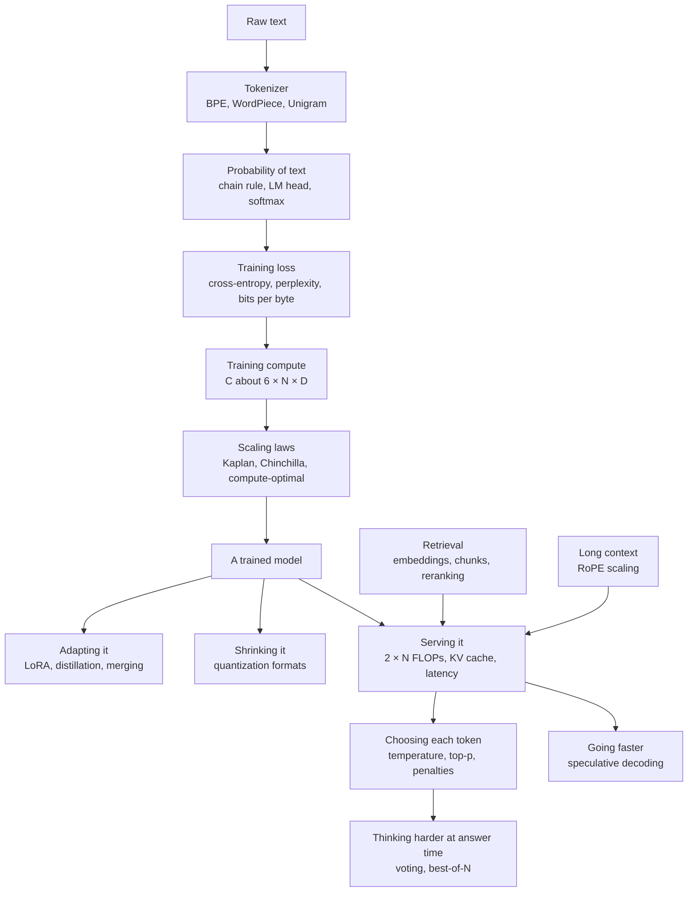
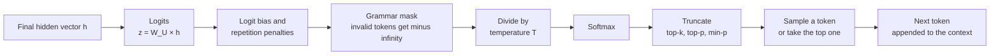

## Large language models: training, scaling and inference

These are the equations that turn a Transformer into a chatbot. They cut text into tokens, score how likely a piece of text is, measure how wrong the model is while it learns, decide how big a model to build and how much text to feed it, and then run it: how much memory a conversation takes, how the next token is picked, how answers are made faster, smaller and cheaper, how a model is adapted to a new job, how its context is stretched, how it looks up documents and how it spends extra thinking at answer time. A handful of quantities tie them all together: the token, the probability the model gives the next token, the loss built from those probabilities, the parameter count N, the number of training tokens D and the compute C. The entries run from simplest to most advanced, and each one uses only ideas from entries above it or from the general-math and deep-learning sections of this appendix.

*Figure G.X: How the large-language-model equations connect, from raw text to a trained model and on to serving, decoding and answer-time compute.*

### Byte-pair encoding merge rule (BPE)

**What it does:** Builds a tokenizer's vocabulary by repeatedly gluing together the pair of neighboring symbols that occurs most often.

`best pair = argmax over adjacent pairs (a, b) of count(a, b); add the new token ab; replace every adjacent a, b with ab; repeat until the vocabulary has V tokens`

- **a, b**: two symbols (bytes, characters or earlier merged tokens) that sit side by side somewhere in the training text
- **count(a, b)**: how many times a is immediately followed by b in the training text
- **argmax over adjacent pairs**: "the pair that makes the count largest"
- **ab**: the new token made by joining a and b
- **V**: the vocabulary size you want to end up with

**In plain words:** Start with single bytes or letters. Count every pair of neighbors, merge the most common pair into one new token, write that merge down, and repeat. To tokenize new text later, the tokenizer replays its recorded merges in the order it learned them.

**Tiny example:** Training text "low low lower", split into letters. Pair counts: l,o = 3; o,w = 3; w,e = 1; e,r = 1. There is a tie, broken by a fixed rule (here, the first pair found), so merge 1 makes "lo": lo w, lo w, lo w e r. Recount: lo,w = 3; w,e = 1; e,r = 1. Merge 2 makes "low": low, low, low e r. The vocabulary grew by two tokens, and "lower" is now three tokens: low, e, r.

**Where it is used:** Byte-level BPE, which starts from all 256 byte values so no text is ever "unknown", is the tokenizer of OpenAI's GPT models (the tiktoken library), Llama 3, DeepSeek, Qwen and most open models. Typical vocabulary sizes: about 50,000 (GPT-2), about 100,000 (cl100k), about 200,000 (o200k), 128,256 (Llama 3) and about 262,000 (Gemma 3). Variants: SentencePiece BPE treats the space as an ordinary symbol; BPE-dropout skips each merge with a small probability during training to make models robust to unusual splits.
**In the book:** Chapter 18 (Building a tokenizer by hand: Byte-Pair Encoding) and Chapter 15 (Byte-pair encoding, worked by hand).

### WordPiece merge score

**What it does:** Chooses which pair of pieces to merge by how much more often they appear together than their separate popularity would predict.

`score(a, b) = count(ab) ÷ (count(a) × count(b))`

- **a, b**: two neighboring pieces of text
- **count(ab)**: how many times a and b appear side by side
- **count(a)**, **count(b)**: how many times each piece appears on its own anywhere

**In plain words:** BPE merges the most frequent pair. WordPiece divides that frequency by the popularity of the two parts, so it prefers pairs that "belong together" (one almost always follows the other) over pairs of common pieces that meet often only because both are everywhere. The ratio is a quick stand-in for "the merge that raises the training text's likelihood the most", which is how Schuster and Nakajima (2012) first described WordPiece.

**Tiny example:** "t,h" appears together 30 times, with t seen 50 times and h 40 times: 30 ÷ (50 × 40) = 30 ÷ 2,000 = 0.015. "q,u" appears together only 5 times, with q seen 5 times and u 60 times: 5 ÷ (5 × 60) = 5 ÷ 300 ≈ 0.0167. BPE would merge "th" (30 beats 5); WordPiece merges "qu" (0.0167 beats 0.015), because q is always followed by u.

**Where it is used:** BERT, DistilBERT and other BERT-family encoders, which still power many embedding models and rerankers in retrieval systems. When encoding, WordPiece takes the longest matching piece first and marks pieces inside a word with "##", as in "play ##ing".
**In the book:** Chapter 18 (Building a tokenizer by hand: Byte-Pair Encoding) names WordPiece; the score is only here.

### Unigram language-model tokenizer likelihood

**What it does:** Gives every possible way of cutting text into tokens a probability, picks the most likely cut, and trains the vocabulary to make the training text as likely as possible.

`P(x) = product over i of p(x_i); best x = argmax over segmentations x of P(x); training maximizes L = sum over sentences s of ln( sum over segmentations x of s of P(x) )`

- **x**: one segmentation, that is, one way of cutting a piece of text into tokens
- **x_i**: the i-th token of that segmentation
- **p(x_i)**: the probability the tokenizer assigns to that token (each vocabulary token has one)
- **product over i**: multiply the values for every token in the cut
- **P(x)**: the probability of the whole segmentation
- **s**: one sentence of training text
- **ln**: the natural logarithm
- **L**: the training objective, the total log-likelihood of the training text

**In plain words:** Every token in the vocabulary has a probability. A cut of a word scores the product of its pieces' probabilities, and the tokenizer uses the highest-scoring cut (found with the Viterbi algorithm, a fast search that checks all cuts without listing them). Training starts from a very large vocabulary, fits the probabilities, then repeatedly deletes the tokens whose removal lowers L the least, keeping about 80% each round, until the target size is reached (Kudo, 2018).

**Tiny example:** Suppose p(hug) = 0.02, p(hu) = 0.05, p(ug) = 0.04, p(h) = 0.1, p(u) = 0.1, p(g) = 0.05. The cuts of "hug": [hug] = 0.02; [hu, g] = 0.05 × 0.05 = 0.0025; [h, ug] = 0.1 × 0.04 = 0.004; [h, u, g] = 0.1 × 0.1 × 0.05 = 0.0005. The best cut is the single token "hug". This word adds ln(0.02 + 0.0025 + 0.004 + 0.0005) = ln(0.027) ≈ −3.61 to L.

**Where it is used:** SentencePiece's unigram mode, used by T5, mT5, ALBERT and XLNet. A variant, subword regularization, samples a cut in proportion to `P(x)^α` (α is a sharpness setting) during training so the model sees several spellings of the same word.
**In the book:** Chapter 18 (Building a tokenizer by hand: Byte-Pair Encoding) defines the unigram tokenizer in words; the likelihood is only here.

### Bytes per token, fertility and tokenizer compression

**What it does:** Measures how much text one token covers, which sets how many tokens (and dollars, and context space) a text costs.

`bytes per token = UTF-8 bytes of a text ÷ tokens; fertility = tokens ÷ words; relative cost of tokenizer B versus A = tokens_B ÷ tokens_A on the same text`

- **UTF-8 bytes**: the size of the text in the standard way computers store characters (one byte for each English letter, two to four for many other scripts)
- **tokens**: how many tokens the tokenizer cuts the text into
- **words**: how many words the text has
- **tokens_A**, **tokens_B**: token counts from two different tokenizers on the same text

**In plain words:** English runs about 4 characters, or 0.75 words, per token for modern vocabularies. Many non-Latin scripts need two to four times as many tokens for the same meaning (the "token tax"), which raises cost and shrinks how much fits in the context window.

**Tiny example:** A 1,000-word English text is 5,600 bytes and becomes 1,300 tokens: 5,600 ÷ 1,300 ≈ 4.31 bytes per token, and fertility = 1,300 ÷ 1,000 = 1.3 tokens per word. A second tokenizer makes 1,560 tokens from the same text: 1,560 ÷ 1,300 = 1.2, so it costs 20% more at the same price per token.

**Where it is used:** Designing tokenizers for multilingual models, comparing API prices and context limits across providers whose tokenizers differ, and converting per-token loss into bits per byte (below).
**In the book:** Chapter 18 (What tokens explain about your chatbot), Chapter 26 (Tokenizers differ: compare cost per task, not per token) and Appendix B (Tokens and words).

> **Definition — Fertility (tokenizer):** The average number of tokens a tokenizer produces per word of a language. Higher fertility means the same sentence costs more tokens, more money and more of the context window.

### Autoregressive factorization (chain rule over tokens)

**What it does:** Writes the probability of a whole text as a product of next-token probabilities, which is why predicting the next token is enough to model language.

`P(x_1, ..., x_T) = P(x_1) × P(x_2 given x_1) × ... × P(x_T given x_1, ..., x_(T−1)); in logs: ln P(x_1, ..., x_T) = sum over t = 1..T of ln P(x_t given x_1, ..., x_(t−1))`

- **x_1, ..., x_T**: the tokens of the text, in order
- **T**: the number of tokens
- **t**: the position being predicted
- **P(x_t given x_1, ..., x_(t−1))**: the probability of token t given every token before it
- **ln**: the natural logarithm, which turns the product into a sum

**In plain words:** The probability of a sentence is the probability of its first token, times the probability of the second given the first, and so on. This is an exact rule of probability, so a model that predicts the next token well describes all of text, and generating is just picking one token at a time.

**Tiny example:** 0.05 × 0.01 × 0.2 = 0.0001. In logs: ln(0.05) + ln(0.01) + ln(0.2) = −2.996 − 4.605 − 1.609 = −9.210, and ln(0.0001) = −9.210.

**Where it is used:** Every decoder-only language model, including GPT, Claude, Gemini, Llama, DeepSeek and Qwen.
**In the book:** Chapter 6 (Chaining probabilities for a whole sentence), Chapter 18 (The one trick: predicting the next token) and Appendix B (Sentence probability; Log-probability).

### Next-token distribution from the final hidden state (LM head)

**What it does:** Turns the model's last internal vector into one score per vocabulary token and then into probabilities.

`z = W_U × h_t; P(next token = j) = exp(z_j) ÷ sum over k = 1..V of exp(z_k); with weight tying W_U = W_E`

- **h_t**: the final hidden vector at position t, a list of d_model numbers
- **W_U**: the unembedding matrix, V × d_model
- **z**: the logits, one score per vocabulary token
- **z_j**: the logit of token j
- **V**: the vocabulary size
- **exp**: e raised to a power
- **W_E**: the input embedding table, also V × d_model (one row per token), reused as W_U when weights are tied

**In plain words:** The last vector is compared with every token's output vector (a matrix times a vector), giving a list of scores. Softmax turns the scores into probabilities that add to 1.

**Tiny example:** h = [1, 2] and a three-token vocabulary with W_U rows [1, 0], [0, 1] and [0.5, 0.5]: z = [1, 2, 1.5]. Then exp gives 2.718, 7.389 and 4.482, total 14.589, so the probabilities are 0.186, 0.506 and 0.307.

**Where it is used:** The last layer of every LLM. The "logprobs" an API can return are ln of these probabilities, and every sampling rule below works on z. Weight tying saves V × d_model parameters and is used by GPT-2, the Gemma family and small models such as Llama 3.2 1B and 3B; most large models keep the two matrices separate. Weight tying itself, and the two training tricks that keep these logits from growing too large (the output z-loss and logit soft-capping), have their own entries in the deep-learning section.
**In the book:** Chapter 15 (Step 9: From vectors back to words) and Chapter 18 (Logits: one score per token); the product z = W_U × h_t is written as a formula only here.

> **Definition — Logprobs:** The natural logarithms of the probabilities a model gave to tokens, which many APIs can return alongside the text. A logprob of 0 means certainty; −2.3 means a probability of about 0.1.

### Next-token cross-entropy loss (language-model negative log-likelihood)

**What it does:** Scores how surprised the model was by the real text: the pretraining loss of every GPT-style model.

`L(θ) = −(1 ÷ T) × sum over t = 1..T of ln P_θ(x_t given x_1, ..., x_(t−1))`

- **L(θ)**: the loss, a single number
- **θ** (theta): all the model's parameters
- **T**: the number of tokens in the batch
- **x_t**: the token that really came at position t
- **P_θ(x_t given ...)**: the probability the model with parameters θ gave the true token x_t
- **ln**: the natural logarithm

**In plain words:** For every position, take minus the natural log of the probability the model gave the token that really came next, then average. All positions are scored at once, using the causal mask so no position can peek ahead (teacher forcing). Gradient descent lowers this number.

**Tiny example:** True tokens got probabilities 0.5, 0.25 and 0.8. Then −ln of each is 0.693, 1.386 and 0.223; the sum is 2.303 and the average is 2.303 ÷ 3 ≈ 0.768.

**Where it is used:** Pretraining of every GPT-style model, and the validation number plotted in every loss curve. Variants average per token or per sequence, or weight data sources differently.
**In the book:** Chapter 19 (Measuring surprise: the loss), Chapter 6 (Cross-entropy: how surprised was the model?) and Appendix B (Cross-entropy, whole text).

### Perplexity

**What it does:** Converts the average loss into "how many equally likely choices the model is hesitating between".

`PPL = exp(L) = 2^(bits per token), where bits per token = L ÷ ln(2)`

- **PPL**: perplexity
- **L**: the average next-token loss in natural-log units (nats)
- **ln(2)**: about 0.693, which converts nats to bits

**In plain words:** Perplexity 1 means the model is always certain and right; perplexity 10 means it is as unsure as a fair pick among 10 options. Because it is measured per token, it depends on the tokenizer, so it cannot compare models with different vocabularies (use bits per byte for that).

**Tiny example:** From the loss example above, L = 0.768: exp(0.768) ≈ 2.15. In bits: 0.768 ÷ 0.693 ≈ 1.107 bits per token, and `2^1.107` ≈ 2.15, the same answer.

**Where it is used:** Language-model evaluation, quick checks after quantizing a model, and filtering web data with a reference model (below).
**In the book:** Chapter 19 (Measuring surprise: the loss), Chapter 6 (Perplexity) and Appendix B (Perplexity); the `2^(bits per token)` form is only here.

### Bits per byte (and bits per character)

**What it does:** Spreads the loss over the raw bytes of the text instead of over tokens, so models with different tokenizers can be compared fairly.

`BPB = (L × number of tokens) ÷ (ln(2) × number of UTF-8 bytes) = L ÷ (ln(2) × bytes per token)`

- **BPB**: bits per byte
- **L**: the average loss per token, in nats
- **ln(2)**: about 0.693, converting nats to bits
- **UTF-8 bytes**: the size of the raw text
- **bytes per token**: from the entry above

**In plain words:** Total surprise in bits, divided by how many bytes of text it covered. It is also the size per byte that a compressor driven by the model (an arithmetic coder) would achieve, which is the link between predicting text and compressing it. Bits per character is the same with characters in place of bytes.

**Tiny example:** A model has loss 2.0 nats per token and its tokenizer averages 4 bytes per token: 2.0 ÷ (0.693 × 4) = 2.0 ÷ 2.773 ≈ 0.72 bits per byte.

**Where it is used:** Tokenizer-independent results in The Pile, Gopher and Chinchilla reports; DeepSeek LLM fitted its scaling laws on validation bits per byte.
**In the book:** Appendix F (Bits per byte) describes it in words; the conversion from per-token loss is only here.

> **Definition — Nat:** A unit of information measured with the natural logarithm instead of base 2. One nat is about 1.44 bits; most training losses are reported in nats.

### Supervised fine-tuning loss with prompt masking

**What it does:** Teaches a model to write good answers by scoring only the tokens it should learn to produce.

`L_SFT = −(1 ÷ sum over t of m_t) × sum over t of m_t × ln P_θ(x_t given x_1, ..., x_(t−1))`

- **L_SFT**: the supervised fine-tuning loss
- **m_t**: the mask, 1 for tokens in the assistant's reply and 0 for system, user and tool tokens
- **sum over t of m_t**: the number of graded tokens
- **θ**: the model's parameters
- **x_t**: the token at position t
- **P_θ(x_t given ...)**: the probability the model gave the true token at position t
- **ln**: the natural logarithm

**In plain words:** The same loss as pretraining, except the prompt counts as context, not as something to imitate. Only the assistant's words are graded, and the average is taken over those graded tokens.

**Tiny example:** A five-token conversation: three user tokens (m = 0) and the assistant's "4" and "." (m = 1), which got probabilities 0.9 and 0.8. Loss = (0.105 + 0.223) ÷ 2 ≈ 0.164; the user tokens add nothing.

**Where it is used:** Instruction tuning in every post-training pipeline, in tools such as Hugging Face TRL (assistant-only or completion-only loss), Axolotl and Unsloth. Variants normalize per example instead of per token (which changes how much long answers weigh) and pack several examples into one sequence.
**In the book:** Chapter 20 (Stage 1: Supervised fine-tuning; Worked example: one SFT step on one token) and Chapter 30 (The fine-tuning menu); the masked average is written as a formula only here.

### Masked-language-model, span-corruption and fill-in-the-middle objectives

**What it does:** Trains a model to fill in hidden pieces of text using context from both sides.

`L_MLM = −(1 ÷ |M|) × sum over i in M of ln P_θ(x_i given the text with the positions in M hidden)`

- **L_MLM**: the masked-language-model loss
- **M**: the set of hidden positions, about 15% of the tokens
- **|M|**: how many positions are hidden
- **x_i**: the original token at hidden position i
- **θ**: the model's parameters

**In plain words:** Hide some tokens, ask the model to guess them from everything around them, and score only the guesses. BERT replaces 80% of the chosen tokens with a [MASK] symbol, 10% with a random token and leaves 10% unchanged.

**Tiny example:** Out of 10 tokens, 2 are hidden. The model gives the true tokens probabilities 0.6 and 0.3: loss = (0.511 + 1.204) ÷ 2 ≈ 0.857.

**Where it is used:** BERT-style encoders behind many embedding models and rerankers. T5 uses span corruption: it drops spans averaging 3 tokens and predicts them after placeholder (sentinel) tokens. Code models such as StarCoder, DeepSeek-Coder and Qwen2.5-Coder use fill-in-the-middle: a document is cut into prefix, middle and suffix, reordered as prefix, suffix, middle with marker tokens, and trained with the ordinary next-token loss, which lets an editor's autocomplete fill a gap in your code.
**In the book:** Chapter 15 (Step 8: Encoders, decoders and the causal mask) defines masked language modeling in words; the loss, span corruption and fill-in-the-middle are only here.

> **Definition — Span corruption:** A training task, used by T5, in which whole runs of tokens are removed from a text and replaced by placeholder tokens, and the model must write out the missing runs.

> **Definition — Fill-in-the-middle (FIM):** A training trick for code models: a file is cut into a beginning, middle and end, and the model sees the beginning and end first and learns to write the missing middle, which is what an editor needs when you type inside existing code.

### Multi-token prediction loss

**What it does:** Adds extra training targets that predict tokens two or more steps ahead, giving the model a denser learning signal.

`L_total = L_main + (λ ÷ D) × sum over k = 1..D of L_k, where L_k = −(1 ÷ T) × sum over t of ln P_k(x_(t+1+k) given x_1, ..., x_t)`

- **L_total**: the full training loss
- **L_main**: the ordinary next-token loss
- **λ** (lambda): the weight on the extra losses
- **D**: the prediction depth, how many extra future tokens are predicted (here D is not the dataset size)
- **k**: which extra step ahead (k = 1 means the token after next)
- **L_k**: the cross-entropy loss of the k-th extra prediction module
- **T**: the number of positions
- **P_k(...)**: the probability the k-th module gives the true token 1 + k steps ahead

**In plain words:** Small extra heads look further into the future from each position. Their losses are averaged, scaled down by λ and added to the main loss. The original version (Gloeckle and others, 2024) uses n parallel heads, each predicting one of the next n tokens; DeepSeek-V3 chains small modules one after another.

**Tiny example:** Main loss 1.2 nats, one extra module (D = 1) with loss 1.8, λ = 0.3: 1.2 + (0.3 ÷ 1) × 1.8 = 1.2 + 0.54 = 1.74.

**Where it is used:** DeepSeek-V3 used D = 1 and λ = 0.3 for the first 10 trillion tokens, then 0.1; DeepSeek-R1, GLM-4.5 and other 2025-2026 open models use the idea too. At inference the extra module doubles as a built-in draft for speculative decoding: DeepSeek-V3 reports 85-90% acceptance of the second token and about 1.8 times the tokens per second.
**In the book:** Chapter 15 (Step 10: How a Transformer learns) defines multi-token prediction and Chapter 23 (Speculative decoding: guess ahead, check in one pass) uses it as a draft; the loss is only here.

### Multiple-choice scoring by log-likelihood

**What it does:** Grades a model on a multiple-choice test without letting it write anything: the answer it finds most probable wins.

`choice = argmax over options c of sum over the tokens of c of ln P(token given the question and the earlier tokens of c); normalized variant: divide each option's sum by its length in characters (or bytes)`

- **c**: one answer option
- **argmax over options**: the option with the largest score
- **ln P(token given ...)**: the log-probability of each token of the option, read after the question
- **length in characters (or bytes)**: the option's size, used for length normalization

**In plain words:** Paste the question, then measure how likely the model finds each possible answer. A longer option has more tokens, each with a probability below 1, so its raw total is lower; dividing by length removes that unfair penalty.

**Tiny example:** Option A, "No" (2 bytes), has total log-probability −1.2. Option B, "Yes, always" (11 bytes), has −2.2. Raw scores pick A, since −1.2 is larger than −2.2. Per byte: A = −1.2 ÷ 2 = −0.6 and B = −2.2 ÷ 11 = −0.2, so the normalized score picks B.

**Where it is used:** Base-model benchmarks such as HellaSwag, ARC and the cloze form of MMLU in EleutherAI's lm-evaluation-harness, where the score divided by length in characters is reported as acc_norm (acc_bytes divides by bytes; for English text the two barely differ). Llama 3's downstream forecasts used the normalized negative log-likelihood of the correct answer (see the two-step forecast below).
**In the book:** Only here (Chapter 24 discusses benchmarks and evaluation harnesses in words).

> **Definition — Length normalization:** Dividing a text's total log-probability by its length (in tokens, characters or bytes) before comparing it with other texts, so longer answers are not penalized just for having more parts.

### Transformer parameter count

**What it does:** Estimates how many parameters a Transformer has from its shape.

`N ≈ 12 × n_layer × d_model^2 + V × d_model (+ another V × d_model if the output matrix is not tied)`

- **N**: the number of parameters
- **n_layer**: the number of Transformer blocks
- **d_model**: the width of the model's vectors
- **V**: the vocabulary size
- **12**: 4 square matrices in attention (query, key, value, output) plus 8 in the feed-forward block (two matrices of d_model × 4 × d_model)

**In plain words:** Each block holds about 12 × d_model^2 weights, so multiply by the number of blocks and add the embedding table. Norms and biases are too small to matter.

**Tiny example:** 32 layers, d_model = 4,096, V = 32,000 with separate input and output matrices: 12 × 32 × 4,096^2 ≈ 6.44 billion, plus 2 × 32,000 × 4,096 ≈ 0.26 billion, total ≈ 6.70 billion, close to Llama 2 7B's 6.74 billion (its SwiGLU feed-forward block is slightly larger than 8 × d_model^2).

**Where it is used:** Sizing models, planning memory (parameters × bytes per parameter) and the N in scaling laws (Kaplan counts only non-embedding parameters; Chinchilla counts all). Variants: SwiGLU feed-forward blocks use 3 × d_model × d_ff weights, and with d_ff ≈ (8 ÷ 3) × d_model the total stays near 8 × d_model^2; grouped-query attention uses 2 × d_model^2 + 2 × d_model × n_kv × d_head for its four matrices, where n_kv is the number of key-value heads and d_head the size of each.
**In the book:** Chapter 15 (Step 7: The residual stream and one full block), Chapter 18 (Counting the knobs) and Appendix B (Parameters in a dense layer; Embedding table size); the untied output matrix is mentioned only here.

### Mixture-of-experts total versus active parameters

**What it does:** Splits a mixture-of-experts model's size into what must be stored (total) and what each token actually uses (active).

`N_total = N_other + L_moe × (E + s) × N_expert; N_active = N_other + L_moe × (k + s) × N_expert; for SwiGLU experts N_expert = 3 × d_model × d_expert`

- **N_total**: all parameters, which must fit in memory
- **N_active**: the parameters one token passes through, which sets compute
- **N_other**: everything outside the experts: attention, dense layers, embeddings, routers
- **L_moe**: the number of mixture-of-experts layers
- **E**: routed experts per layer
- **k**: routed experts chosen for each token
- **s**: shared experts that every token always uses
- **N_expert**: the parameters in one expert
- **d_model**: the model width
- **d_expert**: the hidden width inside one expert

**In plain words:** Memory pays for every expert; compute pays only for the few each token is routed to. So use N_total for memory and N_active in the compute rules (2 × N_active FLOPs per token, 6 × N_active × D for training). Routing and load-balancing equations are in the deep-learning section.

**Tiny example:** N_other = 100 million, L_moe = 4, E = 8, k = 2, s = 0, N_expert = 10 million. Total = 100 + 4 × 8 × 10 = 420 million; active = 100 + 4 × 2 × 10 = 180 million.

**Where it is used:** Every 2025-2026 frontier open-weight MoE and every serving capacity plan. A check against DeepSeek-V3's published shape (61 layers, the first 3 dense; 256 routed experts plus 1 shared; 8 routed active; d_model 7,168; d_expert 2,048): N_expert = 3 × 7,168 × 2,048 ≈ 44.0 million; 58 × 257 × 44.0 million ≈ 656.5 billion of its 671 billion are experts, leaving about 14.5 billion; active ≈ 14.5 billion + 58 × 9 × 44.0 million ≈ 37.5 billion, matching the reported 37 billion. Other examples: Kimi K2 (about 1 trillion total, 32 billion active), gpt-oss-120b (about 117 billion total, 5.1 billion active), Qwen3-235B-A22B.
**In the book:** Chapter 17 (Total versus active parameters), Chapter 18 (Dense versus mixture of experts: total and active parameters) and Appendix B (Mixture of experts); the counting formula is only here.

### Training compute C ≈ 6ND

**What it does:** Estimates the total arithmetic needed to train a model.

`C ≈ 6 × N × D`

- **C**: training compute, in floating-point operations (FLOPs)
- **N**: parameters (active parameters for a mixture of experts)
- **D**: training tokens
- **6**: 2 FLOPs per parameter per token in the forward pass plus about 4 in the backward pass

**In plain words:** Every parameter does one multiply-add (2 FLOPs) per token going forward and about twice that going backward. It ignores the attention term (below). With full activation recomputation the hardware actually does about 8 × N × D.

**Tiny example:** N = 1 billion, D = 20 billion: 6 × 10^9 × 2 × 10^10 = 1.2 × 10^20 FLOPs. Llama 3 405B: 6 × 4.05 × 10^11 × 1.56 × 10^13 ≈ 3.8 × 10^25, matching Meta's reported figure.

**Where it is used:** Budgeting every pretraining run, and regulatory thresholds such as the EU AI Act's presumption of systemic risk above 10^25 FLOPs.
**In the book:** Chapter 19 (The 6ND rule and what a training run costs), Chapter 37 (Counting the work: the 6 × N × D rule) and Appendix B (Training compute); the 8ND recomputation variant is only here.

### Inference compute ≈ 2N FLOPs per token

**What it does:** Estimates the arithmetic needed to read or write each token at answer time.

`FLOPs per token ≈ 2 × N; prefill of P prompt tokens ≈ 2 × N × P; one request ≈ 2 × N × (P + G)`

- **N**: parameters (active parameters for a mixture of experts)
- **P**: prompt tokens
- **G**: generated tokens

**In plain words:** Each weight is used once per token as one multiply-add. Reading the prompt (prefill) processes all P tokens in parallel; writing (decode) produces one token at a time. Sampling several answers multiplies the cost by their number.

**Tiny example:** An 8-billion-parameter model reads a 1,000-token prompt and writes 500 tokens: 2 × 8 × 10^9 × 1,500 = 2.4 × 10^13 FLOPs.

**Where it is used:** Pricing and capacity estimates, and counting the test-time compute of reasoning models and best-of-N.
**In the book:** Chapter 23 (Two different jobs: prefill and decode), Chapter 18 (Compute per token) and Appendix B (Inference cost per token; Cost of an answer).

### Attention FLOPs term (the context-length cost)

**What it does:** Adds the arithmetic that attention spends comparing each token with all earlier ones, which the 2N and 6ND rules leave out.

`forward FLOPs per token ≈ 2 × N + 2 × n_layer × n_ctx × d_attn`

- **N**: parameters
- **n_layer**: the number of layers
- **n_ctx**: the number of tokens of context each token attends to
- **d_attn**: the total width of the attention heads (heads × head size)

**In plain words:** Scoring a query against every earlier key and mixing their values costs work proportional to the context length, for every token, so a whole sequence costs work that grows with the square of its length. The term is small for short contexts and dominates long ones, which is why sparse, linear and latent attention exist. Causal masking halves the real work, a factor most accounting formulas ignore.

**Tiny example:** A 7-billion-parameter shape (32 layers, d_attn = 4,096, so 2 × N ≈ 13.4 billion): at 4,096 tokens of context the extra term is 2 × 32 × 4,096 × 4,096 ≈ 1.07 billion FLOPs, about 8% of 2 × N. At 128,000 tokens it is 2 × 32 × 128,000 × 4,096 ≈ 33.6 billion, 2.5 times 2 × N.

**Where it is used:** Kaplan and others (2020) gave this form. PaLM's model-FLOPs-utilization accounting uses 6 × N + 12 × n_layer × n_heads × d_head × T per training token (T the sequence length). DeepSeek LLM replaced 6 × N with M = 72 × n_layer × d_model^2 + 12 × n_layer × d_model × l_seq FLOPs per token (l_seq the sequence length) and C = M × D for more accurate scaling-law fits at small scale.
**In the book:** Chapter 15 (The catch: attention costs grow with the square of length), Chapter 17 (Two bills every Transformer pays) and Chapter 23 (Worked example: how long does reading take?) explain it in words; the FLOP formulas are only here.

### Kaplan power laws for language-model loss

**What it does:** Predicts test loss from model size, data or compute as a straight line on a log-log plot.

`L(N) = (N_c ÷ N)^α_N; L(D) = (D_c ÷ D)^α_D; L(C_min) = (C_c ÷ C_min)^α_C; combined L(N, D) = ((N_c ÷ N)^(α_N ÷ α_D) + D_c ÷ D)^α_D`

- **L**: test loss, in nats per token
- **N**: non-embedding parameters
- **D**: training tokens
- **C_min**: compute, used as efficiently as possible, in PF-days
- **α_N ≈ 0.076**, **α_D ≈ 0.095**, **α_C ≈ 0.050** (alpha): how steeply loss falls with each quantity
- **N_c ≈ 8.8 × 10^13**, **D_c ≈ 5.4 × 10^13 tokens**, **C_c ≈ 3.1 × 10^8 PF-days**: fitted constants that set where each line sits

**In plain words:** Make the model, the data or the compute bigger by a fixed factor and the loss shrinks by a fixed factor, with no sign of stopping across many orders of magnitude. Kaplan and others (2020) concluded that compute should go mostly into model size (N growing as `C^0.73`), which Chinchilla later corrected.

**Tiny example:** N = 10^9: `(8.8 × 10^13 ÷ 10^9)^0.076` = `88,000^0.076` ≈ 2.376 nats. Doubling to N = 2 × 10^9 gives ≈ 2.254, and 2.254 ÷ 2.376 ≈ 0.949 = `2^(−0.076)`: each doubling trims the loss by about 5%.

**Where it is used:** Sizing in the GPT-3 era, and loss forecasting before frontier runs. The GPT-4 report used L(C) = a × `C^b` + c, with an irreducible term c, to predict the final loss from runs using up to 10,000 times less compute.
**In the book:** Chapter 19 (Kaplan 2020: loss falls on a straight line) describes it in words; Appendix B (Power law) and Chapter 6 (Log-log plots and scaling laws) give the general form; the fitted formulas are only here.

> **Definition — PF-day (petaflop/s-day):** A unit of compute: a machine doing 10^15 floating-point operations per second for one day, about 8.64 × 10^19 operations in total.

### Chinchilla parametric loss

**What it does:** Splits a model's loss into a floor nobody can beat, a penalty for too few parameters and a penalty for too little data.

`L(N, D) = E + A ÷ N^α + B ÷ D^β`

- **L(N, D)**: predicted loss
- **N**: parameters
- **D**: training tokens
- **E**: the irreducible loss
- **A**, **B**: fitted sizes of the two penalties
- **α** (alpha), **β** (beta): how fast each penalty shrinks

**In plain words:** Even a perfect model cannot predict text perfectly (E). A finite model adds a penalty that shrinks as it grows; finite data adds one that shrinks as you add tokens. Hoffmann and others (2022) fitted E = 1.69, A = 406.4, B = 410.7, α = 0.34, β = 0.28, minimizing a Huber loss (δ = 10^−3) on log loss with L-BFGS.

**Tiny example:** N = 70 billion, D = 1.4 trillion: `406.4 ÷ (7 × 10^10)^0.34` ≈ 0.083; `410.7 ÷ (1.4 × 10^12)^0.28` ≈ 0.163; L ≈ 1.69 + 0.083 + 0.163 = 1.937.

**Where it is used:** The standard functional form for planning model size and data, and the base of later variants (data-constrained, precision-aware). Epoch AI's 2024 replication (Besiroglu and others) refitted it as E = 1.82, A = 482.01, B = 2,085.43, α = 0.3478, β = 0.3658.
**In the book:** Chapter 19 (Chinchilla 2022: feed the model more data); the Epoch AI constants are only here.

> **Definition — Irreducible loss:** The part of a model's loss that no amount of size, data or compute can remove, because text itself contains genuine randomness. In the Chinchilla formula it is the constant E.

### Twenty tokens per parameter rule

**What it does:** Gives the rounded Chinchilla answer to "how big a model and how much data for this budget".

`D_opt ≈ 20 × N_opt; with C = 6 × N × D: N_opt ≈ sqrt(C ÷ 120), D_opt ≈ 20 × sqrt(C ÷ 120)`

- **N_opt**: the compute-optimal number of parameters
- **D_opt**: the compute-optimal number of training tokens
- **C**: the compute budget in FLOPs
- **120**: 6 × 20, from putting D = 20 × N into C = 6 × N × D

**In plain words:** At the best balance, a model sees about 20 training tokens per parameter. Substituting into the 6ND rule gives C = 120 × N^2, so N is the square root of C ÷ 120.

**Tiny example:** C = 10^24: N ≈ sqrt(10^24 ÷ 120) = sqrt(8.33 × 10^21) ≈ 9.1 × 10^10 (91 billion parameters); D ≈ 20 × 9.1 × 10^10 ≈ 1.8 × 10^12 tokens. Check: 6 × 9.13 × 10^10 × 1.83 × 10^12 ≈ 10^24.

**Where it is used:** Back-of-envelope planning everywhere. Chinchilla itself was 70 billion parameters on 1.4 trillion tokens. Modern models deliberately go far past it: Llama 3 8B saw about 15 trillion tokens, about 1,875 per parameter (see inference-aware scaling).
**In the book:** Chapter 19 (Chinchilla 2022: feed the model more data, which includes a worked example of sizing a compute-optimal model) and Appendix B (Chinchilla ratio; Compute-optimal size).

### Compute-optimal allocation of model size and data

**What it does:** Finds the exact best split of a compute budget between parameters and data from the Chinchilla loss formula.

`N_opt(C) = G × (C ÷ 6)^a; D_opt(C) = (1 ÷ G) × (C ÷ 6)^b; G = (α × A ÷ (β × B))^(1 ÷ (α + β)); a = β ÷ (α + β); b = α ÷ (α + β)`

- **N_opt(C)**, **D_opt(C)**: the best number of parameters and of training tokens for budget C
- **C**: the compute budget, with C = 6 × N × D
- **A**, **B**, **α**, **β**: the constants of the Chinchilla loss above
- **G**: a constant that sets the level of the best model size
- **a**, **b**: how fast the best size and the best data grow with compute (a + b = 1)

**In plain words:** Minimize the Chinchilla loss while holding 6 × N × D fixed. The answer says both N and D grow as powers of C. Chinchilla found a ≈ b ≈ 0.5, so parameters and tokens should grow equally: 0.50 and 0.50 from training curves, 0.49 and 0.51 from IsoFLOP curves, 0.46 and 0.54 from the parametric fit.

**Tiny example:** With Epoch AI's constants at C = 10^24: a = 0.3658 ÷ 0.7136 ≈ 0.513 and b ≈ 0.487; G = (0.3478 × 482.01 ÷ (0.3658 × 2,085.43))^(1 ÷ 0.7136) = (167.6 ÷ 762.9)^1.401 ≈ 0.120; C ÷ 6 ≈ 1.67 × 10^23; N_opt ≈ `0.120 × (1.67 × 10^23)^0.513` ≈ 9.6 × 10^10 and D_opt ≈ 1.7 × 10^12, about 18 tokens per parameter. The same formula with the 2022 paper's rounded constants gives about 41 billion parameters and 98 tokens per parameter, out of line with the paper's other two methods; Epoch AI's replication reported that inconsistency and its refit agrees with the roughly 20-to-1 answer.

**Where it is used:** Sizing pretraining runs (Chinchilla, Llama 3, DeepSeek). Llama 3 fitted `D*(C) = A × C^α` with (α, A) = (0.53, 0.29) on IsoFLOP curves, predicting 402 billion parameters on 16.55 trillion tokens at 3.8 × 10^25 FLOPs; Meta trained 405 billion.
**In the book:** Chapter 19 (Chinchilla 2022: feed the model more data) computes the 20-tokens special case; the general closed form is only here.

> **Definition — IsoFLOP curve:** A set of training runs that all use the same compute budget but trade model size against data differently. Plotting their final losses against model size gives a U-shaped curve whose bottom marks the compute-optimal size for that budget.

### Inference-aware (beyond-Chinchilla) scaling

**What it does:** Chooses model size and training data to minimize compute over a model's whole life, including serving it, not just training it.

`(N*, D_tr*) = argmin over N, D_tr of (6 × N × D_tr + 2 × N × D_inf), subject to L(N, D_tr) = ℓ`

- **`N*`**, **`D_tr*`**: the best model size and number of training tokens
- **D_tr**: training tokens
- **D_inf**: tokens the model is expected to read and write in service
- **L(N, D_tr)**: the loss formula (for example Chinchilla's)
- **ℓ** (script l): the target loss

**In plain words:** Training cost is paid once; serving cost is paid on every token users ever generate. If a model will serve a lot, a smaller model trained on much more data reaches the same quality and is cheaper overall (Sardana and others, 2024). A dollar version replaces FLOPs with prices.

**Tiny example:** With Epoch AI's loss constants, the compute-optimal model for 10^24 FLOPs is about 96 billion parameters on 1.74 trillion tokens (loss ≈ 1.963). A 48-billion-parameter model reaches the same loss with about 4.38 trillion tokens (91 per parameter): training costs 6 × 4.79 × 10^10 × 4.38 × 10^12 ≈ 1.26 × 10^24, 26% more. Serving 2 × 10^13 tokens costs 2 × 9.59 × 10^10 × 2 × 10^13 ≈ 3.83 × 10^24 for the big model versus 1.92 × 10^24 for the small one. Lifetime totals: 4.83 × 10^24 versus 3.18 × 10^24, a saving of about a third.

**Where it is used:** Why Llama 3, Gemma, Qwen and other widely served models are heavily over-trained.
**In the book:** Chapter 19 (Over-training: why labs train small models far past "optimal") works a two-option example; the argmin is written as a formula only here.

### Data-constrained scaling (repeated epochs)

**What it does:** Discounts repeated data, since a token seen for the fifth time teaches less than a fresh one.

`D' = U_D + U_D × R*_D × (1 − exp(−R_D ÷ R*_D)); N' = U_N + U_N × R*_N × (1 − exp(−R_N ÷ R*_N)); L = E + A ÷ N'^α + B ÷ D'^β`

- **D'**: the effective number of fresh tokens
- **U_D**: unique tokens available
- **R_D**: extra repetitions (epochs minus 1)
- **`R*_D` ≈ 15.4**: the repetition scale at which repeats have lost most of their value
- **N'**: the effective number of parameters
- **U_N**: the compute-optimal model size for the unique data alone
- **R_N**: how many times larger the model is than U_N, minus 1 (extra parameters give diminishing returns in the same way)
- **`R*_N` ≈ 5.3**: the matching scale for parameters
- **E**, **A**, **B**, **α**, **β**: the Chinchilla constants

**In plain words:** Each extra pass over the same data is worth a bit less than the one before. Up to about 4 epochs costs almost nothing; when R_D equals `R*_D`, repeated tokens are worth 1 − 1 ÷ e ≈ 63% of fresh ones; beyond that, extra epochs add little (Muennighoff and others, 2023).

**Tiny example:** 100 billion unique tokens. Four epochs (R_D = 3): D' = 100 + 100 × 15.4 × (1 − exp(−3 ÷ 15.4)) = 100 + 1,540 × 0.177 ≈ 373 billion effective, versus 400 billion read. Forty epochs (R_D = 39): 100 + 1,540 × (1 − exp(−39 ÷ 15.4)) = 100 + 1,540 × 0.921 ≈ 1,518 billion effective, versus 4,000 billion read.

**Where it is used:** Planning around the "data wall": multi-epoch training on scarce high-quality, code and non-English data.
**In the book:** Chapter 19 (The escape routes) says in words that up to about four passes is almost as good as fresh data; the formula is only here.

> **Definition — Data-constrained scaling:** Scaling laws for the case where unique training data runs out and must be repeated. They treat repeated tokens as worth progressively less than fresh ones.

### Compute-based learning-rate and batch-size scaling laws

**What it does:** Predicts the best learning rate, batch size and model-versus-data split for a compute budget, from fits to small runs.

`DeepSeek LLM: η_opt = 0.3118 × C^(−0.1250); B_opt = 0.2920 × C^0.3271; M_opt = 0.1715 × C^0.5243; D_opt = 5.8316 × C^0.4757, with C = M × D`

- **C**: compute in FLOPs
- **η_opt** (eta): the near-best peak learning rate
- **B_opt**: the near-best batch size, in tokens
- **M**: model scale, measured as non-embedding FLOPs per token
- **D**: training tokens
- **M_opt**, **D_opt**: the compute-optimal model scale and number of training tokens

**In plain words:** Bigger budgets want a slightly smaller learning rate and a much larger batch. These power laws, fitted on many small runs, set both before an expensive run starts.

**Tiny example:** C = 10^22: η_opt ≈ 0.3118 × 10^(−2.75) ≈ 0.3118 × 0.00178 ≈ 5.5 × 10^−4; B_opt ≈ 0.2920 × 10^7.196 ≈ 4.6 million tokens; M_opt ≈ 5.9 × 10^10 FLOPs per token; D_opt ≈ 1.7 × 10^11 tokens. Check: 5.9 × 10^10 × 1.7 × 10^11 ≈ 10^22.

**Where it is used:** DeepSeek LLM and its successors, and the general practice of fitting hyperparameter laws on proxies before a frontier run. The other standard way to carry settings from a small proxy to a big model, μP (maximal update parametrization), rescales initialization and learning rates with width; its rules are in the deep-learning section, and Depth-μP and CompleteP (2025) extend them to depth.
**In the book:** Chapter 19 (The settings) says in words that DeepSeek and others published such formulas and defines μP; the fitted laws are only here.

> **Definition — μTransfer:** Tuning hyperparameters such as the learning rate on a small, cheap model set up with μP and copying them directly to a much larger model, which μP makes possible.

### Critical batch size

**What it does:** Marks the batch size beyond which making batches bigger mostly wastes compute.

`B_crit(L) = B_* ÷ L^(1 ÷ α_B); S_min = S ÷ (1 + B_crit ÷ B); C_min = C ÷ (1 + B ÷ B_crit); gradient noise scale B_noise = tr(Σ) ÷ length(G)^2`

- **B_crit(L)**: the critical batch size, in tokens, when the loss is L
- **`B_*` ≈ 2 × 10^8 tokens** and **α_B ≈ 0.21**: fitted constants (Kaplan and others, 2020)
- **B**: the batch size actually used
- **S**, **S_min**: training steps taken, and the fewest possible with an enormous batch
- **C**, **C_min**: compute used, and the least possible with a tiny batch
- **Σ** (capital sigma): the covariance of per-example gradients; **tr(Σ)** adds up their variances
- **G**: the average gradient; **length(G)^2** is its squared length

**In plain words:** Below the critical batch size, doubling the batch nearly halves the number of steps at no extra compute. Above it, steps barely drop while compute keeps climbing. It grows as the loss falls, which is why runs ramp the batch up and why frontier runs use batches of millions of tokens. The gradient noise scale (McCandlish and others, 2018) estimates it from how noisy the gradients are.

**Tiny example:** At loss 3.0: `3^(1 ÷ 0.21)` = `3^4.76` ≈ 187, so B_crit ≈ 2 × 10^8 ÷ 187 ≈ 1.07 million tokens. At loss 2.5: ≈ 2.55 million; at 2.0: ≈ 7.4 million. Training exactly at B = B_crit takes twice the minimum steps and twice the minimum compute.

**Where it is used:** Choosing global batch sizes and batch ramps for large runs; Meta's Llama 3 doubled its batch size twice during its largest run.
**In the book:** Only here (Chapter 13, Batch size and the learning rate, and Chapter 37, Data parallelism, discuss batch size in words).

> **Definition — Critical batch size:** The batch size at which a training run gets a good trade between speed and compute: much smaller batches waste time, much larger ones waste compute. It grows as the model gets better.

> **Definition — Gradient noise scale:** A measure of how much individual examples' gradients disagree compared with their average. When it is large, bigger batches help, because averaging more examples cancels the disagreement.

### Two-step downstream performance forecast

**What it does:** Predicts a benchmark score before training, by forecasting a smooth quantity first and then mapping it to accuracy.

`step 1: NLL_task(C) ≈ a + b × log(C); step 2: accuracy = c_0 + (1 − c_0) ÷ (1 + exp(k × (NLL_task − n_0)))`

- **NLL_task**: the length-normalized negative log-likelihood of the correct answers (see multiple-choice scoring above)
- **C**: training compute
- **a**, **b**: fitted line constants (b is negative: more compute, lower NLL)
- **c_0**: chance-level accuracy (0.25 for four options)
- **k**, **n_0**: fitted steepness and midpoint of the S-shaped curve

**In plain words:** Accuracy jumps abruptly with scale, but the probability of the right answer improves smoothly. So forecast the smooth number from compute, then convert it to accuracy with an S-curve fitted across many models.

**Tiny example:** Illustrative constants a = 3, b = −0.1 (log in base 10), c_0 = 0.25, k = 5, n_0 = 1.0. At C = 10^22: NLL = 3 − 2.2 = 0.8, accuracy = 0.25 + 0.75 ÷ (1 + exp(−1)) = 0.25 + 0.75 × 0.731 ≈ 0.798. At C = 10^24: NLL = 0.6, accuracy = 0.25 + 0.75 ÷ (1 + exp(−2)) ≈ 0.911.

**Where it is used:** Meta used this method to predict the Llama 3 405B model's ARC-Challenge score across four orders of magnitude of compute; labs forecast capabilities this way before committing to a frontier run.
**In the book:** Chapter 19 (Emergent abilities: sudden leaps or smooth progress?) argues in words for tracking a smooth metric; the two-step fit is only here.

### Compounding success over many tokens or steps (exact match and long agent tasks)

**What it does:** Gives the chance that every part of a long answer or a long task comes out right, which explains sudden-looking jumps in scores and why long agent runs fail.

`P(all n parts right) = p^n, if each part is right with probability p independently; per-part accuracy needed for a target success rate S: p = S^(1 ÷ n)`

- **p**: the chance that one part is right (one token of an answer, or one step of an agent's task)
- **n**: how many parts must all be right
- **S**: the overall success rate you want
- **`S^(1 ÷ n)`**: the n-th root of S

**In plain words:** All-or-nothing scoring multiplies the per-part chances together, so a smooth rise in p turns into a cliff in p^n. Schaeffer and others (2023) argued that many "emergent" abilities are this effect of the metric rather than a sudden change inside the model. The same arithmetic is why a step that almost always works still sinks a 100-step task. Real errors are not independent, and agents that notice and fix their own mistakes beat the simple product.

**Tiny example:** A 10-token answer: per-token accuracy 0.8 gives `0.8^10` ≈ 0.107; 0.9 gives `0.9^10` ≈ 0.349; 0.95 gives `0.95^10` ≈ 0.599. An agent that gets 99% of its steps right finishes a 100-step task `0.99^100` ≈ 37% of the time. To finish it 90% of the time, each step must succeed with p = `0.9^(1 ÷ 100)` ≈ 0.99895, about 99.9%.

**Where it is used:** Arguments about emergent abilities and the choice of smooth metrics (log-likelihood, per-token accuracy) when forecasting, as in the two-step forecast above; reliability budgets for agents, and the `pass^k` score of agent benchmarks such as τ-bench (Yao and others, 2024), the chance that k separate tries at the same task all succeed, which is `p^k` for a task solved with probability p. METR's time-horizon measurements of agents have their own entry elsewhere in this appendix.
**In the book:** Chapter 19 (The case against: the metric makes the cliff) works the 10-token table and Chapter 28 (Why long tasks are hard: reliability compounds) works the agent case; the n-th-root form is only here.

### MinHash near-duplicate detection with LSH banding

**What it does:** Finds near-copies of documents among billions of web pages without comparing every pair.

`J(A, B) = |A ∩ B| ÷ |A ∪ B|; P(minhash(A) = minhash(B)) = J(A, B); with b bands of r hashes: P(flagged as duplicates) = 1 − (1 − J^r)^b`

- **A**, **B**: the sets of shingles (overlapping runs of n words) of two documents
- **|A ∩ B|**: how many shingles the two share
- **|A ∪ B|**: how many distinct shingles they have between them
- **J(A, B)**: the Jaccard similarity, from 0 (nothing shared) to 1 (identical sets)
- **minhash(A)**: the smallest value of one hash function over all of A's shingles
- **r**: hashes per band; **b**: number of bands

**In plain words:** One MinHash value matches between two documents with probability exactly equal to their Jaccard similarity, so a list of many MinHash values is a compact fingerprint that estimates J cheaply. Locality-sensitive hashing groups the values into bands and flags any pair that matches on a whole band. The result is an S-shaped filter: very similar pairs are almost always caught, dissimilar pairs almost never.

**Tiny example:** Shingle sets {a, b, c, d} and {b, c, d, e}: J = 3 ÷ 5 = 0.6. With FineWeb's setting of 14 bands of 8 hashes: J = 0.9 gives 1 − (1 − `0.9^8`)^14 = 1 − (1 − 0.430)^14 ≈ 0.9996; J = 0.75 gives 1 − (1 − 0.100)^14 ≈ 0.77; J = 0.5 gives 1 − (1 − 0.0039)^14 ≈ 0.053.

**Where it is used:** Deduplication in FineWeb (5-word shingles, 112 hashes in 14 bands of 8, targeting about 75% similarity), RefinedWeb, Dolma and NVIDIA NeMo Curator. A related check, n-gram decontamination, flags benchmark items that share a long run of words with the training data (13-grams in GPT-3; its score is in the evaluation-metrics section).
**In the book:** Chapter 19 (Cleaning the firehose: the curation pipeline) works the Jaccard similarity and defines MinHash in words; the match probability and the banding formula are only here.

> **Definition — Shingle:** A short overlapping run of consecutive words (or characters) taken from a document, such as every 5-word window. Comparing documents' sets of shingles measures how much text they share.

> **Definition — LSH (locality-sensitive hashing):** A family of tricks that give similar items the same short code with high probability, so near-duplicates land in the same bucket and only items sharing a bucket need to be compared.

### Perplexity and classifier quality filtering

**What it does:** Scores each web page with a small model and keeps only the pages that look like good writing.

`PPL_ref(doc) = exp( −(1 ÷ T) × sum over t of ln P_ref(x_t given the earlier tokens) ), keep documents below a chosen percentile; classifier filter: keep doc if P_clf(high quality given doc) ≥ τ`

- **PPL_ref(doc)**: the perplexity a small reference model gives the document
- **T**: the document's token count
- **P_ref(x_t given ...)**: the reference model's probability for each token
- **P_clf(high quality given doc)**: a quality classifier's probability that the page is good
- **τ** (tau): the cut-off score

**In plain words:** A reference model trained on clean text (CCNet used a small KenLM 5-gram model trained on Wikipedia) finds junk surprising, so very high perplexity flags spam, menus and gibberish. Model-based filters instead train a cheap classifier, often fastText, on pages a strong LLM has graded, and keep the top-scoring share.

**Tiny example:** A page whose tokens get probabilities 0.2, 0.1 and 0.05 has average loss (1.609 + 2.303 + 2.996) ÷ 3 = 2.303 and perplexity exp(2.303) = 10. A junk page whose tokens each get 0.001 has perplexity exp(6.908) = 1,000. With a threshold of 300, the first is kept and the second dropped.

**Where it is used:** CCNet (pages bucketed into perplexity thirds), DCLM, FineWeb-Edu (kept pages scoring at least 3 on a 0-to-5 educational scale annotated by Llama 3 70B), Nemotron-CC and lab pretraining pipelines.
**In the book:** Chapter 19 (Cleaning the firehose: the curation pipeline) describes model-based quality filters in words; perplexity filtering with a reference model is only here.

> **Definition — Perplexity filtering:** Removing training documents that a small reference language model finds very surprising (high perplexity), on the theory that text unlike clean reference writing is likely to be junk.

### Temperature-scaled data-mixture sampling

**What it does:** Decides how often to sample each data source (a language or a domain) when the sources differ hugely in size.

`p_i = n_i^α ÷ sum over j of n_j^α (equivalently α = 1 ÷ T); tokens from source i = p_i × D; epochs of source i = p_i × D ÷ n_i`

- **p_i**: the share of training tokens drawn from source i
- **n_i**: the size of source i, in tokens
- **α** (alpha): the flattening exponent (sometimes written as 1 ÷ T, a "temperature")
- **D**: the total training tokens
- **epochs**: how many times the source is read in full

**In plain words:** With α = 1 each source is sampled in proportion to its size, so small languages barely appear. Lowering α moves the shares toward equal, which upsamples small sources at the price of repeating them more often.

**Tiny example:** Two sources: 900 billion tokens of English and 100 billion of another language, with D = 1,000 billion. α = 1: shares 0.9 and 0.1, one epoch each. α = 0.3: `900^0.3` ≈ 7.70 and `100^0.3` ≈ 3.98, so shares 7.70 ÷ 11.68 ≈ 0.66 and 0.34; the small source is now read 0.34 × 1,000 ÷ 100 ≈ 3.4 times.

**Where it is used:** Multilingual and multi-domain pretraining; mT5 and XLM-R used α = 0.3. Variants: UniMax caps the epochs of each source; DoReMi learns the weights with a small proxy model; data-mixing laws fit loss as a function of the mixture weights.
**In the book:** Chapter 19 (Choosing the recipe: data mixtures) describes upsampling and downsampling in words; the formula is only here.

> **Definition — Temperature-scaled mixture sampling:** Choosing how often to draw from each data source by raising each source's size to a power below 1 before turning sizes into shares, which gives small sources (rare languages, niche domains) more weight than their raw size.

*Figure G.X: The order in which a typical serving engine applies the decoding equations to one step's logits; the exact order varies by engine.*

### Temperature-scaled softmax sampling

**What it does:** Sharpens or flattens the model's next-token probabilities before one is picked.

`p_i = exp(z_i ÷ T) ÷ sum over j of exp(z_j ÷ T)`

- **p_i**: the probability of token i after scaling
- **z_i**: the logit of token i
- **T**: the temperature; T = 1 is the model's own distribution

**In plain words:** Dividing every score by T below 1 widens the gaps, so the favorite gets more likely; T above 1 shrinks the gaps, so unusual tokens get more chances. As T approaches 0 the result approaches always taking the top token.

**Tiny example:** Logits [2, 1, 0.1]. At T = 0.5 they become [4, 2, 0.2], giving 0.864, 0.117 and 0.019. At T = 2 they become [1, 0.5, 0.05], giving 0.502, 0.304 and 0.194.

**Where it is used:** The temperature setting of every LLM API and local runner; most engines apply it before the truncation rules below.
**In the book:** Chapter 18 (Temperature: the creativity dial), Chapter 6 (Temperature), Chapter 26 (Sampling settings: the creativity dials) and Appendix B (Temperature).

### Greedy decoding

**What it does:** Always picks the single most probable next token.

`x_t = argmax over j of P(j given x_1, ..., x_(t−1))`

- **x_t**: the token chosen at step t
- **j**: any vocabulary token
- **P(j given ...)**: the model's probability for token j after the earlier tokens

**In plain words:** No randomness: take the top token every time. In principle it gives the same answer every run, but batched floating-point arithmetic can still change results slightly, which is why "temperature 0" is not perfectly repeatable.

**Tiny example:** Probabilities 0.5, 0.3, 0.15 and 0.05: greedy takes the 0.5 token, every time.

**Where it is used:** Temperature-0 API calls, evaluations that need repeatable answers, and the check step of greedy speculative decoding.
**In the book:** Chapter 18 (Temperature: the creativity dial; Why "temperature 0" is still not perfectly repeatable) and Appendix B (Greedy decoding).

### Top-k sampling

**What it does:** Samples only from the k most likely tokens.

`V_k = the k tokens with the largest p_i; p'_i = p_i ÷ (sum over j in V_k of p_j) for i in V_k, and 0 otherwise`

- **V_k**: the kept set of k tokens
- **k**: how many tokens to keep
- **p_i**: the original probability of token i
- **p'_i**: its new probability after rescaling

**In plain words:** Cut everything but the top k, then divide the survivors by their total so they add to 1. A fixed k is too loose when the model is confident and too tight when many continuations are fine, which motivated top-p and min-p.

**Tiny example:** Probabilities 0.5, 0.3, 0.15, 0.05 with k = 2: keep 0.5 and 0.3, total 0.8, so 0.5 ÷ 0.8 = 0.625 and 0.3 ÷ 0.8 = 0.375.

**Where it is used:** The top_k setting in the Anthropic, Gemini and Hugging Face APIs, vLLM and llama.cpp.
**In the book:** Chapter 18 (Cutting off the long tail: top-k, top-p and min-p) and Chapter 26 (Sampling settings: the creativity dials).

### Top-p (nucleus) sampling

**What it does:** Samples from the smallest group of top tokens whose probabilities add up to at least p.

`V_p = the smallest set of most-likely tokens with sum of p_i ≥ p; p'_i = p_i ÷ (sum over j in V_p of p_j) for i in V_p, and 0 otherwise`

- **V_p**: the kept set (the "nucleus")
- **p**: the target total probability, for example 0.9
- **p_i**, **p'_i**: probabilities before and after rescaling

**In plain words:** Add tokens from the top down until their total reaches p, drop the rest and rescale. The kept set grows when the model is unsure and shrinks when it is confident (Holtzman and others, 2020).

**Tiny example:** Probabilities 0.4, 0.3, 0.2, 0.1 with p = 0.8: 0.4 + 0.3 = 0.7 is not enough, 0.4 + 0.3 + 0.2 = 0.9 is, so keep three and divide by 0.9: 0.444, 0.333, 0.222.

**Where it is used:** The top_p setting in almost every API and engine.
**In the book:** Chapter 18 (Cutting off the long tail: top-k, top-p and min-p), Chapter 6 (Top-p: cutting off the long tail) and Appendix B (Top-p).

### Min-p sampling

**What it does:** Keeps every token that is at least a set fraction as likely as the top token.

`threshold = p_base × p_max; V_min = the tokens i with p_i ≥ threshold; rescale within V_min`

- **p_base**: the fraction, typically 0.05 to 0.1
- **p_max**: the probability of the most likely token
- **V_min**: the kept tokens

**In plain words:** The cut-off moves with the model's confidence: a confident model (high p_max) keeps few tokens, an unsure one keeps many, which keeps higher temperatures coherent (Nguyen and others, 2024).

**Tiny example:** Probabilities 0.6, 0.25, 0.1, 0.04, 0.01 with p_base = 0.1: threshold 0.1 × 0.6 = 0.06, so keep 0.6, 0.25 and 0.1 (total 0.95) and rescale to 0.632, 0.263 and 0.105.

**Where it is used:** Hugging Face transformers, vLLM, llama.cpp and other local runners.
**In the book:** Chapter 18 (Cutting off the long tail: top-k, top-p and min-p).

### Epsilon, eta and locally typical sampling

**What it does:** Three more ways to cut off unlikely tokens before sampling.

`epsilon: keep tokens with p_i ≥ ε; eta: keep p_i ≥ η, with η = min(ε, sqrt(ε) × exp(−H(p))); typical: sort tokens by |−ln(p_i) − H(p)|, smallest first, and keep the smallest set whose probabilities reach τ; H(p) = −sum over j of p_j × ln(p_j)`

- **p_i**: the probability of token i
- **ε** (epsilon): a fixed probability floor
- **η** (eta): a floor that drops when the model is unsure
- **H(p)**: the entropy of the next-token distribution, the average surprise in nats
- **−ln(p_i)**: the surprise of token i
- **|...|**: the size of a difference, ignoring its sign
- **τ** (tau): the total probability the typical set must reach

**In plain words:** Epsilon sampling drops every token below a fixed probability. Eta sampling lowers that floor when the distribution is spread out, so creative moments keep more options (Hewitt and others, 2022). Locally typical sampling keeps the tokens whose surprise is closest to the average surprise, rather than simply the most likely ones (Meister and others, 2023).

**Tiny example:** Epsilon with ε = 0.001 on 0.6, 0.3, 0.0995, 0.0005: drop the 0.0005 token and rescale the rest by 0.9995. Eta with ε = 0.001 when the model is spread over 50 equally likely tokens: H = ln(50) ≈ 3.91, so η = min(0.001, 0.0316 × exp(−3.91)) = min(0.001, 0.0316 × 0.02) ≈ 0.00063, a lower floor. Typical on 0.5, 0.3, 0.15, 0.05: H ≈ 1.142; surprises are 0.693, 1.204, 1.897 and 2.996, at distances 0.449, 0.062, 0.755 and 1.854 from H. With τ = 0.25 the set is just the 0.3 token, not the most likely one; with τ = 0.7 it is the 0.3 and 0.5 tokens (total 0.8).

**Where it is used:** Hugging Face transformers generation options epsilon_cutoff, eta_cutoff and typical_p (suggested epsilon values 3 × 10^−4 to 9 × 10^−4), and some local runners.
**In the book:** Only here (entropy itself is defined in Chapter 6, Maximum likelihood, entropy and KL divergence).

> **Definition — Epsilon sampling:** A rule that drops every candidate token whose probability is below a small fixed number before sampling the next token.

> **Definition — Eta sampling:** A version of epsilon sampling whose cut-off shrinks when the model's next-token distribution is spread out (high entropy), so it keeps more options when many continuations are reasonable.

> **Definition — Locally typical sampling:** A decoding rule that keeps the tokens whose surprise is closest to the model's average surprise at that step, aiming for text that is neither too predictable nor too strange.

### Mirostat (target-surprise sampling)

**What it does:** Adjusts the sampling cut-off token by token so the text stays at a chosen level of surprise.

`surprise of token i: s_i = −log2(p_i); keep only tokens with s_i ≤ μ, rescale and sample a token x; error e = s_x − τ; update μ ← μ − η × e; start with μ = 2 × τ`

- **p_i**: the probability of token i
- **s_i**: its surprise, in bits
- **log2**: the base-2 logarithm
- **μ** (mu): the current cut-off, the most surprise a token may have and still be allowed
- **x**: the token actually drawn; **s_x** its surprise
- **τ** (tau): the target surprise in bits (5 by default in llama.cpp)
- **e**: how far the last token's surprise was from the target
- **η** (eta): how fast the cut-off moves (0.1 by default)
- **←**: "is replaced by"

**In plain words:** Fixed cut-offs such as top-k or top-p let the text drift into boring loops or into rambling over a long output. Mirostat (Basu and others, 2021) works like a thermostat: if the last token was more surprising than the target, it tightens the cut-off; if less, it loosens it, so the average surprise, and with it the perplexity, stays near τ. This is version 2; version 1 estimates the shape of the distribution to pick a top-k instead.

**Tiny example:** τ = 3 bits, η = 0.1, so μ starts at 6. Probabilities 0.5, 0.25, 0.15, 0.06 and 0.04 have surprises 1, 2, 2.74, 4.06 and 4.64 bits, all at most 6, so all are kept. Suppose the 0.06 token is drawn: e = 4.06 − 3 = 1.06 and μ = 6 − 0.1 × 1.06 ≈ 5.89, a slightly tighter cut. Had the 0.5 token been drawn, e = 1 − 3 = −2 and μ = 6.2, a looser one. If μ later sits at 2.5, only the tokens with surprise 1 and 2 survive, rescaled to 0.667 and 0.333.

**Where it is used:** llama.cpp (its mirostat, mirostat-ent and mirostat-lr options) and the local runners and front ends built on it.
**In the book:** Only here.

> **Definition — Mirostat:** A sampling method that keeps generated text at a steady, chosen level of surprise by raising or lowering its cut-off after every token, like a thermostat for randomness.

### Gumbel-max and exponential-race sampling

**What it does:** Draws a token with exactly the softmax probabilities by adding random noise to the scores and taking the largest.

`x = argmax over i of (z_i ÷ T + g_i), with g_i = −ln(−ln(u_i)) and each u_i a random number between 0 and 1; equivalently x = argmax over i of p_i ÷ q_i with each q_i drawn from an Exponential(1) distribution`

- **x**: the chosen token
- **z_i**: the logit of token i
- **T**: the temperature
- **g_i**: Gumbel noise for token i
- **u_i**: a uniform random number, a different one for each token
- **p_i**: the softmax probability of token i
- **q_i**: an exponential random number (a random positive number that is usually near 1 and rarely large)

**In plain words:** Give every token's score a random shove of a special shape and take the top one. The winner turns out to be distributed exactly like softmax sampling, but every token's shove can be computed at once in parallel. Fixing the random numbers (a seed) makes the draw repeatable.

**Tiny example:** Logits [1.0, 0.0], T = 1, so softmax gives token 1 a probability of 0.731. Random numbers u = [0.3, 0.9]: g = [−ln(−ln 0.3), −ln(−ln 0.9)] = [−0.186, 2.250]; scores 1.0 − 0.186 = 0.814 and 0.0 + 2.250 = 2.250, so this draw picks token 2. Repeating with 200,000 fresh pairs of random numbers picked token 1 in 73.1% of draws, matching 0.731.

**Where it is used:** vLLM's sampler (it avoids a slow handoff between the GPU and the CPU that ordinary sampling needs), seeded sampling and Gumbel-based text watermarks.
**In the book:** Only here (Appendix B, Sampling with a random number, and Chapter 6, Drawing from the bag, show the lay-them-end-to-end method instead).

> **Definition — Gumbel-max trick:** A way to sample from a softmax: add specially shaped random noise (Gumbel noise) to each score and take the largest. It gives exactly the same odds as ordinary sampling and parallelizes well.

### Logit bias

**What it does:** Adds a fixed number to chosen tokens' scores to make them more likely, or to ban them.

`z'_j = z_j + b_j, with b_j from −100 (effectively bans token j) to +100 (effectively forces it)`

- **z_j**: the logit of token j
- **b_j**: the bias you set for token j (0 for tokens you do not mention)
- **z'_j**: the adjusted logit

**In plain words:** Before softmax, push particular tokens up or down. A bias of −100 makes a token's probability effectively zero, because exp(−100) is tiny.

**Tiny example:** Logits yes = 1.0, no = 1.5, maybe = 0.5 give probabilities 0.307, 0.506 and 0.186. Ban "no" with b = −100: its logit becomes −98.5, its probability about 4 × 10^−44, and the others become 0.622 and 0.378.

**Where it is used:** The logit_bias parameter of the OpenAI API and compatible servers, for example to force a yes-or-no label or to ban a word.
**In the book:** Only here.

> **Definition — Logit bias:** An API setting that adds a chosen number to specific tokens' scores before the next token is picked, used to encourage, discourage or completely block those tokens.

### Repetition penalty (CTRL-style)

**What it does:** Makes tokens that already appeared less likely to appear again.

`for each token i already in the context: z'_i = z_i ÷ θ if z_i > 0, and z'_i = z_i × θ if z_i ≤ 0`

- **z_i**: the logit of token i
- **z'_i**: the penalized logit
- **θ** (theta): the penalty, above 1 to discourage repeats (about 1.2 was suggested)

**In plain words:** Positive scores of repeated tokens are shrunk and negative ones are pushed further down, so either way the token loses ground. It applies once per token, however many times the token appeared (Keskar and others, 2019).

**Tiny example:** θ = 1.2. A repeated token with logit 3.0 drops to 3.0 ÷ 1.2 = 2.5; one with logit −1.0 drops to −1.0 × 1.2 = −1.2.

**Where it is used:** The repetition_penalty setting in Hugging Face transformers, vLLM and llama.cpp. Variants: no-repeat n-gram blocking sets the score to minus infinity for any token that would repeat a run of n tokens; DRY penalties in local runners.
**In the book:** Only here (Chapter 26, Sampling settings: the creativity dials, covers temperature, top-p and top-k).

> **Definition — Repetition penalty:** A decoding setting that shrinks the scores of tokens already present in the text, to discourage a model from looping or repeating itself.

### Frequency and presence penalties

**What it does:** Subtracts a penalty from tokens the model has already written, growing with each repeat.

`z'_j = z_j − α_freq × c_j − α_pres × 1[c_j > 0]`

- **z_j**, **z'_j**: the logit of token j before and after
- **c_j**: how many times token j has been generated so far
- **α_freq**: the frequency penalty, charged per repeat
- **α_pres**: the presence penalty, charged once if the token has appeared at all
- **1[c_j > 0]**: 1 if token j has appeared, otherwise 0

**In plain words:** The frequency penalty grows with every use; the presence penalty is a flat charge for having appeared. Negative values encourage repetition instead. OpenAI-style APIs accept values from −2 to 2.

**Tiny example:** A token with logit 2.0 has been used 3 times; α_freq = 0.5, α_pres = 0.4: 2.0 − 0.5 × 3 − 0.4 × 1 = 0.1.

**Where it is used:** OpenAI-compatible APIs; vLLM subtracts exactly frequency_penalty × counts and presence_penalty × (appeared or not) from the logits.
**In the book:** Only here.

> **Definition — Frequency penalty:** An API setting that lowers a token's score by an amount proportional to how many times it has already been generated.

> **Definition — Presence penalty:** An API setting that lowers a token's score by a fixed amount if it has appeared at all so far, nudging the model toward new words and topics.

### Grammar-constrained (structured-output) decoding mask

**What it does:** Guarantees the output follows a format such as a JSON schema by blocking every token that would break it.

`z'_j = z_j if token j is allowed in state s_t, otherwise −infinity; s_(t+1) = δ(s_t, x_t)`

- **z_j**, **z'_j**: the logit of token j before and after masking
- **s_t**: the state of the format checker (an automaton) at step t, which records where in the format the output is
- **δ** (delta): the rule that moves the checker to its next state after token x_t is written
- **x_t**: the token actually chosen at step t

**In plain words:** A small machine compiled from a JSON schema, regular expression or grammar follows the output as it is written. At each step every token that would make the output invalid gets minus infinity, which softmax turns into probability zero. The relative odds of the valid tokens are unchanged.

**Tiny example:** Right after "{" the schema allows only a quote mark or "}". Logits: quote = 1.0, "}" = 0.5, "Hello" = 2.0. Unmasked, "Hello" would win with 0.629. Masked, "Hello" gets minus infinity and the others become 0.622 and 0.378. Their ratio stays exp(1.0) ÷ exp(0.5) ≈ 1.65 before and after.

**Where it is used:** Structured outputs in the OpenAI, Anthropic and Gemini APIs; XGrammar, llguidance and Outlines inside vLLM and SGLang.
**In the book:** Chapter 26 (Structured outputs: getting forms, not prose) defines constrained decoding in words; the mask is written as a formula only here (the same minus-infinity trick appears in the causal mask, Chapter 15, Step 8).

### Beam search with length normalization

**What it does:** Searches for a whole high-probability output by keeping several partial answers alive at each step.

`score(y) = sum over t of ln P(y_t given y_1, ..., y_(t−1), x); keep the B best partial outputs each step; length-normalized score = score(y) ÷ |y|^α; GNMT: score(y) ÷ lp(y), lp(y) = (5 + |y|)^α ÷ (5 + 1)^α`

- **y**: a candidate output; **y_t** its t-th token
- **x**: the input (for example the sentence to translate)
- **B**: the beam width, how many candidates to keep
- **|y|**: the length of the candidate in tokens
- **α** (alpha): the length-penalty strength (0.6 to 0.7 in GNMT)
- **lp(y)**: GNMT's length penalty

**In plain words:** Instead of one greedy path, keep the B best prefixes, extend each by every likely token, and keep the best B again. Raw sums of log-probabilities always favor short outputs (each extra token adds a negative number), so scores are divided by a length term.

**Tiny example:** Candidate A has 2 tokens with total log-probability −1.2; candidate B has 5 tokens with −2.5. Raw: A wins (−1.2 is larger). Divided by length (α = 1): A = −0.6, B = −0.5, so B wins. GNMT with α = 0.6: lp(2) = (7 ÷ 6)^0.6 ≈ 1.097 and lp(5) = (10 ÷ 6)^0.6 ≈ 1.359, giving A = −1.094 and B = −1.840, so the milder penalty still picks A.

**Where it is used:** Machine translation and speech recognition (Whisper decodes with beam size 5), and the length_penalty setting in Hugging Face; rarely used for chat. GNMT also added a coverage penalty for translation.
**In the book:** Chapter 18 (Beam search: looking a few steps ahead) works an example without length normalization; the length penalty is only here.

> **Definition — Length penalty:** A divisor based on output length applied to beam-search scores, so the search does not unfairly prefer short outputs.

### Contrastive decoding

**What it does:** Prefers tokens that a big "expert" model likes much more than a small "amateur" model does.

`score(x_i) = ln P_expert(x_i given the earlier tokens) − ln P_amateur(x_i given the earlier tokens), over V_head = the tokens with P_expert ≥ α × (the expert's largest probability), α = 0.1`

- **x_i**: a candidate next token
- **P_expert**, **P_amateur**: the probabilities from the large and the small model
- **V_head**: the plausible tokens allowed to compete
- **α** (alpha): the plausibility fraction

**In plain words:** Both models like bland, repetitive continuations, so subtracting the amateur's view removes them and leaves what only the expert "knows". The plausibility set stops a weird token from winning just because the amateur dislikes it even more (Li and others, 2023).

**Tiny example:** Expert probabilities 0.5, 0.3, 0.02; amateur 0.6, 0.1, 0.001. Plausibility threshold 0.1 × 0.5 = 0.05 keeps only the first two. Scores: ln(0.5 ÷ 0.6) = −0.182 and ln(0.3 ÷ 0.1) = 1.099, so the second token wins. The third would have scored ln(0.02 ÷ 0.001) = 3.0 but is excluded as implausible.

**Where it is used:** Research and some open-source decoding toolkits. Variants: DoLa contrasts the final layer with an early layer of the same model; classifier-free guidance for language models uses z = z_uncond + γ × (z_cond − z_uncond), where γ (gamma) sets the strength and z_cond, z_uncond are logits with and without the guiding prompt.
**In the book:** Only here.

> **Definition — Contrastive decoding:** A way of choosing tokens by comparing a large model's probabilities with a small model's, favoring tokens the large model likes much more than the small one.

### Green-list text watermark and its z-test

**What it does:** Hides a statistical signal in generated text and later tests for it.

`generation: z'_j = z_j + δ for tokens j in a green list G covering a fraction γ of the vocabulary, chosen pseudo-randomly from the previous token; detection: z = (|s|_G − γ × T) ÷ sqrt(T × γ × (1 − γ)), flag the text if z > 4`

- **z_j**, **z'_j**: a token's logit before and after the nudge
- **δ** (delta): the size of the nudge
- **G**: the green list, a different random half (or other fraction) of the vocabulary at each step
- **γ** (gamma): the fraction of the vocabulary that is green
- **T**: the number of tokens checked
- **|s|_G**: how many of those tokens were green
- **z**: the detection score, in standard deviations above chance (not a logit)

**In plain words:** While writing, the model is nudged toward a secret, shifting set of "green" tokens. Ordinary text hits green about γ of the time; watermarked text hits it far more often. A detector who knows the seeding counts green tokens and computes how unlikely that count would be by chance (Kirchenbauer and others, 2023).

**Tiny example:** T = 200 tokens, γ = 0.25, so chance predicts 50 green with a spread of sqrt(200 × 0.25 × 0.75) ≈ 6.12. A text with 90 green tokens: z = (90 − 50) ÷ 6.12 ≈ 6.5, flagged. A human text with 55: z = 5 ÷ 6.12 ≈ 0.82, not flagged.

**Where it is used:** Research watermarks and provenance tools; Google's SynthID-Text in Gemini uses a different scheme (tournament sampling).
**In the book:** Chapter 58 (Can anyone tell whether a text was written by AI?) and Chapter 47 discuss watermarks and SynthID in words; the green-list nudge and the z-test are only here.

> **Definition — Green-list watermark:** A text watermark that, at each step, secretly marks part of the vocabulary as "green" and slightly boosts those tokens, so a detector who knows the secret can spot text with too many green tokens to be chance.

### Semantic entropy (uncertainty for hallucination detection)

**What it does:** Measures how unsure a model is about the meaning of its answer, to flag likely made-up answers.

`SE(x) = −sum over meaning clusters C of P(C given x) × ln P(C given x), with P(C given x) = sum over sampled answers s in C of P(s given x), or the share of samples in C`

- **SE(x)**: the semantic entropy for question x
- **C**: a cluster of sampled answers that mean the same thing (checked by asking whether each answer implies the other)
- **P(C given x)**: the probability of that meaning
- **s**: one sampled answer

**In plain words:** Ask the same question several times, group the answers that say the same thing in different words, and compute entropy over the groups. If the model keeps giving the same meaning, entropy is low; if the meanings scatter, the model is probably making it up (Farquhar and others, Nature, 2024).

**Tiny example:** Five samples: "Paris" three times, "It is Paris" once, "Lyon" once. Clusters: Paris (4 of 5) and Lyon (1 of 5): SE = −(0.8 × ln 0.8 + 0.2 × ln 0.2) ≈ 0.50 nats. Five answers with five different meanings would give ln(5) ≈ 1.61, a warning sign.

**Where it is used:** Hallucination-detection research; the cheaper relatives that skip the meaning-clustering step (agreement between samples, or the entropy of the exact answers) are common baselines.
**In the book:** Only here (Chapter 18, Hallucination: fluent, confident and false, explains hallucination in words).

> **Definition — Semantic entropy:** A measure of a model's uncertainty computed over the meanings of several sampled answers rather than their exact wording; high values suggest the model is guessing.

### KV cache size

**What it does:** Gives the memory needed to keep the keys and values of every earlier token, so they are not recomputed for each new token.

`bytes = 2 × n_layer × n_kv_heads × d_head × T × b × batch; multi-head latent attention: bytes = n_layer × (d_c + d_R) × T × b × batch`

- **2**: one key and one value per token
- **n_layer**: the number of layers
- **n_kv_heads**: key-value heads (all heads in standard attention, fewer in grouped-query attention, 1 in multi-query attention)
- **d_head**: the size of each head's vectors
- **T**: tokens in the context
- **b**: bytes per number (2 for 16-bit)
- **batch**: conversations held at once
- **d_c**, **d_R**: the compressed latent size and the small rotary key size that multi-head latent attention stores instead

**In plain words:** Every layer stores one key and one value vector per KV head for every token so far. The bill grows with context length and with the number of conversations, which is why long chats are expensive and why GQA, MLA, sliding windows and smaller number formats exist.

**Tiny example:** A 70-billion-parameter model with 80 layers and 8 KV heads of size 128, at 2 bytes: 2 × 80 × 8 × 128 × 2 = 327,680 bytes per token; a 4,000-token chat needs 327,680 × 4,000 ≈ 1.31 GB. DeepSeek-V3's MLA (61 layers, 512 + 64 = 576 numbers, 2 bytes): 61 × 576 × 2 = 70,272 bytes per token, about a fifth as much.

**Where it is used:** Serving capacity, context-length pricing and the design of GQA, MLA and hybrid models. Sliding-window layers cap T at the window size; StreamingLLM keeps a few "attention sink" tokens plus a window; FP8 or 4-bit caches shrink b.
**In the book:** Chapter 23 (Worked example: KV-cache memory by hand), Chapter 15 (The KV cache and its memory bill) and Appendix B (KV cache per token; KV cache total).

### Concurrency limit from KV memory (and paged blocks)

**What it does:** Bounds how many conversations one accelerator can serve at once, given its memory.

`max concurrent sequences ≈ (accelerator memory − weight bytes − activation reserve) ÷ (KV bytes per token × context length); with PagedAttention: blocks per sequence = ceil(T ÷ B_block), wasted slots per sequence < B_block`

- **accelerator memory**: the chip's memory
- **weight bytes**: memory taken by the model's parameters
- **activation reserve**: working space for intermediate results
- **KV bytes per token**: from the entry above
- **context length**: tokens per conversation
- **T**: one sequence's tokens
- **B_block**: tokens per cache block (16 by default in vLLM)
- **ceil**: round up to a whole number

**In plain words:** After the weights are loaded, the leftover memory divided by one conversation's cache is how many conversations fit, and that caps throughput. PagedAttention stores the cache in small fixed blocks handed out on demand, so only each sequence's last block is partly empty; earlier systems used only 20.4-38.2% of their KV memory for real token data.

**Tiny example:** An 80 GB accelerator running an 8-billion-parameter model (16 GB of 16-bit weights, 4 GB reserve) with 131,072 KV bytes per token (32 layers, 8 KV heads of size 128, 2 bytes) and 8,192-token conversations: (80 − 16 − 4) GB ÷ (131,072 × 8,192 bytes ≈ 1.07 GB) ≈ 55.9, so 55 conversations. Paging a 1,000-token sequence in 16-token blocks: ceil(1,000 ÷ 16) = 63 blocks, 63 × 16 = 1,008 slots, 8 wasted.

**Where it is used:** Schedulers in vLLM, SGLang and TensorRT-LLM, and capacity planning for long-context products.
**In the book:** Chapter 23 (Worked example: KV-cache memory by hand; PagedAttention: managing memory like an operating system).

### Online softmax (FlashAttention running max and running sum)

**What it does:** Computes exact attention one block of keys at a time, never storing the full table of scores.

`for each new block j of scores s_j: m_new = max(m_old, max(s_j)); l_new = exp(m_old − m_new) × l_old + sum(exp(s_j − m_new)); O_new = exp(m_old − m_new) × O_old + sum of exp(s_j − m_new) × V_j; at the end O = O_new ÷ l_new`

- **s_j**: the attention scores of the current block of keys
- **m**: the running maximum score seen so far
- **l**: the running sum of exp(score − m)
- **O**: the running weighted sum of value vectors
- **V_j**: the value vectors of the current block
- **exp(m_old − m_new)**: the rescaling factor applied whenever a new, larger maximum appears

**In plain words:** Softmax needs every score's exponent and their total, which seems to require seeing all scores first. Instead, keep a running maximum, a running total and a running output; when a bigger score turns up, shrink the old totals by exp(old max − new max) so everything shares the same reference point. The result is exactly the same as ordinary softmax, but it fits in a chip's small fast memory. The backward pass keeps m + ln(l) (the log-sum-exp) to avoid redoing the work.

**Tiny example:** Scores [1, 3, 2, 5] with values [10, 20, 30, 40], in two blocks. Block 1: m = 3; l = exp(−2) + exp(0) = 1.135; O = 0.135 × 10 + 1 × 20 = 21.35. Block 2: new max 5, rescale factor exp(3 − 5) = 0.135; l = 0.135 × 1.135 + exp(−3) + exp(0) = 1.203; O = 0.135 × 21.35 + 0.0498 × 30 + 1 × 40 = 44.38. Answer O ÷ l = 44.38 ÷ 1.203 ≈ 36.88, the same as softmax over all four scores at once.

**Where it is used:** FlashAttention 1 to 4, FlashInfer, cuDNN attention and every modern serving engine (Milakov and Gimelshein, 2018; Dao and others, 2022). Flash-decoding splits a long cache across processors and merges the partial results with the same rescaling.
**In the book:** Chapter 15 (Making attention cheaper) and Chapter 23 (Long context: making a million tokens affordable) describe FlashAttention's tiles and "running softmax" in words; the update rules are only here.

> **Definition — Online softmax:** A way to compute softmax over a long list in pieces, keeping a running maximum and running total and rescaling them whenever a larger value appears, so the whole list never has to be stored at once.

### Latency decomposition: time to first token and time per output token

**What it does:** Splits how long you wait for an answer into the wait for the first word and the pace of the rest.

`latency ≈ TTFT + TPOT × (n_output − 1); per-user speed = 1 ÷ TPOT tokens per second; system throughput ≈ concurrent sequences × per-user speed`

- **TTFT**: time to first token (queueing plus reading the prompt)
- **TPOT**: time per output token after the first (also called inter-token latency)
- **n_output**: tokens in the answer
- **concurrent sequences**: conversations being served at once

**In plain words:** The first token waits for the prompt to be read; every later token waits one decode step. Bigger batches raise the total tokens per second of the server but slow each user, the central serving trade-off; "goodput" counts only requests that meet their speed targets.

**Tiny example:** TTFT = 0.5 s, TPOT = 0.02 s, a 501-token answer: 0.5 + 0.02 × 500 = 10.5 s. Each user sees 1 ÷ 0.02 = 50 tokens per second; 32 users at once give about 32 × 50 = 1,600 tokens per second for the server.

**Where it is used:** Service-level targets in vLLM, SGLang, TensorRT-LLM and NVIDIA Dynamo, and public speed benchmarks such as Artificial Analysis.
**In the book:** Chapter 23 (Measuring speed: latency, throughput and cost) and Chapter 26 (Streaming and time to first token).

> **Definition — TPOT (time per output token):** The average time between consecutive generated tokens after the first one; its inverse is the reading speed a user sees, in tokens per second.

### Speculative sampling acceptance rule and residual distribution

**What it does:** Lets a small draft model guess several tokens that the big model then checks in one pass, while keeping the output exactly as if the big model had written it alone.

`accept a draft token x with probability min(1, p(x) ÷ q(x)); if rejected, sample a replacement from p'(x) = max(0, p(x) − q(x)) ÷ (sum over x' of max(0, p(x') − q(x'))); if all γ drafts are accepted, sample one bonus token from p`

- **x**: a token the draft proposed
- **p(x)**: the target (big) model's probability for x
- **q(x)**: the draft model's probability for x
- **min(1, ...)**: the smaller of 1 and the ratio
- **p'(x)**: the residual distribution used after a rejection
- **x'**: any vocabulary token, in the sum that rescales p'
- **γ** (gamma): how many tokens the draft guesses per round

**In plain words:** If the big model likes a draft token at least as much as the draft did, keep it. If it likes it less, keep it only some of the time. After a rejection, sample from the leftover probability the draft under-covered. These two rules together make the final output distribution exactly the big model's, so the speed-up is lossless (Leviathan and others, 2023; Chen and others, 2023).

**Tiny example:** Vocabulary A, B, C with p = [0.3, 0.5, 0.2] and q = [0.6, 0.2, 0.2]. The draft proposes A: accept with min(1, 0.3 ÷ 0.6) = 0.5. Residual: max(0, p − q) = [0, 0.3, 0], rescaled to [0, 1, 0], so a rejection always yields B. Check A: 0.6 × 0.5 = 0.3, as p wants. Check B: drafted directly 0.2 × 1 = 0.2, plus rejections 1 − (0.3 + 0.2 + 0.2) = 0.3, total 0.5, as p wants.

**Where it is used:** vLLM, SGLang and TensorRT-LLM; EAGLE-style and multi-token-prediction drafts in DeepSeek, Qwen and other deployments. Variants: greedy verification (accept if the draft equals the big model's top token), tree drafts (Medusa, EAGLE-3) and Medusa's slightly lossy typical acceptance.
**In the book:** Chapter 23 (Speculative decoding: guess ahead, check in one pass) states in words that the right acceptance rule keeps the big model's probabilities; the rule itself is only here.

> **Definition — Residual distribution (speculative decoding):** The distribution a speculative decoder samples from after rejecting a draft token: the part of the big model's probabilities that the draft model under-covered, rescaled to add up to 1.

### Acceptance rate and expected tokens per verification step

**What it does:** Predicts how many tokens each expensive big-model pass produces in speculative decoding.

`β = sum over x of min(p(x), q(x)) = 1 − TV(p, q); α = E[β]; E[tokens per step] = (1 − α^(γ+1)) ÷ (1 − α)`

- **β** (beta): the chance one draft token is accepted at a given position
- **p**, **q**: the big and draft models' next-token distributions
- **TV(p, q)**: the total variation distance, half the summed absolute differences between p and q
- **α** (alpha): the acceptance rate averaged over positions
- **E[...]**: the average (expected value)
- **γ** (gamma): draft tokens per round

**In plain words:** A draft token survives with probability equal to how much the two distributions overlap. With γ guesses, each surviving with chance α, the tokens per round follow a capped geometric pattern: 1 + α + α^2 + ... + α^γ.

**Tiny example:** The distributions above overlap by min(0.3, 0.6) + min(0.5, 0.2) + min(0.2, 0.2) = 0.7, so TV = 0.3. With α = 0.8 and γ = 4: (1 − `0.8^5`) ÷ 0.2 = (1 − 0.328) ÷ 0.2 ≈ 3.36 tokens per pass. With α = 0.7: ≈ 2.77; with α = 0.5: ≈ 1.94.

**Where it is used:** Choosing draft length and judging draft models in serving systems.
**In the book:** Chapter 23 (Speculative decoding: guess ahead, check in one pass) works the 0.8 and 4-draft case; acceptance as 1 − TV(p, q) is only here.

> **Definition — Total variation distance:** A measure of how different two probability distributions are: half the sum of the absolute differences of their probabilities, from 0 (identical) to 1 (no overlap at all).

### Speculative decoding wall-clock speedup

**What it does:** Turns the acceptance rate and the draft's cost into the overall speed-up.

`speedup = (1 − α^(γ+1)) ÷ ((1 − α) × (γ × c + 1)); extra total arithmetic = (1 − α) × (γ × ĉ + γ + 1) ÷ (1 − α^(γ+1))`

- **α** (alpha): the acceptance rate
- **γ** (gamma): draft tokens per round
- **c**: the draft's time per token as a fraction of the big model's
- **ĉ** (c-hat): the same ratio measured in arithmetic operations instead of time

**In plain words:** Each round costs one big-model pass plus γ cheap draft steps and yields the expected tokens from the entry above. It spends extra arithmetic to cut waiting time, which pays off because decoding is limited by memory speed, not arithmetic.

**Tiny example:** α = 0.8, γ = 4, c = 0.1: each round costs 1 + 4 × 0.1 = 1.4 big-model steps and yields 3.36 tokens, so the speed-up is 3.36 ÷ 1.4 ≈ 2.4.

**Where it is used:** Picking a draft model and γ in serving systems.
**In the book:** Chapter 23 (Speculative decoding: guess ahead, check in one pass).

### Request cost with prompt caching, batch discounts and reasoning tokens

**What it does:** Computes the price of one API call.

`cost = (p_in × (n_uncached + w × n_cache_write + r × n_cache_read) + p_out × (n_output + n_reasoning)) ÷ 10^6`

- **p_in**, **p_out**: prices per million input and output tokens
- **n_uncached**: ordinary input tokens
- **n_cache_write**: input tokens written to the prompt cache
- **w**: the cache-write multiplier (Anthropic: 1.25 for a 5-minute cache, 2 for a 1-hour cache)
- **n_cache_read**: input tokens read from the cache
- **r**: the cache-read multiplier (0.1 for most Anthropic models)
- **n_output**: visible output tokens; **n_reasoning**: hidden thinking tokens, billed as output

**In plain words:** Input and output are priced separately per million tokens. A cached prefix costs a little extra once and then a tenth of the price on every reuse, so a 5-minute cache pays for itself after one reuse (1.25 + 0.1 is less than 1 + 1). Batch APIs typically halve the price in exchange for slower results.

**Tiny example:** Illustrative prices $3 in and $15 out per million. One call: 2,000 uncached input tokens, a 50,000-token prefix read from cache, 1,000 output and 3,000 thinking tokens: (3 × (2,000 + 0.1 × 50,000) + 15 × 4,000) ÷ 10^6 = (21,000 + 60,000) ÷ 10^6 = $0.081. Without the cache the input part would be 3 × 52,000, making $0.216. Through a batch API, roughly half.

**Where it is used:** Budgeting agent loops and chat products against the Anthropic, OpenAI and Google pricing pages.
**In the book:** Chapter 26 (A worked cost example: 1,000 customer emails; Prompt caching: pay once for the part that never changes), Chapter 23 (How it all shows up in your bill) and Appendix B (API bill).

### Input tokens of a multi-turn chat or agent loop

**What it does:** Counts the input tokens billed over a whole conversation or agent run, given that every call resends the full history.

`total input over n calls = n × P_0 + g × (0 + 1 + ... + (n − 1)) = n × P_0 + g × n × (n − 1) ÷ 2`

- **n**: the number of calls (chat turns or agent steps)
- **P_0**: the tokens in the first call (instructions, tool definitions, the first message)
- **g**: the tokens each call adds to the history (the model's reply, a tool call and its result)

**In plain words:** The model remembers nothing between calls, so call k resends the starting prompt plus everything added in the k − 1 calls before it. The first term grows in step with n, the second with the square of n: doubling the length of an agent run roughly quadruples its input bill. Prompt caching (the entry above) bills the repeated part at a fraction of the price, and compaction (summarizing old history) shrinks g × n.

**Tiny example:** P_0 = 5,000, g = 2,000 and n = 30: 30 × 5,000 + 2,000 × 30 × 29 ÷ 2 = 150,000 + 870,000 = 1,020,000 tokens, about $4.08 at $4 per million. Twice as many steps (n = 60): 300,000 + 3,540,000 = 3,840,000 tokens, about 3.8 times as many.

**Where it is used:** Budgeting coding agents and long chats, step limits, and the case for prompt caching and context compaction.
**In the book:** Chapter 28 (Stop conditions, budgets and humans in the loop) works this 30-step run, with and without caching; the closed form is only here.

### Routing and cascade expected cost

**What it does:** Gives the average cost per request when a cheap model handles most traffic and an expensive one handles the rest.

`router: cost per request = c_router + f × c_small + (1 − f) × c_large; cascade: cost per request = c_small + P(escalate) × c_large; saving = 1 − cost per request ÷ c_large`

- **c_router**: the cost of the step that decides where a request goes
- **c_small**, **c_large**: the average cost of one request on the cheap and on the expensive model
- **f**: the share of requests the router sends to the cheap model
- **P(escalate)**: in a cascade, the share of cheap answers that fail a check and are redone by the expensive model
- **saving**: the fraction saved compared with sending everything to the expensive model

**In plain words:** A router pays for a quick decision and then for one model. A cascade always pays for the cheap attempt and pays again for the expensive model when the attempt fails a check. Either way the saving is real only if the cheap model answers its share well, which has to be measured.

**Tiny example:** Requests of 1,500 input and 300 output tokens. On a large model priced at $4 and $20 per million: c_large = (1,500 × 4 + 300 × 20) ÷ 10^6 = $0.012. On a small one at $0.10 and $0.50: c_small = $0.0003, and reading the request to route it costs c_router = $0.00015. Routing 80% to the small model: 0.00015 + 0.8 × 0.0003 + 0.2 × 0.012 = $0.00279 per request, $27.90 per 10,000 instead of $120, a saving of 1 − 0.00279 ÷ 0.012 ≈ 77%. A cascade that escalates 20%: 0.0003 + 0.2 × 0.012 = $0.0027.

**Where it is used:** Model routers in products (OpenAI's GPT-5 system routes between a fast model and a thinking model), cascades in the style of FrugalGPT (Chen and others, 2023) and learned routers such as RouteLLM, which send a request to the strong model when a predicted chance that it would answer better passes a threshold.
**In the book:** Chapter 26 (Routing and cascades) works this router example; the general formulas are only here.

### Visual token count for vision-language model inputs

**What it does:** Estimates how many tokens an image costs.

`tokens = ceil(W ÷ p) × ceil(H ÷ p)`

- **W**, **H**: the image's width and height in pixels, after any downscaling to the model's size cap
- **p**: the pixels on each side of the square covered by one visual token (28 for Anthropic's API as of October 2026)
- **ceil**: round up to a whole number

**In plain words:** The image is cut into square patches and each patch, or each merged group of patches, becomes one token. Qwen2-VL merges 2 × 2 patches of 14 pixels, so its tokens also cover 28 × 28 pixels.

**Tiny example:** 1,000 × 1,000 pixels: ceil(1,000 ÷ 28) = 36, so 36 × 36 = 1,296 tokens. An 800 × 600 image: 29 × 22 = 638 tokens.

**Where it is used:** Estimating the cost and context use of screenshots, documents and computer-use agents. Anthropic shrinks images until they fit at most 4,784 visual tokens and 2,576 pixels on the long side for Claude 4.7 and later models (1,568 tokens and 1,568 pixels for older ones); its 2024-2025 guidance used tokens ≈ width × height ÷ 750. Video is priced per sampled frame (Gemini documented about 258 tokens per frame at 1 frame per second in 2025).
**In the book:** Chapter 22 (Worked example: what does one photo cost?), which also explains the 2 × 2 patch merging and the size limits.

### Absmax (symmetric) quantization and dequantization

**What it does:** Stores real numbers as small integers using one scale, so the largest number lands on the largest integer.

`s = max|x| ÷ (2^(b−1) − 1); q = clamp(round(x ÷ s), −(2^(b−1) − 1), 2^(b−1) − 1); x̂ = s × q; rounding error |x − x̂| ≤ s ÷ 2`

- **x**: the original numbers (for example a block of weights)
- **max|x|**: the largest size among them, ignoring sign
- **b**: bits per stored number
- **s**: the scale (the gap between neighboring levels)
- **q**: the stored integer
- **round**: round to the nearest whole number
- **clamp(v, lo, hi)**: keep v inside the range lo to hi
- **x̂** (x-hat): the value recovered when the integer is multiplied back

**In plain words:** Divide by the scale, round to an integer, store it; to use it, multiply back. Every number ends up within half a step of its true value (the average squared error is about s^2 ÷ 12). One huge outlier inflates s and wastes resolution for all the others, which motivates per-group scales, smoothing and rotations (below).

**Tiny example:** x = [0.5, −1.27, 0.123] with b = 8: s = 1.27 ÷ 127 = 0.01. Divide: 50, −127, 12.3; round: 50, −127, 12. Multiply back: 0.5, −1.27, 0.12. The third value is off by 0.003, within the bound 0.01 ÷ 2 = 0.005.

**Where it is used:** INT8 and INT4 weight and activation quantization in llama.cpp, bitsandbytes (LLM.int8), TensorRT-LLM and vLLM.
**In the book:** Chapter 23 (Worked example: rounding four weights to 4 bits), Chapter 32 (Worked example: rounding to FP4, and how block scaling saves it) and Chapter 30 (Quantization and GGUF); the error bound is only here.

> **Definition — Absmax quantization:** Quantization that sets its scale from the largest absolute value in a group of numbers, so that number maps to the largest available integer and zero maps to zero.

### Affine (zero-point) quantization

**What it does:** Adds an integer offset so lopsided ranges, such as mostly positive numbers, use every available level.

`s = (x_max − x_min) ÷ (2^b − 1); z = round(−x_min ÷ s); q = clamp(round(x ÷ s) + z, 0, 2^b − 1); x̂ = s × (q − z)`

- **x_max**, **x_min**: the largest and smallest values to represent
- **b**: bits per number
- **s**: the scale
- **z**: the zero-point, the integer that stands for the real value 0
- **q**: the stored integer, from 0 to 2^b − 1
- **x̂**: the recovered value

**In plain words:** Symmetric quantization wastes half its levels if the data are all positive. The affine version stretches its levels over the actual range and shifts them so that real 0 lands exactly on an integer.

**Tiny example:** Values from −0.3 to 1.2 in 4 bits (16 levels): s = 1.5 ÷ 15 = 0.1, z = round(0.3 ÷ 0.1) = 3. For x = 0.47: round(4.7) + 3 = 8, recovered as 0.1 × (8 − 3) = 0.5. For x = 0: q = 3, recovered exactly as 0. The ends map to 0 and 15.

**Where it is used:** Asymmetric INT4 and INT8 schemes: GPTQ and AWQ checkpoints with zero-points, PyTorch quantization and ONNX Runtime.
**In the book:** Chapter 30 (Quantization and GGUF) shows evenly spaced levels between −1 and +1; zero-points are only here.

> **Definition — Zero-point:** In quantization, the stored integer that represents the real number 0, which lets an unsigned integer range cover numbers that are not centered on zero.

### Scale granularity and effective bits per weight

**What it does:** Counts the true storage per weight once the scales (and zero-points) are included.

`bits per weight = b + (scale bits + zero-point bits) ÷ g; model file size ≈ N × bits per weight ÷ 8 bytes`

- **b**: bits per stored integer
- **scale bits**, **zero-point bits**: bits for each group's scale and offset (zero-point bits are 0 for symmetric schemes)
- **g**: weights sharing one scale (the group size)
- **N**: the number of parameters

**In plain words:** One scale can cover a whole tensor, one row, a group of g weights (32 to 128 is typical) or a small 2-D block. Smaller groups follow the local range better but cost more overhead bits.

**Tiny example:** 4-bit integers with one 16-bit scale per 128 weights: 4 + 16 ÷ 128 = 4.125 bits per weight. An 8-billion-parameter model then takes 8 × 10^9 × 4.125 ÷ 8 ≈ 4.1 GB. With a 16-bit scale and a 16-bit zero-point per 32 weights: 4 + 32 ÷ 32 = 5 bits.

**Where it is used:** Every weight-only quantization format: GPTQ, AWQ, GGUF k-quants (Q4_K_M averages about 4.8 bits per weight) and MLX.
**In the book:** Chapter 30 (Quantization and GGUF; Will it fit? The memory rule of thumb), Chapter 17 and Appendix B (Memory math); the b + scale bits ÷ g count is only here.

> **Definition — Quantization group (group size):** A run of consecutive weights that share one scale (and sometimes one zero-point). The group size, often 32 to 128, trades accuracy against the overhead of storing scales.

### Microscaling (MX) block formats

**What it does:** Gives every block of 32 numbers a shared power-of-two scale, a standard that chips support directly.

`X = 2^(floor(log2(max|V_i|)) − e_max); P_i = quantize(V_i ÷ X) to the element format (clamped); stored value v_i = X × P_i; bits per element = d + 8 ÷ 32`

- **V_i**: the 32 original values of a block
- **X**: the block's shared scale, a power of two stored in 8 bits (format E8M0)
- **floor**: round down
- **log2**: base-2 logarithm
- **e_max**: the exponent of the largest power of two the element format can show (2 for FP4, whose largest value is 6)
- **P_i**: the stored low-precision element
- **d**: bits per element (4 for MXFP4)

**In plain words:** Find the block's largest value, pick the power of two that brings it into the element format's range, divide, round each value to the nearest representable one and store the scale once for the block. Power-of-two scales make the hardware simple.

**Tiny example:** A block whose largest value is 0.30, stored in FP4 (values 0, 0.5, 1, 1.5, 2, 3, 4, 6): floor(log2(0.30)) = −2, so X = `2^(−2 − 2)` = 1 ÷ 16 = 0.0625. Then 0.30 ÷ 0.0625 = 4.8, rounded to 4, stored value 0.25; a value 0.12 becomes 1.92, rounded to 2, stored value 0.125. Storage: 4 + 8 ÷ 32 = 4.25 bits per value.

**Where it is used:** The Open Compute Project standard (2023), with formats MXFP8, MXFP6, MXFP4 and MXINT8; gpt-oss weights ship in MXFP4; NVIDIA Blackwell and AMD MI350-series accelerators support MX natively.
**In the book:** Chapter 32 (Worked example: rounding to FP4, and how block scaling saves it), Chapter 23 and Appendix B (Memory math: MXFP4 about 4.25 bits); the scale formula and the 8 ÷ 32 overhead are only here.

### NVFP4 two-level block scaling

**What it does:** NVIDIA's 4-bit format: smaller blocks with finer-grained scales than MXFP4, plus one scale for the whole tensor.

`x ≈ s_tensor × s_block × q, q in {0, ±0.5, ±1, ±1.5, ±2, ±3, ±4, ±6}; one FP8 (E4M3) s_block per 16 values; one FP32 s_tensor per tensor; storage ≈ 4 + 8 ÷ 16 = 4.5 bits per value`

- **x**: the original value
- **q**: the stored 4-bit value (format E2M1)
- **s_block**: the block's scale, stored as an 8-bit floating-point number, one per 16 values
- **s_tensor**: a 32-bit scale for the whole tensor, keeping the block scales inside E4M3's range (largest value 448)

**In plain words:** Blocks of 16 instead of 32, and block scales that can be any FP8 number rather than only powers of two, fit the data more tightly. Each block scale is chosen so the block's largest value maps near 6, the largest FP4 value.

**Tiny example:** A block whose largest value is 0.30: s_block = 0.30 ÷ 6 = 0.05 (ignoring the per-tensor scale and FP8 rounding), so 0.30 maps exactly to 6. A value 0.12 becomes 0.12 ÷ 0.05 = 2.4, rounded to 2, stored as 0.10. Storage: 4 + 8 ÷ 16 = 4.5 bits per value.

**Where it is used:** Blackwell-generation inference and NVIDIA's 2025 recipe for pretraining in NVFP4.
**In the book:** Chapter 32 (Worked example: rounding to FP4, and how block scaling saves it, which defines NVFP4; Mixed precision and quantization), Chapter 23 and Chapter 37 (Fewer bits: low-precision training) describe it in words; the two-level formula and 4.5 bits are only here.

### FP8 scaling factors (per-tensor, delayed and fine-grained)

**What it does:** Multiplies values before casting them to 8-bit floating point so they use the format's full range without overflowing.

`scale = FP8_max ÷ amax; x_fp8 = cast_to_fp8(x × scale); x ≈ x_fp8 ÷ scale; FP8_max = 448 (E4M3) or 57,344 (E5M2)`

- **amax**: the largest absolute value in the tensor or tile
- **FP8_max**: the largest number the FP8 format can hold
- **scale**: the multiplier applied before casting
- **cast_to_fp8**: round to the nearest FP8 number
- **E4M3**, **E5M2**: the two FP8 layouts (4 exponent bits and 3 mantissa bits, or 5 and 2)

**In plain words:** FP8 has few levels and a narrow range, so tiny numbers lose their precision and big ones overflow. Scaling the largest value up to the format's ceiling puts the data where FP8 is most precise. Delayed scaling takes amax from a history of recent training steps; fine-grained scaling computes it for small tiles.

**Tiny example:** amax = 3.5 in E4M3: scale = 448 ÷ 3.5 = 128. A small value 0.001 cast directly lands on E4M3's nearest number 0.00195, an error of 95%. Scaled first: 0.001 × 128 = 0.128, cast to 0.125, divided back to 0.000977, an error of only 2.3%.

**Where it is used:** FP8 training in DeepSeek-V3 (amax computed per 1 × 128 activation tile and per 128 × 128 weight block, E4M3 everywhere) and NVIDIA Transformer Engine, and FP8 inference on Hopper and Blackwell. FP8 bit layouts themselves are in the general-math section.
**In the book:** Chapter 32 (The ladder, which gives FP8's largest values 448 and 57,344), Chapter 19 (Fewer bits, more speed) and Chapter 37 (Fewer bits: low-precision training) mention scaling in words; the formula is only here.

> **Definition — amax:** The largest absolute value in a tensor or a tile of one, used to choose the scale before converting numbers to a low-precision format.

> **Definition — Delayed scaling:** Choosing an FP8 scale from the largest values seen over recent training steps instead of the current one, which avoids an extra pass over the data at the cost of reacting late to sudden changes.

### NormalFloat-4 (NF4) levels and double quantization

**What it does:** Places 16 storage levels where bell-shaped weights actually fall, and shrinks the scales themselves.

`q_i = (1 ÷ 2) × (Q_N(i ÷ (2^k + 1)) + Q_N((i + 1) ÷ (2^k + 1))), normalized to the range −1 to 1, k = 4; one absmax scale per 64 weights; double quantization cuts scale overhead from 32 ÷ 64 = 0.5 to 8 ÷ 64 + 32 ÷ (64 × 256) ≈ 0.127 bits per parameter`

- **q_i**: the i-th of the 16 levels
- **Q_N**: the quantile function of the standard normal distribution (the value below which a given share of a bell curve lies)
- **k**: bits per weight
- **64**: weights per block, each block with its own scale
- **256**: block scales that share one second-level scale under double quantization

**In plain words:** Weights are roughly bell-shaped, so NF4 spaces its 16 levels at equal-probability points of a bell curve: dense near zero, sparse in the tails, each level used about equally often. In practice the levels are built separately for the negative and positive sides so 0 is exactly representable. Double quantization then stores each block's 32-bit scale in 8 bits, with one 32-bit scale per 256 blocks (Dettmers and others, 2023).

**Tiny example:** Without double quantization, one 32-bit scale per 64 weights costs 32 ÷ 64 = 0.5 extra bits per weight. With it: 8 ÷ 64 = 0.125, plus 32 ÷ (64 × 256) ≈ 0.002, total ≈ 0.127 bits, saving about 0.37 bits per parameter (about 3 GB on a 65-billion-parameter model).

**Where it is used:** QLoRA fine-tuning and 4-bit loading with bitsandbytes in Hugging Face.
**In the book:** Chapter 30 (QLoRA: fine-tuning on one GPU) defines NF4 and double quantization in words; the formulas are only here.

> **Definition — Double quantization:** Quantizing the scales of a quantized model as well, storing each block's scale in 8 bits with a second, shared scale, to shave the memory those scales take.

> **Definition — Quantile:** The value below which a given share of a distribution lies; for example, the 0.5 quantile is the median. A quantile function turns a share into that value.

### Ternary (1.58-bit) absmean quantization

**What it does:** Rounds every weight to −1, 0 or +1, so multiplying by the weights becomes adding and subtracting.

`γ = (1 ÷ (n × m)) × sum over i, j of |W_ij|; W̃ = RoundClip(W ÷ (γ + ε), −1, 1); RoundClip(x, a, b) = max(a, min(b, round(x))); log2(3) ≈ 1.58 bits per weight`

- **W**: an n × m weight matrix; **W_ij** one entry
- **γ** (gamma): the average absolute weight
- **ε** (epsilon): a tiny number that prevents division by zero
- **W̃** (W-tilde): the ternary matrix
- **RoundClip(x, a, b)**: round x, then clip it to the range a to b

**In plain words:** Scale the matrix by its mean absolute value and round every weight to −1, 0 or +1. Three possible values carry log2(3) ≈ 1.58 bits of information. It has to be used during training (with the straight-through estimator below), not applied afterwards (Ma and others, 2024).

**Tiny example:** Weights [0.4, −0.05, −0.9, 0.2]: γ = (0.4 + 0.05 + 0.9 + 0.2) ÷ 4 = 0.3875. Divided: 1.03, −0.13, −2.32, 0.52; rounded and clipped: 1, 0, −1, 1.

**Where it is used:** Microsoft's BitNet b1.58 models (2B4T, 2025) and the bitnet.cpp runtime.
**In the book:** Chapter 32 (Mixed precision and quantization) describes BitNet b1.58 and ternary weights in words; the quantizer is only here.

> **Definition — BitNet:** A family of Microsoft language models trained from the start with weights restricted to very few values, in BitNet b1.58 just −1, 0 and +1, so they need little memory and almost no multiplication.

### Quantization-aware training with the straight-through estimator

**What it does:** Trains a model while simulating rounding, by pretending rounding has a slope of 1 when computing gradients.

`forward: w_q = s × clamp(round(w ÷ s), q_min, q_max); backward: ∂L ÷ ∂w ≈ (∂L ÷ ∂w_q) × 1[q_min ≤ w ÷ s ≤ q_max]`

- **w**: a full-precision "shadow" weight that training updates
- **w_q**: its quantized version, used in the forward pass
- **s**: the scale
- **q_min**, **q_max**: the integer range
- **∂L ÷ ∂w**: the gradient of the loss with respect to w (how much the loss changes when w is nudged)
- **1[...]**: 1 if w ÷ s lies inside the range (not clipped), otherwise 0

**In plain words:** Rounding is flat almost everywhere, so its true slope is zero and nothing would learn. The straight-through trick passes the gradient through rounding unchanged, except for values that were clipped. The model learns weights that survive quantization.

**Tiny example:** s = 0.1, range −8 to 7. w = 0.234: 2.34 rounds to 2, w_q = 0.2, and the gradient passes through (2.34 is inside the range). w = 0.93: 9.3 is clipped to 7, w_q = 0.7, and the gradient is blocked (indicator 0).

**Where it is used:** Gemma 3's int4 QAT checkpoints, Kimi K2 Thinking's native INT4 via QAT, and BitNet training. Variant: LSQ also learns the scale s.
**In the book:** Chapter 23 and Chapter 30 define quantization-aware training in words; the straight-through gradient is only here.

> **Definition — Straight-through estimator (STE):** A training trick that treats a step with no useful slope, such as rounding, as if it simply passed its input through when computing gradients, so the layers before it can still learn.

### GPTQ (Optimal Brain Quantization) objective and update

**What it does:** Quantizes a layer's weights one at a time, adjusting the not-yet-quantized weights to cancel each rounding error.

`minimize over Ŵ: sum of squares of (W × X − Ŵ × X); H = 2 × X × X^T (+ λ × I); after rounding weight q: δ_F = −((w_q − quant(w_q)) ÷ [H_F^−1]_qq) × (H_F^−1)_(:, q)`

- **W**, **Ŵ**: the layer's original and quantized weights
- **X**: calibration inputs, a small sample of real activations
- **H**: the Hessian of the layer's squared error, built from the inputs (it says which inputs move together)
- **λ × I**: a small amount added to the diagonal for numerical stability (λ is lambda, I the identity matrix)
- **w_q**: the weight just rounded; **quant(w_q)** its rounded value
- **F**: the weights not yet quantized
- **H_F^−1**: the inverse Hessian restricted to F; **[H_F^−1]_qq** its entry for weight q; **(H_F^−1)_(:, q)** its column for weight q
- **δ_F** (delta): the correction added to the remaining weights

**In plain words:** Round one weight, see how much the layer's outputs would shift, and nudge the remaining weights to cancel the shift, using the inverse Hessian to know which weights can compensate. GPTQ processes columns in a fixed order, in blocks of 128, with a Cholesky factorization, so 175-billion-parameter models quantize in hours (Frantar and others, 2023).

**Tiny example:** Two weights [0.6, 0.2], a grid with step 0.5 (levels 0, 0.5, 1), and correlated inputs giving H = [[2, 1.6], [1.6, 2]], so H^−1 = [[1.389, −1.111], [−1.111, 1.389]]. Round w_1 = 0.6 to 0.5 (error 0.1). Correction: −(0.1 ÷ 1.389) × (−1.111) = +0.08, so w_2 becomes 0.28, which rounds to 0.5. Result [0.5, 0.5]. Plain rounding gives [0.5, 0]. Output error (d^T × H × d, with d the weight change): 0.104 for GPTQ versus 0.164 for plain rounding.

**Where it is used:** GPTQ 3- and 4-bit checkpoints on Hugging Face; ExLlama, Marlin and vLLM kernels; llm-compressor.
**In the book:** Only here (Chapter 30, Quantization and GGUF, names GPTQ files).

> **Definition — Calibration data:** A small sample of typical inputs run through a model during quantization to measure the real ranges and correlations of its activations, so scales and corrections fit actual use.

### Activation-aware weight quantization (AWQ)

**What it does:** Protects the few weight channels that matter most by scaling them up before rounding.

`L(s) = size of (Q(W × diag(s)) × (diag(s)^−1 × X) − W × X); s = s_X^α; α* = argmin over α in [0, 1] of L(s_X^α)`

- **W**: the weight matrix; **X**: calibration inputs
- **Q(...)**: quantization
- **s**: one scale per input channel
- **diag(s)**: a matrix with s on its diagonal (multiply each channel by its s); **diag(s)^−1** divides instead
- **s_X**: the average size of each input channel's activations
- **α** (alpha): how strongly scales follow activation size, found by grid search; **`α*`** is the best one

**In plain words:** Channels whose inputs are large carry most of the output, so their rounding errors matter most. Multiply those weights up before quantizing and divide the inputs by the same amount: the math is unchanged, but the important weights now sit on a finer relative grid (Lin and others, 2024).

**Tiny example:** Weights [0.13, 0.9] with a step of 0.3 (set by the 0.9). Inputs are 10 and 1, so channel 1 is important. Plain rounding turns 0.13 into 0, an output error of 0.13 × 10 = 1.3. Scale channel 1 by 2: 0.26 rounds to 0.3, and the input becomes 10 ÷ 2 = 5, so the output part is 0.3 × 5 = 1.5 versus the true 1.3, an error of only 0.2.

**Where it is used:** AWQ 4-bit checkpoints served by vLLM, TensorRT-LLM and Text Generation Inference.
**In the book:** Only here (Chapter 30, Quantization and GGUF, names AWQ files).

### SmoothQuant (migrating outliers from activations to weights)

**What it does:** Moves quantization difficulty from hard-to-quantize activations to easy-to-quantize weights without changing the result.

`Y = (X × diag(s)^−1) × (diag(s) × W); s_j = max(|X_j|)^α ÷ max(|W_j|)^(1−α), α ≈ 0.5`

- **X**: the activations; **X_j** input channel j
- **W**: the weights; **W_j** the weight row that multiplies channel j
- **s_j**: the smoothing factor for channel j
- **α** (alpha): the migration strength, how much difficulty moves to the weights
- **Y**: the layer output, unchanged

**In plain words:** A few activation channels have huge outliers, so 8-bit activations lose precision, while weights are tame. Divide each activation channel by s_j and multiply the matching weights by s_j: the product is the same, but both sides now have moderate ranges (Xiao and others, 2023).

**Tiny example:** Channel maxima: activations 10 and 0.5, weights 0.5 and 0.5, α = 0.5. s_1 = sqrt(10) ÷ sqrt(0.5) ≈ 4.47 and s_2 = 1. After smoothing, channel 1's activations peak at 10 ÷ 4.47 ≈ 2.24 and its weights at 0.5 × 4.47 ≈ 2.24. The ratio between activation channels drops from 20 to about 4.5.

**Where it is used:** W8A8 (8-bit weights and activations) inference in TensorRT-LLM, llm-compressor and other toolkits.
**In the book:** Only here (Chapter 23, Worked example: rounding four weights to 4 bits, shows how one outlier wrecks a shared scale).

> **Definition — SmoothQuant:** A quantization method that divides each activation channel by a factor and multiplies the matching weights by the same factor, evening out outliers so both can be stored in 8 bits.

### Hadamard rotation for outlier removal

**What it does:** Spreads a few large outlier values evenly across all channels, without changing the layer's output, so everything quantizes better.

`W × x = (W × Q) × (Q^T × x), with Q orthogonal (Q × Q^T = I), typically a randomized Hadamard matrix with entries ±1 ÷ sqrt(n)`

- **W**: the weight matrix; **x**: the input vector
- **Q**: an orthogonal (pure rotation) matrix; **Q^T** its transpose, which undoes it
- **I**: the identity matrix
- **n**: the size of the vectors

**In plain words:** Rotating both the weights and the inputs by the same rotation leaves their product unchanged. A Hadamard rotation mixes every channel into every other, so one spike becomes many small values, and rounding errors shrink.

**Tiny example:** x = [4, 0, 0, 0] (one outlier), w = [1, 2, 3, 4], Q = the 4 × 4 Hadamard matrix with entries ±1 ÷ 2. Then Q^T × x = [2, 2, 2, 2]: the peak halves from 4 to 2. Rotated weights w × Q = [5, −1, −2, 0], and [5, −1, −2, 0] · [2, 2, 2, 2] = 4, the same as w · x = 4.

**Where it is used:** QuaRot uses fixed random Hadamard rotations; SpinQuant learns them, and Meta's quantized Llama 3.2 1B and 3B used SpinQuant; random Hadamard transforms also appear in 4-bit (NVFP4) training recipes.
**In the book:** Only here.

> **Definition — Hadamard matrix:** A square matrix whose entries are all +1 or −1 (often divided by the square root of its size) and whose rows are mutually perpendicular. Multiplying by it is a cheap rotation that mixes every entry of a vector into every other.

### Precision-aware scaling law

**What it does:** Extends the Chinchilla formula to say how much quality is lost by training or storing a model in fewer bits.

`L = A × N_eff^(−α) + B × D^(−β) + E; N_eff = N × (1 − exp(−P_w ÷ γ_w)) × (1 − exp(−P_a ÷ γ_a)) × (1 − exp(−P_kv ÷ γ_kv)); after-training quantization adds δ_PTQ = C_T × (D^γ_D ÷ N^γ_N) × exp(−P_post ÷ γ_post)`

- **N_eff**: the effective number of parameters after accounting for low precision
- **N**, **D**: parameters and training tokens
- **P_w**, **P_a**, **P_kv**: bits used during training for weights, activations and the attention (KV) cache
- **γ_w**, **γ_a**, **γ_kv** (gamma): fitted constants for how sensitive each part is to fewer bits
- **δ_PTQ** (delta): the extra loss from quantizing after training to P_post bits
- **C_T**, **γ_D**, **γ_N**, **γ_post**: fitted constants of that penalty
- **A**, **B**, **E**, **α**, **β**: Chinchilla-style constants

**In plain words:** Training in fewer bits acts like having fewer parameters. Separately, quantizing a finished model hurts more the more data it was trained on (D grows the penalty), so heavily over-trained models quantize worse. Kumar and others (2024) found the compute-optimal training precision around 7 to 8 bits.

**Tiny example:** Take only weights in low precision and an illustrative γ_w = 2 (the paper fits its own value). At 4 bits, 1 − exp(−4 ÷ 2) = 1 − 0.135 = 0.865; at 8 bits, 1 − exp(−4) ≈ 0.982; at 16 bits, ≈ 0.9997. So a 10-billion-parameter model trained with 4-bit weights would behave like about 8.65 billion full-precision parameters.

**Where it is used:** Choosing FP8 versus lower-precision training, and deciding how far to quantize over-trained models.
**In the book:** Only here (Chapter 19, Fewer bits, more speed, and Chapter 23, Quantization: fewer bits per number, discuss low precision in words).

### Low-rank adaptation (LoRA)

**What it does:** Fine-tunes a model by learning a small low-rank correction to each frozen weight matrix instead of changing the matrix itself.

`h = W_0 × x + (α ÷ r) × B × A × x; B is d_out × r (starts at 0), A is r × d_in (random); trainable numbers per matrix = r × (d_in + d_out); merged weight W = W_0 + (α ÷ r) × B × A`

- **W_0**: the frozen pretrained weight matrix, d_out × d_in
- **x**: the layer's input; **h**: its output
- **A**, **B**: the two small trainable matrices
- **r**: the rank, the inner size of A and B (typically 8 to 64)
- **α** (alpha): a scaling setting; α ÷ r sets how strongly the update counts
- **d_in**, **d_out**: the matrix's input and output sizes

**In plain words:** Leave the big matrix alone and learn B × A, a correction squeezed through r numbers. B starts at zero, so training begins exactly at the base model. Afterwards the correction can be added into W_0, so the adapted model runs at the same speed.

**Tiny example:** A 4,096 × 4,096 matrix with r = 16 trains 16 × (4,096 + 4,096) = 131,072 numbers instead of 16,777,216, about 0.8%. With α = 32 the update is multiplied by 32 ÷ 16 = 2.

**Where it is used:** Hugging Face PEFT, Unsloth, Axolotl, hosted fine-tuning services, and adapters for diffusion models too. Variants: rsLoRA scales by α ÷ sqrt(r) so higher ranks keep learning; LoRA+ gives B a larger learning rate than A (Hayou and others, 2024).
**In the book:** Chapter 30 (LoRA: the clip-on lens) and Chapter 20 (Fine-tuning for everyone).

### QLoRA forward pass

**What it does:** Runs LoRA on top of a base model stored in 4 bits, so large models can be fine-tuned on one GPU.

`Y = X × doubleDequant(c_1, c_2, W_NF4) + s × X × L_1 × L_2`

- **X**: the input, in bfloat16 (a 16-bit format)
- **W_NF4**: the frozen base weights stored in 4-bit NF4
- **c_1**, **c_2**: the two levels of quantization constants (block scales and the scales of those scales)
- **doubleDequant**: rebuild 16-bit weights from the 4-bit ones, on the fly, for each multiplication
- **L_1** (d × r), **L_2** (r × d): the trainable LoRA matrices
- **s**: the LoRA scale α ÷ r
- **Y**: the output

**In plain words:** The base model lives in memory at about 4 bits per weight and is expanded to 16 bits only for the moment it is used; only the small LoRA matrices are trained in 16-bit. Paged optimizers avoid memory spikes (Dettmers and others, 2023).

**Tiny example:** A 65-billion-parameter base at 4 + 0.127 bits per weight: 65 × 10^9 × 4.127 ÷ 8 ≈ 33.5 GB, versus 130 GB in 16 bits, which is how it fit, with adapters and activations, on one 48 GB GPU.

**Where it is used:** bitsandbytes with PEFT, Unsloth and consumer-GPU fine-tuning.
**In the book:** Chapter 30 (QLoRA: fine-tuning on one GPU) and Chapter 20 (Fine-tuning for everyone) describe it in words; the forward-pass formula is only here.

### Weight-decomposed low-rank adaptation (DoRA)

**What it does:** Splits each weight column into a length and a direction, trains the length directly and the direction through LoRA.

`W' = m × (W_0 + B × A) ÷ colnorm(W_0 + B × A), with m starting at colnorm(W_0)`

- **W'**: the adapted weight matrix
- **W_0**: the frozen pretrained weights
- **B × A**: the LoRA update
- **colnorm(...)**: the length of each column, computed column by column
- **m**: one trainable length per column

**In plain words:** LoRA changes how long and which way each column points at the same time. DoRA lets the length be learned on its own (one number per column) and uses LoRA only to turn the direction, which tracks full fine-tuning more closely at the same rank (Liu and others, 2024).

**Tiny example:** A column W_0 = [3, 4] has length 5, so m starts at 5. LoRA adds [1, 0], giving [4, 4] with length 5.657 and direction [0.707, 0.707]. If training sets m = 5.5, the new column is 5.5 × [0.707, 0.707] ≈ [3.89, 3.89].

**Where it is used:** The use_dora option in Hugging Face PEFT.
**In the book:** Only here.

> **Definition — DoRA (weight-decomposed low-rank adaptation):** A LoRA variant that separates each weight column into a length, trained directly, and a direction, adjusted with a low-rank update, to get closer to the results of full fine-tuning.

### Bottleneck adapters and (IA)^3 scaling vectors

**What it does:** Two more ways to fine-tune a model by training only a few added numbers.

`adapter: h ← h + W_up × f(W_down × h), W_down is r × d, W_up is d × r; (IA)^3: k' = l_k ⊙ k, v' = l_v ⊙ v, ffn' = l_ff ⊙ ffn`

- **h**: a layer's hidden vector, of size d
- **W_down**, **W_up**: small trainable matrices that shrink to size r and expand back
- **f**: a nonlinear function such as ReLU
- **←**: "is replaced by"
- **k**, **v**, **ffn**: attention keys, values and feed-forward activations
- **l_k**, **l_v**, **l_ff**: trainable vectors that rescale them
- **⊙**: element-wise multiplication (multiply matching entries)

**In plain words:** An adapter is a small squeeze-and-expand block with a shortcut, inserted inside each layer; only it is trained (Houlsby and others, 2019). (IA)^3 is even smaller: it learns three vectors per layer that turn individual channels up or down.

**Tiny example:** An adapter with d = 4,096 and r = 64 trains 64 × 4,096 + 4,096 × 64 = 524,288 numbers per layer (plus small biases). (IA)^3 with 4,096-wide keys and values and an 11,008-wide feed-forward block trains 4,096 + 4,096 + 11,008 = 19,200 numbers per layer. Rescaling a key [1, 2] by l_k = [0.5, 2] gives [0.5, 4].

**Where it is used:** Hugging Face PEFT; taught alongside LoRA as parameter-efficient fine-tuning in courses such as Stanford CS224n.
**In the book:** Only here (Chapter 30, The idea at real scale, names the wider parameter-efficient family).

> **Definition — IA3 (Infused Adapter by Inhibiting and Amplifying Inner Activations):** A parameter-efficient fine-tuning method, written (IA)^3, that trains only three small vectors per layer which multiply a model's keys, values and feed-forward activations channel by channel.

> **Definition — Element-wise multiplication:** Multiplying two same-length vectors entry by entry, so [1, 2] times [3, 4] gives [3, 8]. It is often written with the symbol ⊙.

### Prompt tuning and prefix tuning (soft prompts)

**What it does:** Adapts a frozen model by learning a few "virtual token" vectors placed in front of the real input.

`prompt tuning: input = [P_1, ..., P_m, e(x_1), ..., e(x_T)], only P (m × d_model) trained; prefix tuning: at every layer K ← [P_K; K], V ← [P_V; V]`

- **P_1, ..., P_m**: m learned vectors, each of length d_model
- **e(x_t)**: the embedding of the real token x_t
- **K**, **V**: an attention layer's keys and values
- **P_K**, **P_V**: learned key and value vectors placed in front at each layer
- **[A; B]**: stack A in front of B

**In plain words:** Instead of writing a better prompt in words, learn the prompt directly as numbers. Prefix tuning goes further and inserts learned keys and values into every attention layer.

**Tiny example:** 20 virtual tokens in a 4,096-wide model: 20 × 4,096 = 81,920 trainable numbers. Prefix tuning the same 20 positions in all 32 layers, for both keys and values: 20 × 2 × 4,096 × 32 = 5,242,880.

**Where it is used:** Hugging Face PEFT and lightweight task adaptation.
**In the book:** Chapter 30 (The idea at real scale) defines prompt tuning; prefix tuning is only here.

> **Definition — Prefix tuning:** A fine-tuning method that keeps the model frozen and learns extra key and value vectors that every attention layer sees in front of the real tokens.

### Model merging (weight averaging and task arithmetic)

**What it does:** Combines several fine-tuned models that share a base into one, by arithmetic on their weights.

`uniform soup: θ = (1 ÷ n) × sum over i of θ_i; task vector τ_i = θ_i − θ_base; θ_merged = θ_base + λ × sum over i of τ_i; DARE: drop each delta with probability p and multiply the kept ones by 1 ÷ (1 − p)`

- **θ_i** (theta): the weights of fine-tuned model i
- **n**: how many models
- **θ_base**: the shared starting weights
- **τ_i** (tau): the task vector, what fine-tuning changed
- **λ** (lambda): how strongly to add the task vectors
- **p**: DARE's drop probability

**In plain words:** Average the weights (a "soup"), or add up what each fine-tune changed (task arithmetic). TIES-merging trims small changes, picks one sign per weight and averages only the changes that agree; SLERP blends two models along a curve instead of a straight line.

**Tiny example:** One weight is 0.56 in model 1 and 0.47 in model 2: soup (0.56 + 0.47) ÷ 2 = 0.515. With base 0.50 and task vectors +0.06 and −0.03, λ = 1: 0.50 + 0.06 − 0.03 = 0.53. DARE with p = 0.5 that keeps the +0.06 doubles it to 0.12.

**Where it is used:** mergekit and open-model leaderboards; Meta averaged models from different data or hyperparameter runs at each Llama 3 post-training stage.
**In the book:** Chapter 20 (Model merging); λ and the DARE rescaling are only here.

> **Definition — Model soup:** A model made by averaging the weights of several fine-tuned copies of the same base model, which often works better than any single copy.

> **Definition — DARE (drop and rescale):** A step before merging that randomly zeroes most of a fine-tune's weight changes and scales up the survivors to keep their total effect, which reduces clashes between merged models.

### Knowledge distillation with soft targets

**What it does:** Trains a small student model to match a large teacher's whole probability distribution, not just the right answer.

`p_i^T = exp(z_i ÷ T) ÷ sum over j of exp(z_j ÷ T); L = (1 − λ) × CE(y, p_student) + λ × T^2 × KL(p_teacher^T || p_student^T); KL(p || q) = sum over i of p_i × ln(p_i ÷ q_i)`

- **z_i**: a logit (teacher's or student's)
- **T**: the distillation temperature, above 1 to soften the distributions
- **p_i^T**: the softened probability of token i
- **CE(y, p_student)**: the ordinary cross-entropy against the true label y
- **KL(p || q)**: the Kullback-Leibler divergence, how much distribution q differs from p (measured from p's side)
- **λ** (lambda): the mix between the two losses
- **T^2**: a factor that keeps gradient sizes comparable when T changes

**In plain words:** A teacher's probabilities say not just "this answer" but "and these wrong answers are almost right". Softening with T > 1 makes that information visible, and the student is trained to match it, mixed with the usual loss on true labels (Hinton and others, 2015).

**Tiny example:** Teacher logits [2, 1, 0], student logits [1.5, 1, 0.5], T = 2. Softened teacher: 0.506, 0.307, 0.186; softened student: 0.419, 0.326, 0.254. KL ≈ 0.0191, times T^2 = 4 gives 0.0764. The student's ordinary loss on the true token (the first) is −ln(0.506) ≈ 0.680. With λ = 0.5: 0.5 × 0.680 + 0.5 × 0.0764 ≈ 0.378.

**Where it is used:** Gemma 2 and 3 small models (Gemma 3 distilled on 256 sampled teacher logits per token), Llama 3.2 1B and 3B (logits from Llama 3.1 8B and 70B) and DistilBERT.
**In the book:** Chapter 20 (Distillation: big teachers, small students) defines soft labels and logit distillation in words, and Chapter 6 defines KL divergence; the loss is only here.

### Sequence-level distillation (training on teacher outputs)

**What it does:** Fine-tunes a student on complete answers written by a teacher, using the ordinary next-token loss.

`L = −sum over t of ln q_student(ŷ_t given ŷ_1, ..., ŷ_(t−1), x), with ŷ written by the teacher`

- **x**: the prompt
- **ŷ** (y-hat): the teacher's answer; **ŷ_t** its t-th token
- **q_student**: the student's probability

**In plain words:** The teacher writes the answers; the student learns to write them. It needs only the teacher's text, not its internal probabilities (Kim and Rush, 2016), so it works through an ordinary API.

**Tiny example:** The teacher answered "4." and the student gives its two tokens probabilities 0.6 and 0.9: loss = 0.511 + 0.105 ≈ 0.616.

**Where it is used:** DeepSeek-R1's distilled Qwen and Llama models (about 800,000 R1-generated samples), synthetic-data fine-tuning everywhere, and illicit distillation through other companies' APIs.
**In the book:** Chapter 20 (Distillation: big teachers, small students; Synthetic data and self-improvement) and Chapter 21 (The DeepSeek-R1 story); the loss is the SFT loss above.

> **Definition — Sequence-level distillation:** Training a small model on complete texts generated by a larger model, with the ordinary next-token loss, so only the teacher's outputs, not its probabilities, are needed.

### On-policy (reverse-KL) distillation

**What it does:** Lets the student write its own answers and has the teacher grade every token of them.

`L = E over y drawn from q_student(given x) of [ sum over t of KL(q_student(given y_1, ..., y_(t−1), x) || p_teacher(given y_1, ..., y_(t−1), x)) ]`

- **x**: the prompt
- **y**: an answer sampled from the student itself
- **E[...]**: the average over such answers
- **q_student**, **p_teacher**: the two models' next-token distributions at each position
- **KL(q || p)**: the divergence measured from the student's side ("reverse" KL)

**In plain words:** Learning only from teacher-written text means the student never practices recovering from its own mistakes. Here the student generates, and at every token it is pushed toward the teacher's distribution. Measuring KL from the student's side is mode-seeking: the student concentrates on the teacher's most likely answers instead of spreading thinly over all of them (Agarwal and others, 2024; Gu and others, 2024). GKD generalizes the divergence and mixes in fixed data.

**Tiny example:** At one position the student says [0.7, 0.3] and the teacher [0.9, 0.1]. Reverse KL = 0.7 × ln(0.7 ÷ 0.9) + 0.3 × ln(0.3 ÷ 0.1) = −0.176 + 0.330 ≈ 0.154. The forward version, 0.9 × ln(0.9 ÷ 0.7) + 0.1 × ln(0.1 ÷ 0.3) ≈ 0.116, is a different number: the direction matters.

**Where it is used:** Qwen3's strong-to-weak distillation (off-policy, then on-policy) and Thinking Machines Lab's on-policy distillation (2025).
**In the book:** Chapter 20 (Distillation: big teachers, small students) defines on-policy distillation in words; the objective is only here.

> **Definition — Reverse KL:** The Kullback-Leibler divergence measured from the model being trained toward the target, KL(model || target). Minimizing it makes the model focus on the target's most likely outcomes ("mode-seeking") rather than covering all of them.

### RoPE frequencies, wavelengths and base

**What it does:** Sets how fast each pair of dimensions rotates with position in rotary position embedding, and so how far apart the model can tell tokens.

`θ_i = base^(−2i ÷ d) for i = 0, ..., d ÷ 2 − 1; rotation angle at position m = m × θ_i; wavelength λ_i = 2π ÷ θ_i = 2π × base^(2i ÷ d)`

- **θ_i** (theta): the rotation speed of dimension pair i, in radians per token
- **base**: a constant, originally 10,000
- **i**: the pair index
- **d**: the head size (number of dimensions rotated)
- **m**: the token's position
- **λ_i** (lambda): the wavelength, how many tokens one full turn takes
- **π**: pi, about 3.1416

**In plain words:** Each pair of numbers in a query or key turns by an angle proportional to position (the rotation itself is in the deep-learning section). Low pairs spin fast and capture nearby order; high pairs spin slowly and can tell long distances apart only if their wavelength is longer than the context. Raising the base slows the slow pairs further, which helps long context.

**Tiny example:** d = 128, base 10,000. Pair 0: θ = 1 radian per token, wavelength 2π ≈ 6.3 tokens. Pair 32: θ = 0.01, wavelength ≈ 628 tokens. Pair 63: θ ≈ 0.000115, wavelength ≈ 54,400 tokens. With base 500,000, pair 63's wavelength is about 2.56 million tokens.

**Where it is used:** Every RoPE model (Llama, Qwen, DeepSeek, Mistral, Gemma) and every context-extension method below. Adjusted base frequency raises the base: 500,000 in Llama 3, 1,000,000 in Code Llama and Qwen2.
**In the book:** Chapter 15 (RoPE: rotating the arrows) works a toy rotation and describes pairs spinning at different speeds; the frequency formula is only here.

> **Definition — ABF (adjusted base frequency):** Raising RoPE's base constant (for example from 10,000 to 500,000) so the slowest rotations take longer to repeat, which helps a model handle longer contexts.

### Position interpolation (PI)

**What it does:** Runs a model on a longer context than it was trained on by squeezing positions back into the trained range.

`f'(x, m) = f(x, m × L ÷ L'), so the angle becomes m × (L ÷ L') × θ_i; scale factor s = L' ÷ L`

- **f(x, m)**: the RoPE rotation of vector x at position m
- **L**: the context length used in training
- **L'**: the new, longer context length
- **θ_i**: the pair's rotation speed
- **s**: how many times longer the new context is

**In plain words:** Instead of asking the model to understand angles it never saw, slow every rotation by s so the longest new position maps onto the longest old one, then fine-tune briefly (Chen and others, 2023). Its weakness: neighboring positions become harder to tell apart when s is large, which NTK-aware scaling and YaRN fix.

**Tiny example:** Trained at L = 4,096, extended to L' = 16,384 (s = 4): position 10,000 is rotated as if it were at 10,000 × 4,096 ÷ 16,384 = 2,500.

**Where it is used:** Early long-context extensions (LLaMA to 32,000 tokens) and the "linear" rope_scaling option in Hugging Face.
**In the book:** Chapter 15 (Stretching the context window) and Chapter 23 describe RoPE rescaling in words; the formula is only here.

> **Definition — Position interpolation (PI):** A context-extension method that divides every token position by a fixed factor, so a longer text's positions fall inside the range the model saw in training.

### NTK-aware RoPE scaling

**What it does:** Extends context by raising the RoPE base, which stretches slow rotations while barely touching fast ones.

`base' = base × s^(d ÷ (d − 2))`

- **base**, **base'**: the old and new RoPE base
- **s**: the context-extension factor
- **d**: the head size

**In plain words:** Fast-spinning pairs carry fine local order and should stay as they are; slow pairs need stretching to cover the longer context. Raising the base by this amount stretches the slowest pair by about s while leaving the fastest essentially unchanged.

**Tiny example:** base 10,000, s = 4, d = 128: 128 ÷ 126 ≈ 1.016, `4^1.016` ≈ 4.09, so base' ≈ 40,900.

**Where it is used:** "Dynamic NTK" scaling in open-source runners; Code Llama's base change applies the same idea.
**In the book:** Only here.

> **Definition — NTK-aware scaling:** A context-extension trick for RoPE models that raises the base constant instead of squeezing positions, so fast rotations (local word order) stay intact and only slow ones are stretched.

### YaRN context extension (NTK-by-parts plus attention temperature)

**What it does:** Extends context by interpolating only the slow-rotating dimensions, blending in between, and slightly sharpening attention.

`r_i = L ÷ λ_i; γ(r) = 0 if r < α, 1 if r > β, (r − α) ÷ (β − α) otherwise; θ'_i = (1 − γ(r_i)) × θ_i ÷ s + γ(r_i) × θ_i; attention uses softmax(q · k ÷ (t × sqrt(d))), with sqrt(1 ÷ t) = 0.1 × ln(s) + 1`

- **r_i**: how many full turns pair i makes within the original context L
- **λ_i** (lambda): the pair's wavelength
- **γ(r)** (gamma): the ramp, 0 (fully interpolate) to 1 (leave alone)
- **α**, **β** (alpha, beta): the ramp's ends, 1 and 32 for Llama-family models
- **θ_i**, **θ'_i**: the rotation speed before and after
- **s**: the extension factor
- **t**: the attention temperature
- **q · k**, **d**: a query-key dot product and the head size

**In plain words:** Pairs that turn many times within the old context already handle any length and are left alone; pairs that turn less than once are fully slowed by s; those in between are blended along a ramp. A small temperature then sharpens attention to offset the longer context (Peng and others, 2024).

**Tiny example:** L = 4,096, d = 128, base 10,000, s = 4. Pair 0 (wavelength 6.3, r ≈ 652): unchanged. Pair 63 (wavelength ≈ 54,400, r ≈ 0.075): slowed by 4. Pair 30 (wavelength ≈ 471, r ≈ 8.7): γ = (8.7 − 1) ÷ 31 ≈ 0.25, so its new speed is 0.75 × θ ÷ 4 + 0.25 × θ ≈ 0.44 × θ. Temperature: sqrt(1 ÷ t) = 0.1 × ln(4) + 1 ≈ 1.139, so attention scores are multiplied by 1.139^2 ≈ 1.30.

**Where it is used:** DeepSeek-V3 (s = 40, α = 1, β = 32, extending 4,000 to 32,000 and then 128,000 tokens), Qwen2.5 and Qwen3 (factor 4, to 131,072 tokens). Variants: Llama 3.1's frequency-dependent rope scaling (factor 8, low_freq_factor 1, high_freq_factor 4, original length 8,192) and LongRoPE's searched per-dimension factors. Log-n attention scaling, used in Qwen's first models, sharpens attention the same way by multiplying scores by ln(n) ÷ ln(L) once the context length n passes the training length L.
**In the book:** Chapter 15 (Stretching the context window) and Chapter 23 (Long context: making a million tokens affordable) name YaRN; the formulas are only here.

> **Definition — YaRN (Yet another RoPE extensioN):** A widely used recipe for stretching a RoPE model's context window that slows only the slow-rotating dimensions, blends the in-between ones and slightly sharpens attention, needing only brief fine-tuning.

### Chunk count with overlap

**What it does:** Counts how many pieces a document is cut into for a retrieval index, and so what the index costs.

`chunks = ceil((L − o) ÷ (c − o)) for a document of L tokens (L > c); index storage ≈ chunks × d × bytes per number`

- **L**: the document's length in tokens
- **c**: the chunk size in tokens
- **o**: the overlap between neighboring chunks
- **ceil**: round up
- **d**: the embedding's number of dimensions

**In plain words:** Each new chunk starts c − o tokens after the previous one, so overlap creates more chunks (more embedding and storage cost) in exchange for not cutting ideas in half at the boundaries.

**Tiny example:** L = 10,000, c = 512, o = 64: ceil(9,936 ÷ 448) = ceil(22.2) = 23 chunks. With 1,536-number embeddings at 4 bytes: 23 × 1,536 × 4 = 141,312 bytes, about 141 KB.

**Where it is used:** RAG indexing pipelines: LangChain and LlamaIndex text splitters and managed RAG services.
**In the book:** Chapter 27 (Chunking: cutting the book into index cards; What embeddings cost).

### Embedding-similarity top-k retrieval (and hybrid score)

**What it does:** Finds the passages whose meaning is closest to a question by comparing their embedding vectors.

`score(q, d) = cos(e_q, e_d) = (e_q · e_d) ÷ (length(e_q) × length(e_d)), which equals e_q · e_d for unit-length embeddings; retrieved = the top k documents by score; hybrid: s = α × s_dense + (1 − α) × s_sparse, after putting both on the same scale`

- **q**: the query; **d**: a document chunk
- **e_q**, **e_d**: their embeddings from the same embedding model
- **·**: the dot product
- **length(...)**: a vector's length
- **k**: how many results to return
- **s_dense**, **s_sparse**: the embedding score and a keyword score (such as BM25)
- **α** (alpha): the weight given to the embedding score

**In plain words:** Embed the question and every chunk, return the k chunks whose vectors point most nearly the same way. Hybrid search blends in keyword matching, which catches exact names and codes that embeddings blur. For unit-length vectors the squared distance between them is 2 − 2 × cosine, so ranking by smallest distance and by largest cosine give the same order, which is why vector databases can use either. Reciprocal rank fusion and BM25 are in the classical-ML retrieval section.

**Tiny example:** Query [1, 0]; chunks [0.6, 0.8] and [0.8, 0.6] (both length 1): cosines 0.6 and 0.8, so the second ranks first. The squared distance from the query to the second chunk is `(1 − 0.8)^2 + (0 − 0.6)^2` = 0.04 + 0.36 = 0.40, which equals 2 − 2 × 0.8. Hybrid with α = 0.7, dense score 0.8 and keyword score 0.2: 0.7 × 0.8 + 0.3 × 0.2 = 0.62.

**Where it is used:** Every RAG system and vector database: pgvector, Pinecone, Weaviate (whose alpha parameter is this α) and Vespa.
**In the book:** Chapter 27 (Measuring closeness: cosine similarity by hand; Three ways to search) and Appendix B (Cosine similarity; Normalize); the α-weighted hybrid score is only here.

> **Definition — Dense retrieval:** Finding documents by comparing embedding vectors (long lists of numbers that capture meaning) rather than by matching keywords, so a question can find passages that use different words for the same idea.

### Cross-encoder reranker score

**What it does:** Reads the question and one candidate passage together and outputs a relevance score, to reorder a shortlist.

`s(q, d) = w · h_CLS(q ⊕ d) + b, often passed through a sigmoid; rerank the top N first-stage results by s`

- **q**, **d**: the query and a candidate passage
- **⊕**: joined into one input text
- **h_CLS(...)**: the vector the encoder produces at its special summary position ([CLS])
- **w**, **b**: a learned weight vector and offset
- **sigmoid**: squeezes the score into the range 0 to 1
- **N**: the shortlist size, typically 50 to 200

**In plain words:** A bi-encoder embeds question and passage separately, which is fast but coarse. A cross-encoder lets attention compare them word by word, which is far more accurate but too slow for the whole collection, so it only reorders the shortlist. It is trained with binary cross-entropy or a listwise softmax loss.

**Tiny example:** h_CLS = [0.5, −1, 2], w = [2, 0.5, 1], b = −1: score = 1 − 0.5 + 2 − 1 = 1.5, and sigmoid(1.5) ≈ 0.82.

**Where it is used:** Cohere Rerank, bge-reranker and the Voyage and Jina rerankers; Anthropic reported that contextual retrieval plus reranking cut failed retrievals by 67%.
**In the book:** Chapter 27 (Reranking: a second, pickier judge) defines bi-encoders, cross-encoders and rerankers; the score head is only here.

### Late interaction (ColBERT MaxSim)

**What it does:** Scores a passage by letting each query token find its best-matching passage token, then adding those best matches.

`s(q, d) = sum over query tokens i of max over document tokens j of (E_q_i · E_d_j)`

- **E_q_i**: the embedding of query token i
- **E_d_j**: the embedding of document token j
- **max over j**: the best match for that query token
- **sum over i**: add the best matches of all query tokens

**In plain words:** Keep one vector per token instead of one per passage. Document vectors are computed in advance, as with ordinary embeddings, but the matching is word-level, giving quality close to a cross-encoder.

**Tiny example:** Two query tokens and three document tokens. Query token 1's similarities: 0.9, 0.2, 0.1, best 0.9. Query token 2's: 0.3, 0.4, 0.8, best 0.8. Score = 0.9 + 0.8 = 1.7.

**Where it is used:** ColBERTv2 and PLAID indexes, Jina-ColBERT, ColPali for page images, and Vespa.
**In the book:** Only here.

> **Definition — Late interaction (ColBERT):** A retrieval method that stores an embedding for every token of every passage and scores a passage by matching each query token to its most similar passage token, combining precomputed vectors with word-level matching.

### Matryoshka embeddings (truncatable dimensions)

**What it does:** Trains embeddings whose first few numbers already work as a smaller embedding, so you can cut them short to save space.

`training: minimize sum over m in M of c_m × L(W^(m) × z_(1:m); y), M = {8, 16, ..., d}; use: e' = e_(1:m) ÷ length(e_(1:m))`

- **M**: the set of sizes trained at once, up to the full size d
- **m**: one size
- **z_(1:m)**: the first m numbers of the embedding
- **W^(m)**: a small task head that reads those m numbers
- **L(...; y)**: the training loss against the target y
- **c_m**: the weight on each size
- **e'**: the shortened, renormalized embedding

**In plain words:** Like nested dolls, every prefix of the vector is trained to be useful on its own (Kusupati and others, 2022). At use time keep the first m numbers and rescale to length 1, cutting storage and search cost.

**Tiny example:** e = [0.5, 0.5, 0.5, 0.5]. Keeping 2 dimensions: [0.5, 0.5] has length 0.707, so e' = [0.707, 0.707]. Keeping 256 of 3,072 dimensions cuts storage by 3,072 ÷ 256 = 12 times.

**Where it is used:** The dimensions parameter of OpenAI's text-embedding-3 models, the selectable output sizes of Gemini embeddings, and Nomic Embed.
**In the book:** Only here (Chapter 27, What embeddings cost, notes that the dimension count sets storage).

> **Definition — Matryoshka embedding:** An embedding trained so that its first few numbers form a usable smaller embedding, letting you shorten vectors to save storage at a modest cost in accuracy.

### RAG marginal likelihood (RAG-Sequence and RAG-Token)

**What it does:** Treats the retrieved passage as a hidden choice and averages the answer's probability over the retrieved passages.

`p_η(z given x) ∝ exp(d(z) · q(x)); RAG-Sequence: p(y given x) ≈ sum over z in top-k of p_η(z given x) × product over t of p_θ(y_t given x, z, y_1, ..., y_(t−1)); RAG-Token: p(y given x) ≈ product over t of sum over z in top-k of p_η(z given x) × p_θ(y_t given x, z, y_1, ..., y_(t−1))`

- **x**: the question; **y**: the answer; **y_t** its t-th token
- **z**: a retrieved passage
- **d(z)**, **q(x)**: the passage and question embeddings
- **p_η(z given x)**: the retriever's probability for passage z (η, eta, are its parameters), a softmax over the top-k scores
- **p_θ(...)**: the generator's probability (θ are its parameters)
- **∝**: proportional to

**In plain words:** The answer's probability is a weighted average of how likely the generator finds it given each passage, weighted by how much the retriever trusts each passage. Because everything is differentiable, retriever and generator can be trained together (Lewis and others, 2020). RAG-Sequence uses one passage for the whole answer; RAG-Token may switch passages from token to token.

**Tiny example:** Two passages with retriever weights 0.7 and 0.3; a two-token answer whose tokens get 0.9 and 0.8 from passage 1 and 0.5 and 0.9 from passage 2. RAG-Sequence: 0.7 × (0.9 × 0.8) + 0.3 × (0.5 × 0.9) = 0.504 + 0.135 = 0.639. RAG-Token: (0.7 × 0.9 + 0.3 × 0.5) × (0.7 × 0.8 + 0.3 × 0.9) = 0.78 × 0.83 ≈ 0.647.

**Where it is used:** Trainable retrieval-augmented models (RAG, REALM, Atlas); taught in Stanford CS224n.
**In the book:** Only here (Chapter 27, Where the idea came from, names the 2020 paper).

> **Definition — RAG-Sequence and RAG-Token:** The two versions of the original retrieval-augmented generation model: RAG-Sequence lets each retrieved passage support a whole answer and averages over passages, while RAG-Token averages over passages separately for every token.

### RAG evaluation scores (faithfulness, answer relevancy, context precision and context recall)

**What it does:** Turns "is this retrieval system any good?" into four ratios, two for the search step and two for the answer.

`faithfulness = claims in the answer supported by the retrieved context ÷ claims in the answer; context recall = claims in the reference answer supported by the retrieved context ÷ claims in the reference answer; context precision@K = (sum over k = 1..K of precision@k × v_k) ÷ (relevant chunks in the top K); answer relevancy = (1 ÷ N) × sum over i = 1..N of cos(e_q, e_(g_i))`

- **claims**: the separate factual statements in a text, extracted and checked one by one by a judge model
- **reference answer**: a correct answer written for the test question
- **K**: how many chunks were retrieved; **k**: a rank from 1 to K
- **precision@k**: the share of the top k chunks that are relevant
- **v_k**: 1 if the chunk at rank k is relevant, otherwise 0
- **N**: how many questions a model writes back from the answer (3 by default in RAGAS)
- **e_q**: the embedding of the real question; **e_(g_i)**: the embedding of the i-th question written back from the answer
- **cos**: cosine similarity (see the retrieval entry above)

**In plain words:** Faithfulness asks whether the answer stays within what was retrieved. Context recall asks whether retrieval found everything the correct answer needs. Context precision rewards putting the relevant chunks near the top of the list. Answer relevancy asks a model which questions the answer would fit and checks that they resemble the one actually asked.

**Tiny example:** The answer "Einstein was born in Germany on 20 March 1879" contains 2 claims; the context supports the country but gives 14 March, so faithfulness = 1 ÷ 2 = 0.5. Three chunks are retrieved, relevant at ranks 1 and 3: precision@1 = 1 and precision@3 = 2 ÷ 3, so context precision = (1 × 1 + 0.5 × 0 + 0.667 × 1) ÷ 2 ≈ 0.83; with the relevant chunks at ranks 2 and 3 instead it falls to (0 + 0.5 + 0.667) ÷ 2 ≈ 0.58. A reference answer with 4 claims, 3 of them found in the context: context recall = 0.75. Written-back questions with cosines 0.9, 0.8 and 0.85 give answer relevancy 0.85.

**Where it is used:** The RAGAS library, TruLens's "RAG triad" (groundedness, context relevance, answer relevance), DeepEval and many in-house RAG dashboards. FActScore (Min and others, 2023) uses the same supported-claims ratio to grade the factual precision of long answers.
**In the book:** Chapter 27 (Did we find the right passages?; Did the model use them faithfully?) defines recall@k, precision@k and faithfulness in words; these formulas are only here. Recall@k and precision@k themselves are in the classical-ML retrieval section.

> **Definition — Context precision (RAG):** A score for whether a retrieval system ranks the passages that are actually relevant near the top of its results, averaged over the positions where relevant passages appear.

> **Definition — Context recall (RAG):** The share of the facts in a correct reference answer that can be found in the passages a retrieval system returned.

> **Definition — Answer relevancy (RAG):** A score for whether an answer addresses the question asked, measured by having a model write questions the answer would fit and comparing their embeddings with the real question's.

### Self-consistency (majority vote over sampled answers)

**What it does:** Asks the same question several times and returns the most common final answer.

`â = argmax over a of sum over i = 1..N of 1[a_i = a]; weighted: â = argmax over a of sum over i of w_i × 1[a_i = a]`

- **â** (a-hat): the chosen answer
- **a**: any candidate answer
- **N**: how many samples
- **a_i**: the final answer of sample i
- **1[a_i = a]**: 1 if sample i gave answer a, else 0
- **w_i**: a weight for sample i, such as a confidence or reward score

**In plain words:** Different reasoning paths make different mistakes but tend to agree on the right answer, so the majority is more reliable than any single sample (Wang and others, 2023). Weighting votes by confidence or a reward model is a common variant.

**Tiny example:** Five samples answer 12, 12, 15, 12, 9: the vote picks 12 (3 of 5). With weights 0.2, 0.2, 0.9, 0.1, 0.3, the totals are 12 → 0.5, 15 → 0.9, 9 → 0.3, so the weighted vote picks 15.

**Where it is used:** Benchmark reporting (OpenAI o1's consensus of 64 samples, written cons@64; Gemini and DeepSeek evaluations) and production ensembles.
**In the book:** Chapter 21 (Self-consistency: ask several times, take a vote); the weighted vote is only here.

> **Definition — maj@k (cons@k):** A benchmark score in which the model answers each question k times and its most common answer is graded, for example cons@64 for 64 samples.

### Best-of-N selection with a reward model or verifier

**What it does:** Samples N candidate answers and keeps the one a scorer likes best.

`ŷ = argmax over i = 1..N of r(x, y_i), with each y_i sampled from the model π(given x); process reward: r(y) = min over steps of r_step (or the product, or the last step); KL from the base model ≤ ln(N) − (N − 1) ÷ N`

- **ŷ** (y-hat): the selected answer
- **x**: the prompt
- **y_i**: the i-th sampled answer
- **π** (pi): the model generating the answers
- **r(x, y)**: the scorer: a learned reward model, a process reward model, or an exact verifier such as unit tests
- **r_step**: a process reward model's score for one reasoning step
- **KL**: how far best-of-N shifts the output distribution away from the model's own (the KL divergence, in nats)
- **≤**: "at most"

**In plain words:** Generate several answers, score them, keep the best. Cost grows in proportion to N. With a process reward model, a solution is only as good as its weakest step, so the minimum is a common way to combine step scores. The KL expression, long quoted as the exact value, is an upper bound (Beirami and others, 2024): selection reshapes the model's behavior by at most that much (see the alignment section).

**Tiny example:** Four answers score 0.2, 0.7, 0.5 and 0.9, so the fourth is kept. A solution whose steps score 0.9, 0.4 and 0.95 gets min = 0.4. For N = 4, KL is at most ln(4) − 3 ÷ 4 = 1.386 − 0.75 ≈ 0.64 nats.

**Where it is used:** Parallel sampling in reasoning products, coding agents that pick the attempt that passes tests, and rejection sampling to build post-training data (Llama 3). OpenAI reported o1 at 74% on AIME 2024 with one sample, 83% with a consensus of 64 and 93% when re-ranking 1,000 samples with a learned scorer.
**In the book:** Chapter 21 (Best-of-N; Process versus outcome rewards) describes it in words; the formulas are only here.

### Repeated-sampling coverage law

**What it does:** Predicts the share of problems solved by at least one of k attempts.

`idealized independent attempts: coverage = 1 − (1 − p)^k; fitted law: coverage(k) ≈ exp(a × k^b)`

- **p**: the chance one attempt solves a problem
- **k**: the number of attempts
- **coverage**: the share of problems solved by at least one attempt
- **a**, **b**: fitted constants (both negative)

**In plain words:** Each extra attempt is another chance. In practice problems differ in difficulty, so real coverage follows an exponentiated power law (Brown and others, 2024). Coverage only becomes accuracy if a verifier or a vote can pick out the right attempt.

**Tiny example:** p = 0.3 and k = 4 independent attempts: 1 − `0.7^4` = 1 − 0.24 = 0.76. Brown and others reported SWE-bench Lite rising from 15.9% with one sample to 56% with 250 (DeepSeek-Coder-V2-Instruct). Fitting a and b through just those two points, for illustration: a = ln(0.159) ≈ −1.84 and b ≈ −0.209, which predicts about 32% at k = 10.

**Where it is used:** Repeated sampling with unit tests or proof checkers, and budgeting parallel agents. The unbiased pass@k estimator is in the evaluation-metrics section.
**In the book:** Chapter 21 (Best-of-N) works 1 − `0.7^N`; the fitted law is only here.

### Test-time compute scaling (log-linear)

**What it does:** Describes how a reasoning model's accuracy grows as it spends more tokens thinking.

`accuracy ≈ a + b × log(test-time compute), over the measured range`

- **accuracy**: the share of problems solved
- **test-time compute**: thinking tokens (or samples) spent per problem
- **a**, **b**: fitted constants; b is the gain per tenfold increase when log is base 10

**In plain words:** Each doubling (or tenfold increase) of thinking buys a similar gain, until it levels off. Allocating test-time compute by question difficulty beat plain best-of-N by more than 4 times in efficiency and could beat a model 14 times larger on suitable problems (Snell and others, 2024).

**Tiny example:** Using Chapter 21's illustrative table (40% at 1,000 thinking tokens, 55% at 10,000): b = 15 points per tenfold and a = 40 − 15 × 3 = −5. At 100,000 tokens: −5 + 15 × 5 = 70%.

**Where it is used:** Effort and thinking-budget settings: Claude's adaptive thinking and effort, Gemini thinking budgets and OpenAI reasoning effort; first shown for OpenAI o1 (2024).
**In the book:** Chapter 21 (Test-time compute: a second scaling law) gives the rule in words and numbers.
