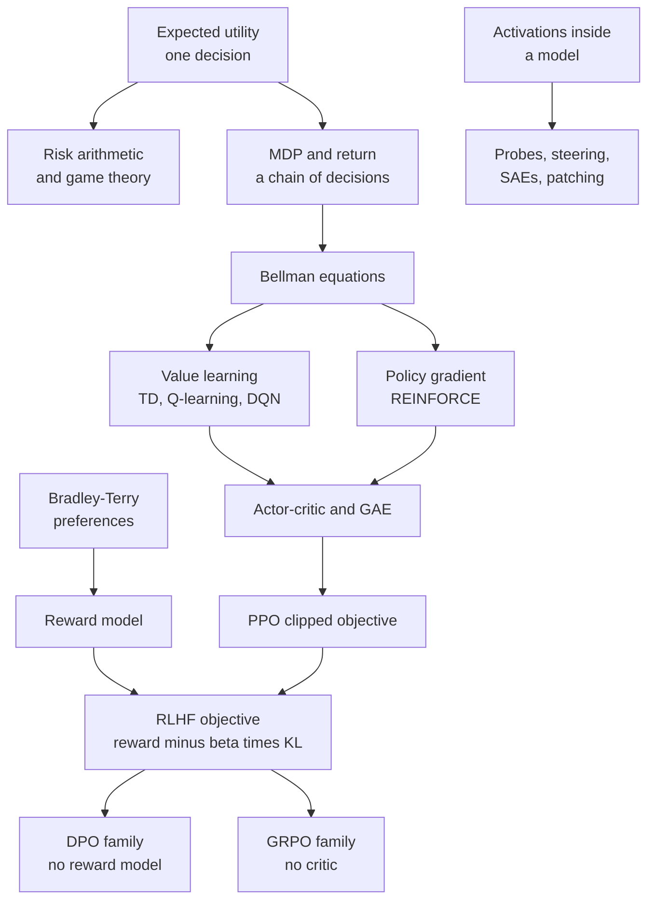
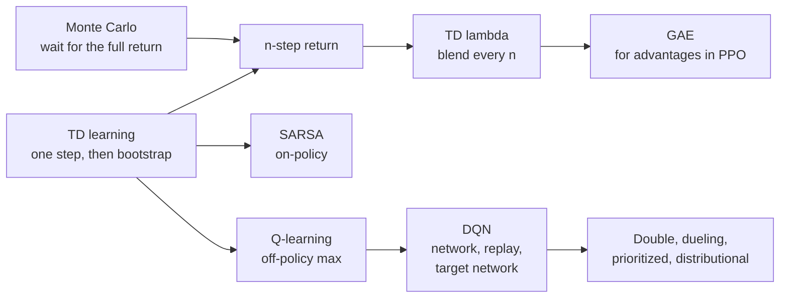
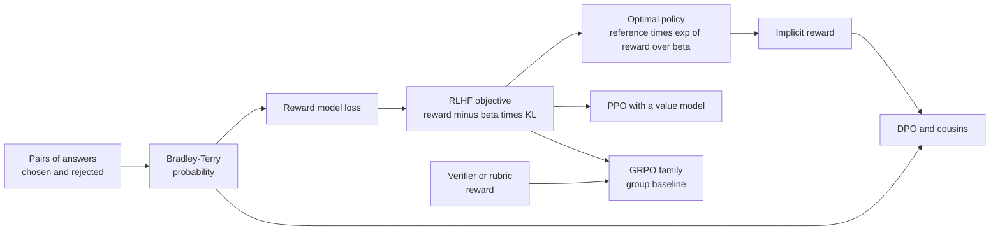
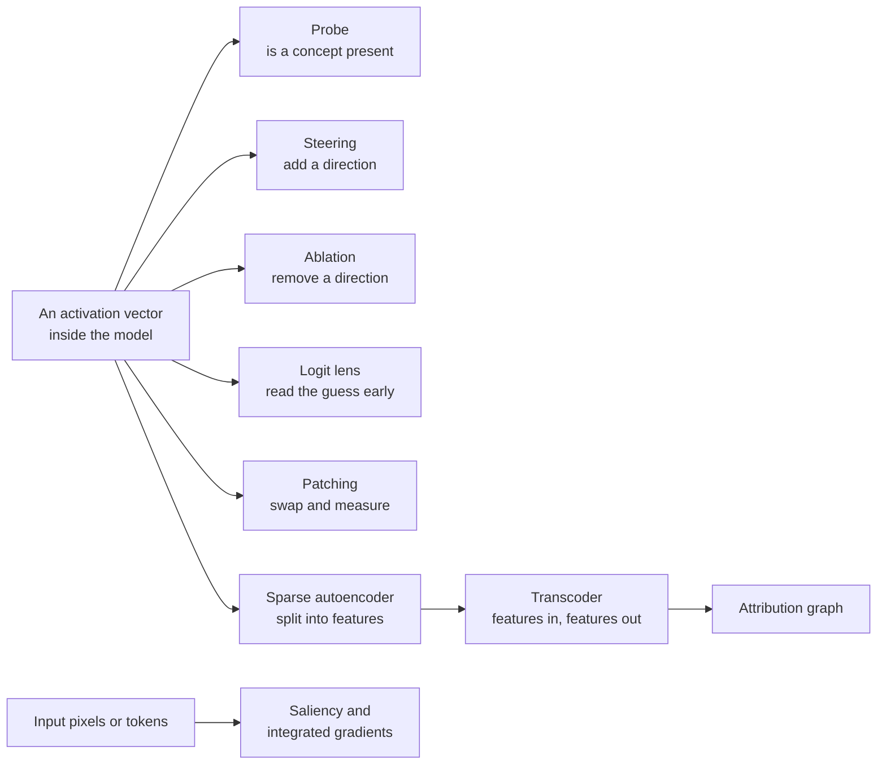

## Reinforcement learning, alignment and safety

These are the equations of deciding, and of steering what an AI decides. They begin with one choice made under uncertainty (expected utility) and the simple arithmetic of risk, then add other players (game theory). Next they stretch a single choice over time: the Markov decision process, the return and the Bellman equations, which every reinforcement learning method tries to solve. From there two families grow. One learns how good situations and actions are (temporal-difference learning, Q-learning, deep Q-networks); the other adjusts behavior directly (policy gradients, actor-critic methods, PPO). Put a reward model trained on human comparisons and a "KL leash" to the starting model on top of those, and you have the post-training of chatbots: RLHF, DPO and the GRPO family behind 2025-2026 reasoning models. The section ends with the measurements of safety research (oversight, uplift, time horizons) and the equations interpretability researchers use to look inside a model. Each entry relies only on entries above it and on Appendix B.

*Figure G.X: How the reinforcement learning, alignment and safety equations connect. Decision theory feeds the MDP, the MDP feeds two learning families, and those families plus a learned reward give the post-training of chatbots.*

### Maximum expected utility (MEU)

**What it does:** Picks the action whose possible outcomes, weighted by how likely they are, are worth the most.

`EU(a) = sum over outcomes s of (P(s given a) × U(s)); a* = argmax over a of EU(a)`

- **a**: one action the agent could take.
- **s**: one possible outcome of that action.
- **P(s given a)**: the probability of outcome s if action a is taken.
- **U(s)**: the utility of outcome s, a number saying how much the agent likes it (higher is better).
- **EU(a)**: the expected utility of action a, the probability-weighted average of its outcomes' utilities.
- **argmax over a**: "the action a that makes what follows as large as possible".
- **a\***: the action chosen, the one with the highest expected utility.

**In plain words:** For each action, list what might happen, multiply how much you would like each result by how likely it is, and add the products. Do that for every action and pick the biggest total. Utilities need not be money: someone who gets less joy from a second thousand dollars than from the first will turn down a fair coin flip, which is risk aversion.

**Tiny example:** A chatbot agent is unsure what you meant. If it answers now, it is right with probability 0.6 (utility 10) and wrong with probability 0.4 (utility −5): EU(answer) = 0.6 × 10 + 0.4 × (−5) = 6 − 2 = 4. If it asks a clarifying question first, it always gets the task right but costs you a little time, utility 8: EU(ask) = 1 × 8 = 8. Since 8 > 4, the argmax is "ask".

**Where it is used:** The decision rule behind the rational agents of Russell and Norvig's *Artificial Intelligence: A Modern Approach*, agents deciding whether to act or to ask, and the risk calculations later in this section. John von Neumann and Oskar Morgenstern showed that anyone whose preferences obey a few consistency rules behaves as if maximizing some utility. A Markov decision process (below) chains this decision over time, with rewards in place of utilities.
**In the book:** Chapter 48 (Deciding when you are not sure: expected utility).

> **Definition — Argmax:** The input that makes a function as large as possible, as opposed to max, which is that largest value itself. If action A scores 4 and action B scores 8, the max is 8 and the argmax is B.

### Value of perfect information (VPI)

**What it does:** Measures how much better you expect to decide if you could learn something before acting.

`VPI = (sum over evidence values e of P(e) × max over a of EU(a given e)) − max over a of EU(a)`

- **e**: one possible result of the information you might get (for example "it will rain").
- **P(e)**: the probability of that result.
- **EU(a given e)**: the expected utility of action a once you know e.
- **max over a of EU(a given e)**: the best you can do after seeing e.
- **max over a of EU(a)**: the best you can do right now, without the information.
- **VPI**: the value of perfect information, always 0 or more.

**In plain words:** Imagine getting each possible answer in turn, choose the best action for that answer, and average those best results using the answers' probabilities. Subtract the best you can do without asking. Information that could never change your choice is worth exactly zero.

**Tiny example:** Chapter 48's umbrella. Utilities: dry and empty-handed 100, dry with an umbrella 80, soaked 0; the chance of rain is 0.3. Without information: EU(take) = 80 and EU(leave) = 0.7 × 100 + 0.3 × 0 = 70, so the best now is 80. With a perfect radar: if rain (probability 0.3), the best is take, 80; if dry (0.7), the best is leave, 100. Expected value with the radar = 0.3 × 80 + 0.7 × 100 = 24 + 70 = 94. VPI = 94 − 80 = 14.

**Where it is used:** Deciding when an agent should ask a clarifying question, which medical test is worth ordering, and active learning, where a system chooses which examples are worth paying a person to label.
**In the book:** Chapter 48 (Deciding when you are not sure: expected utility).

### Off-switch game (value of deferring to a human)

**What it does:** Shows that a machine unsure whether its plan is good gains, on average, by letting a person switch it off.

`value(defer to the human) = E[max(U, 0)] ≥ max(E[U], 0) = value(acting alone or switching itself off)`

- **U**: the true utility, to the human, of the action the robot plans; the robot does not know it exactly.
- **E[...]**: the expected value, the probability-weighted average.
- **max(U, 0)**: what deferring yields if the human lets the action go ahead when U is positive and switches the robot off (value 0) when U is negative.
- **max(E[U], 0)**: the best the robot can do on its own: act anyway (worth E[U] on average) or switch itself off (worth 0).

**In plain words:** If the person will stop the robot exactly when its plan is bad, then deferring keeps all the good cases and throws away all the bad ones. Acting alone has to accept the average, bad cases included. The advantage disappears when the robot is certain about U, or when the human is not a reliable judge.

**Tiny example:** The robot thinks its plan is worth +10 with probability 0.6 and −20 with probability 0.4. Acting alone: E[U] = 0.6 × 10 + 0.4 × (−20) = 6 − 8 = −2, so on its own it would rather switch off (0). Deferring: E[max(U, 0)] = 0.6 × 10 + 0.4 × 0 = 6. Since 6 ≥ 0, letting the human decide is worth 6 more. If the robot were sure the plan is worth +10, both sides would equal 10 and deferring would add nothing.

**Where it is used:** The off-switch game of Hadfield-Menell, Dragan, Abbeel and Russell (2017), part of Stuart Russell's program of building corrigibility from the machine's uncertainty about human preferences (assistance games).
**In the book:** Chapter 56 (Other research bets you will hear about), in words; Chapter 55 (Power-seeking, instrumental convergence and shutdown resistance).

> **Definition — Off-switch game:** A simple model of a robot, a human and an off switch, analyzed in 2017, showing that a robot uncertain about what the human wants has a reason to let the human switch it off, because the human's choice tells it whether its plan was good.

### Expected harm (risk = probability × severity)

**What it does:** Puts rare disasters and common nuisances on one scale, and turns a tiny per-use failure rate into a count at scale.

`risk = P(harm) × severity; expected incidents = p × N; P(at least one incident) = 1 − (1 − p)^N`

- **P(harm)**, **p**: the probability that one use (one request, one action) causes the harm.
- **severity**: how bad the harm is, in dollars or another unit.
- **N**: the number of uses.
- **risk**: the expected loss, the average loss over many such gambles.

**In plain words:** Multiply how likely a harm is by how big it is. Then remember scale: a one-in-ten-thousand failure becomes a daily event when a system answers millions of requests. The last formula is the chance that it happens at least once.

**Tiny example:** A harmful answer happens on p = 0.0001 of requests and costs $2,000 each time: risk per request = 0.0001 × $2,000 = $0.20. Over N = 10,000 requests, expected incidents = 0.0001 × 10,000 = 1, and P(at least one) = 1 − 0.9999^10,000 ≈ 0.632.

**Where it is used:** Risk assessments in frontier safety frameworks and product safety reviews. The EU AI Act (Article 3) defines risk as the combination of the probability of an occurrence of harm and the severity of that harm.
**In the book:** Chapter 56 (What other safety-critical industries learned: a 1-in-1,000 chance of $1 million counts as $1,000), Chapter 55 (Why small error rates are big numbers).

### Risk decomposition (hazard × exposure × vulnerability)

**What it does:** Splits a risk into three factors that can each be reduced separately.

`risk ≈ hazard × exposure × vulnerability`

- **hazard**: the source of harm and how likely or severe it is.
- **exposure**: how much of what we care about comes into contact with the hazard.
- **vulnerability**: how easily the exposed people or systems are harmed.

**In plain words:** Because the factors multiply, halving any one halves the risk. That shows where to act when the hazard itself cannot be removed.

**Tiny example:** Chapter 56's phishing case: 20,000 AI-written emails reach inboxes (exposure) and 2% are clicked (vulnerability): 20,000 × 0.02 = 400 clicks. Halve both: 10,000 × 0.01 = 100, a fourfold cut without touching the hazard.

**Where it is used:** Disaster-risk practice; Hendrycks and Mazeika's "X-Risk Analysis for AI Research" (2022) sorts safety work by the factor it reduces. Labs cannot un-invent a capability, but access tiers cut exposure and classifiers, monitoring and patching cut vulnerability.
**In the book:** Chapter 56 (What other safety-critical industries learned).

### Compounding reliability over many steps

**What it does:** Gives the chance that a long chain of steps all succeed, and the chance that at least one of many tries succeeds.

`P(all n steps succeed) = p^n; per-step reliability needed for target T: p = T^(1 ÷ n); P(at least one success in k tries) = 1 − (1 − p)^k`

- **p**: the probability that one step (or one try) succeeds, assumed independent of the others.
- **n**: the number of steps that must all succeed.
- **T**: the target success rate for the whole task.
- **k**: the number of independent tries.

**In plain words:** Small error rates multiply fast over long tasks. Run the same arithmetic the other way and an attacker with many attempts eventually gets through.

**Tiny example:** 0.95^20 ≈ 0.358, so a 20-step agent task with 95%-reliable steps finishes only about a third of the time. To finish a 100-step task 90% of the time, each step needs 0.9^(1 ÷ 100) ≈ 0.99895, about 99.9%. An attack that works 20% of the time succeeds at least once in 10 tries with probability 1 − 0.8^10 ≈ 0.893.

**Where it is used:** Planning agent reliability; it is why METR's 80% time horizon is several times shorter than its 50% horizon (below), and why jailbreak success rises with the number of attempts. AI control turns it around in the defenders' favor: if each sabotage attempt by an untrusted model escapes the monitor with probability 0.4, a plan that needs five attempts escapes every time with probability 0.4^5 ≈ 0.01.
**In the book:** Chapter 55 (From answers to actions: errors compound), Chapter 28, Chapter 31 (Evaluating agents), Chapter 57 (Why evaluations keep getting harder), Chapter 56 (AI control: safety even if the model is not trustworthy).

### Defense in depth (multiplying pass-through rates)

**What it does:** Combines several imperfect safety layers into an overall rate at which attacks get through.

`pass-through = product over layers i of (1 − c_i), if layers fail independently; in general P(pass all) = P(pass layer 1) × P(pass layer 2 given passed layer 1) × ...`

- **c_i**: the catch rate of layer i, the share of attempts it stops.
- **1 − c_i**: the share it lets through.
- **product over layers**: multiply the shares together.
- **P(pass layer 2 given passed layer 1)**: the chance the second layer also misses, among attempts that already beat the first.

**In plain words:** Independent layers multiply small failure rates into a very small one. Layers that share a blind spot fail together, and the conditional form shows how that correlation eats the benefit. This is the arithmetic of the Swiss cheese model.

**Tiny example:** Chapter 56's four layers catch 90%, 80%, 75% and 50%: 0.10 × 0.20 × 0.25 × 0.5 = 0.0025, or 2.5 in 1,000. Now take an attack style that fools both classifiers for the same reason, so that together they let through 60% of what gets past training instead of 0.20 × 0.25 = 0.05: the first three layers let through 0.10 × 0.60 = 0.06 instead of 0.10 × 0.05 = 0.005, twelve times more.

**Where it is used:** Layered safeguards around frontier models: trained refusals, input and output classifiers such as constitutional classifiers, account monitoring and access tiers, as in Anthropic's ASL-3 protections.
**In the book:** Chapter 56 (Worked example: how layers multiply), Chapter 31 (Defense in depth).

> **Definition — Swiss cheese model:** A picture from aviation and medical safety in which each layer of defense is a slice of cheese with holes; harm gets through only when the holes in every slice line up, so many imperfect but different layers can be very safe together.

### Attack success rate (ASR) and refusal rates

**What it does:** Reports how often attacks get through a model or safeguard, alongside how often harmless requests are wrongly refused.

`ASR = successful attacks ÷ attempts; over-refusal rate = refused benign requests ÷ benign requests; ASR over k independent tries = 1 − (1 − ASR_1)^k`

- **ASR**: attack success rate, the share of jailbreak or misuse attempts that succeed.
- **ASR_1**: the success rate of a single attempt.
- **k**: the number of attempts.
- **over-refusal rate**: the share of harmless requests the system wrongly refuses, the other side of the trade-off.

**In plain words:** Count wins over tries, and always report the false alarms next to it, because a system that refuses everything has an ASR of zero and is useless.

**Tiny example:** Chapter 56's classifier example: 860 of 1,000 automated jailbreaks succeed without classifiers (ASR = 0.86) and 44 of 1,000 with them (0.044). An attacker allowed 10 independent tries against the protected system succeeds at least once with probability 1 − 0.956^10 ≈ 0.362.

**Where it is used:** Safety sections of system cards, HarmBench-style benchmarks and bug-bounty evaluations. Anthropic reported in February 2025 that automated jailbreaks succeeded 86% of the time against an unprotected model and 4.4% with constitutional classifiers.
**In the book:** Chapter 31 (Red-teaming your own system), Chapter 56 (Classifiers and constitutional classifiers), Chapter 57 (Red-teaming: trying to break it), Chapter 20 (Refusal calibration).

### Power-law scaling of repeated jailbreak attempts (Best-of-N jailbreaking)

**What it does:** Predicts how an attacker's success grows with the number of tries, from a straight-line fit that can be extended to budgets nobody has tested yet.

`−ln(ASR_N) = a × N^(−b), so ASR_N = exp(−a × N^(−b)); fitted as the straight line ln(−ln(ASR_N)) = ln(a) − b × ln(N)`

- **ASR_N**: the share of harmful requests that get through at least once within N attempts each.
- **N**: the number of attempts per request, each a small random variation such as shuffled capital letters or typos.
- **a**, **b**: constants fitted to the data; a larger b means success grows faster with N.
- **ln**: the natural logarithm; **exp(...)**: e raised to that power.

**In plain words:** If every attempt were an independent coin flip, success would race toward 100% as 1 − (1 − p)^N (the attack success rate entry above). Real attempts are not independent: some requests resist almost every variation, so success climbs more slowly, and in experiments −ln(ASR) shrinks like a power of N. Fitting the line on small N lets defenders forecast what a determined attacker with thousands of tries would achieve. A related 2024 study of many-shot jailbreaking found that the likelihood of a harmful reply also follows power laws in the number of fake example dialogues packed into one long prompt.

**Tiny example:** Illustrative constants a = 3 and b = 0.3, not a paper's fit. N = 1: −ln(ASR) = 3, so ASR = e^(−3) ≈ 0.050. N = 100: 100^(−0.3) ≈ 0.251, so −ln(ASR) ≈ 3 × 0.251 = 0.754 and ASR ≈ e^(−0.754) ≈ 0.47. N = 10,000: 10,000^(−0.3) ≈ 0.063, so −ln(ASR) ≈ 0.189 and ASR ≈ 0.83. Independent tries at 5% each would already have reached 1 − 0.95^100 ≈ 0.994 by N = 100.

**Where it is used:** Hughes and colleagues ("Best-of-N Jailbreaking", Anthropic and collaborators, December 2024) reached 89% success on GPT-4o and 78% on Claude 3.5 Sonnet with 10,000 varied prompts, and forecast large-N success from power-law fits on smaller samples; Anil and colleagues (Anthropic, 2024) for many-shot jailbreaking; sizing red-team budgets and stress-testing safeguards.
**In the book:** Only here (Chapter 56 and Chapter 57 cover jailbreaks and red-teaming in words).

> **Definition — Best-of-N jailbreaking:** An automated attack that resubmits a harmful request many times with small random changes, such as shuffled capital letters, typos or altered audio and images, until one version gets through. Its success rate grows with the number of attempts in a predictable way.

> **Definition — Many-shot jailbreaking:** An attack that fills a long prompt with many made-up dialogues in which an assistant complies with harmful requests, so that the model continues the pattern; it exploits long context windows.

### Private versus social expected loss (externality gap)

**What it does:** Shows why a developer may skip a safety step that society would want, when most of the damage falls on others.

`developer pays for safety when cost < p × L_developer; society wants it when cost < p × (L_developer + L_others); externality gap = p × L_others`

- **p**: the probability of an incident.
- **L_developer**: the part of the damage the developer bears.
- **L_others**: the part that falls on everyone else.
- **cost**: the price of the extra safety work.

**In plain words:** Each side compares the cost of prevention with its own expected loss. When most of the loss is external, the two answers disagree, a market failure that liability law and regulation try to correct.

**Tiny example:** Chapter 59's numbers: p = 1%, the lab bears $100 million and others $9.9 billion. The lab's expected loss is 0.01 × $100 million = $1 million, less than a $50 million test, so it skips. Society's is 0.01 × $10 billion = $100 million, more than the test. The gap is 0.01 × $9.9 billion = $99 million.

**Where it is used:** AI liability and regulation debates, insurance and safety-standard arguments.
**In the book:** Chapter 59 (Why governing AI is hard: Worked example: who pays for the accident?).

### Payoff matrix, dominant strategy and Nash equilibrium

**What it does:** Tests whether a combination of choices is stable, meaning no player gains by changing only their own choice.

`Nash equilibrium: u_i(s_i*, s_−i*) ≥ u_i(s_i, s_−i*) for every player i and every alternative s_i; dominant strategy d: u_i(d, s_−i) ≥ u_i(s_i, s_−i) for every s_i and every s_−i`

- **i**: one player.
- **u_i**: player i's payoff, read from one cell of the payoff matrix.
- **s_i**: a strategy (choice) of player i; **s_−i**: the strategies of everyone else.
- **s_i\***, **s_−i\***: the strategies in the candidate equilibrium.
- **d**: a dominant strategy, best for player i whatever the others do.

**In plain words:** Freeze everyone else's choice and ask each player, "could you do better by switching?" If nobody can, the outcome is a Nash equilibrium. A dominant strategy is even stronger: it wins against every possible choice of the others. An equilibrium need not be good for the group (Pareto optimal).

**Tiny example:** Chapter 59's racing game, payoffs to Lab A: both careful 7, A fast while B careful 9, A careful while B fast 1, both fast 3. If B is careful, fast gives A 9 > 7; if B is fast, fast gives 3 > 1, so fast is dominant. At (fast, fast) A switching to careful drops from 3 to 1, and the same for B, so (fast, fast) is the Nash equilibrium, although (careful, careful) gives both 7.

**Where it is used:** Multi-agent reinforcement learning and self-play, poker and Diplomacy AIs, and governance analysis of racing. Nash learning from human feedback (Munos and colleagues, Google DeepMind, 2023) frames alignment as finding the equilibrium of a preference game.
**In the book:** Chapter 48 (A short course in game theory), Chapter 59 (Why governing AI is hard: the racing game).

> **Definition — Payoff matrix:** A table listing, for every combination of players' choices, what each player gets. Game theorists read best responses and equilibria straight off it.

### Prisoner's dilemma payoffs and the repeated-game cooperation threshold

**What it does:** Defines the prisoner's dilemma by four payoffs and gives how much players must value the future for cooperation to last.

`T > R > P > S and 2 × R > T + S; in the infinitely repeated game, mutual cooperation under grim trigger is an equilibrium when δ ≥ (T − R) ÷ (T − P)`

- **T**: the temptation payoff for defecting on a cooperator.
- **R**: the reward for mutual cooperation.
- **P**: the punishment for mutual defection.
- **S**: the sucker's payoff for cooperating with a defector.
- **δ** (delta): the discount factor between 0 and 1 for future rounds (how much tomorrow's payoff counts today; it plays the same role as γ in reinforcement learning).

**In plain words:** Defecting is dominant in one round, yet both prefer mutual cooperation. If the game repeats and the future matters enough, the threat of punishment ("if you defect once, I defect forever") makes cooperating the better deal.

**Tiny example:** The racing game has T = 9, R = 7, P = 3, S = 1: 9 > 7 > 3 > 1 and 2 × 7 = 14 > 9 + 1 = 10. Threshold: (9 − 7) ÷ (9 − 3) = 2 ÷ 6 ≈ 0.33. Check at δ = 0.5: cooperating forever is worth 7 ÷ (1 − 0.5) = 14; defecting is worth 9 now plus 3 every later round, 9 + 0.5 × 3 ÷ (1 − 0.5) = 12, so cooperate. At δ = 0.25: 7 ÷ 0.75 ≈ 9.33 against 9 + 0.25 × 3 ÷ 0.75 = 10, so defect.

**Where it is used:** Analyses of racing between AI labs and countries and of why voluntary restraint is fragile; Axelrod's tournaments around 1980, which tit-for-tat won.
**In the book:** Chapter 48 (A short course in game theory, Table 48.8), Chapter 59 (Why governing AI is hard: the racing game), Chapter 60.

> **Definition — Repeated game:** A game played over and over by the same players, so that what they do now can be rewarded or punished later. Cooperation that fails in a single round can hold up when the game repeats.

> **Definition — Grim trigger:** A strategy for a repeated game that cooperates until the other player defects once, then defects forever after. It is the harshest possible threat, which makes it the easiest way to sustain cooperation in theory.

> **Definition — Tit-for-tat:** A strategy for the repeated prisoner's dilemma that cooperates in the first round and then copies whatever the other player did in the previous round. It won Robert Axelrod's computer tournaments around 1980.

### Expected-value model of an AI race

**What it does:** Shows how teams that trade safety for speed can be pushed toward less safety, especially when they dislike a rival winning.

`EV_i = sum over possible winners j of P(j wins) × [(1 − d(s_j)) × U_i(j wins safely) + d(s_j) × U_disaster]`

- **EV_i**: team i's expected value.
- **j**: a team that might win; **P(j wins)**: its chance, which rises when it skimps on safety.
- **s_j**: team j's safety effort, between 0 and 1.
- **d(s)**: the chance of disaster given the winner's safety effort, for example d = 1 − s.
- **U_i(j wins safely)**: how much team i values a safe win by team j; lower when j is a rival (the gap is called enmity).
- **U_disaster**: the value to team i of a disaster.

**In plain words:** Each team's payoff is a weighted average over who wins and whether that win ends in disaster. Skimping raises your chance of winning but also the chance that your win goes badly. If a rival's win is nearly as good to you as your own, skimping rarely pays; if you hate the rival winning, it can.

**Tiny example:** A simplified version (not the paper's exact parameters). Two teams, U_disaster = 0, a safe win by yourself worth 1. Both careful (s = 0.9, each wins with 0.5); team 1 considers skimping to s = 0.8, which raises its win chance to 0.8. With full enmity (a rival's win worth 0): careful gives 0.5 × 0.9 × 1 = 0.45, skimping gives 0.8 × 0.8 × 1 = 0.64, so skimp. With no enmity (a rival's win worth 1 too): careful gives 0.5 × 0.9 + 0.5 × 0.9 = 0.9, skimping gives 0.8 × 0.8 + 0.2 × 0.9 = 0.82, so stay careful.

**Where it is used:** Armstrong, Bostrom and Shulman, "Racing to the precipice" (2016), found that more teams and more enmity push equilibrium safety down; AI governance arguments for coordination, verification and compute-based agreements.
**In the book:** Chapter 59 (Why governing AI is hard: the racing game), Chapter 60, in words.

> **Definition — Enmity (in AI race models):** How much less a team values a rival's success than its own. In race models, higher enmity makes teams more willing to cut safety to win.

### Mixed-strategy equilibrium and the minimax theorem

**What it does:** Finds the random mix of moves that leaves an opponent nothing to exploit, and states that in two-player zero-sum games the best guarantee for each side meets at one value.

`indifference: choose the opponent's mix q so that q × u(a_1, b_1) + (1 − q) × u(a_1, b_2) = q × u(a_2, b_1) + (1 − q) × u(a_2, b_2); minimax theorem: max over x of min over y of (x^T × A × y) = min over y of max over x of (x^T × A × y)`

- **a_1, a_2**: your two actions; **b_1, b_2**: the opponent's two actions.
- **u(a, b)**: your payoff when you play a and the opponent plays b.
- **q**: the probability that the opponent plays b_1.
- **A**: the payoff matrix of a two-player zero-sum game (your gain is the opponent's loss).
- **x**, **y**: mixed strategies, lists of probabilities over each player's moves; **x^T** is x written as a row (its transpose).
- **x^T × A × y**: your expected payoff when both mix.

**In plain words:** In a mixed equilibrium each player randomizes so the other is indifferent between their options. Von Neumann's theorem says that in zero-sum games the best payoff you can guarantee equals the least the opponent can hold you to: the value of the game.

**Tiny example:** A penalty kick. Chance of scoring: kick left, keeper dives left 0.6; kick left, dives right 0.9; kick right, dives left 0.95; kick right, dives right 0.7. The keeper dives left with probability q that makes the kicker indifferent: q × 0.6 + (1 − q) × 0.9 = q × 0.95 + (1 − q) × 0.7, so 0.9 − 0.3 × q = 0.7 + 0.25 × q, giving q = 0.2 ÷ 0.55 ≈ 0.364 and a scoring chance of 0.9 − 0.3 × 0.364 ≈ 0.791. The kicker kicks left with x = 0.25 ÷ 0.55 ≈ 0.455, which also gives 0.791. Both guarantees meet, as the theorem says.

**Where it is used:** Bluffing frequencies in poker programs, security patrol scheduling, and adversarial training formulations. Minimax search over game trees is a separate entry in the classical-AI section.
**In the book:** Chapter 48 (A short course in game theory: rock-paper-scissors at one-third each), in words.

> **Definition — Minimax theorem:** John von Neumann's 1928 result that in any two-player zero-sum game with mixed strategies, the most a player can guarantee equals the least the opponent can hold them to. That shared number is the value of the game.

> **Definition — Transpose:** Turning a column of numbers into a row (or a matrix's rows into its columns), written with a superscript T, as in x^T. It lets two vectors be multiplied into a single number, x^T × y, which is their dot product.

### Second-price (Vickrey) auction and truthful bidding

**What it does:** Sets auction rules under which bidding your true value is your best strategy.

`winner = highest bidder, who pays the second-highest bid b_(2); u_i = v_i − b_(2) if i wins, else 0; bidding b_i = v_i is a dominant strategy`

- **b_i**: bidder i's bid; **b_(2)**: the second-highest bid.
- **v_i**: what the item is truly worth to bidder i.
- **u_i**: bidder i's gain (utility).

**In plain words:** Your bid decides only whether you win, never what you pay. Overbidding risks winning at a price above your value; underbidding risks losing a profitable win. So honesty is optimal: mechanism design that makes truth-telling the best strategy.

**Tiny example:** Values 50, 40 and 30, everyone bids truthfully. Bidder 1 wins and pays 40, gaining 50 − 40 = 10. Had bidder 1 shaded to 35, bidder 2 (40) would win and bidder 1 would gain 0. Had bidder 2 overbid 60, it would win, pay 50 and gain 40 − 50 = −10.

**Where it is used:** Mechanism design in AIMA; the incentive logic behind sponsored-search and ad-exchange auctions (many exchanges moved to first-price auctions by 2019); spectrum auctions. Its multi-slot cousin for ads, generalized second-price, is not truthful in general and sits with ad ranking in the classical-ML section.
**In the book:** Chapter 48 (A short course in game theory: You can design the game), Chapter 51 (The auction, worked by hand).

> **Definition — Truthful mechanism (incentive compatible):** A set of rules, such as an auction format, under which each participant's best strategy is to report their true value or preference, so nobody gains by lying.

### Markov decision process and the Markov property (MDP)

**What it does:** Writes any problem of repeated decisions as five ingredients, the common language of planning and reinforcement learning.

`MDP = (S, A, P, R, γ), with transition probabilities P(s' given s, a) and expected reward R(s, a); Markov property: P(s_(t+1) given s_t, a_t) = P(s_(t+1) given s_0, a_0, ..., s_t, a_t)`

- **S**: the set of states (situations the agent can be in).
- **A**: the set of actions.
- **P(s' given s, a)**: the transition probability that action a in state s leads to next state s'.
- **R(s, a)**: the expected reward for taking action a in state s.
- **γ** (gamma): the discount factor, between 0 and 1, that shrinks later rewards.
- **s_t**, **a_t**: the state and action at time step t; **s_0, a_0, ...**: the whole history.

**In plain words:** An MDP says what situations exist, what you can do, where each action probably leads, what it pays and how much the future counts. The Markov property says the present state already contains everything needed to predict the next one, so remembering the history adds nothing. Variants merged here: rewards written R(s, a, s'), episodic versus continuing tasks, and finite-horizon MDPs; the partially observable case has its own entry below.

**Tiny example:** A slippery corridor: from square A, action "right" reaches B with probability 0.8 and leaves you in A with 0.2 (0.8 + 0.2 = 1, as every row of P must). If entering B pays 10 and staying pays 0, then R(A, right) = 0.8 × 10 + 0.2 × 0 = 8. The Markov property holds because those probabilities depend only on being in A now, not on how you got there.

**Where it is used:** The formal frame of every algorithm in this section: games such as Atari and Go, robot control, data-center cooling control, and language-model post-training, where the state is the prompt plus the tokens written so far, the action is the next token, the transition simply appends that token, and the reward usually arrives at the end.
**In the book:** Chapter 48 (Markov decision processes: the formal frame), Chapter 20 (A two-paragraph refresher on reinforcement learning).

> **Definition — Transition probability:** In a Markov decision process, the probability that taking a given action in a given state leads to a particular next state. The full table of them is the transition model, the "rules" of the environment.

### Discounted return (G)

**What it does:** Adds up all future rewards from a moment on, counting later ones a little less.

`G_t = r_(t+1) + γ × r_(t+2) + γ^2 × r_(t+3) + ... = sum over k ≥ 0 of (γ^k × r_(t+k+1)); recursively G_t = r_(t+1) + γ × G_(t+1)`

- **G_t**: the return from time step t onward.
- **r_(t+1)**: the reward received right after step t; **r_(t+k+1)**: the reward k steps later.
- **γ** (gamma): the discount factor, from 0 to 1.
- **k**: how many steps into the future a reward lies.

**In plain words:** A reward k steps away is multiplied by γ k times. The recursive form says "the return now is the next reward plus the discounted return from the next step", the seed of the Bellman equations. The effective planning horizon is about 1 ÷ (1 − γ) steps. With γ = 1 and an episode that ends, the return is just the sum of rewards, the usual setting for training language models, where one reward arrives at the end.

**Tiny example:** Rewards 0, 0 and then 10, with γ = 0.9: G_0 = 0 + 0.9 × 0 + 0.81 × 10 = 8.1. The recursive way, from the end: G_2 = 10, G_1 = 0 + 0.9 × 10 = 9, G_0 = 0 + 0.9 × 9 = 8.1. The horizon is 1 ÷ (1 − 0.9) = 10 steps; γ = 0.99 gives about 100.

**Where it is used:** The learning target of every value-based and policy-gradient method. DQN on Atari used γ = 0.99; PPO-based RLHF implementations such as Hugging Face TRL's PPO trainer default to γ = 1, so the return is the final reward-model score minus the per-token KL penalties.
**In the book:** Chapter 48 (Rewards, returns and discounting).

> **Definition — Effective horizon:** Roughly how many steps ahead an agent with discount factor γ cares about, about 1 ÷ (1 − γ). With γ = 0.9 rewards beyond about 10 steps barely count; with γ = 0.99, about 100.

### State-value and action-value functions (V and Q)

**What it does:** Defines how good a state is, and how good an action in that state is, as expected returns.

`V_π(s) = E_π[G_t given s_t = s]; Q_π(s, a) = E_π[G_t given s_t = s, a_t = a]; V_π(s) = sum over a of (π(a given s) × Q_π(s, a))`

- **π** (pi): the policy; **π(a given s)** is the probability it chooses action a in state s.
- **V_π(s)**: the state value, the expected return starting from state s and following π.
- **Q_π(s, a)**: the action value, the expected return after taking action a in s and following π afterward.
- **E_π[...]**: the expected value over the randomness of the policy and the environment.
- **G_t**: the return from time t (previous entry).

**In plain words:** V answers "how good is it to be here?" and Q answers "how good is this move here?". A state's value is the policy-weighted average of its action values.

**Tiny example:** In state s the policy picks "right" with probability 0.75 and "left" with 0.25, and Q(s, right) = 8, Q(s, left) = 2. Then V(s) = 0.75 × 8 + 0.25 × 2 = 6 + 0.5 = 6.5.

**Where it is used:** Critics and value heads everywhere: the value model in PPO-based RLHF, AlphaGo's value network, DQN's Q-network and the value head of MuZero.
**In the book:** Chapter 48 (Policies and values), Chapter 20 (The RLHF loop: value model).

### Bellman expectation equation

**What it does:** Breaks a state's value into the expected next reward plus the discounted value of where you land, for a fixed policy.

`V_π(s) = sum over a of π(a given s) × sum over s' of P(s' given s, a) × (R(s, a, s') + γ × V_π(s')); Q_π(s, a) = sum over s' of P(s' given s, a) × (R(s, a, s') + γ × sum over a' of π(a' given s') × Q_π(s', a'))`

- **V_π**, **Q_π**: the state and action values of policy π (previous entry).
- **π(a given s)**: the probability the policy picks action a in s.
- **P(s' given s, a)**: the transition probability to next state s'.
- **R(s, a, s')**: the reward for that step.
- **γ**: the discount factor.
- **a'**: the action taken in the next state.

**In plain words:** Value now equals the reward you expect next plus the discounted value of the next state, averaged over the policy's choices and the environment's randomness. It turns a sum over whole futures into a one-step recursion, which is what makes values computable and learnable a step at a time. Written with expectations: V_π(s) = E_π[r_(t+1) + γ × V_π(s_(t+1)) given s_t = s].

**Tiny example:** In state s the policy picks right or left with probability 0.5 each; γ = 0.9. Right leads to a state worth 10 with probability 0.8 or to one worth 0 with probability 0.2, reward 0 either way: 0.8 × (0 + 0.9 × 10) + 0.2 × (0 + 0.9 × 0) = 7.2. Left leads for sure to a state worth 2, with reward 1: 1 × (1 + 0.9 × 2) = 2.8. So V(s) = 0.5 × 7.2 + 0.5 × 2.8 = 3.6 + 1.4 = 5.0.

**Where it is used:** Policy evaluation, the targets of TD learning and SARSA, and every learned critic, from the value model in RLHF to actor-critic robot controllers.
**In the book:** Chapter 48 (Policies and values).

> **Definition — Policy evaluation:** Computing how much return a fixed policy earns from each state, usually by applying the Bellman expectation equation over and over until the values stop changing.

### Bellman optimality equation

**What it does:** Describes the best possible values: the best action's expected reward plus the discounted best value of where it leads.

`V*(s) = max over a of sum over s' of P(s' given s, a) × (R(s, a, s') + γ × V*(s')); Q*(s, a) = sum over s' of P(s' given s, a) × (R(s, a, s') + γ × max over a' of Q*(s', a')); π*(s) = argmax over a of Q*(s, a)`

- **V\*(s)**, **Q\*(s, a)**: the optimal state and action values, the best achievable over all policies.
- **max over a**: take the largest over actions.
- **P(s' given s, a)**, **R(s, a, s')**, **γ**: transition probability, reward and discount, as above.
- **π\*(s)**: an optimal policy, which picks the action with the highest Q\*.
- **s'**, **a'**: the next state and an action in it.

**In plain words:** The expectation equation averages over the policy's choices; the optimality equation takes the best choice instead. Once you know Q\*, acting well is easy: in every state pick the action with the biggest Q\*.

**Tiny example:** Same state as the previous entry, with those next-state values now taken as optimal: Q\*(s, right) = 7.2 and Q\*(s, left) = 2.8, so V\*(s) = max(7.2, 2.8) = 7.2 and π\*(s) = right. In Chapter 48's deterministic corridor the final values 10, 9 and 8.1 satisfy it: 9 = 0 + 0.9 × 10 and 8.1 = 0 + 0.9 × 9.

**Where it is used:** The fixed point that value iteration, Q-learning and DQN aim at. The max inside it is also the source of the overestimation bias that Double DQN (below) fixes.
**In the book:** Chapter 48 (Markov decision processes: the formal frame).

> **Definition — Optimal value function:** The highest expected return achievable from each state (written V\*) or from each state-and-action pair (written Q\*) by any policy. Acting greedily on Q\* gives an optimal policy.

### Value iteration

**What it does:** Computes optimal values when the rules are known, by applying the Bellman optimality equation as an update until nothing changes.

`V_(k+1)(s) = max over a of sum over s' of P(s' given s, a) × (R(s, a, s') + γ × V_k(s')), for every state s, repeated until max over s of |V_(k+1)(s) − V_k(s)| is below a small threshold`

- **V_k(s)**: the value estimate of state s after k sweeps; all start at 0.
- **P**, **R**, **γ**: transition probabilities, rewards and discount (known in advance).
- **|...|**: the absolute value, the size of a change ignoring its sign.
- **threshold**: a small number such as 0.001 at which you stop.
- **s'**: a possible next state; **a**: an action; **V_(k+1)(s)**: the new estimate after one more sweep.

**In plain words:** Sweep through every state, replacing its value with "best immediate reward plus discounted value of where that action leads", using the previous sweep's values. Each sweep shrinks the worst error by at least a factor γ (the update is a contraction), so the values settle on V\*. Variants: in-place sweeps that use new values immediately, and "soft" value iteration, which replaces the max with a smooth maximum in maximum-entropy RL.

**Tiny example:** A slippery corridor A, B, then a goal worth +10; "right" moves one square with probability 0.8 and fails (you stay) with 0.2; γ = 0.9; "left" is always worse here, so the max picks "right". Sweep 1: V(B) = 0.8 × 10 + 0.2 × 0.9 × 0 = 8; V(A) = 0.8 × 0.9 × 0 + 0.2 × 0.9 × 0 = 0. Sweep 2: V(B) = 8 + 0.2 × 0.9 × 8 = 9.44; V(A) = 0.8 × 0.9 × 8 + 0.2 × 0.9 × 0 = 5.76. Sweep 3: V(B) = 8 + 0.18 × 9.44 ≈ 9.70; V(A) = 0.72 × 9.44 + 0.18 × 5.76 ≈ 7.83. They converge to about 9.76 and 8.57.

**Where it is used:** Planning when the model of the world is known: gridworlds, inventory and queueing problems, small robot maps, and the inner loop of maximum-entropy inverse RL (below).
**In the book:** Chapter 48 (Markov decision processes: the formal frame: the deterministic corridor in three sweeps, 10, 9, 8.1).

> **Definition — Contraction (in value iteration):** An update that always brings any two sets of value estimates closer together by at least a fixed factor, here γ. Repeating a contraction is guaranteed to converge to a single answer, which is why value iteration always finds the optimal values.

### Policy iteration and the policy improvement theorem

**What it does:** Alternates between scoring a policy and making it greedy with respect to those scores, improving it every round.

`evaluate: solve V_π from the Bellman expectation equation; improve: π_new(s) = argmax over a of sum over s' of P(s' given s, a) × (R(s, a, s') + γ × V_π(s')); theorem: if Q_π(s, π_new(s)) ≥ V_π(s) for every s, then V_(π_new)(s) ≥ V_π(s) for every s`

- **π**, **π_new**: the current and the improved policy.
- **V_π**, **Q_π**: the values of the current policy.
- **π_new(s)**: the action the new policy picks in state s.
- **P**, **R**, **γ**: as above.
- **s'**: a possible next state; **V_(π_new)**: the value of the new policy.

**In plain words:** Work out exactly how good your current plan is, then in each state switch to the action that looks best under those numbers. The theorem guarantees the new plan is at least as good everywhere, and a finite MDP reaches an optimal policy in a finite number of rounds. The general pattern of interleaving evaluation and improvement is called generalized policy iteration.

**Tiny example:** State A: "stay" pays 1 and stays in A; "go" pays 0 and moves to B. State B: "stay" pays 2 forever. γ = 0.9. Start with "stay" everywhere. Evaluate: V(B) = 2 ÷ (1 − 0.9) = 20 and V(A) = 1 ÷ 0.1 = 10. Improve A: Q(A, stay) = 1 + 0.9 × 10 = 10, Q(A, go) = 0 + 0.9 × 20 = 18, so switch to "go". The new V(A) is 18, up from 10, and a second round changes nothing: optimal.

**Where it is used:** A textbook planning method. Generalized policy iteration is the template behind actor-critic methods and behind AlphaZero, where tree search improves the policy and the network learns to evaluate it.
**In the book:** Chapter 48 (Markov decision processes: the formal frame), named in the value iteration definition.

> **Definition — Policy iteration:** A planning method for MDPs with known rules that repeatedly computes the value of the current policy and then switches each state to the action that looks best under those values, until the policy stops changing.

> **Definition — Policy improvement theorem:** The guarantee that a policy made greedy with respect to another policy's values is at least as good as that policy in every state.

> **Definition — Generalized policy iteration (GPI):** The general pattern of letting a value estimate and a policy improve each other in turns: the values judge the policy, the policy is made greedier toward the values, and so on. Most reinforcement learning methods are versions of it.

### Potential-based reward shaping

**What it does:** Adds hints to the reward in a form that provably cannot change which policy is best.

`r'(s, a, s') = r(s, a, s') + γ × Φ(s') − Φ(s)`

- **r(s, a, s')**: the original reward for moving from s to s' with action a.
- **r'(s, a, s')**: the shaped reward the agent is trained on.
- **Φ** (capital phi): a potential, any function of the state, such as minus the distance to the goal.
- **γ**: the discount factor.

**In plain words:** Give the agent the change in "potential" as a bonus: credit for moving to a better-looking state, an equal debit for moving back. Over any path the bonuses telescope to depend only on where you started and ended, so circling earns nothing. Ng, Harada and Russell (1999) proved this form never changes the optimal policy, while other bonus schemes can create loopholes.

**Tiny example:** Corridor squares A, B, C, goal, with Φ = minus the distance to the goal: Φ(A) = −3, Φ(B) = −2. Take γ = 1 to keep it simple. Moving A to B earns −2 − (−3) = +1; moving back B to A earns −3 − (−2) = −1. A loop A to B to A nets 0. A naive bonus of +1 for every step toward the goal and nothing for steps away would pay +1 per loop, an invitation to circle like the CoastRunners boat.

**Where it is used:** Speeding up learning in robotics and games without creating new reward hacks; a reference point when designing partial or format rewards for language-model RL, which are usually not potential-based and can therefore be gamed.
**In the book:** Only here. Chapter 48 (Credit assignment) defines plain reward shaping in words and warns that it can be gamed.

> **Definition — Potential-based reward shaping:** Adding to each step's reward the discounted change in a chosen "potential" score of the state. It speeds up learning and, unlike other bonus schemes, provably leaves the best policy unchanged.

### POMDP belief update

**What it does:** Updates an agent's probabilities over hidden states after it acts and observes something.

`b'(s') = η × O(o given s', a) × sum over s of (P(s' given s, a) × b(s)), with η = 1 ÷ (the sum of the right-hand side over all s')`

- **b(s)**: the belief, the agent's probability that the hidden state is s.
- **b'(s')**: the updated belief that the new state is s'.
- **a**: the action just taken; **o**: the observation just received.
- **P(s' given s, a)**: the transition probability.
- **O(o given s', a)**: the observation model, how likely observation o is in state s'.
- **η** (eta): a normalizer that makes the new beliefs add up to 1.

**In plain words:** First predict: push your old beliefs through the transition model. Then correct: multiply each predicted state by how likely the observation is there, and rescale so everything sums to 1. It is Bayes' rule applied after every step; hidden Markov model filtering and Kalman filters, in the classical-AI section, are the same update without actions.

**Tiny example:** A robot is in the Kitchen with belief 0.6 or the Hall with 0.4. It drives east: from the Kitchen it reaches the Hall with probability 0.9 (stays with 0.1); from the Hall it stays in the Hall. Predict: Kitchen 0.6 × 0.1 = 0.06; Hall 0.6 × 0.9 + 0.4 × 1.0 = 0.94. It then sees a window, which it sees with probability 0.2 in the Kitchen and 0.7 in the Hall: 0.2 × 0.06 = 0.012 and 0.7 × 0.94 = 0.658, total 0.67, so η = 1 ÷ 0.67. New beliefs: Kitchen 0.012 ÷ 0.67 ≈ 0.018, Hall 0.658 ÷ 0.67 ≈ 0.982.

**Where it is used:** Robot localization, dialogue state tracking, poker and other hidden-information games, and any agent that must act on uncertain state.
**In the book:** Chapter 48 (Markov decision processes: the formal frame: POMDP and belief state, in words), Chapter 54 (Reasoning over time: hidden states and filters, the same update without actions).

> **Definition — Observation model:** In a partially observable problem, the probabilities of each possible observation (a sensor reading, a card shown) given the true hidden state. It tells the agent how much each observation should shift its beliefs.

*Figure G.X: The family of value-learning updates. They differ in how far they look ahead with real rewards before trusting their own estimates.*

### Monte Carlo value estimate and the incremental mean

**What it does:** Estimates a value by averaging returns actually observed, updating the average one sample at a time.

`V(s) ← V(s) + α × (G_t − V(s)); with α = 1 ÷ N(s) this is the running average of observed returns; bandit form: Q_(n+1) = Q_n + (1 ÷ n) × (R_n − Q_n)`

- **V(s)**: the current value estimate for state s.
- **←**: "is replaced by".
- **G_t**: a complete return observed after visiting s.
- **α** (alpha): the step size (learning rate).
- **N(s)**: how many times s has been visited.
- **Q_n**: the estimate of an action's value after n − 1 rewards; **R_n**: the n-th reward.

**In plain words:** New estimate = old estimate + step × (target − old estimate). With step 1 ÷ n this keeps an exact average without storing past returns; a constant step weights recent returns more, which suits a changing world. Monte Carlo estimates are unbiased but noisy, and they must wait for the episode to end. Variants: first-visit and every-visit Monte Carlo.

**Tiny example:** Chapter 48's four episodes return 10, 2, 8 and 4. Start at 0. After 10: 0 + 1 × (10 − 0) = 10. After 2: 10 + (1 ÷ 2) × (2 − 10) = 6. After 8: 6 + (1 ÷ 3) × (8 − 6) ≈ 6.67. After 4: 6.67 + (1 ÷ 4) × (4 − 6.67) = 6.0, exactly the average. With a constant α = 0.5 the estimates go 5, 3.5, 5.75, 4.875.

**Where it is used:** AlphaZero's value target is the Monte Carlo outcome of the finished game. In RL with verifiable rewards (GRPO and its relatives) each answer's single end-of-episode reward is a Monte Carlo return with no bootstrapping. Bandit action-value estimates use the incremental form.
**In the book:** Chapter 48 (Policy gradients and actor-critic methods: the average return of four episodes; Monte Carlo tree search), in words.

> **Definition — Incremental mean:** Updating an average one new number at a time with new average = old average + (new number − old average) ÷ count, so the past numbers never need to be stored.

### TD(0) learning and the TD error (δ)

**What it does:** Updates a value estimate after every single step, using the next state's estimate in place of the rest of the future.

`δ_t = r_(t+1) + γ × V(s_(t+1)) − V(s_t); V(s_t) ← V(s_t) + α × δ_t; with a network V_w instead of a table (semi-gradient TD): w ← w + α × δ_t × ∇_w V_w(s_t)`

- **δ_t** (delta): the temporal-difference error, how much better or worse the step went than predicted.
- **r_(t+1)**: the reward just received.
- **V(s_t)**, **V(s_(t+1))**: the current estimates for this state and the next.
- **γ**: the discount factor; **α**: the step size.
- **w**: the weights of a value network V_w; **∇_w V_w(s_t)**: the gradient, which says how each weight changes the prediction for s_t. "Semi" because the target r + γ × V_w(s_(t+1)) is treated as a fixed number, not differentiated.

**In plain words:** Before the step you predicted V(s_t). After one step you have a slightly better-informed guess: the reward you got plus the discounted estimate of where you landed. Nudge the old prediction a fraction α toward the new guess. Using your own estimate as part of the target is called bootstrapping; it lowers noise compared with Monte Carlo, at the price of some bias.

**Tiny example:** V(A) = 5, V(B) = 8, moving from A to B pays 1, γ = 0.9 and α = 0.1. δ = 1 + 0.9 × 8 − 5 = 1 + 7.2 − 5 = 3.2, so V(A) becomes 5 + 0.1 × 3.2 = 5.32. Semi-gradient version with a linear value V_w(s) = w · x(s), features x(A) = [1, 2] and w = [1, 2] (so V(A) = 1 + 4 = 5): the gradient is x(A) = [1, 2], so w becomes [1 + 0.1 × 3.2 × 1, 2 + 0.1 × 3.2 × 2] = [1.32, 2.64] and V(A) becomes 1.32 + 5.28 = 6.6. Every other state that shares those features moves too, which is how a network generalizes.

**Where it is used:** Every learned critic (A2C, PPO, SAC); TD-Gammon (1992); and neuroscience, where Schultz and colleagues (1997) found dopamine neurons firing like a TD error.
**In the book:** Chapter 48 (Q-learning, worked by hand).

> **Definition — TD error (temporal-difference error):** The difference between a reward-plus-next-estimate and the current estimate, δ = r + γ × V(next) − V(now). Positive means the step went better than predicted; temporal-difference methods learn by shrinking it.

> **Definition — Bootstrapping (in reinforcement learning):** Building a learning target partly out of the learner's own current estimates, as when TD learning uses the next state's estimated value in place of the true remaining return. It speeds learning but can carry errors forward. (Not the same as bootstrapping a company with its own money.)

### Advantage function (A = Q − V) and its one-step estimate

**What it does:** Says how much better an action is than the policy's average behavior in that state.

`A_π(s, a) = Q_π(s, a) − V_π(s); one-step estimate A_t ≈ δ_t = r_(t+1) + γ × V(s_(t+1)) − V(s_t); E over a from π of [A_π(s, a)] = 0`

- **A_π(s, a)**: the advantage of action a in state s under policy π.
- **Q_π**, **V_π**: action value and state value.
- **δ_t**: the TD error, an estimate of the advantage of the action actually taken.
- **E over a from π of [...]**: the average over the policy's own action choices.
- **r_(t+1)**, **γ**, **V(s_t)**, **V(s_(t+1))**: the reward just received, the discount factor, and the value estimates of this state and the next.

**In plain words:** Advantages average to zero under the policy, so pushing up positive-advantage actions and down negative ones changes behavior without inflating everything at once. The TD error is an unbiased estimate of the advantage when V is exact.

**Tiny example:** With the earlier numbers (Q(s, right) = 8, Q(s, left) = 2, policy 0.75 and 0.25, V = 6.5): A(right) = 8 − 6.5 = 1.5, A(left) = 2 − 6.5 = −4.5, and 0.75 × 1.5 + 0.25 × (−4.5) = 0. Chapter 20's toy gives +0.42, +1.02 and −2.58.

**Where it is used:** It weights the update in A2C, PPO and RLHF; GRPO replaces the learned V with a group mean and divides by the group's spread.
**In the book:** Chapter 48 (Policy gradients and actor-critic methods), Chapter 20 (Worked toy example: one prompt, three replies), Chapter 21.

### n-step return

**What it does:** Uses n real rewards and then bootstraps from the value estimate n steps ahead.

`G_t^(n) = r_(t+1) + γ × r_(t+2) + ... + γ^(n−1) × r_(t+n) + γ^n × V(s_(t+n))`

- **G_t^(n)**: the n-step return from time t.
- **r_(t+1), ..., r_(t+n)**: the next n real rewards.
- **γ**: the discount factor.
- **V(s_(t+n))**: the current value estimate of the state reached after n steps.

**In plain words:** n = 1 is TD(0); n reaching the end of the episode is the Monte Carlo return. In between you trade bias against noise, and reward travels back n squares per update instead of one.

**Tiny example:** Chapter 48's corridor after one episode, using the "right" values of Table 48.5 as state values: V(B) = 0 and V(C) = 5, γ = 0.9, all step rewards 0 before the goal. The 1-step target for A is 0 + 0.9 × V(B) = 0: nothing has reached A yet. The 2-step target is 0 + 0.9 × 0 + 0.81 × V(C) = 0.81 × 5 = 4.05, so news of the goal reaches A one episode sooner.

**Where it is used:** A3C (rollouts of up to 5 steps), Rainbow DQN (n = 3), the distributed agent R2D2, and MuZero's value targets.
**In the book:** Only here.

> **Definition — n-step return:** A learning target that adds up the next n actual rewards and then the discounted value estimate of the state reached, a middle ground between one-step TD learning and waiting for the whole episode.

> **Definition — Rainbow (DQN):** A 2017 DeepMind agent that combined six improvements to the deep Q-network, among them double Q-learning, the dueling architecture, prioritized replay, n-step returns and distributional values, and outperformed each of them alone on Atari games.

### TD(λ), the λ-return and eligibility traces

**What it does:** Blends all n-step returns with geometrically shrinking weights, and implements the blend with a fading memory of recently visited states.

`G_t^λ = (1 − λ) × sum over n ≥ 1 of (λ^(n−1) × G_t^(n)); backward view: e_t(s) = γ × λ × e_(t−1)(s) + (1 if s = s_t else 0), then V(s) ← V(s) + α × δ_t × e_t(s) for every state s`

- **λ** (lambda): a number from 0 to 1 that sets how far back credit flows.
- **G_t^(n)**: the n-step return (previous entry); **G_t^λ**: the λ-return.
- **e_t(s)**: the eligibility trace of state s at time t.
- **δ_t**: the TD error at time t; **α**: step size; **γ**: discount.
- **V(s)**: the value estimate of state s; **s_t**: the state visited at time t.

**In plain words:** λ = 0 gives TD(0) and λ = 1 gives Monte Carlo. The trace marks each visited state and fades by γ × λ every step, so every new TD error updates all recent states in proportion to how recently they were visited. In an episode that ends, the leftover weight goes to the full return. Generalized advantage estimation (below) applies the same weighting to advantages.

**Tiny example:** λ = 0.5 gives weights 0.5, 0.25, 0.125, ... From A in the corridor above, the 1-step return is 0, the 2-step return 4.05 and the full return 0.81 × 10 = 8.1 (episode over after 3 steps, so it takes the leftover weight 0.25): G^λ = 0.5 × 0 + 0.25 × 4.05 + 0.25 × 8.1 ≈ 3.04. Backward view with γ = 0.9: visit A (trace 1), then B (A's trace fades to 0.9 × 0.5 = 0.45). A TD error of 2 at B with α = 0.1 adds 0.1 × 2 × 1 = 0.2 to V(B) and 0.1 × 2 × 0.45 = 0.09 to V(A).

**Where it is used:** TD-Gammon (Tesauro, 1992-1995) learned backgammon with TD(λ) and a neural network; the λ weighting lives on inside GAE in PPO.
**In the book:** Only here. Chapter 48 (Early learners: checkers and backgammon) says TD-Gammon used temporal-difference learning.

> **Definition — TD(λ):** A family of temporal-difference methods that average one-step, two-step and longer returns with weights shrinking by a factor λ, sliding between one-step TD (λ = 0) and Monte Carlo (λ = 1).

> **Definition — Eligibility trace:** A fading tag on each recently visited state (or state and action), raised when the state is visited and shrunk a little every step, so that each new learning signal is shared with the states that led up to it.

### SARSA and Expected SARSA

**What it does:** Learns the action values of the policy the agent actually follows, exploration included.

`Q(s, a) ← Q(s, a) + α × (r + γ × Q(s', a') − Q(s, a)), where a' is the action actually chosen next; Expected SARSA uses sum over b of (π(b given s') × Q(s', b)) in place of Q(s', a')`

- **Q(s, a)**: the estimate for action a in state s.
- **r**: the reward received; **s'**: the next state.
- **a'**: the next action the agent actually picks; **b**: any action in s'.
- **π(b given s')**: the policy's probability of b in s'.
- **α**, **γ**: step size and discount.

**In plain words:** The name lists the five things each update uses: state, action, reward, next state, next action. Because it uses the action really taken next, random moves included, it learns safer routes than Q-learning near a cliff edge. Expected SARSA averages over the next action instead of sampling it, which lowers noise.

**Tiny example:** Q(s, a) = 4, r = 0, γ = 0.9, α = 0.5. In s' the best action is worth 9 and another worth 6, and the agent's exploration happened to pick the 6. SARSA target 0.9 × 6 = 5.4, new Q = 4 + 0.5 × (5.4 − 4) = 4.7. Q-learning would use 0.9 × 9 = 8.1 and get 6.05. Expected SARSA with probabilities 0.95 and 0.05: 0.9 × (0.95 × 9 + 0.05 × 6) = 0.9 × 8.85 ≈ 7.97, new Q ≈ 5.98.

**Where it is used:** Textbook on-policy control (Sutton and Barto, Chapter 6), and a stepping stone to on-policy methods such as PPO.
**In the book:** Only here.

> **Definition — SARSA:** An on-policy temporal-difference method that updates each action value toward the reward plus the value of the action the agent actually takes next. The name lists what it uses: State, Action, Reward, next State, next Action.

> **Definition — Expected SARSA:** A version of SARSA that replaces the sampled next action's value with the average next-action value under the policy, which gives steadier updates.

### Q-learning update

**What it does:** Learns optimal action values from experience by nudging each estimate toward the reward plus the best next estimate.

`Q(s, a) ← Q(s, a) + α × (r + γ × max over a' of Q(s', a') − Q(s, a))`

- **Q(s, a)**: the estimate for the action just taken.
- **r**: the reward; **s'**: the next state.
- **max over a' of Q(s', a')**: the best estimate in the next state.
- **α**, **γ**: step size and discount. At a terminal state the target is just r.

**In plain words:** Because the target uses the best next action rather than the one actually taken, Q-learning is off-policy: it learns optimal values while exploring. Chris Watkins introduced it in 1989, and Watkins and Dayan (1992) proved that the table converges to the optimal values when every state-action pair keeps being visited and α shrinks appropriately.

**Tiny example:** Chapter 48's corridor, episode 2, square B: 0 + 0.5 × (0 + 0.9 × 5 − 0) = 2.25.

**Where it is used:** Tabular control, and the update that DQN turns into a neural-network loss.
**In the book:** Chapter 48 (Q-learning, worked by hand).

### Deep Q-network loss with target network and experience replay (DQN)

**What it does:** Turns the Q-learning update into a squared-error loss for a neural network, with two tricks that keep training stable.

`L(θ) = E over (s, a, r, s') sampled from the replay buffer of [(r + γ × max over a' of Q_target(s', a') − Q_θ(s, a))^2]; target refresh θ_target ← θ every C steps, or Polyak averaging θ_target ← τ × θ + (1 − τ) × θ_target`

- **θ** (theta): the Q-network's weights; **Q_θ(s, a)**: its estimate.
- **Q_target**: a slowly updated copy of the network that supplies the targets; **θ_target**: its weights.
- **(s, a, r, s')**: one stored transition from the replay buffer.
- **C**: how many steps between hard copies.
- **τ** (tau): a small mixing rate such as 0.005 for soft (Polyak) updates.
- **r**, **γ**, **a'**: the stored reward, the discount factor, and any action in the next state s'.
- **E over ... of [...]**: the average over transitions sampled from the buffer.
- **L(θ)**: the loss to be made small.

**In plain words:** Sample old experiences at random from memory, compute a target with the frozen copy, and shrink the squared gap between target and prediction. The replay buffer breaks the correlation between consecutive frames, and the slow target stops the network chasing its own tail. The 2015 DQN clipped the error to the range −1 to 1, which amounts to using the Huber loss.

**Tiny example:** Transition with r = 1, γ = 0.9; the target network scores the next state's actions 2.0 and 3.0; the online network says Q_θ(s, a) = 3.5. Target = 1 + 0.9 × 3.0 = 3.7; error = 3.7 − 3.5 = 0.2; loss = 0.2^2 = 0.04. A soft update with τ = 0.005 moves a target weight of 0.5 toward an online weight of 0.7: 0.005 × 0.7 + 0.995 × 0.5 ≈ 0.501.

**Where it is used:** DQN learned 49 Atari games from pixels with one architecture (*Nature*, 2015); Polyak-averaged target networks are standard in DDPG, TD3 and SAC.
**In the book:** Chapter 48 (From tables to neural networks: Deep Q-Networks).

> **Definition — Huber loss:** A loss that is squared for small errors and grows only in a straight line for large ones, so a few wild errors cannot dominate training.

### Double DQN target

**What it does:** Reduces Q-learning's tendency to overrate actions by letting one network choose the next action and another score it.

`y = r + γ × Q_target(s', argmax over a' of Q_θ(s', a'))`

- **y**: the learning target.
- **Q_θ**: the online network, which picks the best-looking next action.
- **Q_target**: the target network, which scores that action.
- **r**, **γ**, **s'**: reward, discount and next state.
- **a'**: an action in the next state.

**In plain words:** Taking the max of noisy estimates is biased upward: the expected maximum is at least the maximum of the expectations. Separating "which action looks best" from "how good is it really" removes much of that bias. Its tabular ancestor is double Q-learning with two tables; TD3's minimum of two critics is the continuous-action relative.

**Tiny example:** Overestimation first: two actions both truly worth 0, each estimate randomly +1 or −1. The four equally likely cases have maxima 1, 1, 1 and −1, average 0.5, not 0. Now a target: the online network rates the next actions 3.0 and 2.5 and picks the first; the target network rates them 2.6 and 2.9. Ordinary DQN uses 1 + 0.9 × 2.9 = 3.61; Double DQN uses 1 + 0.9 × 2.6 = 3.34.

**Where it is used:** van Hasselt, Guez and Silver (2016); a standard part of Rainbow and later value-based agents.
**In the book:** Only here.

> **Definition — Double DQN:** A version of the deep Q-network whose targets use the online network to choose the next action and the target network to value it, curbing the habit of overestimating action values.

> **Definition — Overestimation bias:** The tendency of methods that take the maximum over noisy value estimates to come out too high, because the maximum picks up whichever estimate happened to be lucky.

### Dueling network architecture

**What it does:** Splits a Q-network into a part that values the state and a part that ranks the actions.

`Q(s, a) = V(s) + (A(s, a) − (1 ÷ |A|) × sum over a' of A(s, a'))`

- **V(s)**: the state-value stream.
- **A(s, a)**: the advantage stream for action a.
- **|A|**: the number of actions.
- **sum over a' of A(s, a') ÷ |A|**: the average advantage, subtracted so the split is well defined.

**In plain words:** Many states are good or bad whatever you do, so learning their value once, separately from the small differences between actions, is efficient. Subtracting the mean advantage stops any constant from drifting between the two streams.

**Tiny example:** V(s) = 5 and advantages 4, 1, 1 (mean 2): Q = 5 + (4 − 2) = 7, 5 + (1 − 2) = 4 and 4. Adding 10 to every advantage gives the same Q-values, which is the point of subtracting the mean.

**Where it is used:** Wang and colleagues (2016); part of Rainbow.
**In the book:** Only here.

> **Definition — Dueling network:** A Q-network design with two output streams, one estimating how good the state is and one how much better each action is than average, recombined into Q-values.

### Prioritized experience replay

**What it does:** Replays surprising experiences more often, then corrects the bias that causes.

`P(i) = p_i^α ÷ sum over k of p_k^α, with priority p_i = |δ_i| + ε; importance weight w_i = (N × P(i))^(−β) ÷ max over j of w_j`

- **P(i)**: the probability of replaying transition i.
- **p_i**: its priority; **|δ_i|**: the size of its last TD error.
- **α** (alpha here): how strongly priorities matter (0 means uniform sampling).
- **ε**: a tiny constant so nothing has zero chance.
- **N**: the number of stored transitions.
- **w_i**: the weight applied to its loss; **β**: how fully the bias is corrected, raised toward 1 during training.
- **k**, **j**: indexes running over all stored transitions.

**In plain words:** Learn most from what you got most wrong. Because the sampling is no longer uniform, each update is down-weighted in proportion to how much more often it was picked than chance would give.

**Tiny example:** Three transitions with TD errors 2, 1 and 1; take α = 1, β = 1 and ignore ε. Priorities sum to 4, so P = 0.5, 0.25, 0.25. Weights (3 × P)^(−1) = 1 ÷ 1.5 ≈ 0.667, 1 ÷ 0.75 ≈ 1.333 and 1.333; dividing by the largest gives 0.5, 1 and 1. The often-picked transition counts half as much each time.

**Where it is used:** Schaul and colleagues (2016); Rainbow and the distributed agents Ape-X and R2D2.
**In the book:** Only here (Chapter 48 defines plain experience replay).

> **Definition — Prioritized experience replay:** A replay memory that samples stored experiences with probability rising with their last prediction error, so the agent studies its biggest surprises more often, and reweights them to keep learning unbiased.

### Distributional Bellman equation (categorical and quantile value learning)

**What it does:** Learns the whole spread of possible returns instead of only their average.

`Z(s, a) has the same distribution as R(s, a) + γ × Z(S', A'), with Q(s, a) = E[Z(s, a)]; C51 projects the target onto fixed support points and minimizes KL(projected target, predicted distribution); QR-DQN fits quantiles with the quantile Huber loss`

- **Z(s, a)**: the random return from taking a in s (a whole distribution, not one number).
- **R(s, a)**: the reward; **S'**, **A'**: the random next state and action.
- **E[Z]**: its average, which is the ordinary Q-value.
- **KL**: the Kullback-Leibler divergence between two distributions (Chapter 20).
- **support points**: the fixed values (for example 51 of them) on which C51 places probabilities.
- **γ**, **Q(s, a)**: the discount factor and the ordinary action value.

**In plain words:** The return distribution equals the reward plus the discounted return distribution of the next step. Averages follow the ordinary Bellman equation, but keeping the spread tells risky actions from safe ones and gives the network a richer learning signal.

**Tiny example:** After the next step the return is 0 or 10 with probability 0.5 each (mean 5). With r = 1 and γ = 0.9 the target distribution is 1 + 0.9 × 0 = 1 or 1 + 0.9 × 10 = 10, each with 0.5, mean 5.5, the same as 1 + 0.9 × 5. Projecting onto support points 0, 5 and 10: the value 1 is one-fifth of the way from 0 to 5, so its 0.5 splits into 0.4 at 0 and 0.1 at 5; the 0.5 at 10 stays. The mean is still 0 + 0.1 × 5 + 0.5 × 10 = 5.5.

**Where it is used:** C51 (Bellemare and colleagues, 2017), QR-DQN and Rainbow; MuZero and DreamerV3 predict values and rewards as categorical distributions over bins, which stabilizes learning across reward scales.
**In the book:** Only here.

> **Definition — Distributional reinforcement learning:** Reinforcement learning that predicts the full probability distribution of future returns rather than only their average, for example as probabilities on a fixed grid of values (C51) or as a set of quantiles (QR-DQN).

> **Definition — Quantile:** The value below which a given share of a distribution falls. The 0.5 quantile is the median; the 0.9 quantile is the value that 90% of outcomes fall below.

### Model-based RL: learned dynamics, Dyna planning and model-predictive control

**What it does:** Learns a model of the world from experience and uses it to imagine extra experience or to plan ahead.

`model loss L_model = E[length(s' − f_ψ(s, a))^2 + (r − r_ψ(s, a))^2]; Dyna: after each real step, k extra Q-learning updates on simulated transitions (s, a, r_ψ(s, a), f_ψ(s, a)); MPC: a_t = first action of argmax over a_t, ..., a_(t+H−1) of sum over k from 0 to H − 1 of (γ^k × r_ψ(s_k, a_k))`

- **f_ψ(s, a)**: a learned dynamics model with weights ψ (psi) that predicts the next state.
- **r_ψ(s, a)**: a learned reward model.
- **length(...)^2**: the squared distance between predicted and actual next state.
- **k**: the number of imagined updates per real step (Dyna).
- **H**: the planning horizon in steps (MPC); **s_k**, **a_k**: the imagined state and action k steps into the plan, starting from the real state s_0 = s_t.
- **s**, **a**, **r**, **s'**: a real state, action, reward and next state; **γ**: the discount factor; **E[...]**: the average over real transitions.
- **L_model**: the model's training loss; **a_t, ..., a_(t+H−1)**: the H planned actions, of which only a_t is carried out.

**In plain words:** Fit a simulator to your own experience. Dyna (Sutton, 1990) mixes real and imagined transitions when learning; model-predictive control plans H steps ahead inside the model, executes only the first action, then replans. Imagined experience is cheap, but plans are only as good as the model. Variants: ensembles of models, latent world models such as Dreamer (its loss belongs to the generative section), and MuZero's value-equivalent model (below).

**Tiny example:** The model predicts next state 2.0 and reward 0.8; reality gives 2.5 and 1.0: loss = 0.5^2 + 0.2^2 = 0.25 + 0.04 = 0.29. MPC with H = 2 and γ = 0.9 compares two plans the model scores as rewards (1, 1) and (0, 3): 1 + 0.9 × 1 = 1.9 versus 0 + 0.9 × 3 = 2.7, so it takes the first step of the second plan and replans.

**Where it is used:** Data-efficient control: TD-MPC2 and MBPO in robotics research; DreamerV3 (published in *Nature* in 2025) learns a world model and trains its actor-critic in imagination, and was the first algorithm to collect diamonds in Minecraft from scratch.
**In the book:** Chapter 48 (Model-free and model-based), Chapter 49 (model predictive control), in words.

> **Definition — Dyna:** Richard Sutton's 1990 design for an agent that learns a model of its environment from real experience and then performs extra learning updates on transitions imagined with that model, getting more out of every real step.

### ε-greedy exploration

**What it does:** Mostly takes the best-known action and occasionally a random one, so the agent keeps learning about the others.

`π(a given s) = 1 − ε + ε ÷ |A| if a = argmax over b of Q(s, b), otherwise ε ÷ |A|; ε often decays over training`

- **π(a given s)**: the probability of choosing action a in state s.
- **ε** (epsilon): the exploration rate, such as 0.1.
- **|A|**: the number of actions.
- **argmax over b of Q(s, b)**: the action with the highest current estimate.

**In plain words:** With probability 1 − ε exploit; with probability ε pick uniformly among all actions, which can also land on the best one. That is why the best action gets the extra ε ÷ |A|. ε usually starts high and is lowered as the estimates improve.

**Tiny example:** Chapter 48's two restaurants with ε = 0.1: the favorite gets 1 − 0.1 + 0.1 ÷ 2 = 0.95 and the new place 0.1 ÷ 2 = 0.05, the 5% of nights in the chapter. With four actions and ε = 0.2: the best gets 1 − 0.2 + 0.05 = 0.85 and each other 0.05, total 1.

**Where it is used:** DQN annealed ε from 1.0 to 0.1 over its first million frames and used 0.05 for evaluation; a standard bandit baseline.
**In the book:** Chapter 48 (Exploration versus exploitation).

### Softmax (Boltzmann) exploration and the gradient bandit

**What it does:** Chooses actions with probabilities that rise smoothly with their estimated value, or learns preferences directly from rewards.

`π(a) = exp(Q(a) ÷ τ) ÷ sum over b of exp(Q(b) ÷ τ); gradient bandit: H_(t+1)(a) = H_t(a) + α × (R_t − R_bar_t) × ((1 if a = A_t else 0) − π_t(a)), with π_t = softmax of H_t`

- **Q(a)**: the estimated value of action a.
- **τ** (tau): the temperature; high values explore, low values exploit.
- **H_t(a)**: a learned preference for action a.
- **R_t**: the reward at time t; **R_bar_t**: the average reward so far (the baseline).
- **A_t**: the action actually taken; **α**: step size.
- **π(a)**, **π_t(a)**: the probability of choosing action a (at time t); **b**: any action, summed over.
- **softmax of H_t**: the probabilities made from the preferences (Appendix B).

**In plain words:** Unlike ε-greedy, a near-tie gets explored more than a hopeless option. The gradient bandit raises the preference for an action that beat the average reward and lowers the others; it is REINFORCE (below) for a one-step problem. Softmax itself is in Appendix B.

**Tiny example:** Estimates 7 for the favorite and 5 for the new place. At τ = 1: exp(7) ≈ 1,096.6 and exp(5) ≈ 148.4, so 0.881 and 0.119. At τ = 2: exp(3.5) ≈ 33.1 and exp(2.5) ≈ 12.2, so 0.731 and 0.269. Gradient bandit from H = [0, 0] (so 0.5 each): you pick action 1 and get 8 against an average of 6, α = 0.1: H(1) = 0 + 0.1 × 2 × (1 − 0.5) = 0.1 and H(2) = 0 + 0.1 × 2 × (0 − 0.5) = −0.1, so action 1 now has probability about 0.55.

**Where it is used:** On-policy language-model RL samples rollouts from the model's own softmax at a temperature near 1, so exploration comes from sampling rather than from ε; bandit textbooks (Sutton and Barto, Chapter 2).
**In the book:** Only here (softmax with temperature for picking tokens is in Chapter 6 and Appendix B).

> **Definition — Boltzmann exploration (softmax exploration):** Choosing actions at random with probabilities from a softmax of their estimated values divided by a temperature, so better-looking actions are picked more often but close rivals still get tried.

> **Definition — Gradient bandit algorithm:** A bandit method that keeps a preference score per option, turns the scores into probabilities with softmax, and after each reward raises the chosen option's score if the reward beat the running average and lowers it if not.

### UCB1 upper-confidence-bound rule

**What it does:** Picks the option whose average result plus an uncertainty bonus is highest.

`a_t = argmax over a of (Q_bar(a) + c × sqrt(ln t ÷ N_t(a))), with c = sqrt(2) in UCB1`

- **Q_bar(a)**: the average reward of option a so far.
- **N_t(a)**: how many times a has been tried.
- **t**: the total number of plays so far; **ln**: the natural logarithm.
- **c**: the exploration constant.
- **a_t**: the option chosen at time t.

**In plain words:** Optimism in the face of uncertainty: rarely tried options get a large bonus that shrinks as evidence accumulates. Auer, Cesa-Bianchi and Fischer (2002) proved its regret grows only like ln t. Applied at every node of a search tree it becomes UCT, the selection rule of classic Monte Carlo tree search.

**Tiny example:** Chapter 48's two moves with c = sqrt(2) ≈ 1.414 and t = 12 (ln 12 ≈ 2.485): A, average 0.6 over 10 tries, scores 0.6 + 1.414 × sqrt(0.2485) ≈ 0.6 + 0.705 = 1.305; B, average 0.5 over 2 tries, scores 0.5 + 1.414 × sqrt(1.242) ≈ 0.5 + 1.576 = 2.076. B gets the next try.

**Where it is used:** Online experiments, recommendation and ad exploration, and the ancestor of AlphaZero's PUCT (below).
**In the book:** Chapter 48 (Monte Carlo tree search, with c = 1.4).

> **Definition — UCT (upper confidence bounds applied to trees):** The selection rule of classic Monte Carlo tree search, which applies the UCB formula at every node to decide which branch to explore next.

### Thompson sampling (Beta-Bernoulli)

**What it does:** Chooses each option with the probability that it is the best, by sampling a plausible success rate for every option and playing the highest.

`for each arm a draw θ_a from Beta(α_a, β_a); play argmax over a of θ_a; after reward r in {0, 1}: α_a ← α_a + r and β_a ← β_a + (1 − r)`

- **arm a**: one option, such as one ad or one restaurant.
- **θ_a** (theta): a sampled guess of arm a's success rate.
- **Beta(α_a, β_a)**: a Beta distribution with α_a = successes + 1 and β_a = failures + 1, starting from Beta(1, 1), which is uniform.
- **r**: the reward, 1 for success and 0 for failure.

**In plain words:** Keep a belief about each arm's success rate. Each round, imagine one plausible world by sampling from every belief, act as if that world were true, and update the belief of the arm you played. Uncertain arms sometimes produce high samples, so they get tried; clearly worse arms rarely do. Variants: Gaussian rewards, contextual and linear Thompson sampling.

**Tiny example:** Arm A has 3 successes and 1 failure: Beta(4, 2), mean 4 ÷ 6 ≈ 0.67. Arm B is untried: Beta(1, 1), mean 0.5. One round you draw θ_A = 0.55 and θ_B = 0.71, so you play B; it fails and becomes Beta(1, 2). Before that round, B's chance of being chosen was the chance a uniform draw beats a Beta(4, 2) draw, which works out to exactly 1 − 4 ÷ 6 = 1 ÷ 3 ≈ 0.33.

**Where it is used:** Adaptive A/B tests, display advertising (Chapelle and Li's 2011 study at Yahoo), and recommendation and pricing experiments.
**In the book:** Only here (Chapter 48 and Chapter 51 define multi-armed bandits).

> **Definition — Thompson sampling:** A strategy for exploration problems that keeps a probability distribution over each option's quality, samples one plausible value for every option, and picks the option whose sample is highest, so options are chosen in proportion to the chance that they are best.

> **Definition — Beta distribution:** A probability distribution over a number between 0 and 1, such as a success rate, described by two counts. Beta(successes + 1, failures + 1) is the natural belief about a coin's bias after seeing those results.

### Regret of a bandit or online learner

**What it does:** Measures how much reward a learner lost by not always playing the best option.

`Regret_T = T × μ* − E[sum over t from 1 to T of r_t] = sum over a of (Δ_a × E[N_T(a)]), with Δ_a = μ* − μ_a; Lai-Robbins: as T grows, E[N_T(a)] ÷ ln T is at least 1 ÷ KL(μ_a, μ*)`

- **T**: the number of rounds.
- **μ\*** (mu star): the best arm's mean reward; **μ_a**: arm a's mean.
- **Δ_a** (delta): arm a's gap to the best.
- **N_T(a)**: how often arm a was played in T rounds.
- **r_t**: the reward in round t.
- **KL(μ_a, μ\*)**: the Kullback-Leibler divergence between the two arms' reward distributions, how hard they are to tell apart.
- **Regret_T**: the regret after T rounds; **E[...]**: the expected value.

**In plain words:** Regret adds up the gaps of every suboptimal play. Good algorithms such as UCB and Thompson sampling keep regret growing like ln T, so they end up playing almost only the best arm. The Lai-Robbins bound says no algorithm can do better: hard-to-distinguish arms must be tried about ln T ÷ KL times. Variant: adversarial bandits (EXP3), where regret grows like sqrt(T × K × ln K) for K arms.

**Tiny example:** Arms with means 0.7 and 0.5, 100 rounds, the worse arm played 10 times: regret = 0.2 × 10 = 2, the same as 100 × 0.7 − (90 × 0.7 + 10 × 0.5) = 70 − 68 = 2. For these two coin-like arms KL ≈ 0.5 × ln(0.5 ÷ 0.7) + 0.5 × ln(0.5 ÷ 0.3) ≈ 0.087, so over T = 10,000 rounds any good algorithm still tries the worse arm at least about ln(10,000) ÷ 0.087 ≈ 9.21 ÷ 0.087 ≈ 106 times.

**Where it is used:** The analysis of bandit and online-learning algorithms; regret is also the quantity counterfactual regret minimization drives down in poker programs.
**In the book:** Chapter 48 (Poker: Libratus and Pluribus; Exercise 2 counts nights spent on the worse cup), in words.

> **Definition — Regret (in bandits and online learning):** The total reward a learner gave up compared with always making the best choice in hindsight. An algorithm whose regret grows more slowly than the number of rounds eventually almost always chooses the best option.

> **Definition — Lai-Robbins bound:** A 1985 result setting the minimum amount of exploration any bandit algorithm needs: each worse option must be tried roughly in proportion to the logarithm of the number of rounds, more often when it is hard to tell apart from the best.

### LinUCB contextual bandit

**What it does:** Adds an uncertainty bonus to a linear prediction of each option's reward given the current context.

`a_t = argmax over a of (x_(t,a) · θ_hat_a + α × sqrt(x_(t,a)^T × A_a^(−1) × x_(t,a))), with A_a = I + sum of (x × x^T) and b_a = sum of (r × x) over past plays of a, and θ_hat_a = A_a^(−1) × b_a`

- **x_(t,a)**: the context vector (user and item features) for option a at time t.
- **θ_hat_a**: the estimated weights of arm a's linear reward model.
- **A_a**: a matrix built from past contexts; **A_a^(−1)**: its inverse; **I**: the identity matrix.
- **b_a**: past contexts weighted by their rewards; **r**: a past reward.
- **x^T**: the transpose of x; **α**: the size of the exploration bonus.
- **a_t**: the arm chosen at time t.

**In plain words:** Each arm's expected reward is modeled as a weighted sum of the context's features, fitted by ridge regression. The square-root term is large when this context looks unlike anything the arm has seen, so unfamiliar situations get explored. Variants: shared-parameter LinUCB, linear Thompson sampling, neural contextual bandits.

**Tiny example:** Two features. Arm 1 was shown twice with context [1, 0], rewards 1 and 0: A = I + 2 × [[1, 0], [0, 0]] = [[3, 0], [0, 1]], b = [1, 0], θ_hat = [1 ÷ 3, 0]. New context x = [1, 1] with α = 1: prediction 1 ÷ 3 ≈ 0.333, bonus sqrt(1 ÷ 3 + 1) ≈ 1.155, score ≈ 1.488. Untried arm 2 (A = I, θ_hat = 0): prediction 0, bonus sqrt(2) ≈ 1.414. Arm 1 wins this round.

**Where it is used:** Li, Chu, Langford and Schapire (2010) used it to personalize the Yahoo! front-page news module; contextual bandits are used for recommendation, ads, notifications and pricing.
**In the book:** Only here (Chapter 51 and Appendix F describe bandits and contextual bandits in words).

> **Definition — LinUCB:** A contextual bandit method that predicts each option's reward as a linear function of the situation's features and adds a bonus for how uncertain that prediction is, then picks the highest total.

### Exploration bonuses: count-based and random network distillation (RND)

**What it does:** Pays the agent extra for reaching novel states, so it explores worlds where real rewards are rare.

`r_total = r_extrinsic + β × r_intrinsic; count-based r_intrinsic = 1 ÷ sqrt(N(s)); RND r_intrinsic(s') = length(f_hat(s') − f(s'))^2, where f is a fixed random network and f_hat is trained to match it`

- **r_extrinsic**: the environment's real reward; **r_intrinsic**: the novelty bonus.
- **β**: the weight of the bonus.
- **N(s)**: how many times state s has been visited (or an estimated "pseudo-count").
- **f**: a randomly initialized network that is never trained; **f_hat**: a predictor trained to imitate f on visited states.
- **length(...)^2**: the squared prediction error.
- **r_total**: the reward the agent learns from; **s, s'**: a state and the next state.

**In plain words:** Familiar states earn little bonus; new ones earn a lot. RND measures familiarity without counting: the predictor imitates the random network well only on states like those it has trained on, so a large error flags novelty.

**Tiny example:** Count-based with β = 0.5: a state visited 1, 4 or 100 times earns 0.5 × 1 = 0.5, 0.5 × 0.5 = 0.25 or 0.5 × 0.1 = 0.05. RND: the random network outputs [0.2, −0.5] on a new screen and the predictor guesses [0.1, 0.1]: bonus = 0.1^2 + 0.6^2 = 0.01 + 0.36 = 0.37.

**Where it is used:** RND (Burda and colleagues, OpenAI, 2018) was the first method to exceed average human performance on *Montezuma's Revenge* without demonstrations; Go-Explore and Agent57 extended hard-exploration results.
**In the book:** Only here (Chapter 48 describes DQN's failure on *Montezuma's Revenge*).

> **Definition — Intrinsic reward (exploration bonus):** Extra reward an agent gives itself for novelty or surprise, added to the environment's reward so it keeps exploring when real rewards are rare.

> **Definition — Random network distillation (RND):** An exploration bonus that trains a network to copy the outputs of a fixed random network; where the copy is still poor, the state is unfamiliar, and the size of the error becomes the bonus.

### Counterfactual regret minimization (regret matching, CFR)

**What it does:** Finds equilibrium strategies for hidden-information games by repeatedly shifting play toward actions it regrets not taking.

`R^T(I, a) = sum over t ≤ T of π_−i^(σ_t)(I) × (v_i(σ_t with a forced at I, I) − v_i(σ_t, I)); next strategy σ_(T+1)(I, a) = max(R^T(I, a), 0) ÷ sum over b of max(R^T(I, b), 0), or uniform if all regrets are ≤ 0`

- **I**: an information set, everything a player knows at one decision point.
- **a**, **b**: actions available there.
- **σ_t** (sigma): the strategy used in iteration t.
- **v_i(...)**: player i's expected value from I under a strategy.
- **π_−i^(σ_t)(I)**: the probability that the other players' and chance's moves reach I.
- **R^T(I, a)**: the accumulated counterfactual regret for a after T iterations.
- **i**: the player whose regrets are tracked; **t**, **T**: iteration numbers; **σ_(T+1)(I, a)**: the probability of playing a at I in the next iteration.

**In plain words:** At each decision point, keep a running total of how much better each action would have done than what you actually played, weighted by how often others' moves bring you there. Then play actions in proportion to their positive regret (regret matching). In two-player zero-sum games the average strategy converges to a Nash equilibrium. Variants: CFR+, linear and discounted CFR, Monte Carlo CFR, Deep CFR.

**Tiny example:** Rock-paper-scissors from the root (reach probability 1). You played rock; the opponent played paper. Payoffs would have been rock −1, paper 0, scissors +1, so the regrets are rock 0, paper 0 − (−1) = 1, scissors 1 − (−1) = 2. Positive regrets sum to 3, so next round play rock 0, paper 1 ÷ 3, scissors 2 ÷ 3.

**Where it is used:** Zinkevich and colleagues (2007); Cepheus essentially solved heads-up limit hold'em (2015, with CFR+); DeepStack and Libratus (2017) and Pluribus (2019, six-player no-limit hold'em) beat top professionals.
**In the book:** Chapter 48 (Poker: Libratus and Pluribus), in words.

> **Definition — Regret matching:** A rule for updating a strategy that plays each action with probability proportional to how much better it would have done in the past than the actions actually played, ignoring actions with no positive regret.

> **Definition — Information set:** In a game with hidden information, the group of situations a player cannot tell apart from what they know, such as all the deals consistent with the cards they hold. A strategy must choose the same way across an information set.

### Exploitability and NashConv (distance from a Nash equilibrium)

**What it does:** Measures how much a perfect opponent could win against a strategy; it is zero exactly when the strategy is part of a Nash equilibrium.

`exploitability(σ_1) = max over σ_2' of u_2(σ_1, σ_2') − v_2; NashConv(σ) = sum over players i of (max over σ_i' of u_i(σ_i', σ_−i) − u_i(σ))`

- **σ_1** (sigma): player 1's strategy, possibly random; **σ_2'**: any strategy player 2 might answer it with.
- **u_i(...)**: player i's expected payoff when those strategies meet.
- **max over σ_2' of u_2(σ_1, σ_2')**: the payoff of a best response, an opponent who knows σ_1 exactly and plays perfectly against it.
- **v_2**: the value of the game to player 2, what it gets at equilibrium (0 in a fair symmetric game such as rock-paper-scissors).
- **σ**: all players' strategies together; **σ_−i**: everyone's except player i's; **σ_i'**: an alternative strategy for player i.
- **NashConv(σ)**: the gains all players together could make by each switching alone to a best response.

**In plain words:** Beating human players does not prove a poker program is sound, because a weak opponent hides its flaws. Exploitability asks the harshest question: if an opponent knew your strategy, how much would they win per game? In a two-player zero-sum game a Nash equilibrium strategy has exploitability 0, and counterfactual regret minimization (previous entry) drives its average strategy's exploitability toward 0. Computing an exact best response is itself hard in big games, so researchers often use approximate, local best responses.

**Tiny example:** Rock-paper-scissors (win +1, loss −1, tie 0) against a player who throws rock 50%, paper 25% and scissors 25%. Paper earns 0.5 × 1 + 0.25 × 0 + 0.25 × (−1) = 0.25 per game, rock 0.5 × 0 + 0.25 × (−1) + 0.25 × 1 = 0, and scissors 0.5 × (−1) + 0.25 × 1 + 0.25 × 0 = −0.25. The best response is paper, the game's value is 0, so the exploitability is 0.25 per game. The one-third mix gives every response 0, an exploitability of 0. If both players use the lopsided mix, each could gain 0.25 by switching, so NashConv = 0.25 + 0.25 = 0.5.

**Where it is used:** The standard yardstick of game-solving research: Cepheus's 2015 heads-up limit hold'em strategy was reported as exploitable by less than one thousandth of a big blind per game, "essentially solved"; poker AIs are scored in milli-big-blinds per game; open-source libraries such as OpenSpiel report NashConv for multi-agent RL and population-based self-play methods.
**In the book:** Only here (Chapter 48, A short course in game theory, explains Nash equilibria and exploitation in words).

> **Definition — Best response:** The strategy that earns a player the most against a fixed, known strategy of the other players. A Nash equilibrium is a set of strategies in which each one is already a best response to the others.

> **Definition — Exploitability (in games):** How much a perfect opponent who knew a strategy in advance could win against it, compared with the game's fair value. An exploitability of zero means the strategy cannot be beaten on average, as in a Nash equilibrium of a two-player zero-sum game.

### Importance sampling ratio for off-policy learning

**What it does:** Reweights data collected by one policy so it can be used to learn about another.

`ρ_t = π(a_t given s_t) ÷ μ(a_t given s_t); E over a from μ of [ρ × f(a)] = E over a from π of [f(a)]; whole trajectory: product over t of ρ_t`

- **μ** (mu): the behavior policy that generated the data.
- **π** (pi): the target policy being learned or evaluated.
- **ρ_t** (rho): the importance ratio for the action taken at step t.
- **f(a)**: any quantity that depends on the action, such as its reward.
- **E over a from μ of [...]**: the average when actions are drawn from μ.
- **a_t**, **s_t**: the action and state at step t.

**In plain words:** If the new policy would pick an action twice as often as the old one did, count that sample twice as much. Over many steps the ratios multiply and can explode or vanish, so practical methods clip or truncate them (PPO, V-trace, truncated importance sampling). The general identity is in the foundations section, and inverse-propensity evaluation of logged recommender policies in the classical-ML section; this is its use inside RL training.

**Tiny example:** Two actions. The old policy μ picked action 1 with probability 0.25 and action 2 with 0.75; the new policy π picks each with 0.5. Action 1 pays 4, action 2 pays 0. The ratio for action 1 is 0.5 ÷ 0.25 = 2. Under μ: 0.25 × (2 × 4) + 0.75 × ((0.5 ÷ 0.75) × 0) = 2, which matches the true average under π, 0.5 × 4 + 0.5 × 0 = 2. Three steps each with ratio 2 multiply to 8; three with ratio 0.5 give 0.125.

**Where it is used:** PPO's probability ratio (with the old policy as the behavior policy) and all its language-model descendants (GRPO, DAPO, GSPO); off-policy actor-critic methods; corrections when rollouts come from an inference engine whose numbers differ slightly from the trainer's.
**In the book:** Chapter 21 (The GRPO family: importance ratio definition), Chapter 20 (What SFT can and cannot do: on-policy and off-policy data), in words.

> **Definition — Behavior policy and target policy:** In off-policy learning, the behavior policy is the one that actually chose the actions in the data, and the target policy is the one being evaluated or improved. Importance ratios convert between the two.

### V-trace off-policy value target (IMPALA)

**What it does:** Builds an n-step value target from slightly stale data, correcting with importance ratios that are capped so they cannot explode.

`v_s = V(x_s) + sum over t from s to s + n − 1 of γ^(t−s) × (product over i from s to t − 1 of c_i) × ρ_t × (r_t + γ × V(x_(t+1)) − V(x_t)), with ρ_t = min(ρ_bar, π(a_t given x_t) ÷ μ(a_t given x_t)) and c_i = min(c_bar, π(a_i given x_i) ÷ μ(a_i given x_i))`

- **v_s**: the V-trace target for the state at time s.
- **x_t**: the state at time t; **V(x_t)**: its current value estimate.
- **r_t**: the reward at time t; **γ**: the discount; **n**: the number of steps.
- **π**, **μ**: the learner's policy and the (older) actors' behavior policy.
- **ρ_t**, **c_i**: importance ratios truncated at the caps **ρ_bar** and **c_bar** (often 1).
- **a_t**, **a_i**: the actions taken at those steps; **s**, **t**, **i**: time-step indexes.

**In plain words:** Add up discounted TD errors along the stored trajectory, each weighted by capped ratios saying how much the learner agrees with what the actor did. With on-policy data (π = μ) all ratios are 1 and it reduces to the ordinary n-step return. Retrace(λ) is a related capped target for Q-values.

**Tiny example:** One step (n = 1): V(x_s) = 5, r = 1, V(next) = 6, γ = 0.9, so the TD error is 1 + 5.4 − 5 = 1.4. If π ÷ μ = 1.5, the cap of 1 gives ρ = 1 and v = 5 + 1.4 = 6.4. If π ÷ μ = 0.5, then ρ = 0.5 and v = 5 + 0.5 × 1.4 = 5.7.

**Where it is used:** IMPALA (DeepMind, 2018), which trains one learner from many parallel actors; AlphaStar used V-trace among its off-policy corrections.
**In the book:** Only here.

> **Definition — V-trace:** An off-policy value target from DeepMind's IMPALA system that sums several steps of TD errors weighted by capped importance ratios, so a central learner can safely learn from experience generated by slightly out-of-date copies of itself.

### Policy gradient theorem (log-derivative trick)

**What it does:** Gives the direction in which to change a policy's parameters to raise its expected return, using only sampled experience.

`∇_θ J(θ) = E_π[sum over t of (∇_θ ln π_θ(a_t given s_t) × Q_π(s_t, a_t))], from the identity ∇_θ E over x from p_θ of [f(x)] = E over x from p_θ of [f(x) × ∇_θ ln p_θ(x)]`

- **θ** (theta): the policy's parameters (its knobs).
- **J(θ)**: the expected return of the policy with those parameters.
- **∇_θ**: the gradient with respect to θ, the list of slopes for every knob.
- **π_θ(a_t given s_t)**: the probability the policy gives action a_t in state s_t.
- **∇_θ ln π_θ(a_t given s_t)**: the direction that makes that action more likely.
- **Q_π(s_t, a_t)**: how good the action was (its action value).
- **p_θ(x)**, **f(x)**: in the general identity, any distribution with parameters θ and any score of its samples.
- **E_π[...]**: the average over episodes generated by the policy; **t**: the time step; **s_t**, **a_t**: the state and the action taken at step t.

**In plain words:** The slope of the expected return is the average of "how to make this action more likely" weighted by how good the action turned out. You never need to differentiate the environment, only your own log-probabilities. Q may be replaced by the return G_t, by G_t minus a baseline, or by an advantage, without changing the expected gradient. For a language model, ln π of a whole answer is the sum of its tokens' log-probabilities.

**Tiny example:** A two-action policy with π(right) = sigmoid(θ) and θ = 0, so 0.5 each. For this policy ∇ ln π(right) = 1 − 0.5 = 0.5 and ∇ ln π(left) = −0.5. With Q(right) = 10 and Q(left) = 2: gradient = 0.5 × (0.5 × 10) + 0.5 × (−0.5 × 2) = 2.5 − 0.5 = 2.0. Check directly: J = 2 + 8 × sigmoid(θ), whose slope at θ = 0 is 8 × 0.5 × 0.5 = 2.0.

**Where it is used:** The root of REINFORCE, actor-critic methods, TRPO, PPO, RLHF, GRPO and every RL-with-verifiable-rewards variant used to train reasoning models in 2025-2026.
**In the book:** Chapter 48 (Policy gradients and actor-critic methods), Chapter 21 (A quick refresher: how RL nudges a model).

> **Definition — Policy gradient theorem:** The result that the gradient of a policy's expected return equals the average, over the policy's own experience, of the gradient of each action's log-probability times how good that action was. It lets a policy be improved from samples alone.

> **Definition — Log-derivative trick (score-function estimator):** The identity "the gradient of p equals p times the gradient of ln p", which turns the gradient of an average over random samples into an average of something computable for each sample. It is what makes policy gradients and REINFORCE possible.

### REINFORCE with baseline

**What it does:** Raises the log-probability of each action in proportion to how much its return beat a baseline.

`θ ← θ + α × sum over t of ((G_t − b(s_t)) × ∇_θ ln π_θ(a_t given s_t))`

- **θ**: the policy parameters; **α**: the learning rate.
- **G_t**: the return that followed the action at step t.
- **b(s_t)**: a baseline, such as the average return or a learned V(s_t), that does not depend on the action.
- **∇_θ ln π_θ(a_t given s_t)**: the direction that makes the action taken more likely.
- **s_t**, **a_t**: the state and the action taken at step t; **←**: "is replaced by".

**In plain words:** Play an episode, then make every action more likely if the return beat the baseline and less likely if it fell short. Any action-independent baseline keeps the gradient unbiased, because the average of ∇ ln π times a constant is zero, but a good one cuts the noise enormously. In practice the update is averaged over a batch of episodes. Williams (1992).

**Tiny example:** Chapter 48's four one-step episodes: right 10, left 2, right 8, left 4; baseline 6; policy π(right) = sigmoid(θ) at θ = 0, so ∇ ln π is +0.5 for right and −0.5 for left. The four terms are 4 × 0.5 = 2, (−4) × (−0.5) = 2, 2 × 0.5 = 1 and (−2) × (−0.5) = 1; their average is 6 ÷ 4 = 1.5. With α = 0.1, θ becomes 0.15 and π(right) = sigmoid(0.15) ≈ 0.537.

**Where it is used:** Language-model RL recipes are REINFORCE at heart: RLOO, REINFORCE++, ReMax and CISPO use it directly, and GRPO adds PPO clipping on top.
**In the book:** Chapter 48 (Policy gradients and actor-critic methods).

> **Definition — REINFORCE:** Ronald Williams's 1992 policy-gradient algorithm: sample an episode, then adjust the policy so that each action's log-probability rises in proportion to the return that followed it, usually minus a baseline.

### Policy entropy and entropy regularization

**What it does:** Measures how spread out a policy's choices are, and rewards keeping them spread out so the agent keeps exploring.

`H(π(· given s)) = −sum over a of (π(a given s) × ln π(a given s)); regularized objective J(θ) + β_H × E_s[H(π_θ(· given s))]`

- **H**: the entropy of the policy's action probabilities in state s (Chapter 6 defines entropy in general).
- **π(a given s)**: the probability of action a.
- **J(θ)**: the expected return; **β_H**: the weight of the entropy bonus.
- **E_s[...]**: the average over visited states.
- **s**, **a**: a state and an action; **θ**: the policy's parameters; **π_θ**: the policy with those parameters.

**In plain words:** Entropy is high when the policy is unsure and zero when it always picks the same action. Adding it to the objective pays the policy for keeping options open. In reasoning-model RL the worry is entropy collapse; a 2025 study (Cui and colleagues) fitted validation reward roughly as R = −a × exp(H) + b as entropy falls, and another (Qwen team, 2025) found most of the learning signal sits in the small share of high-entropy "forking" tokens.

**Tiny example:** A 50/50 policy: H = −(0.5 × ln 0.5 + 0.5 × ln 0.5) = ln 2 ≈ 0.693. A 90/10 policy: −(0.9 × ln 0.9 + 0.1 × ln 0.1) ≈ 0.095 + 0.230 = 0.325. A policy that always picks one action: 0. With β_H = 0.01 the bonuses are 0.0069 and 0.0033.

**Where it is used:** A3C, PPO (its c_2 term) and SAC (where the weight becomes the temperature α); language-model RL dashboards track token entropy, and DAPO's clip-higher was designed to stop entropy collapse.
**In the book:** Chapter 21 (The GRPO family: entropy collapse), Chapter 6 (entropy).

> **Definition — Entropy bonus (entropy regularization):** A term added to a reinforcement learning objective that rewards the policy for keeping its action probabilities spread out, which sustains exploration and delays the policy becoming too certain too early.

### Actor-critic loss (A2C, A3C)

**What it does:** Trains a policy (the actor) and a value function (the critic) together in one loss.

`L(θ, φ) = −E[ln π_θ(a_t given s_t) × A_t] + c_v × E[(V_φ(s_t) − G_t)^2] − c_e × E[H(π_θ(· given s_t))]`

- **π_θ**: the actor, with weights θ.
- **V_φ**: the critic, with weights φ (phi).
- **A_t**: the advantage estimate, usually G_t − V_φ(s_t) or a GAE estimate, treated as a fixed number in the actor term.
- **G_t**: the observed or bootstrapped return.
- **H**: the policy's entropy (previous entry).
- **c_v**, **c_e**: weights chosen by the engineer.
- **L(θ, φ)**: the combined loss to be made small; **a_t**, **s_t**: the action and state at step t; **E[...]**: the average over experience.

**In plain words:** The first term pushes the actor toward actions with positive advantage, the second fits the critic to the returns, and the third keeps the actor exploring. Minimizing the whole loss does all three at once.

**Tiny example:** The action taken had probability 0.4 (ln 0.4 ≈ −0.916) and advantage 2: actor term −(−0.916 × 2) ≈ 1.833. The critic predicted 3 where the return was 5: c_v = 0.5 gives 0.5 × 4 = 2. The policy's probabilities 0.4 and 0.6 have entropy ≈ 0.673; c_e = 0.01 gives 0.0067. Loss ≈ 1.833 + 2 − 0.0067 ≈ 3.826.

**Where it is used:** A3C (Mnih and colleagues, 2016) and its synchronous version A2C; the structure inside PPO, including PPO-based RLHF with its separate value model; AlphaStar's actor-critic.
**In the book:** Chapter 48 (Policy gradients and actor-critic methods), Chapter 20 (The RLHF loop).

> **Definition — A2C and A3C (advantage actor-critic):** Actor-critic algorithms that train a policy and a value function together using advantage estimates. A3C, from DeepMind (2016), runs many copies of the agent asynchronously in parallel; A2C is its simpler synchronous version.

### Generalized advantage estimation (GAE)

**What it does:** Estimates advantages as an exponentially weighted sum of future TD errors, trading bias against noise with one knob.

`A_t = sum over l ≥ 0 of ((γ × λ)^l × δ_(t+l)), with δ_t = r_(t+1) + γ × V(s_(t+1)) − V(s_t); recursively A_t = δ_t + γ × λ × A_(t+1); value target = A_t + V(s_t)`

- **A_t**: the advantage estimate at step t.
- **δ_t**: the TD error at step t.
- **γ**: the discount; **λ** (lambda): the GAE weight from 0 to 1.
- **l**: how many steps ahead a TD error lies.
- **V**: the critic's value estimates.
- **r_(t+1)**: the reward after step t; **s_t**: the state at step t.

**In plain words:** λ = 0 uses only the one-step TD error (low noise, more bias from the critic); λ = 1 gives the full Monte Carlo advantage G_t − V(s_t) (no critic bias, more noise). Values such as 0.95 sit in between. The recursion computes all advantages in one backward sweep. Schulman and colleagues (2015, published 2016).

**Tiny example:** An episode with TD errors 1.0, 0.5 and −0.2, γ = 1, λ = 0.95. From the end: A_2 = −0.2; A_1 = 0.5 + 0.95 × (−0.2) = 0.31; A_0 = 1.0 + 0.95 × 0.31 ≈ 1.29. With λ = 0, A_0 = 1.0; with λ = 1, A_0 = 1.0 + 0.5 − 0.2 = 1.3.

**Where it is used:** The default advantage estimator inside PPO for games and robotics (λ = 0.95 is common) and inside PPO-based RLHF (TRL's PPO trainer defaults to γ = 1 and λ = 0.95).
**In the book:** Only here (Chapter 20 describes the value model and advantage in words).

> **Definition — Generalized advantage estimation (GAE):** A way to estimate how much better an action was than expected by adding up the TD errors that follow it, with weights shrinking by a factor γ × λ per step, so one setting λ trades noise against bias.

### Trust-region policy optimization and the natural policy gradient (TRPO)

**What it does:** Improves the policy as much as possible while keeping its average change, measured by KL divergence, under a small limit.

`maximize E[(π_θ(a given s) ÷ π_old(a given s)) × A_old(s, a)] subject to E_s[KL(π_old(· given s), π_θ(· given s))] ≤ δ; natural-gradient step θ_new = θ + sqrt(2 × δ ÷ (g^T × F^(−1) × g)) × F^(−1) × g`

- **π_θ**, **π_old**: the new and the current policy.
- **A_old(s, a)**: advantages estimated under the current policy.
- **KL(...)**: the Kullback-Leibler divergence, the measure of how different two distributions are (Chapter 20).
- **δ** (delta): the trust-region size, for example 0.01.
- **g**: the policy gradient; **g^T**: it written as a row (transpose).
- **F**: the Fisher information matrix, the curvature of the KL; **F^(−1)**: its inverse.
- **E[...]**, **E_s[...]**: averages over experience and over visited states; **s**, **a**: a state and an action.

**In plain words:** Ordinary gradient steps measure distance in weights, but a tiny weight change can swing a policy wildly. The natural gradient F^(−1) × g measures steps by how much the policy's behavior changes instead, and the square-root factor sizes the step to use exactly the allowed KL. In practice the step is computed approximately and shrunk until the limit holds.

**Tiny example:** One parameter: gradient g = 2, curvature F = 4, δ = 0.01. Natural direction F^(−1) × g = 2 ÷ 4 = 0.5; g^T × F^(−1) × g = 2 × 0.25 × 2 = 1; step size sqrt(2 × 0.01 ÷ 1) ≈ 0.141; so θ moves by 0.141 × 0.5 ≈ 0.0707. Check: the approximate KL, 0.5 × F × step^2 = 0.5 × 4 × 0.0707^2 ≈ 0.01, is exactly the limit.

**Where it is used:** Schulman and colleagues (2015) on simulated locomotion. It was largely replaced by PPO, but its idea of a KL-bounded step is the ancestor of PPO clipping and of the KL leash in RLHF.
**In the book:** Only here (Chapter 48's PPO definition says only that it limits how much the policy changes).

> **Definition — TRPO (trust region policy optimization):** A 2015 policy-gradient method that takes the biggest improvement step it can while keeping the average KL divergence between the old and new policies below a set limit, which made training far more stable.

> **Definition — Natural gradient:** A gradient step rescaled by the inverse of the Fisher information matrix, so that its size is measured by how much the model's output distribution changes rather than by how much its raw weights change.

> **Definition — Fisher information matrix:** A table describing how sensitive a probability model's outputs are to small changes in each of its parameters; it is the curvature of the KL divergence between the model and a slightly changed copy.

### PPO clipped surrogate objective

**What it does:** Improves the policy on a batch of data while removing any incentive to move an action's probability too far in one update.

`r_t(θ) = π_θ(a_t given s_t) ÷ π_old(a_t given s_t); L_CLIP(θ) = E_t[min(r_t(θ) × A_t, clip(r_t(θ), 1 − ε, 1 + ε) × A_t)], typically ε = 0.2`

- **r_t(θ)**: the probability ratio between the updated policy and the policy that collected the data.
- **π_θ**, **π_old**: the policy being updated and the data-collecting policy.
- **A_t**: the advantage of the action at step t.
- **clip(x, low, high)**: x capped to the range from low to high.
- **ε** (epsilon): the clip range.
- **min(...)**: the smaller of the two numbers.
- **L_CLIP(θ)**: the objective to push up; **E_t[...]**: the average over time steps (tokens); **a_t**, **s_t**: the action and state at step t.

**In plain words:** When an action was good (A > 0), PPO stops giving credit once its probability has grown by more than 20%; when it was bad (A < 0), it stops once the probability has shrunk by more than 20%. The min always keeps the more pessimistic of the clipped and unclipped values, so clipping never hides a change that makes things worse. It is a cheap stand-in for TRPO's trust region. Variants merged here: an adaptive KL penalty instead of clipping (E[r_t × A_t − β × KL], halving β when KL is below target ÷ 1.5 and doubling it above target × 1.5), asymmetric clip ranges (DAPO's clip-higher) and dual-clip PPO.

**Tiny example:** ε = 0.2. A token's probability rose from 0.30 to 0.45, ratio 1.5, with A = 2: min(1.5 × 2, 1.2 × 2) = min(3.0, 2.4) = 2.4, so the gain is counted only up to ratio 1.2. If instead A = −2: min(−3.0, −2.4) = −3.0, the full penalty. A ratio of 0.6 with A = −2: min(−1.2, 0.8 × −2 = −1.6) = −1.6, so there is no push to lower it further.

**Where it is used:** PPO (Schulman and colleagues, 2017) trained OpenAI Five and InstructGPT/ChatGPT-style RLHF, is the default for robot locomotion trained in simulation, and its clipped ratio is inherited by GRPO, DAPO and GSPO.
**In the book:** Chapter 20 (What PPO adds: small, careful steps), Chapter 48, Chapter 21.

> **Definition — Surrogate objective:** A stand-in objective that is easier to optimize than the true one and agrees with it near the current policy, such as PPO's probability-ratio-times-advantage, which can be improved on a fixed batch of data.

### PPO full loss with value loss and entropy bonus

**What it does:** Combines PPO's policy objective with a value-function loss and an entropy bonus when actor and critic share one network.

`L_total(θ) = E_t[L_CLIP_t(θ) − c_1 × (V_θ(s_t) − V_t^target)^2 + c_2 × H(π_θ(· given s_t))] (maximized); value-clipping variant: value loss = max((V − V_target)^2, (V_old + clip(V − V_old, −ε, ε) − V_target)^2)`

- **L_CLIP_t**: the clipped surrogate for step t (previous entry).
- **V_θ(s_t)**: the value prediction; **V_t^target**: its target, the return or GAE-based target.
- **c_1**: the value-loss weight (about 0.5 to 1); **c_2**: the entropy weight (0.01 in the paper's Atari runs).
- **H**: the policy's entropy.
- **V_old**: the value prediction before the update; **ε**: the clip range.
- **π_θ(· given s_t)**: the policy's action probabilities in state s_t, with weights θ shared by actor and critic; **E_t[...]**: the average over time steps.
- **L_total(θ)**: the combined objective.

**In plain words:** One number to maximize: clipped policy improvement, minus how badly the critic predicts, plus a little reward for exploring. In language-model RLHF the value model is usually a separate network trained alongside rather than added into one sum.

**Tiny example:** L_CLIP = 2.4 (previous entry), value 4 against a target of 5 with c_1 = 0.5 gives 0.5 × 1 = 0.5, entropy 0.693 with c_2 = 0.01 gives 0.0069: total = 2.4 − 0.5 + 0.0069 ≈ 1.907.

**Where it is used:** Standard PPO implementations (OpenAI Baselines, Stable-Baselines3, CleanRL) and PPO-based RLHF, which keeps four models in memory: policy, reference, reward and value.
**In the book:** Chapter 20 (The RLHF loop: the four models), in words.

### Deterministic policy gradient (DDPG, TD3)

**What it does:** Trains a policy that outputs one continuous action by moving it in the direction that raises the critic's Q-value.

`∇_φ J = E_s[∇_a Q(s, a) evaluated at a = μ_φ(s), times ∇_φ μ_φ(s)]; TD3 target y = r + γ × min over i in {1, 2} of Q_target_i(s', μ_target(s') + clip(noise, −c, c))`

- **μ_φ(s)**: a deterministic actor with weights φ that outputs one action (such as a steering angle).
- **Q(s, a)**: the critic's value estimate.
- **∇_a Q**: how the critic's value changes as the action changes; **∇_φ μ_φ**: how the action changes as the actor's weights change.
- **Q_target_1, Q_target_2**: two target critics; **μ_target**: the target actor.
- **noise**, **c**: small random noise and its clip limit.
- **J**: the expected return; **E_s[...]**: the average over visited states; **r**, **γ**, **s'**, **y**: reward, discount factor, next state and the critic's learning target.

**In plain words:** Follow the chain rule: nudge the actor's weights so its action moves uphill on the critic's value. TD3 (Fujimoto and colleagues, 2018) fixes DDPG's overestimation by taking the smaller of two critics, adds clipped noise to the target action, and updates the actor less often than the critics.

**Tiny example:** A critic that says Q(s, a) = 5 − (a − 2)^2 and an actor that outputs a = φ = 1. The slope of Q at a = 1 is −2 × (1 − 2) = 2 and the slope of the action with respect to φ is 1, so the gradient is 2; a step of 0.1 moves φ to 1.2, closer to the best action 2. TD3 target: the two critics give 7.0 and 6.2, so with r = 1 and γ = 0.9, y = 1 + 0.9 × 6.2 = 6.58.

**Where it is used:** Continuous control in robotics and simulation; TD3 is a standard baseline and its clipped double-Q trick is reused in SAC.
**In the book:** Only here.

> **Definition — DDPG (deep deterministic policy gradient):** A 2015 actor-critic method for continuous actions in which the actor outputs a single action and is trained by following the gradient of the critic's Q-value with respect to that action.

> **Definition — TD3 (twin delayed DDPG):** A 2018 improvement of DDPG that uses the smaller of two critics' estimates to avoid overestimation, smooths its targets with a little noise, and updates the actor less often than the critics.

### Soft actor-critic and maximum-entropy RL (SAC)

**What it does:** Maximizes reward plus a bonus for keeping the policy random, with a temperature that can tune itself.

`J(π) = sum over t of E[r(s_t, a_t) + α × H(π(· given s_t))]; soft target y = r + γ × (min over i of Q_target_i(s', a') − α × ln π(a' given s')) with a' drawn from π(· given s'); policy loss E[α × ln π(a given s) − Q(s, a)]; temperature loss E[−α × (ln π(a given s) + H_target)]; soft value V(s) = α × ln(sum over a of exp(Q(s, a) ÷ α))`

- **α** (alpha): the temperature, how much entropy is worth.
- **H(π(· given s))**: the policy's entropy in state s; **H_target**: a desired entropy level.
- **Q_target_i**: two target critics, as in TD3; **a'**: a next action sampled from the policy.
- **ln π(a given s)**: the log-probability of an action.
- **V(s)**: the soft value, a smooth version of the max over actions.
- **J(π)**: the objective; **r(s_t, a_t)**, **r**: rewards; **γ**: the discount factor; **y**: the critics' learning target; **E[...]**: the average over experience.

**In plain words:** The soft Bellman target subtracts α × ln π, so surprising actions earn a little bonus. The policy is pulled toward probabilities proportional to exp(Q ÷ α), and α can be adjusted automatically to hold entropy near a target. As α shrinks to 0 the soft value becomes the ordinary max. Soft Q-learning and "control as inference" share these formulas.

**Tiny example:** Soft value of Q-values 2 and 1: with α = 1, ln(e^2 + e^1) = ln(7.389 + 2.718) ≈ 2.313, a little above the max of 2; with α = 0.1, 0.1 × ln(e^20 + e^10) ≈ 2.000005, essentially the max. Soft target with r = 1, γ = 0.9, the smaller critic 4, α = 0.2 and π(a') = 0.5: 4 − 0.2 × ln 0.5 ≈ 4.139, so y ≈ 1 + 0.9 × 4.139 ≈ 4.725.

**Where it is used:** Haarnoja and colleagues (2018); a default for continuous control and real-robot learning. The same Boltzmann form, policy proportional to exp(value ÷ temperature), is the exact solution of KL-regularized RLHF (below).
**In the book:** Only here.

> **Definition — Soft actor-critic (SAC):** A 2018 off-policy actor-critic method for continuous control that maximizes reward plus the policy's entropy, using two critics and an automatically tuned temperature; it is known for being sample-efficient and stable.

> **Definition — Maximum-entropy reinforcement learning:** Reinforcement learning whose objective adds the policy's entropy, weighted by a temperature, to the reward, so the agent seeks high reward while acting as randomly as it can afford.

> **Definition — Log-sum-exp (soft maximum):** The function temperature × ln(sum of exp(value ÷ temperature)), which is slightly larger than the largest value and approaches it as the temperature shrinks. It is a smooth stand-in for max.

### PUCT selection rule (AlphaZero, MuZero)

**What it does:** Chooses which move to explore next inside a search tree, balancing simulated value against a learned prior and visit counts.

`a = argmax over a of (Q(s, a) + c_puct × P(s, a) × sqrt(sum over b of N(s, b)) ÷ (1 + N(s, a))); MuZero: c = c_1 + ln((sum over b of N(s, b) + c_2 + 1) ÷ c_2), with c_1 = 1.25 and c_2 = 19,652`

- **Q(s, a)**: the average value of move a from simulations so far.
- **P(s, a)**: the policy network's prior probability for move a.
- **N(s, a)**: how many times move a has been explored; **sum over b of N(s, b)**: the parent's total visits.
- **c_puct**: the exploration constant; **c_1**, **c_2**: MuZero's constants for growing it slowly.
- **s**: the current position; **a**: a candidate move (the one chosen is the argmax); **b**: any move, summed over; **c**: MuZero's slowly growing version of c_puct.

**In plain words:** Like UCB1, but the bonus is large for moves the network thinks a strong player would consider and that have few visits so far, so search spends its effort on plausible moves. MuZero raises the constant very slowly as the visit count grows.

**Tiny example:** Parent visited 11 times, c_puct = 1.25, sqrt(11) ≈ 3.317. Move 1: Q = 0.5, P = 0.6, 10 visits: 0.5 + 1.25 × 0.6 × 3.317 ÷ 11 ≈ 0.5 + 0.226 = 0.726. Move 2: Q = 0.3, P = 0.3, 1 visit: 0.3 + 1.25 × 0.3 × 3.317 ÷ 2 ≈ 0.3 + 0.622 = 0.922. Move 2 is explored next. MuZero's constant at 11 visits is 1.25 + ln(19,664 ÷ 19,652) ≈ 1.2506, barely changed.

**Where it is used:** AlphaGo Zero, AlphaZero, MuZero and the open engines Leela Chess Zero and KataGo; search-guided RL in AlphaProof (2024), which paired an AlphaZero-style learner with the Lean proof checker.
**In the book:** Chapter 48 (Monte Carlo tree search; AlphaGo Zero and AlphaZero), in words.

> **Definition — PUCT (predictor plus upper confidence bound for trees):** The move-selection rule in AlphaZero-style tree search, which adds to each move's average simulated value a bonus that grows with the policy network's prior for the move and shrinks as the move is visited more.

### AlphaZero training loss and visit-count policy target

**What it does:** Trains one network to predict the game's outcome and to imitate the moves that tree search preferred.

`l = (z − v)^2 − π · ln p + c × length(θ)^2; search policy π(a given s) = N(s, a)^(1 ÷ τ) ÷ sum over b of N(s, b)^(1 ÷ τ)`

- **v**: the network's predicted value of a position; **z**: the actual game result from that player's view (+1 win, 0 draw, −1 loss).
- **p**: the network's move probabilities; **ln p**: their logs.
- **π**: the move distribution produced by tree search from visit counts **N(s, a)**.
- **π · ln p**: the dot product of π with ln p, so −π · ln p is a cross-entropy.
- **τ** (tau): a temperature for turning visit counts into probabilities.
- **c × length(θ)^2**: weight decay on the network's weights θ.
- **l**: the loss for one position; **s**: the position; **a**, **b**: moves.

**In plain words:** Search improves on the network's raw move choices, and the network then learns to imitate the search: expert iteration. The value head learns to predict who wins. Repeat with the improved network and the search gets stronger too.

**Tiny example:** The game was won (z = 1) and the network said v = 0.6: (1 − 0.6)^2 = 0.16. Search visited three moves 70, 20 and 10 times; with τ = 1, π = [0.7, 0.2, 0.1]. The network's p = [0.5, 0.3, 0.2]: −(0.7 × ln 0.5 + 0.2 × ln 0.3 + 0.1 × ln 0.2) ≈ 0.485 + 0.241 + 0.161 = 0.887. Ignoring weight decay, l ≈ 1.047. A lower τ = 0.5 squares the counts and sharpens π to about [0.91, 0.07, 0.02].

**Where it is used:** AlphaGo Zero (2017) and AlphaZero (announced 2017, published 2018; chess, shogi and Go); the same recipe found faster sorting routines (AlphaDev, 2023) and matrix multiplication algorithms (AlphaTensor, 2022).
**In the book:** Chapter 48 (AlphaGo Zero and AlphaZero; Why games matter, and the power of self-play), in words.

> **Definition — AlphaZero:** DeepMind's 2017 game-playing system that learned chess, shogi and Go from the rules alone by self-play, using one network to suggest moves and judge positions and Monte Carlo tree search to improve on them.

> **Definition — Expert iteration:** A training loop in which a slow, strong procedure (such as tree search, or sampling many answers and keeping the good ones) produces better decisions than the current model, the model is trained to imitate them, and the improved model makes the procedure stronger in the next round.

### MuZero loss over unrolled model steps

**What it does:** Trains a learned model of the game by unrolling it several steps and matching rewards, values and search policies at each step.

`l_t(θ) = sum over k from 0 to K of [l_r(u_(t+k), r_t^k) + l_v(z_(t+k), v_t^k) + l_p(π_(t+k), p_t^k)] + c × length(θ)^2`

- **K**: how many steps the learned model is unrolled from a real position (5 in the paper).
- **r_t^k**, **v_t^k**, **p_t^k**: the model's predicted reward, value and move probabilities after k imagined steps.
- **u_(t+k)**: the reward actually observed; **z_(t+k)**: an n-step value target; **π_(t+k)**: the search policy actually used.
- **l_r**, **l_v**, **l_p**: losses comparing each prediction with its target.
- **c × length(θ)^2**: weight decay.
- **l_t(θ)**: the total loss for real position t, with network weights θ.

**In plain words:** MuZero learns three functions: one turns an observation into a hidden state, one predicts the next hidden state and reward from an action, and one predicts value and policy. It never tries to predict the pixels, only what planning needs. Variants: EfficientZero, Gumbel MuZero (policy improvement with fewer simulations) and Stochastic MuZero.

**Tiny example:** K = 1, squared errors for reward and value. Step 0: reward error 0, value target 1.0 against prediction 0.7 gives 0.09, policy cross-entropy 0.6. Step 1: reward target 1 against 0.8 gives 0.04, value target 1.0 against 0.9 gives 0.01, policy cross-entropy 0.4. Total = 0 + 0.09 + 0.6 + 0.04 + 0.01 + 0.4 = 1.14.

**Where it is used:** MuZero (*Nature*, 2020) matched AlphaZero at board games without being given the rules and set Atari records; DeepMind applied a MuZero agent to rate control in YouTube's VP9 video compression (2022).
**In the book:** Chapter 48 (MuZero (2020): not even told the rules), in words.

> **Definition — MuZero:** DeepMind's 2020 successor to AlphaZero that learned its own internal model of how actions change the game and planned inside that model, so it could master board games and Atari without being told the rules.

### Behavior cloning loss (imitation learning)

**What it does:** Trains a policy to predict the expert's action in each recorded state, as ordinary supervised learning.

`L_BC(θ) = −E over (s, a) from expert demonstrations of [ln π_θ(a given s)]; for continuous actions often E[length(a − π_θ(s))^2]`

- **(s, a)**: a recorded state and the expert's action in it.
- **π_θ(a given s)**: the policy's probability of the expert's action; **π_θ(s)**: its predicted action for continuous controls.
- **length(...)^2**: the squared difference between expert and predicted action.
- **L_BC(θ)**: the behavior cloning loss for policy weights θ; **E over ... of [...]**: the average over the demonstrations.

**In plain words:** Treat the demonstrations as labeled examples: cross-entropy for discrete actions, squared error for continuous ones. Supervised fine-tuning of a language model on demonstration answers is behavior cloning on text. Return-conditioned versions such as the Decision Transformer also feed in the return still to come, R_t = sum over t' ≥ t of r_t'.

**Tiny example:** The driver braked; the policy gives "brake" probability 0.7: loss = −ln 0.7 ≈ 0.357. For steering, the expert turned 0.30 and the policy 0.25: (0.05)^2 = 0.0025.

**Where it is used:** Robot learning from teleoperated demonstrations (RT-1, RT-2, ACT and the vision-language-action models of 2025-2026, whose action heads are often diffusion or flow-matching generators covered in the generative section), driving policies learned from human drivers, and language-model SFT.
**In the book:** Chapter 49 (The robot data problem), Chapter 48 (When rewards go wrong), Chapter 50, Chapter 20 (Stage 1: Supervised fine-tuning, or learning by example), in words.

> **Definition — Decision Transformer:** A 2021 approach that treats reinforcement learning as sequence prediction: a Transformer reads past states, actions and the return still desired, and predicts the next action, so asking for a high return produces good behavior.

### Compounding error of behavior cloning versus DAgger

**What it does:** Shows why a copied policy's mistakes snowball over long tasks, and how collecting expert corrections fixes the growth.

`behavior cloning: J(π_hat) ≤ J(π*) + T^2 × ε; DAgger: J(π_hat) ≤ J(π*) + u × T × ε, with dataset aggregation D ← D ∪ {(s, π*(s)) for states s visited by the learner π_hat}`

- **J**: the expected total cost over a task (lower is better).
- **π_hat**: the learned policy; **π\***: the expert.
- **T**: the number of steps in the task.
- **ε** (epsilon): the learner's per-step mistake rate on the expert's own states.
- **u**: a bound on how much one mistake can cost.
- **D**: the training dataset; **∪**: "add to it".
- **s**, **π\*(s)**: a state the learner visited and the expert's action label for it.

**In plain words:** A cloned policy that slips into states the expert never visited has no idea what to do there, so errors pile up, and cost can grow with T squared. DAgger (Ross, Gordon and Bagnell, 2011) runs the learner, asks the expert to label the states the learner actually reaches, adds them to the data and retrains, bringing the growth down to linear in T.

**Tiny example:** T = 50 steps and ε = 0.001. Behavior cloning's bound: 50^2 × 0.001 = 2.5 extra cost. DAgger's, with u = 1: 1 × 50 × 0.001 = 0.05, fifty times smaller.

**Where it is used:** Interactive imitation for driving and robotics; the reason robot-learning teams collect correction data, and the same mechanism as exposure bias in sequence models.
**In the book:** Chapter 49 (Why copying is not enough), in words.

> **Definition — DAgger (dataset aggregation):** An imitation-learning method that repeatedly lets the learner act, asks an expert what it should have done in the situations the learner actually reached, adds those labels to the training data and retrains, so the learner learns to recover from its own mistakes.

> **Definition — Exposure bias:** The mismatch that arises when a model is trained only on an expert's (or the true data's) situations but must act on situations produced by its own earlier outputs, where small errors can lead it into unfamiliar territory.

### Maximum-entropy inverse reinforcement learning

**What it does:** Infers a reward from demonstrations by assuming experts choose higher-reward paths exponentially more often.

`P(τ given θ) = exp(θ · f(τ)) ÷ Z(θ), with Z(θ) = sum over τ of exp(θ · f(τ)); gradient of the log-likelihood = f_tilde − sum over τ of (P(τ given θ) × f(τ))`

- **τ** (tau): a whole trajectory (path).
- **f(τ)**: the trajectory's summed features, such as distance and number of turns.
- **θ**: reward weights, so θ · f(τ) is the trajectory's reward.
- **Z(θ)**: the normalizer that makes the probabilities add to 1.
- **f_tilde**: the expert's average feature counts.
- **P(τ given θ)**: the model's probability that the expert takes path τ.

**In plain words:** Raise the weight on features the expert's paths have more of than the model's predicted paths, and lower it on features they have less of, until the two match. The expected feature counts are computed with soft value iteration. Ziebart and colleagues (2008).

**Tiny example:** Two possible routes: a fast route with features [1, 0] and a scenic one with [0, 1]. With θ = [1, 0]: exp(1) ≈ 2.718 and exp(0) = 1, Z ≈ 3.718, so P = 0.731 and 0.269. The expert always took the scenic route, so f_tilde = [0, 1]. The model's expected features are [0.731, 0.269], and the gradient is [0 − 0.731, 1 − 0.269] = [−0.731, 0.731]: the weights move toward valuing scenery.

**Where it is used:** Learning rewards from demonstrations (taxi-driver route prediction in the original work, robot and driving behavior modeling); the conceptual parent of adversarial IRL and of reward modeling from human preferences.
**In the book:** Chapter 48 (When rewards go wrong), Chapter 56 (Other research bets you will hear about), in words.

> **Definition — Maximum-entropy inverse reinforcement learning:** A way to infer a reward from an expert's demonstrations that assumes the expert picks each possible path with probability proportional to the exponential of its reward, then fits the reward so that the expert's paths become as likely as possible.

### Generative adversarial imitation learning (GAIL)

**What it does:** Imitates an expert without ever writing a reward, by rewarding the policy for fooling a classifier that tries to tell it from the expert.

`min over π of max over D of E_π[ln D(s, a)] + E_expert[ln(1 − D(s, a))] − λ × H(π); the policy is trained with RL on the reward −ln D(s, a)`

- **D(s, a)**: a discriminator, a classifier giving the probability that a state-action pair came from the policy rather than the expert.
- **E_π**, **E_expert**: averages over the policy's and the expert's state-action pairs.
- **H(π)**: the policy's entropy; **λ**: its weight.
- **π**: the policy being trained; **s**, **a**: a state and an action.

**In plain words:** The discriminator learns to spot the learner; the learner earns more reward the more expert-like (low D) its behavior looks, which pushes its whole pattern of states and actions toward the expert's. The GAN objective itself belongs to the generative section. Variant: AIRL, which recovers a reward that transfers to new settings.

**Tiny example:** A pair that looks clearly like the learner, D = 0.8, earns −ln 0.8 ≈ 0.223. A pair that looks expert-like, D = 0.2, earns −ln 0.2 ≈ 1.609.

**Where it is used:** Ho and Ermon (2016); imitation in robotics and physics-based character animation (adversarial motion priors, 2021).
**In the book:** Only here.

> **Definition — GAIL (generative adversarial imitation learning):** A 2016 imitation method that trains a classifier to distinguish the learner's behavior from an expert's and rewards the learner, through reinforcement learning, for behavior the classifier mistakes for the expert's.

### Advantage-weighted regression (AWR)

**What it does:** Imitates logged actions, weighting each by the exponential of its advantage so better-than-average actions are copied more.

`π_new = argmax over π of E over (s, a) from data of [ln π(a given s) × exp(A(s, a) ÷ β)]`

- **(s, a)**: a logged state and action.
- **A(s, a)**: the action's advantage.
- **β** (beta): a temperature; smaller means stronger preference for high-advantage actions.
- **ln π(a given s)**: the new policy's log-probability of the logged action.
- **π**, **π_new**: a candidate policy and the improved policy chosen; **E over (s, a) from data of [...]**: the average over the logged data.

**In plain words:** It is behavior cloning with a quality filter turned into a smooth weight. Mathematically it solves "improve the policy while staying close, in KL, to the data", the same exponential tilt as the KL-regularized optimal policy of RLHF (below). The hard-threshold version, keeping only good actions, is filtered behavior cloning. Relatives: AWAC, CRR and MARWIL.

**Tiny example:** Three logged actions with advantages +1, 0 and −1. With β = 1 the weights are e^1 ≈ 2.718, 1 and e^(−1) ≈ 0.368, shares 0.665, 0.245 and 0.090. With β = 0.5 they are e^2 ≈ 7.389, 1 and 0.135, shares 0.867, 0.117 and 0.016.

**Where it is used:** Peng and colleagues (2019); offline and robotic RL, and the policy-extraction step of implicit Q-learning (next entry).
**In the book:** Only here.

> **Definition — Advantage-weighted regression (AWR):** A reinforcement learning method that trains a policy by imitating logged actions, each weighted by the exponential of how much better than average it was.

> **Definition — Filtered behavior cloning:** Imitating only the demonstrations or logged actions that scored well, and discarding the rest, a simple and surprisingly strong way to improve on mixed-quality data.

### Offline RL regularizers: conservative Q-learning (CQL) and implicit Q-learning (IQL)

**What it does:** Learns from a fixed log of experience without overrating actions the log never tried.

`CQL: minimize α × E_s[ln(sum over a of exp(Q(s, a))) − E over a from data of Q(s, a)] + (1 ÷ 2) × E[(Q(s, a) − (r + γ × E[Q_target(s', a')]))^2]; IQL: L_V = E[L_τ(Q(s, a) − V(s))] with expectile loss L_τ(u) = |τ − (1 if u < 0 else 0)| × u^2, and L_Q = E[(r + γ × V(s') − Q(s, a))^2]`

- **Q(s, a)**: the action-value estimate; **V(s)**: a state-value estimate.
- **ln(sum over a of exp(Q(s, a)))**: the soft maximum of Q over all actions.
- **E over a from data**: the average over actions that appear in the log.
- **α**: CQL's penalty weight.
- **τ** (tau): IQL's expectile level, near 1 (such as 0.7 to 0.9); **u**: the gap Q − V.
- **r**, **γ**, **s'**: reward, discount, next state.
- **L_V**, **L_Q**: IQL's losses for V and Q; **Q_target**, **a'**: a slowly updated copy of Q and an action in the next state; **E_s[...]**: the average over logged states.

**In plain words:** A Q-function learned only from a log tends to believe untried actions are great, because nothing ever corrects it. CQL pushes down a soft maximum over all actions while pushing up the logged ones. IQL never asks about unseen actions at all: it fits V as an upper expectile of the logged actions' Q-values, then extracts a policy with advantage weighting.

**Tiny example:** CQL: Q-values 2, 1 and 5 in a state where the log only ever shows the first action. The soft maximum is ln(e^2 + e^1 + e^5) = ln(158.5) ≈ 5.07, so the penalty term is 5.07 − 2 ≈ 3.07, dominated by the never-tried action worth 5, which training will push down. IQL with τ = 0.9: if V underestimates Q by 1 (u = +1) the loss is 0.9 × 1 = 0.9; if it overestimates by 1 (u = −1) the loss is 0.1 × 1 = 0.1, so V settles near the high end of the logged values.

**Where it is used:** Kumar and colleagues (2020) and Kostrikov and colleagues (2021); offline RL from logs in robotics, recommendation and healthcare research.
**In the book:** Only here.

> **Definition — Offline reinforcement learning:** Learning a policy entirely from a fixed dataset of past experience, without trying new actions in the environment, which is safer and cheaper but makes it hard to judge actions the data never contains.

> **Definition — Conservative Q-learning (CQL):** An offline reinforcement learning method that adds a penalty pushing down the estimated values of actions missing from the data and pushing up those present, so the learned policy does not chase imagined rewards.

> **Definition — Implicit Q-learning (IQL):** An offline reinforcement learning method that learns values using only actions found in the data, fitting the state value to an upper expectile of those actions' Q-values, then trains the policy with advantage-weighted imitation.

> **Definition — Expectile:** A summary of a distribution, similar to a quantile, found by fitting squared errors that count overestimates and underestimates with different weights. A high expectile sits near the top of the values.

*Figure G.X: The equations of preference training. One probability model (Bradley-Terry) and one objective (reward minus a KL leash) lead to RLHF with PPO, to DPO, and, with automatic checkers as the reward, to GRPO.*

### Bradley-Terry preference model

**What it does:** Turns two scores into the probability that one response is preferred over the other.

`P(y_1 preferred to y_2 given x) = exp(r(x, y_1)) ÷ (exp(r(x, y_1)) + exp(r(x, y_2))) = sigmoid(r(x, y_1) − r(x, y_2))`

- **x**: the prompt; **y_1**, **y_2**: two responses.
- **r(x, y)**: a score (reward) for response y.
- **sigmoid(z)**: 1 ÷ (1 + exp(−z)), which squashes any number into the range 0 to 1.

**In plain words:** Only the difference between scores matters; a bigger gap means a more confident prediction. Elo ratings use the same curve with base 10 and a scale of 400 (that use belongs to the classical-ML section). Variant merged here: the Plackett-Luce model for a full ranking of K responses, P(ranking) = product over k of exp(r(y_k)) ÷ (sum over j ≥ k of exp(r(y_j))), where y_1 is the response ranked first, y_2 second, and so on.

**Tiny example:** Chapter 20's gap of 1.5 gives sigmoid(1.5) ≈ 0.82. Plackett-Luce for three responses scored 2, 1 and 0, ranked in that order: e^2 ÷ (e^2 + e^1 + e^0) ≈ 0.665 for first place, then e^1 ÷ (e^1 + e^0) ≈ 0.731 for second, so 0.665 × 0.731 ≈ 0.486.

**Where it is used:** The likelihood behind every pairwise reward model (InstructGPT, Llama 2, Claude) and inside DPO and its relatives; LMArena fits Bradley-Terry scores to human votes for its leaderboard.
**In the book:** Chapter 20 (Reward models: teaching a judge to score: From comparisons to a single number), Chapter 48 (Why games matter, and the power of self-play: Elo rating).

> **Definition — Plackett-Luce model:** An extension of the Bradley-Terry model from pairs to full rankings: the chance of a ranking is the chance the top item is picked first from all of them, times the chance the second is picked from those left, and so on, each by softmax of the scores.

### Reward model pairwise loss

**What it does:** Trains a reward model so that the response people preferred gets the higher score.

`L(φ) = −E over (x, y_w, y_l) of [ln sigmoid(r_φ(x, y_w) − r_φ(x, y_l))]; InstructGPT: average over all C(K, 2) pairs from K ranked responses; Llama 2 margin version: −ln sigmoid(r_φ(x, y_w) − r_φ(x, y_l) − m)`

- **y_w**, **y_l**: the preferred (winning) and rejected (losing) responses.
- **r_φ**: the reward model with weights φ, usually a language model with a single-number output head.
- **C(K, 2)**: the number of pairs among K ranked responses, K × (K − 1) ÷ 2.
- **m**: a margin, larger when annotators said one answer was much better.
- **L(φ)**: the loss; **x**: the prompt; **sigmoid(z)**: 1 ÷ (1 + exp(−z)).

**In plain words:** It is the cross-entropy of the Bradley-Terry probability: small when the model already ranks the pair correctly, large when it does not. InstructGPT ranked K = 4 to 9 responses per prompt and weighted each pair by 1 ÷ C(K, 2).

**Tiny example:** Chapter 20's gap of 1.5 gives a loss of −ln 0.82 ≈ 0.20 if the preferred answer is the higher-scored one and about 1.70 if not. With a margin m = 1 the first case becomes −ln sigmoid(0.5) ≈ −ln 0.622 ≈ 0.47: the model must win by more than 1 to get a small loss.

**Where it is used:** Training reward models for RLHF at OpenAI, Meta (separate helpfulness and safety reward models for Llama 2), Anthropic and open-weight labs; benchmarked by RewardBench, which reports accuracy, the share of held-out pairs in which the chosen answer gets the higher score (equivalently, a Bradley-Terry probability above 0.5). In 2026 frontier labs still use learned reward models for qualities no program can check.
**In the book:** Chapter 20 (Worked example: training the judge on one comparison).

### Constitutional AI and RLAIF preference labels

**What it does:** Turns an AI judge's multiple-choice probabilities into soft labels for training a preference model.

`t = P_feedback("(A)" given prompt, principle) ÷ (P_feedback("(A)" given prompt, principle) + P_feedback("(B)" given prompt, principle)); L = −[t × ln sigmoid(r_A − r_B) + (1 − t) × ln sigmoid(r_B − r_A)]`

- **P_feedback("(A)" given ...)**: the probability the feedback model gives to answering "(A)" when asked which of two responses better follows a principle.
- **t**: the soft label, the judge's normalized confidence that A is better.
- **r_A**, **r_B**: the preference model's scores for the two responses.
- **L**: the preference model's loss; **sigmoid(z)**: 1 ÷ (1 + exp(−z)).

**In plain words:** No new equation beyond Bradley-Terry: instead of a hard human "A wins", the label is the AI judge's probability. When the judge reasons step by step first, Anthropic clamped the labels to the 40-60% range to avoid overconfident targets. The critique-and-revision stage of Constitutional AI has no equation of its own.

**Tiny example:** The judge gives "(A)" probability 0.3 and "(B)" 0.1, so t = 0.3 ÷ 0.4 = 0.75. The preference model scores r_A = 1 and r_B = 0: sigmoid(1) ≈ 0.731 and sigmoid(−1) ≈ 0.269. L = −[0.75 × ln 0.731 + 0.25 × ln 0.269] ≈ 0.75 × 0.313 + 0.25 × 1.313 ≈ 0.563.

**Where it is used:** Anthropic's Constitutional AI (Bai and colleagues, December 2022) and RLAIF more broadly (Google's 2023 RLAIF study), plus the LLM-as-judge labeling pipelines of 2025-2026 post-training.
**In the book:** Chapter 20 (Constitutional AI), Chapter 56 (Constitutional AI and RLAIF: writing the values down), in words.

> **Definition — Soft label:** A training target given as a probability (such as "75% sure A is better") instead of a hard yes or no, which lets a model learn from a judge's uncertainty.

### RLHF objective (expected reward minus β times KL)

**What it does:** States what RLHF optimizes: high reward-model scores while staying close to the starting model.

`maximize over π_θ of E over x from prompts, y from π_θ(· given x) of [r_φ(x, y)] − β × KL(π_θ(· given x), π_ref(· given x)), equivalently E[r_φ(x, y) − β × ln(π_θ(y given x) ÷ π_ref(y given x))]; InstructGPT's PPO-ptx adds + γ_ptx × E over x from pretraining data of [ln π_θ(x)]`

- **π_θ**: the policy being trained; **π_ref**: the reference model, usually the SFT model.
- **r_φ(x, y)**: the reward model's score.
- **β** (beta): the strength of the KL leash.
- **KL(...)**: the Kullback-Leibler divergence between the two models' answer distributions.
- **γ_ptx**: the weight of an optional pretraining term.
- **x**: a prompt (in the pretraining term, a piece of pretraining text); **y**: an answer sampled from the policy; **E over ... of [...]**: the average over prompts and sampled answers.

**In plain words:** Earn reward, pay a toll for drifting. β sets the leash length. The KL term limits reward hacking and keeps the model fluent, but cannot fix a flawed reward model. The optional pretraining term reduces the "alignment tax", the loss of general abilities.

**Tiny example:** Chapter 20's toy after one round, with unrounded probabilities (the chapter's table rounds them to 2.12 and 0.11): average reward ≈ 2.115 and KL ≈ 0.109. With β = 2 the objective is 2.115 − 2 × 0.109 ≈ 1.897, up from 1.58 for the SFT model (whose KL is 0). No other policy scores higher at β = 2, which is why the chapter says training stops there (see the optimal KL-regularized policy below).

**Where it is used:** InstructGPT (2022), ChatGPT, Llama 2-Chat and Claude's RLHF; the same reward-minus-KL form appears in RL with verifiable rewards when a KL term is kept (GRPO).
**In the book:** Chapter 20 (The KL leash).

> **Definition — PPO-ptx:** InstructGPT's variant of RLHF that mixes ordinary next-token training on pretraining data into the PPO objective, to limit the loss of general abilities while the model learns from human feedback.

### Combining and normalizing several reward signals

**What it does:** Merges scores from several reward models or checkers into the single reward RL needs.

`weighted sum r = sum over k of (w_k × r_k); Llama 2 gate: R_c = R_safety if (the prompt is safety-related or R_safety < 0.15) else R_helpful, then R_tilde = WHITEN(LOGIT(R_c)) and R = R_tilde − β × KL(π_θ, π_ref)`

- **r_k**: the score from signal k; **w_k**: its weight.
- **R_safety**, **R_helpful**: Llama 2's two reward models' scores (between 0 and 1).
- **LOGIT(p)**: ln(p ÷ (1 − p)), which turns a 0-to-1 score back into an unbounded number.
- **WHITEN**: subtract the batch mean and divide by the batch standard deviation.
- **β × KL**: the usual leash, with **π_θ** the policy being trained and **π_ref** the reference model.
- **R_c**, **R_tilde**, **R**: the gated score, its normalized version and the final reward.

**In plain words:** Normalize each signal so none dominates by accident, then add them with weights, or let one override the other where it matters. Llama 2-Chat let the safety reward model take over on risky prompts or low safety scores. Variants: per-task weights, reward clipping, per-batch normalization.

**Tiny example:** Helpfulness 0.8 with weight 0.7 and correctness 1.0 with weight 0.3: 0.56 + 0.3 = 0.86. Llama 2 gate: a safety score of 0.10 is below 0.15, so the safety score is used. LOGIT(0.9) = ln(0.9 ÷ 0.1) ≈ 2.197. Whitening the batch 1, 2, 3 (mean 2, standard deviation ≈ 0.816) gives −1.22, 0 and +1.22.

**Where it is used:** Llama 2-Chat (2023); 2025-2026 post-training runs mix learned reward models, verifiable rewards and rubric-based AI judges in the same run.
**In the book:** Chapter 20 (From comparisons to a single number; At the frontier (2026)), in words.

> **Definition — Whitening (reward normalization):** Rescaling a batch of rewards by subtracting their average and dividing by their standard deviation, so that rewards from different sources or batches sit on a comparable scale centered at zero.

### Per-token KL penalty and the adaptive KL controller

**What it does:** Charges the KL leash token by token, and adjusts its strength automatically to hit a target drift.

`per-token reward r_t = −β × ln(π_θ(y_t given x, y_<t) ÷ π_ref(y_t given x, y_<t)), with r_φ(x, y) added at the final token; adaptive β: e_t = clip((KL_t − KL_target) ÷ KL_target, −0.2, 0.2) and β_(t+1) = β_t × (1 + K_β × e_t)`

- **y_t**: the token written at position t; **y_<t**: the tokens before it.
- **π_θ**, **π_ref**: the policy and the reference model.
- **β**: the penalty strength; **KL_t**: the measured KL; **KL_target**: the desired KL.
- **e_t**: the clipped relative error; **K_β**: the controller's gain, such as 0.1.
- **r_φ(x, y)**: the reward model's score for the whole answer y to prompt x, added at the last token; **r_t**: the reward credited to token t.
- **t**: the token position in the first formula and the training step in the controller; **β_(t+1)**: the strength used at the next step; **clip(x, −0.2, 0.2)**: x capped to that range.

**In plain words:** A token the policy now favors far more than the reference pays β times the log of the probability ratio; summed over the answer this is a one-sample estimate of the KL. The controller (Ziegler and colleagues, 2019) raises β when the measured KL is above target and lowers it when below.

**Tiny example:** Chapter 20's token " Absolutely" at 0.40 against 0.10: ln 4 ≈ 1.39 of drift, times β = 0.1 ≈ 0.14 off the reward. Controller: target 6, measured 9, so e = clip(3 ÷ 6, −0.2, 0.2) = 0.2 and β becomes 0.1 × (1 + 0.1 × 0.2) = 0.102.

**Where it is used:** PPO-based RLHF implementations (OpenAI's 2019 and 2020 work, TRL's PPO trainer, Llama 2-Chat).
**In the book:** Chapter 20 (The KL leash).

> **Definition — Adaptive KL controller:** A rule that adjusts the strength of an RLHF training run's KL penalty after each batch, raising it when the model has drifted further from the reference than a target and lowering it when it has drifted less.

### Sampled KL estimators k1, k2 and k3

**What it does:** Estimates the KL divergence from a few sampled tokens instead of summing over every possible answer.

`with y sampled from π_θ and ρ = π_ref(y) ÷ π_θ(y): k1 = −ln ρ; k2 = (ln ρ)^2 ÷ 2; k3 = ρ − 1 − ln ρ; GRPO's per-token term D_KL = π_ref ÷ π_θ − ln(π_ref ÷ π_θ) − 1 (the k3 form)`

- **y**: a sampled token or answer.
- **π_θ(y)**, **π_ref(y)**: its probability under the policy and the reference.
- **ρ** (rho): their ratio, reference over policy.
- **k1**, **k2**, **k3**: three estimators, each computed from one sample and averaged over many.
- **D_KL**: the per-token KL term in GRPO's loss.

**In plain words:** k1 is unbiased (right on average) but noisy and can be negative; k3 is also unbiased and never negative, with less noise; k2 is slightly biased but low-noise (John Schulman's 2020 note "Approximating KL Divergence"). Caveat from 2025 analyses: putting k3 directly into the loss gives a biased gradient of the true KL, and several recipes, DAPO among them, drop the KL term altogether.

**Tiny example:** The policy gives two tokens 0.4 and 0.6; the reference gives 0.1 and 0.9. True KL = 0.4 × ln 4 + 0.6 × ln(0.6 ÷ 0.9) ≈ 0.555 − 0.243 = 0.311. For the first token ρ = 0.25: k1 ≈ 1.386, k3 = 0.25 − 1 + 1.386 ≈ 0.636. For the second ρ = 1.5: k1 ≈ −0.405 (negative), k3 = 1.5 − 1 − 0.405 ≈ 0.095. Averaged with weights 0.4 and 0.6, both give 0.311; k2 gives about 0.434.

**Where it is used:** GRPO in DeepSeekMath and DeepSeek-R1; KL options in TRL, verl and OpenRLHF.
**In the book:** Only here (Chapter 20 shows the exact KL sum and one per-token log ratio).

> **Definition — Unbiased estimator:** A way of estimating a quantity from random samples whose average over many tries equals the true value, even if any single estimate is off.

### Optimal KL-regularized policy (exponential tilt of the reference)

**What it does:** Gives the exact policy that maximizes the RLHF objective.

`π*(y given x) = π_ref(y given x) × exp(r(x, y) ÷ β) ÷ Z(x), with Z(x) = sum over y of (π_ref(y given x) × exp(r(x, y) ÷ β))`

- **π\*(y given x)**: the optimal policy's probability of answer y.
- **π_ref**: the reference model; **r(x, y)**: the reward.
- **β**: the leash strength.
- **Z(x)**: the normalizer (partition function) that makes the probabilities sum to 1.

**In plain words:** Start from the reference model, multiply each answer's probability by exp(reward ÷ β) and renormalize. Small β lets probability flow strongly toward high reward; large β stays near the reference. The same form is the maximum-entropy RL solution and the AWR weighting.

**Tiny example:** Chapter 20 at β = 2: 0.50 × e^1 ≈ 1.359, 0.30 × e^1.3 ≈ 1.101 and 0.20 × e^(−0.5) ≈ 0.121; Z ≈ 2.581, giving 0.53, 0.43 and 0.05.

**Where it is used:** The starting point of the DPO derivation; CICERO (2022) used the same form, called piKL, to keep its Diplomacy policy close to human play.
**In the book:** Chapter 20 (The KL leash).

### Implicit reward (DPO reparameterization)

**What it does:** Reads a reward straight off a policy's probabilities relative to the reference model.

`r(x, y) = β × ln(π*(y given x) ÷ π_ref(y given x)) + β × ln Z(x); for a trained model r_hat(x, y) = β × ln(π_θ(y given x) ÷ π_ref(y given x))`

- **r_hat(x, y)**: the implicit reward of answer y.
- **π_θ**, **π_ref**: the trained policy and the reference.
- **β**: the leash strength; **β × ln Z(x)**: a constant per prompt that cancels when two answers to the same prompt are compared.
- **r(x, y)**, **π\***, **Z(x)**: the reward, the optimal policy and its normalizer from the previous entry; **x**, **y**: a prompt and an answer.

**In plain words:** Turn the optimal-policy formula around: if a model was trained this way, how much more likely it makes an answer than the reference already encodes the reward. Token-level version: the sum over tokens of β × ln(π_θ(y_t) ÷ π_ref(y_t)), which can act as a dense step-by-step reward.

**Tiny example:** The policy makes an answer 0.6 likely where the reference made it 0.3; with β = 0.1 the implicit reward is 0.1 × ln 2 ≈ 0.069.

**Where it is used:** DPO training logs report implicit "reward margins"; PRIME (2025) used implicit token-level rewards as process rewards in RL for reasoning.
**In the book:** Chapter 20 (DPO and its cousins: The shortcut).

> **Definition — Implicit reward:** The reward implied by how much more likely a trained model makes a response than a reference model does, β × ln(policy probability ÷ reference probability). DPO trains on it without ever building a separate reward model.

### Direct preference optimization loss (DPO)

**What it does:** Learns from preference pairs directly, with no reward model and no sampling loop.

`L_DPO(θ) = −E over (x, y_w, y_l) of [ln sigmoid(β × ln(π_θ(y_w given x) ÷ π_ref(y_w given x)) − β × ln(π_θ(y_l given x) ÷ π_ref(y_l given x)))]`

- **y_w**, **y_l**: the chosen and rejected responses.
- **π_θ**, **π_ref**: the model being trained and the frozen reference.
- **β**: the leash strength, often around 0.1.
- **sigmoid**: 1 ÷ (1 + exp(−z)).
- **L_DPO(θ)**: the loss; **x**: the prompt.

**In plain words:** Plug the implicit reward into the Bradley-Terry loss: raise the chosen answer's probability and lower the rejected one's, both measured relative to the reference. The gradient weights each pair by sigmoid(r_hat_l − r_hat_w), so pairs the model still gets wrong count most. Variants merged here: conservative DPO (label smoothing for noisy labels), DPO plus a negative log-likelihood term on the chosen answer (used for Llama 3), length-normalized DPO, which divides each log-ratio by the answer's length in tokens (used in the Tülu 3 recipe), and iterative or online DPO on fresh samples. Rafailov and colleagues (2023).

**Tiny example:** Chapter 20's pair: log-ratios +2.0 (chosen) and −1.0 (rejected), β = 0.1: margin 0.1 × 3.0 = 0.3, loss −ln sigmoid(0.3) ≈ −ln 0.574 ≈ 0.55, and this pair's gradient weight is sigmoid(−0.3) ≈ 0.43. With β = 0.5: margin 1.5, loss ≈ 0.20.

**Where it is used:** Zephyr (2023), Llama 3 (2024), the Tülu 3 recipe and many open-weight models; TRL's DPOTrainer; OpenAI's preference fine-tuning API (December 2024) uses DPO.
**In the book:** Chapter 20 (Worked example: one DPO pair), Chapter 30.

### Identity preference optimization loss (IPO)

**What it does:** Pulls the chosen-versus-rejected log-ratio margin to a fixed target instead of pushing it ever higher.

`h = ln(π_θ(y_w given x) ÷ π_ref(y_w given x)) − ln(π_θ(y_l given x) ÷ π_ref(y_l given x)); L_IPO = E[(h − 1 ÷ (2 × τ))^2]`

- **h**: the margin between the chosen and rejected log-ratios.
- **τ** (tau): a strength setting playing the role of β; the target margin is 1 ÷ (2 × τ).
- **y_w**, **y_l**, **π_θ**, **π_ref**: as in DPO.
- **L_IPO**: the loss; **x**: the prompt; **E[...]**: the average over preference pairs.

**In plain words:** DPO's loss keeps rewarding larger margins, which can drive probabilities to extremes when one answer always wins. IPO squares the distance to a fixed target, so overshooting is penalized like undershooting. Part of the ΨPO family of Azar and colleagues (Google DeepMind, 2023).

**Tiny example:** τ = 0.1 gives a target of 1 ÷ 0.2 = 5. A margin of 3 costs (3 − 5)^2 = 4, and a margin of 7 costs (7 − 5)^2 = 4 as well.

**Where it is used:** A loss option in TRL and other preference-tuning libraries.
**In the book:** Chapter 20 (The cousins), in words.

### Kahneman-Tversky optimization loss (KTO)

**What it does:** Learns from single answers marked good or bad, comparing each answer's implicit reward with a reference point.

`r_θ(x, y) = ln(π_θ(y given x) ÷ π_ref(y given x)); z_0 = KL(π_θ(y' given x), π_ref(y' given x)) estimated on the batch with no gradient; v(x, y) = λ_D × sigmoid(β × (r_θ(x, y) − z_0)) if y is desirable, λ_U × sigmoid(β × (z_0 − r_θ(x, y))) if undesirable; L_KTO = E[λ_y − v(x, y)]`

- **r_θ(x, y)**: the answer's log-ratio against the reference (its implicit reward, without β).
- **z_0**: a reference point, an estimate of the current KL from the reference model, treated as a constant.
- **λ_D**, **λ_U**: weights for desirable and undesirable examples; **λ_y** is whichever applies.
- **β**: the leash strength; **v(x, y)**: the "value" of the answer, as in prospect theory.
- **π_θ**, **π_ref**: the model being trained and the frozen reference; **y'**: other answers in the batch, used to estimate z_0; **x**, **y**: a prompt and an answer.
- **L_KTO**: the loss; **sigmoid(z)**: 1 ÷ (1 + exp(−z)); **E[...]**: the average over labeled answers.

**In plain words:** A thumbs-up answer should beat the reference point and a thumbs-down answer should fall below it. Weighting losses and gains differently echoes prospect theory's loss aversion. Ethayarajh and colleagues (2024).

**Tiny example:** z_0 = 0.2, β = 0.1, both weights 1. A good answer with r_θ = 1.0: v = sigmoid(0.1 × 0.8) = sigmoid(0.08) ≈ 0.520, loss 1 − 0.520 = 0.480. A bad answer with r_θ = −0.5: v = sigmoid(0.1 × 0.7) ≈ 0.517, loss ≈ 0.483. Both losses shrink as the good answer rises further above z_0 and the bad one falls further below it.

**Where it is used:** Fine-tuning from unpaired feedback logs; TRL's KTOTrainer.
**In the book:** Chapter 20 (The cousins), Appendix F (Human judgment and irrationality: prospect theory), in words.

### Odds-ratio preference optimization loss (ORPO)

**What it does:** Combines supervised fine-tuning and preference learning in one loss with no reference model.

`odds(y given x) = P(y given x) ÷ (1 − P(y given x)), with P the length-normalized likelihood exp((1 ÷ |y|) × ln π_θ(y given x)); L_ORPO = L_SFT − λ × ln sigmoid(ln(odds(y_w given x) ÷ odds(y_l given x)))`

- **P(y given x)**: the answer's per-token average likelihood.
- **|y|**: the answer's length in tokens.
- **odds**: P ÷ (1 − P).
- **L_SFT**: the ordinary supervised loss on the chosen answer.
- **λ**: the weight of the preference term, such as 0.1.
- **π_θ(y given x)**: the model's probability of answer y to prompt x; **y_w**, **y_l**: the chosen and rejected answers.
- **L_ORPO**: the combined loss; **sigmoid(z)**: 1 ÷ (1 + exp(−z)).

**In plain words:** Learn to write the chosen answer as in SFT, plus a penalty that grows when the rejected answer's odds rival the chosen one's. Hong, Lee and Thorne (2024).

**Tiny example:** Length-normalized likelihoods 0.6 (chosen) and 0.4 (rejected): odds 1.5 and 0.667, ratio 2.25, ln 2.25 ≈ 0.811, sigmoid ≈ 0.692, so the penalty is −ln 0.692 ≈ 0.368, times λ = 0.1 ≈ 0.037. L_SFT = −ln 0.6 ≈ 0.511, so L ≈ 0.548.

**Where it is used:** Single-stage preference tuning of open-weight models; TRL's ORPOTrainer.
**In the book:** Chapter 20 (The cousins), in words.

> **Definition — Odds:** A probability p written as p ÷ (1 − p), the chance something happens compared with the chance it does not. A probability of 0.6 is odds of 1.5, or "3 to 2".

### Simple preference optimization loss (SimPO)

**What it does:** Uses each answer's average per-token log-probability as its reward, with no reference model, and demands a margin.

`L_SimPO = −E[ln sigmoid((β ÷ |y_w|) × ln π_θ(y_w given x) − (β ÷ |y_l|) × ln π_θ(y_l given x) − γ)]`

- **|y_w|**, **|y_l|**: the lengths of the chosen and rejected answers in tokens.
- **ln π_θ(y given x)**: the answer's total log-probability under the model.
- **β**: a scale; **γ** (gamma here): the target margin the chosen answer must beat the rejected one by.
- **L_SimPO**: the loss; **x**: the prompt; **y_w**, **y_l**: the chosen and rejected answers; **sigmoid(z)**: 1 ÷ (1 + exp(−z)); **E[...]**: the average over pairs.

**In plain words:** Dividing by length removes the pull toward ever-longer answers, and the margin makes the model separate good from bad clearly. Meng, Xia and Chen (2024).

**Tiny example:** Chosen: 10 tokens, total log-probability −5, average −0.5. Rejected: 20 tokens, total −16, average −0.8. With β = 2 and γ = 0.5: 2 × (−0.5) − 2 × (−0.8) − 0.5 = −1 + 1.6 − 0.5 = 0.1, loss −ln sigmoid(0.1) ≈ 0.644.

**Where it is used:** Preference tuning of open-weight models (for example SimPO-tuned Gemma 2 checkpoints); supported in TRL.
**In the book:** Chapter 20 (The cousins), in words.

### Best-of-N against a reward model and its KL cost

**What it does:** Samples N answers and keeps the one the reward model or verifier likes best, and says how far that moves from the original model.

`y* = argmax over i in 1, ..., N of r(x, y_i), with y_1, ..., y_N sampled from π_ref; KL(π_BoN, π_ref) = ln N − (N − 1) ÷ N`

- **N**: the number of samples.
- **y_i**: the i-th sampled answer; **r(x, y_i)**: its score.
- **π_ref**: the model the samples come from; **π_BoN**: the distribution of the selected answers.
- **KL**: the Kullback-Leibler divergence, how far the selected answers' distribution sits from π_ref, measured in nats (natural-log units).
- **y\***: the answer kept; **x**: the prompt.

**In plain words:** The simplest way to optimize a reward without training. Its distance from the original model grows only like ln N. Beirami and colleagues (2024) showed the formula is an upper bound on the true KL. The probability that at least one of N samples is right (pass@k) belongs to the classical-ML section.

**Tiny example:** Scores 1.2, 3.4, 2.0 and 0.5 for four samples: keep the second. The KL cost of N = 4 is ln 4 − 3 ÷ 4 ≈ 1.386 − 0.75 = 0.636 nats; N = 16 costs ln 16 − 15 ÷ 16 ≈ 2.773 − 0.938 = 1.835.

**Where it is used:** A baseline in RLHF comparisons (WebGPT and the 2022 over-optimization study); reranking with reward models and verifiers; parallel "Pro" or "Heavy" answer modes.
**In the book:** Chapter 21 (Thinking wider: best-of-N, parallel thinking and agent swarms), Chapter 48 (Planning and search today), in words.

> **Definition — Nat:** The unit of information or KL divergence when natural logarithms are used; one nat is about 1.44 bits.

### Rejection-sampling fine-tuning (STaR, expert iteration)

**What it does:** Generates many attempts, keeps only the good ones, and fine-tunes on them, round after round.

`keep K = {(x, y) : y sampled from π_θ(· given x) and r(x, y) = 1} (or the top answers by reward); minimize L = −(1 ÷ |K|) × sum over (x, y) in K of ln π_θ(y given x); repeat`

- **K**: the kept set of prompt-answer pairs; **|K|**: how many there are.
- **π_θ**: the current model; **r(x, y)**: the reward or verdict.
- **ln π_θ(y given x)**: the log-probability of a kept answer.
- **L**: the fine-tuning loss; **x**, **y**: a prompt and an answer.

**In plain words:** It equals a policy-gradient step with 0-or-1 rewards and no negative examples (filtered behavior cloning on the model's own outputs). Names for variants: STaR, ReST and ReST-EM, RAFT, expert iteration.

**Tiny example:** Chapter 20's 16,000 attempts with 30% kept leaves 0.3 × 16,000 = 4,800 examples. If three kept answers have log-probabilities −20, −30 and −25, the loss is (20 + 30 + 25) ÷ 3 = 25, and training lowers it by making those answers more likely.

**Where it is used:** STaR (Zelikman and colleagues, 2022); Llama 2 and Llama 3 post-training rounds; DeepSeek-R1's rejection-sampled reasoning data for SFT before its final RL stage; AlphaZero's search-then-imitate loop.
**In the book:** Chapter 20 (Synthetic data and self-improvement), Chapter 21 (R1: adding a cold start).

> **Definition — Rejection-sampling fine-tuning:** Improving a model by sampling many answers from it, keeping only those a checker or reward model accepts, and fine-tuning the model on the kept answers, often for several rounds.

### Reward model over-optimization curves (Goodhart scaling)

**What it does:** Describes how the true quality of a policy first rises and then falls as it is optimized harder against a proxy reward model.

`d = sqrt(KL(π, π_init)); best-of-N: R_gold(d) = d × (α_bon − β_bon × d); RL: R_gold(d) = d × (α_RL − β_RL × ln d)`

- **d**: the square root of the KL distance from the initial policy, a measure of how hard it has been optimized.
- **R_gold(d)**: the score from a "gold" reward model standing in for true quality.
- **α_bon**, **β_bon**, **α_RL**, **β_RL**: fitted coefficients that change smoothly with reward-model size.
- **π**, **π_init**: the optimized policy and the policy it started from; **KL**: the Kullback-Leibler divergence between them.

**In plain words:** The proxy score keeps rising, but true quality peaks and falls: Goodhart's law in numbers. Gao, Schulman and Hilton (OpenAI, 2022) found these shapes; larger reward models push the peak further out.

**Tiny example:** Illustrative coefficients, not the paper's. Best-of-N with α = 1, β = 0.2: d = 1 gives 0.8, d = 2.5 gives 2.5 × 0.5 = 1.25 (the peak, at d = α ÷ (2 × β)), and d = 5 gives 0. RL with α = 1, β = 0.5: d = 1 gives 1, d = e ≈ 2.718 gives 2.718 × 0.5 ≈ 1.359 (the peak), and d = e^2 ≈ 7.39 gives 0.

**Where it is used:** Motivates the KL leash, early stopping, larger reward models and fresh preference data in RLHF, and reward-model ensembles, which score an answer by the worst member or by the members' mean minus a multiple of their spread, so the policy gains little from fooling only one of them (Coste and colleagues, 2023).
**In the book:** Chapter 20 (Reward hacking and over-optimization), Chapter 55 (Objectives, proxies and Goodhart's law), in words.

> **Definition — Gold reward model:** In over-optimization experiments, a large reward model treated as the "true" judge, used to measure how much a policy optimized against a smaller proxy reward model has really improved.

### Regressional Goodhart and the optimizer's curse

**What it does:** Shows how much of the winning option's score is luck, when you pick the best of many noisy scores.

`with proxy U = V + X, where the true value V and the error X are independent and normal with means 0 and variances σ_V^2 and σ_X^2: E[V given U = u] = u × σ_V^2 ÷ (σ_V^2 + σ_X^2)`

- **U**: the proxy score you can see; **u**: one observed value of it.
- **V**: the true value; **X**: the noise in the proxy.
- **σ_V^2**, **σ_X^2** (sigma squared): the variances of the true values and of the noise.
- **E[V given U = u]**: the expected true value of an option whose proxy reads u.

**In plain words:** A high score is partly real and partly lucky noise, so its expected true value is shrunk toward the average by the factor σ_V^2 ÷ (σ_V^2 + σ_X^2). The noisier the proxy and the more options you choose among, the bigger the disappointment. Manheim and Garrabrant (2018) call this regressional Goodhart, one of four kinds; decision analysts call it the optimizer's curse (Smith and Winkler, 2006).

**Tiny example:** True values and noise equally spread (both variances 1): a proxy score of 4 means an expected true value of 4 × 1 ÷ 2 = 2. With less noise (variance 0.25) the same score means 4 × 1 ÷ 1.25 = 3.2.

**Where it is used:** Reading benchmark leaderboards (the top model on a small test is probably overrated), best-of-N against noisy reward models, and reward-hacking analysis.
**In the book:** Chapter 48 (Deciding when you are not sure: expected utility), Chapter 55 (Objectives, proxies and Goodhart's law), Chapter 9, in words.

> **Definition — Regressional Goodhart:** The part of Goodhart's law caused by noise alone: when you select on a proxy that is the true goal plus random error, the selected options' true values fall short of their proxy scores, because selection favors lucky errors.

### Verifiable reward (RLVR)

**What it does:** Scores an answer with a program that checks it, instead of a learned judge.

`r(x, y) = 1 if verify(extract_answer(y), y*) else 0, often plus a format reward (1 if y follows the required format, else 0); for code r = 1 only if all unit tests pass, or r = tests passed ÷ tests total`

- **x**: the problem; **y**: the model's full output.
- **extract_answer(y)**: the final answer pulled out of the output.
- **y\***: the reference answer.
- **verify**: a checking program (math-answer matcher, unit tests, proof checker).
- **r(x, y)**: the reward, 1 or 0, or a fraction when partial credit is given for tests passed.

**In plain words:** Rule-based rewards are hard to flatter, but a sloppy checker is still a loophole, and coding agents have learned to edit the tests.

**Tiny example:** A code answer passing 7 of 10 tests scores 0.7 under the partial rule and 0 under the all-or-nothing rule.

**Where it is used:** Named RLVR in the Tülu 3 report (Allen Institute, November 2024); DeepSeek-R1-Zero and R1 (January 2025) used rule-based accuracy and format rewards; the standard signal in open reasoning-model recipes, and the kind of large-scale RL on checkable math and code tasks that OpenAI, Anthropic and Google DeepMind describe, without publishing details, for their reasoning models.
**In the book:** Chapter 21 (Reinforcement learning with verifiable rewards; Worked example: a reward function, and how to break it).

### Rubric-based reward

**What it does:** Scores answers no program can check by having an AI judge tick weighted criteria.

`r(x, y) = sum over j of (w_j × c_j(x, y)) ÷ sum over j of w_j, where c_j(x, y) in {0, 1} (or between 0 and 1) is the judge's verdict on criterion j`

- **j**: one criterion in the rubric; **w_j**: its weight (points).
- **c_j(x, y)**: whether answer y meets criterion j.
- **r(x, y)**: the reward for answer y to prompt x.

**In plain words:** Points earned over points possible. Negative weights can encode penalties, for example for a dangerous recommendation, in which case the score is clipped to the range 0 to 1.

**Tiny example:** Weights 5, 3 and 2; the answer meets the first and third: (5 + 2) ÷ 10 = 0.7. Chapter 21's example scores 8 ÷ 10 = 0.8.

**Where it is used:** Rubrics as Rewards (Scale AI, 2025); OpenAI's HealthBench (May 2025) scores answers as rubric points earned out of points possible; LLM-as-judge rewards in non-verifiable RL environments.
**In the book:** Chapter 21 (Rubrics and AI judges for tasks no program can check).

### Process reward aggregation and automatic step labels (PRM versus ORM)

**What it does:** Combines a process reward model's step-by-step scores into one score for a whole solution, and shows how step labels can be made without human graders.

`solution score = product over steps k of P(step k correct) (Lightman and colleagues, 2023), or min over k of P(step k correct); outcome reward model: score = P(final answer correct); automatic step labels from N completions: soft label = (completions reaching the right answer) ÷ N, hard label = 1 if at least one does, else 0`

- **k**: one step of a solution.
- **P(step k correct)**: the process reward model's probability that step k is correct.
- **min over k**: the score of the weakest step.
- **N**: the number of times a model is asked to finish the solution starting from the end of that step.

**In plain words:** The product is the chance every step is right, if steps are judged independently; the minimum asks how bad the weakest step is. An outcome reward model only judges the final answer. Human step-by-step grading is expensive, so the labels for training a process reward model can come from rollouts instead: a step is good to the extent that finishing the solution from it still reaches the right answer.

**Tiny example:** Step scores 0.9, 0.95 and 0.6: product 0.9 × 0.95 × 0.6 = 0.513; minimum 0.6. The third step is where the solution probably went wrong, which an outcome-only score cannot show. Labeling a step automatically: of N = 8 completions from it, 3 reach the right answer, so its soft label is 3 ÷ 8 = 0.375 and its hard label is 1; if none had, both labels would be 0.

**Where it is used:** "Let's Verify Step by Step" (OpenAI, 2023) with the PRM800K dataset of human step labels, for best-of-N reranking of math solutions; Math-Shepherd (Wang and colleagues, 2023: rollout labels with N = 8, minimum aggregation, also used as the reward in step-by-step PPO); test-time verification. Large 2024-2026 reasoning models were trained mostly with outcome rewards.
**In the book:** Chapter 21 (Process versus outcome rewards), in words.

### Length-aware reward shaping (length penalty)

**What it does:** Within a group of sampled answers, gives short correct answers a bonus and long ones a penalty.

`Kimi k1.5: λ_i = 0.5 − (len_i − min_len) ÷ (max_len − min_len); length reward = λ_i if answer i is correct, min(0, λ_i) if wrong`

- **len_i**: answer i's length in tokens.
- **min_len**, **max_len**: the shortest and longest answers in the group.
- **λ_i**: a score from +0.5 (shortest) to −0.5 (longest).

**In plain words:** Correct answers earn more the shorter they are; wrong answers can only lose points, never gain them for being short. It counters overthinking and runaway chain-of-thought length. DAPO's overlong penalty (below) is a related cap near the length limit.

**Tiny example:** Lengths 200, 500 and 800 tokens: λ = 0.5 − 0 = 0.5, 0.5 − 300 ÷ 600 = 0 and 0.5 − 600 ÷ 600 = −0.5. If the 200-token answer is correct it gets +0.5; if it were wrong it would get min(0, 0.5) = 0. A wrong 800-token answer gets −0.5.

**Where it is used:** Kimi k1.5 (Moonshot AI, January 2025); length and thinking-budget controls in 2025-2026 reasoning models.
**In the book:** Chapter 21 (The GRPO family: DAPO's overlong shaping), Chapter 20 (Verbosity and style bias), in words.

> **Definition — Length penalty (length-aware reward):** A term in an RL reward that lowers the score of longer answers, or raises it for shorter correct ones, to stop a model from padding or overthinking.

### GRPO group-relative advantage

**What it does:** Scores each sampled answer by how many standard deviations it sits above its group's average.

`A_i = (r_i − mean(r_1, ..., r_G)) ÷ std(r_1, ..., r_G), the same for every token of answer i; for 0/1 rewards std = sqrt(p × (1 − p)), where p is the group's fraction correct`

- **G**: the group size, typically 8 to 64 answers to one prompt.
- **r_i**: answer i's reward; **mean**, **std**: the group's average and standard deviation.
- **A_i**: answer i's advantage.
- **p**: the share of the group that is correct.

**In plain words:** The group replaces the learned critic as the baseline. Groups that are all right or all wrong give zero advantage and teach nothing. Some implementations divide by G − 1 inside the standard deviation.

**Tiny example:** Chapter 21's 3 correct out of 8: mean 0.375, std sqrt(0.375 × 0.625) ≈ 0.484, advantages (1 − 0.375) ÷ 0.484 ≈ +1.29 and (0 − 0.375) ÷ 0.484 ≈ −0.77.

**Where it is used:** DeepSeekMath (February 2024), DeepSeek-R1 (2025) and most open reasoning-model recipes since; TRL's GRPOTrainer, verl and OpenRLHF.
**In the book:** Chapter 21 (Worked example: a group of eight answers).

### REINFORCE leave-one-out baseline (RLOO) and REINFORCE++

**What it does:** Gives each sample a baseline made from the other samples' rewards, or normalizes rewards across the whole batch.

`A_i = r_i − (1 ÷ (k − 1)) × sum over j ≠ i of r_j, equivalently (k ÷ (k − 1)) × (r_i − mean(r)); REINFORCE++: A = (r − mean_batch(r)) ÷ std_batch(r)`

- **k**: the number of samples per prompt.
- **r_i**: sample i's reward; **sum over j ≠ i**: all the other samples.
- **mean_batch**, **std_batch**: statistics over every sample in the training batch.
- **A_i**, **A**: the advantage of sample i (RLOO) or of any sample (REINFORCE++); **r**: a reward; **mean(r)**: the average reward for the prompt.

**In plain words:** A sample's baseline must not include its own reward, or the gradient is biased; leaving it out keeps REINFORCE exactly unbiased. REINFORCE++ uses the whole batch's statistics, which are less noisy than a small group's. Related: ReMax, which uses the reward of the model's greedy answer as the baseline.

**Tiny example:** Four samples with rewards 1, 0, 1, 0. Sample 1's baseline is (0 + 1 + 0) ÷ 3 ≈ 0.333, so A = 0.667; sample 2's is (1 + 1 + 0) ÷ 3 ≈ 0.667, so A = −0.667. Check: (4 ÷ 3) × (1 − 0.5) ≈ 0.667. REINFORCE++ on a batch of rewards 1, 0, 1, 0, 1, 1, 1, 0 (mean 0.625, std ≈ 0.484) gives (1 − 0.625) ÷ 0.484 ≈ 0.77 and (0 − 0.625) ÷ 0.484 ≈ −1.29.

**Where it is used:** Kool and colleagues (2019); Ahmadian and colleagues (Cohere, 2024, "Back to Basics") found RLOO matched or beat PPO for RLHF at lower cost; TRL's RLOOTrainer; REINFORCE++ in OpenRLHF; batch-level advantage normalization in Meta's ScaleRL recipe.
**In the book:** Only here (Chapter 21 explains the group baseline).

> **Definition — RLOO (REINFORCE leave-one-out):** A policy-gradient method that samples several answers per prompt and uses, as each answer's baseline, the average reward of the other answers, which keeps the update unbiased without a learned critic.

> **Definition — REINFORCE++:** A critic-free policy-gradient recipe for language models that normalizes each reward using the mean and standard deviation of the whole training batch rather than of one prompt's group.

### GRPO objective (group relative policy optimization)

**What it does:** Applies PPO's clipped update to every token of every sampled answer, weighted by the group advantage, with a KL penalty inside the loss.

`J_GRPO(θ) = E[(1 ÷ G) × sum over i of (1 ÷ |o_i|) × sum over t of (min(ρ_(i,t) × A_i, clip(ρ_(i,t), 1 − ε, 1 + ε) × A_i) − β × D_KL,(i,t))], with ρ_(i,t) = π_θ(o_(i,t) given q, o_(i,<t)) ÷ π_old(o_(i,t) given q, o_(i,<t)) and D_KL,(i,t) the k3 estimator against π_ref`

- **q**: the prompt (question); **G**: the group size.
- **o_i**: the i-th sampled answer; **|o_i|**: its length in tokens; **o_(i,t)**: its t-th token; **o_(i,<t)**: the tokens before it.
- **ρ_(i,t)** (rho): the token's probability ratio between the updated and the sampling policy.
- **A_i**: the group advantage of answer i (two entries above).
- **ε**: the clip range; **β**: the KL weight; **π_ref**: the reference model.
- **D_KL,(i,t)**: the per-token k3 KL estimate.
- **π_θ**, **π_old**: the policy being updated (weights θ) and the policy that sampled the answers; **E[...]**: the average over prompts and groups.
- **J_GRPO(θ)**: the objective to push up, for model weights θ.

**In plain words:** Average the clipped, advantage-weighted ratio over each answer's tokens, then over the group, and subtract a per-token KL penalty. Only two models need to be in memory, the policy and the reference, when a program is the verifier.

**Tiny example:** An answer with A = +1.29 and three tokens whose ratios are 1.1, 1.3 and 0.9, with ε = 0.2: 1.1 × 1.29 ≈ 1.419; the 1.3 is clipped to 1.2, giving 1.548; 0.9 × 1.29 ≈ 1.161. Average ≈ 1.376. With KL estimates 0.01, 0.02 and 0 and β = 0.04 (DeepSeekMath's setting), the average drops by 0.04 × 0.01 = 0.0004 to about 1.3756.

**Where it is used:** DeepSeekMath and DeepSeek-R1; the base of DAPO, Dr. GRPO, GSPO and many 2025-2026 open recipes.
**In the book:** Chapter 21 (GRPO: grading on a curve).

### Dr. GRPO (GRPO done right)

**What it does:** Removes GRPO's division by answer length and by the group's standard deviation.

`A_i = r_i − mean(r_1, ..., r_G); loss = (1 ÷ (G × L_max)) × sum over i and t of min(ρ_(i,t) × A_i, clip(ρ_(i,t), 1 − ε, 1 + ε) × A_i)`

- **A_i**: the advantage without dividing by the standard deviation.
- **L_max**: a fixed length, such as the generation limit, used for every answer.
- **ρ_(i,t)**, **ε**, **G**: as in GRPO.
- **r_i**: answer i's reward; **loss**: the quantity training optimizes, written as in GRPO.

**In plain words:** Dividing by each answer's own length punishes long wrong answers less per token, which teaches rambling; dividing by the standard deviation over-weights questions that are almost always right or almost always wrong. A constant normalizer fixes the first, and a plain difference from the mean fixes the second.

**Tiny example:** Chapter 21's group: advantages become 1 − 0.375 = 0.625 and −0.375. With GRPO's length division, a 100-token wrong answer spreads −0.375 as −0.00375 per token and a 1,000-token one as −0.000375. With L_max = 1,000 every token gets −0.000375, so the 100-token answer totals −0.0375 and the 1,000-token answer −0.375: longer wrong answers now cost more, not less.

**Where it is used:** Liu and colleagues (Sea AI Lab and collaborators, 2025, "Understanding R1-Zero-Like Training"); a loss option in TRL.
**In the book:** Chapter 21 (The GRPO family: DAPO, Dr. GRPO and GSPO), in words.

### DAPO objective (clip-higher, token-level loss, dynamic sampling, overlong shaping)

**What it does:** Makes four changes to GRPO for long reasoning runs and drops the KL term.

`J_DAPO(θ) = E[(1 ÷ sum over i of |o_i|) × sum over i and t of min(ρ_(i,t) × A_(i,t), clip(ρ_(i,t), 1 − ε_low, 1 + ε_high) × A_(i,t))] subject to 0 < (number of correct o_i) < G, with ε_low = 0.2 and ε_high = 0.28; overlong penalty R_length(y) = 0 if |y| ≤ L_max − L_cache, ((L_max − L_cache) − |y|) ÷ L_cache if L_max − L_cache < |y| ≤ L_max, −1 if |y| > L_max`

- **ε_low**, **ε_high**: separate lower and upper clip ranges.
- **1 ÷ sum over i of |o_i|**: one average over all tokens in the group, so every token counts equally.
- **number of correct o_i**: groups that are all right or all wrong are filtered out and resampled.
- **L_max**: the length limit; **L_cache**: the buffer before it where the penalty ramps up; **|y|**: an answer's length.
- **A_(i,t)**, **ρ_(i,t)**, **G**: as in GRPO, with **θ** the weights being trained; **E[...]**: the average over prompts.
- **J_DAPO(θ)**: the objective; **R_length(y)**: the length penalty added to the reward of answer y.

**In plain words:** A looser upper clip lets rare good tokens grow, which fights entropy collapse; token-level averaging stops long answers being under-weighted; dynamic sampling spends compute only on groups that teach something; and the length penalty ramps from 0 to −1 over the last L_cache tokens.

**Tiny example:** A token with ratio 1.25 and positive advantage is clipped at 1.2 by GRPO but not by DAPO (limit 1.28). With DAPO's 20,480-token limit and 4,096-token buffer, the ramp starts at 16,384: an 18,000-token answer gets (16,384 − 18,000) ÷ 4,096 ≈ −0.39, a 15,000-token answer 0, and an answer over 20,480 tokens −1. With answers of 100 and 900 tokens, GRPO gives each token 1 ÷ 200 or 1 ÷ 1,800 of the weight; DAPO gives every token 1 ÷ 1,000. A group of 8 correct out of 8 is skipped.

**Where it is used:** ByteDance Seed and Tsinghua University (March 2025): 50 points on AIME 2024 with the Qwen2.5-32B base model, open-sourced on the verl framework; clip-higher and token-level averaging were widely adopted in later open recipes.
**In the book:** Chapter 21 (The GRPO family: DAPO, Dr. GRPO and GSPO), in words.

> **Definition — Dynamic sampling (in RL training):** Discarding prompts whose sampled answers were all right or all wrong, which give no learning signal under a group baseline, and sampling more until the batch is full of informative groups.

### GSPO sequence-level importance ratio

**What it does:** Computes one probability ratio and one clip per whole answer instead of per token.

`s_i(θ) = (π_θ(y_i given x) ÷ π_old(y_i given x))^(1 ÷ |y_i|) = exp((1 ÷ |y_i|) × sum over t of ln(π_θ(y_(i,t) given x, y_(i,<t)) ÷ π_old(y_(i,t) given x, y_(i,<t)))); J_GSPO = E[(1 ÷ G) × sum over i of min(s_i × A_i, clip(s_i, 1 − ε, 1 + ε) × A_i)]`

- **s_i(θ)**: answer i's length-normalized sequence ratio, the geometric mean of its token ratios.
- **|y_i|**: the answer's length; **y_(i,t)**: its t-th token.
- **A_i**: the GRPO group advantage; **ε**, **G**: as before.
- **π_θ**, **π_old**: the updated policy (weights θ) and the policy that sampled the answers; **x**: the prompt; **y_(i,<t)**: the tokens before token t.
- **J_GSPO**: the objective to push up.

**In plain words:** Token ratios are noisy, especially in mixture-of-experts models where a small weight change reroutes tokens to different experts. A sequence ratio matches the sequence-level reward and is much steadier.

**Tiny example:** Token ratios 1.2, 0.8 and 1.1. Their logs, about 0.182, −0.223 and 0.095, average 0.018, so s = exp(0.018) ≈ 1.018 (the same as the cube root of 1.2 × 0.8 × 1.1). That is well inside the clip range, so the whole answer is updated, whereas per-token clipping would have treated the 1.2 and 0.8 tokens as at the edge.

**Where it is used:** Alibaba's Qwen team (July 2025), used to train Qwen3 models.
**In the book:** Chapter 21 (The GRPO family: DAPO, Dr. GRPO and GSPO), in words.

> **Definition — Geometric mean:** The n-th root of the product of n numbers, equivalently e raised to the average of their natural logs. The geometric mean of 2 and 8 is 4.

### Clipped importance-sampling REINFORCE (CISPO) and truncated importance sampling (TIS)

**What it does:** Keeps a gradient for every token by clipping the importance weight itself instead of the update, and corrects for differences between the rollout and training engines.

`J_CISPO(θ) = E[(1 ÷ sum over i of |o_i|) × sum over i and t of sg(clip(ρ_(i,t), 1 − ε_low, 1 + ε_high)) × A_(i,t) × ln π_θ(o_(i,t) given q, o_(i,<t))]; TIS weight per token = min(π_train(y_t) ÷ π_rollout(y_t), C)`

- **sg(...)**: stop-gradient: the clipped weight is used as a fixed number and not differentiated.
- **ρ_(i,t)**: the token's importance ratio; **ε_low**, **ε_high**: clip ranges.
- **ln π_θ(...)**: the token's log-probability, through which the gradient flows.
- **π_train**, **π_rollout**: the token's probability under the training engine and under the inference engine that generated it.
- **C**: a cap, such as 2.
- **J_CISPO(θ)**: the objective; **q**: the prompt; **o_i**, **o_(i,t)**, **o_(i,<t)**: the i-th answer, its t-th token and the tokens before it; **A_(i,t)**: the advantage; **y_t**: a token.

**In plain words:** PPO clipping zeroes the gradient of clipped tokens, which are often rare "reflection" tokens such as "wait". CISPO caps the weight but lets every token keep learning; MiniMax set no effective lower bound and tuned only ε_high. TIS corrects for the fact that fast inference engines (vLLM, SGLang) compute slightly different probabilities than the trainer, and for slightly stale asynchronous rollouts.

**Tiny example:** A token with ratio 1.5 and positive advantage: PPO with ε = 0.2 gives it zero gradient this step; CISPO with ε_high = 0.28 weights it by 1.28 and still pushes its log-probability up. TIS: the trainer gives a token 0.30 where the rollout engine gave 0.10, ratio 3, capped at C = 2.

**Where it is used:** MiniMax-M1 (June 2025); Meta's ScaleRL recipe (October 2025) adopted a CISPO-style loss; TIS (Yao and colleagues, August 2025) was added to open RL frameworks such as verl.
**In the book:** Only here.

> **Definition — CISPO (clipped importance-sampling policy optimization):** MiniMax's 2025 variant of REINFORCE for language models that clips the importance weight of each token and treats it as a constant, so that no token, however rare, loses its learning signal.

> **Definition — Stop-gradient:** An instruction to treat a value as a fixed number during training, so the learning algorithm does not try to change it by following its gradient.

> **Definition — Truncated importance sampling (TIS):** Correcting for the small differences between the probabilities computed by the fast engine that generated training rollouts and by the trainer, by weighting each token with their ratio capped at a maximum.

### Sigmoidal compute-performance curve for RL (ScaleRL)

**What it does:** Fits how a model's pass rate grows with RL training compute, to compare recipes and extrapolate.

`R_C = R_0 + (A − R_0) ÷ (1 + (C_mid ÷ C)^B)`

- **R_C**: the expected pass rate on held-out prompts after C GPU-hours of RL.
- **R_0**: the starting pass rate; **A**: the ceiling it approaches (between 0 and 1).
- **C_mid**: the compute at which half the total gain is reached.
- **B**: an efficiency exponent greater than 0 (how steeply it climbs).

**In plain words:** Unlike pretraining's power laws, RL gains follow an S-curve that flattens at a ceiling. Fitting early runs shows which recipe has the higher ceiling and which gets there faster. Pretraining scaling laws belong to the LLM section.

**Tiny example:** Illustrative values R_0 = 0.3, A = 0.7, C_mid = 1,000 GPU-hours and B = 1: at 100 GPU-hours 0.3 + 0.4 ÷ (1 + 10) ≈ 0.336; at 1,000, 0.3 + 0.4 ÷ 2 = 0.5; at 10,000, 0.3 + 0.4 ÷ 1.1 ≈ 0.664.

**Where it is used:** Khatri and colleagues (Meta and collaborators, October 2025, "The Art of Scaling Reinforcement Learning Compute"), based on more than 400,000 GPU-hours of experiments.
**In the book:** Only here (Chapter 21 discusses RL compute and test-time scaling).

> **Definition — ScaleRL:** A reinforcement learning recipe for language models published by Meta researchers in October 2025, together with a method for predicting a recipe's final performance by fitting an S-shaped curve to its early compute-versus-accuracy results.

### Performance gap recovered (weak-to-strong generalization, PGR)

**What it does:** Measures how much of its potential a strong model reaches when trained only on a weaker supervisor's imperfect labels.

`PGR = (score of strong model trained on weak labels − score of weak supervisor) ÷ (score of strong model trained on true labels − score of weak supervisor)`

- **weak supervisor**: the smaller model whose labels are used.
- **strong model trained on weak labels**: the large model fine-tuned on those labels.
- **strong model trained on true labels**: the same large model trained on correct labels, its ceiling.
- **PGR**: the share of the gap recovered, from 0% to 100%.

**In plain words:** A stand-in for humans supervising superhuman AI. 0% means the strong model only copied its teacher's mistakes; 100% means it reached its full potential anyway. Variant: an auxiliary confidence loss that mixes the weak labels with the strong model's own confident predictions.

**Tiny example:** Chapter 56's numbers: (75 − 60) ÷ (90 − 60) = 15 ÷ 30 = 50%.

**Where it is used:** Burns and colleagues (OpenAI, December 2023), supervising GPT-4 with a GPT-2-level model; scalable oversight research.
**In the book:** Chapter 56 (Scalable oversight: supervising something smarter than you: Weak-to-strong generalization).

### Uplift study effect and its uncertainty

**What it does:** Measures how much a model helps people do a task, such as a dangerous one, compared with ordinary tools, and how sure we can be.

`uplift = mean(score with the model) − mean(score without it); SE = sqrt(s_1^2 ÷ n_1 + s_2^2 ÷ n_2); rough 95% range = uplift ± 2 × SE; relative uplift = uplift ÷ mean(control score)`

- **mean(score ...)**: the average score of each group.
- **s_1**, **s_2**: the two groups' standard deviations; **n_1**, **n_2**: their sizes.
- **SE**: the standard error of the difference.
- **uplift**: the difference in average scores; **relative uplift**: that difference as a share of the control group's average.

**In plain words:** The question is not whether a model knows dangerous facts but how much it adds. The standard error shows why small studies give wide ranges: four times the participants halves the range. The general two-sample statistics belong to the foundations section; this is the safety-evaluation use.

**Tiny example:** Chapter 57's study: 48 − 30 = 18 points; SE = sqrt(20^2 ÷ 20 + 20^2 ÷ 20) = sqrt(40) ≈ 6.3; range 18 ± 12.6, about 5 to 31; relative uplift 18 ÷ 30 = 60%.

**Where it is used:** Biology and cyber uplift trials behind the capability thresholds of Anthropic's Responsible Scaling Policy, OpenAI's Preparedness Framework and Google DeepMind's Frontier Safety Framework; RAND's 2024 red-team study of language-model help with biological attack planning.
**In the book:** Chapter 57 (Dangerous capability evaluations), Chapter 56.

> **Definition — Standard error:** How much an estimate, such as an average or a difference between two averages, would typically wobble if the study were repeated with new participants. It shrinks with the square root of the sample size.

### METR 50% time horizon (logistic fit) and its doubling trend

**What it does:** Summarizes an agent's ability as the length of task (in human working time) it completes half the time, and tracks how fast that length grows.

`P(agent succeeds on a task) = sigmoid(β × (ln h_50 − ln t_task)); trend: h_50(date) = h_0 × 2^((date − date_0) ÷ T_double); 80% horizon: t_80 = h_50 × exp(−ln 4 ÷ β)`

- **t_task**: how long skilled humans take on a task.
- **h_50**: the task length at which predicted success is 50%, because sigmoid(0) = 0.5.
- **β**: the steepness of the fitted curve for one agent.
- **h_0**: the horizon at a starting date **date_0**; **T_double**: the doubling time.
- **t_80**: the task length at which predicted success is 80%.
- **P(...)**: the predicted chance of success; **sigmoid(z)**: 1 ÷ (1 + exp(−z)); **ln**: the natural logarithm; **date**: a model's release date.

**In plain words:** Fit an S-curve of success against the log of task length; where it crosses 50% is the horizon. Plot horizons of successive models against their release dates and read off a doubling time. Success of 80% needs β × (ln h_50 − ln t) = ln 4, which is why the 80% horizon is several times shorter.

**Tiny example:** h_50 = 60 minutes and β = 1. A 15-minute task: sigmoid(ln 60 − ln 15) = sigmoid(ln 4) = 4 ÷ 5 = 0.8, so t_80 = 60 × exp(−ln 4) = 15 minutes. A 240-minute task: sigmoid(ln(1 ÷ 4)) = 0.2. With a 7-month doubling time, 14 months later the horizon is 60 × 2^2 = 240 minutes.

**Where it is used:** METR's "Measuring AI Ability to Complete Long Tasks" (Kwa and colleagues, March 2025) found the 50% horizon doubling about every seven months since 2019, with signs of a faster pace in 2024 and early 2025; METR time horizons now appear in frontier model system cards and safety evaluations.
**In the book:** Chapter 57 (Measuring autonomy: time horizons), Chapter 24, Chapter 28, Chapter 60.

*Figure G.X: The interpretability toolkit. Most tools read or edit one activation vector; attribution methods work back from the output to the input.*

### Linear probe

**What it does:** Tests whether a model's internal activations contain a concept, using a single dot product and a threshold.

`p(concept present given a) = sigmoid(w · a + b), trained with the logistic loss −[y × ln p + (1 − y) × ln(1 − p)] (often plus an L2 penalty); difference-of-means probe: w = mean(a over positive examples) − mean(a over negative examples)`

- **a**: an activation vector from one layer of the model.
- **w**: a learned weight vector (a direction); **b**: a bias.
- **y**: the true label, 1 if the concept is present and 0 if not.
- **p**: the probe's probability that it is present.
- **sigmoid(z)**: 1 ÷ (1 + exp(−z)); **positive** and **negative examples**: inputs where the concept is present or absent.

**In plain words:** A probe shows that information is present, not that the model uses it. A check called selectivity compares the probe's accuracy on the real task with its accuracy on a control task with random labels (Hewitt and Liang, 2019).

**Tiny example:** Chapter 57's probe: w · a = 1.4 against a threshold of 1.0, so b = −1.0 and p = sigmoid(0.4) ≈ 0.60. If the concept really is present (y = 1), the loss is −ln 0.60 ≈ 0.51.

**Where it is used:** Alain and Bengio (2016); Anthropic's "defection probes" for sleeper-agent models (2024); Apollo Research's deception probes (2025); Google DeepMind reported in 2025 that simple linear probes beat SAE-based methods at detecting harmful intent; cheap always-on monitors.
**In the book:** Chapter 57 (Probes: simple detectors).

> **Definition — Control task (for probes):** A version of a probing task with random labels, used as a baseline: if a probe does nearly as well on it as on the real task, its success reflects the probe's own flexibility rather than information in the model.

### Activation steering with a steering vector

**What it does:** Changes a model's behavior while it runs by adding a direction to its activations.

`a' = a + α × v, with v = mean(a over prompt set A) − mean(a over prompt set B); SAE feature clamping: a' = a + (k − f_i(a)) × d_i`

- **a**: the activation vector; **a'**: the steered activation.
- **v**: the steering vector; **α**: its strength.
- **prompt sets A and B**: contrasting prompts, such as honest and dishonest ones.
- **f_i(a)**: the current strength of sparse-autoencoder feature i; **k**: the value it is clamped to; **d_i**: its decoder direction.

**In plain words:** Too little α does nothing and too much produces gibberish. Clamping sets one feature to a chosen strength along its own direction. Names for variants: activation addition, contrastive activation addition, representation engineering, persona vectors.

**Tiny example:** Chapter 57: [2.5, 1.0, 0.0, 1.5] + 10 × [1.0, 0.0, 0.0, 0.5] = [12.5, 1.0, 0.0, 6.5]. Clamping the same direction's feature from a strength of 2 to 10: a + 8 × [1.0, 0.0, 0.0, 0.5] = [10.5, 1.0, 0.0, 5.5].

**Where it is used:** Golden Gate Claude (Anthropic, May 2024); representation engineering (Zou and colleagues, 2023); persona vectors for monitoring and preventing trait shifts such as sycophancy (Anthropic, August 2025).
**In the book:** Chapter 57 (Steering: turning the dials).

> **Definition — Feature clamping:** Fixing one sparse-autoencoder feature at a chosen strength while a model runs, by adjusting the activation along that feature's direction, to see or change what the feature does.

### Directional ablation (projecting out a direction)

**What it does:** Removes the part of an activation that points along a chosen direction, so the model can no longer represent that concept there.

`a' = a − (a · v_hat) × v_hat, with v_hat = v ÷ length(v); weight orthogonalization: W' = W − v_hat × (v_hat^T × W)`

- **a**: the activation; **a'**: the activation with the direction removed.
- **v**: the direction; **v_hat**: the same direction scaled to length 1.
- **a · v_hat**: how far a points along that direction.
- **W**: a weight matrix that writes into the residual stream; **W'**: its edited version; **v_hat^T**: v_hat written as a row.

**In plain words:** Subtract the shadow the activation casts on the direction. Editing the weights the same way makes the removal permanent. Related: concept-erasure methods such as LEACE.

**Tiny example:** v = [3, 4], so length 5 and v_hat = [0.6, 0.8]. For a = [2, 1]: a · v_hat = 1.2 + 0.8 = 2.0, and a' = [2, 1] − 2.0 × [0.6, 0.8] = [0.8, −0.6]. Check: a' · v_hat = 0.48 − 0.48 = 0.

**Where it is used:** Arditi and colleagues (2024) showed refusal is mediated by a single direction in many open chat models; "abliteration" uses this to strip refusals from open-weight models, a known misuse route.
**In the book:** Chapter 57 (Steering: turning the dials: ablation), in words.

> **Definition — Directional ablation:** Removing from a model's activations their component along one direction, so the concept that direction stands for is erased at that point in the network.

> **Definition — Abliteration:** Editing an open-weight model's weights so that it can no longer represent its "refusal direction", which removes much of its trained tendency to refuse harmful requests. It is an example of why open weights limit what safety training alone can guarantee.

> **Definition — Unit vector:** A vector of length exactly 1, made by dividing a vector by its own length. Its dot product with another vector gives how far that vector extends in its direction.

### Saliency maps, gradient times input and Grad-CAM

**What it does:** Estimates how much each input feature (a pixel, a token) matters to an output, from the gradient.

`saliency S_i = |∂F(x) ÷ ∂x_i|; gradient × input attribution_i = x_i × ∂F(x) ÷ ∂x_i; Grad-CAM map = ReLU(sum over channels k of (α_k × M_k)), with α_k = the average over all positions of ∂F(x) ÷ ∂M_k`

- **F(x)**: the model's score for one output class at input x.
- **x_i**: one input feature.
- **∂F(x) ÷ ∂x_i**: the partial derivative, how fast the score changes when that feature changes.
- **|...|**: the absolute value.
- **S_i**: the saliency of feature i; **attribution_i**: its gradient-times-input score.
- **M_k**: channel k of the last convolutional layer, a small grid of numbers (a feature map, Chapter 14); **α_k**: that channel's importance weight, its average slope; **ReLU**: max(0, value), applied to each cell of the grid.

**In plain words:** A big slope means the output is sensitive to that pixel or token. Multiplying by the input gives a first-order estimate of each feature's contribution. Both are known to be noisy and sometimes misleading; SmoothGrad averages gradients over noisy copies of the input. Grad-CAM works one level up: it weights the last convolutional layer's feature maps by how much the class score depends on them, giving a coarse heat map that is then stretched over the image.

**Tiny example:** F(x) = 3 × x_1 + 0.5 × x_2^2 at x = [2, 4]. Slopes: 3 for x_1 and x_2 = 4 for x_2, so saliency [3, 4]. Gradient × input: [6, 16], which adds to 22 although F(x) = 6 + 8 = 14, so these attributions do not add up to the output. Grad-CAM with two 2 × 2 feature maps M_1 = [[2, 0], [1, 3]] and M_2 = [[1, 4], [0, 1]] and weights α = [0.5, −0.2]: 0.5 × M_1 − 0.2 × M_2 = [[0.8, −0.8], [0.5, 1.3]], and ReLU gives the heat map [[0.8, 0], [0.5, 1.3]]: the bottom-right corner matters most.

**Where it is used:** Simonyan and colleagues (2013) saliency maps; Grad-CAM (Selvaraju and colleagues, 2017) for vision models; explanation libraries such as Captum; debugging shortcut learning in vision models.
**In the book:** Chapter 57 (The black-box problem), Chapter 14 (Looking inside a trained CNN), in words.

> **Definition — Gradient × input:** An attribution method that scores each input feature by its value times the slope of the output with respect to it, a quick first-order estimate of the feature's contribution.

> **Definition — SmoothGrad:** A way to make saliency maps less noisy by averaging the gradient over many copies of the input with a little random noise added.

### Integrated gradients

**What it does:** Attributes an output to input features by averaging gradients along a path from a neutral baseline, so the attributions add up exactly to the output's change.

`IG_i(x) = (x_i − x'_i) × integral from α = 0 to 1 of (∂F(x' + α × (x − x')) ÷ ∂x_i) dα ≈ (x_i − x'_i) × (1 ÷ m) × sum over k from 1 to m of (∂F(x' + (k ÷ m) × (x − x')) ÷ ∂x_i); completeness: sum over i of IG_i(x) = F(x) − F(x')`

- **x**: the real input; **x'**: a baseline input, such as a black image or all-padding text.
- **α**: how far along the straight path from x' to x (0 is the baseline, 1 the input).
- **∂F(...) ÷ ∂x_i**: the slope of the output with respect to feature i at a point on the path.
- **m**: the number of steps used to approximate the integral, often 20 to 300.
- **IG_i(x)**: the integrated-gradients attribution of feature i; **x_i**, **x'_i**: feature i in the input and in the baseline; **k**: the step number.

**In plain words:** Walk from the baseline to the real input in small steps, average the slope for each feature along the way, and multiply by how far that feature moved. Unlike plain gradients, the attributions sum exactly to the change in output (completeness).

**Tiny example:** The same F(x) = 3 × x_1 + 0.5 × x_2^2, input [2, 4], baseline [0, 0]. For x_1 the slope is always 3: IG_1 = 2 × 3 = 6. For x_2 the slope at fraction α of the way is 4 × α, averaging 2: IG_2 = 4 × 2 = 8. Total 6 + 8 = 14 = F(x) − F(0). With only m = 4 steps (α = 0.25, 0.5, 0.75, 1) the x_2 slopes 1, 2, 3, 4 average 2.5 and give 10; with m = 100 it is 8.08, approaching 8.

**Where it is used:** Sundararajan, Taly and Yan (2017); Captum and cloud explainability services; attribution for vision, text and tabular models.
**In the book:** Only here.

> **Definition — Integrated gradients:** An attribution method that credits each input feature with its change from a neutral baseline times the average gradient along the straight path between them, so all credits add up to the model's change in output.

### Influence functions (which training examples shaped an answer)

**What it does:** Estimates how much one training example changed a model's loss on a test input, without retraining the model.

`I(z, z_test) = −∇_θ L(z_test)^T × H^(−1) × ∇_θ L(z); deleting z from n training examples changes the test loss by about −I(z, z_test) ÷ n`

- **z**: one training example; **z_test**: the input whose behavior we want to explain.
- **θ** (theta): the trained model's parameters.
- **L(z)**: the loss on example z; **∇_θ L(z)**: its gradient, the direction in which training on z pushes the parameters.
- **H**: the Hessian, the matrix of second derivatives (the curvature) of the average training loss; **H^(−1)**: its inverse.
- **^T**: the transpose, which turns the first gradient into a row so that row × matrix × column gives one number.
- **I(z, z_test)**: the influence; negative means giving z more weight lowers the test loss (z helped this answer), positive means it hurt.
- **n**: the number of training examples.

**In plain words:** Training on z pushes the parameters along its gradient. The inverse Hessian converts that push into how far the trained parameters actually settle once every other example pushes back, and the dot product with the test gradient says whether that shift helps or hurts the test answer. For billions of parameters the Hessian cannot even be stored, so practical methods approximate it, or drop it and add up gradient dot products over saved training checkpoints (TracIn).

**Tiny example:** One parameter. The average training loss has curvature H = 4, the test example's gradient is 2 and the training example's gradient is 1: I = −2 × (1 ÷ 4) × 1 = −0.5, so z helped this test answer. With n = 100 training examples, deleting z would raise the test loss by about 0.5 ÷ 100 = 0.005. A training example with gradient −1 would get I = +0.5: it pulled the model the wrong way for this input.

**Where it is used:** Koh and Liang (2017) brought influence functions from statistics into deep learning; Anthropic's "Studying Large Language Model Generalization with Influence Functions" (Grosse and colleagues, August 2023) scaled them to language models of up to 52 billion parameters with an approximation of the Hessian called EK-FAC and traced answers back to the pretraining documents behind them; training-data attribution for data cleaning and debugging.
**In the book:** Only here.

> **Definition — Influence function:** A formula that estimates how a model's prediction on one input would change if a particular training example were removed or given more weight, used to find which training data a behavior came from without retraining the model.

### Toy model of superposition

**What it does:** Shows how a model can store more sparse features than it has dimensions, as overlapping, nearly perpendicular directions.

`x' = ReLU(W^T × W × x + b); L = sum over examples x of sum over features i of (I_i × (x_i − x'_i)^2), with n sparse features squeezed through m < n dimensions by the m × n matrix W`

- **x**: a vector of n feature strengths, mostly zero; **x'**: its reconstruction.
- **W**: an m × n matrix that compresses n features into m dimensions; **W^T**: its transpose, which decompresses.
- **b**: a bias; **ReLU**: max(0, value).
- **I_i**: the importance of feature i.
- **L**: the training loss; **x_i**, **x'_i**: feature i and its reconstruction.

**In plain words:** When features are rare, they seldom appear together, so cramming them into shared directions costs little. That explains polysemantic neurons, which respond to several unrelated things. Elhage and colleagues (Anthropic, 2022).

**Tiny example:** Chapter 57's three features as arrows 120 degrees apart in two dimensions: [1, 0], [−0.5, 0.866] and [−0.5, −0.866], with b = 0 and all I_i = 1. Feature 1 alone: W × x = [1, 0], W^T × [1, 0] = [1, −0.5, −0.5], ReLU gives [1, 0, 0], perfect. Features 1 and 2 together: W × x = [0.5, 0.866], W^T × that = [0.5, 0.5, −1], ReLU gives [0.5, 0.5, 0], a loss of 0.25 + 0.25 = 0.5. Sparse inputs survive; crowded ones interfere.

**Where it is used:** The motivation for sparse autoencoders (next entry).
**In the book:** Chapter 57 (Superposition: more ideas than neurons).

### Sparse autoencoder loss with an L1 penalty (SAE)

**What it does:** Learns to rewrite each activation as a few active features out of a very large dictionary.

`f = ReLU(W_enc × (x − b_dec) + b_enc); x_hat = W_dec × f + b_dec; L = length(x − x_hat)^2 + λ × sum over i of (f_i × length(column i of W_dec))`

- **x**: a model activation; **x_hat**: its reconstruction.
- **f**: a much longer vector of feature strengths, most of them zero.
- **W_enc**, **b_enc**: the encoder's weights and bias; **W_dec**, **b_dec**: the decoder's.
- **column i of W_dec**: feature i's direction; **λ**: the sparsity weight.
- **L**: the loss; **f_i**: feature i's strength; **ReLU**: max(0, value).

**In plain words:** The first term rewards faithful reconstruction, the second rewards using few features. Anthropic's 2024 variant weights each feature's penalty by its decoder column length; the earlier form fixed those lengths at 1 and used the plain sum of f_i.

**Tiny example:** Chapter 57's bridge example with λ = 0.01 and unit-length directions: a candidate code with squared reconstruction error 0.02 and feature strengths adding to 4.1 costs 0.02 + 0.01 × 4.1 = 0.061, while the exact code (error 0, strengths adding to 4) costs 0 + 0.01 × 4 = 0.04, so training prefers the exact, sparser code. With the decoder-length weighting, features of strength 2, 0 and 1 with direction lengths 1, 1 and 0.5 and λ = 0.01 cost 0.01 × (2 × 1 + 1 × 0.5) = 0.025.

**Where it is used:** Anthropic's "Towards Monosemanticity" (2023) and "Scaling Monosemanticity" (May 2024: 1, 4 and 34 million features on Claude 3 Sonnet); widely used open SAE libraries.
**In the book:** Chapter 57 (Sparse autoencoders: unpacking the suitcase).

### TopK, BatchTopK and JumpReLU sparse autoencoders

**What it does:** Controls how many features are active directly, instead of with an L1 penalty that also shrinks the active ones.

`TopK: f = TopK(W_enc × (x − b_pre)), keeping only the k largest entries, and L = length(x − x_hat)^2 plus an auxiliary loss for dead features; JumpReLU: f_i = z_i if z_i > θ_i else 0, with z = W_enc × x + b_enc, and L = length(x − x_hat)^2 + λ × (count of nonzero f_i), trained with straight-through gradient estimates`

- **TopK(...)**: keep the k largest values and set the rest to 0; **k**: the number of active features per token.
- **b_pre**: a bias subtracted before encoding.
- **z_i**: feature i's pre-activation; **θ_i** (theta): a learned threshold for feature i.
- **count of nonzero f_i**: the L0 norm; **λ**: its weight.
- **x_hat**: the reconstruction.
- **W_enc**, **b_enc**: the encoder's weights and bias; **f**: the active features; **x**: the activation.

**In plain words:** TopK fixes exactly k active features per token; BatchTopK fixes the average over a batch. JumpReLU learns a threshold per feature and penalizes the count of active features directly. Dead features, which never fire, are revived with an auxiliary loss.

**Tiny example:** Pre-activations [0.9, −0.2, 2.5, 0.4, 1.1]. TopK with k = 2 keeps [0, 0, 2.5, 0, 1.1]. JumpReLU with thresholds [1.0, 0.5, 1.0, 0.3, 1.2] keeps the values above their thresholds: [0, 0, 2.5, 0.4, 0], so L0 = 2.

**Where it is used:** OpenAI's TopK SAE with 16 million latents on GPT-4 activations (June 2024); Gemma Scope (Google DeepMind, August 2024), more than 400 JumpReLU SAEs on Gemma 2, browsable on Neuronpedia; BatchTopK (2024) and Matryoshka SAEs (2025).
**In the book:** Only here (Chapter 57 mentions Gemma Scope by name).

> **Definition — TopK sparse autoencoder:** A sparse autoencoder that keeps only the k strongest features for each input and sets the rest to zero, fixing exactly how many features may be active.

> **Definition — JumpReLU sparse autoencoder:** A sparse autoencoder whose features switch on only above a learned threshold each, trained with a penalty on the number of active features. Google DeepMind's Gemma Scope used this design.

> **Definition — L0 norm:** The number of nonzero entries in a vector. For a sparse autoencoder it counts how many features are active for an input, the most direct measure of sparsity.

> **Definition — Dead feature:** A feature in a sparse autoencoder that never or almost never activates, wasting part of the dictionary.

> **Definition — Straight-through estimator:** A training trick for steps with no useful gradient, such as a hard threshold: the forward pass uses the step itself, while the backward pass substitutes a simple stand-in slope.

### Sparse autoencoder quality metrics (L0, FVU, loss recovered)

**What it does:** Scores a sparse autoencoder on sparsity, reconstruction, and whether the model still works with it spliced in.

`L0 = average number of nonzero f_i per token; FVU = sum of length(x − x_hat)^2 ÷ sum of length(x − mean(x))^2; CE loss recovered = (CE with the layer zero-ablated − CE with the SAE spliced in) ÷ (CE with the layer zero-ablated − CE of the original model)`

- **f_i**: feature strengths; **x**, **x_hat**: the activation and its reconstruction.
- **mean(x)**: the average activation.
- **CE**: the model's next-token cross-entropy loss.
- **zero-ablated**: with that layer's activation replaced by zeros.

**In plain words:** L0 measures how few features fire, FVU (fraction of variance unexplained) how much of the activation the reconstruction misses, and loss recovered whether the model still predicts text well when its activation is replaced by the reconstruction. The unexplained part is sometimes called the "dark matter".

**Tiny example:** Three tokens with 30, 50 and 40 active features: L0 = 40. Squared reconstruction errors totaling 2 against a total variance of 20: FVU = 0.1, so 90% is explained. Original loss 2.0, zero-ablated 5.0, with the SAE 2.3: (5.0 − 2.3) ÷ (5.0 − 2.0) = 0.9, so 90% of the loss is recovered.

**Where it is used:** Reported for Gemma Scope and other SAE releases; benchmark suites such as SAEBench (2025).
**In the book:** Chapter 57 (Sparse autoencoders: unpacking the suitcase), in words.

> **Definition — FVU (fraction of variance unexplained):** The share of the variation in a model's activations that a reconstruction fails to capture: 0 means perfect reconstruction, 1 means no better than predicting the average.

> **Definition — Loss recovered:** For a sparse autoencoder spliced into a model, how much of the model's original next-token accuracy survives, scaled so that 100% matches the original model and 0% matches deleting the layer's information entirely.

### Transcoders, cross-layer transcoders and attribution-graph edges

**What it does:** Replaces a feed-forward block with sparse, interpretable features, so each feature's effect on another can be read off as a number.

`f = ReLU(W_enc × x_in + b_enc); y_hat = W_dec × f + b_dec; L = length(MLP(x_in) − y_hat)^2 + λ × sum over i of |f_i|; cross-layer: y_hat_l = sum over l' ≤ l of (W_dec^(l' → l) × f_l'); edge weight from feature s to target t = activation of s × linear weight from s to t (attention patterns and normalizations frozen)`

- **x_in**: the input to the feed-forward block (MLP); **MLP(x_in)**: its real output; **y_hat**: the transcoder's imitation.
- **f**: the sparse features; **λ**: the sparsity weight.
- **l**, **l'**: layers; **W_dec^(l' → l)**: how a feature read at layer l' writes to layer l.
- **s**, **t**: a source feature and a target feature or output.
- **W_enc**, **b_enc**, **W_dec**, **b_dec**: encoder and decoder weights and biases; **ReLU**: max(0, value); **L**: the loss; **f_l'**: the features read at layer l'.

**In plain words:** A transcoder imitates what one feed-forward block computes through sparse features; a cross-layer transcoder lets a feature read at one layer write to every later layer. With these in place the computation becomes locally linear, so each feature's contribution to another is an activation times a weight, and those edges form an attribution graph. Variant: crosscoders use the same reconstruction-plus-sparsity loss but read and rebuild several layers, or the same layer in two different models, with one shared set of features; comparing a model before and after fine-tuning this way is called model diffing.

**Tiny example:** The block's real output [1, 2], the transcoder's [1.1, 1.8], features [0.5, 0, 1.5] and λ = 0.01: L = 0.01 + 0.04 + 0.01 × 2 = 0.07. A feature active at 2.0 whose linear weight to a target is 0.3 contributes an edge of 2.0 × 0.3 = 0.6.

**Where it is used:** Dunefsky and colleagues (2024); Anthropic's "Circuit Tracing" and "On the Biology of a Large Language Model" (March 2025, on Claude 3.5 Haiku); open-source circuit-tracer tools with Neuronpedia (May 2025); crosscoders for model diffing (Anthropic, from late 2024).
**In the book:** Chapter 57 (Sparse autoencoders; Circuits and attribution graphs: tracing a thought), in words.

> **Definition — Crosscoder:** A sparse autoencoder that learns one shared set of features across several layers of a model, or across two models, so researchers can see which features persist, which move between layers and which appear or vanish after fine-tuning (model diffing).

### Logit lens and direct logit attribution

**What it does:** Reads off what the model "would say" at an intermediate layer, and how much each component pushes toward a particular next token.

`logits_l = W_U × LN_final(h_l); direct logit attribution of component c to token t = W_U[t] · (output_c ÷ s_final), with the final layer-norm scale s_final frozen`

- **h_l**: the residual-stream vector after layer l.
- **LN_final**: the model's final layer normalization; **s_final**: its scaling factor.
- **W_U**: the unembedding matrix; **W_U[t]**: its row for token t.
- **output_c**: what one component (an attention head or MLP) added to the residual stream.
- **logits_l**: the next-token scores read off at layer l.
- **c**: one component; **t**: one possible next token.

**In plain words:** Apply the model's last two steps early to see its guess at that depth. Because the residual stream is a sum of component outputs, each head's or MLP's direct push toward a token is its output dotted with that token's unembedding row. Variant: the tuned lens learns a small correction per layer.

**Tiny example:** Treat the layer norm as doing nothing. h = [1, 2]; unembedding rows "Paris" [2, 1] and "London" [1, 0]. Logits: 2 × 1 + 1 × 2 = 4 and 1; softmax gives about 0.953 and 0.047. A head that added [0.5, 1.0] contributes [2, 1] · [0.5, 1.0] = 2.0 to "Paris" and 0.5 to "London".

**Where it is used:** nostalgebraist's logit lens (2020), the tuned lens (Belrose and colleagues, 2023), the TransformerLens library and circuit studies such as the indirect-object-identification work (2022).
**In the book:** Only here (Chapters 15 and 18 explain the unembedding).

> **Definition — Logit lens:** An interpretability technique that applies a language model's final normalization and unembedding to the hidden state of an intermediate layer, to see which next tokens the model is leaning toward at that depth.

> **Definition — Direct logit attribution:** Measuring how much one part of a model, such as a single attention head, directly raises or lowers the score of a particular output token, by projecting that part's output onto the token's unembedding direction.

> **Definition — Tuned lens:** A refinement of the logit lens that trains a small linear correction for each layer before decoding, giving more accurate readings of intermediate layers.

### Activation patching and attribution patching

**What it does:** Tests whether a component carries information by swapping its activation between two prompts, or approximates every such swap at once with a gradient.

`patching effect = M(run on prompt A with activation a_c replaced by its value from prompt B) − M(unpatched run on A); normalized: (M_patched − M_corrupt) ÷ (M_clean − M_corrupt); attribution patching: ΔM ≈ (a_corrupt − a_clean) · (∂M ÷ ∂a evaluated on the clean run)`

- **M**: a metric, such as the logit difference between the right and a wrong answer.
- **a_c**: the activation of component c; **a_clean**, **a_corrupt**: its values on the clean and corrupted prompts.
- **M_clean**, **M_corrupt**, **M_patched**: the metric on the clean run, the corrupted run and the patched run.
- **∂M ÷ ∂a**: the gradient of the metric with respect to the activation; **ΔM**: the estimated change.
- **prompt A**, **prompt B**: the prompt being run and the prompt the activation is copied from; one is clean and the other corrupted (for example with one key word changed), in either order.

**In plain words:** Unlike probing, patching gives causal evidence: if putting one component's clean value into a corrupted run restores the right answer (or a corrupted value into a clean run breaks it), that component carries the information. Attribution patching estimates all patches with one backward pass, a first-order (Taylor) approximation.

**Tiny example:** Logit difference 3.0 on the clean prompt and −1.0 on the corrupted one; patching one head's clean activation into the corrupted run gives 2.0: (2.0 − (−1.0)) ÷ (3.0 − (−1.0)) = 0.75, so that head restores 75%. Attribution patching with an activation change [0.5, −1] and gradient [2, 1]: 0.5 × 2 + (−1) × 1 = 0, predicting no effect.

**Where it is used:** Causal tracing in ROME (Meng and colleagues, 2022), the indirect-object-identification circuit (Wang and colleagues, 2022), attribution patching (Nanda, 2023) and AtP\* (Google DeepMind, 2024).
**In the book:** Chapter 57 (Circuits and attribution graphs: tracing a thought), in words.

> **Definition — Activation patching:** An interpretability experiment that runs a model on one prompt while copying in a single component's activation from a different prompt, to see whether that component causes the change in output.

> **Definition — Attribution patching:** A fast approximation of activation patching that uses one gradient calculation to estimate how much swapping each component's activation would change the output, instead of rerunning the model once per component.

> **Definition — Logit difference:** The model's score for the correct answer minus its score for a specific wrong answer, a common metric in interpretability experiments because it isolates the choice being studied.
